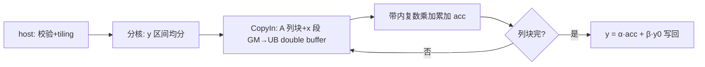

# aclblasChbmv 算子设计文档

# 需求背景（required）

## 需求来源
- 任务名称/批次：2026 年 11 月社区任务 — aclblasChbmv 算子开发（A2A3）。
- 合入目标仓：https://gitcode.com/cann/ops-blas ，算子代码 `blas/sbmv/arch22/`，测试代码 `test/sbmv/chbmv/arch22/`。
- 验收流程：cann-competitions 社区任务流程（任务书 §4 交付件 / §5 PR 申请合入）。

## 背景介绍
### 算子功能定位
- aclblasChbmv 完成单精度复数 Hermitian 带状矩阵-向量乘 `y = alpha·A·x + beta·y`：A 为 n×n Hermitian 带状矩阵（k 条次对角线 + k 条超对角线），x/y 为 n 元素复向量，alpha/beta 为复标量，y 原地覆写。
- 数学公式：`y[i] = α·Σ_j A(i,j)·x[j] + β·y[i]`，j 限于 A 的带内列（UPPER：j∈[i, min(n,i+k+1)]；LOWER：j∈[max(1,i-k), i]，1 基），带外元素视为 0。

### 业界对标
- 对标 cuBLAS `cublasChbmv`（https://docs.nvidia.com/cuda/cublas/index.html#cublas-t-hbmv）：参数序列、返回码、快速返回口径以该文档为唯一依据。
- 语义参考 Netlib `chbmv.f`（https://www.netlib.org/blas/chbmv.f）：列主序带状存储（(k+1)×n 数组）、uplo 选带、对角元素虚部假定为 0（仅实部参与计算）、n=0 quick return、beta=(0,0) 时不读 y 旧值、alpha=(0,0) 按 y=β·y 计算（不保证跳过 A/x 读取）。
- 与实数同族 `aclblasSsbmv`（仓内 blas/sbmv/arch35 与 arch22 均已合入）参数序列一一对应，仅 dtype 由 float 换为 aclblasComplex。

### 工程形态
- 工程模式：Ascend C kernel 直调（host 入口 + 参数校验 + tiling 下发 + device kernel，handle 绑定 stream）。
- 代码落位：`blas/sbmv/arch22/`（chbmv_host.cpp / chbmv_kernel.cpp / chbmv_kernel.h / chbmv_tiling_data.h，与同目录 ssbmv 文件分层一致）；测试落位 `test/sbmv/chbmv/arch22/`。
- 仓内近亲：`blas/sbmv/arch22/ssbmv_*`（实数同族，host 校验链与分核/tiling 骨架直接复用，复数化为实部/虚部双份 float 计算）；`blas/?/arch22/csymv_*`（复数矩阵-向量乘，复数乘加指令用法参考）。
- 复数类型：`aclblasComplex`（ops-blas `include/cann_ops_blas_common.h` L68 定义，实部/虚部各 float32）。

### 接口规格
- **本算子为新增接口**：`include/cann_ops_blas.h` 当前无 `aclblasChbmv` 声明，需按 §2.3 新增（纯追加声明，不修改任何既有声明，无其他 arch/产品线波及）；签名按 cublasChbmv 参数序列，维数参数 int，与同族 `aclblasSsbmv` 口径一致：

```cpp
aclblasStatus_t aclblasChbmv(
    aclblasHandle_t handle,
    aclblasFillMode_t uplo,
    int n, int k,
    const aclblasComplex* alpha,
    const aclblasComplex* A, int lda,
    const aclblasComplex* x, int incx,
    const aclblasComplex* beta,
    aclblasComplex* y, int incy);
```

- 参数规格表（官方栏目）：

| 参数 | 参数含义 | 数据类型 | 支持数据类型 | 约束 | 形状 |
| --- | --- | --- | --- | --- | --- |
| handle | 库上下文句柄（携带 stream），Host 内存 | scalar | - | 非空有效句柄；nullptr 返回 ACLBLAS_STATUS_HANDLE_IS_NULLPTR | - |
| uplo | 带形三角存储模式，Host 内存 | attr | int（枚举） | 仅 ACLBLAS_UPPER / ACLBLAS_LOWER；非法返回 ACLBLAS_STATUS_INVALID_VALUE（任务书 §7-5：统一 INVALID_VALUE，与仓内 csymv 的 INVALID_ENUM 差异由研发后续统一） | - |
| n | 方阵 A 阶数，Host 内存 | scalar | int32 | n≥0；n<0 返回 INVALID_VALUE；n=0 合法 quick return | - |
| k | 带宽（次/超对角线条数），Host 内存 | scalar | int32 | k≥0；k<0 返回 INVALID_VALUE；k>n-1 时按有效带宽 min(k,n-1) 计算 | - |
| alpha | 复标量乘数指针，Host 内存 | scalar | COMPLEX64 | n>0 时 nullptr 返回 INVALID_VALUE；值不校验 | 标量 |
| A | Hermitian 带状矩阵，列主序带状存储于 lda×n 数组，Device 只读 | tensor | COMPLEX64 | 对角虚部假定 0；UPPER 左上 k×k / LOWER 右下 k×k 不被引用；n>0 时 nullptr 返回 INVALID_VALUE | (k+1)×n（lda×n） |
| lda | A 前导维度（列主序），Host 内存 | scalar | int32 | lda≥k+1；不足返回 INVALID_VALUE（k+1 比较在 int64 域，防 INT32_MAX 回绕） | - |
| x | 输入向量，Device 只读 | tensor | COMPLEX64 | 步长访问；n>0 时 nullptr 返回 INVALID_VALUE | 1+(n−1)×\|incx\| |
| incx | x 步长，Host 内存 | scalar | int32 | ≠0 且非 INT32_MIN；(n−1)×\|incx\| 超 int32 返回 INVALID_VALUE（host int64 计算，issue #780/#866） | - |
| beta | 复标量乘数指针，Host 内存 | scalar | COMPLEX64 | n>0 时 nullptr 返回 INVALID_VALUE；=(0,0) 时 y 旧值不必有效 | 标量 |
| y | 输入/输出向量（原地覆写），Device | tensor | COMPLEX64 | beta=(0,0) 不豁免非空要求 | 1+(n−1)×\|incy\| |
| incy | y 步长，Host 内存 | scalar | int32 | 同 incx | - |

### 数学公式
- 与 §3.2 精度判定 golden（cblas_chbmv，CblasColMajor，fp64 真值计算、按 FLOAT32 收窄）同一计算形态；golden 生成按 Hermitian 约束解释 A：对角只取实部、未存储三角共轭对称补全。

# 需求分析（required）

## 需求描述
- 使用 Ascend C 在 Atlas A2/A3（arch22）上以 kernel 直调实现 aclblasChbmv：COMPLEX64 dtype、UPPER/LOWER 全覆盖、任意合法带宽 k（含满带 k=n-1）、正负步长、n=0 quick return，精度按 mixed_tolerance FLOAT32 阈值（实部/虚部分别比对）对齐 cblas_chbmv golden，性能达到 cublasChbmv（910B3 实测）平均单次耗时的 0.8 倍以上。

## 需求拆解

| # | 必须回答 | 本算子结论 |
| --- | --- | --- |
| 1 | 数学定义与可复用的代数量 | Hermitian 带状矩阵-向量乘；复数乘加可拆为实部/虚部各 4 次 float 乘加（α·A·x 逐列贡献 + β·y）；实数同族 ssbmv 的带状寻址与分核方案可整体复用 |
| 2 | 接口原型 | 按 §2.3 新增声明到 include/cann_ops_blas.h（纯追加）；参数序列与 cublasChbmv 一一对应 |
| 3 | 参数规格 | 见接口规格表；异常码：HANDLE_IS_NULLPTR / INVALID_VALUE（含非法 uplo）/ SUCCESS（n=0 quick return） |
| 4 | 支持数据类型 | COMPLEX64（A/x/y 向量与 alpha/beta 标量，实部/虚部各 FLOAT32） |
| 5 | 目标芯片与 arch 映射 | Atlas A2/A3（arch22）；自验精度 910B3 或 A3、性能 910B3；标杆 cublasChbmv 同规模同 dtype |
| 6 | 精度要求 | 实部/虚部分别按 FLOAT32：rtol/atol=2^-13，ratio 0.99，max_abs 1e-2 or 32×ULP（按 golden 动态计算，issue #434 口径）；Inf/NaN 按 §3.2 等效规则；golden=cblas_chbmv fp64 真值收窄 |
| 7 | 性能预期 | msprof op 采集（warmup 5 + 有效采样 ≥10 取平均）≤ GPU 标杆 1.25 倍；标杆取 test_cases/gpu_baseline.csv |
| 8 | 代码架构选型 + 可行性 | 复用 blas/sbmv/arch22/ssbmv 骨架：带状列分核 + UB 内列段乘累加；复数以 float2 (re,im) 拆分计算，Axpy 级向量指令逐列累加 y。已排除死路：整带矩阵一次性载入 UB（k=n-1 满带时 (k+1)×n 内存超 UB，必须按列块流式）；host 侧不逐元素展开共轭对称补全（带宽扫描内存开销大，kernel 按带内寻址直接引用） |
| 9 | 评测来源 | golden：cblas_chbmv（Netlib CBLAS 复数，CblasColMajor）；性能标杆：cublasChbmv（gpu_baseline.csv）；用例：test_cases CSV + GTest 工程 |

# 详细设计（required）

## 算子分析
### 数学公式
- `y[i] = α·Σ_{j∈带(i)} A(i,j)·x[j] + β·y[i]`；带(i) = UPPER 时 [i, min(n,i+k+1)]、LOWER 时 [max(1,i-k), i]（1 基）。
- 带状寻址（1 基）：UPPER 元素 A(i,j) 存于 A(1+k+i-j, j)；LOWER 存于 A(1+i-j, j)。对角元素虚部假定 0，实现仅取实部。

### 支持数据类型
- A/x/y/alpha/beta：COMPLEX64（float32 实部 + float32 虚部）。

### 支持形状
- A：lda×n 带状数组（逻辑 (k+1)×n 引用带）；x/y：长度 1+(n−1)×|inc| 的复向量。
- 退化：n=0 → quick return SUCCESS；k=0 → 纯对角；k≥n → 有效带宽 min(k,n-1)（满带退化）；k+1 的校验比较在 int64 域。

## 算子实现
### 实现方案
#### 总体架构与数据流
- 借鉴 ssbmv 骨架，按 y 元素分核：每核负责一段 y 下标区间，kernel 内沿该区间的带内列扫描 A 的列块并累加。数据流：GM(A 列块, x 向量)→UB→复数乘加（实/虚分离）→累加结果 ×α、与 β·y 融合→GM(y)。
- 两 uplo 变体由 host 侧参数下发（uplo 传入 kernel 或 tiling key 区分带寻址公式），寻址公式不同但流水结构一致。

#### host 侧设计
- **分核策略**：n 按 AIV 核数均分 y 下标区间（均分 + 余块），满足满核原则；k 很大（满带）时每核仍按自身区间做带内列扫描，天然负载均衡。
- **数据分块和内存优化策略**：A 按列块（tile）流式载入 UB，x 按列块对应的下标区间载入；double buffer 覆盖 A 列块搬运与计算；y 初值/终值各一次性读写（β·y 融合进累加链，避免二次遍历）。
- **tilingkey 规划策略**：uplo（UPPER/LOWER）与 beta 是否为零进入 tiling key；n/k 步长等运行时参数走 tiling 结构体。
- **数据检测（校验顺序，逐条对齐任务书 §2.5，#765/#861 口径）**：
  1. handle==nullptr → ACLBLAS_STATUS_HANDLE_IS_NULLPTR（最优先，quick return 不得先于判空）；
  2. n<0 或 k<0 → INVALID_VALUE；
  3. n==0 → 直接返回 SUCCESS（quick return，不访问 alpha/A/x/beta/y）；
  4. uplo 非 {UPPER, LOWER} → INVALID_VALUE；lda<k+1（int64 域比较）→ INVALID_VALUE；
  5. incx==0 / incy==0 / incx 或 incy 为 INT32_MIN → INVALID_VALUE；
  6. (n−1)×|incx|、(n−1)×|incy| 超 int32 表示范围（host int64 计算）→ INVALID_VALUE；
  7. n>0 时 alpha/beta/A/x/y 任一 nullptr → INVALID_VALUE。
- **alpha/beta 处理**：Host 侧同步解引用后写入 tiling 下发；beta=(0,0) 时 kernel 跳过 y 旧值读取（β 项置零）；alpha=(0,0) 不做跳过 A/x 读取的短路（任务书 §2.1-4 口径）。

#### kernel 侧设计
- Init：解析 tiling（n/k/lda/incx/incy/alpha/beta/各核起止下标），SetGlobalBuffer，InitBuffer（A 列块 ×2、x 段 ×2，double buffer）。
- Process：对每核 y 区间逐元素：先载 y 初值乘 β（或置零），再沿带内列扫描——UPPER/LOWER 两套带内寻址宏按 tiling key 编译期二选一——对每列做复数乘加 `acc += a·x`（复数乘法展开为 4 次 float 乘加，A 对角元素仅取实部），最后 `y = α·acc + β·y0` 写回。
- 流程图：



- workspace 布局：无额外 workspace（累加在寄存器/UB 内完成，y 原地覆写）。

#### 性能优化要点（终态）
- 优化项：A 列块 double buffer 流水（搬运与计算重叠）；x 段在核内驻留 UB 复用（同一列块内多 y 元素共享 x 列）；β·y 融合消除 y 二次读写。目标 ≤1.25× cublasChbmv 标杆，实测数据回填自测报告，不预填未经测试数字。
- 未采用路线：整带载入 UB（满带时超容量）；按共轭对称显式补全未存储三角（额外内存与带宽，kernel 直接带内寻址即可）。

## 支持硬件

| 支持的芯片版本 | 涉及 |
| --- | --- |
| Atlas A2/A3 训练系列（910B，arch22） | ✅（本任务目标，自验精度 910B3 或 A3、性能 910B3） |
| Atlas 950PR（arch35） | ❌（本任务不改；arch35 仅有实数 ssbmv） |

## 算子约束限制
- 不支持超出 lda/incx/incy 语义的非连续内存访问；不涉及 broadcast；不要求 dynamic shape（n/k 运行时入参，host tiling 按运行时值适配）。
- 对角元素虚部假定为 0（Hermitian 性质，仅实部参与计算）；未引用三角不读取。
- y 原地覆写，不返回视图；beta=(0,0) 时 y 旧值不必有效但指针仍须非空。
- 异步执行：依赖 handle 绑定 stream，读结果前须同步 stream；alpha/beta 为 Host 标量，Host 侧同步解引用后下发。

# 可维可测分析（required）

## 精度标准/性能标准

| 验收标准 | 描述 | 标准来源 |
| --- | --- | --- |
| 精度标准 | 输出 y 实部/虚部分别按 FLOAT32 判定：rtol=atol=2^-13(1.2e-4)，required_matched_ratio=0.99，max_abs_error_limit=1e-2 or 32×ULP（按 golden 动态计算，issue #434）；golden=cblas_chbmv fp64 真值计算按 FLOAT32 收窄，按 Hermitian 约束解释 A；Inf/NaN 按等效规则单独判定（非有限值不计入统计） | mixed_tolerance_standard（2026-09-24 修订），任务书 §3.2 |
| 性能标准 | COMPLEX64 场景平均单次耗时 ≤ GPU 标杆（cublasChbmv 同规模同 dtype）×1.25；msprof op 采集 task duration（us），warmup 5 + 有效采样 ≥10 取算术平均，仅 SUCCESS 样本计入 | 任务书 §3.3 + test_cases/gpu_baseline.csv |

## 测试概览
- 测试工程：`test/sbmv/chbmv/arch22/` 新建（CSV 用例描述 + C++ GTest 加载执行），文件结构参考主仓 blas 算子测试代码结构。
- 覆盖：uplo 全组合小尺寸基础用例、尺寸扫描（0/1/小质数/2 的幂 ±1/非对齐/大规模）、带宽扫描（k=0/1/小带宽/满带 k=n-1/典型大带宽）、标量特殊值（(0,0)/(1,0)/纯虚/大值）、lda padding、步长组合（±1/±2/±3）、边界与负向（空指针/非法 uplo/非法 lda/负维度/零步长/INT32_MIN 步长）、Inf/NaN 特殊值用例、性能用例。
- 输入生成：均匀分布 [-5,5] 50% + 正态分布（GAUSS_NORM_5_2，μ∈[-5,5]、σ∈[0.1,2]）50%，实部/虚部独立采样；A 按 Hermitian 带状约束填充（任务自带 gen_csv.py 仅均匀分布，正态用例由本任务补齐并在自测报告说明）。
- 性能口径：msprof op，warmup 5 + 有效采样 ≥10 取平均；复现入口见交付件测试 README。

## 兼容性分析
- 唯一公共头改动：`include/cann_ops_blas.h` **追加** `aclblasChbmv` 声明（新增接口，纯追加、不改不删任何既有声明，与任务书 §2.3/§7-3 一致）；无其他 arch/产品线波及，既有接口行为零影响。
- `blas/sbmv/arch22/` 新增 chbmv 文件、`test/sbmv/chbmv/arch22/` 新增测试工程与 CMake 接入，均不影响同目录既有 ssbmv 与 arch35。
- 非法 uplo 返回 INVALID_VALUE 与仓内 csymv 的 INVALID_ENUM 存在口径差异——按任务书 §7-5 执行（已与研发确认），差异由研发后续统一，README 中注明。
