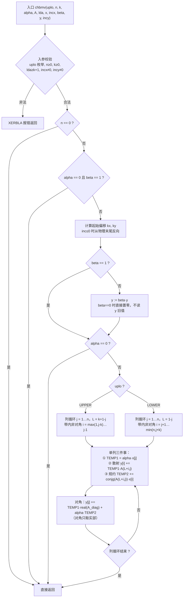
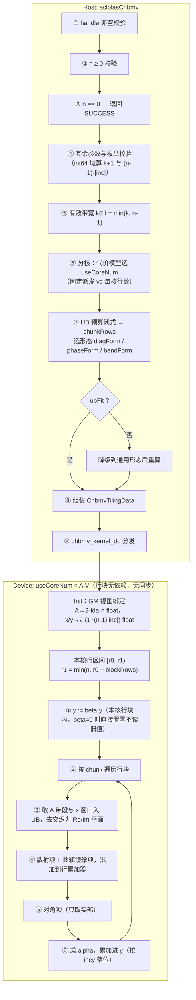
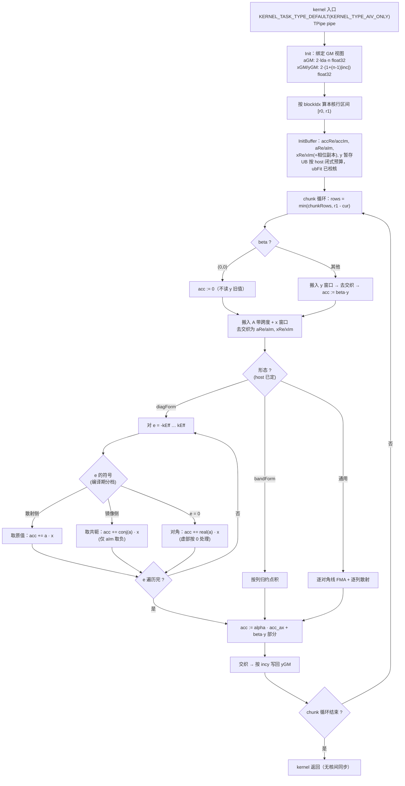

# aclblasChbmv 算子设计文档（Atlas A2/A3）

| 项目 | 内容 |
| --- | --- |
| 算子名称 | `aclblasChbmv` |
| 任务名称 | 11 月社区任务 - aclblasChbmv 算子开发（A2/A3） |
| 目标仓库 | `gitcode.com/cann/ops-blas`，实现目录 `blas/sbmv/arch22/`，测试目录 `test/sbmv/chbmv/arch22/` |
| 适配硬件 | Atlas A2 系列产品（性能测试设备 Atlas 800T A2 / 910B3）、Atlas A3 系列产品 |
| CANN 版本 | 9.1.0 |
| 数据类型 | COMPLEX64（单精度复数，实部/虚部各 float32，内存中实虚交织） |
| 工程模式 | kernel 直调（Ascend C），句柄式 BLAS 接口，handle 绑定 stream |

---

# 一、需求背景

## 1.1 需求来源

通过社区任务完成昇腾算子开源仓（`cann/ops-blas`）的算子贡献：在 Atlas A2/A3 系列产品上以
Ascend C 实现单精度复数 Hermitian 带状矩阵-向量乘算子 `aclblasChbmv`，对齐 cuBLAS
`cublasChbmv` 的功能与参数语义，补齐 ops-blas 仓 Level-2 BLAS 的复数 Hermitian 带状能力
（当前 `blas/sbmv/` 仅有实数档 `ssbmv` 的 arch22/arch35 实现，复数档缺失；
`include/cann_ops_blas.h` 中亦无 `aclblasChbmv` 声明）。

## 1.2 背景介绍

### 1.2.1 aclblasChbmv 实现参考路径

本算子属 BLAS 库函数，**昇腾侧无对应 TBE 单算子实现**（`ai_core/tbe/impl` 下无 `hbmv`/`sbmv`
类算子，算子信息库中亦无对应 OpType）。按社区任务对「无自有 TBE kernel」类算子的要求，
本节改附**标杆实现与仓内同族参考实现**的源码路径，作为 1.2.2.3 baseline 流程图的依据：

1. **标杆语义与 golden 来源**：Netlib BLAS 参考实现 `chbmv.f`（随任务测试包提供的 cblas 复数
   实现，精度 golden 由 `cblas_chbmv` 生成，CBLAS 层以双精度复数 `cblas_zhbmv` 承担 fp64 真值
   计算后按 FLOAT32 收窄落盘）；对标接口文档 cuBLAS `cublasChbmv`（参数序列与本算子一一对应）。
2. **仓内同算子参考实现（实数档、同架构）**——本设计的主要继承对象：
   - `blas/sbmv/arch22/ssbmv_host.cpp`（分核代价模型、UB 预算闭式、三种计算形态的选择、校验顺序）
   - `blas/sbmv/arch22/ssbmv_kernel.cpp`（行块分解、带段搬运与错位对齐、对角线形式的 Gather 组织）
   - `blas/sbmv/arch22/ssbmv_tiling_data.h`（TilingData 结构与形态开关 `bandForm`/`diagForm`/`phaseForm`）
   - `blas/sbmv/arch22/ssbmv_kernel.h`（kernel 入口签名）
3. **仓内 complex64 交织存储的读写参考（arch22）**：
   - `blas/gerc/arch22/cgerc_kernel_impl.h`、`blas/gemv/arch22/cgemv_no_trans_kernel.cpp`
   - `blas/common/helper/complex.h`、`blas/common/helper/kernel_constant.h`
4. **仓内「共轭开关」的既有先例（arch22）**——本算子散射/镜像两侧的直接参照：
   `blas/dot/arch22/cdot_host.cpp` 与 `cdot_kernel.cpp` 以**一个 `isConj` 标志**让
   `cdotu`（不共轭）与 `cdotc`（共轭）复用同一 kernel：host 把 `isConj` 写进 TilingData，
   kernel 内按该标志决定是否对虚部取负。本算子的「同一带元素，散射取原值、镜像取共轭」
   正是同一模式的推广（区别在于本算子两侧同时出现在一次遍历里，故改为按对角线偏移 `e`
   的符号在**编译期**分档，而非运行期标志——见 3.2.2.1）。
4. **测试工程参考**：`test/sbmv/ssbmv/`（`ssbmv_param.h` / `ssbmv_golden.h` /
   `ssbmv_npu_wrapper_impl.h` / `CMakeLists.txt` / `arch22/`）。

### 1.2.2 现状分析

#### 1.2.2.1 标杆支持的数据类型和数据格式

| 项 | 内容 |
| --- | --- |
| 数据类型 | COMPLEX64（`aclblasComplex`，实部/虚部各 float32，**内存中实虚交织**） |
| 数据排布 | ND；A 为列主序**带状存储**，逻辑 `n×n` Hermitian，物理 `lda×n`，`lda ≥ k+1` |
| 向量排布 | x / y 逻辑长度 `n`，物理占位 `1 + (n-1)·|inc|`，`inc ≠ 0` 且可为负 |
| 枚举 | `uplo ∈ {UPPER, LOWER}`，共 2 组（**无 `trans`**：Hermitian 满足 `Aᴴ = A`，`op(A)` 恒为 `A`） |
| 标量 | `alpha`、`beta` 均为 COMPLEX64 |

#### 1.2.2.2 baseline（Netlib `chbmv`）实现描述

1. **入参校验**：依次校验 `uplo / n / k / lda / incx / incy`，任一非法即 `XERBLA` 返回。
2. **快速返回**：`n == 0`，或 `alpha == 0 且 beta == 1`，直接返回。
3. **起始偏移**：`incx <= 0` 时 `kx = 1 - (n-1)·incx`，否则 `kx = 1`；`ky` 同理。
4. **先做 `y := beta · y`**（`beta != 1` 时），`beta == 0` 时直接置零而**不读 y 旧值**。
5. **若 `alpha == 0` 则返回**（此时 A、x 不再被读取）。
6. **主循环按列推进**（以 UPPER 为例，1 基，`L = k + 1 - j`）：对 `j = 1 … n`
   - `TEMP1 = alpha · x[j]`，`TEMP2 = 0`
   - 对 `i = max(1, j-k) … j-1`（本列带内的**非对角**元素）：
     - `y[i] += TEMP1 · A(L+i, j)` ——「**列自身的散射**」
     - `TEMP2 += conjg(A(L+i, j)) · x[i]` ——「**镜像的规约**」，**取共轭**
   - `y[j] += TEMP1 · real(A(k+1, j)) + alpha · TEMP2` ——对角元**只取实部**
7. **LOWER** 对称：先用 `real(A(1,j))` 处理对角，再对 `i = j+1 … min(n, j+k)` 做同样的
   散射 + 共轭规约。
8. 不做任何溢出/特殊值检测，Inf/NaN 按 IEEE-754 传播。

**三条由 baseline 直接读出的语义**，是本设计全部复数改造的依据：

- 每个**非对角**带元素被用两次：一次**原值**（散射到 `y[i]`），一次**共轭**（规约进 `y[j]`）；
- **对角元只取实部**，且只被用一次；
- `beta` 先行、`alpha==0` 提前返回，二者共同决定边界行为。

#### 1.2.2.3 baseline 实现流程图 ⭐



---

# 二、需求分析

## 2.1 外部组件依赖

| 依赖 | 说明 | 适配状态 |
| --- | --- | --- |
| ACL runtime（`acl/acl.h`） | stream / device 内存管理 | 已适配 |
| Ascend C kernel 框架（`kernel_operator.h`） | AIV 向量编程、UB 管理、`DataCopyPad` / `Gather` | 已适配 |
| ops-blas 公共层 | `cann_ops_blas.h`、`cann_ops_blas_common.h`、`common/helper/*` | 已适配 |
| cblas（Netlib BLAS 复数实现） | 精度比对 golden，随任务测试包提供 | 已适配 |

## 2.2 内部适配模块

| 模块 | 说明 |
| --- | --- |
| `aclblasHandle_t` | 携带 stream，通过 `aclblasSetStream` 绑定；本算子读取 `h->stream` |
| `blas/sbmv/arch22/` | 本算子新增 `chbmv_*` 四文件，与既有实数档 `ssbmv_*` **同目录并列** |
| `include/cann_ops_blas.h` | **新增** `aclblasChbmv` 接口声明，供其他产品线共用（禁止私有平行 API） |
| `test/sbmv/chbmv/arch22/` | 新建 CSV 驱动的 GTest 测试工程 |

## 2.3 需求模块设计

### 2.3.1 AscendC 算子原型

与 cuBLAS `cublasChbmv` 参数序列一一对应（无额外映射），维数参数采用 `int`，与仓内同族实数
接口 `aclblasSsbmv` 口径一致：

```cpp
aclblasStatus_t aclblasChbmv(
    aclblasHandle_t handle,
    aclblasFillMode_t uplo,
    int n, int k,
    const aclblasComplex* alpha,
    const aclblasComplex* A, int lda,
    const aclblasComplex* x, int incx,
    const aclblasComplex* beta,
    aclblasComplex* y, int incy);
```

| 参数 | 输入/输出 | 类型 | dtype | 排布 | shape | 值域 | 异常行为 |
| --- | --- | --- | --- | --- | --- | --- | --- |
| handle | 输入 | scalar | - | - | - | 有效句柄 | nullptr → `HANDLE_IS_NULLPTR` |
| uplo | 输入(attr) | scalar | int | - | - | `{UPPER, LOWER}` | 非枚举 → `INVALID_VALUE` |
| n | 输入 | scalar | int | - | - | `n ≥ 0` | `n < 0` → `INVALID_VALUE`；`n = 0` 合法 quick return |
| k | 输入 | scalar | int | - | - | `k ≥ 0` | `k < 0` → `INVALID_VALUE`；`k > n-1` 按有效带宽 `min(k, n-1)` 计算 |
| alpha | 输入 | scalar | COMPLEX64 | - | - | FLOAT32 全集 | `n>0` 且 nullptr → `INVALID_VALUE` |
| A | 输入 | tensor | COMPLEX64 | ND | `lda × n`（带状列主序） | FLOAT32 全集 | `n>0` 且 nullptr → `INVALID_VALUE` |
| lda | 输入 | scalar | int | - | - | `lda ≥ k+1` | 不满足 → `INVALID_VALUE`（**`k+1` 在 int64 域计算比较**，避免 `k = INT32_MAX` 时 int32 回绕使校验穿透） |
| x | 输入 | tensor | COMPLEX64 | ND | 逻辑 `n`，物理 `1+(n-1)·|incx|` | FLOAT32 全集 | `n>0` 且 nullptr → `INVALID_VALUE` |
| incx | 输入 | scalar | int | - | - | `incx ≠ 0` 且 ≠ `INT32_MIN` | 违反 → `INVALID_VALUE`；`(n-1)·|incx|` 超 int32 → `INVALID_VALUE`（host 侧 int64 计算） |
| beta | 输入 | scalar | COMPLEX64 | - | - | FLOAT32 全集 | `n>0` 且 nullptr → `INVALID_VALUE` |
| y | 输出(原地) | tensor | COMPLEX64 | ND | 逻辑 `n`，物理 `1+(n-1)·|incy|` | FLOAT32 全集 | `n>0` 且 nullptr → `INVALID_VALUE`（**`beta=(0,0)` 只表示旧值不必有效，不豁免非空**） |
| incy | 输入 | scalar | int | - | - | 同 incx | 同 incx |

**返回值**：`aclblasStatus_t`，语义与 `include/cann_ops_blas_common.h` 一致
（`SUCCESS`(0) / `INVALID_VALUE`(3) / `HANDLE_IS_NULLPTR`(9) / `INVALID_ENUM`(10)）。

### 2.3.2 AscendC 算子相关约束

与 baseline（Netlib `chbmv` / cuBLAS `cublasChbmv`）相比**无功能缺失**，2 组 `uplo`、
正负步长、`k=0`、满带 `k=n-1`、`k>n-1` 退化、`lda` padding、`n=0` 全部支持。
仅有如下与 baseline 一致的「非功能」差异：

| 项 | baseline | 本算子 | 说明 |
| --- | --- | --- | --- |
| 浮点累加顺序 | 顺序累加 | 向量化累加 | 任务书 §2.5「确定性计算：不要求」，误差在 §5.3 精度标准内 |
| `alpha=(0,0)` 的短路 | 提前返回、不读 A/x | **不保证跳过 A/x 读取** | 任务书 §2.1-4 明确不要求短路；因此含 Inf/NaN 的 x 用例不与 `alpha=(0,0)` 组合（任务书给定约束） |
| 非连续访存 | 仅 `lda`/`inc` 语义 | 同 | 任务书 §2.5 明确不要求超出该语义的非连续访问 |
| 非法 `uplo` 状态码 | — | `INVALID_VALUE` | 任务书 §7.5 已与研发确认；仓内复数同族 `aclblasCsymv` 当前返回 `INVALID_ENUM`，差异由研发后续统一，**本算子以任务书为准** |

## 2.4 数学模型与依赖方向

计算 `y = alpha · A · x + beta · y`，`A` 为 `n×n` Hermitian 带状矩阵（`Aᴴ = A`）。

**带状存储下标换算（0 基）**：

| uplo | 被引用元素范围 | `A(i,j)` 的存储位置 | 对角元位置 |
| --- | --- | --- | --- |
| UPPER | `max(0, j-k) ≤ i ≤ j` | `AB[(k + i - j) + j·lda]` | `AB[k + j·lda]` |
| LOWER | `j ≤ i ≤ min(n-1, j+k)` | `AB[(i - j) + j·lda]` | `AB[j·lda]` |

未存储的另一半由 **共轭对称** 补全：`A(j,i) = conj(A(i,j))`。
UPPER 时数组左上 `k×k`、LOWER 时数组右下 `k×k` 不被引用。

**依赖方向——本算子与求解类（如 `ctbsv`）的根本区别**：

`y[r]` 只依赖 `A` 的第 `r` 行带内元素与 `x` 的对应窗口，**输出行之间没有依赖**。
因此本算子**可以跨核按输出行并行**，不存在串行链；这与 ops-blas 仓内求解类算子
（`trsv`/`tbsv`，`n` 步严格串行、只能单核）完全不同，也是本设计能继承 `ssbmv`
多核行块分解的前提。

**每个存储元素被用两次（共轭差异）**：对非对角元 `A(i,j)`（`i ≠ j`）

```
散射：y[i] += alpha · A(i,j)      · x[j]      （原值）
镜像：y[j] += alpha · conj(A(i,j)) · x[i]      （共轭）
```

两条路径读**同一个 GM 地址**，仅虚部符号相反。对角元 `A(j,j)` 只被用一次且**只取实部**：
`y[j] += alpha · real(A(j,j)) · x[j]`。

## 2.5 边界与负向行为（对齐 cuBLAS）

**校验顺序（任务书 §2.5 冻结，#765/#861 维护者拍板口径，不得自行调整）**：

```
handle 非空 → n ≥ 0 → n == 0 直接返回 SUCCESS → uplo / k / lda / incx / incy / alpha / beta / A / x / y
```

注意两点：`handle` 判空**最优先**；`n == 0` 的 quick return **不得先于 handle 判空**，但**先于**
其余一切校验（因此 `n=0` 叠加非法 uplo/k/lda/incx/空指针仍返回 `SUCCESS`）。

| 场景 | 期望返回 | 说明 |
| --- | --- | --- |
| `handle == nullptr` | `HANDLE_IS_NULLPTR` | 最先校验，优先于 `n == 0` |
| `n == 0`（含叠加任何非法参数） | `SUCCESS` | 合法 quick return，不执行计算 |
| `n < 0` / `k < 0` | `INVALID_VALUE` | - |
| `lda < k+1` | `INVALID_VALUE` | `k+1` 在 int64 域比较 |
| `incx == 0` / `incy == 0` | `INVALID_VALUE` | - |
| `incx/incy == INT32_MIN` | `INVALID_VALUE` | 取负溢出 |
| `(n-1)·|inc|` 超 int32 表示范围 | `INVALID_VALUE` | host 侧 int64 计算（issue #780/#866 口径） |
| 非法 `uplo`（如 999） | `INVALID_VALUE` | 见 2.3.2 末行 |
| `n > 0` 且 `alpha/beta/A/x/y` 为 nullptr | `INVALID_VALUE` | `beta=(0,0)` 不豁免 `y` 的非空要求 |
| `beta == (0,0)` | `SUCCESS` | **不读 y 旧值**（旧值可为 NaN/Inf 而不影响结果） |
| `alpha == (0,0)` | `SUCCESS` | 按 `y = beta·y` 计算；**不保证**跳过 A/x 读取 |
| `k > n-1` | `SUCCESS` | 按有效带宽 `min(k, n-1)` 计算 |
| x/y 含 Inf/NaN | 按 IEEE-754 传播 | 判定按任务书 §3.2 的 Inf/NaN 规则 |

## 2.6 需求拆解

1. 实现 `aclblasChbmv` 句柄式接口与 arch22 kernel，覆盖 2 组 `uplo`；
2. 支持 `incx`/`incy` 正负步长、`k ∈ [0, n-1]`（含 `k=0`、满带、`k>n-1` 退化）、`lda` padding；
3. 完成 2.5 全部边界与负向行为，校验顺序严格按冻结口径；
4. 精度满足 §5.3 COMPLEX64 标准（golden = `cblas_chbmv`，实部/虚部分别判定）；
5. 性能满足 §5.4 逐 case `≤ gpu_ms / 0.8`；
6. 交付算子 README、`include/cann_ops_blas.h` 接口声明、CSV 驱动测试工程、
   `task_submission/` 七件套。

---

# 三、需求详细设计

## 3.1 使能方式

kernel 直调：`aclblasChbmv`（host）完成校验、快速返回、tiling 组装与形态选择 →
`chbmv_kernel_do` 按 `uplo` 与形态分发到模板实例化的 kernel → 通过 `h->stream` 异步下发。
不经过 aclnn 两段式，读回 device 结果前需同步 stream。

## 3.2 需求总体设计



### 3.2.1 host 侧设计

#### 3.2.1.1 分核策略

**本算子按输出行切分到多个 AIV 核，一行只由一个核写——因此不需要 atomic，也不需要 workspace。**

依据：

- 2.4 已说明输出行之间**无依赖**；核 `b` 拥有行区间 `[r0, r1)`，`r1 = min(n, r0 + blockRows)`；
- 一个带元素虽被用两次（散射 + 共轭镜像），但**两次都由拥有对应输出行的核自己算**，
  代价是 A 最多被读两遍，换来的是**零核间同步**；
- `blockRows` 恒为向量对齐宽度的整数倍，保证每核的写区间不跨越对齐边界，无需读改写。

**核数不取设备上限。** 每个 block 有固定派发成本，而每核的工作量在行数不超过一条向量指令的
lane 数之前并不随行数增长。因此核数取「每核至少 `CHBMV_ROWS_PER_CORE` 行」与设备 AIV 数的较小者：

```
useCoreNum = min(n, min(aivCoreNum, ceil(n / CHBMV_ROWS_PER_CORE)))
```

对带较宽的情形，另用一个**代价模型**在 `1 … cap` 上取最小值（与 `ssbmv` 的
`CalSsbmvDiagCoreNum` 同构，常数按复数重新标定）：

```
cost(cores) = CORE_FIXED_US · cores
            + PASS_ITER_US · (2·kEff + 1) · ceil(rowsPerCore / VEC_LANES)
            + bytes / min(BW_PER_CORE · cores, BW_CAP)
```

其中 `bytes = n·lda·8 + n·16`（复数 8 字节/元素，x 与 y 各一份）。
`CORE_FIXED_US`（实数档实测 0.40 µs/核）是本算子最关键的常数——见 §5.4 的预算核算：
4 条判据用例的达标线只有 12 ~ 66 µs，**多开一个核就要付 0.40 µs**，`n=512` 档若按 64 行/核
开 8 个核，仅派发就吃掉 3.2 µs / 12.35 µs ≈ 26% 的预算。常数需在本算子上重新实测标定
（复数档的每核工作量约为实数档的 2~4 倍，最优核数会上移）。

#### 3.2.1.2 数据分块和内存优化策略

**继承 `ssbmv` 的三种计算形态，按 UB 预算与 `kEff/blockRows` 的比例选择：**

| 形态 | 做法 | 适用条件 | 复数档的变化 |
| --- | --- | --- | --- |
| 通用（默认） | 每条对角线一次向量 FMA；散射走逐列 `DataCopyPad` + `leftPadding` 错位 | 兜底 | 散射与镜像分别用原值/共轭 |
| `diagForm` | 整条带按 `2·kEff+1` 条错位对角线累加，`y[r] += A[r·lda + C_e] · x[r+e]`；A 侧等步长 `lda` 一次 Gather，x 侧连续切片 | 整段带 `lda·(chunkRows + kEff)` 能进 UB | **此形态下散射与镜像合并为同一组对角线遍历**：`e > 0` 与 `e < 0` 的两条对角线读的是同一批存储元素的两种用法，共轭只作用于其中一侧 |
| `phaseForm` | x 窗口按对齐宽度错位各存一份，使每条对角线的 x 操作数都是对齐连续切片 | 与 `diagForm` 叠加 | 相位副本份数按**复数**对齐宽度重算（见下） |
| `bandForm` | 按列走带、逐列归约点积 | `kEff >> blockRows` | 规约侧要分别对 Re/Im 归约 |

**complex64 带来的三处重算：**

1. **对齐粒度**：32 B = **4 个 complex64**（实数档是 8 个 float32）。所有 padding、
   `blockRows` 的对齐倍数、相位副本份数都按 4 重算。本设计在 kernel 内部统一采用
   **「float32 视角」**：把 `aclblasComplex` 数组视为 `2n` 个 float32，对齐宽度仍是 8 float32，
   但**一个逻辑元素占 2 lane**，这一点贯穿全部 tiling 计算，不与「复数视角」混用。
2. **UB 字节翻倍**：同样行数的缓冲，复数档字节数是实数档的 2 倍，故同等 UB 下
   `chunkRows` 约减半，`diagForm` 的可用范围相应收窄。UB 预算采用与 `ssbmv` 同构的闭式，
   逐项把 host 要分配的每个 buffer 都计入，算不下就把 `ubFit` 置 0、**host 直接拒绝下发**，
   不把越界的 UB 分配带进 kernel。
3. **实虚分离**：向量复数乘需要 Re/Im 分离。A 的带段按 `Gather`/`GatherMask` 分离为
   `aRe/aIm`；x、y 的窗口在进入 chunk 时去交织、离开时交织写回。
   **`GatherMask` 为 repeat 粒度（每 repeat 固定 256 B = 64 个 float32）**，故 UB 上的带段缓冲
   长度按 64 个 float32 向上对齐、尾部按整 repeat 处理，避免槽位不整导致的静默越界写。

**共轭的实现代价为零**：镜像侧只需对 `aIm` 取负（`Muls(aIm, aIm, -1.0f)`，或在复数乘的
符号组合中直接体现），**不改变任何访存结构**。这是 `ssbmv` 的分解能够原样继承的关键。

#### 3.2.1.3 tilingKey 规划策略

分两层：**编译期模板**（消除内层循环的分支）+ **运行期形态开关**（UB 预算分流）。

**编译期**：`ChbmvKernel<UPLO>`，`UPLO ∈ {UPPER, LOWER}` → **2 个 kernel 实例**，
由 `chbmv_kernel_do` 按枚举分发。带状下标换算、对角位置、散射/镜像的方向全部在编译期确定。
（本算子无 `trans`/`diag` 枚举，实例数远少于 `ctbsv` 的 12 个。）

**运行期形态开关**（写入 TilingData，与 `ssbmv` 同名以便对照审阅）：

| 字段 | 含义 | 选择依据 |
| --- | --- | --- |
| `diagForm` | 行-对角形式，无散射 | 整段带能进 UB |
| `phaseForm` | x 相位副本，省掉每 pass 一次 Gather | 与 `diagForm` 叠加且 UB 还有余量 |
| `bandForm` | 按列归约 | `kEff` 远大于行块 |
| `spanExt` | chunk 的带跨度也覆盖散射读的列，散射可从 UB 取 | 该跨度能进 UB |
| `ubFit` | host 的 UB 预算校核结果 | 0 时拒绝下发 |

### 3.2.2 kernel 侧设计

#### 3.2.2.1 kernel 侧实现描述

与 1.2.2.2 baseline 的步骤逐条对应：

| baseline 步骤 | AscendC 实现 | 对应关系 |
| --- | --- | --- |
| ① 入参校验 | host `ValidateChbmvArgs` | 前移到 host，kernel 内无校验 |
| ② 快速返回 | host（`n==0`；`alpha==0 && beta==1` 可选短路） | 一致 |
| ③ 起始偏移 `kx/ky` | `Offset(idx, inc, n) = inc ≥ 0 ? idx·inc : (n-1-idx)·(-inc)` | 等价闭式 |
| ④ `y := beta·y` | **并入行块的第一遍**：本核对自己的 `[r0,r1)` 做 `beta·y`，`beta=0` 时直接置零不读旧值 | 由全局一遍改为各核各做自己那段，省一次全量往返 |
| ⑤ `alpha==0` 返回 | 不短路（任务书允许），`alpha` 在最后统一乘入 | 见 2.3.2 |
| ⑥ 列循环的散射 + 共轭规约 | **改为行块遍历**：每个输出行累加「本行作为散射目标」与「本行作为镜像目标」两类贡献 | **循环重组**，见差异点 1 |
| ⑦ 对角只取实部 | 编译期已知对角在带内的行号（UPPER `t=kEff`、LOWER `t=0`），单独一条向量 pass，只读 Re | 一致 |

**单 chunk 的计算（`diagForm`，0 基，`rows` 为本 chunk 行数）**：

1. 把本 chunk 需要的带跨度 `lda·(rows + kEff)` 与 x 窗口 `rows + 2·kEff` 搬入 UB，去交织成
   `aRe/aIm`、`xRe/xIm`；
2. 累加器 `accRe/accIm` 置为 `beta·y` 的结果（或 0）；
3. 对每个偏移 `e ∈ [-kEff, kEff]`：
   - A 侧取第 `e` 条对角线（等步长 `lda`，一次 Gather），x 侧取连续切片 `x[r+e]`；
   - `e` 的符号决定取原值还是共轭：以 UPPER 为例，`e ≤ 0` 的一侧取原值（散射方向），
     `e > 0` 的一侧取共轭（镜像方向），`e = 0` 为对角、**只取 Re**；
   - 复数乘累加：`accRe += aRe·xRe ∓ aIm·xIm`，`accIm += aRe·xIm ± aIm·xRe`
     （`±` 由共轭与否决定，编译期常量，不在循环内判断）；
4. 乘 `alpha`：`y = alpha·acc + (已在步骤 2 计入的 beta·y)`；
5. 交织后按 `incy` 写回 GM。

**无效 lane 的处理**：对角线在行块首尾会越出 `[0, n)`，`phaseForm` 的相位副本头尾**预清零**，
使无效 lane 读到 0；与 A 侧清零相乘仍是 0，**不会把 NaN 带进结果**——这一点对本任务尤其重要，
因为测试用例含 Inf/NaN 填充，越界 lane 若读到垃圾会污染整行的判定。

#### 3.2.2.2 AscendC 实现流程图 ⭐



#### 3.2.2.3 AscendC 流程图与 baseline 流程图的差异点和原因 ⭐

| # | baseline（Netlib `chbmv`） | AscendC（本设计） | 原因 |
| --- | --- | --- | --- |
| 1 | **按列**循环：每列做一次散射 + 一次规约，`y` 被反复读改写 | **按输出行块**循环：每个核独占一段 `y`，一次写定 | 列循环下同一个 `y[i]` 会被 `k+1` 个不同列更新，跨核切列必须 atomic 或 workspace 归约；改为行块后**一行只由一个核写**，零同步、零 workspace。代价是 A 最多读两遍，而 §5.4 显示本算子远不在带宽墙上（最大用例仅 33 GB/s），这笔交换是划算的 |
| 2 | 单列内对 `≤ k+1` 个元素**逐个标量**乘加 | 单 pass **一次向量运算**覆盖整条对角线上的 `rows` 个元素 | CPU 上标量即峰值；AIV 上标量取数代价高。`diagForm` 下每 chunk 只有约 `3 × (2k+1)` 条向量指令，且 pass 循环内**无跨流水同步** |
| 3 | 每个带元素读两次（原值 + `conjg`），都走标量 | 两次用法仍读同一 GM 地址，**共轭只对 `aIm` 取负** | 共轭不改变访存结构，这是能原样继承 `ssbmv` 行块分解的关键判断 |
| 4 | 复数按 `complex` 标量类型直接运算 | 实虚**去交织**为两个 float32 平面后做 4 次 `Mul` + `Add/Sub` | AIV 向量指令面向同类型连续元素，交织布局无法直接做复数乘 |
| 5 | `y := beta·y` 作为**全局前置一遍** | 并入各核行块的第一步 | 省掉一次 `y` 的全量 GM 往返；`beta=(0,0)` 时直接置零、不读旧值（语义一致） |
| 6 | x 每列重复读 | x 窗口按 chunk 驻留 UB，`phaseForm` 下再按对齐错位存若干份 | 省掉每 pass 一次 Gather；Gather 的开销显著高于普通向量指令 |
| 7 | `uplo` 运行期分支 | **编译期模板 2 实例** | 内层循环体执行次数与 `n·k` 同阶，运行期分支每次都要付判断与取指代价 |
| 8 | 单线程顺序执行 | 多 AIV 并行行块，**核数由代价模型决定而非取设备上限** | 达标线只有 12 ~ 66 µs，每核固定派发约 0.40 µs，核开多了直接吃掉预算（§5.4） |
| 9 | 对角元 `real(A(j,j))` | 单独一条 pass，只读 Re 平面 | 语义一致；实现上要保证对角**不被共轭、也不被算两次**（它同时落在散射与镜像的交界 `e=0` 上） |

#### 3.2.2.4 专题：对角元与「用两次」的边界

本算子最容易出错的地方不是复数乘，而是**对角元的归属**。`e = 0` 这条对角线同时是散射侧
（`i = j`）与镜像侧（`j = i`）的边界，若按「非对角元用两次」的通则处理，对角元会被
**累加两次且其中一次被共轭**，结果等于 `2·real(A_jj)`——在均匀分布用例上误差不大、
容易漏过小尺寸用例，但在 `k=0`（纯对角阵）用例上会直接翻倍，暴露得最明显。

设计上的保证：`e = 0` 在编译期就是独立的一档（见 3.2.2.2 流程图 D5 分支），
只做 `acc += real(a) · x`，既不进散射档也不进镜像档。
`k = 0` 的用例因此成为该逻辑的**定向验证用例**，在 §5.2 中单列。

## 3.3 支持硬件

| 支持的芯片版本 | 勾选 | SocVersion | 架构目录 |
| --- | --- | --- | --- |
| Atlas A2 训练系列 / Atlas 800I A2 推理系列 | √ | `ascend910b`（910B3 / 910B4） | `arch22` |
| Atlas A3 训练系列 / Atlas 800I A3 推理系列 | √ | `ascend910_93` | `arch22` |

算子 README 的产品支持表按上表标注「支持」；接口声明放入 `include/cann_ops_blas.h` 供其他产品线共用。

## 3.4 算子约束限制

| 约束项 | 内容 |
| --- | --- |
| dtype | 仅 COMPLEX64（本任务范围）；实数档由既有 `ssbmv` 承担 |
| 数据格式 | 仅 ND，A 为列主序带状存储；不支持其他 format |
| 非连续 Tensor | 仅支持 `lda` / `incx` / `incy` 语义内的跨步 |
| broadcast | 不涉及 |
| dynamic shape | `n`/`k`/`lda`/`incx`/`incy` 均为运行期入参，由 host tiling 支持 |
| 原地与重叠 | `y` 原地读写；**A/x 与 y 不允许内存重叠**（重叠行为未定义） |
| 确定性计算 | 不保证逐位一致（任务书 §2.5 明确不要求） |
| Hermitian 假设 | 对角元虚部**假定为 0**，实现只取实部；调用方传入非零虚部时行为与 baseline 一致（同样忽略） |
| UB 上限 | 由 host 闭式预算逐项校核，`ubFit = 0` 时拒绝下发并降级形态 |

---

# 四、特性交叉分析

## 4.1 枚举 × 形状 × 带宽 × 步长 交叉覆盖

| 维度 | 取值 | 交叉说明 |
| --- | --- | --- |
| uplo | UPPER / LOWER | 决定带内下标换算与对角位置（`t=kEff` vs `t=0`）；随包用例 UPPER 507 / LOWER 490 |
| n | 0, 1, 小质数, 2^p, 2^p±1, 非对齐值 … 2048（精度）/ 4096（性能） | `n=0` 走 quick return；`n=1` 单元素；非对齐值验证尾块与 pad |
| k | 0, 1, 小带宽, 满带 `n-1`, 典型大带宽, `k > n-1` | `k=0` 是**对角元逻辑的定向验证**（见 3.2.2.4）；满带验证 UB 预算边界与形态降级 |
| lda | 紧凑 `k+1` / padding `k+1+{1,4,8,16}` | 验证列间跨步不破坏对角线等步长 `lda` 的 Gather |
| incx / incy | ±1, ±2, ±3 全组合（72 条） | 负步长验证反向落位；非 1 步长验证去交织/交织的跨步读写 |
| alpha / beta | 0 / 1 / -1 / 复数 / 纯虚数 / 大值 | `beta=(0,0)` 不读 y 旧值；`alpha=(0,0)` 不短路 |
| 填充 | 均匀 `[-5,5]` / **正态 μ∈[-5,5] σ∈[0.1,2]** / 全零 / 交替 / 极端 / Inf / NaN | 正态档需自行补齐（§5.2） |

**关键交叉风险点**：

1. `k = 0`：对角元被算两次的缺陷在此暴露最明显（3.2.2.4），必须有定向用例；
2. `k = n-1`（满带）+ 大 `n`：UB 预算边界，`diagForm` 应降级到 `bandForm`，验证降级路径真的被走到；
3. `lda` padding + `diagForm`：对角线等步长为 `lda`，padding 只改变步长值不改变「等步长」性质，需用例实证；
4. 负步长 + `n=1`：`Offset(0)` 正负步长一致，需边界用例；
5. Inf/NaN 填充 + 行块首尾越界 lane：相位副本预清零是否真的生效（3.2.2.1 末段），
   否则越界 lane 会把 NaN 带进本应有限的行；
6. `n=0` 叠加非法参数：校验顺序必须让 quick return 先于除 handle 外的一切校验。

## 4.2 兼容性分析

| 项 | 说明 |
| --- | --- |
| 接口兼容 | 新增接口，无既有接口变更；声明加入 `include/cann_ops_blas.h`，不影响其他算子 |
| 目录兼容 | 新增文件与既有 `blas/sbmv/arch22/ssbmv_*` **同目录并列**，不改动实数档 |
| 架构兼容 | arch22 覆盖 A2（`ascend910b`）与 A3（`ascend910_93`）；arch35/950 不在本任务范围 |
| CANN 版本 | 目标 CANN 9.1.0；仅使用通用 AIV 向量接口与 `DataCopyPad` / `Gather`，不使用 arch35 专有通路 |
| 数据兼容 | `aclblasComplex` 交织布局与仓内既有复数算子（`cgerc` / `cgemv`）一致 |
| 状态码 | 非法 `uplo` 返回 `INVALID_VALUE`，与同族 `aclblasCsymv` 的 `INVALID_ENUM` 暂不一致，**以任务书为准**（§2.3.2） |

## 4.3 风险与规避

| 风险 | 影响 | 规避措施 |
| --- | --- | --- |
| 对角元被算两次 / 被共轭 | 精度用例 FAIL，且在大 `k` 上不易察觉 | `e=0` 编译期独立分档（3.2.2.4）；`k=0` 定向用例 |
| 核数开多，派发吃掉预算 | 性能不达标（这是本算子的**主要**性能风险） | 核数走代价模型而非设备上限；`CORE_FIXED_US` 在本算子上重新实测标定（§5.4） |
| 复数档 UB 翻倍导致 `diagForm` 失效面变大 | 退化到慢形态 | host 闭式逐项预算 + `ubFit` 守卫 + 形态降级链 |
| `GatherMask` 槽位不整 | 静默越界写、结果错乱且难定位 | UB 带段缓冲按 64 个 float32（1 repeat = 256 B）向上对齐，尾部按整 repeat 处理 |
| 向量操作数未 32 B 对齐 | aivec 异常（运行期崩溃） | 所有 UB buffer 起址按 32 B 对齐；UB 偏移非 8 倍数时用掩码而非偏指针 |
| 越界 lane 把 NaN 带进结果 | Inf/NaN 用例误判 | 相位副本与 A 侧清零（3.2.2.1 末段），并用 Inf/NaN 用例实证 |
| 910B3 为共享设备 | 性能数据被并发污染 | 性能采集全程持 NPU 互斥锁独占，计时前做连续空闲采样 |
| `msprof op` 默认只采第 1 次 launch | **性能判据整体翻盘** | 见 §5.4 的采集纪律，显式设 `--launch-count` |

---

# 五、可维可测分析

## 5.1 可维护性

- 文件结构对齐仓内同族算子，**不引入冗余文件**（对照 `ssbmv` 的 4 文件结构）：

  ```
  blas/sbmv/arch22/
  ├── chbmv_host.cpp          # 接口 + 校验 + 快速返回 + 分核/UB 预算 + TilingData + 分发
  ├── chbmv_kernel.cpp        # 2 组模板实例 + chbmv_kernel_do
  ├── chbmv_kernel.h          # kernel 入口声明
  └── chbmv_tiling_data.h     # ChbmvTilingData POD + 形态开关常量
  test/sbmv/chbmv/arch22/     # CSV 驱动 GTest 工程（含 chbmv_test.csv）
  ```

  与既有 `ssbmv_*` 四文件**同目录并列**，不改动实数档。
- 带状下标换算集中在 `chbmv_kernel.h` 的单一函数，与 `ssbmv` 同构，便于对照审阅；
- 形态开关字段与 `ssbmv_tiling_data.h` **同名**（`diagForm`/`phaseForm`/`bandForm`/`spanExt`/`ubFit`），
  审阅者可直接对照实数档；
- 无硬编码 SocVersion / 核数 / UB 大小：核数与 UB 由平台接口查询，预算走闭式。

## 5.2 测试设计

使用 ops-blas 仓 `test/` 测试框架：CSV 描述用例 → C++ GTest 工程加载 CSV → 调用
`aclblasChbmv` → golden 由 `cblas_chbmv` 生成并逐元素比对（实部/虚部分别）。
随任务测试包已提供 **1200 条**用例（精度 1000 + 性能 200，固定种子 `20261028`，同种子逐字节一致）：

| 层级 | 前缀 | 条数 | 覆盖内容 |
| --- | --- | --- | --- |
| L0 基础 | `TC_L0` | 6 | uplo × 小尺寸 (4,8,12)，k=1 |
| L1 尺寸/带宽 | `TC_SQ` | 90 | 23 种尺寸 × uplo + 20 组 (n,k) × uplo + `k>n-1` 退化 |
| L2 标量 | `TC_AB` | 16 | 8 组 alpha/beta（0/1/-1/复数/纯虚数）× uplo |
| L4 前导维 | `TC_LD` | 12 | `lda = k+1+pad`（pad=1/4/8/16）× uplo |
| L4 步长 | `TC_INC` | 72 | `incx × incy ∈ ±1/±2/±3` 全组合 × uplo |
| L5 填充 | `TC_FL` | 18 | 均匀 / 全零 / 交替 / 极端 / Inf / NaN（a、x、y 分别） |
| L5b 覆盖 | `TC_CV` | 16 | 中等尺寸（10~400），`k = n/2` × uplo |
| L6 边界 | `TC_ED` | 33 | 零维（含叠加非法参数）/ alpha=0 或 beta=0 / 空指针 / 非法 uplo / 非法 lda / 负维度 / 负 k / 零步长 / `INT32_MIN` 步长 / 跨度溢出 |
| EX 扩展 | `TC_EX` | 737 | 尺寸池 × 带宽 × uplo × 标量 × 步长 × padding 确定性采样 |
| PF 性能 | `TC_PF` | 200 | 4 条典型 case + 小尺寸 + 阶数对数扫描 + `n=2048` 带宽扫描 |

**本设计额外要求补齐的三项**（随包未覆盖，任务书要求）：

1. **正态分布用例**：随包 `gen_csv.py` 默认只生成均匀分布 `RANDOM_NORM_5_5`，
   而任务书 §3.5-3 要求均匀/正态**各 50%**（`GAUSS_NORM_5_2`，μ∈[-5,5]、σ∈[0.1,2]）。
   通过 `--dist mixed` 开关或单独补充 CSV 实现，补齐方式、数量与覆盖写入自测报告。
2. **`handle` 空指针用例**：列序按 §2.3 去掉了 handle，**CSV 无法表达**，由测试工程在
   参数装配层另做接口单测，期望 `HANDLE_IS_NULLPTR`。
3. **负向用例的缓冲分配**：`INT32_MIN` 步长与跨度溢出用例**不得**按 `(n-1)·|inc|` 预分配 x/y，
   否则元素数在 int32 域溢出、测试工程自身分配失败而误判接口行为；须用单元素 dummy 或
   `NULLPTR` 占位，由接口在读数据前返回预期错误码即判定通过。

**定向用例**：`k = 0` 作为 3.2.2.4 对角元逻辑的验证用例单列于报告。

## 5.3 精度标准

golden 由 `cblas_chbmv` 单标杆生成（`CblasColMajor`，输入转 float64 真值计算、按输出 FLOAT32
收窄落盘；CBLAS 层以 `cblas_zhbmv` 承担 fp64 计算）。golden 须按 Hermitian 约束解释 A：
**对角只取实部、未存储的带形三角按共轭对称补全**。对输出向量 `y`（逻辑长度 `n`，含步长位置）
**全量验证，实部、虚部分别比对**：

| 数据类型 | rtol | atol | required_matched_ratio | max_abs_error_limit |
| --- | --- | --- | --- | --- |
| COMPLEX64（实/虚各按 FLOAT32 判） | 2⁻¹³ (1.22e-4) | 2⁻¹³ (1.22e-4) | 0.99 | 1e-2 或 32 × ULP |

- 逐元素通过条件：`|actual - golden| ≤ atol + rtol × |golden|`；
- 用例通过条件：`matched_ratio ≥ 0.99` **且** `max_abs_error ≤ max_abs_error_limit`；
  `32×ULP` 按最大误差点的 golden 值**动态计算**（生态标准 2026-09-24 修订口径，issue #434）。
- **Inf/NaN 规则**（任务书 §3.2）：golden 与 actual 同为 NaN、同为同号 Inf，或一方 NaN
  另一方 ±Inf，视为等效通过；一方有限另一方非有限则不通过。
  **非有限值元素不计入 `matched_ratio` 与 `max_abs_error` 统计**，单独记录总数及通过数；
  用例通过条件为「有限值元素满足上述两条 **且** 非有限值元素全部按该规则通过」。
- CSV 的 `mere_threshold` / `mare_multiplier` 为测试工程 MERE/MARE 保留列，
  **不参与生态标准比对**；标准比对按 dtype 固定阈值执行。

## 5.4 性能标准

测试设备 Atlas 800T A2 (910B3)，COMPLEX64 场景；判据为**逐 case**
`NPU 平均单次耗时 ≤ gpu_baseline.csv 的 gpu_ms ÷ 0.8`。
标杆为 NVIDIA A100-SXM4-80GB / CUDA 12.8 / cuBLAS 12.8.4，200/200 已实测回填，
按 `(uplo, n, k, incx, incy)` 联合匹配。

**4 条典型 case 的达标线与时间预算核算**：

| id | uplo | n | k | lda | A100 (µs) | 达标线 (µs) | A 访存 (MB) | 达标线对应带宽 | 每行预算 (ns) |
| --- | --- | ---: | ---: | ---: | ---: | ---: | ---: | ---: | ---: |
| chbmv-base-000 | UPPER | 512 | 8 | 9 | 9.88 | **12.35** | 0.04 | 3.6 GB/s | 24.1 |
| chbmv-base-001 | UPPER | 1024 | 16 | 17 | 15.87 | **19.84** | 0.14 | 7.8 GB/s | 19.4 |
| chbmv-base-002 | LOWER | 2048 | 32 | 33 | 28.01 | **35.01** | 0.54 | 16.4 GB/s | 17.1 |
| chbmv-base-003 | LOWER | 4096 | 64 | 65 | 53.03 | **66.28** | 2.13 | 33.1 GB/s | 16.2 |

> 「A 访存」为带状数组字节数 `lda·n·8`（十进制 MB）；「带宽」按 `(A + x + y) ÷ 达标线` 折算。

全 200 条的 `gpu_ms` 分布：min **6.30 µs**（`n=1, k=0`）/ 中位 **159 µs** / max **699 µs**。

结论与设计取舍的对应关系：

1. **本算子既不受算力限制、也不受带宽限制**。最大的一条（base-003）在达标线上只要求
   33 GB/s，而 910B3 的 HBM 带宽是 TB/s 量级；算术量 `n·(2k+1) = 528 K` 个复数 MAC，
   折合 4.23 MFLOP，在达标线上只有 **0.064 TFLOPS**。**两个屋顶都远未触及。**
2. **真正的对手是固定开销**。A100 在 `n=1, k=0` 上都要 6.30 µs，这是 GPU 的下发地板；
   NPU 侧同样存在 kernel 下发地板与**每核约 0.40 µs 的 block 派发成本**（实数档实测值）。
   对 base-000（达标线 12.35 µs），若按「每核 64 行」开 8 个核，仅派发就是 3.2 µs ≈ 26% 预算。
   **这就是 3.2.1.1 坚持用代价模型选核数、而不是取设备上限的理由。**
3. **每行预算 16 ~ 24 ns**（≈ 27 ~ 40 cycle @1.65 GHz）。行块分解下每核并行处理
   `blockRows` 行，一条向量指令覆盖多行，吞吐侧压力不大；但它再次说明**不能有任何
   核间同步**——一次 `SyncAll` 就是微秒量级，等于整段行块的预算。
4. **上述为设计期模型，不是实测**。实现的第一步即为 4.3 表中的两项标定：
   (a) 复数档的 `CORE_FIXED_US` 与 `PASS_ITER_US`；(b) `diagForm` 在复数 UB 预算下的可用边界。
   标定后回填本节，并以实测取代模型值。

**采集纪律**（两条，均有前车之鉴）：

- **`msprof op` 的默认值会使判据整体失真**：其 `--launch-count` 默认为 1、
  `--launch-skip-before-match` 默认为 0，采到的是进程**第 1 次 launch**，而第 1 次带一笔
  一次性冷开销（同类算子上实测可达 +10 µs，在本算子 12 ~ 66 µs 的量级上就是 15% ~ 80% 的偏差）。
  采集必须显式指定 `--launch-count ≥ 10` 与足够的 warmup。
- **任务书与随包 README 的判定口径不一致**，这是一处**已记录的要求冲突**：
  任务书 §3.3-1 规定「采用 `msprof op` 模式采集单算子 task duration 作为单次耗时」；
  随包 `test_cases/README.md` 则规定判定按 GTest 打印的 `[PERF] ... avg_us=`
  （`aclrtEvent` 夹住 warmup 5 + 连续 10 次下发，**含下发开销**），并明确
  「`msprof op` 的 kernel task duration 仅供交叉验证/分析，不参与判定」。
  两者相差的正是下发开销。**本设计两套口径都采、报告并列**，判定以任务书原文为准；
  若两者结论不一致，带数据向验收方确认，不自行择优。
- 910B3 为共享设备：全部性能数据在 NPU 互斥锁下独占采集，计时前连续空闲采样；
  同一提交连测 3 次以区分离群与真实回退。

## 5.5 交付件

| 序号 | 交付件 | 位置 |
| --- | --- | --- |
| 1 | 算子设计文档 | 本文档（`cann-ops-competitions` 的 `04_tasks/01_community-task-2026/tasklist/` PR） |
| 2 | 自测用例及测试代码 | 个人仓 `test/sbmv/chbmv/arch22/`（含 CSV 与 README 测试步骤，精度/性能 case 分列） |
| 3 | 自测报告 | 精度/性能/内存自验证报告 + 完整日志 + 截图（实部/虚部分别） |
| 4 | 待验收代码地址 | 个人仓分支 + 算子目录 `blas/sbmv/arch22/` + 算子 README（产品支持表标注 A2/A3 支持）+ `include/cann_ops_blas.h` 接口声明；**邀请 `Ascend-CANN` 为开发者** |
| 5 | `task_submission/` 七件套 | 个人仓根目录：`1 自验证步骤说明.md`、`2.1/2.2 精度`、`3.1/3.2 性能`、`4.1/4.2 内存`（**任务书 §3.4 内存不涉及，两份材料如实写明「无指标要求」，不伪造数值、不自行免除**） |
| 6 | PR 申请合入 | 验收通过后提交至 `cann/ops-blas`：实现入 `blas/sbmv/arch22/`，测试入 `test/sbmv/chbmv/arch22/` |
