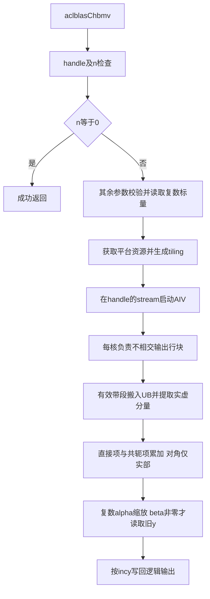

# aclblasChbmv（Atlas A2/A3，arch22）设计文档

> 团队：spr1ght。版本：v1.0，2026-11-11。
> 本文为设计阶段方案；接口和用例统计已按任务包核对，尚无本算子的真机编译、精度或性能实测结论。

# 需求背景（required）

## 需求来源

11月社区任务《aclblasChbmv 算子开发任务书》，文件名为 `aclblasChbmv_AtlasA2_A3_task_doc.md`。
在 CANN 9.1.0、Atlas A2/A3（arch22）上，以 Ascend C Kernel 直调方式补齐 ops-blas 的
complex64 Hermitian 带状矩阵与向量乘法接口 `aclblasChbmv`。

代码合入 [cann/ops-blas](https://gitcode.com/cann/ops-blas)：实现位于 `blas/sbmv/arch22/`，
测试位于 `test/sbmv/chbmv/arch22/`，公共接口声明位于 `include/cann_ops_blas.h`。

## 背景介绍

### 算子实现与相关 API 路径

本任务新增句柄式 BLAS 接口，不是把已有 TBE/ACLNN 算子迁移为 Ascend C。
任务书未提供对应 TBE 源文件；不注册 ACLNN 算子，因此 TBE 实现路径和 ACLNN 算子信息库路径不适用。
数学语义以任务书、cuBLAS `cublasChbmv` 和 Netlib `chbmv` 为准。

2026-11-11 核对的 ops-blas 上游 master 为 `5bd95145a9c499e43ebad44a313a1029c63d54bc`：
其中尚无 `aclblasChbmv` 声明或实现，但已有同族实数 `Ssbmv` 的 arch22 实现。

| 资料/工程 | 路径 | 复用边界 |
|---|---|---|
| 同架构带状算子 | `blas/sbmv/arch22/ssbmv_{host,kernel}.cpp`、`ssbmv_tiling_data.h` | 输出行归属、带状分块、UB预算和搬运组织；不能复制实数数值逻辑 |
| 同族其他架构 | `blas/sbmv/arch35/ssbmv_{host,kernel}.cpp` | 带状语义参考；不把SIMT实现直接搬到arch22 |
| 复数Hermitian算子 | `blas/hpr/arch22/chpr_{host,kernel}.cpp` | 复数实虚存储、负步长、共轭与对角处理的工程参考 |
| 复数矩阵向量算子 | `blas/gemv/arch22/cgemv_*` | 复数计算、Host/Kernel边界和stream接入 |
| 公共接口与类型 | `include/cann_ops_blas.h`、`include/cann_ops_blas_common.h` | 复用handle、状态码、uplo及`aclblasComplex` |
| 平台与句柄工具 | `blas/common/helper/host_utils.h`、`aclblas_handle_internal.h` | 动态核数、已绑定stream和必要时的workspace管理 |
| CSV测试蓝本 | `test/hpr/chpr/`、`test/sbmv/ssbmv/` | param/golden/wrapper/GTest/CMake结构 |

### 标杆算子现状分析

HBMV只存一个三角带。相较实数对称带状乘法，新增的关键语义是：alpha/beta为复数，镜像元素必须共轭，
对角只使用实部。不能把Ssbmv简单改名或仅把每个float替换为两个float。

原始标杆的逻辑流程为：校验参数、处理零阶矩阵、根据uplo和步长确定逻辑元素、遍历有效带、
利用共轭对称补全未存储侧，最后计算 `alpha*A*x + beta*y`。
本接口的错误码与quick return优先级按本任务书执行，不能直接继承其他算子的不同规则。

## 算子功能分析

计算 `y = alpha * A * x + beta * y`。A为n×n Hermitian带状矩阵，满足 `A(i,j)=conj(A(j,i))`；
带外元素为零，对角只取实部。x/y的逻辑长度为n，y输入输出同址。

| 参数 | 位置/类型 | 语义 |
|---|---|---|
| handle | Host，`aclblasHandle_t` | 有效句柄及其绑定stream |
| uplo | Host，`aclblasFillMode_t` | UPPER或LOWER，选择被存储的三角带 |
| n、k、lda、incx、incy | Host，int | 阶数、半带宽、列主序前导维、向量步长 |
| alpha、beta | Host，`const aclblasComplex*` | 单精度复数标量 |
| A | Device，`const aclblasComplex*` | 列主序带状数组，存储长度lda*n个复数 |
| x | Device，`const aclblasComplex*` | 存储长度至少`1+(n-1)*abs(incx)`个复数 |
| y | Device，`aclblasComplex*` | 同理，以incy定位；仅逻辑输出元素被更新 |

`aclblasComplex`沿用公共头中的 `{float real; float imag;}`，每个元素8字节。
仅支持complex64，不增加转置、批量、广播或Device标量模式。

# 需求分析（required）

## 需求描述

在A2/A3上新增统一公共API，实现完整Hermitian带状语义、正负步长和padding布局，
通过ops-blas CSV/GTest测试框架验证，满足全部任务精度和性能用例的逐条要求。

```cpp
aclblasStatus_t aclblasChbmv(
    aclblasHandle_t handle,
    aclblasFillMode_t uplo,
    int n, int k,
    const aclblasComplex* alpha,
    const aclblasComplex* A, int lda,
    const aclblasComplex* x, int incx,
    const aclblasComplex* beta,
    aclblasComplex* y, int incy);
```

## 需求拆解

| 需求 | 设计措施 | 验证方式 |
|---|---|---|
| Hermitian带状存储 | 直接由带状地址读取；镜像共轭；对角实数专用计算 | UPPER/LOWER、小矩阵手算、带宽扫描、对角虚部哨兵 |
| 复数alpha/beta | Host读取两分量，Kernel以FP32复乘/复加计算 | 零、一、负一、纯虚、一般复数、大值 |
| k可超过n-1 | 访问范围裁剪，但UPPER对角存储位置保留原k | TC_SQ_093/094等超带宽用例 |
| 正负非零步长 | 逻辑下标到物理下标映射；写回不破坏间隙 | ±1/±2/±3组合与间隙哨兵 |
| beta为零 | 单独分支，完全不读取旧y | 旧y填NaN的beta=0用例 |
| quick return与错误码 | 校验顺序明确；64位中间值防溢出 | 负向、n=0叠加非法参数、空handle |
| 异步执行 | 只向handle绑定stream入队，读回前由调用者同步 | 非默认stream和连续调用测试 |
| 精度与性能 | 独立高精度golden；计时入口与数值校验分离 | 官方1000精度、200性能及补充集 |

### 参数校验和特殊分支

严格执行以下顺序：

1. handle为空，返回 `ACLBLAS_STATUS_HANDLE_IS_NULLPTR`。
2. n<0，返回 `ACLBLAS_STATUS_INVALID_VALUE`。
3. n=0，直接返回SUCCESS，不检查或解引用其余参数，不启动Kernel。
4. n>0时依次校验uplo、k、lda、incx、incy和alpha/beta/A/x/y指针，错误均返回INVALID_VALUE。

| 检查 | 规则 |
|---|---|
| uplo | 仅ACLBLAS_UPPER、ACLBLAS_LOWER；非法不是INVALID_ENUM |
| k | k>=0；允许k>n-1 |
| lda | `int64_t(lda) >= int64_t(k)+1`，避免k+1的int32回绕 |
| incx/incy | 均不为0或INT32_MIN；在int64域计算`(n-1)*abs(inc)`，超INT32_MAX则拒绝 |
| 指针 | n>0时alpha、beta、A、x、y均必须非空，beta=0也不豁免y非空 |

每项检查独立记录错误日志；在所有标量指针校验完成前不解引用。
alpha=0仍须先完成参数校验，再计算beta*y；alpha=0且beta=0直接写零，不能读取带NaN的旧y后乘零。
任务不要求alpha=0、beta=1额外短路，也不要求alpha=0避免A/x读取；特殊值测试遵守任务规定的组合限制。

# 详细设计（required）

## 算子分析

### 数学公式与带状地址

以下均为0起始下标。记物理带状数组为B，`B[r,j]`对应`A[r+lda*j]`。

- UPPER存储 `B[k+i-j,j]=A(i,j)`，其中 `max(0,j-k)<=i<=j`；对角在B的第k行。
- LOWER存储 `B[i-j,j]=A(i,j)`，其中 `j<=i<=min(n-1,j+k)`；对角在第0行。
- 不对应矩阵元素的三角空洞和lda padding不参与计算；不得把其值乘零后混入归约。

对输出行i，非零列区间为 `j∈[max(0,i-k), min(n-1,i+k)]`。按下表重建逻辑元素：

| 存储 | 列范围 | 逻辑A(i,j) |
|---|---|---|
| UPPER | j<i | `conj(B[k+j-i,i])` |
| UPPER | j=i | `real(B[k,i])` |
| UPPER | j>i | `B[k+i-j,j]` |
| LOWER | j<i | `B[i-j,j]` |
| LOWER | j=i | `real(B[0,i])` |
| LOWER | j>i | `conj(B[j-i,i])` |

地址乘法和`i±k`等边界运算使用64位中间值。有效半带宽可记为`min(k,n-1)`以裁剪循环，
但不能用它替代UPPER存储公式中的原始k。

设带内非对角元素为a+ib、对应x为u+iv，则直接项为 `(a*u-b*v)+i(a*v+b*u)`；
镜像项使用a-ib。对角d只形成 `d*u+i*d*v`，不读取对角虚部参与运算。
完成行内累加后再应用复数alpha及beta。

### 支持数据类型与形状

仅complex64，按FP32实虚分量计算。n/k为运行时int入参，支持n=0、k=0、窄带、满带和超矩阵半带宽；
接口范围以任务参数约束为准，不把CSV当前最大n当作接口上限。
列主序A允许lda padding，x/y允许正负非零步长；不涉及超出这些参数语义的张量视图或广播。

向量逻辑下标t的物理位置为：

```text
pos(t, inc) = t*inc                  , inc > 0
              (n-1-t)*(-inc)        , inc < 0
```

## 算子实现

### 实现方案

使用arch22的AIV SIMD/membase实现，不引入GEMM/Cube/TBE计算路径。
首先建立输出行分块、带内分段的正确通用路径；在同架构Ssbmv的输出归属和带块复用思路上，
增加复数计算、镜像共轭和对角专用处理。布局相同不代表可直接复用实数阈值、UB元素数或数值指令。



#### 3.2.1 host侧设计

API入口保留handle/n检查和quick return；参数合法性与tiling/launch分别由独立函数承担。
以参数结构体组织辅助函数入参，避免把公共12参数接口照搬给所有内部函数。

tiling包含n、原始k、有效带宽、lda、uplo、64位incx/incy、复数alpha/beta两分量、使用核数、
输出行块范围的计算参数、带段长度及所选缓冲方案。不在tiling中放逐核分配数组。
核数和UB容量通过当前设备平台信息获取，不硬编码A2/A3核心数或固定UB容量。

##### 1. 分核策略

每核拥有一段连续逻辑输出行，核内再切成UB可容纳的小块；每个y(i)只有一个写入者，
避免跨核原子复数累加和全局同步。小n减少空核与固定开销；大n在资源允许范围内展开并行。
核数和块形状只由输入布局及平台资源决定，不按case_name或已知答案特判。

##### 2. 数据分块和内存优化策略

对每个输出行，分别处理列内连续段和跨列段。连续段合并搬运；跨列段评估批量跨步搬运与
“带状span搬入UB后Gather”的方案，不依赖逐元素GM标量读取覆盖性能主路径。
短带优先在多个输出行间复用x窗口，长带按段计算和归约，不要求整行或整个矩阵装入UB。

实虚拆分、索引表、乘积、归约临时区与尾部padding均计入预算。以通用分段实现为例，
记F(q)=q个float的对齐字节数、C(q)=q个complex64的对齐字节数、I(q)=q个uint32索引的对齐字节数，
R为输出块行数、T为带段长度、D为搬入缓冲份数、Q为归约及附加scratch的实际字节数：

| UB项 | 设计预算 |
|---|---|
| 输出实/虚累加 | `2*F(R)` |
| beta非零时旧y暂存 | `C(R)`，beta为零不分配/不搬入 |
| A/x分段AoS搬入 | `2*D*C(T)` |
| A/x实虚分量及两路乘积 | `6*F(T)` |
| 两张Gather索引表 | `2*I(T)`，不需要时不分配 |
| 归约、尾部与同步需要的scratch | Q，按最终API要求和实际分配逐项计入 |
| 可选x窗口缓存 | `C(W)`，仅启用缓存路径时存在 |

Host必须证明各项之和不超过可用UB，Kernel按同一布局分配；开启双缓冲或x缓存时重新核算，
不能只修改D/W而沿用旧预算。上述为设计公式，不是已经测得的固定内存占用。
常规独立输入路径不申请n×n临时矩阵或全局输出归约缓冲；若后续沿用同族的输入别名保护，
其快照空间必须单独核算并记录，不得仍宣称所有路径均为零workspace。

##### 3. 分支规划

运行时按uplo、alpha/beta零值、步长与资源可容纳性选择分支。k=0可用对角专用路径；
窄带可评估行与对角线批量累加，宽带回到带段归约。首版不预设未经实测的最优tile常量或性能阈值。
优化分支不可用时回到完整语义的分段方案，不以NOT_SUPPORTED代替任务规定内的合法布局。

#### 3.2.2 kernel侧设计

Kernel按Init、CopyIn、Compute、CopyOut组织：

1. Init计算本核输出行范围，建立与Host预算一致的UB视图。TPipe的创建与依赖它的API使用保持一致，
   不把无TPipe入口与内部依赖全局TPipe的接口混用。
2. CopyIn只搬入本轮有效带段与逻辑x片段。负步长先按物理区间搬入再形成逻辑次序；
   当跨步或span大小不能用当前DMA描述时分段处理，仍保持完整布局支持。
3. Compute把AoS实虚分量转为向量运算所需布局；共轭通过虚部符号实现；对角独立计算。
   padding和越界lane不参加有效乘法，避免`0*Inf`或`0*NaN`污染本应无关的输出。
4. 行内分段归约后应用复数alpha；beta非零才读取、计算旧y项。beta=0路径不能依赖旧y值。
5. CopyOut只更新incy对应的逻辑元素，不覆写向量间隙。所有UB复用明确建立MTE2/Vector/MTE3依赖，
   尾块用非对齐安全搬运与有效长度控制，避免超读或超写。

优先减少单次launch固定成本、细碎DMA和重复同步；在profiler确认瓶颈后再选择带块批量搬运、
x窗口复用或流水重叠。每次改动后先证明代码进入正确Kernel产物，再做同机、同输入、同口径比较。

### 工程文件与构建接入

```text
include/cann_ops_blas.h                         # 新增统一公共声明
blas/sbmv/README.md                             # 增加Chbmv接口与A2/A3支持表
blas/sbmv/arch22/chbmv_host.cpp
blas/sbmv/arch22/chbmv_kernel.h
blas/sbmv/arch22/chbmv_kernel.cpp
blas/sbmv/arch22/chbmv_tiling_data.h
test/sbmv/chbmv/CMakeLists.txt
test/sbmv/chbmv/chbmv_param.h
test/sbmv/chbmv/chbmv_golden.h
test/sbmv/chbmv/README.md
test/sbmv/chbmv/arch22/chbmv_test.cpp
test/sbmv/chbmv/arch22/chbmv_npu_wrapper.h
test/sbmv/chbmv/arch22/chbmv_test.csv
```

测试target为 `chbmv_test`，产物必须能在 `build/test/sbmv/chbmv/chbmv_test` 找到，
与任务包两个验收脚本的第一候选一致。沿用仓内公共test_main，不增加私有平行框架。
补充分布CSV与测试源同版本管理，保留官方CSV原字节。

拟用构建入口：`bash build.sh --soc=ascend910b3 --ops=chbmv`；A3使用 `--soc=ascend910_93`。
最终由实际工程验证target自动发现和产物路径，设计阶段不把命令列出视作已编译通过。

## 支持硬件

| 目标产品 | 设计支持 | 自验证安排 |
|---|---|---|
| Atlas A2训练/推理系列产品 | 支持，arch22 | 优先910B3性能自验 |
| Atlas A3训练/推理系列产品 | 支持，arch22 | 同一接口；按资源补充验证 |

CANN版本9.1.0；任务书规定自验证只需一种款型。生产实现不依赖CPU BLAS或CUDA，
CBLAS仅在测试侧作为独立golden。暂不声称支持arch20或新增arch35实现。

## 算子约束限制

除任务书定义的lda/incx/incy外，不增加广播、转置、批量或视图规则；只引用指定三角带，
保持y的原地输入输出语义。调用方保证Device存储容量合法，在读取结果前同步同一stream。
跨参数输入输出重叠不等同于y自身原地；最终README须与所采用的同族别名保护策略一致。

# 可维可测分析

## 精度标准/性能标准

### 精度标准

输入先从complex64提升为complex128，以 `cblas_zhbmv(CblasColMajor, ...)` 承担任务要求的FP64真值计算，
然后收窄为complex64。其Hermitian带状语义与任务所述 `cblas_chbmv` 一致；
不使用候选Kernel的索引代码或数值结果生成golden。

实部、虚部分别统计有限值，采用：

```text
abs(actual-golden) <= 2^-13 + 2^-13*abs(golden)
matched_ratio >= 0.99
max_abs_error <= max(1e-2, 32*ULP(golden_at_max_error))
```

ULP在最大误差点的FP32 golden值上计算；不能误用整个向量最大幅值放宽硬上限。
非有限值单独判断：同为NaN、同号Inf、或一方NaN另一方Inf视为任务规定的等效；
有限/非有限不匹配或异号Inf不匹配必须失败。非有限值不进入有限值统计，且其等效检查必须全部通过。
CSV中的mere_threshold/mare_multiplier为保留列，不替代本算子混合容差标准。
若仓内checker缺省与任务不同，在Chbmv测试中显式设置并补充非有限值判断，不全局修改旧算子阈值。

### 性能标准与采样设计

对全部200条TC_PF逐条满足 `NPU_us <= gpu_ms*1000/0.8`，不是只验证典型case。
标杆为任务包给定的NVIDIA A100-SXM4-80GB、CUDA12.8、cuBLAS12.8.4数据。
200条基线按(uplo,n,k,incx,incy)与用例唯一匹配，已在设计阶段完成数量/键审计。

| 典型case | uplo、n、k | GPU标杆(us) | NPU门槛(us，GPU/0.8) |
|---|---|---:|---:|
| TC_PF_1001 | UPPER，512，8 | 9.881600 | 12.352000 |
| TC_PF_1002 | UPPER，1024，16 | 15.872000 | 19.840000 |
| TC_PF_1003 | LOWER，2048，32 | 28.006400 | 35.008000 |
| TC_PF_1004 | LOWER，4096，64 | 53.026133 | 66.282666 |

表中为任务包GPU基线及推导门槛，不是本算子NPU实测结果。

任务包 `verify_performance.py` 及README明确读取GTest打印的
`[PERF] case=<case_name> ... avg_us=<value>`：先预热5次，再用aclrtEvent夹住连续10次调用取均值，
H2D/D2H、输入生成和golden比较在计时窗口之外，每次调用须返回SUCCESS。
任务书§3.3另有msprof op采样的文字说明，故自测报告必须写清实际采用的入口和统计口径。

另提供单次调用的profiling入口/模式，逐case独立进程采集目标Kernel的Task Duration，
保留调用数、原始样本、均值与中位数，核对实际外部验收量具后按其协议复验。
独立进程模式每次确实只调用一次；不得对15次连续调用的分支标注calls_per_case=1。
不将event均值与单次冷启动结果混称同一指标，不凭热循环通过推断最终外部验收必过。

首轮从最小case1005、四条典型case及满带case1082校准，再扩至全量。
msprof输出缺失、NA、非正值、Kernel身份/行数不符即中止；多Kernel实现核对每次完整调用的总耗时，
不能只挑其中最快一条。正式性能结论须绑定源码、二进制及实际加载库版本。

### 测试用例规划

随包CSV共1200条，精度1000条、性能200条；精度中984条期望SUCCESS、16条期望INVALID_VALUE。
空handle另外用接口单测覆盖，不计入官方CSV的1000条。

| 类别 | 前缀 | 条数 | 覆盖 |
|---|---|---:|---|
| 基础 | TC_L0 | 6 | 两种uplo、小尺寸 |
| 尺寸/带宽 | TC_SQ | 90 | 零/一/质数/幂边界、k=0/1/满带/超带宽 |
| 标量 | TC_AB | 16 | 零、一、负一、纯虚、一般复数 |
| 前导维 | TC_LD | 12 | 多种lda padding |
| 步长 | TC_INC | 72 | ±1/±2/±3全组合与两种uplo |
| 填充 | TC_FL | 18 | 常规、零、交替、极端值、Inf/NaN |
| 覆盖补足 | TC_CV | 16 | 中等尺寸、两种uplo |
| 边界 | TC_ED | 33 | quick return、空指针、非法枚举/维度/步长、溢出 |
| 扩展 | TC_EX | 737 | 尺寸、带宽、标量、padding及步长组合 |
| 性能 | TC_PF | 200 | 最小形状、典型形状、宽带及满带 |

官方包未提供正态分布用例。另建固定种子的补充集，对正常随机场景构建均匀/正态配对，
按输入A/x/y和alpha/beta各自统计50/50；正态参数满足任务规定的mu与sigma范围，实虚独立采样。
任务提及的填充token须在param/fill中明确兼容，不能把未识别token默认为INDEX后继续测试。

补充哨兵覆盖：对角虚部非零/NaN、未引用带区和padding为NaN、beta=0旧y为NaN、步长间隙不变、
非默认stream和重复调用。负向/零阶用例使用dummy存储，不按INT32_MIN、跨度溢出或负维数分配巨量缓冲。
所有补充用例独立命名、纳入精度回归并说明数量；官方原始CSV不改写。

验收脚本解析GTest文本，外层另核对发现/执行/通过case集合，防止漏跑仍返回成功。
性能分支的返回码检查不能代替正确性验证；Kernel/tiling变更后重新做完整精度回归。

### 内存与可维护性

任务书内存指标“不涉及”，仍按交付模板提供内存报告/日志，列明输入输出存储、实际tiling大小、
UB预算、必要workspace及释放结果；不使用未核算的“约若干KiB”替代实际字节数。
代码遵循仓内命名、日志、clang-format及头文件pragma once规则，函数拆分控制复杂度与参数数目。

## 兼容性分析

仅新增公共Chbmv声明、arch22实现和对应测试，不改变Ssbmv等既有接口、错误码或数值路径。
复用公共复数ABI和handle绑定stream，A2/A3使用同一API。SIMT仅作其他架构参考，不作为arch22实现前提。
CPU BLAS仅链接到测试程序，不成为生产算子运行依赖。

## 交付与验证计划

先提交本文完成设计评审，再推进实现和自验。最终交付代码、可复现测试README、官方七件套及私仓commit链接，
所有报告数字与原始日志同源，冻结代码版本后提交验收。自验证覆盖一种款型即可，第二款型证据补充不推迟硬门禁。

当前已完成的仅是资料与任务包审计：原包12个文件字节一致、1000/200分类计数、200条基线唯一匹配，
以及上游接口/同族工程核查；不据此宣称设备功能或性能通过。

## 参考资料

1. 本任务包：`aclblasChbmv_AtlasA2_A3_task_doc.md`、`test_cases/README.md`、两个verify脚本及CSV。
2. [ops-blas](https://gitcode.com/cann/ops-blas)，本文核对提交 `5bd95145a9c499e43ebad44a313a1029c63d54bc`。
3. [cuBLAS HBMV](https://docs.nvidia.com/cuda/cublas/index.html#cublas-t-hbmv)。
4. [Netlib chbmv.f](https://www.netlib.org/blas/chbmv.f)。
5. [生态算子开源混合容差标准](https://gitcode.com/cann/opbase/blob/28a1ce52ae856353589841226a0002af73314a6b/docs/zh/ops_precision_standard/mixed_tolerance_standard.md)。
6. [社区任务流程及注意事项](https://gitcode.com/org/cann/discussions/39)。
7. [官方设计文档模板](https://gitcode.com/cann/cann-ops-competitions/blob/master/04_tasks/01_community-task-2026/resources/design_template.md)。
