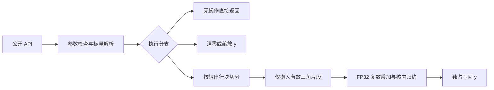

# aclblasChemv 算子设计文档（Atlas A2/A3）

| 文档项 | 内容 |
| --- | --- |
| 版本 / 日期 | v1.0 / 2026-11-11 |
| 需求依据 | 《11月社区任务-aclblasChemv算子开发（A2A3）》任务书及随附测试包 |
| 目标工程 | [cann/ops-blas](https://gitcode.com/cann/ops-blas)，`blas/symv/arch22/` |
| 目标环境 | Atlas A2/A3，CANN 9.1.0；性能验收使用 Atlas 800T A2（910B3） |
| 参考源码版本 | ops-blas `5bd95145a9c499e43ebad44a313a1029c63d54bc` |
| 文档状态 | 设计方案；文中阈值为验收目标，Tiling 参数为候选值，尚未宣称编译、精度或性能通过 |

# 需求背景（required）

## 需求来源

依据社区任务书，在 Atlas A2/A3 上使用 Ascend C、通过 ops-blas 句柄式接口实现 `aclblasChemv`，补齐单精度复数 Hermitian 矩阵与向量乘能力。设计文档采用社区 [design_template.md](https://gitcode.com/cann/cann-competitions/blob/master/04_tasks/01_community-task-2026/resources/design_template.md) 的章节结构。

计算接口、数值语义对齐 cuBLAS `cublasChemv`，负步长、三角引用与对角处理参考 Netlib `chemv`。参数校验顺序和错误码以本任务书为准；任务书对 `n=0` 的校验优先级不能直接照搬 Netlib 的 Fortran 参数检查。

## 背景介绍

### 现状分析

在上述参考提交中，`include/cann_ops_blas.h` 已声明 `aclblasSsymv`、`aclblasCsymv`，尚无 `aclblasChemv`。`blas/symv/arch22/` 的 Ssymv 可参考 A2/A3 工程接入和地址计算；`arch35/csymv_host.cpp` 可参考复数标量的 Host/Device 属性识别。Csymv 使用复对称语义，不能作为 Chemv 的数学实现直接复用。

Ssymv arch22 的实现还存在与本任务不同的非法枚举状态码、负维度和空指针处理，其双 kernel / 原子累加算法也不作为 Chemv 的默认方案。复用范围限于已核对的工程工具和 API 使用方式。

### 算子功能分析

`aclblasChemv` 计算 `y ← alpha · H · x + beta · y`。A 按列主序全存储，但 H 只由 `uplo` 指定三角和实数对角定义：另一三角通过共轭对称推断，禁止从该区域读取数据。所有复数输入输出均为 complex64，实部和虚部各使用 FLOAT32。

# 需求分析（required）

## 需求描述

新增共用 API `aclblasChemv`，通过 handle 绑定的 stream 直调 Ascend C kernel。支持任意合法运行时 n、lda padding、正负非零 incx/incy，以及 Host/Device 复数标量；y 原地更新。

验收包含完整功能与异常语义、Netlib CBLAS 3.10.0 单标杆精度、随包 200 条性能用例逐条达到 GPU 标杆的 0.8 倍以上性能，以及可复现的测试工程和报告。

## 需求拆解

| 编号 | 需求 | 设计落实位置 |
| --- | --- | --- |
| R1 | complex64、Hermitian 共轭、仅引用有效三角、忽略对角虚部 | 数学公式、三角搬运和复数计算 |
| R2 | 列主序、lda padding、incx/incy 正负步长 | 地址计算、通用步长路径 |
| R3 | 严格校验顺序、n=0、alpha=0、beta=0 等分支 | Host 侧设计、分支表 |
| R4 | Host/Device alpha、beta；使用 handle stream | 标量解析、资源与同步 |
| R5 | A2/A3 kernel 直调，共用公开头文件 | 工程改动、兼容性分析 |
| R6 | 1000 条随包精度用例并补齐正态分布等覆盖 | 测试设计、精度判据 |
| R7 | 910B3、warmup 5 次、有效样本不少于 10 次、逐 case 达标 | 性能标准、采集方法 |
| R8 | arch22 GTest 注册、可复现实验和完整交付件 | 工程设计、交付检查表 |

# 详细设计（required）

## 算子分析

### 数学公式

下文采用从 0 开始的逻辑索引。物理矩阵元素 `a(i,j)=A[i+j·lda]`，逻辑矩阵定义为：

\[
H_{ij}=\begin{cases}
\operatorname{Re}(a(i,i)),&i=j,\\
a(i,j),&i<j\ \land\ uplo=UPPER,\\
\overline{a(j,i)},&i>j\ \land\ uplo=UPPER,\\
a(i,j),&i>j\ \land\ uplo=LOWER,\\
\overline{a(j,i)},&i<j\ \land\ uplo=LOWER.
\end{cases}
\]

\[
y_i^{new}=\alpha\sum_{j=0}^{n-1}H_{ij}x_j+\beta y_i^{old}.
\]

对 `a=ar+i·ai`、`x=xr+i·xi`，普通复数乘法为 `(ar·xr−ai·xi, ar·xi+ai·xr)`；共轭乘法为 `(ar·xr+ai·xi, ar·xi−ai·xr)`。对角项单独按实数乘复数计算 `(d·xr,d·xi)`，不执行含对角虚部的乘法，避免被忽略的 NaN/Inf 污染结果。

### 支持数据类型和形状

| 对象 | 数据类型 / 内存 | 形状与约束 |
| --- | --- | --- |
| A | `const aclblasComplex*` / Device | 列主序 `lda×n`，`lda≥max(1,n)`，仅有效三角参与计算 |
| x | `const aclblasComplex*` / Device | 逻辑长度 n，物理长度至少 `1+(n−1)·abs(incx)` |
| y | `aclblasComplex*` / Device | 逻辑长度 n，物理长度至少 `1+(n−1)·abs(incy)`，原地输出 |
| alpha、beta | `const aclblasComplex*` / Host 或 Device | 各 1 个复数标量，来源分别识别 |
| n、lda、incx、incy | Host `int` | n≥0；incx/incy 非 0、非 INT32_MIN；满足跨度守卫 |

复用 `include/cann_ops_blas_common.h` 的 `aclblasComplex { float real; float imag; }`，不另定义公开复数类型。不增加广播、批量、转置属性或超出 lda/inc 语义的 Tensor 视图接口。

### 接口定义

在现有 `include/cann_ops_blas.h` 的同族接口位置增加唯一声明，维度类型保持 `int`：

```cpp
aclblasStatus_t aclblasChemv(
    aclblasHandle_t handle, aclblasFillMode_t uplo,
    int n, const aclblasComplex* alpha,
    const aclblasComplex* A, int lda,
    const aclblasComplex* x, int incx,
    const aclblasComplex* beta,
    aclblasComplex* y, int incy);
```

| 条件 | 返回值 / 行为 |
| --- | --- |
| handle 为空 | `ACLBLAS_STATUS_HANDLE_IS_NULLPTR` |
| n<0 | `ACLBLAS_STATUS_INVALID_VALUE` |
| n=0，且 handle 非空 | `ACLBLAS_STATUS_SUCCESS`；不检查其余参数、不探测标量、不启动 kernel |
| n>0，uplo 非 UPPER/LOWER | `ACLBLAS_STATUS_INVALID_ENUM` |
| 非法 lda、inc、跨度，或 alpha/beta 为空 | `ACLBLAS_STATUS_INVALID_VALUE` |
| alpha=0，beta=1 | 校验通过后直接成功；A/x/y 均可为空 |
| alpha=0，beta≠1 | A/x 可为空；y 必须非空，仅处理 `y←beta·y` |
| alpha≠0 | A/x/y 必须非空 |
| beta=0 | 不读取旧 y；y 仍必须指向有效输出存储，除非进入上述无操作分支 |

## 算子实现

### 实现方案

采用 A2/A3 SIMD FP32 Vector 实现。每个核独占一组输出行，核内完成该组行的全部三角贡献、复数标量计算和最终写回。正常数据路径仅启动一个 kernel，不使用跨核原子累加，不生成完整 Hermitian 矩阵，也不申请算法 GM workspace。

该方案使输出所有权、beta=0 和负步长语义容易验证；代价是每个存储非对角元素最多读取两次，分别服务于两个输出行。该代价作为性能验证项保留，不以理论分析代替实测。



### Host 侧设计

#### 1. 参数校验及早退顺序

严格按以下顺序执行；任何检查失败即返回，不启动计算：

1. handle 判空。
2. n<0 返回 INVALID_VALUE。
3. n=0 直接返回 SUCCESS；此分支允许其余参数全部非法或为空。
4. 检查 uplo；随后检查 lda、incx/incy（含 INT32_MIN）、跨度和 alpha/beta 指针。
5. 解析两个标量；alpha=0 且 beta=1 直接返回 SUCCESS。
6. y 判空；alpha≠0 时再要求 A/x 非空，并检查实际使用的矩阵地址计算不溢出。
7. 获取平台能力、形成 Tiling 数据，并在 handle stream 上启动选定 kernel。

alpha=0/beta=1 不能绕过第 4 步的非法枚举、lda、inc、标量指针检查；只有 n=0 能绕过这些检查。NaN 不按 0 或 1 判断；复数零和一分别比较两个 FLOAT32 分量，正负零均按浮点相等语义处理。

#### 2. 64 位地址和跨度守卫

在 n>0 且排除 INT32_MIN 后，先提升为 int64 再求绝对值：

```text
absIncX = abs(int64(incx))
spanX   = int64(n - 1) * absIncX
xStart  = incx < 0 ? spanX : 0
xOffset(j) = xStart + int64(j) * int64(incx)
```

y 同理。采用已核对的 ssymv arch22 同族跨度上限 `UINT32_MAX`，`spanX/spanY` 超限返回 INVALID_VALUE；长度 `span+1` 仍使用 64 位存储。检查矩阵 `lda·n·sizeof(aclblasComplex)`、最大访问地址和字节偏移的乘加溢出。Host、Tiling、Kernel 全链路保留 64 位，不能在 DMA 参数或 `SetGlobalBuffer` 长度处再次截断。

负步长输入指针仍是物理缓冲区起点，核内由上述公式定位逻辑第 0 项；Host 不预先平移指针。DMA 的无符号 stride 字段不能直接接收负 inc，过大 stride 也不能强制窄化。

#### 3. Host/Device 标量

参考 csymv 的 `ComplexScalarSource` 和 `aclrtPointerGetAttributes`，分别识别 alpha、beta 的来源。Host 标量复制为本次调用的值；属性探测失败返回 INVALID_VALUE。

本版选择在任一标量位于 Device 时，先显式同步 handle 绑定的 stream，等待该 stream 上先前的标量写入完成，再用同步 `aclrtMemcpy(...,ACL_MEMCPY_DEVICE_TO_HOST)` 分别回读需要的 8B 标量，之后执行值相关早退和空指针检查。`aclrtMemcpy` 自身不提供隐式 stream 同步，因此不能省略前置同步。这样所有标量来源均遵循同一 Host 校验顺序，alpha=0/beta=1 均可无计算 kernel 返回。此处与 csymv 正常路径的懒回读条件不同，是为严格落实本任务校验顺序作出的取舍。

Device 标量调用因此存在一次 stream 同步和一至两次同步 D2H；Host 标量路径不增加该同步，计算 kernel 仍按绑定 stream 异步下发。测试和接口说明必须写明此行为，并分别记录 Device 标量调用的 API 耗时。同步回读也避免给任务未约束的标量地址增加异步拷贝对齐条件，或让局部暂存区暴露给尚未完成的异步 D2H。标量不得跨调用缓存；同步或回读失败按仓内运行时错误处理规则返回，不继续启动计算。Host 值和回读结果通过启动参数按值传递，不能把局部变量地址留给异步 kernel。

#### 4. 执行分支和 Tiling 参数

| 分支 | 条件 | 处理 |
| --- | --- | --- |
| NO_OP | n=0，或合法参数下 alpha=0/beta=1 | Host 直接返回 |
| ZERO_Y | alpha=0/beta=0 | 单次清零 kernel，仅写逻辑 y |
| SCALE_Y | alpha=0/beta≠0、1 | 单次缩放 kernel，不绑定或访问 A/x |
| HEMV_CONTIG | alpha≠0、incy=1，且 y 基址满足 32B 对齐 | 多核行块独占；incx 可走连续或精确步长读取 |
| HEMV_GENERAL | alpha≠0，其余合法 y 布局 | 单写者通用 kernel，覆盖负步长、稀疏步长及非对齐基址 |

ZERO_Y/SCALE_Y 同样按物理写块所有权选择多核连续或单写者路径。上述为内部执行枚举，不新增公开 API，也不沿用 ACLNN 的 TilingKey/注册机制。

```cpp
// 内部数据结构示意，非新增公开 ABI。
struct ChemvTilingData {
    int64_t n, lda, incx, incy;
    int64_t xStart, yStart, xStorageLength, yStorageLength;
    uint32_t rowTile, reduceTile, usedCoreNum, mode;
    uint32_t upper, betaIsZero;
    aclblasComplex alphaValue, betaValue;
};
```

### Kernel 侧设计

#### 1. 分核和两级切分

Host 通过 `PlatformAscendCManager` 查询 AIV 核数和 `GetCoreMemSize(CoreMemType::UB, ubSize)`，复用仓内工具获取当前设备能力，不写死核数或 UB 容量，不切换调用者设备。

设输出行块长为 B、归约分块长为 K，`rowTiles=ceil(n/B)`，连续路径 `usedCoreNum=min(AIV核数,rowTiles)`。第 c 个核按 `tileId=c,c+usedCoreNum,...` 处理行块，各块写回一次。B 取 8 的倍数，保持 FLOAT32 分量缓冲区 32B 对齐；非尾块至少包含完整的 32B 输出块。通用路径 usedCoreNum=1，仍使用相同的 UB 分块计算。

初始候选为 `B∈{8,16,32}`、`K∈{64,128,256}`，K 取 8 的倍数。小尺寸减少启动核数和实际 tile 长度；按真实 UB 容量计算可行组合，910B3 的性能测试决定最终分界和参数。调度只依赖尺寸、步长、对齐与平台能力，不依赖 case 名称、种子或输入数值分布。

#### 2. 三角访问与数据搬运

对输出行块 I 和归约块 J，根据 uplo 决定存储位置和是否共轭：

| 关系 | UPPER | LOWER |
| --- | --- | --- |
| I 在 J 之前 | 读取 `A[I,J]`，普通乘法 | 读取 `A[J,I]`，共轭转置贡献 |
| I 在 J 之后 | 读取 `A[J,I]`，共轭转置贡献 | 读取 `A[I,J]`，普通乘法 |
| 两块跨越对角 | 按列裁剪为严格上三角片段；对角单独处理 | 按列裁剪为严格下三角片段；对角单独处理 |

矩形块始终沿物理列内的连续行段搬运。跨对角块按每列实际合法区间发起 `DataCopyPad`，不先搬整块再 mask；lda padding 和未引用三角均不属于搬运区间。对角只搬 FLOAT32 实部，单独执行实数乘复数。

使用 `DataCopyExtParams` 的有效 `blockLen` 字节数，UB 起址按 32B 对齐。尾部对齐空间在 UB 内补零，GM 读取不向边界外扩展。零填充仅服务存储对齐，三角外和尾部 lane 不参与有效累加；尤其不能通过 `0×Inf` 再求和实现语义上的“跳过”。跨对角块的有效片段先压紧到对齐临时区，其到行累加器的边界映射可在 UB 内逐项完成，避免以未对齐的 LocalTensor 子片段调用向量 API；GM 访问仍由精确 DMA 完成。

#### 3. 复数计算和归约

输入 AoS 为 `[real0,imag0,real1,imag1,...]`。使用 `GatherMask` 固定模式 1/2 将有效复数片段拆成实、虚两个 FP32 向量；完整矩形片段复用当前归约块已经拆分的 x。跨对角裁剪起点可能不满足 32B 对齐，此时将对应 x 片段重新置于现有对齐槽并拆分，不能直接对 `xReal[offset]` 使用向量接口；需要恢复整块 x 时重新搬入。输出不对齐的边界映射采用 UB 内标量操作，不直接向量访问 `yReal[offset]`。连续行段的直接贡献使用向量与复数标量乘加；镜像贡献沿物理列内连续片段做复数点积和 `ReduceSum`。

以下为单个有效片段的 API 调用示意；各 LocalTensor 的起址和 count 满足已核对接口约束，实际代码须补齐队列和指令依赖：

```cpp
// ar/ai、xr/xi 已由合法搬运和 GatherMask 得到，count 仅覆盖有效 lane。
Mul(work0, ar, xr, count);
Mul(work1, ai, xi, count);
Sub(work0, work0, work1, count);   // 普通乘法实部
ReduceSum<float, true>(reduceDst, work0, reduceTmp, int32_t(count));
// 先消费实部归约结果，再复用 work0/work1 和 reduceDst。
Mul(work0, ar, xi, count);
Mul(work1, ai, xr, count);
Add(work0, work0, work1, count);   // 普通乘法虚部
ReduceSum<float, true>(reduceDst, work0, reduceTmp, int32_t(count));
// 共轭乘法将实部 Sub 改为 Add，虚部 Add 改为 Sub。
```

实现中实、虚乘积按生命周期依次复用 work 区，不额外重复申请整块 UB。直接贡献使用 `Muls` 形成与单个复数 x 的乘法，再用 `Add/Sub` 累加到所拥有行；镜像点积的实、虚部分别归约。累加和标量复数乘法全程 FP32，不使用 FP16/BF16/TF32 中间表示。

计算组织参考 Netlib 的列顺序：直接贡献使用 `(alpha·x_j)·a(i,j)`；镜像部分先积累 `conj(a(j,i))·x_j`，再乘 alpha；对角使用 `(alpha·x_i)·Re(a(i,i))`。UPPER 在该行对角处合入较小索引镜像项，再累加较大列的直接项；LOWER 顺序对应反转其三角角色。核内树形归约仍可能改变加法顺序，按任务容差验收，不承诺 bit-exact。

beta=0 时直接初始化输出累加器为零，不搬旧 y；beta=1 时保留旧 y，不执行无必要的复数乘法。alpha=0 的清零/缩放分支在任何 A/x 搬运之前分离。有效 count 为 0 时跳过搬运和 ReduceSum，不调用非法的零长度归约。

#### 4. 步长、输出与流水

x 的负步长可按物理地址递增搬入有限跨度，再在 UB 选取、反序为逻辑顺序；跨度过大时按有效元素进行 8B 精确搬运。`Gather` 只用于 UB 内索引，不能用于直接 gather GM。y 仅写 `yStart+i·incy` 的复数位置，保持向量空洞及周围保护区不变。

连续路径以完整 32B 物理输出块划分 writer，最后不足一块的尾部归同一核。其他 y 布局使用单写者通用路径，按有效 8B 写回，不覆写步长空洞。这是保守的所有权设计，不据 Ascend950 的案例断言 A2/A3 已存在同一硬件行为。

A tile 使用深度 2 的队列，按 `AllocTensor→DataCopyPad→EnQue→DeQue→Compute→FreeTensor` 管理；输出计算完成后建立 Vector 到搬出流水的依赖，再精确写回。复用同一临时区前保证前序指令完成；不能仅申请两个 buffer 就宣称已实现传输与计算重叠。各核之间无共享累加器和全局 barrier。

#### 5. UB 规划

记 `L=max(B,K)`，每项分配向上对齐到 32B。B、K 均为 8 的倍数时，下表给出连续计算路径的可实现布局：

| Buffer | 单份大小 | 数量 | 合计字节 | 用途 / 复用 |
| --- | ---: | ---: | ---: | --- |
| aQueue | `8·B·K` | 2 | `16·B·K` | 矩阵 AoS 双缓冲，存储两种物理朝向 |
| xRaw | `8·K` | 1 | `8·K` | 当前 x 块 AoS |
| xReal/xImag | `4·K` | 2 | `8·K` | x 拆分后在该块复用 |
| aReal/aImag | `4·L` | 2 | `8·L` | 当前列片段拆分，直接与镜像阶段复用 |
| work0/work1 | `4·L` | 2 | `8·L` | 乘法、中间和/差、实虚归约依次复用 |
| yReal/yImag | `4·B` | 2 | `8·B` | 独占行的输出累加器，兼作 beta·y 缓冲 |
| mirrorReal/mirrorImag | `4·B` | 2 | `8·B` | 镜像点积的跨 K 块累加 |
| yRaw | `8·B` | 1 | `8·B` | 最终 AoS 输出；阶段内复用为精确步长搬运槽 |
| reduceDst/reduceTmp | 32B | 2 | 64 | FP32 count 重载的独立对齐槽 |

\[
U(B,K)=16BK+16K+16\max(B,K)+24B+64.
\]

例如 B=32、K=256 时，`U=140096B`；若运行时查询 UB 为 196608B，该组合占约 71.26%。这只是容量校验示例，不固定设备容量。总分配加框架实际占用不得超过实测可用 UB；Host 枚举满足约束的 B/K，必要时减小 K 或 B。使用 count 重载 ReduceSum，不套用其他重载的临时区公式。通用步长路径按单元素精确搬运兜底，不另申请与 `abs(inc)` 成比例的 UB。

#### 6. Workspace、资源和执行语义

算法 GM workspace 为 0B；Tiling 结构按启动参数传值，不按 `sizeof(TilingData)` 另申请 Device workspace。复用 ops-blas 既有 handle/stream，不创建私有 stream，不分配完整矩阵副本，不在每次调用中申请 O(n²) 临时区。

Host 标量在函数返回后不再被 kernel 引用。Device 标量需保持有效至本次回读结束；A/x/y 在存在计算时需保持有效至绑定 stream 完成，调用者读回输出前须同步。正常计算提交成功表示异步下发成功，不等同于所有异步执行错误已被排除；测试必须检查同步返回值。

### 工程改动

沿用 ops-blas family/arch 工程，不引入 ACLNN、GE 注册或 PyTorch 封装。实现文件数量与同族一致：

```text
include/cann_ops_blas.h                  # 新增共用 API 声明
blas/symv/
├── README.md                           # 补充 Chemv 语义和 A2/A3 支持
└── arch22/
    ├── chemv_host.cpp                  # API、校验、标量、Tiling、启动
    ├── chemv_kernel.cpp                # kernel 入口及内部计算类
    ├── chemv_kernel.h                  # 唯一 launcher 声明
    └── chemv_tiling_data.h             # 内部参数结构
test/symv/chemv/
├── CMakeLists.txt                      # arch22 分支注册 GTest
├── README.md                           # 编译、自验、采样与复现说明
├── profile_chemv.py                     # 逐 case 采集与统计 msprof task
└── arch22/
    ├── chemv_test.cpp
    ├── param.h
    ├── golden.h
    ├── npu_wrapper.h
    ├── chemv_test.csv                   # 随包 1200 条用例原样保留
    ├── chemv_extra_test.csv             # 正态与语义补充用例
    ├── gpu_baseline.csv                 # 随包 200 行基线原样保留
    └── perf_case_map.csv                # case 与基线行稳定一对一关联
```

`test/symv/chemv/CMakeLists.txt` 的 arch22 分支调用 `ops_blas_add_gtest_tests(${OPS_BLAS} chemv_test)`；使用框架已有的 GTest main，不自行复制测试框架或增加平行 runner。库实现使用仓内 `.cpp` 和 Ascend C CMake 编译链。若合入前已有其他产品线 Chemv 声明/目录，应在其上增补 arch22，避免重复符号。

测试依赖显式固定 Netlib BLAS/CBLAS 3.10.0，保留来源、版本和构建记录。现有 CMake 自动找到 `openblas` 或通用 `blas` 不能证明满足该版本要求；测试应输出实际 golden 库版本/路径，缺少指定依赖时明确失败，不静默替换标杆。

## 支持硬件

| 支持产品 | 构建架构 | 支持状态 / 验证规划 |
| --- | --- | --- |
| Atlas A2（含 Atlas 800T A2） | arch22 | 本次目标；910B3 进行精度与性能自验 |
| Atlas A3（含 Atlas 800T A3） | arch22 | 本次目标；完成适配构建；按任务书自验至少覆盖一种款型 |

面向用户的算子 README 产品支持表标记 Atlas A2/A3：支持；自测报告另外列明实际验证设备，不能把 910B3 结果表述为 A3 真机结果。

## 算子约束限制

本任务仅实现 complex64、列主序稠密全存储的 HEMV，运行时 n 不要求固定。步长和 padding 不改变 Hermitian 三角语义；未引用三角、lda padding、y 空洞不能成为计算输入或输出。接口不增加数据范围限制，Inf/NaN 按任务书单独验收；不要求确定性或逐 bit 一致。

Host 可验证数值范围和空指针，合法 Device 缓冲区实际容量、调用者越界以及跨 stream 的外部依赖仍需调用方正确提供。测试使用符合 BLAS 契约的独立输入/输出缓冲区，不将未定义的输入输出重叠作为新增功能。

# 可维可测分析

## 精度标准/性能标准

| 项目 | 验收标准 | 来源 |
| --- | --- | --- |
| 精度标杆 | Netlib BLAS/CBLAS 3.10.0 `cblas_chemv(CblasColMajor,...)`；全逻辑 y，实虚分别判定 | 任务书 §3.1/§3.2 |
| 有限值精度 | atol=rtol=2⁻¹³；matched_ratio≥0.99；最大绝对误差满足下述动态上限 | 任务书 §3.2、指定 opbase 标准 |
| 非有限值 | 独立统计并逐点按任务规则判定；有限/非有限不匹配必须失败 | 任务书 §3.2 |
| 性能 | 910B3 上每条有效性能用例 `NPU_avg_us≤1000·gpu_ms/0.8` | 任务书 §3.3 |
| 内存专项 | 任务书未设独立验收门槛；仍测试边界、空洞保护及资源泄漏 | 任务书 §3.4 |

### 精度判定细节

有限值逐分量满足 `abs(actual−golden)≤2⁻¹³+2⁻¹³·abs(golden)`。实部、虚部分别计算有限值 matched_ratio 和 max_abs_error，不能合并后掩盖某一分量失败。指定 opbase 标准将“1e−2 or 32 ULP”定义为取较大值：最大绝对误差点的 golden 按 FLOAT32 计算 ULP，`max_abs_error_limit=max(1e−2,32·ULP(golden_at_max_error))`；不得用其他位置的大值抬高上限。

非有限值遵循任务书：双方均 NaN、同号 Inf，或一方 NaN 另一方 ±Inf，均通过；相反符号 Inf 不通过；一方有限而另一方非有限不通过。非有限点不进入有限值统计，另报总数和通过数且要求全部通过。不存在有限点时该部分记 N/A，不以 0/0 产生 NaN；用非有限点全部通过决定该部分结果。n=0 检查状态及不访问数据，不伪造非空向量误差统计。

CSV 的 `mere_threshold/mare_multiplier` 仅供框架附加统计，不能替代上述混合容差和非有限值规则。保留并输出框架 MERE/MARE 结果，补充独立的任务书精度判定；若两种判定不一致，报告分列呈现，不由脚本隐藏。算子不含随机行为，随机分布只用于生成输入。

### 测试覆盖设计

按实际 `chemv_test.csv` 统计为 1200 条：1000 条精度/功能用例和 200 条性能用例。其中精度包含 980 条预期 SUCCESS、18 条 INVALID_VALUE 和 2 条 INVALID_ENUM；README 的部分分类计数已滞后，以实际 CSV 为准。

| 随包类别 | 数量 | 核心覆盖 |
| --- | ---: | --- |
| TC_L0 | 4 | 小尺寸、UPPER/LOWER |
| TC_SQ | 46 | 1～2048 的质数、幂次、幂次±1、非对齐尺寸 |
| TC_AB | 16 | 复数 alpha/beta、零、一、纯虚等组合 |
| TC_LD | 18 | lda=n+1/n+8/n+16 |
| TC_INC | 72 | incx/incy∈{±1,±2,±3} 的组合 |
| TC_FL | 18 | 零、交替、极值、Inf/NaN |
| TC_CV | 16 | 中等尺寸及两种 uplo |
| TC_ED | 32 | 早退、非法参数、空指针、INT32_MIN、跨度溢出 |
| TC_EX | 778 | 尺寸、标量、步长与 padding 的组合 |
| TC_PF | 200 | n=1～4096、incx=incy=1、lda=n 的性能用例 |

随包文件无 GAUSS 用例，生成器的 `--dist mixed` 当前也只输出均匀分布。扩展 CSV 在保留原用例的基础上，对 n>0、预期成功且至少一个实际读取的 A/x/y 使用随机填充的精度用例增加正态镜像：排除无操作分支，alpha≠0 时计入 A/x，beta≠0 时计入旧 y。按当前 CSV 筛选得到 776 条镜像，对应原始随机填充位置 A=770、x=770、旧 y=401；这些位置均由均匀用例与正态镜像一一配对。镜像将相应 `RANDOM_NORM_5_5` 改为 `GAUSS_NORM_5_2`，实虚独立采样 μ∈[-5,5]、σ∈[0.1,2]。测试填充器须实际支持该 token 和 μ/σ 记录，不能只改 CSV 字符串。正态镜像加随机标量组共 2072 条分布补充用例，定向语义测试另计。

随包 alpha/beta 全部来自预设组合，不能充当随机标量分布覆盖。另建 648 对、共 1296 条随机标量用例：`uplo=(UPPER,LOWER)`、`n=(1,17,128)`、`incx/incy=(1,2,3,-1,-2,-3)`、`lda=n+(0,1,8)` 全组合。同一组合的一条用例将 alpha/beta 实虚分量独立均匀采样 [-5,5]，另一条独立正态采样，并对 A/x/y 同步成对选择分布。按上述固定枚举顺序生成从 0 开始的 pairId，从主种子 20261111 派生 `20261111+2·pairId+distId`，distId 为 0/1，记录每个正态分量的 μ/σ。固定标量、负向、早退及特殊值测试保留为独立类别，不计入随机分布配额。扩展器输出实际数量、种子、每个实际读取输入的分布统计，纳入精度报告。

另增以下定向测试，不依赖随机命中：

| 补充项 | 检查内容 |
| --- | --- |
| 标量来源四组合 | Host/Host、Host/Device、Device/Host、Device/Device；含在绑定 stream 上先写标量再调用 |
| 标量地址 | Device 分配内偏移 1 个复数的有效标量地址，验证未新增 64B 对齐限制 |
| Device 值更新 | 同一地址两次调用写不同值，验证不使用历史缓存；覆盖 alpha=0 和 beta=0/1 |
| 三角和对角毒化 | 未引用三角、lda padding 填 NaN/Inf；对角虚部独立填非零/NaN/Inf，输出应与忽略它们的 golden 一致 |
| 真实读取边界 | 对角/尾块地址范围审查，配合设备内存检查；数值毒化只证明不依赖内容，不能独自证明未发起读取 |
| beta=0 | 旧 y 全 NaN；有效 y 仍成功，空 y 必须失败；alpha=beta=0 直接写零 |
| 写回所有权 | n=1/3/4/5、B±1、K±1；y 非 32B 对齐基址、所有步长符号和空洞哨兵 |
| 参数优先级 | 空 handle+n=0，n<0+非法 uplo，n=0+全部非法，alpha0/beta1+非法 inc/空标量等 |
| 地址守卫 | inc=0/INT32_MIN、跨度临界值和超限；合法 n=1+大非零 inc；矩阵字节计算溢出 |
| 异步和资源 | 非默认 stream、连续调用、同步错误检查、重复调用资源稳定性 |

预期错误用例使用单元素 dummy 或空指针，不按异常跨度申请巨量缓冲区。n=0 或已确定为 quick return 的用例同样不按步长分配。合法负步长计算用例必须分配完整物理长度，不能因 inc<0 就统一跳过输入分配。

### 性能采集与判定

以随包 `gpu_baseline.csv` 为基线，记录其 SHA256 和采集说明。该文件含 200 行、197 组唯一参数，其中重复参数行的 gpu_ms 并不相同，不能仅以参数键选择基线。已核对原 CSV 中按出现顺序提取的 200 条 TC_PF 与 200 行基线逐行全参数一致，据此固化 `perf_case_map.csv`，记录 `case_name、baseline_id、原始序号及全参数`。后续执行顺序可变，关联只按该稳定映射，并再次核验所有参数；任一缺失或变更即报错，不重新猜测配对。基线说明记录 NVIDIA A100-SXM4-80GB、CUDA 12.8、cuBLAS 12.8.4、Host pointer mode；本设计未重新测量该 GPU 基线。

前四条性能目标如下，单位统一换算为 μs：

| 基线 id | uplo / n | GPU 均值 | NPU 均值上限（÷0.8） |
| --- | --- | ---: | ---: |
| chemv-base-000 | UPPER / 512 | 14.643200 | 18.304000 |
| chemv-base-001 | UPPER / 1024 | 21.111466 | 26.389333 |
| chemv-base-002 | LOWER / 2048 | 30.088534 | 37.610667 |
| chemv-base-003 | LOWER / 4096 | 65.297066 | 81.621333 |

性能不得只验证这四条，也不能用平均加速比抵消失败 case。全部 200 条分别要求 `gpu_us/npu_avg_us≥0.8`；缺失、失败、NO_REF 或采样不足均不能记为通过。

测试在预置 Device 缓冲上调用 API，排除数据生成、H2D/D2H 和 golden 计算。每 case warmup 5 次，不计入样本；随后至少 10 次有效调用，检查接口和同步状态，采用 msprof op 的 task duration 计算算术平均。报告记录实际 warmup、有效样本数、异常样本及处理原因，不能删除慢样本来改善均值。

单条用例过滤后再采集，避免混叠；依据 case/迭代和 kernel 关联保留原始明细。若以后改为多 kernel，必须把一次 API 的所有计算 task 耗时求和后再按调用求均值，不能只选最快 kernel，Host 与同步开销另列。

任务材料存在口径差异：任务书 §3.3 要求 msprof task duration；README/`verify_performance.py` 解析 `[PERF] case=... avg_us=...` 的事件计时，并声明 msprof 只供分析。验收主表遵循任务书，事件计时继续作为脚本复现及交叉检查列，两者保留原名，不能互相冒充。测试工具需补充逐 case 的 msprof 统计入口；若验收方后续指定事件计时，则同时按该列逐条判定并记录口径变更。

### 性能优化计划与风险

优先优化合法矩阵片段的批量搬运、x 的核内复用、实虚拆分次数、A 双缓冲以及按尺寸选择核数。小尺寸减少调度与同步，大尺寸枚举可行 B/K 以平衡指令数、并行度和 UB 使用。性能版本变更后重新执行语义定向用例和完整精度用例。

行独占方案的矩阵逻辑读取量约为 `8n(n−1)+4n` 字节，n=4096 时约 134.2MB；以 81.621333μs 预算估算，对应约 1.64TB/s 的逻辑读取率。此值包含潜在重复/缓存命中，不等于物理 HBM 利用率，也不能证明目标可达。若真机仍不达标，先以 profiling 判定瓶颈；只有证据表明重复读取占主导，才评估三角块单次读取、私有 partial workspace 加归约的后续方案，并重新设计其资源生命周期、总 task 计时和精度测试，不能直接换成复用实数原子累加。

Device 标量同步和非连续 y 的单写者路径另列性能行为；随包性能用例均为连续布局，本设计为该性能入口选择 Host 标量，与提供的 GPU 标杆来源口径一致，不据此声称任意步长和 Device 标量均达到相同延迟。

## 兼容性分析

公开函数与 cuBLAS Chemv 参数顺序一致，与 ops-blas 同族维度类型保持一致；增加声明不修改既有 API、枚举或 `aclblasComplex` 布局。A2/A3 共享 arch22，通过平台能力查询选择 Tiling；不使用 arch35 专属指令。

仅新增 Chemv 的实现和测试、修改对应公开声明与同族 README，既有 Ssymv/Csymv 的行为不随本任务改变。接入后需完成目标架构的库构建、导出符号检查及同族 smoke 回归。若合入基线发生变化，重新核对声明、CMake 和标量辅助函数，再更新本文引用版本。

## 复现与交付

建议在 Atlas 800T A2（910B3）的隔离任务目录中完成验证，先记录 `npu-smi`、CANN/编译器版本、源码 commit、构建命令和设备占用。A2 构建选择 `ascend910b`，A3 构建选择 `ascend910_93`；测试 README 说明 GTest 二进制位置和 CSV 安装步骤。以下是待实现工程的复现入口，不代表已经执行：

```bash
bash build.sh --soc=ascend910b --ops=chemv
python3 verify_accuracy.py --repo /path/to/ops-blas --soc ascend910b --csv ./chemv_test.csv
python3 verify_performance.py --repo /path/to/ops-blas --soc ascend910b --skip-build
```

补充用例由 GTest 单独加载并核对实际运行条数；msprof 逐 case 采集和主判定结果在新增统计入口中导出。精度报告包含实虚分别统计和截图，性能报告同时列 task duration、事件计时、基线键、样本数与逐条结论。报告绑定源码 commit 和 CSV 哈希，不混用不同版本的实现、日志和结果。

| 阶段 | 完成条件 |
| --- | --- |
| 接口与工程 | 公共声明、arch22 实现、GTest 注册、固定 Netlib 3.10.0 golden 可构建 |
| 语义实现 | Host 校验、所有早退、两种 uplo、对角、步长、标量来源与尾部定向用例通过 |
| 完整精度 | 1000 条原用例和全部补充用例逐条有结果，实虚与非有限规则符合任务标准 |
| 性能调优 | 910B3 200 条逐条达标；warmup、样本数、计时来源可审计 |
| 交付准备 | 算子 README、测试步骤、代码 commit、自测报告与原始日志齐全 |

最终按任务书生成 `task_submission/1 自验证步骤说明.md`、`2.1 精度自验证报告.xlsx`、`2.2 精度自验证日志.log`、`3.1 性能自验证报告.xlsx`、`3.2 性能自验证日志.log`、`4.1 内存自验证报告.xlsx`、`4.2 内存自验证日志.log`。内存专项按任务书填“不涉及”并说明依据，不能伪造测试通过。设计文档提交至社区任务对应团队目录的 `docs/design.md`；本设计阶段只产出文档，不等同于已完成代码验收或提交。

## 参考资料

1. 随任务提供的 `aclblasChemv_AtlasA2_A3_task_doc.md`、`test_cases/README.md`、`chemv_test.csv`、`gpu_baseline.csv` 及两个验证脚本。
2. [cuBLAS HEMV](https://docs.nvidia.com/cuda/cublas/index.html#cublas-t-hemv)、[Netlib chemv](https://www.netlib.org/blas/chemv.f)。
3. [指定版本 opbase 混合容差标准](https://gitcode.com/cann/opbase/blob/28a1ce52ae856353589841226a0002af73314a6b/docs/zh/ops_precision_standard/mixed_tolerance_standard.md)。非有限值判定采用本任务书的专门规则。
4. [ops-blas 固定参考提交](https://gitcode.com/cann/ops-blas/commit/5bd95145a9c499e43ebad44a313a1029c63d54bc)：`include/cann_ops_blas.h`、`cann_ops_blas_common.h`、`blas/symv/arch22/ssymv_*`、`blas/symv/arch35/csymv_*`、`blas/common/helper/host_utils.h`、`cmake/test.cmake`。
5. [ops-blas 贡献指南](https://gitcode.com/cann/ops-blas/blob/master/CONTRIBUTING.md)、[社区任务设计提交规范](https://gitcode.com/cann/cann-competitions/blob/master/04_tasks/01_community-task-2026/README.md)。

Ascend KG 核对记录如下。score 为检索相关性分数；直接加载的设计技能 `ascendc-operator-design`、`ascendc-docs-gen`、`ascendc-tiling-design` 及其资源无检索分数，记为不适用。任务特定的 BLAS 直调接口和社区模板优先于通用技能中的 PyTorch/ACLNN 示例。

| 用途 | id | source_file | score |
| --- | --- | --- | ---: |
| 同族接口 | `opsblas_blas_symv_readme_aclblascsymv` | `cann-ops/ops-blas/blas/symv/README.md` | 0.921129 |
| 同族测试 | `opsblas_test_symv_csymv_readme_aclblascsymv` | `cann-ops/ops-blas/test/symv/csymv/README.md` | 0.921129 |
| 精确搬运 | `ascdevkit_docs_zh_api_simdapi_basicapi_datamoveguide_gmubdatamove_非对齐数据搬运_datacopypad` | `ascend-c-kernel/asc-devkit/docs/zh/api/SIMD-API/basic_api/data_move_guide/GM_UB_data_move.md` | 0.966540 |
| 实虚拆分 | `ascdevkit_docs_zh_api_simdapi_basicapi_memoryvectorcompute_compareandselect_gathermask_内置固定模式` | `ascend-c-kernel/asc-devkit/docs/zh/api/SIMD-API/basic_api/memory_vector_compute/compare_and_select/GatherMask.md` | 0.951824 |
| FP32 归约 | `ascdevkit_docs_zh_api_simdapi_basicapi_memoryvectorcompute_reductioncompute_reducesum_sharedtmpbuffer` | `ascend-c-kernel/asc-devkit/docs/zh/api/SIMD-API/basic_api/memory_vector_compute/reduction_compute/ReduceSum.md` | 0.920831 |
| AIV 核数 | `ascdevkit_docs_zh_api_utilsapi_platforminfo_platformascendc_getcorenumaiv_函数原型` | `ascend-c-kernel/asc-devkit/docs/zh/api/Utils-API/platform_info/PlatformAscendC/GetCoreNumAiv.md` | 0.947733 |
| UB 容量 | `ascdevkit_docs_zh_api_utilsapi_platforminfo_platformascendc_getcorememsize_ascendcplatform_getcorememsize_platform_ascendc_corememtype_ub_ub_size` | `ascend-c-kernel/asc-devkit/docs/zh/api/Utils-API/platform_info/PlatformAscendC/GetCoreMemSize.md` | 0.961469 |
| 同步标量回读 | `doc_cannruntimeapi_aclcppdevg030105aclrthostunregister_aclerror_aclrtmemcpy_void_dst_size_t_destmax_const_void_src_size_t_count_aclrtmemcpykind_kind` | `ascend-doc/doc/cann_runtimeapi/aclcppdevg_03_0105_aclrtHostUnregister.md`（节点元数据文件名残留，正文为 C 接口 aclrtMemcpy） | 0.938503 |

| 修订 | 日期 | 内容 |
| --- | --- | --- |
| v1.0 | 2026-11-11 | 按任务书、实际测试包和固定版本同族源码完成 A2/A3 设计，明确标量同步取舍、三角访问边界和性能验收口径 |
