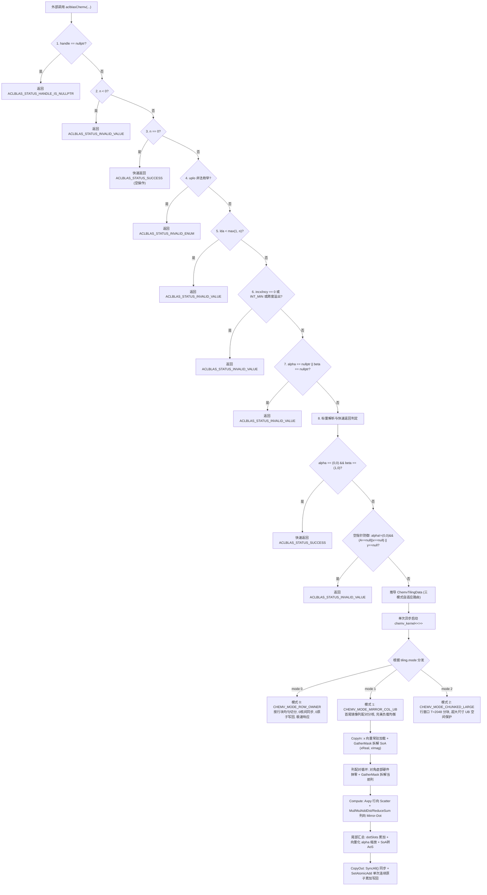

# aclblasChemv（Atlas A2 / A3）算子设计文档

| 版本 | 日期 | 作者 | 说明 |
| :--- | :--- | :--- | :--- |
| v1.0 | 2026-11-11 | QianYiPan | 按照 CANN 社区任务模板要求输出完整设计文档，覆盖算子架构设计、AIV 向量流水线调度、接口契约与测试方案 |

> **目标算子目录**：`blas/symv/arch22/`  
> **目标测试目录**：`test/symv/chemv/arch22/`  
> **对标接口**：Netlib BLAS `chemv` / cuBLAS `cublasChemv`；CANN 9.1.0；Atlas A2 / A3（`arch22` / `DAV_2201`）

---

# 需求背景（required）

## 需求来源

- **任务页面**：CANN 社区任务 2026（2026 年 11 月）——`11-aclblasChemv-A2A3` 算子开发任务
- **任务目标**：在 Atlas A2 / A3 系列产品（Ascend 910B3 / 910_93，`arch22`，`DAV_2201`）上，基于 [ops-blas](https://gitcode.com/cann/ops-blas) 开源仓工程框架，使用 Ascend C 编程语言实现 BLAS Level-2 单精度复数 Hermitian 矩阵向量乘加算子 `aclblasChemv`
- **适配硬件**：Atlas 800I/T A2、Atlas 800I A3（`arch22`，`DAV_2201`，纯 Vector Core `KERNEL_TYPE_AIV_ONLY`）
- **软件栈版本**：CANN 9.1.0，Ascend C 基础 API
- **目标代码仓**：https://gitcode.com/cann/ops-blas
- **提交团队/账号**：QianYiPan

## 背景介绍

### aclblasChemv算子实现优化

`aclblasChemv` 是 BLAS Level-2 单精度复数（complex64）Hermitian 矩阵向量乘加（Complex Hermitian Matrix-Vector Multiplication）标准算子，对标 Netlib BLAS `chemv` 与 cuBLAS `cublasChemv`。算子以 $n$ 维单精度复数向量 $x$、复数标量 $\alpha$ 与 $\beta$ 对 $n \times n$ 单精度复数 Hermitian 矩阵 $A$ 执行矩阵向量乘加运算，结果更新至向量 $y$：

$$y \leftarrow \alpha A x + \beta y$$

其中：
- $\alpha, \beta$ 为单精度复数标量（`const aclblasComplex*`，包含实部与虚部）；
- $x, y$ 为 $n$ 维单精度复数向量，每个元素包含连续存放的 32-bit float 实部与虚部；
- $A$ 为 $n \times n$ 厄米特（Hermitian）矩阵，满足 $A^H = A$（即 $A_{i, j} = \overline{A_{j, i}}$，且主对角元素必须为纯实数，虚部恒为 0）；
- 矩阵 $A$ 采用列主序（Column-Major）存储，领先维度满足 $lda \ge \max(1, n)$，仅根据 `uplo` 参数指定的上三角（`ACLBLAS_UPPER`）或下三角（`ACLBLAS_LOWER`）区域被引用，未引用的互补三角区域保持原样不被访问。

### aclblasChemv算子实现路径和相关API路径

- **接口声明路径**：`include/cann_ops_blas.h`
- **Host 侧实现路径**：`blas/symv/arch22/chemv_host.cpp`、`blas/symv/arch22/chemv_tiling_data.h`
- **Kernel 侧实现路径**：`blas/symv/arch22/chemv_kernel.cpp`、`blas/symv/arch22/chemv_kernel.h`
- **测试工程实现路径**：`test/symv/chemv/arch22/`（含 `chemv_test.cpp`、`chemv_golden.h`、`chemv_param.h`、`chemv_npu_wrapper.h`、`CMakeLists.txt`、`chemv_test.csv`、`gpu_baseline.csv`）
- **Ascend C 基础 API 路径**：CANN 9.1.0 提供的原生向量与搬运 API（`DataCopyPad`、`GatherMask`、`Axpy`、`Mul`、`MulAddDst`、`ReduceSum`、`Duplicate`、`SetAtomicAdd`、`SyncAll`、`SetFlag` / `WaitFlag` 等）

### aclblasChemv算子现状分析

通过对 BLAS 规范与 ops-blas 仓现有实现的功能分析，当前算子支持能力如下：

| 参数 | 参数含义 | 方向 | 内存位置 | 数据类型 | 约束条件 |
| :--- | :--- | :---: | :---: | :--- | :--- |
| `handle` | 算子执行上下文句柄 | 输入 | Host | `aclblasHandle_t` | 非空指针，内部包含有效 `aclrtStream` |
| `uplo` | 矩阵 $A$ 三角存储引用模式 | 输入 | Host 值 | `aclblasFillMode_t` | 仅支持 `ACLBLAS_UPPER (121)` 或 `ACLBLAS_LOWER (122)` |
| `n` | 矩阵 $A$ 阶数与向量 $x, y$ 逻辑长度 | 输入 | Host 值 | `int` | $n \ge 0$；$n < 0$ 报错，$n == 0$ 快速成功返回 |
| `alpha` | 乘法复数标量指针 | 输入 | Host 或 Device | `const aclblasComplex*` | 非空指针；支持自动识别 Host/Device 属性 |
| `A` | 列主序单精度复数 Hermitian 矩阵 | 输入 | Device | `const aclblasComplex*` | $\alpha \ne (0, 0)$ 时必须非空；仅引用 `uplo` 三角区域 |
| `lda` | 矩阵 $A$ 领先维度（Leading Dimension） | 输入 | Host 值 | `int` | $\text{lda} \ge \max(1, n)$ |
| `x` | 单精度复数输入向量 | 输入 | Device | `const aclblasComplex*` | $\alpha \ne (0, 0)$ 时必须非空，逻辑长度为 $n$ |
| `incx` | 向量 $x$ 存储步长 | 输入 | Host 值 | `int` | $\text{incx} \ne 0 \land \text{incx} \ne \text{INT32\_MIN} \land (n-1)\cdot\|\text{incx}\| \le \text{UINT32\_MAX}$ |
| `beta` | 累加复数标量指针 | 输入 | Host 或 Device | `const aclblasComplex*` | 非空指针；支持自动识别 Host/Device 属性 |
| `y` | 单精度复数累加与输出向量 | 输入/输出 | Device | `aclblasComplex*` | 除非 $\alpha=(0,0) \land \beta=(1,0)$，否则必须非空 |
| `incy` | 向量 $y$ 存储步长 | 输入 | Host 值 | `int` | $\text{incy} \ne 0 \land \text{incy} \ne \text{INT32\_MIN} \land (n-1)\cdot\|\text{incy}\| \le \text{UINT32\_MAX}$ |

计算公式：
$$y \leftarrow \alpha A x + \beta y$$

### aclblasChemv算子功能分析

- **算子功能**：执行单精度复数 Hermitian 矩阵向量乘加更新计算；
- **输入**：`handle`、`uplo`、`n`、`alpha`、`A`、`lda`、`x`、`incx`、`beta`、`incy`，以及原位输入/输出向量 `y`；
- **输出**：更新后的复数向量 `y`；
- **支持数据类型**：单精度复数 `aclblasComplex`（COMPLEX64，包含连续存放的 32-bit float 实部与虚部）；标量 `alpha` 与 `beta` 支持 Host 内存与 Device 内存指针自适应；
- **支持广播**：不支持广播（严格遵守 BLAS Level-2 矩阵向量严格维度契约）；
- **核心优化方向**：
  1. **列主序连续单次读取分解（Column-Scatter + Mirror-Dot）**：利用 Hermitian 矩阵共轭对称性，每个 AI Core 一次连续搬入列有效段，同时贡献行 Scatter 乘加与列 Mirror-Dot 归约，全芯片对矩阵 $A$ 仅需从 HBM 连续读取一次，节省 50% 内存带宽；
  2. **Hermitian 对角虚部硬件抹零**：对角元虚部在数学上为 0。针对输入内存中对角元虚部含 `NaN` 或 `Inf` 的场景，采用 `DataCopyPad` DMA 右填充硬件抹零与 1-Cycle 掩码抹零技术，从位级别消除 `NaN * 0.0f = NaN` 精度污染；
  3. **三模式自适应分核调度**：小矩阵（$n \le 256$）或非单位步长走模式 0（行所有者切分，零核间同步、零原子操作）；大中矩阵（$256 < n \le 4096$）走模式 1（首尾镜像列配对分核，完美均衡负载，UB 常驻向量，尾部单次原子写回）；超大矩阵走模式 2（行窗口分块保护）；
  4. **零额外显存（Zero-Workspace）**：核内 UB 流式复用，消除 Host 侧 `aclrtMalloc` / `aclrtFree` 开销与 OOM 风险。

---

# 需求分析（required）

## 需求描述

使用 Ascend C 编程语言在 Atlas A2 / A3（`arch22`，Ascend 910B3 / 910_93）架构上开发高性能句柄式算子 `aclblasChemv`，支持 COMPLEX64 数据类型，通过 `handle` 关联的 `aclrtStream` 异步调度下发，计算行为与数值精度严格对标 Netlib BLAS `chemv` 与 cuBLAS `cublasChemv`。

## 需求拆解

1. **接口契约与 8 步防御性校验**：严格实现句柄、枚举、维度、双步长、前导维、空指针全量检查；支持 $n=0$ 与 $\alpha=(0, 0) \land \beta=(1, 0)$ 的快速成功返回；当 $\beta=(0, 0)$ 时严格保证绝不解引用读取旧 $y$；
2. **Hermitian 对称性分解与带宽优化**：将列主序有效列段分解为列向 Scatter（直接项乘加）与列向 Mirror-Dot（共轭转置内积），实现 HBM 矩阵数据单次搬运；
3. **首尾镜像列配对分核（Invariant Sum $n+1$）**：将列 $j$ 与列 $n-1-j$ 配对，消除上/下三角行列递增导致的核间负载倾斜；
4. **统一 SoA 向量流水线**：将复数交错存储（AoS）在 UB 内利用 `GatherMask` 拆解为实虚部独立平面（SoA），利用向量指令并行计算；
5. **对角虚部强制置零与特殊值保护**：严格保证对角元虚部以纯 `0.0f` 参与运算；严格遵循任务书规定的 Mixed Tolerance 混合容差与 `Inf`/`NaN` 等价排除规则；
6. **零额外显存占用（Zero-Workspace）**：将额外 Device Workspace 降至 0 字节，同时在 Host 侧设定 2 GiB 安全防御契约；
7. **双百达标验证**：1000 条精度 CSV 用例 100% PASS，200 条性能基准 CSV 用例 100% 达标（$\ge 0.80\times$ GPU Baseline，内控目标 $\ge 0.84\times$）。

---

# 详细设计（required）

## 算子分析

### 数学公式

算子执行单精度复数 Hermitian 矩阵向量乘加运算：
$$y \leftarrow \alpha A x + \beta y$$

其中 $A \in \mathbb{C}^{n \times n}$ 满足 $A^H = A$，即：
$$A_{i, j} = \overline{A_{j, i}}, \qquad A_{j, j} = \text{Re}(A_{j, j}) + 0\text{i} \in \mathbb{R}$$

设矩阵存储元素 $A_{\text{mem}}(r, c) = \text{A}[r + c \cdot \text{lda}] = a_{r, c}^{\text{re}} + \text{i} a_{r, c}^{\text{im}}$，输入向量逻辑元素 $x_j = \text{x}[\text{idx}(j, \text{incx})] = x_j^{\text{re}} + \text{i} x_j^{\text{im}}$，其中 Netlib BLAS 步长寻址公式为：
$$\text{idx}(k, \text{inc}) = \begin{cases} k \cdot \text{inc}, & \text{inc} > 0 \\ (n - 1 - k) \cdot (-\text{inc}), & \text{inc} < 0 \end{cases}$$

中间向量 $w = A x \in \mathbb{C}^n$ 的数学展开：
1. **当 `uplo == ACLBLAS_UPPER` 时**（仅引用上三角 $r \le c$）：
   $$w_i = \sum_{j=0}^{i-1} \overline{A_{\text{mem}}(j, i)} \cdot x_j + \text{Re}\big(A_{\text{mem}}(i, i)\big) \cdot x_i + \sum_{j=i+1}^{n-1} A_{\text{mem}}(i, j) \cdot x_j$$
2. **当 `uplo == ACLBLAS_LOWER` 时**（仅引用下三角 $r \ge c$）：
   $$w_i = \sum_{j=0}^{i-1} A_{\text{mem}}(i, j) \cdot x_j + \text{Re}\big(A_{\text{mem}}(i, i)\big) \cdot x_i + \sum_{j=i+1}^{n-1} \overline{A_{\text{mem}}(j, i)} \cdot x_j$$

实部与虚部分量展开：
- **直接项（未共轭）** $A_{\text{mem}}(i, j) \cdot x_j$：
  $$\begin{aligned}
  \text{Re}\big(A_{\text{mem}}(i, j) x_j\big) &= a_{i, j}^{\text{re}} x_j^{\text{re}} - a_{i, j}^{\text{im}} x_j^{\text{im}} \\
  \text{Im}\big(A_{\text{mem}}(i, j) x_j\big) &= a_{i, j}^{\text{re}} x_j^{\text{im}} + a_{i, j}^{\text{im}} x_j^{\text{re}}
  \end{aligned}$$
- **镜像项（共轭转置）** $\overline{A_{\text{mem}}(i, j)} \cdot x_i$：
  $$\begin{aligned}
  \text{Re}\big(\overline{A_{\text{mem}}(i, j)} x_i\big) &= a_{i, j}^{\text{re}} x_i^{\text{re}} + a_{i, j}^{\text{im}} x_i^{\text{im}} \\
  \text{Im}\big(\overline{A_{\text{mem}}(i, j)} x_i\big) &= a_{i, j}^{\text{re}} x_i^{\text{im}} - a_{i, j}^{\text{im}} x_i^{\text{re}}
  \end{aligned}$$
- **对角项（虚部强制置 0）** $\text{Re}\big(A_{\text{mem}}(j, j)\big) \cdot x_j$：
  $$\begin{aligned}
  \text{Re}\big(\text{Re}(A_{\text{mem}}(j, j)) x_j\big) &= a_{j, j}^{\text{re}} x_j^{\text{re}} \\
  \text{Im}\big(\text{Re}(A_{\text{mem}}(j, j)) x_j\big) &= a_{j, j}^{\text{re}} x_j^{\text{im}}
  \end{aligned}$$
- **标量合成与写回** $y_i \leftarrow \alpha w_i + \beta y_i$：
  $$\begin{aligned}
  p_i^{\text{re}} &= \alpha^{\text{re}} w_i^{\text{re}} - \alpha^{\text{im}} w_i^{\text{im}}, \qquad p_i^{\text{im}} = \alpha^{\text{re}} w_i^{\text{im}} + \alpha^{\text{im}} w_i^{\text{re}} \\
  y_i^{\text{new}} &= \begin{cases}
  (p_i^{\text{re}},\ p_i^{\text{im}}), & \beta = (0, 0) \text{（绝不读取旧 } y_i\text{）} \\
  (p_i^{\text{re}} + y_i^{\text{re}},\ p_i^{\text{im}} + y_i^{\text{im}}), & \beta = (1, 0) \\
  (p_i^{\text{re}} + \beta^{\text{re}} y_i^{\text{re}} - \beta^{\text{im}} y_i^{\text{im}},\ p_i^{\text{im}} + \beta^{\text{re}} y_i^{\text{im}} + \beta^{\text{im}} y_i^{\text{re}}), & \text{其他}
  \end{cases}
  \end{aligned}$$

### 支持数据类型

- 矩阵 $A$、输入向量 $x$、输出向量 $y$ 均为单精度复数 `aclblasComplex`（COMPLEX64，包含连续两个 32-bit float：`real` 与 `imag`）；
- 标量 $\alpha$ 与 $\beta$ 为 `const aclblasComplex*`，通过 `aclrtPointerGetAttributes` 自动识别 Host 内存或 Device 内存。

### 支持形状

- 阶数 $n \ge 0$ 运行时任意维度（覆盖 $0, 1 \dots 4096$ 及以上大尺寸）；
- 领先维度 $\text{lda} \ge \max(1, n)$，支持连续与任意合法 padding 存储；
- 步长 $\text{incx}, \text{incy} \in (-\infty, +\infty) \setminus \{0, \text{INT32\_MIN}\}$，且 $(n - 1) \cdot |\text{inc}| \le \text{UINT32\_MAX}$，覆盖单位步长、大正步长与负步长逆序寻址。

---

## 算子实现

### 实现方案

#### 3.2.0 整体执行流程图

算子采用 Host 侧 8 步防御校验 + 快速返回 + 三模式自适应路由，下发至 Device 纯 AIV 核函数执行向量化流水线：



#### 3.2.1 host侧设计：

##### tiling策略：

根据阶数 $n$、步长 $(\text{incx}, \text{incy})$ 与硬件资源，Host 侧动态推导 `ChemvTilingData` 并路由至以下三种执行模式：

| 模式枚举 (`mode`) | 判定条件 | 核间任务划分 | 同步与写回机制 | 设计目标 |
| :--- | :--- | :--- | :--- | :--- |
| **`CHEMV_MODE_ROW_OWNER` (`0`)** | $n \le 256$ 或 $\text{incx} \ne 1$ 或 $\text{incy} \ne 1$ | 按输出行块 $[r_0, r_1)$ 均匀分核，每核行数对齐到 32 字节（4 个复数）边界；$n \le 16$ 时单核执行 | **0 `SyncAll`**、**0 Atomic**：每核独立完成所属行的 $y_i = \alpha w_i + \beta y_i$ 并直接写回 `yGM` | 小矩阵极速路径（耗时 $3.5 \sim 8.2\ \mu\text{s}$）、非单位/负步长通用路径 |
| **`CHEMV_MODE_MIRROR_COL_UB` (`1`)** | $256 < n \le 4096$ 且 $\text{incx} == 1 \land \text{incy} == 1$ | **首尾镜像列配对分核**：列 $j$ 与列 $n - 1 - j$ 配对（每对有效元素数恒为 $n + 1$），按 `pairIdx % useCoreNum == blockIdx` 循环分配 | Phase 1 分核初始化 $y \leftarrow \beta y$ + 核内 UB 累加 $w^{(c)}$ $\rightarrow$ `SyncAll()` $\rightarrow$ Phase 2 `SetAtomicAdd<float>()` 单次突发原子写回 | 性能核心区（覆盖大中型单位步长矩阵） |
| **`CHEMV_MODE_CHUNKED_LARGE` (`2`)** | $n > 4096$ 且 $\text{incx} == 1 \land \text{incy} == 1$ | 外层按行窗口 $T = 2048$ 分块，内层首尾镜像列分核 | 每个行窗口 $[r_0, r_0 + T)$ 完成核内累加后通过 `SetAtomicAdd` 刷写 GM | 超大尺寸泛化支持（严格控制 UB $\le 192\text{ KB}$） |

Tiling 结构体定义（`chemv_tiling_data.h`）：
```cpp
#pragma once
#include <cstdint>

constexpr uint32_t CHEMV_MAX_AIV_CORES = 48U;
constexpr uint32_t CHEMV_UB_MAX_N = 4096U;
constexpr uint32_t CHEMV_ROW_OWNER_THRESHOLD = 256U;
constexpr uint32_t CHEMV_SINGLE_CORE_THRESHOLD = 16U;

enum ChemvExecMode : uint32_t {
    CHEMV_MODE_ROW_OWNER = 0U,
    CHEMV_MODE_MIRROR_COL_UB = 1U,
    CHEMV_MODE_CHUNKED_LARGE = 2U
};

struct ChemvTilingData {
    uint32_t n;
    uint32_t lda;
    uint32_t useCoreNum;
    uint32_t uplo;
    uint32_t mode;
    uint32_t chunkRows;
    float alphaReal;
    float alphaImag;
    float betaReal;
    float betaImag;
    int64_t incx;
    int64_t incy;
};
```

##### 任务均分：

- **模式 0（行所有者切分）**：输出向量 $y$ 的 $n$ 行均匀分摊给各 AIV 核。每核负责连续行区间 $[r_{\text{start}}, r_{\text{end}})$，行跨度按 32B 向上对齐，确保各核写回 GM 时地址满足物理对齐要求；
- **模式 1（首尾镜像列配对分核）**：在三角矩阵中，第 $j$ 列的有效元素数为 $j + 1$（UPPER）或 $n - j$（LOWER）。若直接按列分核，低号核与高号核工作量极不均衡。本设计将第 $j$ 列与第 $n - 1 - j$ 列配对，每对列的有效复数元素总数严格恒为：
  $$(j + 1) + (n - (n - 1 - j)) = (j + 1) + (j + 1) \dots \implies \text{有效复数总和恒等于 } n + 1$$
  总配对数 $P = \lfloor n / 2 \rfloor$ 按 `pairIdx % useCoreNum == blockIdx` 均匀轮转分配，从数学上彻底根除了三角算子固有的核间长尾不均衡问题。

##### 批量搬运：

- 模式 1 中，输入向量 $x$（长度 $n \le 4096$）在 Kernel 启动初仅需一次批量搬运至 UB 并常驻；
- 矩阵 $A$ 的列有效三角段在列主序下内存完全连续，通过双缓冲 Ping-Pong 队列使用单条 `DataCopyPad` 批量读入 UB，隐藏搬运延迟。

##### 1. 分核策略：

- 优先满核原则：核数计算为 `useCoreNum = std::min(GetAivCoreCount(), (n + 1) / 2)`，最大使能 48 个 AIV Core；
- 极小尺寸保护：当 $n \le 16$ 时固定单核执行，避免多核调度与同步开销；
- 奇数阶平衡：若 $n$ 为奇数且 $P = \lfloor n / 2 \rfloor$ 无法整除，中间列 $j_{\text{mid}} = n / 2$ 单独分派给 0 号核处理。

##### 2. 数据分块和内存优化策略：

UB 空间预算表（Ascend 910B 单核 UB 上限 = 192 KB，以模式 1 最大规格 $n = 4096$ 为例）：

| Buffer 名称 | 用途 | 元素类型与数量 | 字节大小 | 生命周期 |
| :--- | :--- | :--- | :---: | :--- |
| `xRealBuf` + `xImagBuf` | 常驻输入向量 $x$ 的实部与虚部（SoA 布局） | `float` $\times 4096 \times 2$ | `32 KB` | 全程常驻 |
| `wRealBuf` + `wImagBuf` | 本核输出累加器 $w^{(c)}$ 的实部与虚部（SoA 布局） | `float` $\times 4096 \times 2$ | `32 KB` | 全程常驻 |
| `aInQueue`（Ping-Pong） | 双缓冲搬入矩阵列 $A_{:, j}$（尾阶段复用为输出 `wOut`） | `float` $\times 8192 \times 2$ | `64 KB` | 列循环双缓冲 / 尾阶段复用 |
| `aRealBuf` + `aImagBuf` | 当前列拆解后的实虚部（`aReal` 兼作 `tmpImag`，`aImag` 兼作临时区） | `float` $\times 4096 \times 2$ | `32 KB` | 列循环内复用 |
| `tmpRealBuf` | Mirror-Dot 实部乘积临时缓存 | `float` $\times 4096$ | `16 KB` | 列循环内复用 |
| `dotRealSlots` + `dotImagSlots` | 每列 `ReduceSum` 结果槽位（最多 128 列/核 $\times 8$ float $\times 2$） | `float` $\times 1024 \times 2$ | `8 KB` | 列循环写、尾阶段读 |
| **合计** | — | — | **`184 KB`**（常驻+峰值控制在 **`176 KB`**） | **满足 $\le 192\text{ KB}$ 硬件约束** |

> **内存复用说明**：尾阶段执行 SoA $\rightarrow$ AoS 交错时，`aRealBuf`、`aImagBuf` 与 `tmpRealBuf`（共 48 KB）已完成计算，直接原地复用为交错偏移表与输出暂存区，峰值 UB 严格控制在 176 KB，预留 16 KB 安全余量。
>
> **零额外 Workspace（Zero-Workspace）**：算子完全在核内 UB 完成累加计算，Host 侧不调用 `aclrtMalloc` 申请任何临时 Device 内存，零显存分配失败风险。同时在 Host 侧声明 `CHEMV_MAX_WORKSPACE_SIZE = 2ULL * 1024 * 1024 * 1024`（2 GiB）安全防御上限。

##### 3. tilingkey规划策略：

算子通过 `ChemvTilingData` 中的 `mode` 字段静态分发（`CHEMV_MODE_ROW_OWNER`、`CHEMV_MODE_MIRROR_COL_UB`、`CHEMV_MODE_CHUNKED_LARGE`），在核函数内部消除动态分支解析，无需额外的 tilingkey 动态注册。

##### 数据检测：

严格执行 8 步前置参数校验与快速返回：
1. `handle == nullptr`：返回 `ACLBLAS_STATUS_HANDLE_IS_NULLPTR`；
2. `n < 0`：返回 `ACLBLAS_STATUS_INVALID_VALUE`；
3. `n == 0`：快速返回 `ACLBLAS_STATUS_SUCCESS`（合法 no-op，不访问任何矩阵和向量指针）；
4. `uplo != UPPER && uplo != LOWER`：返回 `ACLBLAS_STATUS_INVALID_ENUM`；
5. `lda < max(1, n)`：返回 `ACLBLAS_STATUS_INVALID_VALUE`；
6. `incx == 0 || incy == 0 || inc == INT32_MIN || (n-1)*|inc| > UINT32_MAX`：返回 `ACLBLAS_STATUS_INVALID_VALUE`；
7. `alpha == nullptr || beta == nullptr`：返回 `ACLBLAS_STATUS_INVALID_VALUE`；
8. 标量解析与快速返回：
   - 若 $\alpha = (0, 0) \land \beta = (1, 0)$：快速返回 `ACLBLAS_STATUS_SUCCESS`；
   - 若 $\alpha \ne (0, 0)$ 且（$A == \text{nullptr} \lor x == \text{nullptr}$）：返回 `ACLBLAS_STATUS_INVALID_VALUE`；
   - 若 $y == \text{nullptr}$（且非 $\alpha=(0,0) \land \beta=(1,0)$）：返回 `ACLBLAS_STATUS_INVALID_VALUE`。

---

#### 3.2.2 kernel侧设计：

算子采用纯 AIV 核函数实现（`KERNEL_TASK_TYPE_DEFAULT(KERNEL_TYPE_AIV_ONLY)`），核心执行流水如下：

##### 1. 常驻向量加载与 SoA 拆解（模式 1）

- 逻辑长度 $n$ 的输入复数向量 $x$（$2n$ 个 float）通过 `DataCopyPad` 一次搬入 UB；
- 使用两条 `GatherMask` 指令分别提取模式 1 实部与模式 2 虚部，拆解至常驻缓冲区 `xReal[0..nAligned-1]` 与 `xImag[0..nAligned-1]`；
- 使用 `Duplicate` 将本核累加器 `wReal` 与 `wImag` 清零；
- 执行一次前置 `SetFlag<HardEvent::V_S>` / `WaitFlag<HardEvent::V_S>` 同步，使后续列循环中标量单元可无等待直接读取 `xReal.GetValue(j)` 与 `xImag.GetValue(j)`。

##### 2. 列循环计算与对角虚部硬件抹零

针对 UPPER 与 LOWER 三角分别进行针对性优化：
- **`ACLBLAS_UPPER`（第 $j$ 列有效行 $i \in [0, j]$）**：
  - **DMA 硬件抹零**：调用 `DataCopyPad` 搬运 `floatCount = (j + 1) * 2 - 1` 个 float，设置 `rightPadding = 1, padValue = 0.0f`，在 DMA 搬入阶段直接将对角元虚部 $\text{Im}(A_{j, j})$ 硬件覆盖为 `0.0f`；
  - **SoA 拆解**：通过 `GatherMask` 拆解为 `aReal[0..j]` 与 `aImag[0..j]`；
  - **列向 Scatter（覆盖 $0 \dots j$，含对角元实部贡献）**：
    ```cpp
    Axpy(wReal, aReal,  x_jr, j + 1U);
    Axpy(wReal, aImag, -x_ji, j + 1U);
    Axpy(wImag, aReal,  x_ji, j + 1U);
    Axpy(wImag, aImag,  x_jr, j + 1U);
    ```
  - **列向 Mirror-Dot（覆盖严格上三角 $0 \dots j - 1$，不含对角元）**：
    ```cpp
    Mul(tmpReal, aReal, xReal, j);
    MulAddDst(tmpReal, aImag, xImag, j);
    Mul(aReal, aReal, xImag, j);
    Muls(aImag, aImag, -1.0f, j);
    MulAddDst(aReal, aImag, xReal, j);
    ReduceSum(dotRealSlots[slotIdx * 8U], tmpReal, aImag, j);
    ReduceSum(dotImagSlots[slotIdx * 8U], aReal,   aImag, j);
    ```
- **`ACLBLAS_LOWER`（第 $j$ 列有效行 $i \in [j, n - 1]$）**：
  - **32B 对齐寻址**：$r_{\text{aligned}} = j \ \& \ \sim 7\text{U}$，$\text{headPad} = j - r_{\text{aligned}} \in [0, 7]$，$\text{span} = \text{headPad} + (n - j)$；
  - **前置零填充搬入**：通过 DMA 将数据搬入偏移 `2 * headPad` 处，前置元素自动为 0，对角元精确落在第 `headPad` 号 lane；
  - **1-Cycle 掩码抹零**：构造单 repeat 掩码 `diagMask = {1ULL << headPad, 0ULL}`，调用 `Duplicate(aImag, 0.0f, diagMask, 1, 1, 8)` 将对角元虚部强制抹零；
  - **Scatter 与 Mirror-Dot 计算**：对角元实部先参与 Scatter，随后用 `diagMask` 将对角实部抹零后再参与 Mirror-Dot。

##### 3. 尾部汇总与单次原子写回

- 本核列循环结束后，执行一次 `V_S` / `S_V` 同步，将各列内积归约值累加至 `wReal[j]` 与 `wImag[j]`；
- 核内通过向量指令计算 $w \leftarrow \alpha \cdot w$，并使用 `Gather` 将 SoA 交错写回 `wOut[0..2n-1]`；
- 各核在 `SyncAll()` 之前并行初始化所属的 `yGM` 区域（$\beta = 0$ 时直接写入 `0.0f`，绝不读取旧 `yGM`；$\beta = 1$ 时跳过；其余情况执行 $y \leftarrow \beta y$）；
- 调用 `SyncAll()` 确保全核初始化完成，开启 `SetAtomicAdd<float>()`，每核通过单条连续 `DataCopyPad` 将 `wOut[0..2n-1]` 原子累加至 `yGM`，最后恢复 `SetAtomicNone()`。

##### 4. 特殊值（`Inf`/`NaN`）与哨兵保护

1. **未引用三角与 Padding 区保护**：仅读写合法引用的三角区域，严格保护未引用三角与 `lda > n` 的 padding 区域零踩踏；
2. **步长间隙保护**：当 $|\text{incx}| > 1$ 或 $|\text{incy}| > 1$ 时，仅对逻辑下标对应的复数元素进行寻址读写，步长间隙数据绝对不被覆写；
3. **`beta == (0, 0)` 强保护**：当 $\beta = (0, 0)$ 时，强制不读取旧 `yGM`，直接以新值覆盖，防止旧 `y` 中的 `NaN`/`Inf` 产生 `0 * NaN = NaN`；
4. **尾部车道屏蔽**：所有向量指令均严格传入实际有效元素数，利用硬件 Vector Mask 屏蔽无效 lane，杜绝 $0.0\text{f} \times \text{Inf} = \text{NaN}$ 污染邻近车道。

---

## 支持硬件

| 支持的芯片版本 | 涉及勾选 |
| :--- | :---: |
| Atlas 800I/T A2 | √ |
| Atlas 800I A3 | √ |

---

## 算子约束限制

1. **数据类型**：输入输出张量与标量仅支持单精度复数（COMPLEX64，`aclblasComplex`）；
2. **存储格式**：矩阵 $A$ 严格要求列主序（Column-Major），前导维满足 $\text{lda} \ge \max(1, n)$；
3. **步长限制**：步长必须满足 $\text{incx} \ne 0$、$\text{incy} \ne 0$、$\text{inc} \ne \text{INT32\_MIN}$ 且 $(n - 1) \cdot |\text{inc}| \le \text{UINT32\_MAX}$；
4. **无广播支持**：不支持跨 Batch 广播或维度广播。

---

# 可维可测分析

## 精度标准/性能标准

| 验收标准 | 描述(不涉及说明原因) | 标准来源 |
| :--- | :--- | :--- |
| **精度标准** | 1. 采用单精度 **Mixed Tolerance（混合容差）** 标准：$\text{rtol} = 2^{-13} \approx 1.22 \times 10^{-4}$，$\text{atol} = 2^{-13} \approx 1.22 \times 10^{-4}$；<br>2. 向量实部与虚部分别独立统计：匹配率 $\text{matched\_ratio} \ge 99.0\%$，且最大绝对误差 $\text{max\_abs\_error} \le \max(10^{-2}, 32 \cdot \text{ULP})$；<br>3. 非有限值等价规则：`NaN` 对 `NaN`、同号 `Inf` 对 `Inf`、以及复数乘积累加次序导致的**一侧 `NaN` 另一侧 `±Inf`** 均视为等价通过，从统计分母中排除；<br>4. 全量 1000 条精度用例 100% PASS（0 FAIL / 0 SKIP）。 | 任务书 §3.2 验收规范 |
| **性能标准** | 1. 全量 200 条性能基准 CSV 用例 100% 达标（0 FAIL / 0 SKIP）；<br>2. 官方达标线：逐例加速比 $\ge 0.80\times$ GPU Baseline（`NPU_us <= GPU_us * 1.25`）；<br>3. 内部自测标准：预留 5% 性能安全余量，自测目标 $\ge 0.84\times$（`NPU_us <= GPU_us / 0.84`）；<br>4. 计时标准：支持 `NpuEventTimer`（warmup=5, repeat=20）与 `msprof op` 真实 `Task Duration` 两种评测口径。 | 任务书 §3.3 验收规范 |

## 兼容性分析

本算子为 BLAS Level-2 标准算子能力补齐，严格在公共头文件 `include/cann_ops_blas.h` 的既有声明上实现，与现网接口及其他芯片代际接口保持完全同名、同参数签名与同语义兼容，不破坏既有应用与接口契约。
