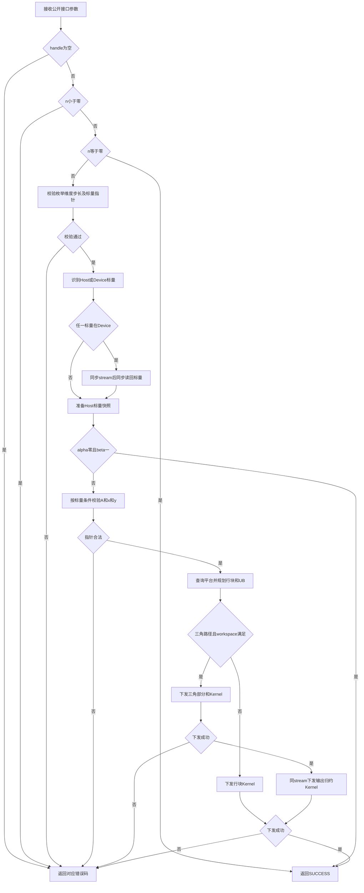
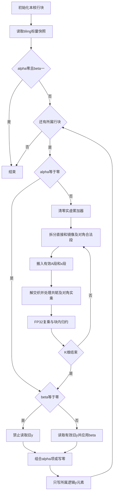

# aclblasChemv 算子设计文档

## 需求背景（required）

### 需求来源

本设计对应[11月社区任务-aclblasChemv算子开发（A2/A3）](https://www.hiascend.com/activities/task-center/details/cbfd47808791498d94595dd9e48500aa?menu=guide)，依据随任务提供的 `aclblasChemv_AtlasA2_A3_task_doc.md`、`chemv_test.csv`、`gpu_baseline.csv`、`gen_csv.py`、两个验证脚本与测试指导制定。计划使用 Ascend C kernel 直调模式，为 `cann/ops-blas` 补齐 Atlas A2/A3 上的 COMPLEX64 Hermitian 矩阵向量乘。

设计文档提交至 `cann/cann-ops-competitions`（任务书中的 `cann/cann-competitions` 当前指向同一仓库）的 `04_tasks/01_community-task-2026/tasklist/11-aclblasChemv-A2A3/Twilight-Fanyi/docs/design.md`。按仓库允许贡献者创建算子任务目录的约定，使用月份、算子名称与目标产品建立任务目录，以 `Twilight-Fanyi` 为贡献者目录。

### 背景介绍

当前 ops-blas 的 `blas/symv/arch22/` 已有实数 `aclblasSsymv`；`arch35/` 已有复数对称 `aclblasCsymv`。公共头文件尚无 `aclblasChemv` 声明，`test/symv/chemv/` 尚不存在。本任务计划新增公共声明、arch22 Host/Kernel 与 GTest 工程，保持同族已有算子的行为。

Chemv 与 Csymv 的差别是镜像位置必须取共轭、对角虚部不参与计算。不得仅重命名 Csymv，也不得全矩阵搬入后再屏蔽未引用三角。计划复用同族工程组织、复数存储方式及 Host/Device 标量位置探测方式；校验顺序以本任务书为准，不照搬 Ssymv 的旧校验顺序。

任务包存在以下需要分别验证的契约差异。

| 项目 | 任务书与附件差异 | 计划处理 |
| --- | --- | --- |
| 性能计时 | 任务书要求 msprof task duration；README 与脚本实际使用 aclrtEvent 的 `[PERF] avg_us` | 同时采集两口径，各自按完整 API 耗时对标并分别满足门限，不相互替代 |
| 基线键 | 200 行基线只有 197 个唯一参数键，三个重复键耗时不同，脚本采用后行覆盖 | 保留原件并复现脚本；另以重复键中较小 `gpu_ms` 复核 |
| 精度类别数 | README 写 TC_ED 30、TC_EX 780；实际 CSV 为 32、778 | 按原始 CSV 的真实用例集合执行，共 1000 条精度 |
| 输入分布 | 任务书要求均匀/正态各 50%；原 CSV 没有正态 token | 保留官方集，另补充成对分布精度队列，不替换原件 |
| 版本 | 任务要求安装 CANN 9.1.0，参考链接仍为 8.5 | 构建固定 9.1.0；API 资料使用 9.1 系列并以安装头文件与实测复核 |

## 需求分析（required）

### 需求描述

计划实现 `y = alpha*A*x + beta*y`，A 为 n×n Hermitian 矩阵，列主序存储，仅读取 uplo 指定三角；A、x、y、alpha、beta 均为 `aclblasComplex`。实部和虚部各为 float32；不假定该结构具备额外的 8 字节自然对齐。支持 lda padding 与正负非零向量步长，y 原地更新。n 为运行时参数，不引入广播或额外 Tensor 视图协议。

### 接口与参数分析

计划在 `include/cann_ops_blas.h` 中新增统一公开声明，不定义产品线私有 API。

```cpp
aclblasStatus_t aclblasChemv(
    aclblasHandle_t handle, aclblasFillMode_t uplo, int n,
    const aclblasComplex* alpha, const aclblasComplex* A, int lda,
    const aclblasComplex* x, int incx,
    const aclblasComplex* beta, aclblasComplex* y, int incy);
```

| 参数 | 位置与类型 | 契约 |
| --- | --- | --- |
| handle | Host，aclblasHandle_t | 已创建的有效句柄，携带执行 stream；空句柄返回 HANDLE_IS_NULLPTR |
| uplo | Host，枚举 | ACLBLAS_UPPER 或 ACLBLAS_LOWER；非法返回 INVALID_ENUM |
| n | Host，int | n≥0；负值返回 INVALID_VALUE，零维直接返回 SUCCESS |
| alpha、beta | Host/Device，COMPLEX64 标量指针 | n>0 时非空，按运行时指针属性分别识别；不直接解引用 Device 指针 |
| A | Device，COMPLEX64，lda×n | 列主序，alpha≠0 时必须非空，只读合法三角；对角虚部忽略 |
| lda | Host，int | n>0 时 lda≥max(1,n) |
| x | Device，COMPLEX64 | 逻辑 n 元素；alpha≠0 时非空，物理元素数至少 1+(n−1)abs(incx) |
| incx、incy | Host，int | n>0 时非零且不为 INT32_MIN；跨度检查后以 int64_t 传入 Kernel |
| y | Device，COMPLEX64 | 逻辑 n 元素，物理元素数至少 1+(n−1)abs(incy)；除完整 quick return 外必须非空 |

返回值计划沿用公共 `aclblasStatus_t`。标量属性查询失败返回 INVALID_VALUE；复制、同步和下发失败按当前仓库状态码规则传播，不把运行时失败作为 SUCCESS。调用方应在读取输出前同步 handle 绑定的 stream。A/x/y 交叠的额外别名语义未由任务定义，首版不承诺 x 与 y 同址或 A 与 y 重叠的正确性；y 自身按 incy 原地覆写为必需行为。

### 需求拆解

| 工作项 | 实现边界 | 完成判据 |
| --- | --- | --- |
| 接口与合法性 | 公共声明及 Chemv Host | 签名、状态码、校验优先级和溢出负向用例逐项通过 |
| 数学与存储 | arch22 Kernel | 共轭、对角虚部、列主序、padding、正负步长满足 CBLAS 参考 |
| 标量与异步 | 标量来源记录、handle stream | Host/Device 混合组合、同 stream 标量更新、Host 短路与资源生命周期验证通过 |
| 工程接入 | symv/arch22 与 chemv GTest | A2/A3 可构建，chemv_test 被实际发现，CSV 不落入整数毫秒 runner |
| 精度 | 官方原始 1000 条和补充分布队列 | 全用例集合完整，实虚分别满足混合容差与框架标准 |
| 性能 | 官方原始 200 PF 及 A100 基线 | 每条按两种计时口径分别记录，有效样本≥10，GPU/NPU≥0.8 |
| 交付 | 算子 README、复现步骤、模板自验材料 | 产品表标注 A2/A3 支持，材料对应真实源码、二进制及测试证据 |

## 详细设计（required）

### 算子分析

#### 数学公式

以 0-based 索引定义 `a(i,j)=A[i+j*lda]`。实际参与计算的 H 为：

$$
H_{ij}=\begin{cases}
\operatorname{Re}(a(i,i)), & i=j,\\
a(i,j), & (uplo=UPPER\land i<j)\lor(uplo=LOWER\land i>j),\\
\overline{a(j,i)}, & \text{其余情况}.
\end{cases}
$$

$$
s_i=\sum_{j=0}^{n-1}H_{ij}x[k_x+j\,incx],\qquad
y[k_y+i\,incy]\leftarrow\alpha s_i+\beta y[k_y+i\,incy].
$$

其中 `kx = incx<0 ? (1-n)*incx : 0`，`ky` 同理，传入指针指向物理存储基址。所有起点、乘积和地址偏移拟在 64 位域计算，不能先在 int 中相乘再转换。

对于 `a+bi` 和 `c+di`，复乘实虚结果为 `ac−bd`、`ad+bc`；共轭仅改变虚部符号。计划使用 FP32 乘加与实虚两路归约，不以未经精度证明的 FP16/BF16 Cube 路径替换。对角贡献单独计算 `Re(a(i,i))*x_i`，不构造带虚部零的通用复乘以免引入 `0*Inf`。beta=0 时不读取旧 y；alpha=0 时不读取 A/x；alpha=1 或 beta=1 时计划直接使用相应项，避免额外零乘法污染非有限值。

#### 支持数据类型与形状

| 项目 | 计划支持 |
| --- | --- |
| 输入/输出/标量 | COMPLEX64，float32 实虚交织 |
| 矩阵 | n×n 有效数据，lda×n 全存储，只引用一个三角 |
| 向量 | n 个逻辑元素，incx/incy 支持正负非零值 |
| 边界 | n=0、n=1、质数、非对齐、padding、大跨度合法边界 |
| 计算要求 | 非 bit-exact，无额外确定性要求，无广播 |

### 算子实现

#### 实现方案

计划在现有 `blas/symv/arch22/` 内新增 Chemv 专用 Host、Kernel 和 tiling 文件，文件名拟为 `chemv_host.cpp`、`chemv_kernel.cpp`、`chemv_kernel.h`、`chemv_tiling_data.h`。复用 `blas/common/helper/host_utils.h` 的平台查询与指针位置探测能力，不修改 Ssymv/Csymv 的数学路径。

基础路径采用输出行块独占方案：每个 AIV 负责若干输出行，完整遍历 K 维，在寄存器/UB 中累加后一次写回所属 y。每行只有一个写者，无浮点原子写，不需要全局部分和 workspace。合法非对角元素可能为两个输出方向分别读取，逻辑矩阵流量约为 `8*n*n` 字节。非连续步长和任意复数 alpha 的标量路径按 Netlib 的直接项先缩放、镜像项先累加的顺序计算，避免统一 Ax 后缩放放大与单标杆的舍入差异。

连续 x/y、alpha=1、n≥512 且有效 workspace 足够时，采用 64×64 三角块成对复用：合法非对角块读取一次，为两个输出块生成直接/共轭贡献，写入独占的 `[outputTile,sourceTile,64]` 部分和槽；对角块只搬运合法三角与对角实部，再在 UB 还原。第二 Kernel 沿 sourceTile 归约。两 Kernel 同 stream 顺序执行，不使用浮点原子写；测量覆盖两阶段总耗时，不以单个阶段代替完整 API。此方案仍须经过原始全部性能用例验证，不把采用双阶段本身视为性能达标。

下图描述 Host 校验、标量来源和 Kernel 下发的职责。任何错误分支都应在访问不合法数据之前结束。



#### Host 侧设计

##### 参数校验与短路

计划严格按以下顺序处理：

1. handle 判空；n<0 返回 INVALID_VALUE；n=0 立即 SUCCESS，不读取其他指针或查询设备。
2. n>0 校验 uplo、lda、incx/incy 和 alpha/beta 非空；非法 uplo 返回 INVALID_ENUM。
3. 先拒绝 INT32_MIN，再将步长转 int64_t 取绝对值，计算 `(n−1)*abs(inc)`。拟以当前同族大跨度守卫的 UINT32_MAX 元素偏移域为上限，并检查物理长度、元素到字节的乘法及地址域；超出返回 INVALID_VALUE。负步长起点在此计算，不调用 int 版本 abs。
4. 通过仓内 `CheckPtrLocation` 与 `aclrtPointerGetAttributes` 探测两标量来源。该 Runtime API 的[官方 9.1 系列说明](https://www.hiascend.com/document/detail/en/CANNCommunityEdition/910/API/runtimeapi/aclcppdevg_03_1803.html)列出 A2/A3 支持；实际仍须以 CANN 9.1.0 安装头文件和运行结果核实。Host 值直接读取；任一标量在 Device 时，先同步 handle stream，使此前对标量的写入完成，再同步 D2H 读回这两个标量中位于 Device 的部分。Host 用读取到的标量快照统一判断 short circuit 和条件空指针，快照通过 tiling 按值传入 Kernel。Host 标量路径不增加同步；Device 标量路径的 API 返回前可能等待此前 stream 工作。
5. alpha=0、beta=1 时直接 SUCCESS，A/x/y 可均为空；alpha=0、beta≠1 时允许空 A/x，只校验可写 y；其余情况要求 A/x/y 非空。beta=0 不豁免 y 非空。
6. 其余情况按已读回的标量值下发计算或缩放 Kernel。Kernel 在 handle stream 中异步执行，Host 返回仅表示下发成功，后续执行错误由同步点报告。

Host/Device 地址域探测拟复用 arch35 Csymv 的 `ComplexScalarSource` 思路；与其正常 Device 路径直接在 Kernel 读取的选择不同，本任务首版计划统一读回后在 Host 判定，严格保证 alpha=0、beta=1 时不下发计算 Kernel。该选择满足任务书校验顺序，并明确接受 Device 标量的同步开销；不能声称 Device 标量路径与 Host 路径具有相同下发延迟。

##### Tiling 与资源

tiling 包含 n、lda、uplo、incx/incy、已解析的 alpha/beta 值与 useCoreNum；负步长起点、三角块数和尾部长度由这些参数推导。平台 AIV 数量由当前平台查询，不固定为 8 核，不缓存与错误设备绑定的查询结果。`useCoreNum=min(可用AIV数,ceil(n/rowTile))`；核 c 依次处理行块 c、c+useCoreNum 等，所有核均有明确的有效范围。n 很小时缩减核数，tile 参数根据 UB 与有效任务量选择；具体阈值拟由代表用例测量决定。

基础路径无 GM workspace；三角路径使用句柄现有的有效 workspace，不在每次 API 内分配或扩容。令 T=ceil(n/64)，需求为 `T*T*64*sizeof(aclblasComplex)`，以宽整数计算并限制 T≤256；默认 32 MiB 可覆盖该边界。借用 workspace 为空或不足时回退基础路径，不写入借用缓冲。workspace 由句柄或调用方拥有，应存活至同 stream 的归约结束；核间只共享独占部分和槽，两个 Kernel 的 stream 顺序提供生产消费依赖。Host tiling/标量值按值传递，Kernel 不引用已结束生命周期的 Host 栈。Device A/x/y 由调用方拥有，应存活至 stream 完成；Device 标量在读回完成前须保持有效，后续 Kernel 使用值快照；调用方不得在完成前释放或修改其他 stream 正在使用的输入。

Device 标量解析拟先同步 handle stream，再通过同步 D2H 复制读取栈上标量快照。这样正常返回和错误返回均没有仍向 Host 栈写入的异步复制，不需为该小标量额外维护 pinned 缓冲和异步释放链。已读回值按 Host 快照传入 tiling。仅当存在 Device 标量时发生上述同步；Host 标量计算路径不引入额外 stream 同步。

#### Kernel 侧设计

##### 地址、取数与 Hermitian 还原

对每个输出行块 I 与 K 块 J，计划在搬运前根据 uplo、i、j 分类，直接生成合法地址。对于直接区域读 `A[i+j*lda]`，镜像区域读 `A[j+i*lda]` 并取共轭；对角只读实部 float。两者地址均位于指定三角。跨对角 tile 拟按列或行拆成不越过对角的合法段，不将未引用三角、lda padding 或缓冲区末尾一并 DMA 搬入再 mask。

列主序直接区域可对行段合并搬运，镜像区域可对列 i 中的连续 K 段搬运后在 UB 解交织；非连续 x 使用物理起点和有符号步长读取，必要时仅对合法元素逐个收集。非法地址上的多余 DMA 读不能以“计算时不使用”豁免。

下图描述基础行块路径，数据短路先于对应输入读取。三角路径的 Host 拓扑见前图；其 source/output 归属同样独占，n≤8192 时归约 Kernel 可一次搬入完整的 64 行部分和 slab，补齐 sourceTile 至二次幂后批量归约，较大 n 保留四行归约路径。非对角矩形可用两组 raw/x 缓冲预取，下一块为对角块时串行处理，避免与当前 stage/pr 复用冲突。



##### UB、流水与尾部

设输出行 tile 为 R、归约 tile 为 K，拟预留双缓冲的复数矩阵输入 `16*R*K` 字节、双缓冲复数 x `16*K` 字节、解交织矩阵两路 `8*R*K` 字节、x 两路 `8*K` 字节、复乘临时两路 `8*R*K` 字节、累加及输出 `24*R` 字节，另预留归约 API scratch 与控制缓冲 S。保守预算为：

$$
UB_{need}=32RK+24K+24R+S\le UB_{available}.
$$

R、K 初始候选拟取小的对齐值，例如 R=8、K=128，在已安装工具链中核对 API 临时空间后再确定 S 和实际 tile，不硬编码整机 UB 为所有产品通用常量。未启用双缓冲的路径仍应使用同一严格上界。若预算不足，减小 K/R 或禁用双缓冲，不越界分配。

每个 buffer 仅在 CopyIn 完成后参与计算、计算完成后复用；计划使用 Ascend C 的队列及事件机制建立搬运、计算和输出依赖，不以手写延时替代同步。实虚两路累加在遍历完 K 后统一施加 alpha。n 尾块使用有效行数/列数；UB 补零只作用于本地未用 lane，GM 取数严格限于有效三角段。连续 y 仅对有效字节搬出，非连续 y 只写 `ky+i*incy`，不能覆盖步长空隙。对不满足块搬运粒度的短段，拟采用目标平台支持的精确尾搬运或标量读写；具体接口须在 CANN 9.1.0 编译及边界运行中验证。

每次调用先清本核累加器，无跨调用静态部分和。beta=0 路径在 CopyIn 阶段即跳过 y；alpha=0 路径跳过所有 A/x 初始化和取数。各核独占物理输出复数元素；合法非零 incy 保证逻辑输出映射唯一，无需跨核共享数据结构。

### 支持硬件与工程集成

| 产品 | 计划实现与验证 |
| --- | --- |
| Atlas A2 系列，含 Atlas 800T A2 | arch22，ascend910b；性能建议 910B3 |
| Atlas A3 系列，含 Atlas 800T A3 | arch22，ascend910_93 |
| 软件 | CANN 9.1.0；Netlib BLAS/CBLAS 3.10.0 golden |

测试计划新建 `test/symv/chemv/` 下公共参数/Golden、`arch22/chemv_test.cpp`、wrapper 与官方 CSV。在 `test/symv/chemv/CMakeLists.txt` 的 arch22 分支显式调用 `ops_blas_add_gtest_tests(${OPS_BLAS} chemv_test)`，避免落入普通 runner。当前仓库不存在该 CMake 文件，应新增；现有 Csymv 的仅 arch35 GTest 条件只能作为接入参考。拟复用 `cmake/test.cmake` 中 CSV 复制与 GTest/refblas 查找规则，并实际确认 `build.sh --ops=chemv` 的源文件发现和链接路径。

计划更新 `blas/symv/README.md` 及 Chemv 测试 README，列出统一签名、参数和边界、A2/A3 产品支持、构建及测试步骤。不会把 arch35 Csymv 改造成 arch22 Chemv；公共头新增声明后需验证已有产品线编译和 ABI 不受影响。

## 可维可测分析

### 精度标准/性能标准

| 标准 | 计划验证方法与目标 | 来源 |
| --- | --- | --- |
| 混合容差 | 实虚分别：atol=rtol=2^-13，有限值 matched_ratio≥0.99，max_abs_error 满足 1e-2 或 32 ULP 的任务规则 | 任务书 §3.2、固定版本生态精度标准 |
| 框架误差 | 额外按 CSV 的 mere_threshold/mare_multiplier 输出 MERE/MARE，不能替代上述判定 | 附件测试指导与框架 |
| 非有限值 | NaN/NaN、同号 Inf/Inf、NaN/±Inf 等效；异号 Inf 不等效；有限/非有限不通过，单独记录统计 | 任务书 §3.2 |
| 性能 | 原始 200 PF，warmup 5 次后有效≥10 次平均，NPU_us≤1000*gpu_ms/0.8 | 任务书 §3.3 与附件基线 |
| 内存 | 任务无数值阈值；拟验证无越界、无泄漏、异步资源有效 | 任务书 §3.4 与工程正确性 |

对仅有非有限元素的分量，拟单列有限元素数为零，不做除零统计，且要求所有非有限元素等效。硬上限按固定标准计算为 `max(1e-2,32*ULP(g_low))`，g_low 是最大绝对误差点的 float32 golden，不是全向量最大 golden，也不是对每个点分别增加硬门槛。MERE/MARE 仅保留诊断，不额外加入本任务 mixed-tolerance 的联合门槛；非有限过滤遵循任务书特殊规则。alpha=1 的最终复乘仍保留 0×Inf 的 IEEE 传播，并用稀疏 Inf 回归验证有限/非有限分类。GTest 应使用 ASSERT/EXPECT 使误差真正导致失败，不能仅打印误差后仍返回 PASS。

### 精度测试设计

Golden 计划使用 Netlib CBLAS 3.10.0 的 `cblas_chemv(CblasColMajor,...)`，保留原始三角数据、对角虚部及向量物理存储，以真实接口语义读取，逻辑 n 个 y 的实虚分别比对。补充数学小例只作定位，不代替正式 CBLAS 单标杆。

| 队列 | 预期规模 | 覆盖与输出 |
| --- | --- | --- |
| 官方精度 | 1000 条 | 实际类别 TC_ED=32、TC_EX=778；用例集合、返回码、实虚误差、失败和未执行列表 |
| 官方性能输入功能检查 | 200 条 | 性能测试前确认有效返回和所用输入的数学结果，不将其计入官方 1000 |
| 分布补充 | 拟 1000 条，即 500 对同参数用例 | 每对一条均匀、一条正态，固定独立种子；均值在[-5,5]、标准差在[0.1,2]，实虚独立；核实 GAUSS_NORM_5_2 的实际填充语义后使用或补齐 |
| API/边界补充 | 按实际列出的命名用例单独统计 | Host/Device/混合标量；stream 内先写标量再调用；空指针、跨度上界、INT_MIN、状态优先级、重复调用 |
| 存储语义补充 | 按实际列出的命名用例单独统计 | 未用三角毒化、对角虚部 NaN、lda padding、步长空隙哨兵、n=1及尾tile、多核边界 |

毒化测试能够发现输出依赖，但不能单独证明未引用三角没有物理读取。计划补充源地址范围审计及可用的内存检测/模拟器访问证据。负向用例在调用前分配单元素 dummy 或使用空指针，绝不按非法大跨度预分配；负步长的正常非 quick-return 用例仍须分配真实完整物理长度，不能因 inc≤0 就缩成 dummy。

官方精度脚本只要求非零 PASS 且无 FAIL，不能证明执行了全部 1000 条。计划独立核对测试进程退出码、唯一用例名集合及 CSV 的集合相等，缺失、重复、未知结果均列为未验证并阻止完整通过结论。部署 CSV 的 SHA256 与原件绑定，补充队列使用不同文件和证据目录。

### 性能测试设计

计划先固定源码提交、目标 SoC、CANN 9.1.0、库与二进制哈希、CSV 和基线哈希，再执行 200 PF。先预热 5 次，后至少 10 次成功调用取算术平均，异常调用不作为有效样本并在报告中注明。计时窗口排除 H2D/D2H、造数及 Golden。按正式 runner 的输入和 y 复用方式固定重复调用生命周期，不为改善数字擅自改变缓存或清零规则。

1. 脚本口径：GTest 使用 aclrtEvent 记录连续调用的平均设备时间，并打印 `[PERF] case=... avg_us=...`；保留官方验证器输出。微秒转毫秒除以 1000，不使用 GTest 外层整数毫秒代替。
2. 任务书口径：msprof op 对单个命名 PF 或可归属序列采集完整 API 的 task duration。若后续启用多阶段，先按一次调用归组并累加所有阶段 Kernel，再在有效调用上取平均；核名多重集合、调用次数和样本数均应匹配。不能取其中最快阶段作为整 API 性能。
3. 判定：两种口径分别对比全部参数键 `(uplo,n,alpha_real,alpha_imag,beta_real,beta_imag,incx,incy,lda)`。200 基线行保留；脚本有效键为 197 个，三组重复键按原脚本后行覆盖复现，并额外以各组较小基线复核。任何无基线、无有效时间或少样本条目为未验证，不能计 PASS。
4. 完整性：独立检查子进程退出码与 200 个 PF 名称的精确集合；脚本本身未检查退出码与全量计数，非零通过子集不能作为完成。报告分列两口径与更严格重复基线复核结果，计划要求两种计时口径均满足门限。

性能 fast set 拟包含原始 PF 的前四条（512 UPPER、1024 UPPER、2048 LOWER、4096 LOWER），再选择最小尺寸、非整块尺寸与每种新增分派的代表用例。仅在完整冻结候选时执行全量 200 条；局部成功不外推全量性能。

### 兼容性分析与交付验证

计划对 A2/A3 各完成目标构建；任务允许一种款型完成自验，优先申请 910B3 完成正式精度及性能。A3 真机自验证据按实际款型单独记录，910B3 性能条款仍按指定设备与基线验证。构建、模拟器、真机精度、真机性能及官方验收分别报告，未执行项保持未验证。

公共接口采用与同族一致的 int 参数。对新增公共声明、测试发现和文档修改涉及的 Ssymv/Csymv、arch35 构建及符号进行针对性回归；不复用与 Hermitian 语义不兼容的 Golden。拟保留绑定 stream 的多次调用与不同 stream 独立缓冲回归，验证无跨调用累加污染及临时资源悬空。

计划按官方模板准备 `task_submission` 的步骤说明、精度/性能报告与日志、内存相关模板文件，报告实虚误差和性能截图，并绑定代码仓、分支及 commit。设计评审、实现提交、代码 PR、平台材料提交和官方验收为独立流程；本文为计划方案，真机测试结果和评审状态应另行核实。

<!-- AI-assisted-by: Codex; AI model: gpt-6.1-sol; scope: design document -->
