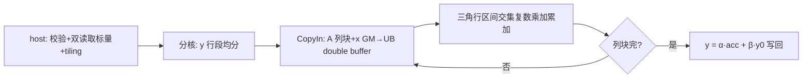

# aclblasChemv 算子设计文档

# 需求背景（required）

## 需求来源
- 任务名称/批次：2026 年 11 月社区任务 — aclblasChemv 算子开发（A2A3）。
- 合入目标仓：https://gitcode.com/cann/ops-blas ，算子代码 `blas/symv/arch22/`，测试代码 `test/symv/chemv/arch22/`。
- 验收流程：cann-competitions 社区任务流程（任务书 §4 交付件 / §5 PR 申请合入）。

## 背景介绍
### 算子功能定位
- aclblasChemv 完成单精度复数 Hermitian 矩阵-向量乘 `y = alpha·A·x + beta·y`：A 为 n×n Hermitian 复矩阵（A = A^H，列主序 lda×n），仅 uplo 指定三角被引用、对角虚部假定 0，x/y 为 n 元素复向量，y 原地覆写。
- 数学公式：`y[i] = α·Σ_j A(i,j)·x[j] + β·y[i]`，j=1..n；带外（未引用三角）元素按共轭对称隐含，不读取。

### 业界对标
- 对标 cuBLAS `cublasChemv`：参数序列、返回码、快速返回口径以 cuBLAS 官方文档为唯一依据。
- 语义参考 Netlib `chemv.f`（https://www.netlib.org/blas/chemv.f）：列主序、uplo 选三角、对角虚部为 0、n=0 no-op、alpha=(0,0) 且 beta=(1,0) 时直接返回成功（此时 A/x/y 可为 nullptr）。
- 与实数同族 `aclblasSsymv`（include/cann_ops_blas.h L181，blas/symv/arch22+arch35 已合入）参数序列一一对应；复数双读取口径对齐仓内 `blas/symv/arch35/csymv_host.cpp` 的 ComplexScalarSource（alpha/beta Host/Device 指针属性运行时探测，issue #869）。

### 工程形态
- 工程模式：Ascend C kernel 直调（host 入口 + 校验 + tiling + device kernel，handle 绑定 stream）。
- 代码落位：`blas/symv/arch22/`（chemv_host.cpp / chemv_kernel.cpp / chemv_kernel.h / chemv_tiling_data.h，与同目录 ssymv 分层一致）；测试落位 `test/symv/chemv/arch22/`，并在 `test/symv/chemv/CMakeLists.txt` arch22 分支补 `ops_blas_add_gtest_tests(${OPS_BLAS} chemv_test)`（当前仅 arch35 注册，A2/A3 构建退回非 GTest runner，随本任务补齐）。
- 仓内近亲：`blas/symv/arch22/ssbmv.../ssymv_*`（实数同族 arch22 骨架：校验链/分核/tiling 直接复用）；`blas/symv/arch35/csymv_*`（复数同族：ComplexScalarSource 双读取、复数乘加展开方式直接移植）。
- 复数类型：`aclblasComplex`（include/cann_ops_blas_common.h L68）。

### 接口规格
- **本算子为新增接口**：`include/cann_ops_blas.h` 当前无 `aclblasChemv` 声明，按 §2.3 新增（纯追加声明，不改既有声明）；签名按 cublasChemv 参数序列，维数参数 int，与同族 `aclblasSsymv` 口径一致：

```cpp
aclblasStatus_t aclblasChemv(
    aclblasHandle_t handle,
    aclblasFillMode_t uplo,
    int n,
    const aclblasComplex* alpha,
    const aclblasComplex* A, int lda,
    const aclblasComplex* x, int incx,
    const aclblasComplex* beta,
    aclblasComplex* y, int incy);
```

- 参数规格表（官方栏目）：

| 参数 | 参数含义 | 数据类型 | 支持数据类型 | 约束 | 形状 |
| --- | --- | --- | --- | --- | --- |
| handle | 库上下文句柄（携带 stream），Host 内存 | scalar | - | nullptr 返回 ACLBLAS_STATUS_HANDLE_IS_NULLPTR | - |
| uplo | 三角存储模式，Host 内存 | attr | int（枚举） | 仅 UPPER/LOWER；非法返回 ACLBLAS_STATUS_INVALID_ENUM（对齐仓内 csymv 口径） | - |
| n | A 的阶数，Host 内存 | scalar | int32 | n≥0；n<0 返回 INVALID_VALUE；n=0 合法 no-op | - |
| alpha | 复标量乘数指针，Host/Device 双读取（运行时按指针属性探测，ComplexScalarSource，issue #869） | scalar | COMPLEX64 | n>0 时 nullptr 返回 INVALID_VALUE；值不校验 | 标量 |
| A | Hermitian 矩阵，列主序 lda×n，Device 只读 | tensor | COMPLEX64 | 对角虚部假定 0；未引用三角不读取；alpha≠(0,0) 且 n>0 时 nullptr 返回 INVALID_VALUE | lda×n |
| lda | 前导维度（列主序），Host 内存 | scalar | int32 | lda≥max(1,n)；不足返回 INVALID_VALUE | - |
| x | 输入向量，Device 只读 | tensor | COMPLEX64 | alpha≠(0,0) 且 n>0 时 nullptr 返回 INVALID_VALUE | 1+(n−1)×\|incx\| |
| incx | x 步长，Host 内存 | scalar | int32 | ≠0 且非 INT32_MIN；跨度超 int32 返回 INVALID_VALUE（host int64，issue #807/#780，对齐 ssymv arch22 大跨度守卫） | - |
| beta | 复标量乘数指针，Host/Device 双读取（同 alpha，issue #869） | scalar | COMPLEX64 | n>0 时 nullptr 返回 INVALID_VALUE；=(0,0) 时 y 旧值不必有效 | 标量 |
| y | 输入/输出向量（原地覆写），Device | tensor | COMPLEX64 | n>0 且非（alpha=(0,0) 且 beta=(1,0)）时 nullptr 返回 INVALID_VALUE；beta=(0,0) 不豁免非空要求 | 1+(n−1)×\|incy\| |
| incy | y 步长，Host 内存 | scalar | int32 | 同 incx | - |

### 数学公式
- 与 §3.2 精度判定 golden（cblas_chemv，CblasColMajor；对角仅取实部、仅取 uplo 三角、另一三角共轭补全）同一计算形态。

# 需求分析（required）

## 需求描述
- 使用 Ascend C 在 Atlas A2/A3（arch22）上以 kernel 直调实现 aclblasChemv：COMPLEX64 dtype、UPPER/LOWER 全覆盖、正负步长、n=0 与（alpha=(0,0) 且 beta=(1,0)）双重快速返回，精度按 mixed_tolerance FLOAT32（实部/虚部分别）对齐 cblas_chemv golden，性能达到 cublasChemv（910B3 实测）平均单次耗时的 0.8 倍以上。

## 需求拆解

| # | 必须回答 | 本算子结论 |
| --- | --- | --- |
| 1 | 数学定义与可复用的代数量 | Hermitian 全矩阵-向量乘；复数乘加拆为实/虚 4 次 float 乘加；实数 ssymv arch22 的按行/按列分核与 tiling 骨架 + arch35 csymv 的复数处理与双读取口径整体复用 |
| 2 | 接口原型 | 按 §2.3 新增声明（纯追加）到 include/cann_ops_blas.h；参数序列与 cublasChemv 一一对应 |
| 3 | 参数规格 | 见接口规格表；异常码：HANDLE_IS_NULLPTR / INVALID_ENUM（非法 uplo）/ INVALID_VALUE / SUCCESS（n=0 或 alpha=(0,0)&beta=(1,0) 快速返回） |
| 4 | 支持数据类型 | COMPLEX64（A/x/y、alpha/beta） |
| 5 | 目标芯片与 arch 映射 | Atlas A2/A3（arch22）；自验精度 910B3 或 A3、性能 910B3；标杆 cublasChemv |
| 6 | 精度要求 | 实部/虚部分别 FLOAT32：rtol/atol=2^-13，ratio 0.99，max_abs 1e-2 or 32×ULP（golden 动态，issue #434）；Inf/NaN 等效规则；golden=cblas_chemv fp64 收窄，Hermitian 约束解释 A |
| 7 | 性能预期 | msprof op（warmup 5 + 采样 ≥10 取平均）≤ GPU 标杆 1.25 倍；标杆 gpu_baseline.csv |
| 8 | 代码架构选型 + 可行性 | 移植 ssymv arch22 骨架 + csymv arch35 复数口径：A 按列块流式载 UB，逐列乘加累加至 y 对应行段，β·y 融合。已排除死路：全矩阵常驻 UB（大规模超容量，必须列块流式）；仅存 uplo 三角的压缩存储（本接口为全 lda×n 数组，未引用三角不读即可，无需压缩） |
| 9 | 评测来源 | golden：cblas_chemv（Netlib CBLAS 复数单精度，CblasColMajor）；性能标杆：cublasChemv（gpu_baseline.csv）；用例：test_cases CSV + GTest |

# 详细设计（required）

## 算子分析
### 数学公式
- `y[i] = α·Σ_{j=1..n} A(i,j)·x[j] + β·y[i]`；仅引用 uplo 三角，A 对角虚部视为 0，未引用元素不读取（由共轭对称隐含）。

### 支持数据类型
- A/x/y/alpha/beta：COMPLEX64（float32 实部 + float32 虚部）。

### 支持形状
- A：lda×n 列主序（lda≥max(1,n)）；x/y：n 逻辑元素，物理 1+(n−1)×|inc|。
- 退化：n=0 → SUCCESS no-op；alpha=(0,0) 且 beta=(1,0) → 直接 SUCCESS（A/x/y 可全 nullptr）；alpha=(0,0)（beta≠(1,0)）→ 等价 y=β·y，A/x 可 nullptr；beta=(0,0) → y 旧值不必有效。

## 算子实现
### 实现方案
#### 总体架构与数据流
- 数据流：GM(A 列块, x 段, y 段)→UB→复数乘加（实/虚分离）→列累加完成 ×α，与 β·y 融合→GM(y)。按列扫描：A 的第 j 列对 y 的贡献为 A(i,j)·x[j]（i 遍历 j 所在三角的行区间），UPPER/LOWER 两套行区间公式由 tiling key 编译期二选一。

#### host 侧设计
- **分核策略**：n 个 y 元素按 AIV 核数均分（均分 + 余块），每核独立完成自身行段的累加，满核原则；矩阵按列分块流式供给各核。
- **数据分块和内存优化策略**：A 列块 + x 对应元素分 tile 载入 UB，double buffer；y 区间首尾各读写一次，β·y 融合进累加链消除二次遍历。
- **tilingkey 规划策略**：uplo（UPPER/LOWER）进 tiling key；标量快返组合在 host 侧短路，不产生 kernel 分支。
- **数据检测（校验顺序，逐条对齐任务书 §2.5）**：
  1. handle==nullptr → ACLBLAS_STATUS_HANDLE_IS_NULLPTR；
  2. n<0 → INVALID_VALUE；n==0 → 直接 SUCCESS；
  3. uplo 非法 → ACLBLAS_STATUS_INVALID_ENUM；lda<max(1,n) → INVALID_VALUE；
  4. incx==0 / incy==0 / INT32_MIN、(n−1)×|inc| 超 int32（host int64）→ INVALID_VALUE；
  5. alpha/beta nullptr（n>0）→ INVALID_VALUE；
  6. 读到标量后（ComplexScalarSource 双读取）：alpha=(0,0) 且 beta=(1,0) → 直接 SUCCESS；否则按取值条件判空：alpha≠(0,0) 时 A/x 非空，非（alpha=(0,0) 且 beta=(1,0)）时 y 非空，违反 → INVALID_VALUE。
- **alpha/beta 处理（issue #869 口径）**：移植 arch35 csymv 的 ComplexScalarSource——运行时探测指针属性，Host 指针同步解引用、Device 指针经 stream 读取后随 tiling 下发。

#### kernel 侧设计
- Init：解析 tiling（n/lda/incx/incy/alpha/beta/各核 y 区间），SetGlobalBuffer，InitBuffer（A 列块 ×2、x 段 ×2 double buffer）。
- Process：逐列块 CopyIn → 对列块内每列计算其三角行区间与 y 段的交集，复数乘加累加（复数乘法展开 4 次 float 乘加，对角元素仅取实部）→ 列块完 CopyIn 下一块 → 全部完成后 y = α·acc + β·y0 写回。
- 流程图：



- workspace 布局：无额外 workspace（累加在寄存器/UB，y 原地覆写）。

#### 性能优化要点（终态）
- 优化项：A 列块 double buffer（搬运/计算重叠）；x 段核内驻留复用；β·y 融合；对角元素跳过虚部乘法。目标 ≤1.25× cublasChemv 标杆，实测数据回填自测报告。
- 未采用路线：全矩阵常驻 UB；未引用三角显式读取补全（带宽浪费，直接不读）。

## 支持硬件

| 支持的芯片版本 | 涉及 |
| --- | --- |
| Atlas A2/A3 训练系列（910B，arch22） | ✅（本任务目标，自验精度 910B3 或 A3、性能 910B3） |
| Atlas 950PR（arch35） | ❌（arch35 已有 csymv，本任务不改） |

## 算子约束限制
- 不支持超出 lda/incx/incy 语义的非连续访问；无 broadcast；不要求 dynamic shape。
- 对角虚部假定 0；未引用三角不读取；y 原地覆写不返回视图。
- 异步执行：依赖 handle 绑定 stream，读结果前须同步 stream；alpha/beta 支持 Host/Device 双来源（ComplexScalarSource 探测）。

# 可维可测分析（required）

## 精度标准/性能标准

| 验收标准 | 描述 | 标准来源 |
| --- | --- | --- |
| 精度标准 | y 实部/虚部分别 FLOAT32：rtol=atol=2^-13(1.2e-4)，ratio 0.99，max_abs 1e-2 or 32×ULP（golden 动态，issue #434）；golden=cblas_chemv（fp64 真值收窄，Hermitian 约束解释 A）；Inf/NaN 等效规则单独判定 | mixed_tolerance_standard，任务书 §3.2 |
| 性能标准 | COMPLEX64 平均单次耗时 ≤ GPU 标杆（cublasChemv）×1.25；msprof op 采集，warmup 5 + 有效采样 ≥10 取平均，仅 SUCCESS 计入 | 任务书 §3.3 + test_cases/gpu_baseline.csv |

## 测试概览
- 测试工程：`test/symv/chemv/arch22/`（CSV + C++ GTest），补 `test/symv/chemv/CMakeLists.txt` arch22 注册。
- 覆盖：uplo 全组合基础用例、尺寸扫描（0/1/小质数/2 的幂 ±1/非对齐/大规模）、标量特殊值（(0,0)/(1,0)/纯虚/大值及快返组合）、lda padding、步长 ±1/±2/±3（含负步长）、边界与负向（n=0 期望 SUCCESS；空指针/非法枚举/非法 lda/负维度/零步长期望对应错误码）、Inf/NaN 特殊值（beta=(0,0) 时含 y=NaN 用例）、性能用例。
- 输入生成：均匀 [-5,5] 50% + 正态 GAUSS_NORM_5_2 50%（实/虚独立采样）；负向用例不按 (n−1)×|inc| 预分配缓冲（dummy 占位，防测试工程自身分配溢出）；任务自带 gen_csv.py 仅均匀分布，正态用例本任务补齐并在自测报告说明。

## 兼容性分析
- 唯一公共头改动：`include/cann_ops_blas.h` **追加** `aclblasChemv` 声明（纯追加，不改既有声明），无其他 arch/产品线波及。
- `blas/symv/arch22/` 新增 chemv 文件、`test/symv/chemv/arch22/` 新增测试工程与 arch22 CMake 注册，不影响同目录 ssymv 与 arch35 既有行为。
- 非法 uplo 返回 INVALID_ENUM，与同族 csymv 口径一致（本任务书 §2.4 明确，无需差异说明）。
