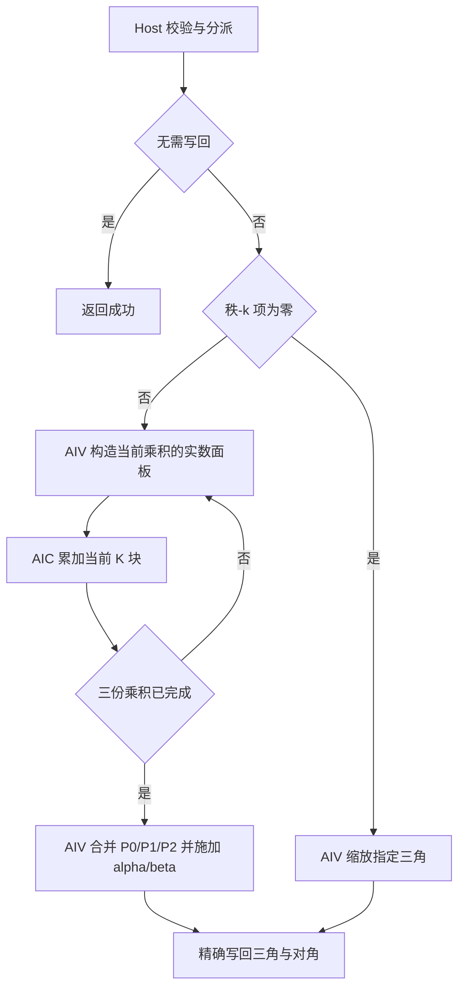

# 需求背景（required）

## 需求来源

[11 月 CANN 社区任务](https://www.hiascend.com/activities/task-center/details/5f0045789d554794aca26d146e93d6b7)的《aclblasCherk3mEx 算子开发任务书》要求在昇腾 950PR 上基于 [ops-blas](https://gitcode.com/cann/ops-blas) 新增与 `cublasCherk3mEx` 核心语义对齐的单精度复数 Hermitian 秩-k 更新接口。功能契约来自任务书 §2，验证口径来自 §3 及随附用例和测试指导。

## 背景介绍

### aclblasCherk3mEx 算子功能

更新列主序方阵 `C` 的指定三角。实数标量 `alpha` 缩放 Hermitian 秩-k 更新项，实数标量 `beta` 缩放原三角。支持复数 FP32 和交错复数 INT8 两种输入，结果均为复数 FP32。常规计算在同一次 kernel 启动中完成三次实数矩阵乘、组合和三角写回。

### 对标与仓内实现现状

- [cuBLAS Cherk3mEx](https://docs.nvidia.com/cuda/cublas/index.html#cublascherk3mex) 是接口与 GPU 性能对照，CPU 精度参考使用 [Netlib HERK](https://www.netlib.org/blas/cherk.f) 对应的 `cblas_cherk`。
- ops-blas 基线 `2760346765b92e40579d16d8fffdb9f0988c35df` 中，[非 Ex Cherk](https://gitcode.com/cann/ops-blas/blob/2760346765b92e40579d16d8fffdb9f0988c35df/blas/herk/arch35/cherk_host.cpp) 提供现成的参数、三角和退化处理参考，乘法阶段包含四次 GEMM 启动。新接口采用单次启动的 Hermitian 3M 计算，按任务书定义返回枚举错误。
- 当前 ops-blas 上游的 [CGEMM3M 入口](https://gitcode.com/cann/ops-blas/blob/55ef791b77f3677b45da3468b0a8b17941424f84/blas/gemm/arch35/cgemm3m_host.cpp) 调用公共复数 GEMM 路径并启用 3M。具体三乘积块调度可参考开发基线的 [arch35 GEMM3M Cube](https://gitcode.com/cann/ops-blas/blob/2760346765b92e40579d16d8fffdb9f0988c35df/blas/gemm3m/arch35/sgemm3m_kernel.cpp)，其中一次 Cube 启动调度三组乘积并处理 K 尾块。本算子使用自己的共轭面板、三角调度与写回，不依赖 `aclblasCherkEx`。

# 需求分析（required）

## 需求描述

使用 Ascend C 为 950PR 增加句柄式 `aclblasCherk3mEx`。调用方设定 handle 的 stream，经公开 BLAS API 下发计算。A、C 使用设备列主序地址和前导维，两个标量可来自 Host 或 Device。

## 需求拆解

| 范围 | 要求 | 设计落点 |
| --- | --- | --- |
| API 与状态码 | 13 参数接口，支持上/下三角、N/C 两种转置和两种 A 类型 | Host 参数校验、类型分派及公开声明 |
| 三角与退化语义 | 仅更新指定三角，实际写回时对角虚部置零。空规模与单位缩放按契约返回 | 无写回、仅缩放、3M 更新三条路径 |
| 3M 数据流 | 三次实矩阵乘在一次 kernel 启动中完成，INT8 分量精确提升 | AIV 面板整理、AIC 计算、AIV 三角写回 |
| 精度与性能 | FP32 分量容差，正式性能采集采用 kernel-to-kernel | Netlib Golden、完整 CSV 回归和逐用例 `msprof op` |
| 仓库接入 | 实现、测试、声明和文档采用 ops-blas 既有结构 | `blas/herk/arch35/`、`test/herk/cherk3m_ex/arch35/`、`include/cann_ops_blas.h`、`blas/herk/README.md` |

# 详细设计（required）

## 算子分析

### 数学公式

设 `X = op(A) = R + iI`，更新式为 `C := alpha · X · Xᴴ + beta · C`。对行块 `i` 和列块 `j`，三个实数乘积分别为：

- `P0 = R_i · R_jᵀ`
- `P1 = I_i · I_jᵀ`
- `P2 = (R_i + I_i) · (R_j − I_j)ᵀ`

秩-k 项的实部为 `P0 + P1`，虚部为 `P2 − P0 + P1 = I_i · R_jᵀ − R_i · I_jᵀ`。右面板使用减法承载乘积中的共轭。INT8 输入先将每个分量独立精确转成 FP32，再做加减、取负与乘法，覆盖 `-128` 取负的边界。三个乘积均以 FP32 累加，不将乘积或中间和差降为 FP16。

### 支持数据类型

| 参数 | 数据类型 | 说明 |
| --- | --- | --- |
| `alpha`、`beta` | `float` | 实数标量，各支持 Host 或 Device 地址 |
| `A`、`Atype` | `ACL_COMPLEX64` 或 `ACL_INT8` | 按实部、虚部交错。每个复元素分别占 8 或 2 字节 |
| `C`、`Ctype` | `ACL_COMPLEX64` | 原地更新，实部、虚部各为 FP32，采用 `aclblasComplex` |

### 支持形状

| 转置 | A 的物理逻辑矩阵 | 前导维约束 | X 的元素来源 |
| --- | --- | --- | --- |
| `ACLBLAS_OP_N` | `n × k` | `lda ≥ max(1,n)` | `X(i,t) = A[i+t×lda]` |
| `ACLBLAS_OP_C` | `k × n` | `lda ≥ max(1,k)` | `X(i,t) = conj(A[t+i×lda])` |

`n`、`k` 为非负整数。C 的逻辑形状为 `n × n`，`ldc ≥ max(1,n)`，元素位置为 `i+j×ldc`。前导维以复元素计。上三角写回条件为 `i ≤ j`，下三角为 `i ≥ j`。合法 shape 由接口及可寻址缓冲限制，样例的最大规模不用于分派或限制接口。

## 算子实现

### 实现方案

在 `include/cann_ops_blas.h` 新增声明，沿用已有类型和句柄设施：

```cpp
aclblasStatus_t aclblasCherk3mEx(
    aclblasHandle_t handle,
    aclblasFillMode_t uplo,
    aclblasOperation_t trans,
    int n, int k,
    const float* alpha,
    const void* A, aclDataType Atype, int lda,
    const float* beta,
    aclblasComplex* C, aclDataType Ctype, int ldc);
```

Host 校验后通过 handle 绑定的 stream 直调 Ascend C kernel。3M 更新采用 AIC/AIV 协作。一个核组负责一个输出块的完整 K 归约，并在同一 kernel 中写回该块。仅缩放路径使用 AIV，无 AIC 乘法。

#### 3.2.1 Host 侧设计

校验顺序为 handle、uplo/trans、n/k 和 lda/ldc、标量指针与 dtype、A/C 指针。空 handle 返回 `ACLBLAS_STATUS_HANDLE_IS_NULLPTR`。非法枚举（含 `OP_T`）返回 `ACLBLAS_STATUS_INVALID_ENUM`。负维度、非法前导维、空标量与应访问的空 A/C 返回 `ACLBLAS_STATUS_INVALID_VALUE`。不支持的类型组合返回 `ACLBLAS_STATUS_NOT_SUPPORTED`。地址跨度和乘积均用受检的宽整数计算，防止元素索引与字节偏移溢出。

合法 `n=0` 时允许 A/C 为空，Host 直接返回成功。其余情况要求 C 非空。Host 根据仓内 [标量读取 helper](https://gitcode.com/cann/ops-blas/blob/2760346765b92e40579d16d8fffdb9f0988c35df/blas/common/helper/host_utils.h) 判定标量位置。Host 标量直接取值，Device 标量在同一 stream 有序读回供校验与分派，计算 kernel 随后在该 stream 异步下发。标量读回属于 Host 准备开销。分支先确定 A 是否会用到，再判断空 A：`k=0` 或 `alpha=0` 时允许 A 为空，否则必须非空。

##### 1. 分核策略

用同一个逻辑边长 `T` 划分输出行和列，令 `q = ceil(n/T)`。上三角调度 `0 ≤ bi ≤ bj < q`，下三角调度 `0 ≤ bj ≤ bi < q`，均有 `W = q(q+1)/2` 个块。按列枚举上三角块，以边界 `bj(bj+1)/2` 反解线性编号。下三角按行使用同一映射。端点用整数搜索校正，不依赖浮点平方根取整。

令 `G` 为 `W` 与平台可用 AIC/AIV 核组数的最小值。核组 `g` 处理编号 `g, g+G, ... < W`。每个块只归一个组并由其完成全部 K，避免跨组更新同一 C 地址及跨核归约。对角块内部再次施加三角边界。仅缩放使用相同的互斥输出分区，按可用 AIV 核数调度。

##### 2. 数据分块和内存优化策略

逻辑块边长、K 分块和按硬件对齐后的物理面板分别记为 `T`、`Tk`、`Pm/Pn/Pk`。根据 arch35 的 FP32 `tensor_api` 装载布局、Mmad 粒度和可用 L1、L0A、L0B、L0C、UB 选择合法档位。逻辑尾块仅按有效范围搬运，片上填零至合法物理块。AIV 在 `OP_C` 路径取相反的虚部，再按每个乘积的操作数定义生成面板。取任一小档位仍须满足硬件对齐和容量限制。

同一核组顺序计算 P0、P1、P2。各乘积的首个 K 分块初始化 L0C，后续分块继续累加。完成一个乘积后，只将当前块结果放入核组自己的暂存区，L0C 可用于下一个乘积。基础实现用单份成对的 GM 面板缓冲和三个块级 FP32 结果槽。定义 `a(x)` 为按仓内设备对齐约束向上取整的字节数，则：

```text
单组面板  = a(4 × Pm × Pk) + a(4 × Pn × Pk)
单组结果  = 3 × a(4 × Pm × Pn)
设备暂存  = G × (单组面板 + 单组结果)
```

每份 FP32 片上面板的元素预算对应上述面板公式，分别按 L1、L0A、L0B 的实际分形布局和缓冲份数校验。单个 L0C 累加槽按物理输出块计，AIV UB 分块安排原始交错输入、FP32 面板、乘积/合并条带及写回条带。转换与写回阶段互斥，用同一段 UB 存储时依据各阶段峰值预算。组间使用互不重叠的暂存切片，生命周期覆盖该流上的 kernel 执行。后续双缓冲仅在容量、同步与实测收益均满足时启用；新增的缓冲份数计入各自预算。缩放路径不分配三乘积缓冲。

##### 3. TilingKey 规划策略

Host 传入 `n/k/lda/ldc`、三角和转置、A 类型、标量、物理块与逻辑有效范围、核组数和暂存布局。设备侧按 A 类型与转置选择通用面板装载方式。Host 按退化语义选择不下发、缩放或 3M 更新；写回按 `beta=0` 专门跳过旧 C 加载。普通路径的块档位按形状、核组数和内存上限选择。

#### 3.2.2 Kernel 侧设计

1. **无需写回。** 合法 `n=0` 或 `(k=0 或 alpha=0) 且 beta=1` 时由 Host 返回成功。快速返回保持 C 的字节原样。
2. **仅缩放。** 当 `(k=0 或 alpha=0) 且 beta≠1` 时，AIV 仅处理指定三角。`beta=0` 时直接写零，其他情况按 `beta` 缩放；实际写回的对角虚部总是置零。
3. **准备面板。** 普通更新时，AIV 根据 `lda` 读取当前块有效范围内的 A，拆分实虚、执行 INT8 提升及必要的共轭，为当前乘积生成左右实数面板。面板有效区外用零填充。
4. **三乘积。** AIC 在同一次 kernel 启动内对 P0、P1、P2 各自遍历 K 分块。面板槽的次序为 AIV 填充、AIC 获得就绪信号并加载、AIC 释放、AIV 重用。当前块三份结果发布后 AIV 才读取，结果槽在写回完成之前不会被下一块覆盖。采用 arch35 支持的核组内 AIC/AIV 同步，按槽区分缓冲代次。
5. **组合与写回。** AIV 合并 P0、P1、P2 并乘 `alpha`。`beta≠0` 时只读有效目标位置的旧 C，且忽略对角旧虚部。`beta=0` 时直接生成结果。按列主序精确写有效三角区间，尾部采用限定有效字节范围的读写方式，保证对侧三角和 padding 的哨兵保持不变。对角虚部写 `+0.0f`。



## 支持硬件

| 产品 | 架构 | 软件条件 |
| --- | --- | --- |
| 昇腾 950PR | arch35 / DAV_3510 | CANN 9.1.0 及以上，ops-blas arch35 编译目标 `ascend950` |

## 算子约束限制

仅支持 `UPPER/LOWER`、`OP_N/OP_C` 与指定的两种数据类型组合。A/C 按前导维描述列主序矩阵，无广播及其他任意步长布局。C 的可写区域与 A 的可读区域不得重叠。调用方应使输入设备缓冲在该 stream 完成前保持有效。正常返回表示下发成功，读取计算结果需等待该 stream。任务书的内存专项验收为不涉及，设计暂存上限仍按块与活跃组数控制。

# 可维可测分析

## 精度标准/性能标准

| 项目 | 判定口径 | 依据 |
| --- | --- | --- |
| 精度 | 仅对指定三角的实部与虚部作 FP32 分量对照。用例须同时达到 `matched_ratio ≥ 0.99` 与最大绝对误差门槛 `1e-2` 或任务书规定的 32 ULP。混合容差为 `abs(actual−golden) ≤ 2^-13 + 2^-13 × abs(golden)` | 任务书 §3.2、[开源精度标准](https://gitcode.com/cann/opbase/blob/28a1ce52ae856353589841226a0002af73314a6b/docs/zh/ops_precision_standard/mixed_tolerance_standard.md) |
| 性能 | `ratio = gpu_ms / (mean(Task Duration(us))/1000)`。每例 `ratio ≥ 0.4`，全部可比正式用例的算术平均 `ratio ≥ 0.5` | 任务书 §3.3，`msprof op` 和随附 GPU kernel 基线 |
| 内存 | 无独立内存通过阈值 | 任务书 §3.4 |

计划运行 1000 条精度 CSV 用例，并单测空 handle、Device 标量、两种转置和三角的组合、尾块与前导维 padding、`-128` INT8 提升、极值和 3M 虚部抵消。每次实际写回均验证对角虚部为零，未选择三角和 padding 按哨兵逐字节检查。验证快速返回保持 C 原样、退化不读取 A，以及 `beta=0` 时旧 C 的 NaN 不参与计算。Golden 采用 Netlib BLAS 3.10.0 的 `cblas_cherk`，INT8 先精确提升。随附工程的 MERE/MARE 判定与任务书混合容差分别记录。对 NaN/Inf 特殊输入单独记录对照结果及适用判据。

正式性能用例按用例名独立采集，从 `OpBasicInfo.csv` 读取目标 kernel 的 `Task Duration(us)`，舍弃 5 次预热并取 10 次有效样本的平均。当前 200 条性能用例均为 COMPLEX64，INT8 另补测并注明沿用的同形状 COMPLEX64 GPU 基线。两个性能参数键各有两条 GPU 基线，逐例报告明确记录绑定的基线 ID，避免快速验证脚本按参数键覆盖记录。GTest 的 `avg_us` 保留用于回归观察。设计阶段未开展设备测量。

## 兼容性分析

新符号使用仓内既有状态码、布局和句柄接口，对现有 `aclblasCherk` 无 ABI 变动。`OP_T` 按任务书拒绝。FP32 3M 的运算顺序与直接复数乘加存在舍入差异，输出按精度标准比对。构建以 `bash build.sh --ops=cherk3m_ex --soc=ascend950` 为验证入口，通过同一 ops-blas 测试框架加载 CSV。
