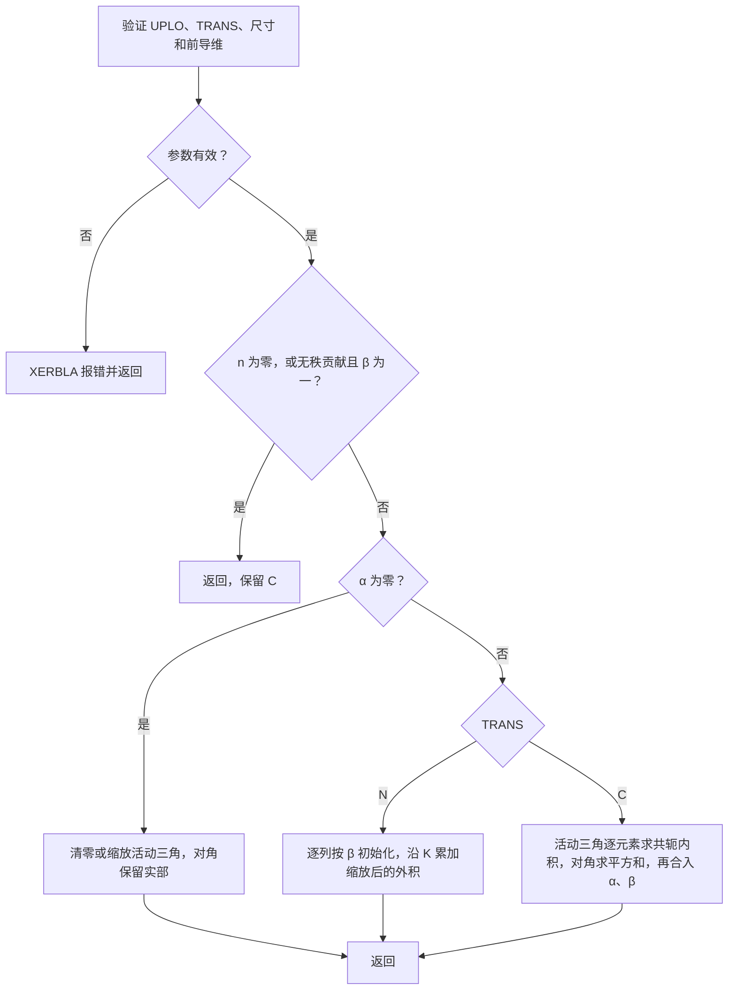
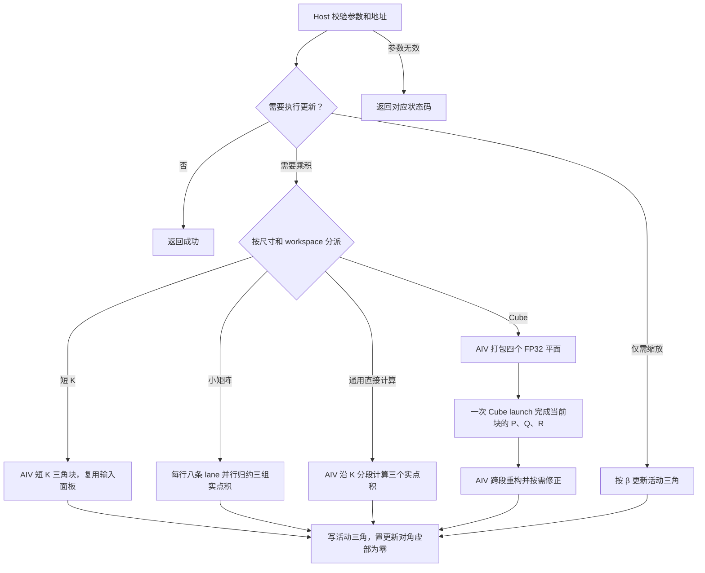

# 一、需求背景

## 1.1 需求来源

11 月社区任务《aclblasCherk3mEx 算子开发（950）》要求在 Atlas 950PR 的 ops-blas 库新增单精度复数 Hermitian 秩 k 更新接口。调用方给出矩阵 A、实数标量 α 和 β，以及矩阵 C 的一个存储三角。算子在原地址更新这个三角。功能、精度与性能分别按正式任务书 `aclblasCherk3mEx_Atlas950PR_task_doc.md` 第 2、3.2 和 3.3 节验收。

## 1.2 背景介绍

### 1.2.1 aclblasCherk3mEx 的实现基线

工程采用 ops-blas 的句柄式 BLAS 入口，直接调度 Ascend C kernel。接口和类型以 `include/cann_ops_blas.h`、`include/cann_ops_blas_common.h` 为准，TBE 算子注册和算子信息库在这条调用链中不适用。以下文件路径均相对于 ops-blas 仓库。

| 仓内参考文件 | 与本设计的关系 |
| --- | --- |
| `blas/herk/arch35/cherk_host.cpp`、`cherk_kernel.cpp` | 非 Ex 的 CHERK 提供列主序、三角选择及实对角处理参考。其常规矩阵路径分开计算四个实乘积。本任务要求三实乘，且 A 增加了交错复数 INT8 格式。 |
| `blas/gemm/arch35/cgemm3m_host.cpp`、`cgemm3m_rounding_kernel.cpp` | 提供复数 3M 输入拆分和结果重构的参考。HERK 需专门处理右操作数的共轭、三角写回和实数 β。 |
| `blas/gemm/arch35/cgemm_compute_kernel.cpp` | 本实现复用并适配的 Cube 乘积核。矩形块和对角块共用入口，按乘积编号、K 分段和输出块分配任务。 |

### 1.2.2 标杆算子现状分析

#### 1.2.2.1 标杆支持的数据类型和数据格式

cuBLAS 的 `cublasCherk3mEx` 是接口和性能标杆。A 支持 `CUDA_C_32F` 或 `CUDA_C_8I`，C 为 `CUDA_C_32F`，两矩阵按列主序存储。α、β 均为实数 FP32。A 为复数 INT8 时，每个逻辑元素由有符号的实、虚两个字节组成。任务书提供同形状下 GPU 的实测 kernel 耗时。[cuBLAS 接口及类型表](https://docs.nvidia.com/cuda/cublas/index.html#cublascherk3mex)

#### 1.2.2.2 标杆实现描述

精度参考来自 CPU Netlib BLAS 3.10.0。对于 `trans=N`，CHERK 先按 β 处理 C 的当前列，再沿 K 累加外积。若 `A[j,l]` 为零，该项跳过。对于 `trans=C`，先完成 `conj(A[:,i])·A[:,j]` 的内积，再乘 α 并合入 β 项。两种次序在 FP32 下可能有不同的舍入结果。对角只使用旧 C 的实部。复数 INT8 的自测将分量精确提升至双精度，按 K 分段调用 ZHERK，最后一次性收窄到复数 FP32。[Netlib CHERK 源码](https://github.com/Reference-LAPACK/lapack/blob/v3.10.0/BLAS/SRC/cherk.f) · [Netlib ZHERK 源码](https://github.com/Reference-LAPACK/lapack/blob/v3.10.0/BLAS/SRC/zherk.f)

#### 1.2.2.3 标杆算子实现流程图

下图对应 Netlib CHERK。GPU 性能数据按任务包的 `gpu_baseline.csv` 取值。



# 二、需求分析

## 2.1 外部组件依赖

| 组件 | 用途 |
| --- | --- |
| CANN 9.1.0 或以上、AscendCL、Ascend C 工具链 | 以 `ascend950` 为目标编译，使用 handle 上的 stream 下发 AIV 向量核和 AIC Cube 核。实测版本为 CANN 9.1.0。 |
| ops-tensor | 提供 ops-blas 构建所需的公共依赖。实测检出版本为 `c1326e7a7fb30536dc3517ac40e06935aba5e88d`。 |
| Netlib BLAS/LAPACK 3.10.0、GoogleTest、Python 3、msprof | 分别用于生成 CPU 参考、驱动接口测试、按发布名单汇总结果及采集 NPU kernel 耗时。 |

## 2.2 内部适配模块

| 文件 | 本算子的职责 |
| --- | --- |
| `include/cann_ops_blas.h` | 声明 Ex 接口，沿用公开句柄、状态码和复数类型。 |
| `blas/herk/arch35/cherk3m_ex_host.cpp` | 校验参数和地址跨度，选择直接计算或 Cube 路径，规划 workspace，在同一 stream 上按依赖顺序下发。 |
| `blas/herk/arch35/cherk3m_ex_kernel.h` | 定义跨 Host/Device 的参数 `Cherk3mExParams`，传递尺寸、布局、数据类型、分块和写回阶段。 |
| `blas/herk/arch35/cherk3m_ex_kernel.cpp` | 实现交错输入打包、短 K 和通用直接计算、分段重构、精度修正与三角写回。 |
| `test/herk/cherk3m_ex/arch35/cherk3m_ex_test.cpp` | 加载正式 CSV，生成输入和参考结果，核对状态码、精度和存储边界。 |

## 2.3 需求模块设计

### 2.3.1 Ascend C 算子原型

```cpp
aclblasStatus_t aclblasCherk3mEx(
    aclblasHandle_t handle, aclblasFillMode_t uplo, aclblasOperation_t trans,
    int n, int k, const float* alpha, const void* A, aclDataType Atype, int lda,
    const float* beta, aclblasComplex* C, aclDataType Ctype, int ldc);
```

| 参数 | 约定 |
| --- | --- |
| `handle`、`uplo`、`trans` | 有效 ops-blas 句柄。UPPER 更新行号 ≤ 列号的元素，LOWER 更新行号 ≥ 列号的元素。运算取 `ACLBLAS_OP_N` 或 `ACLBLAS_OP_C`。 |
| `n`、`k`、`lda`、`ldc` | n、k 非负。N 模式下 A 为 n×k，lda ≥ max(1,n)。C 模式下 A 为 k×n，lda ≥ max(1,k)。C 的逻辑形状为 n×n，ldc ≥ max(1,n)。前导维以复元素计。 |
| `A`、`Atype` | Device 输入。复数 `ACL_COMPLEX64` 为相邻两个 float，复数 `ACL_INT8` 为相邻两个 int8，顺序均为实部、虚部。 |
| `alpha`、`beta` | 有效的 FP32 实标量指针。实现支持二者同在 Host 或同在 Device。 |
| `C`、`Ctype` | Device 原地输入输出，类型为 `ACL_COMPLEX64`。活动三角之外的元素和每列的 padding 保持原字节。 |

### 2.3.2 Ascend C 算子相关约束

`handle` 为空返回 `ACLBLAS_STATUS_HANDLE_IS_NULLPTR`。非法 uplo 或 trans（含普通转置 `OP_T`）返回 `ACLBLAS_STATUS_INVALID_ENUM`。负尺寸、过小的前导维、缺少必需指针或有效地址跨度不可表示时返回 `ACLBLAS_STATUS_INVALID_VALUE`。不支持的 A/C 类型组合返回 `ACLBLAS_STATUS_NOT_SUPPORTED`。Host 在空矩阵快速返回前仍校验枚举、类型、尺寸、前导维和标量指针。

# 三、需求详细设计

## 3.1 调用方式

调用方创建 handle 并用 `aclblasSetStream` 绑定 stream，在 Device 分配 A 和 C，然后调用公开入口。一般路径异步下发，同一 stream 的后继算子可直接消费 C。Host 读取结果前同步该 stream。以下示例假设已有有效的 handle、绑定的 stream、Device 输入 `a` 和输出 `c`，以紧凑列主序计算上三角。

```cpp
const int n = 128, k = 64;
const float alpha = 1.0f, beta = 0.0f;
const auto status = aclblasCherk3mEx(
    handle, ACLBLAS_UPPER, ACLBLAS_OP_N, n, k, &alpha, a, ACL_COMPLEX64, n,
    &beta, c, ACL_COMPLEX64, n);
```

## 3.2 需求总体设计

令 `X = op(A) = U + iV`。Hermitian 更新为 `C ← α·X·Xᴴ + β·C`。计算三个实矩阵 `P = U·Uᵀ`、`Q = V·Vᵀ`、`R = (U+V)·(U−V)ᵀ`，则乘积实部为 `P+Q`，虚部为 `(R−P)+Q = V·Uᵀ−U·Vᵀ`。实现从物理 A 直接打包实部、虚部，C 模式按转置方向访问，在重构时给乘积虚部取反。旧 C 的虚部仅乘 β。举例取 n=2、k=1、α=1、β=0，按物理顺序放入 `1+i, 2−i`。上三角元素 `C[0,1]` 在 N 模式为 `1+3i`，在 C 模式为 `1−3i`，两种模式的对角均为 2 和 5。

### 3.2.1 Host 侧设计

#### 3.2.1.1 分核策略

通用直接计算启动 `min(n, 可用 AIV 数)` 个 block。小矩阵按 32 行划带，每列每带一个任务，启动 block 数取任务数与可用 AIV 数的较小值。通用 SIMT 路径按列轮转分配 block，列内 128 个线程遍历活动行。短 K 路径在 AIV 上按 64×64 三角块分配工作。相邻块复用输入面板。向量核完成打包后释放原始输入缓冲区，下一块输入搬运可以与上一块的输出写回重叠。

短 K 且 α=1、β=0 时，向量寄存器在核内累计两侧输入分量的绝对值最大值，每核最后只做一次水平归约。记最大值为 m，m≤2⁵⁵ 且 k·m²≤1024 时直接保留 3M 结果。m² 同时约束每块的左右面板幅值乘积。越界或 NaN 时，该核在自己的 DMA 写回结束后，按标杆次序重算它负责的活动三角元素。由于 β=0，重算只依赖 A。其余标量组合沿用逐块检查，分别保留两侧面板及旧 C 的幅值。

Cube 路径先按可用 workspace 将输出分成边长最多为 s 的面板块，再将每块切为 64×64 或 128×128 的 Cube tile。设某块有 m×q 个 tile、K 有 h 段。完全位于活动三角内的矩形块有 `3·h·m·q` 个任务。对角方块只枚举 `3·h·m·(m+1)/2` 个任务。AIC 的 block 数取可用 AIC 数与任务数的较小者，每个 block 按步长领取后续任务。列主序交换了 Cube 的行列视角，所以对角块在下发时也反转上、下三角标志。写回仍按调用方的 uplo 判定。

#### 3.2.1.2 数据分块和内存优化策略

`PlanCube` 优先尝试 s=n，装不下时把跨度减半并向下取 64 的倍数。库持有的 workspace 可扩容，库的规划上限为 2 GiB。用户提供的 workspace 仅借用。首地址向上对齐到 512 字节，无法容纳面板时切换到无需全局 workspace 的直接核。

下表可用于从 n、k 和候选跨度 s 复算必需空间。记 `up(x,a)=a·ceil(x/a)`，表内长度以 FP32 元素数计。

| 量 | 计算方式 |
| --- | --- |
| 乘积前导维 d，K 段数 h | `d=up(s,16)`。COMPLEX64 取 `h=ceil(k/512)`，复数 INT8 取 `h=ceil(k/256)`。 |
| 每个输入平面的长度 I | N 模式 `I=up(d·k,128)`，C 模式 `I=up(up(k,16)·s,128)`。 |
| 每个面板的占用 F | 四个实平面 U、V、U+V、U−V 共 `4I`。COMPLEX64 另预留 `up(s,128)` 个行范数槽，INT8 取零。 |
| 必需 workspace | 整阵用一个面板，分块时预留两个，记作 b。字节数为 `4·(b·F + 3·h·d²)`，另计首地址 0～511 字节对齐。 |
| 可选连续 K 副本 | 对满足长 K 优化条件的完整 N 模式，容量允许时多留 `8·s·up(k,16)` 字节。修正时可连续读一行的 K 个复数。C 模式的 K 本已连续。 |

Cube tile 在较短一边 ≤512，或 k≤128 且较短一边 ≤768 时取 64，其他情形取 128。常规大面板打包以 128×16 个复元素为片上块。每级 UB 缓冲容纳两个输入分量和四个输出平面，双缓冲共 `2×6×128×16×4 = 98,304` 字节。边缘块按有效行列数搬运。满足短 K、紧凑布局条件的面板按 64 个元素的向量长度分给实际启动的核，每批最多 2048 个复元素，一次带步长的 DMA 写出四个平面。P、Q 的对角提供输入平方和。

#### 3.2.1.3 tilingKey 规划策略

本接口通过 Host 直接 launch。实际分派由 `Cherk3mExParams` 与所选 kernel 入口表达，没有 GE tilingKey。分派按下列优先级执行。

| 条件 | 执行路径 |
| --- | --- |
| `n=0`，或 Host 已知无秩贡献且 β=1 | 返回成功，保留全部 C。无秩贡献且需缩放时，仅更新活动三角。Device 标量由核内读取并执行相同语义。 |
| COMPLEX64、16≤n,k≤64 且 n·k≤2048 | 使用同一 AIV 直接核。每个 warp 负责四行，每行用八条 lane 沿 K 并行求三组部分和，再用 shuffle 合并。 |
| COMPLEX64、128≤n≤4096、1≤k≤16、n·k≤16384，且前导维可用 32 位字节步长表示 | Host 选择短 K 入口。核内标量满足范围条件时用 RegBase 三角块，否则执行通用 SIMT。 |
| 需乘积、n≥32，且 k≥32 或满足 COMPLEX64 的 n≥128、k≤16 条件 | 尝试规划 Cube。可用面板跨度和 AIC 数均大于零时下发打包、三实乘、写回。 |
| 其余尺寸，或 Cube 空间/核数不足 | 通用 AIV 核直接计算。该核每次沿 K 处理最多 64 项，在同一次 launch 内完成三个实点积。 |

### 3.2.2 Kernel 侧设计

#### 3.2.2.1 Kernel 侧实现描述

1. **打包。** AIV 核 `cherk3m_ex_pack` 从交错复元素生成四个实平面。对分块计算，外层先打包列面板，内层复用它处理同一列的活动行块。对角块共用同一输入面板。
2. **三实乘。** 每个输出面板块只下发一次 `gemm_cgemm_products_kernel`，该次 launch 同时覆盖 P、Q、R 和所有 K 分段。Cube 关闭 HF32，按 FP32 计算。矩形块走完整 tile 网格，对角块跳过整块落在未使用三角内的 tile。
3. **重构与修正。** `cherk3m_ex_finish` 合并各 K 段的结果。COMPLEX64 对分段和做补偿累加，并根据行范数、部分和、标量和结果量级识别对消或非有限值风险。需要修正时从原始 A 逐 K 累加，N 与 C 模式保留各自的参考运算顺序。较长 K 的完整块在 α=1、β=0 等适用条件下按列筛选需修正的分量，通过同一 stream 顺序执行常规区写入、评估前缀、生成行号列表、重算、发布修正值和处理对角带。按列修正时，相邻两轮按相反顺序向各核分配列组，平衡三角区域长短列的工作量。对角的 8×8 小块每次沿 K 搬入 256 项。共轭转置时在 UB 相邻两行之间增加一个 32 字节块，错开 gather 的存储体访问。前缀筛选是数值启发式，验收门槛独立按第 5.1 节检查。
4. **复数 INT8。** 分量准确提升至 FP32。和的绝对值至多 256，差的绝对值至多 255。Cube 每段最多 256 项，所以最大中间绝对值 `256×255×256 = 16,711,680 < 2²⁴`，三个整数部分和都能由 FP32 精确表示。核内将部分和转为 INT32 后重构。每个复点积的实部和虚部均有绝对值上界 32768·k。α=1、β=0 且该上界在 INT32 内时用 INT32 跨段累加，最后一次转为 FP32。其他情形用 INT64 跨段累加，再处理实标量缩放及旧 C。这样长 K 的整数和不会提前丢失低位。
5. **写回。** 单分段完整矩阵在 α=1、β=0 时，由对角平方和约束三组乘积的幅度。通过筛查的矩形区域以八列为一组批量重构并 DMA 写回，其余输入沿用原有逐块检查。列主序元素偏移是 `j·ldc+i`。仅当 UPPER 的 i≤j 或 LOWER 的 i≥j 时写 C。β=0 时跳过旧 C，对角更新取旧值实部并把结果虚部置为正零。整矩阵快速返回时保留原有对角字节。

#### 3.2.2.2 Ascend C 实现流程图



#### 3.2.2.3 Ascend C 与标杆流程的差异及原因

Netlib 在 CPU 上按列或逐元素做直接复数乘加，便于复现参考舍入顺序。950PR 用三组实乘积利用 Cube 并行度，代价是虚部重构时可能出现相消。实现将三实乘作为常规路径，对数值敏感的元素保留顺序修正。短 K 直接在向量核内完成计算，可以省去打包和跨核写回的固定开销。公开 cuBLAS 说明给出了 Gauss 3M 及接口语义，GPU 对比使用发布的逐例 kernel 时间。

## 3.3 支持硬件

| 任务要求 | 构建目标 | 已验证环境 |
| --- | --- | --- |
| Atlas 950PR，arch35 | `bash build.sh --ops=cherk3m_ex --soc=ascend950` | Ascend 950PR、CANN 9.1.0，2026-11-25 完成实机自验。 |

## 3.4 算子约束限制

A、C 为列主序，支持由 lda、ldc 描述的列间填充。调用方须保证 C 的可写区与 A 的可读区互不重叠。接口只处理单个矩阵的 Hermitian 更新，不提供批量、广播、任意元素步长或单独的 64 位尺寸入口。Host 按实际 n、k 分块。正式验收按浮点容差比较。

# 四、特性交叉分析

| 交叉场景 | 对调用者可见的行为及实现 |
| --- | --- |
| 空矩阵、零秩、α=0 | n=0 可传空 A/C，校验后不启动 kernel。k=0 或 α=0 时无需读取 A，β=1 保留整个 C，其他 β 只缩放活动三角。 |
| β=0、旧 C 含 NaN | 核只写结果，无需读取旧 C。进行更新时，非零对角虚部也统一写为正零。 |
| 三角、共轭及 padding | uplo 独立于 trans。交换 A 的读取方向时仍按原 uplo 更新 C。未用三角和 padding 可放哨兵值，按字节校验。 |
| Device 标量与 stream | 一般路径直接把标量指针传给核。若 k>0、A 为空且 α 在 Device，Host 同步 handle 的 stream 并取回 α，以判定空 A 是否合法。 |
| 用户 workspace 与多次调用 | 按有效容量规划，用户缓冲区归调用方，算子仅借用。不同形状共用 handle 时重新计算面板需求。打包、乘积和各写回阶段按同 stream 的先后顺序消费临时结果。 |
| 非有限值与极端输入 | COMPLEX64 的敏感路径按参考复乘顺序处理 NaN、Inf 及消去。INT8 路径覆盖 −128 和 127 的交错组合。零系数使对应的输入项失效。 |

# 五、可维可测分析

## 5.1 精度标准/性能标准

正式名单由 `test/herk/cherk3m_ex/arch35/cherk3m_ex_test.csv` 给定，性能基线为同目录的 `gpu_baseline.csv`。重复参数的性能编号各自匹配发布时的基线行。下表为正式任务书第 3 节的判据与 2026-11-25 自验结果。

| 验收项 | 判据与采集方法 | 950PR 实测 |
| --- | --- | --- |
| 正式精度 | 每例对活动三角的实部和虚部分别统计。两者均须有至少 99% 满足混合容差 `abs(out−ref) ≤ 2⁻¹³·(1+abs(ref))`。每个有限分量还须满足 `abs(out−ref) ≤ max(0.01,32·ULP(ref))`。NaN 匹配类别，Inf 匹配符号。 | 1000/1000 通过。产生数值匹配率的 885 例中，实部最低 99.465241%，虚部最低 99.605667%。 |
| 状态与存储语义 | 正式名单含 19 条异常用例、4 条 3M 专项。按各例适用条件检查返回码、对角虚部、未用三角、列间 padding 和快速返回的原始字节。 | 正式名单内相应检查通过。名单外的 `Arguments` 与 `BorrowedWorkspace` 两项接口测试通过。 |
| 单例性能 | 每例预热 5 次，对后续 10 次调用用 msprof 采集。每次先将该 API 的全部 kernel 的 `Task Duration(us)` 相加，再对 10 次取平均得到 `npu_us`。每例 `ratio=1000·gpu_ms/npu_us ≥ 0.4`。 | 200/200 通过。最紧的是 `TC_PF_1127`（UPPER/C，n=530，k=3238），GPU 257.9001 µs，NPU 614.0389 µs，倍率 0.420006。 |
| 整体性能 | 200 个逐例倍率等权取算术平均，要求 ≥0.5。 | 平均倍率 0.676083。 |
| INT8 性能补充 | 官方 200 条性能用例的 A 均为 COMPLEX64。另采复数 INT8 输入，沿用同形状 COMPLEX64 的 GPU 基线，单列报告。 | 4/4 通过，平均倍率 0.526094。 |
| 内存专项 | 正式任务书第 3.4 节列为不涉及。 | 工作区借用及写回边界由接口和精度测试覆盖。 |

独立复核可从 ops-blas 根目录按第 3.3 节编译，再使用 `test/herk/cherk3m_ex/run_acceptance.py` 的 `--phase accuracy`、`--phase performance` 或 `--phase int8` 入口。完整环境和运行参数见 `test/herk/cherk3m_ex/README.md`。交付分支为 `predev/cherk3mex-950`，对应实测源码提交 `8fca7ae0d33c292c466c7c5b4a87a3654094fef4`，自验证报告随验收材料单独交付。

发布脚本的 ACL event 计时用于快速回归。`TC_PF_1012`（n=32，k=32）在 event 口径得到 10.405 µs，在正式 msprof kernel 口径得到 8.8478 µs、倍率 0.433656。两组计时分别保存在性能报告中，表中的 200 例采用任务书指定的 kernel 口径。

## 5.2 兼容性分析

新增公开符号沿用 ops-blas 的句柄、stream、复数结构和状态码，参数顺序与 cuBLAS 对标接口逐项对应。普通转置按正式任务书返回非法枚举。调用方可继续使用既有 `aclblasCherk`，本实现与同期新增的 `aclblasCherkEx` 相互独立。通用 Cube 入口保留既有矩形调度，仅在 HERK 的对角块启用三角调度。
