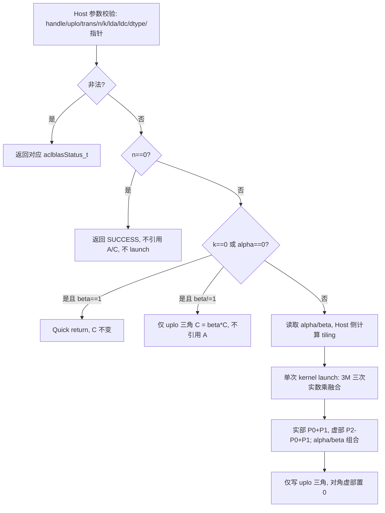

# aclblasCherk3mEx 算子设计文档（Atlas 950PR / arch35）

| 文档版本 | 日期 | 作者 | 说明 |
| --- | --- | --- | --- |
| V1.0 | 2026-11-25 | dzzw123 | 公开方案级设计文档，用于任务设计文档 PR 评审；核内分块参数、性能标定数值与优化细节留待私有验收仓，不在公开文档披露 |

> 任务：**11 月社区任务 - aclblasCherk3mEx 算子开发（950）**
> 目标仓：`cann/ops-blas`，实现目录 `blas/herk/arch35/`，测试目录 `test/herk/cherk3m_ex/arch35/`
> 设计文档提交目录：`cann-competitions/04_tasks/01_community-task-2026/tasklist/11-aclblasCherk3mEx-950/dzzw123/docs/design.md`
> 提交目录名 `dzzw123` 与 PR 提交时使用的 AtomGit 账号名一致。
>
> 按社区任务惯例，公开文档描述**方案级**内容（接口语义、数学定义、3M 分解公式、校验矩阵、验收口径、测试方案），具体 tiling 参数与性能优化余量在实现阶段于私有仓确定。

# 需求背景（required）

## 需求来源

本需求来自 CANN 社区任务「aclblasCherk3mEx 算子开发（950）」。任务要求在昇腾 950PR（arch35）硬件上，使用 Ascend C 并基于 `ops-blas` 开源仓工程模式，开发单精度复数（complex64）Hermitian 矩阵秩-k 更新（扩展版）算子 `aclblasCherk3mEx`，对标 cuBLAS `cublasCherk3mEx`，完成设计、开发、测试全流程，验收通过后合入 `cann/ops-blas`。设计文档需以 PR 形式合入 `cann-competitions` 仓库 `04_tasks/01_community-task-2026/tasklist` 对应目录，未合入将被驳回验收。

## 背景介绍

### Hermitian 秩-k 更新（HERK）与 3M 变体

CHERK 属于 BLAS Level-3，计算 Hermitian 矩阵的秩-k 更新：

```
C = alpha * op(A) * op(A)^H + beta * C
```

其中 `C` 为 `n×n` Hermitian 复数矩阵（列主序，仅 `uplo` 指定三角被读写，另一三角由 `C = C^H` 隐含），`op(A)` 为 `n×k` 复数矩阵，`alpha`/`beta` 为**实数**标量。Hermitian 矩阵的对角元素必为实数，故计算后对角虚部强制置 0。`aclblasCherk3mEx` 采用 **3M（three-M）算法**：将复数矩阵乘 `X·X^H` 分解为三次**实数**矩阵乘，减少复数乘法次数，是对标 cuBLAS `cublasCherk3mEx` 的扩展接口。

典型应用包括 Hermitian 协方差/相关矩阵更新、特征值迭代、信号处理与量子化学中的密度矩阵构造，是复数 BLAS 栈的基础算子。

### 对标接口与仓内现状分析

| 接口 / 实现 | 现状 | 与本设计的关系 |
| --- | --- | --- |
| `cublasCherk3mEx`（cuBLAS） | 对标接口，参数序列一一对应 | 语义参考；3M 结果与直接复数乘舍入不同，按阈值判定 |
| `cblas_cherk`（Netlib BLAS 3.10.0） | 精度 golden（**非 3M** 直接复数乘实现） | CPU 侧生成参考结果，实部/虚部分别比对 |
| `include/cann_ops_blas.h` | 目前**不存在** `aclblasCherk3mEx` | 本次新增公开声明，不定义私有平行 API |
| `blas/herk/arch35/`（非 Ex `aclblasCherk`） | 仓内已有 | 参考参数校验、uplo 三角处理、Hermitian 对角虚部置 0 与 beta 缩放逻辑 |
| `blas/gemm/arch35/cgemm3m*` | 仓内已有 | 参考 3M 分解与舍入处理；但注意本算子乘积为 `X·X^H`，不可直接套用 `X·X^T` 的对称分解 |
| `aclblasCherkEx` | 1125 新增接口，可能尚未合入 | **本任务不得依赖**；`aclblasCherkEx` 与本任务是彼此独立的接口 |

> 现状约束：ops-blas 在 1125 之前无 `Ex` 后缀接口/实现。本任务的 3M 路径必须基于非 Ex `cherk` 的参数校验/三角处理与 `cgemm3m` 的 3M 分解自行实现，**不得调用 `aclblasCherkEx`，也不得用三次独立 GEMM 调用拼接**——三次实数矩阵乘必须在**同一次 kernel launch** 内完成。

### aclblasCherk3mEx 算子功能分析

- `trans = ACLBLAS_OP_N` 时 `op(A) = A`（n×k，列主序，`lda ≥ max(1,n)`）；`trans = ACLBLAS_OP_C` 时 `op(A) = A^H`（由 k×n 存储的 A 共轭转置得到，`lda ≥ max(1,k)`）；
- `trans = ACLBLAS_OP_T` 不属于 Hermitian 秩-k 更新的定义域，返回 `ACLBLAS_STATUS_INVALID_ENUM`（cuBLAS 文档虽将 OP_T 列入合法枚举，但公式未定义；本接口按定义域收窄，属有意差异）；
- `Atype` 支持 `ACL_COMPLEX64` 与 `ACL_INT8`（complex-int8，每个复元素按 `(int8 real, int8 imag)` 交错 2 字节存储，对应 cuBLAS `CUDA_C_8I`），`Ctype` 仅 `ACL_COMPLEX64`，其余组合返回 `ACLBLAS_STATUS_NOT_SUPPORTED`；
- `alpha`/`beta` 为实数 `FLOAT32` 标量；`n = 0` 为合法 no-op；`k = 0` 或 `alpha = 0` 时秩-k 贡献为 0（`beta = 1` quick return，`beta ≠ 1` 只做 `C = beta·C`，不引用 A）；
- 仅 `uplo` 指定三角被读写；对角虚部计算后强制置 0；
- `C` 为原地覆写语义，调用方须保证 A 可读区域与 C 可写区域不重叠；张量本身是否满足 Hermitian 约束由调用方保证，不做元素级扫描。

# 需求分析（required）

## 需求描述

使用 Ascend C 在 Atlas 950PR（arch35）上实现 `aclblasCherk3mEx`，在 `include/cann_ops_blas.h` 新增如下公开声明（与 `cublasCherk3mEx` 逐参数对应）：

```cpp
aclblasStatus_t aclblasCherk3mEx(
    aclblasHandle_t handle,
    aclblasFillMode_t uplo,
    aclblasOperation_t trans,
    int n, int k,
    const float* alpha,
    const void* A, aclDataType Atype, int lda,
    const float* beta,
    aclblasComplex* C, aclDataType Ctype, int ldc);
```

实现置于 `blas/herk/arch35/`，测试置于 `test/herk/cherk3m_ex/arch35/`，算子文档补充到 `blas/herk/README.md` 的 `aclblasCherk3mEx` 章节。编译与测试入口：`bash build.sh --ops=cherk3m_ex --soc=ascend950`。

## 需求拆解

1. **接口与声明**：新增公共声明；状态码语义与 `include/cann_ops_blas_common.h` 一致，枚举非法 → `INVALID_ENUM`，阶数/秩/前导维非法 → `INVALID_VALUE`，不支持 dtype 组合 → `NOT_SUPPORTED`，handle 空 → `HANDLE_IS_NULLPTR`。
2. **功能**：`uplo ∈ {UPPER, LOWER}` 与 `trans ∈ {N, C}` 全组合正确；Hermitian 三角语义、对角虚部置 0、A 的两种 Atype 精确提升/交错解析、`n=0`/`k=0`/`alpha=0`/`beta=0/1` 退化路径全部正确。
3. **3M 算法**：按 `B = X^H`（`Br = Xr^T, Bi = −Xi^T`）分解，`P0 = Xr·Xr^T`、`P1 = Xi·Xi^T`、`P2 = (Xr+Xi)·(Xr−Xi)^T`，实部 `= P0+P1`，虚部 `= P2−P0+P1`；三次实数乘在单次 kernel launch 内完成。
4. **精度**：FLOAT32 分量 `rtol = atol = 2^-13 ≈ 1.22e-4`，`required_matched_ratio ≥ 0.99`，`max_abs_error ≤ 1e-2`（或 32×ULP）；实部/虚部分别比对；golden 由 `cblas_cherk` 生成。
5. **性能**：kernel-to-kernel 口径；单 case NPU kernel `Task Duration ≤ gpu_ms / 0.4`，全部性能 case 加速比算术平均 ≥ 0.5，两条同时满足；warmup 5 次 + 有效采样 10 次。
6. **工程**：新建 `cherk3m_ex_host.cpp` / `cherk3m_ex_kernel.cpp`（或按仓内规范扩展），kernel 直调、handle 绑定 stream 异步执行；新增 `test/herk/cherk3m_ex/arch35/` 并注册构建目标。
7. **自验**：基于任务的 CSV/ATK 测试框架全量跑通精度 1000 条与性能 200 条，输出自测报告与日志。

# 详细设计（required）

## 算子分析

### 数学公式

```
C_uplo = alpha * op(A) * op(A)^H + beta * C_uplo
diag_imag(C) = 0
```

令 `X = op(A) = Xr + i·Xi`（`n×k`；Atype=`ACL_INT8` 时先将每个 `(int8 real, int8 imag)` 精确提升为 float 的实部/虚部），则：

```
X · X^H = Xr·Xr^T + Xi·Xi^T + i·(Xi·Xr^T − Xr·Xi^T)
```

### 3M 分解（Hermitian 专用，关键设计点）

乘积是 `X·X^H` 而**非** `X·X^T`，因此第二操作数必须按共轭转置 `B = X^H` 分解（`Br = Xr^T`、`Bi = −Xi^T`）。采用非融合形式：

```
P0 = Xr · Xr^T
P1 = Xi · Xi^T                       （取正号形式，等价于通用式 P1' = Xi·Bi = −Xi·Xi^T）
P2 = (Xr + Xi) · (Xr − Xi)^T
实部 = P0 + P1
虚部 = P2 − P0 + P1
```

**正确性说明**：展开 `P2 = P0 − Xr·Xi^T + Xi·Xr^T − P1`，则 `P2 − P0 + P1 = Xi·Xr^T − Xr·Xi^T`，与 `X·X^H` 的虚部一致。若错误套用 `X·X^T` 的对称分解，虚部会算成 `Xi·Xr^T + Xr·Xi^T`，属于实现错误。

**实现约束**：三次实数矩阵乘必须在同一次 kernel launch 内完成；可参考 `cgemm3m` 的融合公式，但必须保证数学结果等于 `X·X^H`。3M 中间 FP32 舍入与直接复数乘法不同，与 `aclblasCherkEx`/`cublasCherk` 不保证逐位一致，按精度阈值判定。

### 支持数据类型与形状

| 项 | 类型/形状 | 说明 |
| --- | --- | --- |
| A | `ACL_COMPLEX64`（8 字节/复元素）或 `ACL_INT8`（2 字节/复元素，交错 `(int8 real, int8 imag)`） | `n×k`（trans=N）或 `k×n`（trans=C），列主序带 lda 填充 |
| C | `ACL_COMPLEX64` | `n×n` 列主序，ldc 填充；原地覆写，仅 uplo 三角读写 |
| alpha / beta | `const float*`（实数 FLOAT32 标量） | Host 或 Device 指针位置均支持 |
| uplo / trans | `aclblasFillMode_t` / `aclblasOperation_t` | `{UPPER, LOWER}` / `{N, C}`（OP_T 非法） |
| 广播 / 非连续 / dynamic shape | 不涉及 | n、k 为运行时入参，Host 侧按实际取值完成 tiling 与 launch |

### 参数与异常行为矩阵

| 参数 | 合法值域 | 非法时返回 |
| --- | --- | --- |
| handle | 非 nullptr | `ACLBLAS_STATUS_HANDLE_IS_NULLPTR` |
| uplo | `{ACLBLAS_UPPER, ACLBLAS_LOWER}` | `ACLBLAS_STATUS_INVALID_ENUM` |
| trans | `{ACLBLAS_OP_N, ACLBLAS_OP_C}`（OP_T 非法） | `ACLBLAS_STATUS_INVALID_ENUM` |
| n / k | `n ≥ 0` / `k ≥ 0`；n=0 合法 no-op | `ACLBLAS_STATUS_INVALID_VALUE` |
| alpha / beta | 非 nullptr（任意有限 float） | `ACLBLAS_STATUS_INVALID_VALUE` |
| A | n>0 且 k>0 时非 nullptr；`k=0` 或 `alpha=0` 时可为 nullptr | n>0 且 k>0 时 nullptr → `ACLBLAS_STATUS_INVALID_VALUE` |
| Atype | `{ACL_COMPLEX64, ACL_INT8}` 且 C 为 COMPLEX64 | 不支持组合 → `ACLBLAS_STATUS_NOT_SUPPORTED` |
| lda | trans=N：`lda ≥ max(1,n)`；trans=C：`lda ≥ max(1,k)` | `ACLBLAS_STATUS_INVALID_VALUE` |
| C | n>0 时非 nullptr（原地输出） | n>0 时 nullptr → `ACLBLAS_STATUS_INVALID_VALUE` |
| Ctype | `{ACL_COMPLEX64}` | 不支持 → `ACLBLAS_STATUS_NOT_SUPPORTED` |
| ldc | `ldc ≥ max(1,n)` | `ACLBLAS_STATUS_INVALID_VALUE` |

**校验顺序**（对齐任务书 §2.5）：handle → uplo/trans → n/k → lda/ldc → alpha/beta/Atype/Ctype 与 A/C 指针；结构合法后再执行 quick return。`n=0` 时允许 A、C 为 NULL，直接返回 `SUCCESS` 且不启动 kernel；`k=0` 或 `alpha=0` 时 A 可为 NULL，但 `n>0` 时 C 必须非空、`beta≠1` 时仍需执行 `C=beta·C`（仅 uplo 三角）。全部异常分支在 Host 侧返回，不下发 kernel。

## 算子实现

### 实现总流程（路线级）



### 工程结构与文件清单（方案级）

```
blas/herk/arch35/
  cherk3m_ex_host.cpp        # Host：参数校验、quick return、tiling、launch（新增）
  cherk3m_ex_kernel.cpp      # Kernel：3M 融合实数乘 + uplo 写回（新增）
  cherk3m_ex_tiling_data.h   # Host/Kernel 共享 tiling 结构（新增）
  （参考）cherk_host.cpp / cherk_kernel.cpp/.h          # 非 Ex cherk
  （参考）blas/gemm/arch35/cgemm3m_host.cpp / cgemm3m_rounding_kernel.cpp
test/herk/cherk3m_ex/arch35/
  cherk3m_ex_test.cpp        # CSV 驱动 GTest
  cherk3m_ex_param.h         # CSV 参数解析
  cherk3m_ex_golden.h        # CPU 参考 cblas_cherk
  cherk3m_ex_test.csv        # 任务配套用例
  CMakeLists.txt             # 构建注册
include/cann_ops_blas.h      # 新增 aclblasCherk3mEx 声明
blas/herk/README.md          # 新增算子说明与产品支持情况
```

### 实现方案（路线级）

- **Host 侧**：按 §校验顺序逐参数校验并返回对应状态码；`n=0` / `k=0` / `alpha=0` 退化路径在 Host 侧短路；依 `n`、`k`、`Atype`、`lda/ldc` 计算 tiling 并按 handle 绑定的 stream 下发单次 kernel。
- **Kernel 侧**：在单次 kernel launch 内完成 `P0`、`P1`、`P2` 三次实数矩阵乘（复用 `cgemm3m` 的 3M 分解与舍入处理思路），按 `实部 = P0+P1`、`虚部 = P2−P0+P1` 合并后叠加 `alpha`/`beta`；3M 中间结果在片上/工作区临时存放，分块策略由形状与片上容量决定（不按测试编号或随机种子分派），具体分块参数在实现阶段结合 msprof 标定，不在公开文档披露。
- **A 的解析**：`Atype=ACL_COMPLEX64` 时按复元素 8 字节读取；`Atype=ACL_INT8` 时按 `(int8 real, int8 imag)` 交错 2 字节读取并精确提升为 float；`trans=C` 时按共轭转置参与计算（`Bi = −Xi^T`）。
- **uplo 与对角**：只计算并写回 `uplo` 指定三角；对角元素虚部在 FP32 舍入后仍显式置 0（精确数学上为 0）。
- **确定性**：不要求逐位一致，同一输入两次执行不保证 bit-exact；验收按精度阈值判定。
- **精度策略**：3M 与 CBLAS 非 3M 直接复数乘舍入过程不同，差异在自测报告中说明；不做降精度改写，Inf/NaN 按 FLOAT32 语义自然传播。

### 支持硬件

| 支持的芯片版本 | 涉及勾选 |
| --- | --- |
| Atlas 950PR / Ascend 950DT（DAV_3510 / arch35） | √ |

### 算子约束限制

- 仅支持 `Atype ∈ {ACL_COMPLEX64, ACL_INT8}`、`Ctype = ACL_COMPLEX64`；alpha/beta 为实数 FLOAT32；
- 不支持 `trans = ACLBLAS_OP_T`（返回 `INVALID_ENUM`）；
- 不支持超出 lda/ldc 前导维度语义的任意非连续内存布局；不使用 AutoContiguous/ViewCopy，不产生相关临时空间；
- 不支持广播；C 为原地覆写，调用方须保证 A 可读区与 C 可写区不重叠；张量是否满足 Hermitian 约束由调用方保证；
- kernel 在 handle 绑定的 stream 上异步执行，接口返回不代表 Device 计算完成；Host 读回结果前须同步该 stream；
- 不涉及动态 shape 特化、0 维 Tensor 输入与额外内存上限约束。

# 可维可测分析

## 精度标准/性能标准

| 验收标准 | 描述 | 标准来源 |
| --- | --- | --- |
| 精度标准 | FLOAT32 分量：`rtol = atol = 2^-13 ≈ 1.22e-4`，`required_matched_ratio ≥ 0.99`，`max_abs_error ≤ 1e-2`（或 32×ULP）；实部/虚部分别比对 | 任务书 §3.2 + 生态算子开源精度标准 |
| golden | CPU 侧 `cblas_cherk`（Netlib BLAS 3.10.0，非 3M）；Atype=INT8 精确提升为 float；float64 域可用 `cblas_zherk` 后收窄 | 任务书 §3.2 |
| 性能标准 | kernel-to-kernel：单 case NPU `Task Duration ≤ gpu_ms / 0.4`（即达到 GPU 0.4×），全部 case 平均倍率 ≥ 0.5；warmup 5 + 有效采样 10 取平均 | 任务书 §3.3 |
| 性能采集 | `msprof op --application="./build/test/herk/cherk3m_ex/cherk3m_ex_test --gtest_filter=*TC_PF*" --output=./prof_cherk3m_ex`，按 kernel 名统计 `OPPROF_*/OpBasicInfo.csv` 的 `Task Duration(us)` | 任务书 §3.3.1 |
| 快速跑测 | `verify_performance.py` 解析 GTest `[PERF] avg_us`，仅作趋势判断，非正式判据 | 任务书 §3.3.2 |
| 内存标准 | 不涉及 | 任务书 §3.4 |

### 性能可行性（路线级）

HERK 为 BLAS Level-3 计算密集算子（复杂度 `O(n²k)`，算术强度高），适合用 Cube 单元承接三次实数矩阵乘。`cgemm3m` 已在同仓 arch35 验证了 3M 分解与舍入路径的可行性；本算子在其基础上针对 Hermitian 半三角写回与对角置 0 做特化，避免非存三角的冗余写入。3M 路径使复数乘转化为三次实数 GEMM，计算量与直接复数乘相当但复数运算开销更低。最终性能数值以 950PR 实机 `msprof` 标定为准，不在公开文档披露具体余量。

## 测试设计

测试基于 ops-blas `test/frame`（CSV 驱动 + GTest），在 `test/herk/cherk3m_ex/arch35/` 新增，复用任务配套用例包（`cherk3m_ex_test.csv`、`gpu_baseline.csv`、`verify_accuracy.py`、`verify_performance.py`）。

### 用例集

任务配套共 **1200 条**（精度 1000 + 性能 200，含 `TC_3M_*` 3M 专项 4 条），全量采纳：

| 类别 | 覆盖点 |
| --- | --- |
| L0 基础 | `uplo × trans` 全组合 × 小尺寸 |
| L1/L5b 尺寸覆盖 | n/k ∈ {0,1,2,3,5,7,16,31,32,33,63,64,65,127,128,129,255,256,511,512,1023,1024,2047,2048,4095,4096} 等，含 2 的幂 ±1 与非对齐值；k≪n / k≫n 非对称 |
| L2 标量 | alpha ∈ {0, 1, −1, ±1e4, 随机}；beta ∈ {0, 1, 随机} |
| L3/L4 前导维 | lda = 紧凑 / +1 / +8 / +64；ldc = 紧凑 / +1 / +8 / +64 |
| L5 填充 | 均匀 `[-5,5]` / 正态 `N(0,1)` / 交替 / 极值 / Inf / NaN；int8 `RANDOM_INT8` 与 `VALUE_INT8_EXTREME` |
| L6 边界负向 | n=0 / k=0 / alpha=0 / beta=0 / 空指针 / 非法枚举 / OP_T / 不支持 Atype,Ctype / 非法前导维 / 负维度 |
| TC_3M 专项 | 交替与极值填充下的虚部抵消、int8 极值、对角虚部置 0 |
| TC_PF 性能 | 典型 case（N/1024/1024、N/2048/2048、C/1024/1024、C/2048/2048）+ 尺寸扫描 + int8 路径，共 200 条 |

### 负向用例与异常行为对照

| 异常行为 | 用例期望返回 |
| --- | --- |
| handle = nullptr | `ACLBLAS_STATUS_HANDLE_IS_NULLPTR` |
| uplo / trans 非法（含 OP_T） | `ACLBLAS_STATUS_INVALID_ENUM` |
| n < 0 / k < 0 / lda / ldc 低于下界 / alpha/beta null | `ACLBLAS_STATUS_INVALID_VALUE` |
| Atype / Ctype 不在支持集（如 `ACL_FLOAT`） | `ACLBLAS_STATUS_NOT_SUPPORTED` |
| n = 0（A/C 可为 null） | `ACLBLAS_STATUS_SUCCESS`，不 launch |
| k=0 或 alpha=0 且 A=NaN | 不引用 A；beta=1 quick return，beta≠1 仅 `C=beta·C` |
| beta=0 且 C=NaN | 不读旧 C |

### 可复现执行口径

| 项 | 说明 |
| --- | --- |
| 编译 | `bash build.sh --ops=cherk3m_ex --soc=ascend950` |
| 精度 | `python verify_accuracy.py --repo /path/to/ops-blas --soc ascend950 ...`（CBLAS golden，实部/虚部分别比对，输出逐条 PASS/FAIL） |
| 性能（快速） | `python verify_performance.py --repo ...`（解析 `[PERF] avg_us`，趋势参考） |
| 性能（正式） | `msprof op` 逐 case 采集 `Task Duration(us)`，warmup 5 剔除后取 10 次有效样本均值，与 `gpu_ms` 做 kernel-to-kernel 比对 |
| 记录项 | CANN/驱动版本、SOC、CSV 随机种子、用例参数、精度对比结果与截图（实部/虚部）、性能数据与截图、日志 |

## 兼容性分析

- **公开接口**：在 `include/cann_ops_blas.h` 新增 `aclblasCherk3mEx` 声明，参数序列与 `cublasCherk3mEx` 一一对应，无 ABI 破坏；不定义产品私有平行 API。
- **接口独立性**：`aclblasCherkEx` 与本任务同为 1125 新增接口，**彼此不得依赖**；本任务 3M 路径只参考非 Ex `cherk` 与 `cgemm3m`，不调用 `aclblasCherkEx`。
- **不影响既有实现**：新增文件位于 `blas/herk/arch35/` 与 `test/herk/cherk3m_ex/arch35/`，不改动非 Ex `cherk` 与 `cgemm3m` 既有路径。
- **数值兼容**：与 cuBLAS `cublasCherk3mEx` 语义一致，但与 `cublasCherk` / `aclblasCherkEx` 非 3M 路径不保证逐位一致，按 §3.2 阈值判定并在自测报告中说明差异。

## 风险与待确认项

| # | 事项 | 影响 | 处置 |
| --- | --- | --- | --- |
| 1 | 3M 分解符号：乘积是 `X·X^H` 而非 `X·X^T`，第二操作数须按 `Br=Xr^T, Bi=−Xi^T` 分解 | 高：符号错误会使虚部变成 `Xi·Xr^T + Xr·Xi^T`，全部精度用例失败 | 以 §推导公式实现，`TC_3M_*` 专项用例 + `cblas_cherk` golden 交叉校验；不直接套用 `cgemm3m` 的对称分解 |
| 2 | 三次实数乘必须单次 kernel launch 内完成 | 高：拆成三次 GEMM 违背任务约束，按反例驳回 | Host 侧一次 launch，Kernel 内融合；设计中明确禁止调用 `aclblasCherkEx` 或三次独立 GEMM |
| 3 | `OP_T` 返回 `INVALID_ENUM`、枚举非法返回 `INVALID_ENUM`（与 cuBLAS `INVALID_VALUE` 不同） | 中：口径混淆导致负向用例失败 | 按 ops-blas 仓约定与任务书 §2.3/§2.4，属有意差异，在 README 与自测报告注明 |
| 4 | `Atype=ACL_INT8` 的交错 `(int8 real, int8 imag)` 存储与精确提升 | 中：解析错位导致 int8 用例精度失败 | Host/Kernel 按 2 字节交错解析并精确提升为 float；golden 同样精确提升后调用 CBLAS |
| 5 | 3M 中间 FP32 舍入与直接复数乘不同 | 中：逐位比对会失败 | 按 §3.2 阈值判定，自测报告说明差异，不做逐位比对 |
| 6 | 性能达标依赖实机 `msprof` 标定 | 低 | 按 `cgemm3m` 同仓经验起步，950PR 实机逐 case 采集后回调分块参数 |
| 7 | 对角虚部在 FP32 舍入后非零 | 低 | 写回时显式置 0，并用 `TC_3M_*` 对角专项用例覆盖 |

## 关联

- 任务讨论帖：按任务 IT 系统对应讨论帖
- 上游代码仓：`cann/ops-blas`（`blas/herk/arch35/`、`test/herk/cherk3m_ex/arch35/`）
- 设计文档提交仓：`cann-competitions`（本 PR）
- PR 标题：`【CANN社区任务】aclblasCherk3mEx算子设计文档`
- 评审：提交后 @condfuse_3 @guomin36 @Ascend-CANN
