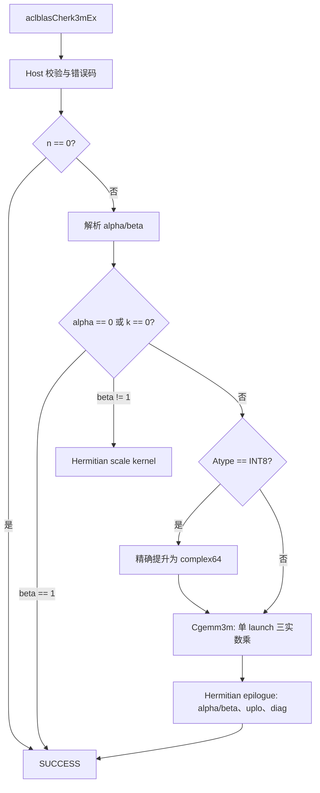

# aclblasCherk3mEx 算子设计文档

## 需求背景（required）

### 需求来源

本设计承接“11月社区任务-aclblasCherk3mEx算子开发（950）”，任务书为
`aclblasCherk3mEx_Atlas950PR_task_doc.md`。目标是在 Ascend 950PR（arch35）上，
基于 ops-blas 的 handle/stream 直调工程新增 complex64 Hermitian 秩-k 更新扩展接口
`aclblasCherk3mEx`，完成设计、实现、测试和交付。

### 背景介绍

`aclblasCherk3mEx` 对标 cuBLAS `cublasCherk3mEx`，计算：

$$
C \leftarrow \alpha\,\operatorname{op}(A)\operatorname{op}(A)^H+\beta C.
$$

其中：

- `trans=ACLBLAS_OP_N` 时，`op(A)=A`，A 为 \(n \times k\)；
- `trans=ACLBLAS_OP_C` 时，A 以 \(k \times n\) 存储，`op(A)=A^H`；
- `trans=ACLBLAS_OP_T` 不属于本接口定义域，返回
  `ACLBLAS_STATUS_INVALID_ENUM`；
- `alpha`、`beta` 为 FLOAT32 实数；
- C 为 \(n \times n\) Hermitian 矩阵，仅 `uplo` 指定三角读写；
- 输出对角元素虚部强制为 0。

A 支持 complex64 和 complex-int8 两种表示。complex-int8 的每个复元素按
`(int8 real, int8 imag)` 交错存储，共 2 Byte；C 固定为 complex64。

### 仓内现状

设计基于 ops-blas 提交 `55ef791b77f3677b45da3468b0a8b17941424f84` 核对：

| 用途 | 现有实现 |
| --- | --- |
| 非 Ex Hermitian 参考 | `blas/herk/arch35/cherk_*` |
| 复数 3M GEMM 主干 | `blas/gemm/arch35/cgemm3m_host.cpp`、`cgemm_host.cpp`、`cgemm_compute_kernel.cpp` |
| 复数实虚拆分与标准 3M 重组 | `cgemm_deinterleave_common.h`、`cgemm_epilogue_kernel.cpp` |
| 公共复数类型与 API | `include/cann_ops_blas.h`、`include/cann_ops_blas_common.h` |
| 测试框架 | `test/herk/cherk/`、`test/frame/`、CBLAS/RefBLAS |

现有非 Ex `aclblasCherk` 使用 4M 分解和多次实数 GEMM launch，且只接受 complex64。
本任务不复用该 4M 路径作为 3M 正式路径，也不依赖尚未合入的 `aclblasCherkEx`。

## 需求分析（required）

### 接口定义

```cpp
aclblasStatus_t aclblasCherk3mEx(
    aclblasHandle_t handle,
    aclblasFillMode_t uplo,
    aclblasOperation_t trans,
    int n, int k,
    const float* alpha,
    const void* A, aclDataType Atype, int lda,
    const float* beta,
    aclblasComplex* C, aclDataType Ctype, int ldc);
```

接口声明加入 `include/cann_ops_blas.h`，不为 950PR 定义私有平行 API。

### 需求拆解

1. 完成 13 参数的公共接口、错误码和前导维语义。
2. 支持 complex64 A、complex-int8 A 与 complex64 C。
3. 实现 `N` 和 `C` 两种转置，拒绝 `T` 和其他非法枚举。
4. 实现 `n=0`、`k=0`、`alpha=0` 的快速返回和仅 beta 缩放路径。
5. 三次实数乘在同一 kernel launch 中完成，并按 \(X X^H\) 语义重组。
6. 只更新 `uplo` 三角，保护另一三角和 `ldc` padding。
7. 建立 1000 条精度、200 条性能 CSV 驱动测试和 msprof 证据。
8. 补充 `blas/herk/README.md` 与可复现测试说明。

### 正式验收口径

| 项目 | 任务书口径 |
| --- | --- |
| 硬件 | Ascend 950PR（arch35） |
| CANN | 9.1.0 及以上 |
| 构建 | `bash build.sh --ops=cherk3m_ex --soc=ascend950` |
| 精度 | 1000 条；实部/虚部分别按 `rtol=atol=2^-13`、matched_ratio 0.99、最大绝对误差 1e-2 判定 |
| 性能 | 200 条；msprof kernel-only，单 case 达到 `gpu_ms` 0.4 倍以上，平均加速比不低于 0.5 |
| 内存 | 任务书明确不涉及 |

## 详细设计（required）

### 数学拆解

令：

$$
X=\operatorname{op}(A)=X_r+iX_i.
$$

采用面向 \(XX^H\) 的 Gauss 3M 分解：

$$
P_0=X_rX_r^T,\qquad
P_1=X_iX_i^T,\qquad
P_2=(X_r+X_i)(X_r-X_i)^T.
$$

对应结果：

$$
\operatorname{Re}(XX^H)=P_0+P_1,
$$

$$
\operatorname{Im}(XX^H)=P_2-P_0+P_1.
$$

三组实数 GEMM 共享同一 K 维归约，组合后得到
\(\alpha\operatorname{Re}(XX^H)+\beta C_r\) 和
\(\alpha\operatorname{Im}(XX^H)+\beta C_i\)。对角元素最后显式写入虚部 0。

### 总体方案

复用仓内已经落地的 `aclblasCgemm3m` 三次实数乘内核，而不是复制一套 Cube
流水线。对 no-trans 路径，以同一个 A 分别作为左、右操作数：

```text
aclblasCgemm3m(handle, N, C, n, n, k, alpha=1, A, lda, A, lda, beta=0, P, ldcTemp)
```

得到 \(P=A A^H\)。对 conjugate-transpose 路径：

```text
aclblasCgemm3m(handle, C, N, n, n, k, alpha=1, A, lda, A, lda, beta=0, P, ldcTemp)
```

得到 \(P=A^H A\)。`aclblasCgemm3m` 内部的标准 3M compute kernel 在一次 launch
内完成三组实数矩阵乘，满足任务书约束。

正式计算流程：



### Host 侧设计

#### 参数校验

校验顺序固定为：

1. `handle == nullptr` → `ACLBLAS_STATUS_HANDLE_IS_NULLPTR`；
2. `uplo`、`trans` 枚举；
3. `n`、`k` 非负；
4. `lda`、`ldc`；
5. `alpha`、`beta` 指针；
6. `Atype`、`Ctype` 支持集；
7. `A`、`C` 空指针条件；
8. quick return。

具体错误码：

| 条件 | 返回 |
| --- | --- |
| `uplo` 不是 UPPER/LOWER | `INVALID_ENUM` |
| `trans` 是 OP_T 或其他非法枚举 | `INVALID_ENUM` |
| `n < 0`、`k < 0` | `INVALID_VALUE` |
| `lda` 小于对应下界 | `INVALID_VALUE` |
| `ldc < max(1,n)` | `INVALID_VALUE` |
| `alpha/beta == nullptr` | `INVALID_VALUE` |
| Atype/Ctype 组合不支持 | `NOT_SUPPORTED` |
| 需要的 A/C 指针为空 | `INVALID_VALUE` |

`trans=N` 时 `lda >= max(1,n)`；`trans=C` 时 `lda >= max(1,k)`。
`k=0` 或 `alpha=0` 时允许 A 为空，因为这些路径不引用 A；`n>0` 时 C 仍必须非空。

#### 标量与前导维

`alpha`、`beta` 支持 Host 和 Device 指针。复用
`ReadAlphaBetaFromDevice()` 和指针位置查询工具解析两个标量。

complex64 结果矩阵使用 `ldcTemp = AlignUp(n, 16)`，确保内部 GEMM 输出连续且可对齐。
用户 C 保持原 `ldc`。complex-int8 的 `lda` 和物理跨度按 2 Byte 元素计算，
提升后的 complex64 临时 A 保持相同逻辑前导维。

#### 临时空间

`aclblasCgemm3m` 会读取临时结果 P，因此 P 不能与用户的 C 直接共用：

- 用户 C 的另一三角不能被 3M epilogue 临时改写；
- beta 项必须引用调用前的 C 原值；
- int8 A 需要 complex64 提升缓冲。

在内部 handle 上增加本接口专用的可增长 scratch，包含对齐的 `P` 和可选的
complex64 A。同一 handle/stream 上的调用按 stream 顺序复用 scratch；扩大容量时先同步
handle stream。handle 销毁时释放 scratch。

### Device 侧设计

#### complex-int8 提升

新增 AIV kernel，按逻辑 A 的物理跨度执行：

```text
dst[k][row].real = float(a[k][row].real)
dst[k][row].imag = float(a[k][row].imag)
```

输入每元素读取 2 个 int8，输出为 8 Byte complex64。实部、虚部独立、精确转换，
不经过量化重算。`trans=N` 和 `trans=C` 均保持原始列主序和 `lda`，转置由后续
Cgemm3m 处理。

#### 三次实数矩阵乘

调用 `aclblasCgemm3m` 时固定 `alpha=(1,0)`、`beta=(0,0)`，只计算未缩放乘积。
形如 \(A A^H\) 或 \(A^H A\) 的共轭转置由 Cgemm3m 的 deinterleave 和标准 3M
路径处理。三组实数乘积在 `cgemm` 的同一 compute kernel launch 内调度：

- fused tile 路径在单个 kernel 内完成三路乘积和组合；
- 大尺寸 tile 路径在一次 compute kernel 内按 product task 分发三路乘积。

#### Hermitian epilogue

新增 AIV kernel，按列主序只遍历 `uplo` 目标三角：

```text
Cnew.real = alpha * P.real + beta * Cold.real
Cnew.imag = alpha * P.imag + beta * Cold.imag
if row == col: Cnew.imag = 0
```

分支规则：

- `beta != 0` 才读取 Cold；
- `beta == 0` 不读取旧 C，允许输入 C 为 NaN；
- 非对角路径保留 3M 的 \(P_0,P_1,P_2\) 组合结果；
- 只写目标三角，另一三角和 padding 不产生写请求；
- `alpha=0` 或 `k=0 && beta!=1` 使用同一 kernel 的 scale 分支；
- `alpha=0` 或 `k=0 && beta==1` 在 Host 直接返回，C 完全不变。

### 支持硬件

| 硬件 | 架构 | 支持状态 |
| --- | --- | --- |
| Ascend 950PR | arch35 / DAV_3510 | 本任务目标与验证平台 |

实际 AIC/AIV 核数通过平台 API 查询，不硬编码数量。

### 算子约束

| 约束项 | 内容 |
| --- | --- |
| A | complex64 或 complex-int8，Device 内存，列主序 |
| C | complex64，Device 内存，原地更新指定三角 |
| alpha/beta | FLOAT32 实数，Host/Device 指针均支持 |
| trans | 仅 N、C；T 返回 INVALID_ENUM |
| 非连续视图 | 仅由 lda/ldc 描述，不支持额外 arbitrary stride |
| 广播 | 不涉及 |
| 确定性 | 3M 归约顺序由固定 tiling 决定；验收按容差而非逐位一致 |
| 内存 | 任务书原文为不涉及 |

## 可维可测分析

### 精度

golden 使用 CPU CBLAS 非 3M 的 `cblas_cherk`；int8 输入先精确提升为 float。
实部、虚部分别判定：

- `rtol = atol = 2^-13`；
- `matched_ratio >= 0.99`；
- `max_abs_error <= 1e-2`。

正式测试集合为 1000 条精度用例，覆盖：

- UPPER/LOWER × N/C；
- complex64/complex-int8；
- n/k 边界、非对齐尺寸和前导维 padding；
- alpha/beta 特殊值；
- 非目标三角和 padding 哨兵；
- 对角虚部非零输入；
- `alpha=0` + A NaN、`beta=0` + C NaN、`k=0` + beta scale；
- trans=T 和非法枚举；
- 3M 相消、int8 极值和虚部抵消。

### 性能

性能测试集合为 200 条。正式数据在 Ascend 950PR 上用 `msprof op` 采集：

- warmup 5 次；
- 取后续 10 次有效 kernel `Task Duration(us)` 算术平均；
- 单 case `NPU_us <= gpu_ms * 1000 / 0.4`；
- 全部 case 的算术平均加速比不低于 0.5。

GTest 的 `[PERF] avg_us` 只作为趋势与交叉验证，不代替 msprof。
int8 路径另行补充采集，并使用同形状 complex64 基线作对照。

### 测试与交付

测试目录：

```text
test/herk/cherk3m_ex/
├── CMakeLists.txt
├── cherk3m_ex_param.h
├── cherk3m_ex_golden.h
└── arch35/
    ├── cherk3m_ex_npu_wrapper.h
    ├── cherk3m_ex_test.cpp
    ├── cherk3m_ex_benchmark.cpp
    ├── cherk3m_ex_test.csv
    └── gpu_baseline.csv
```

测试以 CSV 驱动调用公共 API，不使用内部 kernel 绕过接口。交付包按任务模板包含：

```text
task_submission/
  1 自验证步骤说明.md
  2.1 精度自验证报告.xlsx
  2.2 精度自验证日志.log
  3.1 性能自验证报告.xlsx
  3.2 性能自验证日志.log
  4.1 内存自验证报告.xlsx
  4.2 内存自验证日志.log
```

其中内存报告按任务书“不涉及”记录结论。

### 兼容性

`aclblasCherk3mEx` 是新增公共符号，不修改现有 `aclblasCherk`、
`aclblasCgemm3m` 或 `aclblasSgemm3m` 的行为。新增实现限定在
`blas/herk/arch35/` 与对应测试目录；公共头文件只增加声明和文档注释。
