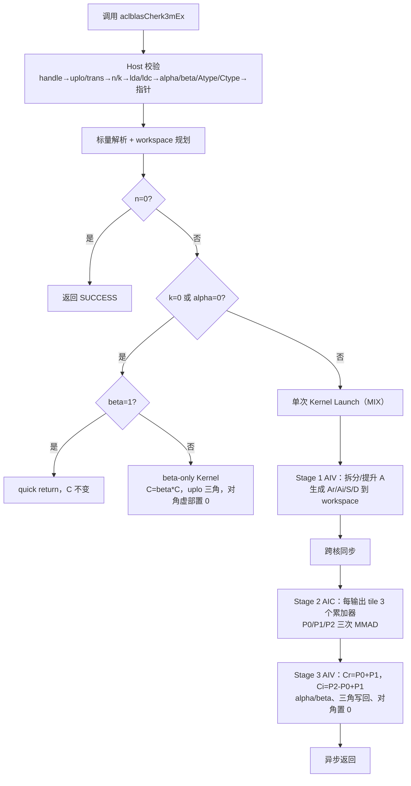

# aclblasCherk3mEx（Ascend 950PR）算子设计文档

> 范围说明：本 PR 仅提交设计文档，不含算子实现与测试代码。设计依据任务方《aclblasCherk3mEx_Atlas950PR 任务书》与 `ops-blas @ 252d42d6` 源码；实现代码按 ops-blas 仓流程单独提交，文档不声称精度/性能已实测达标。

# 需求背景（required）

## 需求来源

- 任务：11 月社区任务-aclblasCherk3mEx 算子开发（950），含税奖金 11445 元，最晚验收 2026-12-10。
- 依据：任务书 §2.1~§2.5（功能、3M 定义、接口、校验顺序）与 §3.2~§3.5（精度、性能、自验口径），配套 `test_cases/`（精度全量 1000 条、性能子集 200 条）。
- 目标仓：[cann/ops-blas](https://gitcode.com/cann/ops-blas)。实现代码入 `blas/herk/arch35/`，测试代码入 `test/herk/cherk3m_ex/arch35/`，并在 `include/cann_ops_blas.h` 新增声明、更新 `blas/herk/README.md`。
- 硬件：Ascend 950PR（arch35，DAV_3510）；CANN 9.1.0 及以上；精度 golden 由 Netlib CBLAS 3.10.0 `cblas_cherk`（可选用 `cblas_zherk`）生成。

## 背景介绍

### 算子功能与工程现状

`aclblasCherk3mEx` 计算 Hermitian 矩阵秩-k 更新（3M 扩展版）：

```text
C := alpha * op(A) * op(A)^H + beta * C
```

- `trans=ACLBLAS_OP_N`：`op(A)=A`（n×k）；`trans=ACLBLAS_OP_C`：`op(A)=A^H`（n×k，由 k×n 存储的 A 共轭转置）。
- `trans=ACLBLAS_OP_T` 不属于 Hermitian 秩-k 更新定义域，返回 `ACLBLAS_STATUS_INVALID_ENUM`（cuBLAS 错误条件表虽列出 OP_T，但公式未定义，本接口按定义域收窄，属有意差异）。
- `C` 为 n×n Hermitian 复矩阵，列主序，仅 `uplo` 指定三角被读写；对角虚部计算后强制置 0。
- `alpha`、`beta` 为**实数**（FLOAT32）；`Atype ∈ {ACL_COMPLEX64, ACL_INT8}`，`Ctype=ACL_COMPLEX64`；`ACL_INT8` 表示 complex-int8，每个复元素按 `(int8 real, int8 imag)` 交错 2 字节。
- 3M 指用 3 次实数矩阵乘完成复数乘：本算子乘积为 `X·X^H`，必须按共轭转置分解，不能套用 `X·X^T` 的对称分解。

以 `ops-blas @ 252d42d6`（2026-11-25）为基线：

| 能力 | 现状 | 本任务 |
|---|---|---|
| 公共声明 | `aclblasCherk` 已声明；**无 `aclblasCherk3mEx`** | 新增声明 |
| 非 Ex `cherk` | `blas/herk/arch35/cherk_host.cpp`、`cherk_kernel.cpp/.h`：Phase 0 AIV 拆分 + 4 次 GEMM（4M）+ Phase 2 AIV 合并 | 复用校验、uplo/对角处理、combine 语义 |
| 3M 参考 | `blas/gemm/arch35/cgemm3m_host.cpp`、`cgemm3m_rounding_kernel.cpp`（复数 GEMM 3M 与舍入修正） | 复用 3M 分解思想，**不得**直接调用 4 次/多次 GEMM 拼接 |
| `Ex` 接口现状 | 1125 前无 `Ex` 后缀的 herk 接口；`aclblasCherkEx` 与本任务同期新增、彼此不得依赖 | 独立实现 |
| 测试 | `test/herk/cherk/arch35/` 已有非 Ex 测试 | 新建 `test/herk/cherk3m_ex/arch35/` 并注册 |
| 产品支持表 | `blas/herk/README.md` 仅列 `aclblasCherk` | 增加 `aclblasCherk3mEx` 章节 |

### 标杆核查

| 审核对象 | 结论 | 依据 |
|---|---|---|
| 原 TBE 算子源码 | 不适用 | handle 式 BLAS 接口，不涉及 ACLNN/TBE 迁移 |
| 算子信息库 JSON | 不适用 | 不注册 ACLNN 算子 |
| 可复用工程实现 | 适用 | arch35 `cherk`（参数校验、uplo 三角、对角置 0、beta 语义、workspace 管理）；`cgemm3m`（复数 3M 分解与舍入风险处理） |
| 不可复用点 | 明确 | `cherk` 为 4M 且分 4 次 GEMM launch；`cgemm3m` 是通用复数 GEMM，不含 Hermitian 三角/对角语义 |

### 现状差距

1. 现有 `cherk` 使用 4M：`Cr=t1+t2`、`Ci=t3-t4`，4 个实数矩阵乘分 4 次 `gemm_kernel_do` 下发；本任务要求 3M 且三次实数乘必须在**同一次 kernel launch** 内完成。
2. 现有 `cherk` 仅支持 `aclblasComplex` 输入；本任务新增 `ACL_INT8`（complex-int8）输入，需要精确提升到 FP32 后再参与 3M。
3. 现有接口无 `Atype/Ctype` 参数与 `NOT_SUPPORTED` 分支；需要新增声明、类型校验与产品支持表。
4. `trans=OP_T` 在现有 `cherk` 返回 `INVALID_VALUE`，本任务要求 `INVALID_ENUM`；校验顺序也需按任务书重排。

# 需求分析（required）

## 需求描述

在 Ascend 950PR（arch35）、CANN 9.1.0 及以上实现 `aclblasCherk3mEx`：支持 `ACL_COMPLEX64` 与 `ACL_INT8` 两种 A 类型、`trans ∈ {N,C}`、UPPER/LOWER、任意 `n,k ≥ 0`、`lda/ldc` padding、实数 `alpha/beta`；用 3M 分解在单次 kernel launch 内完成 `alpha·op(A)·op(A)^H + beta·C`；精度满足 COMPLEX64 混合容差，性能达到 GPU kernel 基线的 0.4 倍以上（全部性能用例平均 ≥0.5）。

## 接口定义

`include/cann_ops_blas.h` 当前无 `aclblasCherk3mEx`，本任务新增声明（`ASC_DEVKIT_GE_9_1` 保护）：

```cpp
aclblasStatus_t aclblasCherk3mEx(
    aclblasHandle_t handle,
    aclblasFillMode_t uplo,
    aclblasOperation_t trans,
    int n, int k,
    const float* alpha,
    const void* A, aclDataType Atype, int lda,
    const float* beta,
    aclblasComplex* C, aclDataType Ctype, int ldc);
```

返回值：`aclblasStatus_t`；成功为 `ACLBLAS_STATUS_SUCCESS`，非法枚举 `INVALID_ENUM`，阶数/前导维非法 `INVALID_VALUE`，类型组合不支持 `NOT_SUPPORTED`，空句柄 `HANDLE_IS_NULLPTR`。

## 需求拆解

1. **功能**：`C = alpha·X·X^H + beta·C`，`X=op(A)`；只更新 `uplo` 三角，对角虚部置 0。
2. **数据类型**：`alpha/beta` FLOAT32；`A` 为 COMPLEX64 或 complex-int8（交错 2B）；`C` COMPLEX64；`Atype/Ctype` 组合仅 `(INT8, COMPLEX64)`、`(COMPLEX64, COMPLEX64)`，其余 `NOT_SUPPORTED`。
3. **形状**：`n,k ≥ 0`；`trans=N` 时 A 为 n×k、`lda≥max(1,n)`；`trans=C` 时 A 为 k×n、`lda≥max(1,k)`；`ldc≥max(1,n)`；covers n/k 至 4096/2048（任务书用例范围）。
4. **边界**：`n=0` 合法 no-op 但仍校验结构参数；`k=0` 或 `alpha=0` 时秩-k 贡献为 0，`beta=1` quick return，`beta≠1` 只做 `C=beta·C`（不引用 A）；`beta=0` 不读 C 旧值。
5. **3M 正确性**：`Cr=P0+P1`、`Ci=P2−P0+P1`，其中 `P0=Xr·Xr^T`、`P1=Xi·Xi^T`、`P2=(Xr+Xi)·(Xr−Xi)^T`；必须保证等于 `X·X^H`，禁止误用 `X·X^T`。
6. **校验**：按任务书 §2.5 顺序；`uplo/trans` 非法返回 `INVALID_ENUM`，阶数/前导维非法返回 `INVALID_VALUE`，类型组合不支持返回 `NOT_SUPPORTED`，空句柄返回 `HANDLE_IS_NULLPTR`。
7. **精度**：golden 为 `cblas_cherk`（INT8 先逐元素精确提升）；COMPLEX64 实部/虚部分别按 FP32：`rtol=atol=2^-13`、`matched_ratio≥0.99`、`max_abs≤1e-2`；3M 与直接复数乘不逐位比对。
8. **性能**：`msprof op` kernel `Task Duration`，warmup 5 + 10 次均值；单 case ≤ `gpu_ms`×2.5（≥0.4×），全部性能 case 平均倍率 ≥0.5；int8 路径补充采集，沿用 COMPLEX64 基线。
9. **交付**：设计文档 PR、arch35 实现、1000 条精度用例与 200 条性能用例自测报告、README 与公共头更新。

# 详细设计（required）

## 算子分析

### 数学公式

```text
X = op(A) = A        (trans = N, A 为 n×k)
X = A^H              (trans = C, A 为 k×n)
C = alpha * X * X^H + beta * C
```

令 `X = Xr + i·Xi`，则

```text
X·X^H = (Xr·Xr^T + Xi·Xi^T) + i·(Xi·Xr^T − Xr·Xi^T)
```

3M 分解（Hermitian 专用）：

```text
P0 = Xr·Xr^T
P1 = Xi·Xi^T
P2 = (Xr+Xi)·(Xr−Xi)^T
Cr = P0 + P1
Ci = P2 − P0 + P1
```

验证：`P2 = XrXr^T − XrXi^T + XiXr^T − XiXi^T = P0 − P1 + (XiXr^T − XrXi^T)`，故 `Ci = P2−P0+P1 = XiXr^T − XrXi^T`，与上式一致。**不能**套用 `X·X^T` 的对称分解，否则虚部会算成 `XiXr^T + XrXi^T`，符号错误。

按 `trans` 展开到 A 的实/虚矩阵（`Ar/Ai` 为 A 的实部/虚部，形状同 A）：

| trans | Xr | Xi | P0 | P1 | P2 |
|---|---|---|---|---|---|
| N | `Ar`（n×k） | `Ai`（n×k） | `Ar·Ar^T` | `Ai·Ai^T` | `S·D^T` |
| C | `Ar^T`（n×k） | `−Ai^T`（n×k） | `Ar^T·Ar` | `Ai^T·Ai` | `D^T·S` |

其中 `S = Ar + Ai`、`D = Ar − Ai`（形状同 A）。两种 trans 都只需 3 个实数乘，且可统一为“对 A 的实/虚/和/差矩阵做 3 次带转置标志的 GEMM”。

Hermitian 输出：

```text
C(i,j) = alpha·Cr(i,j) + beta·C_old(i,j)          (i≠j, uplo 三角内)
C(i,i) = alpha·Cr(i,i) + beta·Re(C_old(i,i)) + 0i
```

### 支持数据类型

| 参数 | 类型 | 位置 | 说明 |
|---|---|---|---|
| `handle` | 句柄 | Host | 携带 stream |
| `uplo`、`trans`、`n`、`k`、`lda`、`ldc` | 标量/枚举 | Host | 见参数约束 |
| `alpha`、`beta` | FLOAT32 | Host/Device | 支持两种位置；Device 经 D2H + stream 同步解析 |
| `A` | COMPLEX64 或 complex-int8 | Device（只读） | INT8 为 `(int8 re, int8 im)` 交错 2B |
| `Atype`、`Ctype` | 枚举 | Host | 支持集见上 |
| `C` | COMPLEX64 | Device（读写） | n×n，列主序，`ldc≥max(1,n)` |

### 支持形状

- `n,k ≥ 0`；任务书用例覆盖 n ∈ {0..4096}、k ∈ {0..2048}。
- `trans=N`：A 物理 n×k、`lda≥max(1,n)`；`trans=C`：A 物理 k×n、`lda≥max(1,k)`。
- C 物理 `ldc×n`、`ldc≥max(1,n)`；只写 uplo 三角，padding 列不写。
- 3M 中间量大小用 `uint64` 计算：`Ar/Ai/S/D` 各 `n·k·4B`，按 `ACLBLAS_MAX_WORKSPACE_SIZE`（2 GiB）校验。

## 算子实现

### 实现方案

#### 3.2.0 整体执行流程图



#### 3.2.1 Host 侧设计

**参数校验顺序（按任务书 §2.5）**：

| 顺序 | 检查 | 返回 |
|---|---|---|
| 1 | `handle == nullptr` | `HANDLE_IS_NULLPTR` |
| 2 | `uplo ∉ {UPPER, LOWER}` | `INVALID_ENUM` |
| 3 | `trans ∉ {N, C}`（含 `OP_T`） | `INVALID_ENUM` |
| 4 | `n < 0`、`k < 0` | `INVALID_VALUE` |
| 5 | `lda` 低于对应下界、`ldc < max(1,n)` | `INVALID_VALUE` |
| 6 | `alpha == nullptr \|\| beta == nullptr` | `INVALID_VALUE` |
| 7 | `Atype/Ctype` 不在支持集或组合不支持 | `NOT_SUPPORTED` |
| 8 | `n>0 && k>0` 时 `A` 为空；`n>0` 时 `C` 为空 | `INVALID_VALUE` |
| 9 | `n == 0` | `SUCCESS`（不启动，A/C 可为空） |
| 10 | `k == 0 \|\| alpha == 0`：`beta=1` 返回，`beta≠1` 走 beta-only | `SUCCESS` 或启动缩放 kernel |
| 11 | 3M 主路径：workspace 规划 + 单次启动 | `SUCCESS`（异步） |

> 标量位置：`CheckPtrLocation` 探测 `alpha`/`beta`；Host 直接读，Device 走 `aclrtMemcpyAsync` D2H + stream 同步。要求二者同为 Host 或同为 Device（与 `cherk` 口径一致），混合位置返回 `INVALID_VALUE`。`n=0`、`k=0&&beta=1` 等短路路径不触发同步。

**Tiling 字段**：

| 字段 | 含义 |
|---|---|
| `n,k,lda,ldc` | 逻辑规模与前导维 |
| `trans`、`uplo` | 转置与三角 |
| `alphaVal/betaVal` | 解析后的实数标量 |
| `aType` | 0=COMPLEX64，1=INT8 |
| `baseM/baseN/baseK` | Cube 基础块（建议 128×64×64 起步） |
| `mTiles/nTiles` | 输出 tile 网格 |
| `usedCoreNum` | AIC 核数 / AIV 核数 |
| `wsAr/wsAi/wsS/wsD` | 4 个实数矩阵的 workspace 偏移 |
| `stage` | 0=beta-only，1=3M 主路径 |

**Cube 分核与 tile**：

- 输出为 n×n，按 `baseM×baseN` 网格切分；`mTiles=ceil(n/baseM)`、`nTiles=ceil(n/baseN)`。
- AIC 核数按 `min(GetAicCoreCount(), mTiles×nTiles)`，沿 M/N 两维做近似均衡划分（沿用 `cherk` 的 `CalcMultiCorePartition` 思路）。
- 每个输出 tile 使用 3 个 FP32 累加器 `acc0/acc1/acc2`；按 L0C 容量选择 `baseM×baseN`，使 `3×baseM×baseN×4B` 同时驻留。建议 128×64（96 KiB）起步，128×128（192 KiB）需按实际 L0C 容量确认。
- 若 L0C 不足以同时驻留 3 个累加器，降级为“2 个累加器 + 1 个中间结果写 workspace”，仍保持单次 launch。

**Workspace**：

| 区域 | 大小 | 说明 |
|---|---|---|
| `Ar` | `n·k·4B` | COMPLEX64 拆分或 INT8 提升后的实部 |
| `Ai` | `n·k·4B` | 虚部 |
| `S = Ar+Ai` | `n·k·4B` | 3M 第三乘的左操作数 |
| `D = Ar−Ai` | `n·k·4B` | 3M 第三乘的右操作数 |
| 可选 spill | `≤3·n·n·4B` | 仅 L0C 不足时使用 |

总需求按 `ACLBLAS_MAX_WORKSPACE_SIZE` 校验，超限返回 `ALLOC_FAILED`；`n=4096,k=2048` 时主区域约 128 MiB，可满足。

#### 3.2.2 Kernel 侧设计

采用 **单次 launch 的 MIX kernel**（AIV + AIC），三个阶段在同一 kernel 内完成，禁止用 3 次独立 GEMM 调用拼接。

**Stage 1（AIV）：A 拆分/提升**

- COMPLEX64：按 2D tile 读 A，`DeInterleave` 拆分实部/虚部，写 `Ar/Ai`；同时计算 `S/D` 写 workspace。
- INT8：按交错 `(int8 re, int8 im)` 读入，先做 `Cast` 到 FP32（值域 [-128,127] 精确可表示），再拆分为 `Ar/Ai`，并生成 `S/D`。
- padding：`lda` 大于物理行数时按逻辑 n×k（或 k×n）搬运，padding 不进入 workspace。
- 分核：按行/列 tile 均分到 AIV 核；`Ar/Ai/S/D` 的写地址按紧凑行主序计算。

**Stage 2（AIC）：3M 三次实数乘**

- 每个输出 tile 沿 K 方向迭代，`baseK=64` 起步：
  ```text
  trans=N: acc0 += Ar_tile · Ar_tile^T
           acc1 += Ai_tile · Ai_tile^T
           acc2 += S_tile  · D_tile^T
  trans=C: acc0 += Ar_tile^T · Ar_tile
           acc1 += Ai_tile^T · Ai_tile
           acc2 += D_tile^T  · S_tile
  ```
- 三个 MMAD 使用同一 K tile 的搬运结果，L1 复用 `Ar/Ai/S/D`，避免 4M 方案的四次全局读。
- 累加器 `acc0/acc1/acc2` 均为 FP32 L0C；K 循环结束后直接进入 epilogue，中间结果不落 GM（L0C 不足时按上文 spill）。
- `alpha` 不进入 MMAD，留给 epilogue，避免实数 alpha 污染 3M 中间值的舍入路径。

**Stage 3（AIV）：合并与写回**

1. 从 L0C/UB 读取 `acc0/acc1/acc2`，计算
   `Cr = acc0 + acc1`、`Ci = acc2 − acc0 + acc1`。
2. 应用 `alpha`（实数）：`Cr *= alpha`、`Ci *= alpha`；`alpha=0` 路径已在 Host 短路，不进入此阶段。
3. `beta` 语义：`beta=1` 直接用旧 C；`beta=0` 不读旧 C；其余做 `C=beta·C` 后相加。
4. 只写 uplo 三角；`i==j` 只写实部、虚部置 0；`ldc` padding 不写。
5. LOWER 对角块需按 `cherk` 的既有做法构造整列 UB 镜像：uplo 段写新值，严格上段按旧值恒等回写，保证非 uplo 区域不被破坏。
6. 同步：AIV→AIC 用 `CrossCoreSetFlag/WaitFlag`（或平台等价的 MIX 同步原语）；AIC→AIV 的 epilogue 等待 L0C/UB 数据就绪；Kernel 退出前保留全屏障。

**INT8 专项**：

- 提升为 FP32 后与 COMPLEX64 路径共用 3M 与 epilogue，不为 INT8 单独维护一套数学路径。
- `VALUE_INT8_EXTREME`（-128/127）与实部/虚部极值组合必须覆盖，验证提升无符号扩展错误。
- INT8 输入不参与 `alpha/beta` 的整数化，`alpha/beta` 始终为 FP32。

**舍入与确定性**：

- 3 个实数乘的中间结果按 FP32 舍入；`Cr/Ci` 的加减顺序固定为 `acc2 − acc0 + acc1`，不得改写为等价但舍入不同的形式。
- 无原子加；同一 tiling 下结果逐位可复现。
- 3M 与直接复数乘/4M 的舍入不同，与 `cblas_cherk` 不逐位一致，按任务书阈值判定。

#### 3.2.3 算子泛化设计

- **n=0**：Host 短路，A/C 可为空。
- **k=0 或 alpha=0**：`beta=1` quick return（C 含对角虚部均不变）；`beta≠1` 只对 uplo 三角做 `C=beta·C` 且对角虚部置 0，不引用 A。
- **beta=0**：不读 C 旧值，uplo 三角直接写新值（含全零），旧值 NaN/Inf 不扩散。
- **trans 两态**：N/C 各自映射为 3 个带转置标志的 GEMM，不引入 OP_T。
- **Atype 两态**：COMPLEX64 与 INT8 共用 Stage 2/3，仅 Stage 1 分支。
- **padding**：`lda/ldc` 大于下界时按逻辑区域搬运/写回，padding 保持原值。
- **大 n/k**：按 tile 流式，不要求整矩阵驻留 UB/L1；workspace 超 2 GiB 返回 `ALLOC_FAILED`。

#### 3.2.4 3M 正确性专项

| 检查点 | 要求 | 反例 |
|---|---|---|
| 共轭方向 | 乘积必须是 `X·X^H`，第三乘按 `S·D^T`（N）或 `D^T·S`（C） | 误用 `X·X^T` 会把虚部算成 `XiXr^T + XrXi^T` |
| 符号 | `Ci = P2 − P0 + P1` | 写成 `P2 + P0 − P1` 会整体反号 |
| 对角 | 3M 的两个独立乘积在对角有非零浮点差，必须强制置 0 | 直接写 `Ci` 会在对角留下 O(0.1~1.0) 的虚假虚部 |
| INT8 | 提升只做符号扩展，不做量化/缩放 | 把 int8 当 uint8 会整体偏移 128 |
| trans=C | `Xi = −Ai^T`，负号通过 `D=Ar−Ai` 与 `D^T` 的组合体现 | 漏掉负号会使虚部反号 |
| 单次 launch | Stage 1/2/3 在同一 kernel 内完成 | 用 3 次 `gemm_kernel_do` 拼接违反任务书 |

### 数据检测

- 空 handle、非法 uplo/trans（含 OP_T）、n/k 负值、lda/ldc 低于下界、alpha/beta 空、A/C 空（按 n/k 条件）、Atype/Ctype 不支持：按上表返回。
- `n=0` 不豁免结构参数校验；`k=0`/`alpha=0` 时 A 可为空，但 `n>0` 时 C 必须非空（beta≠1 仍需缩放）。
- workspace 超 2 GiB：`ALLOC_FAILED`。
- `lda/ldc` 计算用 `int64`，乘法用 `uint64`，避免 n·k·4B 溢出。

### 支持硬件

| 芯片版本 | 勾选 |
|---|---|
| Ascend 950PR（arch35，DAV_3510） | √ |
| Ascend 950DT | 不在本任务验收范围；如需支持须按平台 L0C/UB 容量另行复核 |
| Atlas A2/A3（arch22） | 不支持（本任务仅 950） |

### 算子约束限制

- 不支持广播；C 原地覆写，C 与 A 不得重叠。
- `alpha/beta` 必须同为 Host 或同为 Device；混合返回 `INVALID_VALUE`。
- 仅支持列主序带 padding 布局，不支持任意非连续 Tensor。
- 仅支持 `(Atype,Ctype) ∈ {(COMPLEX64,COMPLEX64), (INT8,COMPLEX64)}`。
- 3M 必须在单次 kernel launch 内完成；`aclblasCherkEx` 未合入前不得依赖。
- 对角虚部输出固定为 0；非 uplo 三角与 padding 保持原值。

# 可维可测分析

## 精度标准/性能标准

| 验收标准 | 描述 | 标准来源 |
|---|---|---|
| 精度 | COMPLEX64 实部/虚部分别按 FP32：`rtol=atol=2^-13`，`matched_ratio≥0.99`，`max_abs≤1e-2`；golden 为 `cblas_cherk`（INT8 先精确提升） | 任务书 §3.2 |
| 性能（单 case） | `msprof op` kernel `Task Duration` ≤ `gpu_ms`×2.5（≥0.4×） | 任务书 §3.3 |
| 性能（整体） | 全部性能 case 的加速比算术平均 ≥0.5 | 任务书 §3.3 |
| 交叉验证 | `[PERF] avg_us` / `verify_performance.py` 仅作趋势，不作正式判据 | 任务书 §3.3.2 |

## 测试用例规划

新建 `test/herk/cherk3m_ex/arch35/`，复用任务书 `test_cases/` 与 CSV 驱动：

| 类别 | 条数 | 覆盖点 |
|---|---|---|
| `basic` | 8 | N/C × UPPER/LOWER × 两种 Atype 冒烟 |
| `ex` | 700 | n 1..4096、k 1..2048、方阵/长条、padding |
| `pf` | 200 | 性能子集（按 dtype × 规模档分层） |
| `inc` | 40 | lda/ldc 下界、+1、+8、+64 |
| `alpha` | 24 | 0、1、-1、±1e4、随机 |
| `beta` | 24 | 0（不读旧 C）、1、随机、NaN 旧值 |
| `k0` | 8 | k=0 + beta=1/≠1 |
| `alpha0` | 8 | alpha=0 + beta=1/≠1、A 为 NaN 不引用 |
| `int8` | 24 | 交错提升、-128/127 极值、INT8×COMPLEX64 组合 |
| `diag` | 12 | 对角虚部非零输入、输出置 0 |
| `n0` / `neg` | 12 | n=0、负 n/k、非法 uplo/trans/lda/ldc |
| `type` | 8 | 不支持 Atype/Ctype → `NOT_SUPPORTED` |
| `3M` | 4 | `TC_3M_*`：交替/极值填充、虚部抵消、int8 极值、对角置 0 |

预期：约 1050 条 SUCCESS，其余按负向用例返回对应错误码；性能用例覆盖 N/C、UPPER/LOWER、小/中/大三档，并单列 INT8 补充采集。

## 兼容性分析

- 新增 `aclblasCherk3mEx` 声明与 arch35 实现，不改变 `aclblasCherk` 行为。
- 新增 `blas/herk/README.md` 章节与 `test/herk/cherk3m_ex/` 构建目标；不改动 A2/A3 的 arch22 `cherk`。
- 受 `ASC_DEVKIT_GE_9_1` 保护（与 `cherk`/`cgemm3m` 一致），低版本 devkit 不编译 3M 路径。
- 不依赖 `aclblasCherkEx`，两者可独立合入。

## 风险与降级预案

| 风险 | 影响 | 预案 |
|---|---|---|
| 3M 公式符号/共轭方向错误 | 虚部整体错误 | `TC_3M_*` 专项 + 对角/非对角分离断言；文档固化 `Ci=P2−P0+P1` |
| 3 个 L0C 累加器超容量 | 无法编译/性能差 | 128×64 起步；不足时 spill 1 个中间结果到 workspace，仍单次 launch |
| 单次 launch 内 AIV/AIC 同步错误 | 数据竞争/挂死 | 使用平台 MIX 同步原语；Stage 1 完成后再发 MMAD；尾部全屏障 |
| INT8 提升符号错误 | 大面积精度失败 | 极值用例；`Cast` 后抽查 `-128/127` |
| workspace 超 2 GiB | 大 n/k 失败 | Host 预校验；必要时按 K 分块复用 `S/D`，`Ar/Ai` 保留 |
| 性能未达 0.4×/0.5× | 验收失败 | 3M 相比 4M 少一次 GEMM；优先保证 L1 复用与 epilogue 融合，实测后调 `baseM/baseN/baseK` |
| 3M 与 golden 舍入差异 | 误判精度失败 | 不逐位比对，按阈值判定；自测报告说明 3M 舍入路径 |

## 附录：修订记录

| 日期 | 版本 | 说明 |
|---|---|---|
| 2026-11-26 | v1.0 | 依据任务书与 `ops-blas @ 252d42d6` 完成设计；明确 `X·X^H` 的 3M 分解、单次 launch 的 MIX 三阶段与 INT8 提升口径 |
