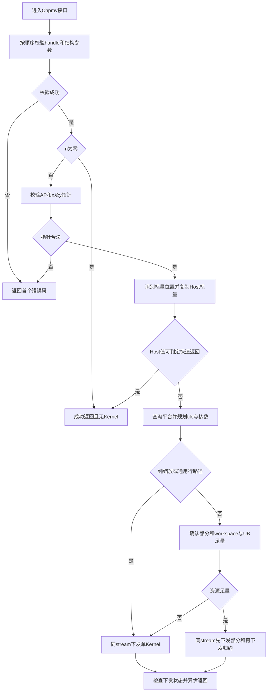
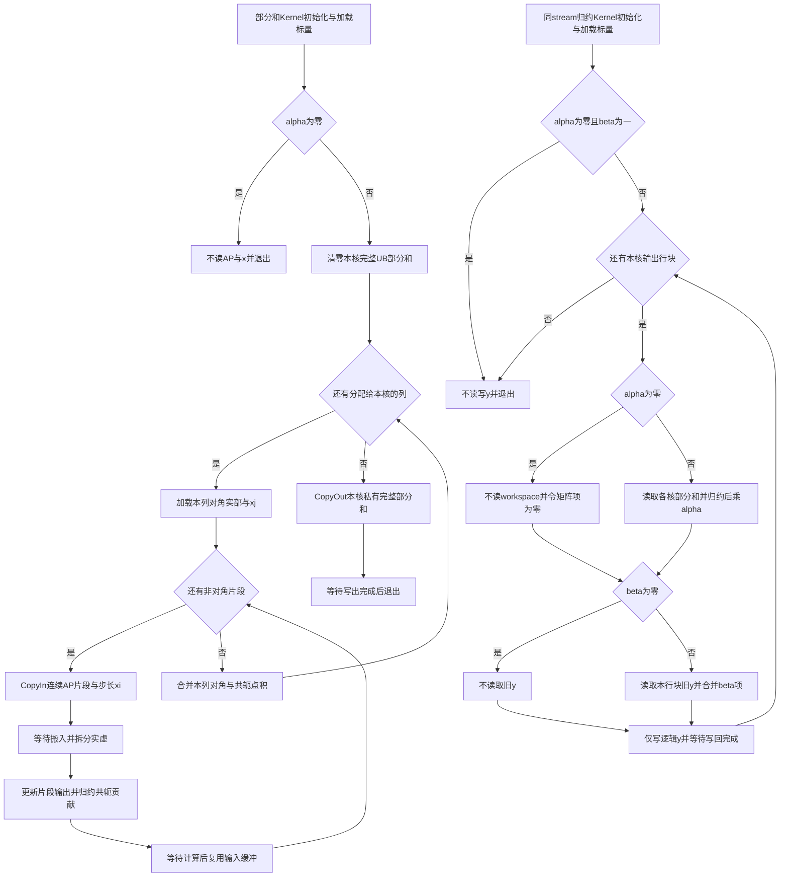

# aclblasChpmv 算子设计文档

## 需求背景（required）

### 需求来源

本设计对应 [11月社区任务-aclblasChpmv算子开发（A2/A3）](https://www.hiascend.com/activities/task-center/details/c596a05d90b9471683e41fcf4d026ae5?menu=tasks)。依据为官方任务包 `c07419f0566d426dacdcc1e3de6885c8.zip` 内的 `aclblasChpmv_AtlasA2_A3_task_doc.md`、`test_cases/chpmv_test.csv`、`gpu_baseline.csv`、`gen_csv.py`、两个验证脚本及测试 README。

计划基于 `cann/ops-blas`，使用 Ascend C kernel 直调方式，在 Atlas A2/A3（arch22）上实现单精度复数 Hermitian 压缩存储矩阵向量乘加。软件环境为 CANN 9.1.0，CPU golden 为 Netlib BLAS 3.10.0 的 `cblas_chpmv(CblasColMajor, ...)`。正式性能平台为 Atlas 800T A2（910B3），自验证只需覆盖一种款型；A3 应保留编译适配与后续验证入口。

设计拟提交到 `cann/cann-ops-competitions` 的 `master`，实现与测试拟提交到 `cann/ops-blas` 的 `master`，两者独立评审。本文描述拟实施与拟验证方案，不代表实现、设备自测或任务验收结论。

### 背景介绍

#### 当前实现与任务边界

核对的 `ops-blas master` 提交为 `55ef791b77f3677b45da3468b0a8b17941424f84`。当前仓库同时存在 arch35 与 arch22 的 Chpmv 实现；任务书“补齐 arch22”的背景描述与当前树有差异。计划在既有 arch22 工程中适配本任务契约，不重复定义接口或覆盖其他贡献者成果。

| 当前模块 | 仓库事实 | 拟处理内容 |
| --- | --- | --- |
| `include/cann_ops_blas.h`、`cann_ops_blas_common.h` | 已有 Chpmv 声明、状态码、复数结构，实虚各 float32 | 保持函数签名、枚举和 ABI |
| `blas/spmv/arch22/chpmv_host.cpp` | n=0 提前于 uplo/步长/标量指针校验；拒绝 INT_MIN；直接解引用 alpha/beta | 按本任务顺序校验，64 位处理负步长，支持 Host/Device 标量 |
| `blas/spmv/arch22/chpmv_{kernel.cpp,kernel.h,tiling_data.h}` | 已有 AIV 两阶段部分和、归约及缩放入口 | 复用工程组织，调整调度、资源预算、特殊值分支与回归测试 |
| `blas/spmv/arch35/` | 已有其他架构实现 | 用于接口与语义对照，保留独立构建路径 |
| `test/spmv/chpmv/CMakeLists.txt` | 已按 arch22/arch35 注册 `chpmv_test` | 保持现有注册，验证当前目标源码被选中 |
| `test/spmv/chpmv/chpmv_param.h`、`chpmv_test_utils.h` | 共用参数映射、造数与比较工具 | 补充本任务 token，避免修改其他架构既有语义 |
| `test/spmv/chpmv/arch22/` | 已有 wrapper、GTest 与 CSV；golden 直接调用链接所得 CBLAS | 使用当前任务附件，冻结 Netlib 版本与符号来源，补足性能与 Device 标量测试 |
| `blas/common/helper/host_utils.h` | 可查询指针位置；`ReadScalarFromHostOrDevice` 内含 D2H 和 stream 同步 | 复用位置识别思想；本接口 Device 标量由 Kernel 读取，避免引入调用内同步 |
| `blas/common/helper/aclblas_handle_internal.h` | handle 持有 stream、有效 workspace 及所有权 | 借用足量工作区；不在异步返回前释放或复用未完成资源 |

#### 算子功能分析

计算 `y ← alpha*A*x + beta*y`。A 为 n×n Hermitian 矩阵，AP 只保存逐列连续的上三角或下三角，另一半由共轭对称关系恢复。对角只读取实部。complex64 元素大小为 8 字节，packed 数据量为 `4*n*(n+1)` 字节；n=8192 时为 268,468,224 字节。矩阵向量乘的计算量为 O(n²)，大规模优先考虑连续 AP 访问、x 复用和均衡分核，不展开为完整 n×n 矩阵，不降低 FP32 计算精度。

## 需求分析（required）

### 需求描述与接口

```cpp
aclblasStatus_t aclblasChpmv(
    aclblasHandle_t handle, aclblasFillMode_t uplo, int n,
    const aclblasComplex* alpha, const aclblasComplex* AP,
    const aclblasComplex* x, int incx,
    const aclblasComplex* beta, aclblasComplex* y, int incy);
```

| 参数 | 类型、位置与角色 | 支持范围与异常行为 |
| --- | --- | --- |
| handle | Host 句柄，携带 stream | nullptr 返回 `ACLBLAS_STATUS_HANDLE_IS_NULLPTR` |
| uplo | Host 枚举 | UPPER/LOWER；其他值返回 `ACLBLAS_STATUS_INVALID_ENUM` |
| n | Host int，方阵阶数 | n≥0；负值返回 `ACLBLAS_STATUS_INVALID_VALUE` |
| alpha、beta | Host 或 Device，complex64 标量指针 | 均须非空，包括 n=0；分别识别位置，Host 值复制入 launch 参数，Device 指针传 Kernel |
| AP | Device，只读 complex64，ND packed 向量 | n(n+1)/2 个元素；无 lda；n>0 时须非空 |
| x | Device，只读 complex64 向量 | 逻辑长度 n，n>0 时须非空 |
| incx | Host int，x 元素步长 | 任意非零值，含负值及 INT_MIN；0 返回 INVALID_VALUE |
| y | Device，complex64 原地输入/输出 | 逻辑长度 n，n>0 时须非空；beta=0 时旧值不参与读取 |
| incy | Host int，y 元素步长 | 与 incx 相同；仅写逻辑位置，空洞保持原样 |

AP/x/y 空指针错误返回 INVALID_VALUE。调用方提供足够且可访问的设备内存；y 的可写区域不得与 AP、x 的可读区域重叠。接口不进行设备数据元素扫描，不校验 Hermitian 数值性质，不支持广播或步长之外的任意 Tensor 视图。运行时 n/uplo/步长决定本次 tiling，不依赖图模式动态 shape。

### 需求拆解与覆盖矩阵

| ID | 要求及任务书来源 | 设计内容 | 计划验证与覆盖状态 |
| --- | --- | --- | --- |
| R01 | §2.1～2.4：complex64、接口顺序、packed 上/下三角 | 接口表、索引公式、工程路径 | L0/SQ、手算例及双 uplo；covered |
| R02 | §2.1：共轭对称、忽略对角虚部 | 数学公式、双贡献计算 | 对角非零/NaN/Inf 毒值；covered |
| R03 | §2.4～2.5：任意非零正负步长、原地 y | 64 位索引、精确 scatter、所有权 | INC/ST、INT_MIN 配 n=1、空洞/guard；covered |
| R04 | §2.5：结构检查顺序、n=0、错误码 | Host 顺序与流程图 | ED、NullHandle、组合错误；covered |
| R05 | §2.1：alpha=0、beta=0/1 快速分支 | Host/Device 标量分流、Kernel 短路 | 无旧 y 读取、无 AP/x 读取；covered |
| R06 | §2.5：Host/Device 标量、stream 异步 | 标量描述、设备加载、workspace 生命周期 | H/H、H/D、D/H、D/D 与同 stream 更新；covered |
| R07 | §2.2、§5：ops-blas、arch22 直调与测试 | 既有模块增量适配 | A2/A3 编译、GTest 发现、arch35 回归；covered |
| R08 | §3.1～3.2：Netlib3.10.0、实虚分别混合容差 | golden 身份和分量比较 | 正式1000条及补充；特殊值与 ULP 细则 open |
| R09 | §3.3：910B3、msprof、5次预热和10次平均、≥0.8×GPU | 全任务耗时、基线逐行映射 | 正式200条逐条判断；covered |
| R10 | §3.5：分布、负例、边界、验收框架 | CSV/token 适配、完整性门禁 | 原始全集与独立补充集；分布分母 open |
| R11 | §3.4：无专项内存要求 | 资源安全与有界workspace | 不虚构内存性能指标；covered |
| R12 | §4～5：设计、代码、README、自验报告、验收包 | 交付规划与独立状态 | 后续交付逐项留证；covered |

### 材料差异与待确认事项

| ID | 已核对差异或缺口 | 拟采用方案与待确认边界 |
| --- | --- | --- |
| Q01 | 任务书称 arch22 待补齐，当前 master 已有实现与测试 | 以本任务契约增量适配；代码开发前请维护者确认已有贡献与本任务归属，设计仍覆盖完整行为 |
| Q02 | README 称200条GPU基线占位待回填，实际200条 gpu_ms 全部有值；分类表 ED写25条，CSV为28条 | 用随包原始CSV的实际1200条和200条基线；不重新生成覆盖原件，不把附件数值表述为本次测量 |
| Q03 | README写 MERE/MARE 与“全部元素”，任务书为混合容差；最大误差的“1e-2 or 32 ULP”未明确组合方式；Inf/NaN输入存在但比较规则未充分定义 | 正式输出两套统计，混合容差按§3.2；暂以 max_abs_error≤1e-2 为保守门禁；ULP替代条件、有限值分母与特殊值分类待确认，不默认NaN与Inf等价 |
| Q04 | 附件含 `RANDOM_GAUSS_0_1`、`RANDOM_DIAG_IMAG`；当前共用 Generate 不支持；既有 GAUSS_NORM_5_2 不等于 N(0,1) | 新增明确token：实虚独立N(0,1)，对角毒值单独注入；不把既有正态分布token当作等价实现 |
| Q05 | 任务书要求均匀/正态各50%；当前CSV含特殊值与固定性能组合，不是简单行数50/50 | 保留正式用例，单独增加等参数配对分布验证；按随机张量生成次数和元素数留统计，最终比例分母待需求方确认 |
| Q06 | 精度脚本不强制完整集合/子进程成功；性能脚本先查 arch35 CSV | 严格入口固定 arch22，核对注册名、退出码、XML、逐项结果和样本数；原脚本结果作辅助，不以退出0替代验收 |
| Q07 | 当前社区任务仓无本次A2/A3 Chpmv专属目录；已有10月950目录对应其他任务 | 依README允许贡献者创建任务目录的规则，拟新建 `11-aclblasChpmv-A2A3/MissingPastDays/docs/design.md`；若发布方后续预建编号目录，提交前对齐。MissingPastDays沿用当前仓已有贡献者标识 |
| Q08 | 合法int参数可能描述超出实际地址空间的对象；任务未指定跨度字节溢出的错误码 | 先以64位计算与检查平台可表示字节跨度，拟溢出返回INVALID_VALUE；不把INT_MIN单独列为非法。具体溢出错误映射请维护者确认 |

## 详细设计（required）

### 算子分析

#### packed 布局与负步长

所有公式采用零基索引。定义上/下三角列首：

$$
s_U(j)=\frac{j(j+1)}2,\qquad s_L(j)=\frac{j(2n-j+1)}2.
$$

上三角 A(i,j) 的存储索引为 `s_U(j)+i`（i≤j）；下三角为 `s_L(j)+(i-j)`（i≥j），后者等价于任务书 `i+j*(2*n-j-1)/2`，不得把两种列首定义混用。

$$
A_{ij}=\begin{cases}
\operatorname{Re}(AP[d(i)]),&i=j,\\
AP[s_U(j)+i],&uplo=U,\ i<j,\\
\overline{AP[s_U(i)+j]},&uplo=U,\ i>j,\\
AP[s_L(j)+i-j],&uplo=L,\ i>j,\\
\overline{AP[s_L(i)+j-i]},&uplo=L,\ i<j,
\end{cases}
$$

其中 `d(i)=s_U(i)+i` 或 `s_L(i)`。读取对角时直接取实部分量并构造虚部0，不用“虚部乘0”处理，避免NaN/Inf污染。

调用方传入向量物理存储低地址端。n>0 时，物理长度为 `1+(n-1)*abs(s)`；n=0 时长度定义为0。定义：

$$
p(t,n,s)=\begin{cases}t\,s,&s>0,\\(n-1-t)(-s),&s<0.\end{cases}
$$

先把 int 步长提升到 int64 再取负，避免 `abs(INT_MIN)` 溢出。packed元素索引、列首、向量偏移与字节跨度使用经溢出检查的64位整数，不能先以32位计算乘积再转换。

#### 复数乘加与退化语义

$$
z_i=\sum_{j=0}^{n-1}A_{ij}x[p(j,n,incx)],\quad
y[p(i,n,incy)]\leftarrow\alpha z_i+\beta y_{old}[p(i,n,incy)].
$$

复乘 `(a+ib)(c+id)=(ac-bd)+i(ad+bc)`，实虚分量在 FP32 域乘加和归约，不使用低精度 Cube 路径。归约顺序可随分核不同，不承诺逐位确定性，以规定误差门禁验证。

| 条件 | 拟执行行为 |
| --- | --- |
| n=0 | 结构参数校验成功后不解引用标量或设备数据，不启动Kernel |
| alpha=0 且 beta=1 | 张量指针校验后返回，不读AP/x/y、不修改y；Device标量在Kernel内判断后退出 |
| alpha=0 且 beta≠1 | 仅缩放y；beta=0则直接写复数0，不读AP/x或旧y |
| alpha≠0 且 beta=0 | 计算矩阵向量项，直接写alpha*z，不加载旧y |
| 一般情况 | 旧y仅在最终epilogue读取一次，beta仅作用一次 |

零的比较包括正负零。特殊值按IEEE运算自然传播；不跳过零x对应列，不使用会破坏短路规则的fast-math。用于诊断的高精度结果不能替换指定单精度Netlib golden。

### 算子实现

#### 整体方案与工程集成

沿用 `blas/spmv/arch22/chpmv_*` 与 `test/spmv/chpmv/arch22/`，按现有构建系统选择 arch22 源，不新增公共API、并行注册或公共句柄模式。`blas/spmv/README.md` 拟补充本任务平台、指针位置、输入限制、调用和测试说明。

| 路径 | 调度依据 | 数据流与资源 |
| --- | --- | --- |
| 空操作/纯缩放 | n、可知的Host标量或Kernel加载的Device标量 | 空任务不launch；缩放单Kernel，无workspace |
| 按输出行计算 | 小n，或大规模部分和资源不适配 | 每核独占输出行，沿归约维分块，单Kernel，零GM workspace |
| packed列分核+归约 | n较大、完整局部累加向量可装入UB且有效workspace足量 | 第一阶段每核生成私有完整部分和，第二阶段按输出行归约，两个Kernel同stream顺序执行 |

切换阈值由完整精度与profile决定，作为tiling常量维护，不按case名称、随机种子或输入值做用例专用选择。对于正式n≤8192以外的可表示合法输入，通用按输出行路径分块处理，不将正式用例上限变成接口硬上限。

#### Host侧设计

入口校验顺序严格为：handle → n<0 → uplo → incx/incy非零 → alpha/beta判空 → n=0返回 → AP/x/y判空 → 标量位置识别与Host值读取 → 可判定的标量quick return → 资源/tiling → launch。多错误输入按此顺序返回首个错误。n=0时不进行标量位置查询或访问，避免对合法空任务引入多余设备依赖。

alpha和beta分别携带“Host按值”或“Device地址”的内部描述，允许混合位置。Host标量在API返回前复制入launch参数；Device标量由每个阶段Kernel从传入地址读取，并以handle stream保证与此前标量更新的顺序。调用方应保持Device标量和AP/x/y在stream完成前有效，不在未完成期间跨stream修改。跨调用只复用资源，不缓存标量数值。位置识别拟复用当前 `CheckPtrLocation`，并在目标CANN9.1.0核验普通Host内存、pinned内存和Device分配的识别行为及错误映射。

Device标量场景不为探测数值执行D2H或同步；Kernel内统一短路。Device alpha=0 时，部分和阶段不读AP/x，归约阶段只按beta处理y，不读取未初始化部分和。因此数值quick return可能需要发射空Kernel，但n=0始终无launch。

Tiling拟携带n、uplo、64位incx/incy、对齐长度N、列分区边界、tile长度T、阶段核数、标量描述和路径标识，均按值下发，不保留栈上Host对象地址。核数与UB容量从当前平台查询。获取资源失败或launch失败分别保留日志并映射仓内错误码，不能返回伪成功；异步执行错误由调用方同步结果体现。

下图只描述Host与stream下发职责，设备标量的数值分支在Kernel执行。



图中纯缩放也包含Host alpha=0且beta≠1；Device值未知时按尺寸预选普通路径，由设备短路。失败出口对标量位置查询、资源查询和任一Kernel下发同样适用。

#### Kernel侧设计：packed列分核与双贡献

对每个存储的非对角元素 `a=A(i,j)`，第一阶段同时产生：

$$
z_i\mathrel{+}=a\,x_j,\qquad z_j\mathrel{+}=\overline a\,x_i.
$$

每个存储对角产生 `z_j += Re(a)*x_j`。上三角只遍历i<j，下三角只遍历i>j，因此每个AP元素拟只加载一次，且共轭侧虚部符号翻转一次。n=2手算测试将同时验证上下三角和纯虚非对角项，避免实数数据掩盖错误。

以列的packed元素数均衡分区。UPPER前k列权重为 `k*(k+1)/2`，LOWER前k列为 `k*(2*n-k+1)/2`，Host用整数二分求各核边界，消除浮点开方取整误差。边界允许重复，空分区不启动；记录实际核数P。每核独占分配列集合及自己的N长度复数部分和，先清零UB累加器，再逐列、逐T元素连续加载AP非对角片段和对应x_i，完成向量乘加与本列共轭点积归约；x_j单次列内复用。

核内完整部分和按实部/虚部分离保存；i范围的向量更新和列j的点积更新均由同一核串行安排依赖。列j累加只发生在本列全部片段计算结束后，不覆盖此前其他列产生的贡献。第一阶段不读写y，不使用对y的原子操作。

完成后每核把完整N槽写入其独占workspace，包括尾部填零。第二阶段按输出行块独占y，逐核累加 `W[p,i]`，再做一次alpha/beta epilogue。阶段间使用同stream的Kernel顺序建立依赖，不使用核内跨全设备屏障。下图分别给出两个由Host独立发射的阶段，二者不在设备端直接跳转。



归约入口alpha=0时不读workspace；alpha=0且beta=0时写0。图中T到AB再返回T构成归约阶段行块循环，直到本核分配输出耗尽。

#### 通用行路径与纯缩放

通用路径每核独占一组输出行，沿j维按tile计算完整复数点积；根据uplo和i/j关系从packed读取或共轭恢复A(i,j)，对角单独读取实部。不存在部分和共享或GM workspace，每个输出只写一次。矩阵访问不如列路径连续，拟用于小规模、资源不足回退与超出UB完整累加容量的输入。每次DMA只访问已分配的有效对象范围，不通过完整矩阵展开换取连续访问。

纯缩放路径按逻辑y分核：beta=1直接退出，beta=0直接置0，其余执行complex64乘法。非单位步长按精确物理索引读取/写回，不读写向量空洞。不同核心输出范围互不重叠，尾部写回不得因DMA对齐扩大而覆盖相邻核或padding。

#### 步长、搬运与缓冲同步

incx=1时拟连续DMA；incx=-1时按物理低地址搬入后在UB反序；其他步长按受限窗口Gather或逐元素有效地址加载，窗口超预算时回退逐元素方式。AP片段在GM按列连续；尾片段只搬运有效字节，UB补零并限定计算mask。y仅对逻辑地址写回，负步长映射后再写，不能通过读改写整个跨步窗口覆盖空洞，也不能在beta=0路径为拼接输出而读取旧y。

输入双缓冲拟用队列或明确的MTE2→Vector依赖确保就绪；复用前建立Vector→MTE2依赖，输出建立Vector→MTE3依赖且等待MTE3完成后才复用对应UB。标量读取、向量计算和标量点积更新之间也须建立相应依赖，不能仅靠代码先后顺序推断流水完成。各路径按目标CANN9.1.0的API约束核对对齐、mask和临时空间。

#### UB、workspace与生命周期

设N=AlignUp(n,8)，T为非对角分块长度，P为部分和核数。部分和workspace采用每核实部N槽、虚部N槽的布局：

$$
W_{bytes}=8PN,\qquad W[p,i]=(W_R[pN+i],W_I[pN+i]).
$$

每核UB预算拟控制为：

$$
U_{partial}=8N+48T+U_{reduce}+U_{index}+U_{guard}\le U_{available}.
$$

8N保存完整复数部分和；48T作为AP双缓冲、x片段与实虚拆分和乘法临时区的预算，具体可复用区须给出生命周期表后确定；其余包含归约临时、索引和保留空间。不能将预算系数视作经编译验证的精确占用。n=8192时完整部分和为64KiB，T拟从256/512候选起步，按实际平台UB与API临时空间筛选。非连续x若采用窗口加载，额外窗口须计入预算；超预算时减小T或回退行路径。

workspace只借用handle当前有效缓冲，不在单次异步调用内申请后立即释放。先按有效容量约束P；无法容纳至少一核私有结果时改用行路径。每个有效槽本次调用都写入后才读取，不依赖前次内容。handle或调用方负责工作区所有权和释放；调用方在stream完成前不得释放/替换workspace。同一handle的调用串行提交到绑定stream；并发stream应使用不同handle和独立workspace。若第一阶段成功下发、第二阶段下发失败，第一阶段仍可能在途，资源保留到该stream安全结束。

普通Host标量已按值复制，API返回后可释放原Host标量；Device标量保持到stream完成。AP/x/y由调用方分配，Kernel仅借用；没有库侧持久输入或结果缓存。更换同地址输入后再次调用必须重新计算。

#### 搬运、同步和尾部

AP的AoS复数搬入UB后拆为实虚FP32；连续x片段DMA加载，负/大步长使用有界窗口收集或精确元素搬运，通用路径保留。不得未经预算按大stride整体搬入巨幅空洞。y的单位步长按块写，负/大步长只scatter有效复数元素。

DMA读有效字节，UB补齐后屏蔽无效lane，归约无效lane置0；对角虚部直接排除加载到计算域。MTE2→Vector、Vector→MTE3及缓冲复用方向建立显式依赖，标量Get/Set与Vector读写间同样建立依赖；双缓冲只有生产者写完且消费者读完后才能复用。先以单缓冲证明正确，再在同样依赖下评估双缓冲收益。

### 支持硬件与算子约束（required）

| 项目 | 设计目标及计划验证 |
| --- | --- |
| Atlas A2 / arch22 | 适配；910B3作为正式性能及首选精度自验证平台 |
| Atlas A3 / arch22 | 保留A3编译适配；真机覆盖按任务允许的一种款型范围报告 |
| CANN | 9.1.0；构建与运行分别记录实际工具链和runtime版本 |
| dtype/布局 | complex64，列主序packed AP，带符号非零元素步长x/y |
| 资源/别名 | 不支持y与AP/x重叠；不扩展任意视图、广播、其他dtype |
| 确定性/异步 | 不要求逐位确定性；API返回不等于设备完成，读回前由调用方同步 |

### 资源所有权与跨调用复用

AP/x/y和Device标量由调用方分配并维持到stream完成；Host标量在下发前按值复制。workspace由handle现有库管理区或用户注入区提供，本算子只借用实际足量的一段，不在单次异步调用中临时分配并释放。容量不足时降低P重新判断，仍不足则使用无workspace通用行路径，不为工作区不足拒绝原本可计算的合法输入。首阶段覆盖每个有效部分和与padding，后阶段只读取本次调用槽，避免沿用历史数据。

同一handle在同一stream中的连续调用依靠stream顺序复用workspace；调用方更换stream、释放用户workspace或销毁handle前应遵循现有库的完成约定。同一handle不得并发占用同一workspace执行不同stream任务；多stream并发使用独立handle和互不重叠的用户workspace。若部分和已下发但后续归约下发失败，仍保留workspace与Device输入直到先前任务完成，不能在错误返回后立即回收。UB为各Kernel各核私有，不跨调用存活。

## 可维可测分析（required）

### 精度标准与验证方法

正式golden拟锁定Netlib BLAS3.10.0的 `cblas_chpmv(CblasColMajor, ...)`。记录库文件SHA256、编译选项、CBLAS及其内部Fortran符号实际提供者；普通链接到其他BLAS不能视作指定参考。可借鉴已有 `chpmv_golden.h` 的符号来源核验，并按arch22 Linux构建验证所需动态链接库配置，避免影响arch35。

实部与虚部分别统计，在有限分量上记录：

$$
|a_i-g_i|\le 2^{-13}+2^{-13}|g_i|,\qquad matched\_ratio\ge0.99.
$$

同时记录max_abs_error并执行Q03的保守硬上限。MERE/MARE列与统计保留为辅助，不替代任务书混合容差。非有限值单独记录分类与位置；拟要求同NaN或同号Inf对应，有限/非有限不匹配，不将NaN和Inf直接等价。此为待确认比较细则，不能以自行选择的分类宣称官方验收。n=0只检查状态、无launch和无写入，不伪造元素匹配率。

| 验证层次 | 用例与方法 | 计划证据 |
| --- | --- | --- |
| 数学/索引 | n=1/2/3，上下packed等价，非对角纯虚、对角毒值；小规模枚举64位索引 | CPU映射检查及明确手算输出，仅作为设计诊断 |
| Host与错误码 | 正式ED28条、NullHandle、n=0与非法uplo/零步长/空标量组合、多错误优先级 | Host测试日志、错误码、launch计数 |
| 正式精度 | 原始1000条非PF全集，逐条保留参数、golden与实虚结果；200条PF形状另作精度预检 | GTest XML、退出码、逐项清单与原始日志 |
| 步长/存储 | ±1/±2/±3及7/8/16/31/64/127；n=1配INT_MIN、边界/非对齐起点 | guard、AP/x只读、y空洞未改写的逐字节检查 |
| 退化语义 | alpha=0且AP/x含毒值，beta=0且旧y为NaN，alpha=0/beta=1保留y | 输出、读写检查、需要时使用内存访问检测工具 |
| 标量位置 | H/H、H/D、D/H、D/D；同stream先改Device标量再调用，连续调用同地址变值 | stream顺序、无D2H同步、结果随新值变化 |
| 分布/token | 原始GAUSS与DIAG token准确实现，实虚独立生成；额外配对均匀/正态集 | token覆盖、seed、N(0,1)配置和分布统计 |
| 数值压力 | 大n、强相消、±1e4、极端有限值、次正规数、NaN/Inf、tiling阈值两侧 | 分量误差、最大误差位置与参考分类 |
| 资源/回归 | 小/大workspace、无workspace回退、连续调用、独立handle多stream、arch35及Sspmv原路径 | 资源边界、构建日志及回归结果 |

当前Generate不支持的token须在测试适配层新增：`RANDOM_GAUSS_0_1`严格采用N(0,1)，`RANDOM_DIAG_IMAG`先生成有效随机三角，再注入对角虚部毒值；golden复制AP并把对角虚部置0，NPU原输入保留毒值。非法参数用例在造数/分配前分流，不能因n<0或零步长在测试框架中先触发分配错误。

测试严格入口计划核对：1000条非PF与200条PF名称全集、是否唯一、实际注册及实际执行集合、子进程返回码、XML失败/跳过/超时和缺项。默认精度脚本仅运行非PF；附加PF精度预检单列，不混入正式1000条的通过计数。CSV实际类别为L0=4、SQ=72、AB=16、INC=72、ST=8、FL=18、CV=16、ED=28、EX=766、PF=200。

### 性能标准与测试设计

正式平台为Atlas800T A2（910B3）/CANN9.1.0。每条用例先确认精度，再预热5次、连续有效采样10次取算术平均。以 `msprof op` 输出 `OpBasicInfo.csv` 的 `Task Duration(us)` 为正式耗时，不能替换为GTest墙钟或aclrtEvent事件值。多Kernel路径必须汇总同一次API内部分和、归约及必要辅助Kernel，不能只统计较快阶段。异常样本保留记录并补足有效样本，不静默删除慢样本。

$$
t_{NPU,us}=\frac1{10}\sum_{r=1}^{10}\sum_{k\in KernelTasks(r)}duration_{r,k},\quad
t_{NPU,us}\le\frac{1000\,gpu\_ms}{0.8}.
$$

附件200条GPU基线的 `uplo,n,incx,incy` 联合键无重复，与200条PF按行顺序一致。拟同时按case名称、行号、基线id和参数校验映射；缺参考、漏项、错误设备、样本不足均不判通过。前5条目标由原始gpu_ms换算如下，均为附件基线与设计目标：

| n | uplo | incx/incy | GPU kernel（μs） | NPU上限（μs） |
| --- | --- | --- | --- | --- |
| 512 | UPPER | 1/1 | 41.9873 | 52.484125 |
| 1024 | LOWER | 1/1 | 77.0369 | 96.296125 |
| 2048 | UPPER | 1/1 | 162.5506 | 203.188250 |
| 4096 | LOWER | 1/1 | 697.4985 | 871.873125 |
| 8192 | UPPER | 1/1 | 1527.1346 | 1908.918250 |

其余195条同样逐case判断，不用平均倍率掩盖个别不达标用例。性能子集保留正大步长与3条含负步长用例。原地y在重复采样时，若beta非零需在采样前恢复同一初值；恢复、H2D/D2H与golden计算独立记录，不计入算术Kernel时间。归档profiler原始数据与launch/task对应关系。

`verify_performance.py` 解析的 `[PERF] avg_us` 为aclrtEvent口径，仅用于趋势回归。计划补足arch22对应事件输出，并分别保存event与msprof结果，不交叉替换。正式性能先使用与附件一致的Host标量模式；Device标量场景单独评估，不能混入同基线成绩。

### 兼容性、可维护性与交付规划

先完成A2/A3编译与Host/索引测试，再进行910B3完整精度和正式性能；模拟或CPU检查不能替代NPU证据。平台查询、标量位置判断和tiling边界集中在Host，Kernel按普通行/列部分和/归约/缩放职责组织，分支和索引公共逻辑只在本算子内共享。对公共测试工具的扩展应保留现有token含义与其他架构测试。

| 交付项 | 计划内容与判据 |
| --- | --- |
| 设计文档 | 本文接口、数学、Host/Kernel、资源、两张流程图及验证计划，独立设计PR评审 |
| 实现与README | arch22代码、构建集成、API示例、约束和测试说明；代码PR另行提交 |
| 测试工程 | 官方CSV、严格执行入口、golden身份核验、token适配与独立补充用例 |
| 自验证材料 | 指定模板的步骤说明、精度/性能报告、日志与截图；逐条对应固定源码commit与设备环境 |
| 验收包 | 后续在私仓task_submission按模板整理；专项内存要求不涉及的项目如实填写，不虚构数据 |

设计评审、设计合入、实现、代码PR、设备自测和官方验收各自记录状态。Q01、Q03、Q05、Q07及Q08需在对应提交或验收前明确，不能由文档编写替代维护者决定。
