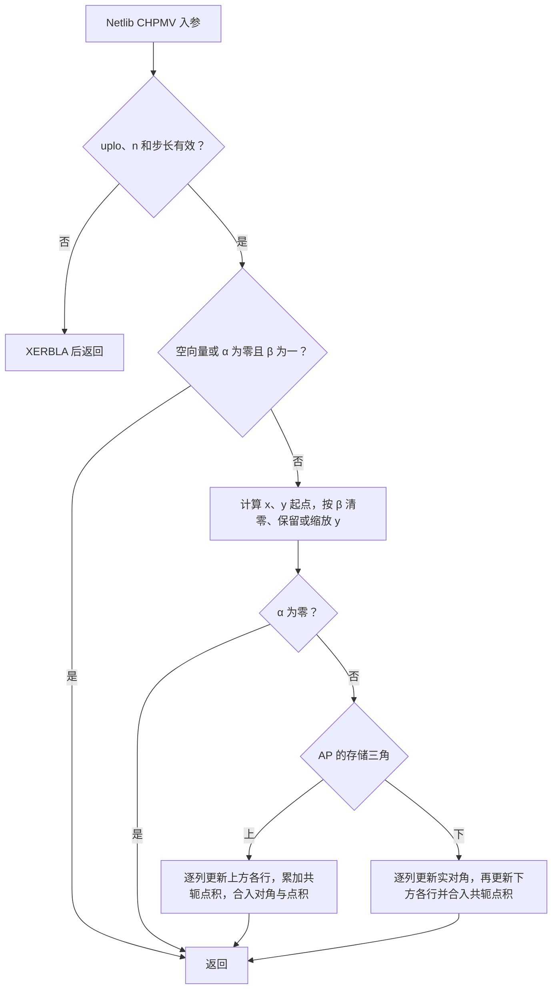
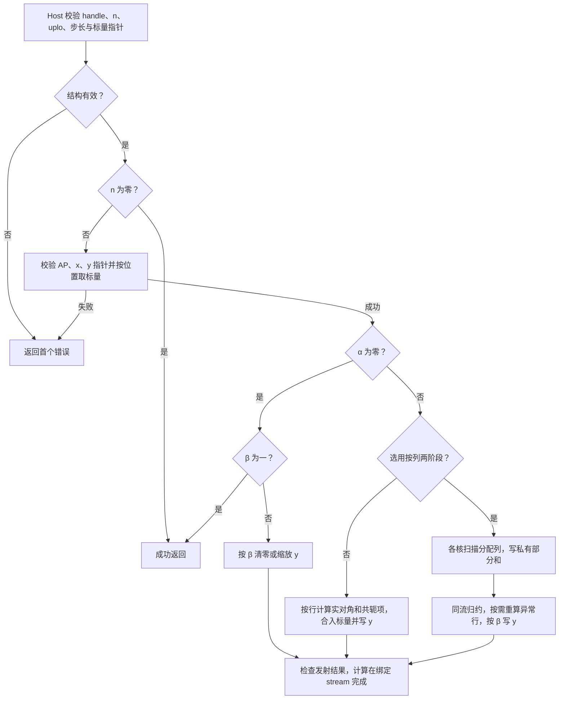

# 一、需求背景

## 1.1 需求来源

11 月社区任务要求在 Atlas A2/A3 上以 Ascend C 实现 Level 2 BLAS 的 `aclblasChpmv`，沿用 ops-blas 句柄接口。功能对标 cuBLAS，精度对标 Netlib CBLAS，性能对标随包提供的 GPU kernel 耗时。本文依据 `aclblasChpmv_AtlasA2_A3_task_doc.md` 和同包 `test_cases/`，任务包 SHA-256 为 `0941ceccb5ebfe101bcd2585f1c05738f02e9a3335826e4c1f4233e24f5c3598`。[官方任务页](https://www.hiascend.com/activities/task-center/details/c596a05d90b9471683e41fcf4d026ae5) · [正式任务包](https://www.hiascend.com/p/resource/202611/c07419f0566d426dacdcc1e3de6885c8.zip)

## 1.2 背景介绍

给定单精度复数 Hermitian 方阵，接口用一条压缩向量 AP 存储一个三角，原地更新向量 `y ← αAx + βy`。非对角元素同时决定两个输出分量，对角元素只有实部参与计算。直接消费 packed 数据可省去展开整张方阵的读写和存储。

### 1.2.1 aclblasChpmv 算子实现优化

任务书以已有 arch35、待补 arch22 为起点。所核对的 ops-blas 提交 `187d56dafbd373cb32e0a032bf4d7dc883bfcdf0` 已有两种架构及 arch22 测试。arch22 Host 校验在 `n==0` 时先返回、正阶时拒绝 `INT_MIN` 步长，并直接读取 `*alpha`、`*beta`。常规路径在同一 stream 上先发射 accum，再发射 reduce；零 α 另有 scale kernel。本设计复用已有 ABI、列分核和归约实现，拟修正上述入口差异，并设计按行计算路径作为小规模、数值敏感和 workspace 不足时的候选。[arch22 Host](https://gitcode.com/cann/ops-blas/blob/187d56dafbd373cb32e0a032bf4d7dc883bfcdf0/blas/spmv/arch22/chpmv_host.cpp) · [arch22 Kernel](https://gitcode.com/cann/ops-blas/blob/187d56dafbd373cb32e0a032bf4d7dc883bfcdf0/blas/spmv/arch22/chpmv_kernel.cpp)

arch35 实现只接受 Host 标量，并按规模、可用 UB 等条件在顺序、分组和 SIMD 路径中选取策略。它可用于核对布局和共轭方向。arch22 的集成入口在公共头文件和直接调用的 kernel 包装函数，模板中的 TBE 源文件、ACLNN 两阶段接口和 op-info 注册项均不适用。[arch35 Host](https://gitcode.com/cann/ops-blas/blob/187d56dafbd373cb32e0a032bf4d7dc883bfcdf0/blas/spmv/arch35/chpmv_host.cpp) · [公共接口](https://gitcode.com/cann/ops-blas/blob/187d56dafbd373cb32e0a032bf4d7dc883bfcdf0/include/cann_ops_blas.h)

### 1.2.2 aclblasChpmv 算子现状分析

语义标杆为 `cublasChpmv`。下述可审阅的算法和流程图来自 Netlib BLAS 3.10.0 的 CHPMV，它也是任务指定的 CPU golden 来源。GPU 基线仅提供计时，cuBLAS 的内部线程划分无需假定。[cuBLAS HPMV](https://docs.nvidia.com/cuda/cublas/index.html#cublas-t-hpmv) · [Netlib 3.10.0 参考源码](https://github.com/Reference-LAPACK/lapack/blob/aa631b4b4bd13f6ae2dbab9ae9da209e1e05b0fc/BLAS/SRC/chpmv.f)

#### 1.2.2.1 标杆算子支持的数据类型和数据格式

| 操作数 | 类型与位置 | 存储及访问 |
| --- | --- | --- |
| α、β | complex64 标量指针，Host 或 Device | 各一个复数，实部和虚部各为 FP32 |
| AP | Device 只读 complex64 向量，ND | 列主序，仅存上三角或下三角，共 `P=n(n+1)/2` 个连续元素 |
| x | Device 只读 complex64 向量，ND | 逻辑长度 n，按 incx 访问 |
| y | Device 可写 complex64 向量，ND | 逻辑长度 n，按 incy 原地读写；β 为零时仅写 |

没有 `trans`、`lda`、批次数或批间距。表中范围限定为本任务的 C 接口；双精度复数 HPMV 不在任务包内。

#### 1.2.2.2 标杆算子实现描述

以下采用零基下标。上三角列 j 的起点为 `U(j)=j(j+1)/2`，有效行 `0≤i≤j`，下标为 `U(j)+i`。下三角列 j 的起点为 `L(j)=j(2n-j+1)/2`，有效行 `j≤i<n`，下标为 `L(j)+i-j`。例如 n=3 时，上三角依次为 00、01、11、02、12、22，下三角为 00、10、20、11、21、22。取未存储侧的 `A(i,j)` 时交换 i、j，再对取出的复数取共轭。

Netlib 先检查 uplo、n、incx、incy，必要时调用 XERBLA。快速返回后剩余的调用先处理 β：零值直接清零，一值保留，其余值缩放 y。α 为零即结束。其余调用顺序遍历 AP 各列，以 `t=α*x[j]` 更新存储侧各行 `y[i]+=t*AP[k]`，并用 `s+=conj(AP[k])*x[i]` 汇集镜像侧贡献。上三角列最后合入 `t*real(Ajj)` 和 `α*s`；下三角列先处理对角，再处理其下方的元素，最后合入 `α*s`。参考源码针对单位和非单位向量步长分别循环，后者从按符号修正的起点推进。[Netlib CHPMV](https://github.com/Reference-LAPACK/lapack/blob/aa631b4b4bd13f6ae2dbab9ae9da209e1e05b0fc/BLAS/SRC/chpmv.f)

#### 1.2.2.3 标杆算子实现流程图



# 二、需求分析

## 2.1 外部组件依赖

部署目标为 CANN 9.1.0，使用 Ascend C、ACL Runtime 和 ops-blas。开发验收使用 ATK/C++ GTest、Netlib BLAS/CBLAS 3.10.0 及 `msprof op`。测试工程应记录实际链接的 BLAS/CBLAS 版本与符号提供库；cuBLAS 仅用于语义参照和已经采集的性能基线。

## 2.2 内部适配模块

| 位置（ops-blas 固定提交同 1.2.1） | 已有职责 | 本设计的适配点 |
| --- | --- | --- |
| `include/cann_ops_blas.h`、`include/cann_ops_blas_common.h` | 函数声明、数据类型、枚举与状态码 | 沿用公共定义 |
| `blas/common/helper/host_utils.h`、`aclblas_handle_internal.h`（同目录） | 标量位置查询、读取、核数与有效 workspace | 使用绑定 stream、实际平台资源与已有错误返回 |
| `blas/spmv/arch22/chpmv_host.cpp`、`chpmv_tiling_data.h`（同目录） | 参数检查、分块参数和 launch | 调整校验先后，加入标量读取和预算选路 |
| `blas/spmv/arch22/chpmv_kernel.cpp`、`chpmv_kernel.h`（同目录） | 累加、归约及缩放入口 | 保留 packed 流式计算，补充按行候选 |
| `test/spmv/chpmv/arch22/` 及上一级共享测试头 | CSV 参数化测试、越界哨兵、CPU 比对 | 对齐附件填充模式、标量位置、分量判据和逐次计时 |

## 2.3 需求模块设计

### 2.3.1 Ascend C 算子原型

```cpp
aclblasStatus_t aclblasChpmv(
    aclblasHandle_t handle, aclblasFillMode_t uplo, int n,
    const aclblasComplex* alpha, const aclblasComplex* AP,
    const aclblasComplex* x, int incx, const aclblasComplex* beta,
    aclblasComplex* y, int incy);
```

`aclblasComplex` 依次存放 `float real` 与 `float imag`，每个复数占 8 B。uplo 取 `ACLBLAS_UPPER` 或 `ACLBLAS_LOWER`。n 是非负 int，incx、incy 是非零 int，单位为复数元素。对任一向量，n>0 时最小物理长度为 `1+(n-1)*abs(inc)`；n=0 时为 0。指针指向物理存储起始处，第 i 个逻辑元素的下标为正步长时的 `i*inc` 或负步长时的 `(n-1-i)*(-int64(inc))`。例如 n=3、inc=-2 的访问次序为 4、2、0。[接口声明](https://gitcode.com/cann/ops-blas/blob/187d56dafbd373cb32e0a032bf4d7dc883bfcdf0/include/cann_ops_blas.h#L161) · [复数和枚举定义](https://gitcode.com/cann/ops-blas/blob/187d56dafbd373cb32e0a032bf4d7dc883bfcdf0/include/cann_ops_blas_common.h)

### 2.3.2 Ascend C 算子相关约束

任务书 §2.5 规定入口按下表**自上而下**命中首项即处理。表内状态名均带 `ACLBLAS_STATUS_` 前缀。

| 次序 | 条件 | 结果及访存 |
| --- | --- | --- |
| 1 | handle 为空 | HANDLE_IS_NULLPTR |
| 2 | n<0 | INVALID_VALUE；与非法 uplo 同时出现也先报此错 |
| 3 | uplo 不属于上、下三角 | INVALID_ENUM |
| 4 | incx 或 incy 为零 | INVALID_VALUE |
| 5 | α 或 β 指针为空 | INVALID_VALUE |
| 6 | n=0 | SUCCESS；不读取标量值，不引用 AP/x/y，不发射 kernel |
| 7 | AP、x、y 中任一指针为空 | INVALID_VALUE；正阶快速通路也须检查 |
| 8 | 取得标量，α=(0,0) 且 β=(1,0) | SUCCESS；不访问 AP/x/y 的内容 |
| 9 | 其余正阶调用 | 进入缩放或乘加路径；β=(0,0) 时禁止读取原 y |

步长在取绝对值前扩展为有符号 64 位，包含 `INT_MIN`。packed 乘积、跨度和偏移在宽整数中计算；从元素换算字节前检查与可寻址范围的关系，避免乘 8 回绕。仅对实际将访问的缓冲区计算地址。调用方提供足量可访问的存储，正阶调用的 y 可写区域与 AP、x 的可读区域不重叠，Device 标量在读取期间保持有效。接口无法从裸指针恢复分配长度或证明 Hermitian 性质，Host 不扫描 Device 数据。标量可独立位于 Host 或 Device，常规取值域是有限 FP32；测试还覆盖 AP/x/y 中的非有限值以及对角虚部污染。

# 三、需求详细设计

## 3.1 调用方式

调用方创建 ops-blas handle，通过 `aclblasSetStream` 绑定 stream 并准备 Device 操作数。拟在 2.3.2 第 7 项之后，分别使用仓内 `ReadScalarFromHostOrDevice<aclblasComplex>` 取得 α 和 β：Host 地址取值，Device 地址在绑定 stream 上发起 D2H 并同步该 stream 后取值。这使前序生产的 Device 标量可见，也允许第 8 项零发射返回。标量取值可能等待前序工作；后续数据 kernel 仍异步执行。位置查询失败返回 INVALID_VALUE，复制或同步失败返回 INTERNAL_ERROR。调用方在读回 y 或回收仍在使用的缓冲区前同步该 stream。[标量读取实现](https://gitcode.com/cann/ops-blas/blob/187d56dafbd373cb32e0a032bf4d7dc883bfcdf0/blas/common/helper/host_utils.h) · [handle 接口](https://gitcode.com/cann/ops-blas/blob/187d56dafbd373cb32e0a032bf4d7dc883bfcdf0/include/cann_ops_blas.h)

## 3.2 需求总体设计

常规大规模路径保留“按列产生私有部分和、按行归约并写回”。每个非对角存储值供原元素与共轭镜像两次乘加使用。拟补充单 kernel 的按行顺序路径，供短向量和显存暂存不足时使用，也用于核对归约次序的数值影响。两种路径都只生成原地输出 y。

### 3.2.1 Host 侧设计

#### 3.2.1.1 分核策略

设平台查询的可用 AIV 数为 C，行块长度为 T，`Npad=ceil(n/8)*8`。若有效 workspace 有 W 字节，则累加核数 `B=min(C,n,floor(W/(8*Npad)))`。第 q 轮中第 b 核分配到列 `j=q*B+(q 为偶数时取 b，否则取 B-1-b)`，跳过 j≥n。交替分配能摊开上下三角列长的差异，各核只写自己的部分和。归约或按行路径取 `D=min(C,ceil(n/T))` 个核；把 n 行均分给 D 个核，前 `n%D` 核各多一行。每个逻辑 y 元素只有一个写者。C 为零按执行失败处理；B 为零时可改用按行路径。

#### 3.2.1.2 数据分块和内存优化策略

- **GM 部分和。** 第 b 核的片首（单位 FP32）为 `2*b*Npad`，实部平面从片首起，虚部平面从片首加 Npad 起。共需 `8*B*Npad` B。先为有效行建立零部分和，再按列及行块累加；跨行块的对角行点积可合到私有片，后续写块时保留已有贡献。累加与归约在同一 stream 顺序发射，归约完成后可在该 stream 复用工作区。不同 stream 并发须使用互不重叠的在途工作区。handle 的有效 workspace 由库或设置它的用户持有，本接口不释放它；即使第二阶段发射失败，第一阶段已入队的访存也须等到完成。按行、清零及缩放路径额外 GM workspace 为 0。[workspace 所有权与重置](https://gitcode.com/cann/ops-blas/blob/187d56dafbd373cb32e0a032bf4d7dc883bfcdf0/blas/common/helper/aclblas_handle_internal.h)
- **单核 UB。** 上游 arch22 的 T=1024、跨步读取窗口 H=4096 个复数是源码常量。以单缓冲和这两个值为例，累加阶段有 12 条 T 长 FP32 数据平面、2T 个 FP32 的交错缓冲、2T+T 个 32 位索引，另有 64+512+64 个 FP32 的归约与标量暂存。合计 `68*T+2560` B，incx≠1 再加 `8*H` B。归约阶段相应为 `52*T+256` B，incy≠1 再加 `8*H` B。两个阶段分别使用 UB，取峰值。拟用平台查询的 UB 字节数扣除预留，按每个缓冲实际分配对齐、归约临时空间、队列深度重新求和；预算容不下时缩小 T/H 或切到按行路径。改变 T 时同步调整索引表、打包间距和归约临时区。双缓冲只计入确实重叠的缓冲对。[核内缓冲分配](https://gitcode.com/cann/ops-blas/blob/187d56dafbd373cb32e0a032bf4d7dc883bfcdf0/blas/spmv/arch22/chpmv_kernel.cpp) · [现有分块常量](https://gitcode.com/cann/ops-blas/blob/187d56dafbd373cb32e0a032bf4d7dc883bfcdf0/blas/spmv/arch22/chpmv_tiling_data.h)
- **数据量和尾块。** AP 为 `8P` B。例如 n=8192 时仅 AP 就有 33,558,528 个复数，占 268,468,224 B。稠密展开会额外产生 `8*n*n` B。单位步长用连续段，负单位步长按低地址搬入后在 UB 中反序；其他步长按跨度和窗口预算选择窗口内提取或逐元素读取。写 y 时仅写有效的 8 B 元素或连续有效段，不整窗覆盖空洞。DMA 长度取有效字节数，向量尾块按实际元素数处理，对齐补位限于 UB。β=0 时写回不得通过读改写旧 y 来处理尾部。

#### 3.2.1.3 tilingKey 规划策略

直调模式按 Host 分支选择已有 kernel 包装函数或拟增的按行入口，无框架 tilingKey 注册。α=0 时由 β 选择快速返回、直接置零、纯缩放。α≠0 时按 C、T、W 和 n 选择按列两阶段或按行一路。tiling 参数携带 n、uplo、两个有符号步长、标量值、分块数与有效行数等。小规模阈值拟以逐例 kernel 总耗时确定；上下三角和步长只影响索引与搬运，不改变 ABI。

### 3.2.2 Kernel 侧设计

#### 3.2.2.1 Kernel 侧实现描述

1. **列累加。** 对实对角 d 直接累加 `(d*xj.real,d*xj.imag)`，不加载虚部参与算术。取非对角值 `a=r+is`，对本列的每个行段，同时累加 `a*x[j]` 到行 i 和 `conj(a)*x[i]` 到行 j。前者两分量为 `(r*u-s*v,r*v+s*u)`（u、v 取自 x[j]），后者为 `(r*u+s*v,r*v-s*u)`（取自 x[i]）。AP 的一个有效段只需搬一次。使用 FP32 乘加、平面累加和分段归约，跨段点积留在本核的部分和中。
2. **归约和输出。** 归约核按片号合并自己负责的行，最后施加 α。β=0 直接写，β=1 可直接加旧 y，其他 β 作复乘再加。若 α=0，缩放 kernel 不访问 AP 或 x，β=0 直接写复数零。按绑定 stream 的先后关系保证全部生产核完成才消费部分和。核内搬入后等待 MTE2 到 Vector 或 Scalar、计算结束后等待到 MTE3，输出缓冲再次使用前等待搬出完成。各核只写私有片或分配的输出行，无需竞争更新 y。
3. **按行路径（拟增）。** 每核逐行计算，复用一段 x 和小块 AP，不需要跨核点积。对给定行 i，可按 Netlib 的列序重放只作用于该行的更新：从 β 项起，对存储侧的来项使用 `(α*x[j])*a`；遇 j=i 时单独计算实对角和该列的共轭点积，按上、下模式的先后次序合入。每行只写回一次。它可能重复加载非对角 AP，代价是矩阵读取接近两倍，收益是省掉第二次发射和部分和读写。
4. **数值路径选择。** 两阶段先求 Ax 再乘 α，舍入及中间上溢可能与 Netlib 不同，尤其是分量相消、极大 α、Inf/NaN。保留顺序路径作这些情况的核对基准；对于无法仅凭标量排除的非有限中间量，拟在累加中按受影响行记录异常并在归约核内以未覆盖的原 y 重算该行（β=0 不取原 y）。若启用标志，按核私有、按行对齐分配并纳入 W；例如每行 32 位标志使每片预算从 `8*Npad` 增至 `12*Npad` B。该候选需要让内部归约入口同时接收只读 AP、x。累加核初始化并更新本核标志，归约核对同一行的标志取并集，同时检查归约及最终乘加产生的非有限值，完成重算判断后才写 y。对无法界定安全范围或未通过分量比对的分支保留顺序实现。按行计算与两阶段都须通过 5.1 的全量验收才可定型。

#### 3.2.2.2 Ascend C 实现流程图



#### 3.2.2.3 与标杆流程的差异及原因

Netlib 逐列就地更新多行，直接让多个核并行执行这些列会同时写同一 y。私有部分和使列间独立，第二阶段按输出行取得写权限。对角只读实部、镜像取共轭、β=0 跳过旧 y 的语义与标杆一致。按行候选复用列序以控制舍入差异。CPU 参考函数只校验 BLAS 结构参数；ops-blas 入口还负责 handle、指针、执行资源和发射状态，单次发射失败返回 EXECUTION_FAILED，异步计算结果在调用方同步时确认。

## 3.3 支持硬件

| 产品 | 任务要求 | 验证安排 |
| --- | --- | --- |
| Atlas A2 系列（含 Atlas 800T A2） | arch22，CANN 9.1.0 | 精度可选 910B3；正式性能使用 Atlas 800T A2（910B3） |
| Atlas A3 系列（含 Atlas 800T A3） | arch22，CANN 9.1.0 | 与 A2 共用接口并按平台查询资源；任务允许精度自验覆盖一种款型 |

## 3.4 算子约束限制

单次调用描述一个方阵和两个向量，无广播、任意视图、0 维 Tensor、转置开关、pointer-array 或 element-stride 批处理。维度和步长在调用时决定，无动态计算图适配。AP 仅有一半矩阵，另一半由算法定义，调用方保证相应存储有效。n=1 时两种 uplo 均只引用同一个实对角，任意合法步长都映射到元素 0。支持非连续向量仅限 inc 描述的布局。任务无单独内存性能指标，也不要求不同归约顺序逐位相同。

# 四、特性交叉分析

| 交叉条件 | 预期行为 | 拟验证的观测点 |
| --- | --- | --- |
| 空向量与非法结构 | 先报结构错误；合法时允许三个数据指针为空 | 组合覆盖 n=0 与非法 uplo、两个零步长、两个空标量，核对状态及零发射 |
| n>0 快速返回与空数据指针 | 检查三个数据指针后才判断 α=0、β=1 | 有效指针时 y 连同空洞逐字节保持；任一空数据指针返回 INVALID_VALUE |
| 退化系数与非有限输入 | α=0 跳过 AP/x，β=0 跳过原 y | x 含 NaN 时只缩放，y 含 NaN 时覆盖；对角虚部换成非零、NaN 或 Inf 时结果相同 |
| 上下三角与独立步长 | 同一矩阵两种 packed 表示得到同一逻辑向量 | 使用非实非对角值和反向向量；在 AP/x/y 首尾与 y 空洞放哨兵，比较 AP/x 全区及输出写边界 |
| 标量位置与 stream | 分别支持 Host/Host、Host/Device、Device/Host、Device/Device | 在同流先写 Device 标量再发射；使用不同 handle/独立工作区检查并发隔离 |
| 分块与舍入 | 跨 tile 的点积全部归入正确行，β 项只施加一次 | 检查 T−1、T、T+1，核数余数，窄 workspace 回退及大幅值相消；对比两条计算路径 |

# 五、可维可测分析

## 5.1 精度标准/性能标准

**精度。** 保留输入副本，CPU 用 Netlib 3.10.0 的 `cblas_chpmv(CblasColMajor,...)`、相同的 uplo、有符号步长和单精度复数标量计算 golden。每例按逻辑 y 顺序分别检查实部和虚部。有限值逐点误差满足 `abs(actual-g) ≤ 2⁻¹³ + 2⁻¹³*abs(g)` 为匹配，每个分量匹配率均须 ≥0.99，最大绝对误差须 ≤`max(1e-2,32*ULP(g_low))`，ULP 取该分量最大有限绝对误差点的 FP32 golden 值处的间距。非有限分量单独匹配 NaN 和同号无穷，有限与非有限不混用容差；没有有限点时只判特殊值。负向例核对状态、哨兵及 y 未改写，空向量不计算匹配率。附件列 `mere_threshold=0.00012207031`、`mare_multiplier=10.0` 及 README 的 MERE/MARE 另行记录，不能替代上述双判据。固定仓库测试还调用框架比较器，应同时保存其结果及任务书的独立分量统计。[任务指定的精度标准](https://gitcode.com/cann/opbase/blob/28a1ce52ae856353589841226a0002af73314a6b/docs/zh/ops_precision_standard/mixed_tolerance_standard.md) · [仓内分量比较器](https://gitcode.com/cann/ops-blas/blob/187d56dafbd373cb32e0a032bf4d7dc883bfcdf0/test/spmv/chpmv/chpmv_test_utils.h)

可手算的回归例为 n=2、实对角 2 和 3、上三角非对角 1+2i、α=1、β=0。逻辑 x 为 (1+i, 2−i) 时，逻辑 y 应为 (6+5i, 9−4i)。改用下三角时存 1−2i；若再将 incx、incy 取为 −1，物理输出顺序应为 (9−4i, 6+5i)。这个例子可同时定位漏共轭、把负步长首地址反转两次和误用对角虚部。

**用例与差异。** 附件 `chpmv_test.csv` 扣除表头共 1200 条。1000 条精度/边界分为 L0 4、SQ 72、AB 16、INC 72、ST 8、FL 18、CV 16、ED 28、EX 766，其中 986 条期望 SUCCESS、12 条 INVALID_VALUE、2 条 INVALID_ENUM。另有独立编号的 PF 200 条。常规随机输入按实虚独立的均匀分布 [-5,5] 与标准正态 N(0,1) 各半设计；固定种子、实际填充 token 和例名须随报告保留。验收使用附件原始行，并另列补测：

| 材料差异或缺口 | 验收处理 |
| --- | --- |
| README 写 ED 25，实际为 28；生成器头注释给出不同的 n=0 顺序，且 README 称非有限 x 不与 α=0 组合 | 以任务书 §2.5 及实际 ED 行为准，保留 `alpha0_beta2_x_nan`，补 n=0 与 incy=0、y 为空、空 handle 等组合 |
| CSV 没有 handle 或标量地址位置列，标量主要是固定组合，`large_alpha` 为 (100,50) | GTest 单测空 handle、四种标量位置、n=1 的 INT_MIN 步长、±1e4 及随机复数标量；检查非单位正负 incy 写保护 |
| 现有测试生成器接受的正态 token 为 `GAUSS_NORM_5_2`；附件另有 `RANDOM_GAUSS_0_1`、`RANDOM_DIAG_IMAG` | 扩展装配层解释两种附件 token；标准正态与随机均值方差分布分别记录。CPU 和 NPU 共享同一输入，对角虚部污染应只对结果无影响 |
| §4 列出 cases.json、perf/、inputs/、golden/、facts.json；实际压缩包给出 CSV、README、生成与校验脚本 | 后续自验交付冻结输入/golden、参数与版本，附可复现步骤、原始日志和报告。附件不提供既有精度通过记录 |
| `verify_accuracy.py` 解析 GTest 文本，超时或未解析出结果时可能得到 0 PASS、0 FAIL，退出码也可能为零 | 按 1000 个例名对账，单独记录补测；保存子进程状态与逐例分量数据，缺测、失败和超时均须处理 |

**性能。** 在 Atlas 800T A2（910B3）、CANN 9.1.0 上逐个 PF 用例运行。预热 5 次后，连续采集 10 次成功调用；用 `msprof op` 的 `OPPROF_*/OpBasicInfo.csv` 中 `Task Duration(us)` 按调用序号归组。两阶段时每次先加总 accum 与 reduce 两个 kernel 的 duration，再对 10 次取算术平均并除以 1000 得到 ms。单 kernel 路径取对应一条。异常样本记录原因，补足有效样本，不计 H2D/D2H、golden、Host 下发或两个 kernel 间的空隙。每例要求 `NPU_avg_ms ≤ 1.25*gpu_ms`，等价于 `gpu_ms/NPU_avg_ms ≥ 0.8`。

`gpu_baseline.csv` 实有 id、uplo、n、incx、incy 和唯一耗时列 gpu_ms。200 行均有正值，按去掉枚举前缀后的 (uplo,n,incx,incy) 与 200 个 PF 唯一对应。README 的“待回填”对应生成器的空白输出，验收应使用发布包中的数值。所有 PF 的 α=1、β=0，188 条双单位步长、12 条非单位步长（含 3 条负 incx）。按 AP 加 x、y 物理跨度计算，small ≤64 KiB 有 9 条，medium ≤2 MiB 有 12 条，其余 large 有 179 条。以下以附件前五行说明逐例上限，单位均为 ms。

| uplo，n（incx=incy=1） | GPU kernel 基线 | NPU 平均耗时上限 |
| --- | ---: | ---: |
| UPPER，512 | 0.0419873 | 0.052484125 |
| LOWER，1024 | 0.0770369 | 0.096296125 |
| UPPER，2048 | 0.1625506 | 0.203188250 |
| LOWER，4096 | 0.6974985 | 0.871873125 |
| UPPER，8192 | 1.5271346 | 1.908918250 |

`verify_performance.py` 解析 GTest 的 `[PERF] case=... avg_us=...`（也识别 average_us），读取以 aclrtEvent 包住 10 次下发的事件均值，仅供快速回归。脚本会优先读取 arch35 CSV，且 NO_REF 可能随成功退出。固定提交的 arch22 测试包装每例调用一次后同步，须补上预热、重复下发和计时输出。正式报告逐例核对 arch22 CSV 键、发射个数、10 组完整样本及单位，不用事件计时、GTest 整数毫秒或跨例平均倍率充当正式结果。

**性能候选和交付。** 比较同一 PF 上按行单发射与两阶段的耗时，分别记录 accum、reduce、列数均衡、AP 有效字节和 workspace 流量。小 n 关注第二次发射的成本，大 n 关注 AP 连续搬运与部分和读写，大步长关注窗口过取和分散访存；依据逐例数据决定 T、窗口和路径阈值。README 的 512 MiB 是生成器对单例输入缓冲的 Host 预算，任务书 §3.4 无独立内存验收门槛。后续自测报告应保留用例清单、分量精度、性能原始数据及截图、版本、代码提交和复现步骤，内存项注明不涉及。本设计阶段未获得设备实测结果。

## 5.2 兼容性分析

公共函数符号、参数次序、枚举和 8 B 复数布局沿用 ops-blas。对旧 arch22 使用者，合法连续向量及 Host 标量仍走同一接口；拟调整的行为包括 n=0 时报告结构参数错误、允许可寻址的负极限步长，以及支持 Device 标量。非法 uplo 按 ops-blas 返回 INVALID_ENUM；cuBLAS 的对应错误为 INVALID_VALUE。arch35 的实现和测试可独立构建，测试资料应绑定架构、任务包哈希和实现提交，防止同名用例引用不同输入或计时基线。
