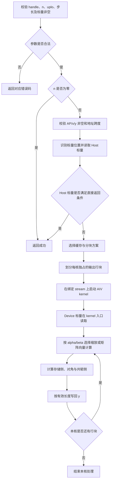

# 【CANN社区任务】aclblasChpmv（A2/A3）算子设计文档

## 1. 需求背景

### 1.1 需求来源

依据 11 月社区任务《aclblasChpmv_AtlasA2_A3_task_doc.md》，基于 ops-blas 工程使用 Ascend C 实现单精度复数 Hermitian 压缩矩阵与向量的乘加运算。实现接入 `blas/spmv/arch22/`，沿用 `include/cann_ops_blas.h` 的公共接口和句柄式调用方式。

### 1.2 背景介绍

Hermitian 矩阵满足 `A[i,j] = conj(A[j,i])`，对角元素为实数。Chpmv 按列连续保存上三角或下三角，只需 `n(n+1)/2` 个复数元素。计算时通过共轭关系访问另一半矩阵，直接使用 packed 存储完成运算。

```text
y = alpha * A * x + beta * y
```

AP 和 x 为只读输入，y 原地更新。算子适用于使用 Hermitian 压缩存储的复数线性代数计算。

## 2. 需求分析

### 2.1 接口定义

```cpp
aclblasStatus_t aclblasChpmv(
    aclblasHandle_t handle,
    aclblasFillMode_t uplo,
    int n,
    const aclblasComplex* alpha,
    const aclblasComplex* AP,
    const aclblasComplex* x, int incx,
    const aclblasComplex* beta,
    aclblasComplex* y, int incy);
```

| 参数 | 方向 | 类型与说明 |
| --- | --- | --- |
| handle | 输入 | 有效 BLAS 句柄，提供当前执行 stream |
| uplo | 输入 | `ACLBLAS_UPPER` 或 `ACLBLAS_LOWER` |
| n | 输入 | 矩阵阶数，`n >= 0` |
| alpha、beta | 输入 | Host 或 Device 上的 `aclblasComplex` 标量指针 |
| AP | 输入 | Device 上的 packed 矩阵，包含 `n(n+1)/2` 个复数 |
| x、incx | 输入 | Device 向量与非零步长；逻辑长度为 n |
| y、incy | 输入/输出 | Device 向量与非零步长；逻辑长度为 n，结果写回原地址 |

`aclblasComplex` 的实部、虚部均为 FLOAT32，整体为 COMPLEX64。AP 不包含 lda 参数。向量在 `n > 0` 时的最小物理元素数为 `1 + (n-1)*abs(inc)`。Golden 直接使用 Netlib BLAS 3.10.0 的 `cblas_chpmv` 单精度复数输出，实部、虚部分别按任务书 FLOAT32 混合容差比较。

### 2.2 功能拆解

| 功能 | 设计要求 |
| --- | --- |
| packed 索引 | 按列解释 UPPER/LOWER 存储，使用 64 位地址计算 |
| Hermitian 语义 | 镜像元素取共轭，对角元素仅取实部 |
| 步长 | 支持正、负和非单位 incx/incy，保留 y 的步长间隙 |
| 空输入 | n=0 时完成结构参数校验后返回，不读取 AP/x/y，不启动 kernel |
| 标量特殊值 | alpha=0 时仅处理 y；beta=0 时不读取 y 旧值 |
| 异步执行 | 使用 handle 绑定的 stream 下发计算，调用方在读回前同步 |
| 工程接入 | 复用公共声明、状态码、构建系统和 `chpmv_test` 测试目标 |

## 3. 详细设计

### 3.1 数据映射

令 i、j 为从 0 开始的行列下标，定义列起点：

```text
UpperColumn(j) = j*(j+1)/2
LowerColumn(j) = j*(2*n-j+1)/2
```

矩阵逻辑元素与压缩存储的对应关系如下。

| 模式 | 条件 | 访问方式 |
| --- | --- | --- |
| UPPER | i <= j | `AP[UpperColumn(j) + i]` |
| UPPER | i > j | `conj(AP[UpperColumn(i) + j])` |
| LOWER | i >= j | `AP[LowerColumn(j) + i-j]` |
| LOWER | i < j | `conj(AP[LowerColumn(i) + j-i])` |

当 i=j 时只读取对角实部参与计算。向量逻辑元素 i 的物理位置为：

```text
start = inc < 0 ? (n-1)*abs(inc) : 0
offset(i) = start + i*inc
```

步长先提升为 64 位再计算绝对值。矩阵元素数、向量跨度和字节偏移均在 Host 校验范围，Kernel 使用对应的 64 位索引。

### 3.2 总体流程



一次有效调用选择一个计算入口。各核独占输出行，核间无输出归约和原子加操作，不申请中间 GM 工作区。

### 3.3 Host 侧设计

#### 参数校验

1. 检查 handle，空句柄返回 `ACLBLAS_STATUS_HANDLE_IS_NULLPTR`。
2. 检查 n，负数返回 `ACLBLAS_STATUS_INVALID_VALUE`。
3. 检查 uplo，非法枚举返回 `ACLBLAS_STATUS_INVALID_ENUM`。
4. 检查非零 incx/incy 和 alpha/beta 非空；非法参数返回 `ACLBLAS_STATUS_INVALID_VALUE`。
5. n=0 时返回成功；此时允许 AP/x/y 为空，不读取标量内容，不启动 kernel。
6. 检查 AP/x/y 非空及地址跨度，再识别 alpha、beta 的指针位置。
7. Host 标量直接读取；Device 标量地址传入 tiling，在当前 stream 的 kernel 入口读取。Host 标量满足 alpha=0 且 beta=1 时直接返回，Device 标量在 kernel 内执行相同短路。

失败分支记录对应日志。设备能力查询和 kernel 启动状态逐层传回，启动失败返回 `ACLBLAS_STATUS_EXECUTION_FAILED`。Host 不解引用 AP/x/y 的 Device 内容。

#### 分派策略

设备 Vector 核数和 UB 容量由运行时取得；使用句柄缓存时核对当前设备与 context。根据 n、步长、地址对齐和缓存预算选择计算方式。Device 标量采用独立入口，沿用矩阵分块，在设备上读取标量后执行缩放、直接返回或计算；不为标量读取同步 Host。

通用标量入口的运行时函数句柄按 BLAS 句柄缓存，使用前核对当前 context，切换 stream 时清空；并发首次调用通过原子读写发布缓存。每次调用仍重新校验并读取 alpha、beta，输入数据与计算结果不进入缓存。

| 路径 | 使用场景 | 主要处理 |
| --- | --- | --- |
| y 缩放 | alpha=0 | 对有效 y 元素执行 beta 缩放或清零 |
| 小矩阵标量缓存 | 输入规模小、单位步长 | 将 packed 矩阵与 x 搬入 UB，减少重复 GM 访问 |
| 小矩阵向量缓存 | packed 矩阵与辅助缓存可装入 UB | 复用矩阵缓存及 x 的广播结果 |
| 完整 x 缓存 | x 及矩阵块满足 UB 预算 | 缓存 x，按列块加载矩阵并更新多个输出行 |
| 窗口 x 缓存 | 大规模连续输入 | 使用有界 x 窗口和行块处理长归约维度 |
| 通用标量路径 | 向量分支容量或搬运约束不满足 | 按逻辑行访问 packed 矩阵与带步长向量 |

完整 x 缓存按步长分别采用连续搬运、短步长提取或有界跨步长 DMA。短步长路径调整行块粒度，使缓存准备成本在同核多行间复用。对于绝对步长不小于 4 且满足 DMA 与 UB 预算的输入，将跨步长 x 缓存与成对计算结合，复用矩阵搬运和乘法准备。分派阈值集中定义在 tiling 常量中。

#### 分核与输出边界

输出划分为互不重叠的连续行块，基础行组按 4 个复数对齐。普通路径先按矩阵规模和设备核数分配连续行区间，再将每核范围划分为 UB 可容纳的行块。

窗口配对路径按 `vectorRows` 划分全局行块，并以 `numBlocks` 个行块为一轮分配给各核。偶数轮按核号正序分配，奇数轮反序分配，以均衡 packed 矩阵存储侧与镜像侧的搬运工作量。同一行块始终由一个核独占，每行仍按固定列序计算。

对于偏移地址和非单位/负输出步长，Host 根据 y 的实际地址和 incy 检查相邻核的写入范围是否共享 32 字节 GM 事务。必要时调整首块行数，使后续分界落到安全位置；无法构造安全分区时使用单核。

以 `rowBias` 表示首块调整量。普通路径的首核从第 0 行开始，其余核从 `blockIndex*blockRows-rowBias` 开始。窗口配对路径的第 0 个行块从第 0 行开始，其余行块从 `tileIndex*vectorRows-rowBias` 开始，结束于 `min(n, (tileIndex+1)*vectorRows-rowBias)`。

各行块完整覆盖 `[0,n)`，彼此不重叠；末轮不存在的行块直接跳过，尾块按有效行数执行。行块分配顺序不改变输出地址的事务边界。

#### Tiling 信息

| 信息组 | 字段 |
| --- | --- |
| 问题规模 | n、upper |
| 核与行块 | numBlocks、blockRows、vectorRows、rowBias |
| 缓存方案 | xBytes、windowX、small |
| 向量访问 | incx、incy、xStart、yStart |
| 标量 | alphaReal、alphaImag、betaReal、betaImag、alphaAddress、betaAddress |

Tiling 结构值初始化后填充，以值传递给 kernel；跨行块的临时状态保存在本次调用的局部缓存中。

### 3.4 Kernel 侧设计

#### 计算与数值顺序

向量 lane 对应一条输出行。每行分别处理存储侧元素、对角实数元素和共轭镜像侧元素，按固定列序累加。复数乘法拆分为 FLOAT32 实部/虚部运算；保持乘法与加法的显式舍入顺序。

存储侧复用 `alpha*x`，镜像侧先形成共轭点积再应用 alpha。对角项仅与 AP 的实部分量相乘。配对计算用于复用加载及乘法准备，最终仍按既定列序更新行累加器。

beta=0 时直接初始化输出，不访问原 y；beta=1 时直接使用原 y；其余情况执行复数缩放。alpha=0 时进入缩放处理，不读取 AP 和 x。

#### 搬入与缓存

packed 矩阵列长随列号变化，Kernel 根据存储模式计算列起点及当前有效行范围。连续有效段使用 DMA 搬入，尾段按实际字节数处理。缓存中的实虚分量经 Gather 或重排形成向量操作所需的布局。

完整 x 缓存供本核各行块复用；窗口路径按当前贡献列范围加载 x。小矩阵路径复用完整 packed 数据，并在容量允许时预先准备 x 的广播形式。无效 lane 在算术前屏蔽，避免引用尾部未定义元素。

#### UB 规划

令 `R` 为单块输出行数、`C` 为列块长度，`align32` 表示向上对齐到 32 字节。普通向量块采用 R≤64、C=64；窗口路径采用 R≤128。

| 缓存 | 预算方式 |
| --- | --- |
| 矩阵搬入及实虚工作区 | `4*R*C*sizeof(float)` |
| 行累加、Gather 索引及输出暂存 | `20*R*sizeof(float)` |
| 完整 x | `align32(8*n)+CHPMV_X_PADDING_BYTES` |
| x 广播区 | 按列块和向量 repeat 数分配 |
| 配对乘积区 | 选择配对路径时分配对应固定缓存 |
| packed 小矩阵区 | 按小矩阵容量上限分配压缩三角缓存 |
| 窗口 x | 按当前列块窗口分配，不随完整 n 增长 |

Host 对所选路径的缓存总量与实际 UB 容量进行比较。各段基址、大小和容量使用具名常量；同一 scratch 的复用区在进入下一阶段前完成同步。

#### 流水与生命周期

TPipe 在本次 Run 调用内局部创建，并传入初始化过程。MTE2 完成后再由 S/V 读取输入，V/S 完成后再由 MTE3 写回。下一块复用输出或索引区域前，等待前一块写回完成。

Gather 索引在每个行块使用前重建；输出打包与索引临时区共享空间时遵循相同的阶段边界。无效缓存位置完成必要初始化，内核结束前恢复向量掩码。

#### 输出写回

单位步长 y 按有效行数打包后写回；非单位步长按有效复数位置精确写回。负步长根据 yStart 和逻辑行号计算物理位置。写回不修改向量间隙，不要求调用方预留 DMA 越界填充区。

### 3.5 工程组织与支持硬件

| 内容 | 位置 |
| --- | --- |
| 公共 API | `include/cann_ops_blas.h` |
| Host、tiling 与 kernel | `blas/spmv/arch22/` |
| 算子接口说明 | `blas/spmv/README.md` |
| 公共测试参数与 golden | `test/spmv/chpmv/` |
| arch22 测试与 CSV | `test/spmv/chpmv/arch22/` |
| 测试目标 | `chpmv_test` |

目标产品为 Atlas A2/A3，使用 arch22 Ascend C 接口。构建时按实际设备选择 SOC，核数及 UB 容量通过运行时能力获取。保持公共接口签名与其他架构一致。

### 3.6 算子约束

- AP 为列主序 packed 存储，x/y 的非连续访问由 incx/incy 描述。
- 调用方保证各缓冲区满足有效跨度，且 AP/x 的只读区域与 y 写入区域不存在未约定的重叠。
- alpha、beta 支持 Host 和 Device 指针；Device 标量与张量需在当前 stream 完成计算前保持有效。AP/x/y 为 Device 缓冲区。
- 读回结果及跨 stream 使用结果前，由调用方建立同步依赖。

## 4. 可维可测分析

### 4.1 功能与精度验证

在仓库 GTest 框架中加载正式 `chpmv_test.csv`，包含 1000 条精度用例与 200 条性能用例。Golden 直接调用 Netlib BLAS 3.10.0 的 `cblas_chpmv(CblasColMajor, ...)`，使用其 FP32 复数输出。实部、虚部分别满足 rtol=atol=2^-13、matched_ratio≥0.99，以及最大绝对误差限制 `max(1e-2, 32*ULP)`；特殊值单独判定。输入按 CSV 分别生成均匀分布 [-5,5] 与正态分布 N(0,1)，对角虚部非零用例保留污染值以验证忽略语义。

覆盖内容包括：

- 上下三角、小尺寸、非对齐尺寸、分块边界与尾块。
- 正负单位及非单位步长、偏移地址、每核多个行块。
- alpha/beta 的零、一、纯虚和一般复数值，以及规定的数据分布。
- n=0、非法枚举、零步长、空指针、标量位置和地址跨度边界。
- 对角虚部忽略、特殊浮点输入、AP/x 不变、y 间隙与缓冲区首尾保护。

### 4.2 性能验证

性能设备为 Atlas 800T A2（910B3），CANN 9.1.0。使用 `msprof op` 获取 kernel `Task Duration(us)`，每条用例先预热 5 次，再取 10 次成功调用的耗时算术平均。与正式 `gpu_baseline.csv` 的 `gpu_ms` 逐项比较，要求 `NPU平均耗时(us) <= gpu_ms*1000/0.8`。

GTest 同时输出 aclrtEvent 连续 10 次下发的平均耗时，供随包脚本快速比较；正式性能报告采用 msprof op 的 kernel 耗时。数据准备、传输与 CPU golden 不计入 kernel 时间。

计时类型在报告中明确注明；各形状和参数组合逐项对比，不以总体平均值替代单例要求。

### 4.3 内存与复现

任务书 §3.4 的内存要求为“不涉及”，对应报告和日志填写“不涉及”。测试说明提供 CANN 与 Netlib 配置、构建命令、精度和性能命令，报告保留用例参数、结果与截图。

### 4.4 兼容性分析

沿用 ops-blas 的复数类型、句柄、stream 绑定和错误码。实现及构建按 arch22 隔离，公共参数与参考计算保持接口级组织。公开接口保持不变，arch22 的参数顺序与标量位置支持按正式任务书实现。

## 5. 参考资料

1. [CANN 社区任务设计模板](https://gitcode.com/cann/cann-ops-competitions/blob/master/04_tasks/01_community-task-2026/resources/design_template.md)。
2. [ops-blas 仓库](https://atomgit.com/cann/ops-blas)。
3. [Netlib CHPMV](https://www.netlib.org/blas/chpmv.f)。
4. [cuBLAS hpmv 接口](https://docs.nvidia.com/cuda/cublas/index.html#cublas-t-hpmv)。
