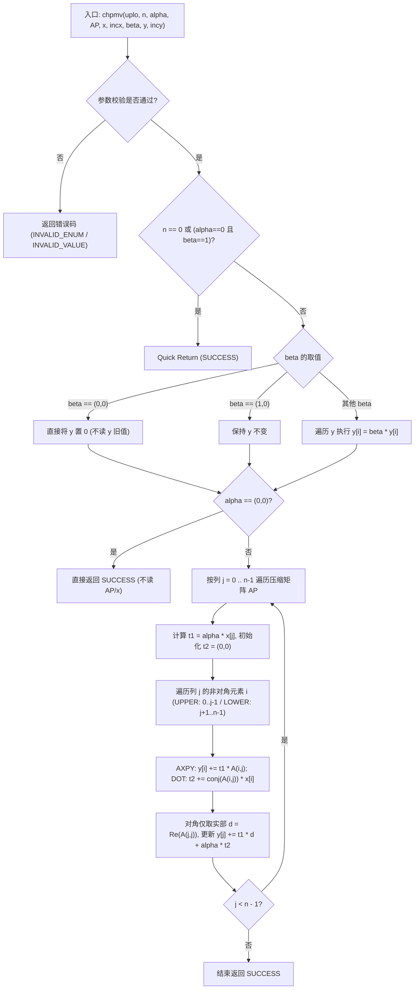
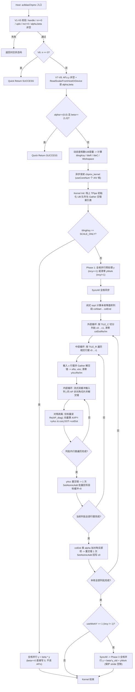

# aclblasChpmv 算子设计文档（Atlas A2/A3，arch22）

> - **任务名称**：11 月社区任务 — `aclblasChpmv` 算子开发（Atlas A2/A3，`arch22`）
> - **贡献者**：`qq52724865`
> - **目标代码仓**：`https://gitcode.com/cann/ops-blas`（`blas/spmv/arch22/`、`test/spmv/chpmv/arch22/`）
> - **核验基线**：《aclblasChpmv 算子开发任务书》、《设计文档 CheckList》及 `cann/ops-blas` `master@b0193c1a` 源码核验

---

# 一、需求背景（required）

## 1.1 需求来源

通过 2026 年 11 月 CANN 社区任务完成昇腾算子开源仓 `cann/ops-blas` 的算子贡献需求：在 **Atlas A2 / A3 系列硬件（对应 `arch22`，性能评测设备 Atlas 800T A2 / 910B3）**、**CANN 9.1.0** 环境下，使用 **Ascend C** 开发单精度复数（`COMPLEX64`）Hermitian 压缩存储矩阵-向量乘算子 **`aclblasChpmv`**，对标 cuBLAS `cublasChpmv` 与 Netlib BLAS `chpmv`。

- **目标代码仓**：`https://gitcode.com/cann/ops-blas`
- **实现落位**：`blas/spmv/arch22/`（新增 `chpmv_host.cpp`、`chpmv_kernel.h`、`chpmv_kernel.cpp`、`chpmv_tiling_data.h`）
- **测试落位**：`test/spmv/chpmv/arch22/`（复合并扩展 `test/spmv/chpmv/` 共享测试头）

## 1.2 背景介绍

### 1.2.1 aclblasChpmv 算子实现优化

本算子属于 `ops-blas` BLAS Level-2 压缩存储矩阵-向量乘族（`spmv`），非历史 TBE 迁移算子；其外部对标接口、仓内已有声明及架构参考路径如下：

| 参考类别 | 仓库 / 路径（含文件名） | 核验说明与复用方式 |
|---|---|---|
| **公开接口声明** | `cann/ops-blas`: `include/cann_ops_blas.h`（L161–L163） | `aclblasChpmv` 声明已存在且跨产品线共用，**本次不修改公共头** |
| **公共类型与状态码** | `cann/ops-blas`: `include/cann_ops_blas_common.h` | 定义 `aclblasComplex`（`float real; float imag;`）、`aclblasFillMode_t`、`aclblasStatus_t` |
| **外部标杆接口与参考实现** | cuBLAS `cublasChpmv`；Netlib BLAS 3.10.0 `chpmv.f`（`cblas_chpmv`） | 语义、压缩布局、对角虚部忽略与错误校验顺序对齐标准；CPU Golden 来源 |
| **仓内同算子 arch35 实现** | `cann/ops-blas`: `blas/spmv/arch35/{chpmv_host.cpp, chpmv_kernel.cpp, chpmv_tiling_data.h}` | 昇腾 950PR（arch35）实现，采用 SIMT（`__simt_vf__`、`asc_shfl`）+ SIMD Reg 混合模型，**无法直接在 arch22 编译运行**；且其校验顺序（`n=0` 提前返回）与标量限制（拒绝 Device 指针）与本任务书不同 |
| **仓内同目录 arch22 实数兄弟** | `cann/ops-blas`: `blas/spmv/arch22/{sspmv_host.cpp, sspmv_kernel.cpp, sspmv_kernel.h, sspmv_tiling_data.h}` | 实数对称压缩矩阵-向量乘 `aclblasSspmv`；存在硬编码 `numBlocks=8`（违背 R2）、`TPipe` 作成员变量（违背 R3）、非单位步长退化单核与逐元素标量循环（违背 R1）、每列直发 `AtomicAdd` 导致 $O(n^2)$ 写竞争等瓶颈，本设计针对性重构优化 |
| **仓内公共基础设施** | `cann/ops-blas`: `blas/common/helper/{host_utils.h, kernel_constant.h, aclblas_handle_internal.h}` | 复用 `GetAivCoreCount()`、`ReadScalarFromHostOrDevice<aclblasComplex>()`、`EnsureDefaultWorkspace()`、`UB_SIZE = 248 KiB` |
| **仓内测试参考** | `cann/ops-blas`: `test/spmv/chpmv/{chpmv_param.h, chpmv_golden.h}` 与 `arch35/chpmv_test.cpp` | 复用 Netlib 动态隔离加载 `Oracle` 与实/虚部分量校验机制，在 `arch22/` 补齐 1200 条任务书 CSV 适配与 `[PERF]` 事件计时输出 |

### 1.2.2 aclblasChpmv 算子现状分析

#### 1.2.2.1 标杆算子支持的数据类型和数据格式

计算单精度复数 Hermitian 压缩存储矩阵-向量乘：

$$y = \alpha A x + \beta y$$

其中 $A \in \mathbb{C}^{n \times n}$ 为 Hermitian 矩阵（$A = A^H$，对角线元素恒为实数，其虚部不被引用），以列主序压缩（Packed）方式存储于长度 $\frac{n(n+1)}{2}$ 的一维连续复数缓冲区 `AP` 中（无 `lda` 参数）。

| 参数名 | 方向 / 类型 | C 数据类型 | dtype / 排布 | 维度 / 存储长度 | 约束与异常返回码 |
|---|---|---|---|---|---|
| `handle` | 输入 / scalar | `aclblasHandle_t` | Host 句柄（携带 `stream`） | — | `nullptr` 返回 `ACLBLAS_STATUS_HANDLE_IS_NULLPTR` |
| `uplo` | 属性 / attr | `aclblasFillMode_t` | int 枚举 | `{ACLBLAS_UPPER, ACLBLAS_LOWER}` | 非法枚举返回 `ACLBLAS_STATUS_INVALID_ENUM` |
| `n` | 属性 / attr | `int` | int32 | $n \ge 0$ | $n < 0$ 返回 `ACLBLAS_STATUS_INVALID_VALUE`；$n = 0$ 为合法 no-op（不豁免结构校验） |
| `alpha` | 输入 / scalar | `const aclblasComplex*` | `COMPLEX64`（Host 或 Device） | 1 个复数 | `nullptr` 返回 `ACLBLAS_STATUS_INVALID_VALUE` |
| `AP` | 输入 / tensor | `const aclblasComplex*` | `COMPLEX64` / ND（列主序 packed） | $\frac{n(n+1)}{2}$ 个复数 | $n > 0$ 时 `nullptr` 返回 `ACLBLAS_STATUS_INVALID_VALUE`；对角虚部忽略 |
| `x` | 输入 / tensor | `const aclblasComplex*` | `COMPLEX64` / ND | 逻辑长度 $n$，物理长度 $\ge 1 + (n-1)\lvert\text{incx}\rvert$ | $n > 0$ 时 `nullptr` 返回 `ACLBLAS_STATUS_INVALID_VALUE` |
| `incx` | 属性 / attr | `int` | int32 | 非零 int（支持负步长） | `incx == 0` 返回 `ACLBLAS_STATUS_INVALID_VALUE` |
| `beta` | 输入 / scalar | `const aclblasComplex*` | `COMPLEX64`（Host 或 Device） | 1 个复数 | `nullptr` 返回 `ACLBLAS_STATUS_INVALID_VALUE` |
| `y` | 原地输出 / tensor | `aclblasComplex*` | `COMPLEX64` / ND | 逻辑长度 $n$，物理长度 $\ge 1 + (n-1)\lvert\text{incy}\rvert$ | $n > 0$ 时 `nullptr` 返回 `ACLBLAS_STATUS_INVALID_VALUE`；$\beta=(0,0)$ 不读旧值 |
| `incy` | 属性 / attr | `int` | int32 | 非零 int（支持负步长） | `incy == 0` 返回 `ACLBLAS_STATUS_INVALID_VALUE` |

**压缩存储寻址规则（0-based）**：
- `ACLBLAS_UPPER`：列 $j \in [0, n-1]$ 存储 $A(i, j)$（$0 \le i \le j$），元素位于 $\text{AP}\left[\frac{j(j+1)}{2} + i\right]$，对角元素位于列末 $\text{AP}\left[\frac{j(j+1)}{2} + j\right]$；下三角由 $A(j, i) = \overline{A(i, j)}$ 隐含。
- `ACLBLAS_LOWER`：列 $j \in [0, n-1]$ 存储 $A(i, j)$（$j \le i < n$），元素位于 $\text{AP}\left[\frac{j(2n-j-1)}{2} + i\right] = \text{AP}\left[\frac{j(2n-j+1)}{2} + (i - j)\right]$，对角元素位于列首 $\text{AP}\left[\frac{j(2n-j+1)}{2}\right]$；上三角由 $A(j, i) = \overline{A(i, j)}$ 隐含。

#### 1.2.2.2 标杆算子实现描述

1. **Netlib `chpmv.f` 标杆算法（CPU 串行语义基准）**：
   - 先做参数合法性与 quick return（$n = 0$ 或 $\alpha=(0,0) \land \beta=(1,0)$）；
   - 按 $\beta$ 预处理 $y$：$\beta=(0,0)$ 时直接置零（不读取旧 $y$），$\beta \ne (1,0)$ 时执行 $y \leftarrow \beta y$；若 $\alpha=(0,0)$ 直接返回；
   - 按列 $j = 0 \dots n-1$ 顺序遍历 `AP` 的压缩列，维护列指针 `kk`：
     - 预计算标量 $t_1 = \alpha \cdot x_j$，初始化共轭点积累加器 $t_2 = (0, 0)$；
     - 对该列全部非对角元素 $i$：同步执行直接散射 $y_i \mathrel{+}= t_1 \cdot A(i, j)$ 与共轭点积 $t_2 \mathrel{+}= \overline{A(i, j)} \cdot x_i$；
     - 对角位置仅读取实部 $\operatorname{Re}(A(j, j))$，更新 $y_j \mathrel{+}= t_1 \cdot \operatorname{Re}(A(j, j)) + \alpha \cdot t_2$。
2. **`ops-blas` 仓内 `arch35/chpmv` 现状（950PR 实现参考）**：
   - 采用 3 级分发策略：`strategy=0`（$n < 16$，SIMT 每线程一行 `ChpmvOrdered`）、`strategy=1`（$16 \le n < 512$，SIMT 32 线程 warp 协作一行 `ChpmvGroupOrdered` + `asc_shfl`）、`strategy=2`（$n \ge 512$，SIMT 暂存转置 64×256 tile 至 UB + SIMD Reg `LoadAlign(DIST_DINTLV_B32)` 乘加）。
   - 该方案强依赖 `arch35` 专属的 SIMT 硬件线程模型与 Reg 级指令，无法在纯 SIMD 架构的 Atlas A2/A3（`arch22`）上运行。

#### 1.2.2.3 标杆算子实现流程图



---

# 二、需求分析（required）

## 2.1 外部组件依赖

| 外部组件 | 版本 / 来源 | 依赖用途 |
|---|---|---|
| **CANN** | CANN 9.1.0 | Ascend C 编译器（`bisheng`）、Ascend C 标准库（`kernel_operator.h`）、Platform Tiling API（`platform_ascendc`）、ACL Runtime（`aclrtPointerGetAttributes`、`aclrtMemcpyAsync`、`aclrtSynchronizeStream`、`aclrtGetLastError`） |
| **Netlib BLAS / CBLAS** | Netlib BLAS 3.10.0 | 测试阶段 CPU Golden 生成（`cblas_chpmv` / `chpmv_`） |
| **GTest / ATK 测试框架** | `ops-blas` 仓内集成 | CSV 驱动的 1000 条精度测试与 200 条性能回归测试 |
| **msprof** | CANN 9.1.0 自带 | 正式性能验收采集 NPU Kernel `Task Duration(us)` |

## 2.2 内部适配模块

| 内部模块 | 仓内路径 | 适配内容 |
|---|---|---|
| **Handle 与 Workspace 管理** | `blas/common/helper/aclblas_handle_internal.h` | 获取 `handle->stream`，在 `incy != 1` 场景通过 `EnsureDefaultWorkspace()` 复用库管理/用户注入的设备侧 Workspace（默认 32 MiB） |
| **Host 公共工具** | `blas/common/helper/host_utils.h` | 复用 `GetAivCoreCount()`、`CeilDiv()`、`CeilAlign()` 与 `ReadScalarFromHostOrDevice<aclblasComplex>()`（支持 Host/Device 双模式标量） |
| **日志与常量** | `blas/common/log/log.h`、`blas/common/helper/kernel_constant.h` | 统一错误日志 `OP_LOGE` / 调试日志 `OP_LOGD` 与 `UB_SIZE = 248 KiB` 常量 |
| **构建与单测体系** | `blas/spmv/arch22/`、`test/spmv/chpmv/arch22/` | 接入 `build.sh --soc=ascend910b3 --ops=chpmv` 编译目标；扩展测试数据生成器支持 `RANDOM_GAUSS_0_1` 与 `RANDOM_DIAG_IMAG` |

## 2.3 需求模块设计

### 2.3.1 Ascend C 算子原型

直接实现 `include/cann_ops_blas.h`（L161–L163）既有公开声明，不新增或修改公共头文件：

```cpp
aclblasStatus_t aclblasChpmv(
    aclblasHandle_t handle,
    aclblasFillMode_t uplo,
    int n,
    const aclblasComplex* alpha,
    const aclblasComplex* AP,
    const aclblasComplex* x, int incx,
    const aclblasComplex* beta,
    aclblasComplex* y, int incy);
```

**入参校验顺序（V1–V8，严格对齐任务书 §2.5 及 cuBLAS 错误检查语义，顺序不可调换）**：

| 序号 | 校验条件 | 返回码 / 行为 | 说明 |
|---|---|---|---|
| V1 | `handle == nullptr` | `ACLBLAS_STATUS_HANDLE_IS_NULLPTR` | 最高优先级 |
| V2 | `n < 0` | `ACLBLAS_STATUS_INVALID_VALUE` | 早于 `uplo` 校验（匹配负向用例 `neg_n_invalid_uplo`） |
| V3 | `uplo != ACLBLAS_UPPER && uplo != ACLBLAS_LOWER` | `ACLBLAS_STATUS_INVALID_ENUM` | 枚举非法返回 `INVALID_ENUM` |
| V4 | `incx == 0 \|\| incy == 0` | `ACLBLAS_STATUS_INVALID_VALUE` | 禁止零步长；负步长合法 |
| V5 | `alpha == nullptr \|\| beta == nullptr` | `ACLBLAS_STATUS_INVALID_VALUE` | `n = 0` 时同样不可豁免 |
| V6 | `n == 0` | **Quick Return `ACLBLAS_STATUS_SUCCESS`** | 不校验 `AP`/`x`/`y` 指针，不启动 kernel |
| V7 | `AP == nullptr \|\| x == nullptr \|\| y == nullptr` | `ACLBLAS_STATUS_INVALID_VALUE` | $n > 0$ 时三张量指针必非空 |
| V8 | 探测并读取 `alpha` / `beta`；若 `alpha == (0,0) && beta == (1,0)` | **Quick Return `ACLBLAS_STATUS_SUCCESS`** | 通过 `ReadScalarFromHostOrDevice` 同时支持 Host/Device 标量指针；不读 `AP`/`x`/`y`，不启动 kernel |

**核心数值与语义契约**：
1. **Hermitian 对角虚部隔离**：对角元素仅读取实部 `AP[2 * diagIdx]`，虚部不参与任何浮点乘加表达式，避免对角虚部为 `NaN`/`Inf` 时发生 $0 \times \text{NaN} = \text{NaN}$ 污染。
2. **退化路径防污染**：
   - `beta == (0, 0)` 时直接写回零值/计算结果，**严禁读取 `y` 旧值**（覆盖 `beta0_y_nan` 用例）；
   - `alpha == (0, 0)` 且 `beta != (1, 0)` 时仅走 `y = beta * y` 缩放分支，**严禁读取 `AP` 与 `x`**（覆盖 `alpha0_beta2_x_nan` 用例）。
3. **负步长反向遍历**：对逻辑索引 $i \in [0, n-1]$，物理复数元素索引定义为：

$$\text{PhysPos}(i, n, \text{inc}) = \begin{cases} i \cdot \text{inc}, & \text{inc} > 0 \\ (n - 1 - i) \cdot (-\text{inc}), & \text{inc} < 0 \end{cases}$$

### 2.3.2 Ascend C 算子相关约束（与标杆算子差异）

1. **枚举错误码有意差异**：非法 `uplo` 返回 `ACLBLAS_STATUS_INVALID_ENUM`（cuBLAS 返回 `CUBLAS_STATUS_INVALID_VALUE`），符合 `ops-blas` 仓统一枚举校验规范。
2. **纯单精度复数**：仅支持 `COMPLEX64`（`aclblasComplex`），不提供混合精度计算类型切换，不支持广播与 0 维 Tensor。
3. **原地输出内存无重叠**：`y` 为原地覆写，调用方需保证 `y` 可写区与 `AP`、`x` 可读区不重叠；当 $\lvert\text{incy}\rvert > 1$ 时，算子保证不修改 `y` 步长空隙（stride holes）中的任意字节。
4. **不确定性归约**：多核原子累加与向量归约不保证与单线程逐位一致，验收以 §5.1 混合精度容差标准判定。

---

# 三、需求详细设计（required）

## 3.1 调用方式

采用 **`ops-blas` 句柄式 C API + Ascend C Kernel 直调**模式：
- 用户调用 `aclblasChpmv(handle, ...)`，Host 侧完成 V1–V8 校验、标量读取、Workspace 检查与 `ChpmvTilingData` 计算后，在 `handle->stream` 上通过 `chpmv_kernel<<<useCoreNum, nullptr, handle->stream>>>(...)` 异步发射纯 AIV（`KERNEL_TYPE_AIV_ONLY`）核函数。
- 接口按异步语义执行，Host 读回 Device 结果前须同步 `handle->stream`；当 `alpha`/`beta` 为 Device 指针时，Host 侧在读取标量阶段仅同步该 D2H 拷贝，主计算 kernel 仍保持异步发射。

## 3.2 需求总体设计

### 数学建模与架构选型

**计算瓶颈分析**：
- 压缩矩阵 `AP` 大小为 $4n(n+1)$ 字节（$n = 8192$ 时约 $256\text{ MiB} \approx 268.5\text{ MB}$）；每个复数元素（8 字节）在非对角位置被复用 2 次（1 次直接 AXPY + 1 次共轭 DOT），共执行 16 FLOPs，计算访存比仅 **2.0 FLOP/Byte**，属于**典型访存带宽密集型算子**。
- 在 Atlas 800T A2（910B3，HBM 带宽约 1.2–1.6 TB/s）上，若能做到对 `AP` **单遍连续流式读取**，则 $n=8192$ 的 HBM 读下限约 **170–225 µs**，远低于验收红线 $1527.1 / 0.8 = 1908.9\ \mu\text{s}$。

**核心方案：AIV 纯 SIMD 2D 行窗 × 等面积列段单遍流式双累加（Column-Streaming Dual-Accumulation）**

- **为什么排除 3 条不可行/低效路径**：
  1. *排除直接平移 `arch35` SIMT Kernel*：Atlas A2/A3（`arch22`）不支持 SIMT 线程编程模型与 `asc_shfl` 指令。
  2. *排除沿用 `arch22/sspmv` 逐列 AtomicAdd 骨架*：`sspmv` 对每一列直接 `SetAtomicAdd` 写 GM，原子写总量高达 $O(n^2)$，且硬编码 8 核、非单位步长退化为单核标量循环，严重违背编码规范 R1/R2/R3 且性能无法达标。
  3. *排除按行切分随机读 `AP`*：`AP` 按列主序打包，按行读非存储侧会退化为跨列变步长离散访问，大幅浪费 HBM 带宽与 MTE2 事务效率。

- **本方案的核心机制**：
  1. **等面积闭式列段划分**：各 AIV 核按三角矩阵元素数均分连续列段 $[\text{colStart}, \text{colEnd})$，消除三角矩阵的核间负载倾斜，且不向 `TilingData` 传入数组（遵守 R4）。
  2. **2D 列批（`TILE_C`）× 行窗（`TILE_R`）分块**：
     - 同一核内，先将自身负责的列段按 `TILE_C` 切成若干**列批**；
     - 在每个列批内，遍历相交的**行窗** $[r_0, r_0 + \text{lenR})$：
       - 将 `x[r0 .. r0+lenR)` 一次搬入 UB 并用 `Gather` 解交错为实/虚平面 `xRe, xIm`；
       - 在 UB 中常驻行窗局部累加器 `yAccRe, yAccIm`（初值 0），顺序流式搬入该列批各列在当前行窗内的连续 `AP` 切片（开启 `BUFFER_NUM=2` 双缓冲）；
       - 每次搬入的 `AP` 切片复用两次：
         - **直接 AXPY**：以 $t_j = \alpha x_j$ 在 UB 内累加至 `yAccRe, yAccIm`（不写 GM）；
         - **共轭 DOT**：与 `xRe, xIm` 做共轭乘并 `ReduceSum`，标量累加到本核独占的 `colDotRe[j - c0], colDotIm[j - c0]`；
       - 整个列批扫完当前行窗后，才对 `yAcc` 重交错并执行**仅 1 次** `SetAtomicAdd<float>` 批量回写 GM！将 GM 原子写流量从 $O(n^2)$ 压缩至 $O(P \cdot n)$（$n=8192, P=48$ 时仅约 3 MB，占比 < 1.2%）。
     - 当前列批所有行窗完成后，对本核独占的 `colDot` 向量统一乘以 $\alpha$、加上纯实部对角贡献 $(\alpha x_j) \cdot \operatorname{Re}(A_{jj})$，重交错后做 **1 次** `SetAtomicAdd<float>` 写回 `y[c0 .. c0+lenC)`。
  3. **非单位步长 `incy != 1` 零竞态支持**：
     - 当 `incy != 1` 时，利用 `handle->workspace` 中 $8n$ 字节（$n=8192$ 仅 64 KiB）作为连续零初始化缓冲 `yWork`，Phase 2 所有核照常满核跑高速连续 `SetAtomicAdd<float>` 写入 `yWork`；`SyncAll()` 后由 Phase 3 全部核并行将 `beta * y + yWork` 写回 `y[PhysPos(i)]`，既避免非对齐原子写限制，又严格保护 `y` 步长空隙不被覆写。

### 3.2.1 Host 侧设计

#### 3.2.1.1 分核策略

遵循 `ops-blas` 编码规范 **R2（禁止硬编码核数）** 与 **R4（TilingData 禁止核分配数组）**：

1. **动态获取可用 AIV 核数**：通过 `uint32_t availCores = GetAivCoreCount();` 动态获取当前芯片 AIV 核数（910B3 为 40/48 核，A3 对应平台实测核数）；若 `availCores == 0` 返回 `ACLBLAS_STATUS_EXECUTION_FAILED`。
2. **有效发射核数 `useCoreNum` 计算**：
   - `TK_SCALE_ONLY`（仅缩放 `y`）：$\text{useCoreNum} = \min\left(\text{availCores},\ \left\lceil \frac{n}{64} \right\rceil\right)$（至少为 1）。
   - 矩阵-向量乘路径：总非零三角元素数 $E = \frac{n(n+1)}{2}$。
     - 当 $n \le 64$ 时，单行/列开销极小，取 $\text{useCoreNum} = \min\left(\text{availCores},\ \left\lceil \frac{n}{16} \right\rceil\right)$，避免过多空核同步开销；
     - 当 $n > 64$ 时，取 $\text{useCoreNum} = \min(\text{availCores},\ n)$，优先满核打满 HBM 带宽。
3. **核内等面积闭式列区间计算（无数组传输）**：
   设 $P = \text{useCoreNum}$，核号 $k = \text{GetBlockIdx}() \in [0, P-1]$，累计元素目标下界 $S_k = \left\lfloor \frac{k \cdot E}{P} \right\rfloor$（64 位无符号整数计算，防溢出）：
   - **当 `uplo == ACLBLAS_UPPER`**：前缀列 $0 \dots c-1$ 共含 $\frac{c(c+1)}{2}$ 个元素，由 $\frac{c(c+1)}{2} \le S_k$ 反解：

     $$\text{colStart}_k = \begin{cases} 0, & k = 0 \\ \left\lfloor \dfrac{\operatorname{isqrt}(8 S_k + 1) - 1}{2} \right\rfloor, & 0 < k < P \end{cases}, \qquad \text{colEnd}_k = \begin{cases} n, & k = P - 1 \\ \text{colStart}_{k+1}, & k < P - 1 \end{cases}$$

   - **当 `uplo == ACLBLAS_LOWER`**：后缀列 $c \dots n-1$ 共含 $\frac{(n-c)(n-c+1)}{2}$ 个元素，令剩余元素 $R_k = E - S_k$，反解得：

     $$\text{colStart}_k = \begin{cases} 0, & k = 0 \\ n - \left\lfloor \dfrac{\operatorname{isqrt}(8 R_k + 1) - 1}{2} \right\rfloor, & 0 < k < P \end{cases}, \qquad \text{colEnd}_k = \begin{cases} n, & k = P - 1 \\ \text{colStart}_{k+1}, & k < P - 1 \end{cases}$$

   其中 $\operatorname{isqrt}(u)$ 为核内 64 位整数牛顿迭代精确平方根（至多 6 次迭代，$O(1)$ 开销）。相邻核共享同一边界表达式保证区间严格无重无漏，且单核工作量偏差不超过单列最大长度 $n$。

#### 3.2.1.2 数据分块和内存优化策略

Host 侧通过 `PlatformAscendCManager::GetInstance()->GetCoreMemSize(CoreMemType::UB, ubBytes)` 动态查询单核 UB 容量（Atlas A2/A3 为 `UB_SIZE = 248 KiB = 253,952 B`），并保证所有缓冲区按 **32 字节（8 个 `float` = 4 个 `complex64`）** 向上对齐。

**1. 分块参数定义**：
- 行窗元素数 $R = \text{tileR}$（单位：复数元素，`complex64`，8 字节/元素；要求为 32 的整数倍以对齐 256B Vector Repeat）；
- 列批元素数 $C = \text{tileC}$（单位：复数元素；要求为 32 的整数倍）；
- 双缓冲深度 $B = \text{BUFFER\_NUM} = 2$（用于 `AP` 搬入与 `y` 搬出队列，实现 MTE2/Vector/MTE3 流水掩盖）。

**2. LocalMemory（UB）占用精确计算公式**：

| 缓冲区名称 | 位置 / 类型 | 元素类型与尺寸 | 字节占用公式 | $R=2048, C=1024$ 占用 | $R=1024, C=1024$ 占用 |
|---|---|---|---|---|---|
| `apInQue` | `TQue<VECIN, 2>` | $B \times 2R$ 个 `float`（交错 `AP` 切片） | $B \cdot 8R = 16R$ | $32,768\text{ B}$ ($32\text{ KiB}$) | $16,384\text{ B}$ ($16\text{ KiB}$) |
| `xInQue` | `TQue<VECIN, 1>` | $2R$ 个 `float`（当前行窗交错 `x`） | $8R$ | $16,384\text{ B}$ ($16\text{ KiB}$) | $8,192\text{ B}$ ($8\text{ KiB}$) |
| `xReBuf` + `xImBuf` | `TBuf<VECCALC>` | $2 \times R$ 个 `float`（解交错 `x` 平面） | $8R$ | $16,384\text{ B}$ ($16\text{ KiB}$) | $8,192\text{ B}$ ($8\text{ KiB}$) |
| `aReBuf` + `aImBuf` | `TBuf<VECCALC>` | $2 \times R$ 个 `float`（解交错 `AP` 平面） | $8R$ | $16,384\text{ B}$ ($16\text{ KiB}$) | $8,192\text{ B}$ ($8\text{ KiB}$) |
| `yAccReBuf` + `yAccImBuf` | `TBuf<VECCALC>` | $2 \times R$ 个 `float`（行窗 AXPY 累加器） | $8R$ | $16,384\text{ B}$ ($16\text{ KiB}$) | $8,192\text{ B}$ ($8\text{ KiB}$) |
| `colDotReBuf` + `colDotImBuf` | `TBuf<VECCALC>` | $2 \times C$ 个 `float`（列批 DOT 累加器） | $8C$ | $8,192\text{ B}$ ($8\text{ KiB}$) | $8,192\text{ B}$ ($8\text{ KiB}$) |
| `tmpBuf[0..3]` | `TBuf<VECCALC>` | $4 \times R$ 个 `float`（复数乘四实积与中间和） | $16R$ | $32,768\text{ B}$ ($32\text{ KiB}$) | $16,384\text{ B}$ ($16\text{ KiB}$) |
| `workLocalBuf` | `TBuf<VECCALC>` | `ReduceSum` 归约工作区（$\ge \lceil R/64 \rceil \times 4\text{B}$，按 4 KiB 对齐预留） | $4096$ | $4,096\text{ B}$ ($4\text{ KiB}$) | $4,096\text{ B}$ ($4\text{ KiB}$) |
| `gatherIdxBuf` | `TBuf<VECCALC>` | 3 组 `uint32` 字节索引（`evenIdx[R]`、`oddIdx[R]`、`interleaveIdx[2R]`） | $16R$ | $32,768\text{ B}$ ($32\text{ KiB}$) | $16,384\text{ B}$ ($16\text{ KiB}$) |
| `yOutQue` | `TQue<VECOUT, 2>` | $B \times 2R$ 个 `float`（重交错输出双缓冲） | $B \cdot 8R = 16R$ | $32,768\text{ B}$ ($32\text{ KiB}$) | $16,384\text{ B}$ ($16\text{ KiB}$) |
| **合计总 UB 占用** | — | — | **$U(R, C) = 96R + 8C + 4096$** | **$208,896\text{ B}$ ($204\text{ KiB}$)** | **$110,592\text{ B}$ ($108\text{ KiB}$)** |

**3. 内存安全裕量与动态降级公式**：
- 约束条件：$U(R, C) \le \text{ubBytes} - 24 \times 1024$（保留至少 $24\text{ KiB}$ 给编译器栈变量与对齐余量）。
- 在 Atlas A2/A3（`ubBytes = 248 KiB`）上：
  - 默认选取 **$R = 2048,\ C = 1024$**，总占用 **$204\text{ KiB}$**（UB 利用率 **82.3%**，剩余裕量 **$44\text{ KiB}$**）；
  - 若目标硬件 `ubBytes < 228 KiB`，Host 自动按公式降级为 $R = 1024,\ C = 1024$（总占用 **$108\text{ KiB}$**）。
- **访存与带宽优化要点**：
  1. `x[r0..r0+lenR)` 在每个行窗仅搬入 1 次并复用于整个列批（最多 $C=1024$ 列），将 `x` 的读放大降至 $\approx 0$；
  2. `yAcc` 在列批内全程驻留 UB，仅在行窗结束时做 1 次 `SetAtomicAdd<float>` 写回；
  3. 仅对 `AP` 的 `DataCopy` 启用双缓冲 `BUFFER_NUM=2`，掩盖 HBM 读取延迟；
  4. `incy != 1` 时通过 `EnsureDefaultWorkspace(handle, 8 * n)` 复用 `handle->workspace`（$n=8192$ 仅占 $64\text{ KiB}$），不发生 `aclrtMalloc`/`aclrtFree` 同步抖动。

#### 3.2.1.3 tilingKey 规划策略

根据 Host 侧已知的 `uplo`、`alpha`、`incx`、`incy` 将 Kernel 划分为 5 条专用分支，避免内层热点循环出现多余条件判断：

| `tilingKey` 枚举值 | 触发条件 | Kernel 执行路径与职责 |
|---|---|---|
| `CHPMV_TK_SCALE_ONLY = 0` | `alpha == (0,0) && beta != (1,0)` | 仅并行执行 `y = beta * y`（`beta == (0,0)` 时直接写 0），**不访问 `AP` / `x`** |
| `CHPMV_TK_UPPER_CONTIG = 1` | `uplo == ACLBLAS_UPPER && incx == 1 && incy == 1` | 上三角连续快路径：Phase 1 原地预处理 `y` → `SyncAll` → Phase 2 双累加 + 直接 `SetAtomicAdd` 写 `y` |
| `CHPMV_TK_LOWER_CONTIG = 2` | `uplo == ACLBLAS_LOWER && incx == 1 && incy == 1` | 下三角连续快路径：同上，按 `LOWER` 列首公式与列首对角剥离执行 |
| `CHPMV_TK_UPPER_STRIDED = 3` | `uplo == ACLBLAS_UPPER && (incx != 1 \|\| incy != 1)` | 上三角通用步长路径：支持负步长与大跨度；若 `incy != 1`，Phase 2 写入连续 `yWork`，`SyncAll` 后由 Phase 3 并行合并写回 `y` |
| `CHPMV_TK_LOWER_STRIDED = 4` | `uplo == ACLBLAS_LOWER && (incx != 1 \|\| incy != 1)` | 下三角通用步长路径：同上，按 `LOWER` 布局执行 |

**`ChpmvTilingData` 结构体设计（纯标量，严格满足 R4）**：

```cpp
struct ChpmvTilingData {
    uint32_t n;           // 矩阵阶数 (> 0)
    uint32_t useCoreNum;  // 实际参与计算的 AIV 核数
    uint32_t tilingKey;   // 0..4，见上表
    uint32_t tileR;       // 行窗复数元素数 (2048 或 1024)
    uint32_t tileC;       // 列批复数元素数 (1024)
    uint32_t useWorkY;    // incy != 1 时为 1，使用 workspace 作为连续中间缓冲
    int64_t incx;         // x 步长（可负，非零）
    int64_t incy;         // y 步长（可负，非零）
    aclblasComplex alpha; // Host 侧已读取的复数标量 alpha
    aclblasComplex beta;  // Host 侧已读取的复数标量 beta
};
```

### 3.2.2 Kernel 侧设计

#### 3.2.2.1 kernel 侧实现描述

遵循 `ops-blas` 编码规范 **R1（向量化禁止逐元素循环）** 与 **R3（`TPipe` 不作成员变量）**：

1. **初始化阶段（`Init`）**：
   - 在 `__global__` 核函数栈上创建 `TPipe pipe;`，以指针传入 `ChpmvKernel::Init(&pipe, ap, x, y, workSpace, tiling)`；
   - 通过 `pipe->InitBuffer(...)` 分配 §3.2.1.2 中定义的全部 `TQue` / `TBuf`；
   - 一次性在 UB 中利用向量指令预生成 `gatherIdxBuf`：
     - 解交错偶索引 `evenIdx[k] = 8k`、奇索引 `oddIdx[k] = 8k + 4`（$k \in [0, R-1]$）；
     - 重交错索引 `interleaveIdx[2k] = 4k`、`interleaveIdx[2k+1] = 4(R + k)`，用于将相邻存放的 `[Re | Im]` 一条 `Gather` 指令拼回交错 `complex64`。
2. **Phase 1：全核并行 `y` 预处理（或 `yWork` 清零）**：
   - 将 $[0, n)$ 按 $n / \text{useCoreNum}$ 均分给全部核并行处理；
   - 若 `useWorkY == 1`：直接用 `Duplicate(yOut, 0.0f)` 向量清零 `yWork[0..2n-1]`（不提前改写 `y`，留到 Phase 3 一次读改写）；
   - 若 `useWorkY == 0`（即 `incy == 1`）：
     - `beta == (0,0)`：直接向量写 `0.0f` 至 `y`（**绝不读取旧 `y`**，防 `NaN` 污染）；
     - `beta == (1,0)`：空操作跳过；
     - 其他 `beta`：连续搬入 `y` → `Gather` 解交错 → 4 路 `Muls` + `Add`/`Sub` 计算 $(\beta_r y_r - \beta_i y_i,\ \beta_r y_i + \beta_i y_r)$ → `Gather` 重交错 → 写回 `y`。
   - 若 `tilingKey == CHPMV_TK_SCALE_ONLY`：对于 `incy != 1` 直接并行缩放/清零 `y[PhysPos(i)]`，完成后直接返回（绝不访问 `AP` / `x`）。
   - 若 `useCoreNum > 1`：执行 **`SyncAll()`** 全核屏障，确保预处理对后续原子累加全局可见。
3. **Phase 2：单遍列流式双累加（核心热点）**：
   - 本核根据 §3.2.1.1 闭式公式计算列区间 $[\text{colStart}, \text{colEnd})$；若为空区间则跳过。
   - 外层按 `TILE_C` 遍历列批 $[c_0, c_1)$，每次开始前向量清零 `colDotRe`、`colDotIm`（长度 $c_1 - c_0$）。
   - 计算当前列批在 `AP` 中覆盖的全局行范围 $[r_{\min}, r_{\max})$：
     - `UPPER`：$r_{\min} = 0,\ r_{\max} = c_1$；
     - `LOWER`：$r_{\min} = c_0,\ r_{\max} = n$。
   - 中层按 `TILE_R` 遍历行窗 $[r_0, r_1) \subseteq [r_{\min}, r_{\max})$：
     - 将 `x[r0..r1)` 搬入 UB（`incx == 1` 用连续 `DataCopy`/`DataCopyPad`；`incx != 1` 按 `abs(incx)` 组织跨步搬入或分片聚集），`Gather` 解交错至 `xRe, xIm`；
     - `Duplicate` 清零 `yAccRe, yAccIm`；
     - 内层遍历列 $j \in [c_0, c_1)$（仅处理与行窗有交集的列）：
       - 确定列 $j$ 存储行范围：`UPPER` 为 $[0, j+1)$，`LOWER` 为 $[j, n)$；
       - **对角剥离**：若 $j \in [r_0, r_1)$，直接以单标量读取实部 `diagReal = apGm.GetValue(2 * diagIdx)`（不碰 `2 * diagIdx + 1` 虚部！），并从非对角向量切片中扣除对角位置（`UPPER` 截断尾元素 `[iStart, j)`，`LOWER` 跳过首元素 `[j+1, iEnd)`）；
       - 连续 `DataCopy` / `DataCopyPad` 将非对角切片搬入 `apInQue`（双缓冲），`Gather` 解交错得 `aRe, aIm`（长度 `cnt`）；
       - **精确复数乘加（与 Netlib/`arch35` 保持一致，避免不必要 FMA 收缩误差）**：
         - 预取本列标量 $x_j$，计算 $t = \alpha \cdot x_j = (t_r, t_i)$；
         - **AXPY（更新 `yAcc` 子区间 `[iStart - r0, cnt)`）**：
           `tmp0 = aRe * t_r`, `tmp1 = aIm * t_i`, `tmp0 = tmp0 - tmp1`, `yAccRe += tmp0`；
           `tmp2 = aRe * t_i`, `tmp3 = aIm * t_r`, `tmp2 = tmp2 + tmp3`, `yAccIm += tmp2`；
         - **共轭 DOT（与 `xRe/xIm` 子区间 `[iStart - r0, cnt)` 逐元素乘后归约）**：
           `tmp0 = aRe * xRe`, `tmp1 = aIm * xIm`, `tmp0 = tmp0 + tmp1`, `dotRe = ReduceSum(tmp0, workLocal, cnt)`；
           `tmp2 = aRe * xIm`, `tmp3 = aIm * xRe`, `tmp2 = tmp2 - tmp3`, `dotIm = ReduceSum(tmp2, workLocal, cnt)`；
           累加至 `colDotRe[j - c0] += dotRe`、`colDotIm[j - c0] += dotIm`。
     - 行窗内所有列完成后：将 `yAccRe, yAccIm` 经 `Gather` 重交错写入 `yOutQue`，开启 `SetAtomicAdd<float>()` 执行 **1 次** `DataCopy` / `DataCopyPad` 写回目标缓冲（`y` 或 `yWork`）偏移 $2r_0$，立即 `SetAtomicNone()`。
   - 列批所有行窗完成后：
     - 向量计算 `colDot = alpha * colDot + (alpha * x[c0..c1)) * diagReal[c0..c1)`，经 `Gather` 重交错后以 **1 次** `SetAtomicAdd<float>()` 写回目标缓冲偏移 $2c_0$，立即 `SetAtomicNone()`。
4. **Phase 3：跨步输出合并（仅 `useWorkY == 1` 时执行）**：
   - `SyncAll()` 等待所有核完成 `yWork` 累加；
   - 全部核按逻辑索引均分 $[0, n)$：若 `beta == (0,0)` 直接将 `yWork[i]` 写入 `y[PhysPos(i)]`（不读旧 `y`）；否则读 `y[PhysPos(i)]` 计算 `beta * y_old + yWork[i]` 写回 `y[PhysPos(i)]`，**不触碰任何 stride 空隙**。

**关键数值与尾块边界处理**：
- 非 32B 对齐尾块搬入使用 `DataCopyPad` 显式零填充，且所有向量指令严格传入有效元素长度 `cnt`（`ReduceSum` 仅对前 `cnt` 个元素归约），防止尾块脏数据进入计算。
- 当 `AP` 或 `x` 含 `Inf`/`NaN` 时，由于非对角与对角严格分离、零长度切片直接跳过，语义与 Netlib `cblas_chpmv` 一致。

#### 3.2.2.2 Ascend C 实现流程图



#### 3.2.2.3 Ascend C 实现流程图与标杆算子流程图存在的差异点和原因

| 差异维度 | 标杆实现（Netlib `chpmv` / `arch35` / `arch22 sspmv`） | 本 `arch22` Ascend C 实现 | 差异原因 |
|---|---|---|---|
| **硬件并行与指令模型** | Netlib 为 CPU 单核串行；`arch35` 为 SIMT + SIMD Reg 混合（`__simt_vf__`、`asc_shfl`） | 纯 AIV 多核 SIMD 向量化（`DataCopy` + `Gather` + `Mul`/`Add`/`ReduceSum`） | Atlas A2/A3（`arch22`）无 SIMT 执行单元，必须走纯 SIMD Membase 向量管线 |
| **三角工作量切分** | `arch22 sspmv` 硬编码 8 核轮询；`arch35` 按 64 行块轮询 | 基于 `GetAivCoreCount()` + 64 位整数 `isqrt` 的**等面积闭式列段划分** | 解决三角矩阵列长线性变化导致的核间负载倾斜，同时严格满足 R2/R4 编码规范 |
| **GM 写回与原子竞争** | Netlib 逐元素更新；`arch22 sspmv` 每列每 tile 直接 `AtomicAdd` 写 GM（$O(n^2)$ 竞争） | 2D `TILE_C × TILE_R` 分块，UB 内常驻 `yAcc` 与 `colDot`，**每行窗/列批仅 1 次批量 `SetAtomicAdd`**（$O(P \cdot n)$） | 将 GM 原子写流量降低 2–3 个数量级，使大尺寸逼近 HBM 单遍流读理论带宽 |
| **复数存储与运算** | 标量逐元素读取复数实虚部（或 `arch35` 硬件 `DIST_DINTLV_B32`） | UB 内用预生成索引表 + `Gather` SIMD 批量解交错/重交错，在实/虚平面上全向量化运算 | 遵守 R1（禁止逐元素标量循环），最大化 Vector ALU 吞吐 |
| **非单位步长 `incy != 1`** | `arch22 sspmv` 退化为 1 核且标量 `GetValue/SetValue` 读写 GM | 复用 `handle->workspace` 连续缓冲 `yWork`（$8n$ 字节），Phase 2 保持满核高速连续累加，Phase 3 并行写回 `y` | 规避非对齐原子写限制、保持多核加速，同时严守 stride 空隙零污染 |
| **入参校验与标量指针** | `arch35` 在 `n=0` 时提前返回且拒绝 Device 标量指针 | `n=0` 前完成 `uplo/inc/alpha/beta` 校验；通过 `ReadScalarFromHostOrDevice` 同时支持 Host 与 Device 标量 | 严格对齐任务书 §2.5 及 cuBLAS 错误校验与指针模式语义 |

## 3.3 支持硬件

| 支持的芯片版本 | 架构标识 | 涉及勾选 | 说明 |
|---|---|---|---|
| **Atlas 800T A2（Ascend 910B3 等 A2 系列）** | `arch22`（`ascend910b3`） | √ | 精度自验 + **正式性能验收基准设备** |
| **Atlas 800T A3（Ascend 910_93 等 A3 系列）** | `arch22`（`ascend910_93`） | √ | 与 A2 共用同一套 `arch22` 实现代码 |

## 3.4 算子约束限制

1. **数据类型**：仅支持单精度复数 `COMPLEX64`（`aclblasComplex`），不支持 `FP16`/`BF16`/`FP32`/`COMPLEX128`。
2. **矩阵与步长**：$n \ge 0$，`incx != 0`，`incy != 0`；`AP` 必须为列主序无间隙压缩布局（元素数 $\frac{n(n+1)}{2}$），无 `lda` 参数；调用方需保证 `x`、`y` 物理存储不少于 $1 + (n-1)\lvert\text{inc}\rvert$ 个复数元素，且 $(n-1)\lvert\text{inc}\rvert$ 不发生地址溢出。
3. **Hermitian 约束**：矩阵 `AP` 对角虚部不参与计算，未存储另一半隐含为共轭转置；Host 侧不对 Device 张量做元素级合法性扫描。
4. **原地与非连续语义**：不支持广播、不支持 0 维 Tensor、不支持超出步长语义的任意非连续视图；`y` 可写区域不得与 `AP`、`x` 可读区域重叠。
5. **异步与 Workspace**：Kernel 在 `handle->stream` 异步执行，Host 读取结果前须同步流；当 `incy != 1` 且用户通过 `aclblasSetWorkspace` 注入外部 Workspace 时，其大小须 $\ge 8n$ 字节（否则返回 `ACLBLAS_STATUS_ALLOC_FAILED`）。

---

# 四、特性交叉分析

| 关联特性 / 模块 | 交互影响分析 | 适配措施 |
|---|---|---|
| **与 `arch35` 共存** | 公共头文件 `include/cann_ops_blas.h` 与 `test/spmv/chpmv/` 共享头被 `arch22`/`arch35` 共同引用 | 不修改 `include/cann_ops_blas.h`；`blas/spmv/arch22/chpmv_*` 独立编译，按 `--soc` 自动路由 |
| **与同目录 `arch22/sspmv` 共存** | 同位于 `blas/spmv/arch22/`，避免符号冲突或修改已有算子 | 内部符号统一加 `Chpmv` 前缀或置于匿名命名空间，不改动 `sspmv_*` 文件 |
| **与 Handle Workspace 机制交互** | `incy != 1` 场景复用 `handle->workspace` | 统一调用 `EnsureDefaultWorkspace(handle, 8ULL * n)`，兼容库默认 32 MiB 池与用户自定义 Workspace 边界检查 |
| **与 Device 标量指针 & 异步流交互** | `alpha`/`beta` 可能位于 Device 内存，直接解引用会触发段错误 | 通过 `host_utils.h` 的 `ReadScalarFromHostOrDevice<aclblasComplex>()` 探测指针属性，Device 指针在 `handle->stream` 上 D2H 拷贝后同步读取 |
| **与编码规范 / Codecheck 交互** | 仓内 CI 强制校验 R1–R10 及 MR 安全编码规则 | 零逐元素向量循环（R1）、动态查核数（R2）、栈上 `TPipe`（R3）、`TilingData` 无数组（R4）、拆分辅助函数控制圈复杂度与函数行数（R5–R7）、完整除零守卫与许可证头（R8–R9） |

---

# 五、可维可测分析

## 5.1 精度标准 / 性能标准

| 验收维度 | 验收标准描述 | 标准来源 |
|---|---|---|
| **精度标准** | 1. Golden 由 CPU 侧 Netlib BLAS 3.10.0 `cblas_chpmv`（`CblasColMajor`）生成，实部与虚部分别按 `FLOAT32` 判定；<br>2. 混合容差阈值：`rtol = 2^-13 ≈ 1.2207e-4`，`atol = 2^-13 ≈ 1.2207e-4`；<br>3. 单用例通过判据：`matched_ratio >= 0.99` 且 `max_abs_error <= 1e-2`（或 `32 * ULP`），同时测试工程满足 `mere_threshold = 2^-13`、`mare_multiplier = 10.0`；<br>4. 覆盖全量 **1000 条**精度用例（含 `UPPER/LOWER`、$n \in [0, 8192]$、`±1/±2/±3` 与大步长 `{7,8,16,31,64,127}`、均匀/正态各 50%、`Inf/NaN`、对角非零虚部 `RANDOM_DIAG_IMAG`、`beta=0 & y=NaN`、`alpha=0 & beta!=1 & x=NaN` 及全套负向校验用例） | 任务书 §3.2、§3.5；生态算子开源精度标准 |
| **性能标准** | 1. **正式验收依据（kernel-to-kernel）**：测试设备 Atlas 800T A2 (910B3)，采用 `msprof op` 采集 `OpBasicInfo.csv` 中的 `Task Duration(us)`，warmup 5 次不计入，连续采集 10 次有效样本取算术平均；<br>2. **达标判据**：200 条性能用例（`TC_PF`）逐条满足 **NPU Kernel 平均耗时 ≤ GPU Kernel 耗时 / 0.8（即 ≤ 1.25× `gpu_baseline.csv` 的 `gpu_ms`）**；<br>3. **快速回归**：GTest 用 `aclrtEvent` 夹住 warmup 5 + 10 次下发并打印 `[PERF] case=<case_name> ... avg_us=<数值>`，供 `verify_performance.py` 做趋势交叉验证 | 任务书 §3.3；`test_cases/gpu_baseline.csv` |
| **内存标准** | 不涉及（单用例 Host 测试预算 ≤ 512 MB） | 任务书 §3.4 |

**典型性能标杆与理论带宽预估（来自 `test_cases/gpu_baseline.csv` 前 5 条，Atlas 800T A2 / 910B3）**：

| 用例 ID | `uplo` | `n` | `incx / incy` | `AP` 数据量 | GPU Kernel (`gpu_ms`) | NPU 达标红线 (`gpu_ms / 0.8`) | 理论 HBM 单遍流读下限（按 1.2 TB/s 估） |
|---|---|---|---|---|---|---|---|
| `chpmv-base-000` | `UPPER` | 512 | 1 / 1 | 1.00 MiB | 0.0420 ms (42.0 µs) | **≤ 0.0525 ms (52.5 µs)** | ~0.9 µs（受小尺寸核启动与 `SyncAll` 主导，须控制小 $n$ 核数） |
| `chpmv-base-001` | `LOWER` | 1024 | 1 / 1 | 4.00 MiB | 0.0770 ms (77.0 µs) | **≤ 0.0963 ms (96.3 µs)** | ~3.5 µs |
| `chpmv-base-002` | `UPPER` | 2048 | 1 / 1 | 16.0 MiB | 0.1626 ms (162.6 µs) | **≤ 0.2032 ms (203.2 µs)** | ~14.0 µs |
| `chpmv-base-003` | `LOWER` | 4096 | 1 / 1 | 64.0 MiB | 0.6975 ms (697.5 µs) | **≤ 0.8719 ms (871.9 µs)** | ~56.0 µs |
| `chpmv-base-004` | `UPPER` | 8192 | 1 / 1 | 256.0 MiB | 1.5271 ms (1527.1 µs) | **≤ 1.9089 ms (1908.9 µs)** | ~224.0 µs（含少量原子回写仍有显著余量） |

*(注：上表最后一列为基于硬件带宽的理论下限估算，不代表实测值；实测 `msprof op` 数据将在开发完成后的自测报告交付件中回填。)*

**测试工程改造计划（`test/spmv/chpmv/arch22/`）**：
1. 适配任务书 CSV 列名 `ap_fill` / `x_fill` / `y_fill`；
2. 实现正态分布填充 token `RANDOM_GAUSS_0_1`（$\mathcal{N}(0, 1)$）与对角非零虚部填充 token `RANDOM_DIAG_IMAG`（验证对角虚部忽略）；
3. 补充 `handle == nullptr` 负向用例（返回 `ACLBLAS_STATUS_HANDLE_IS_NULLPTR`）、Device 标量指针用例及 stride 空隙逐字节校验；
4. 在 `TC_PF` 性能路径输出标准日志 `[PERF] case=<case_name> avg_us=<数值>`，支持 `verify_accuracy.py`、`verify_performance.py` 及 `msprof op` 自动化跑测。

## 5.2 兼容性分析

- **接口与 ABI 兼容性**：直接实现 `include/cann_ops_blas.h` 既有声明，不新增私有平行接口、不修改任何现有结构体或枚举定义，对 `ops-blas` 既有调用方与 `arch35` 产品线完全兼容。
- **架构演进兼容性**：补齐 Atlas A2 / A3（`arch22`）硬件支持，与 `arch35` 通过构建期 `--soc` 隔离选择；所有硬件规格（AIV 核数、UB 大小）均在运行时通过 `PlatformAscendCManager` 动态查询，具备跨 A2/A3 多款型的良好可移植性。
