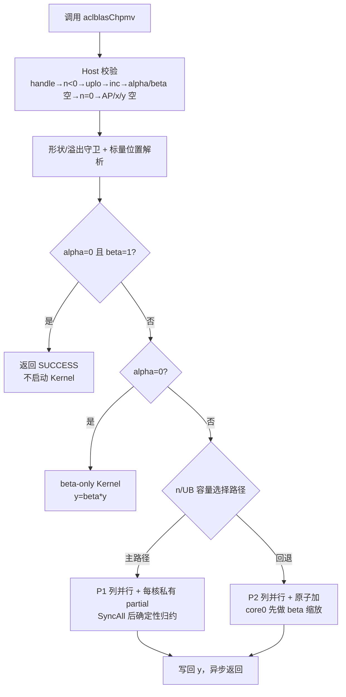

# aclblasChpmv（A2/A3）算子设计文档

> 范围说明：本 PR 仅提交设计文档，不含算子实现与测试代码。设计依据任务方《aclblasChpmv_AtlasA2_A3 任务书》与 `ops-blas @ 252d42d6` 源码；实现代码按 ops-blas 仓流程单独提交，文档不声称精度/性能已实测达标。

# 需求背景（required）

## 需求来源

- 任务：11 月社区任务-aclblasChpmv 算子开发（A2/A3），含税奖金 8175 元，最晚验收 2026-12-07。
- 依据：任务书 §2.1~§2.5（功能、接口、参数、校验顺序）与 §3.2~§3.5（精度、性能、自验口径），配套 `test_cases/`（精度全量 1000 条、性能子集 200 条）。
- 目标仓：[cann/ops-blas](https://gitcode.com/cann/ops-blas)。实现代码入 `blas/spmv/arch22/`，测试代码入 `test/spmv/chpmv/arch22/`。
- 硬件：Atlas A2/A3（arch22，DAV_2201）；CANN 9.1.0；精度 golden 由 Netlib CBLAS 3.10.0 生成。

## 背景介绍

### 算子功能与工程现状

`aclblasChpmv` 计算单精度复数 Hermitian 压缩矩阵与向量的乘加：

```text
y := alpha * A * x + beta * y
```

- `A` 为 n×n Hermitian 矩阵，按列主序逐列无间隙 packed 存储 `uplo` 指定三角，共 `n(n+1)/2` 个 `aclblasComplex`（实部/虚部各 FP32），无 `lda`。
- 未存储的另一半由共轭对称确定：`A(i,j)=conj(A(j,i))`；对角元素只引用实部，虚部不参与计算。
- `x`、`y` 为逻辑长度 n 的复数向量，`incx/incy` 可为任意非零整数（含负步长，负步长按反向遍历语义）；`y` 原地覆写。
- 对标接口为 cuBLAS `cublasChpmv`，数值与边界语义参考 Netlib `chpmv.f`。

以 `ops-blas @ 252d42d6`（2026-11-25）为基线：

| 能力 | arch35（950PR/DT） | arch22（A2/A3） | 本任务 |
|---|---|---|---|
| 公共声明 | `include/cann_ops_blas.h` L161 已声明 | 共用同一头文件 | **无需修改** |
| 复数乘加实现 | `blas/spmv/arch35/chpmv_host.cpp`、`chpmv_kernel.cpp`、`chpmv_tiling_data.h` | 无 | 新增 arch22 |
| 同族实数实现 | arch35 `sspmv` | `blas/spmv/arch22/sspmv_host.cpp`、`sspmv_kernel.cpp`、`sspmv_tiling_data.h` | 复用 AIV 流水、packed 寻址、原子加回退 |
| 复数 AIV 先例 | — | `blas/gbmv/arch22/cgbmv_*`、`blas/gemv/arch22/cgemv_*`、`blas/dot/arch22/cdot_kernel.cpp` | 复用复数平面化与多路径 |
| 产品支持表 | 支持 | **不支持**（`blas/spmv/README.md`） | 本任务补齐并更新 README |
| 测试资产 | `test/spmv/chpmv/arch35/`：golden、param、1200 条 CSV | 无 arch22 注册 | 新增 arch22 GTest 与注册 |

### 标杆核查

| 审核对象 | 结论 | 依据 |
|---|---|---|
| 原 TBE 算子源码 | 不适用 | handle 式 BLAS 接口，不涉及 ACLNN/TBE 迁移 |
| 算子信息库 JSON | 不适用 | 不注册 ACLNN 算子 |
| 可复用工程实现 | 适用 | arch35 `chpmv_*`（语义金标准、有序归约）、arch22 `sspmv_*`（AIV 流水、packed 寻址、原子加）、arch22 `cgbmv/cgemv`（复数平面化与路径选择） |

### 现状差距

1. arch35 为 SIMT 实现（256/1024 线程、warp 内有序规约、SIMT+SIMD 混合暂存），**arch22 无 SIMT**，不能直接移植，需改写为 AIV dataflow。
2. arch22 `sspmv` 把数据视为一维、固定 `numBlocks=8`、`maxDataCount=30KB/4`，用 GM 原子加回写 `y`；复数元素 8B，UB 预算与 tile 需按 2 倍元素宽度重算。
3. arch22 `sspmv` 校验顺序为 `uplo → handle → n≤0 → inc → 指针 → alpha`，并且不校验标量位置；本任务按任务书口径重排，空 handle 优先、`n=0` 不豁免结构校验。
4. `sspmv` 的原子加路径在跨核累加时顺序不确定；本设计为主路径提供确定性归约，原子加仅作大 n 回退。

# 需求分析（required）

## 需求描述

在 CANN 9.1.0、Atlas A2/A3 上实现与 cuBLAS/Netlib 语义一致的 `aclblasChpmv`：COMPLEX64、packed 存储、原地更新 `y`、UPPER/LOWER、正负步长、`n=0`／零 alpha／零 beta 边界；精度满足 COMPLEX64（FP32 分量）混合容差，性能达到 GPU kernel 基线的 0.8 倍以上。

## 接口定义

接口声明已存在于 `include/cann_ops_blas.h`（L161），本任务不新增/不修改声明：

```cpp
aclblasStatus_t aclblasChpmv(
    aclblasHandle_t handle,
    aclblasFillMode_t uplo,
    int n,
    const aclblasComplex* alpha,
    const aclblasComplex* AP,
    const aclblasComplex* x, int incx,
    const aclblasComplex* beta,
    aclblasComplex* y, int incy);
```

返回值：`aclblasStatus_t`；成功为 `ACLBLAS_STATUS_SUCCESS`，非法枚举 `INVALID_ENUM`，其余结构参数非法 `INVALID_VALUE`，空句柄 `HANDLE_IS_NULLPTR`。

## 需求拆解

1. **功能**：`y_i = beta·y_i + alpha·Σ_j A(i,j)·x_j`；存储侧直接读 `AP`，镜像侧取共轭；`i==j` 只取 `AP` 实部。
2. **数据类型**：`alpha`、`beta`、`AP`、`x`、`y` 全部为 `aclblasComplex`（re/im 各 FP32）；不支持 half/bf16/双精度扩展。
3. **形状**：`n ≥ 0`；`AP` 元素数 `n(n+1)/2`；`x/y` 物理元素数 `1+(n-1)·|inc|`；全程 `uint64/int64`，并校验字节数不超 `size_t`。
4. **边界**：`n=0` 合法 no-op 但不豁免结构参数校验；`alpha=(0,0) && beta=(1,0)` quick return；`alpha=(0,0) && beta≠1` 只做 `y=beta·y`；`beta=(0,0)` 不读 `y` 旧值。
5. **步长**：`incx/incy` 任意非零整数；负步长从物理分配起点反向遍历；`INT_MIN` 因长度溢出在守卫层拒绝。
6. **校验**：严格按任务书 §2.5 顺序；非法枚举返回 `INVALID_ENUM`，其余结构参数非法返回 `INVALID_VALUE`，空句柄返回 `HANDLE_IS_NULLPTR`。
7. **精度**：golden 由 `cblas_chpmv`（CblasColMajor）生成，实部/虚部分别比对；FLOAT32 分量取 `rtol=atol=2^-13`、`matched_ratio≥0.99`、`max_abs≤1e-2`。
8. **性能**：`msprof op` 采集 kernel `Task Duration`，warmup 5 次 + 连续 10 次取均值，NPU ≤ GPU `gpu_ms`×1.25（即 ≥0.8× GPU kernel 性能）。
9. **交付**：设计文档 PR、arch22 实现、1000 条精度用例与 200 条性能用例自测报告、README 支持矩阵更新。

# 详细设计（required）

## 算子分析

### 数学公式

设 `A` Hermitian，`A(j,i)=conj(A(i,j))`，`A(i,i)∈R`。按行展开：

```text
y_i = beta*y_i + alpha * [ Σ_{(i,j) 已存储} A(i,j)*x_j
                        + Σ_{(i,j) 未存储} conj(A(j,i))*x_j ]
```

packed 下标（0 基，列主序）：

```text
列基址：UPPER C(j)=j*(j+1)/2，列长 j+1，存行 0..j
        LOWER L(j)=j*(2n-j+1)/2，列长 n-j，存行 j..n-1
UPPER (i<=j): idx(i,j)=C(j)+i
LOWER (i>=j): idx(i,j)=L(j)+(i-j)
```

对角项：

```text
A(i,i) = Re(AP[idx(i,i)])        # 虚部不引用
```

### 支持数据类型

| 参数 | 类型 | 位置 | 说明 |
|---|---|---|---|
| `handle` | 句柄 | Host | 携带 stream |
| `uplo`、`n`、`incx`、`incy` | 标量 | Host | `inc != 0` |
| `alpha`、`beta` | COMPLEX64 | Host/Device | Host 直接读取；Device 各经一次 D2H + stream 同步解析 |
| `AP` | COMPLEX64 | Device（只读） | packed，长度 `n(n+1)/2` |
| `x` | COMPLEX64 | Device（只读） | 物理长度 `1+(n-1)·|incx|` |
| `y` | COMPLEX64 | Device（读写） | 原地覆写，物理长度 `1+(n-1)·|incy|` |

### 支持形状

- `n ≥ 0`；`n(n+1)/2` 与 `1+(n-1)·|inc|` 用 `uint64/int64` 计算，并校验字节数不超 `size_t`。
- 主路径（确定性归约）要求 `x` 与每核 partial 常驻 UB：`2·n·8B（x） + 2·n·8B（partial） ≤ UB 预算`，覆盖任务书 n ≤ 8192 的全部用例。
- `n > 8192` 走列并行 + 原子加回退路径，不要求整向量常驻 UB。
- 负步长物理起点 `(1-n)·inc`（`int64`）；`INT_MIN` 的 `|inc|=2^31` 会触发长度/字节守卫，返回 `INVALID_VALUE`。

## 算子实现

### 实现方案

#### 3.2.0 整体执行流程图



#### 3.2.1 Host 侧设计

**参数校验顺序（严格按任务书 §2.5）**：

| 顺序 | 检查 | 返回 |
|---|---|---|
| 1 | `handle == nullptr` | `HANDLE_IS_NULLPTR` |
| 2 | `n < 0` | `INVALID_VALUE` |
| 3 | `uplo ∉ {UPPER, LOWER}` | `INVALID_ENUM` |
| 4 | `incx == 0 \|\| incy == 0` | `INVALID_VALUE` |
| 5 | `alpha == nullptr \|\| beta == nullptr` | `INVALID_VALUE` |
| 6 | `n == 0`（结构参数已校验） | `SUCCESS`，不引用 tensor、不启动 |
| 7 | `AP/x/y` 任一为空 | `INVALID_VALUE` |
| 8 | 长度/字节溢出守卫（`uint64`） | `INVALID_VALUE` |
| 9 | `alpha=(0,0) && beta=(1,0)`（标量值已解析） | `SUCCESS` |
| 10 | 计算 Tiling、单次启动 | `SUCCESS`（异步） |

> `n=0` 只豁免 `AP/x/y` 指针校验与 kernel 启动，不豁免 handle/n/uplo/inc/alpha/beta 校验。`alpha/beta` 指针判空先于 `n=0`，与任务书一致。

**标量位置处理**：

- `CheckPtrLocation` 分别探测 `alpha`、`beta`；Host 直接解引用，Device 走 `aclrtMemcpyAsync` D2H + 同步 stream。
- 仅在进入第 9 步后解析标量值；`n=0`、结构错误路径不触发同步。
- `alpha` 与 `beta` 允许各自位于 Host 或 Device；两者都为 Device 时分别发起 D2H 拷贝，随后合并为一次 stream 同步，减少同步次数。

**Tiling 字段**：

| 字段 | 含义 |
|---|---|
| `n`、`uplo` | 规模与存储三角 |
| `alphaReal/Imag`、`betaReal/Imag` | 解析后的复数标量 |
| `incx/incy`、`xStart/yStart` | 步长与负步长物理起点 |
| `packedLength` | `n(n+1)/2`（`uint64`） |
| `path` | 0=beta-only，1=P1 确定性归约，2=P2 原子加 |
| `usedCoreNum` | 实际 AIV 核数 |
| `slabElems` | 单次 AP slab 元素数 |
| `wsPartialOffset` | 每核 partial 在 workspace 的偏移（P1） |
| `coreColumnBegin/End` | 每核负责的列区间（`int64`，避免列号乘法溢出） |

**分核策略**：

- **P1（n ≤ 8192）**：`blocks = min(GetAivCoreCount(), n)`；按列区间 `[c0,c1)` 连续划分，划分点按“累计工作量 ≈ 总量/核数”选取（UPPER 列 j 工作量 `j+1`，LOWER 为 `n-j`），保证列数不均衡时仍负载均衡。
- **P2（n > 8192）**：`blocks = min(GetAivCoreCount(), n)`，列区间均匀划分；`core 0` 先完成 `y=beta*y`，`SyncAll` 后各核原子加列贡献。
- **beta-only**：`blocks = min(GetAivCoreCount(), ceil(n·2/UB_TILE))`，仅做 `y=beta*y`。

**UB 预算（184 KiB 口径，P1）**：

| 缓冲 | 规格（n=8192） | 字节 |
|---|---|---|
| `x` packed（平面化） | 2×8192×4B | 64 KiB |
| `y` partial（每核私有，UB 常驻） | 2×8192×4B | 64 KiB |
| AP slab × 2（双缓冲） | 1024 复数 × 8B × 2 | 16 KiB |
| 计算临时（乘积/归约） | 1024×4B×6 | 24 KiB |
| 对齐/尾块余量 | — | ≤ 8 KiB |
| 合计 | — | ≤ 176 KiB < 184 KiB |

n 较小时按实际长度收缩；P1 若 UB 预算不足（平台 UB 配置差异），Host 侧自动降级到 P2。

#### 3.2.2 Kernel 侧设计

**P1：列并行 + 私有 partial + 确定性归约（主路径）**

1. **向量打包**：`x` 按 `|inc|` 打包并平面化到 UB，`inc==1/-1` 用连续 `DataCopy`，跨步用“稠密跨度 + `Gather`”，超跨度退化为标量打包；本核 partial 初始化为 0，不在列处理阶段读取 `y`。
2. **列处理**：本核按列区间逐列处理。固定列 j 时 `x_j` 为标量：
   - 存储侧 `A(i,j)` 连续（UPPER 行 0..j，LOWER 行 j..n-1），向量化做
     `partial[i] += alpha * A(i,j) * x_j`；
   - 对角 `i==j` 只取 `real(AP)`；
   - 镜像侧对 `y_j` 的贡献为列内点积
     `partial[j] += alpha * Σ conj(A(i,j)) * x_i`（UPPER 取行 0..j-1，LOWER 取行 j+1..n-1），用 `ReduceSum` 完成。
3. **partial 落盘**：所有列处理完后，每核将 UB partial 写到 workspace 的私有区 `ws[core]`（n 复数）。
4. **同步**：`SyncAll()` 保证所有核 partial 写完（`sspmv` 已使用同一同步原语）。
5. **确定性归约**：按固定核序 `core=0..C-1` 逐元素累加 partial，再按 `y_i = beta·y_i + sum_i` 写回 `y` 的物理位置（含负步长映射）。归约顺序固定，同输入结果逐位可复现。
6. **beta 语义**：归约阶段只做一次 `y_i = beta·y_i + Σ_core partial[core][i]`；`beta=0` 不读旧 `y`，`beta=1` 直接与旧 `y` 相加。`beta` 不在各核 partial 中重复缩放，避免 `C` 次累加把 `beta·y` 放大 `C` 倍。

> 归约由部分核并行完成（按行区间切分），每个输出元素仍只由一个核写一次；跨核只读 workspace，不需要原子操作。

**P2：列并行 + 原子加（大 n 回退）**

1. `core 0` 对 `y` 的逻辑 n 个元素做 `y=beta*y`（`beta=0` 直接置 0，不读旧值），其余核等待 `SyncAll`。
2. 各核按列区间处理，`alpha*x_j*A(i,j)` 与镜像点积结果用 `SetAtomicAdd<float>()` 累加到 `y` 物理地址；`SetAtomicNone()` 收尾。
3. 原子加顺序由调度决定，同输入不保证逐位一致；任务书 §2.5 明确不要求确定性，精度按容差判定。
4. 该路径沿用 `sspmv` 的 8 核/50 核上限与 slab 预算，`slabElems` 按复数 8B 减半。

**P0：beta-only**

- `alpha=0 && beta≠1`：单 kernel 对 `y` 的 n 个逻辑元素做 `y=beta*y`，不读 `AP/x`；`beta=0` 不读旧 `y`。
- `n=0` 与 `alpha=0 && beta=1` 在 Host 短路，不启动。

**复数乘加舍入口径**：

- 复数乘法展开为 4 个实数乘积分别舍入，再做加减；不使用把整体收缩为 FMA 的写法。
- 列内点积用 `ReduceSum`，归约树固定；P1 的跨核归约顺序固定。
- 对角只取实部，避免 `0×Inf/NaN` 污染虚部（对角虚部本来就不引用）。

#### 3.2.3 算子泛化设计

- **n=0**：Host 短路。
- **n=1**：仅 `y_0 = beta*y_0 + alpha*Re(AP0)*x_0`。
- **正负步长**：逻辑 k → 物理 `start+k·inc`；负步长 `start=(1-n)·inc`。
- **零 alpha**：`beta=1` quick return；否则 beta-only。
- **零 beta**：不读 `y` 旧值，partial 初值为 0。
- **特殊值**：Inf/NaN 按 IEEE 传播；对角虚部忽略；测试包含 `alpha=0` 且 `x` 为 NaN 的 quick return 用例。
- **原地**：`y` 与 `x/AP` 不得重叠，调用方保证。

#### 3.2.4 Hermitian 与复数专项

- **共轭方向**：镜像侧 `conj(A(i,j))` 只对虚部取负；平面化后直接对 `Ai` 平面做 `Muls(-1)`。
- **对角只取实部**：`A(j,j)` 读 `AP[2·idx]`，不读虚部，避免输入虚部为垃圾值时污染结果。
- **与 arch35 差异**：arch35 每行有序扫描两段（存储侧 + 共轭侧），arch22 列并行改写归约顺序；两者数学等价，浮点顺序不同，按任务书容差判定。
- **确定性**：P1 无原子、无动态调度，同 tiling 下逐位可复现；P2 明确标注非确定。

### 数据检测

- 空 handle、负 n、非法 uplo、零步长、空 alpha/beta、空 AP/x/y：按上表返回。
- 长度/字节溢出、`INT_MIN` 导致的溢出：`INVALID_VALUE`。
- 零 alpha 且 `x` 含 NaN：quick return 不读 `x`，结果 `y` 不变。
- `alpha=0 && beta≠1`：只做 beta 缩放，`AP/x` 可为未初始化。
- `n=0` 叠加非法 uplo/inc/alpha 空：返回对应结构错误，不因 `n=0` 豁免。

### 支持硬件

| 芯片版本 | 勾选 |
|---|---|
| Atlas A2 训练/推理系列 | √ |
| Atlas A3 训练/推理系列 | √ |
| Ascend 950PR/DT（arch35 既有） | 不改动 |

### 算子约束限制

- 不支持广播；`y` 原地覆写，`y` 与 `AP/x` 不得重叠。
- `alpha/beta` 支持 Host/Device 指针；Device 标量引入一次 stream 同步（n>0 时）。
- 仅支持列主序 packed 布局，不支持任意非连续 Tensor。
- P1 的 n 上限由 UB 容量决定（覆盖任务书 n ≤ 8192）；更大 n 自动走 P2。
- P2 不保证逐位确定性；P1 在相同 tiling 下确定性。

# 可维可测分析

## 精度标准/性能标准

| 验收标准 | 描述 | 标准来源 |
|---|---|---|
| 精度 | COMPLEX64 实部/虚部分别按 FP32：`rtol=atol=2^-13`，`matched_ratio≥0.99`，`max_abs≤1e-2`；golden 为 `cblas_chpmv` | 任务书 §3.2 |
| 性能 | `msprof op` kernel `Task Duration`，warmup 5 + 10 次均值 ≤ GPU `gpu_ms`×1.25 | 任务书 §3.3 |
| 交叉验证 | `verify_performance.py` 的 `TC_PF` 事件计时仅作趋势，不作正式判据 | 任务书 §3.3 |

## 测试用例规划

复用任务书 `test_cases/` 与 arch35 `chpmv_test.csv`，arch22 新增 GTest 注册：

| 类别 | 条数 | n 范围 | 覆盖点 |
|---|---|---|---|
| `basic` | 4 | 4–8 | UPPER/LOWER 冒烟 |
| `ex` | 800 | 1–4096 | 常规形状、两三角 |
| `pf` | 200 | 1–8192 | 性能基线（覆盖 P1 上限） |
| `sq` | 46 | 1–4096 | 方阵边界 |
| `inc` | 72 | 16–64 | ±1/±2/±3 与大步长 |
| `cv` | 16 | 10–400 | 共轭方向正确性 |
| `alpha` | 16 | 32 | alpha/beta 的 0/1/±1e4/一般复数 |
| `beta0` | 12 | 32 | `beta=0` 不读旧 y、NaN 输入 |
| `n0` | 8 | 0 | 空矩阵 + n=0 结构校验 |
| `null` | 4 | 16 | 空指针 |
| `neg` | 2 | -1 | 负 n |
| `alpha0` | 8 | 32 | 零 alpha（beta=1 快返回 / beta≠1 缩放） |
| 其他边界 | 12 | — | 非法 uplo、零步长、大 n、对角虚部非零 |

预期：约 1186 条 SUCCESS、14 条 `INVALID_VALUE`；性能子集覆盖 UPPER/LOWER、正负步长与小/中/大三档规模，并单独统计 P1/P2 两条路径。

## 兼容性分析

- 新增 arch22 实现，不改公共头与 arch35 行为。
- 更新 `blas/spmv/README.md` 的 A2/A3 支持矩阵与 `test/spmv/chpmv/CMakeLists.txt` 的 arch22 目标。
- 保持 `include/cann_ops_blas.h` L161 声明不变，不新增私有 API。
- 与 `sspmv` 共用 AIV 脚手架时保持其现有行为不变，仅新增复数实例化。

## 风险与降级预案

| 风险 | 影响 | 预案 |
|---|---|---|
| P1 workspace 归约增加一次 GM 往返 | 大 n 性能下降 | partial 仅 `C×n×8B`（n=8192、C=48 约 3 MB），相对 `n²/2` 计算量可忽略；实测不足再评估行块化 |
| UB 预算在低配平台不足 | P1 无法启动 | Host 侧按实测 UB 自动降级 P2；两条路径共用 tiling 校验 |
| P2 原子加非确定 | 复现性争议 | 任务书不要求确定性；P1 覆盖全部验收规模，P2 仅兜底 |
| 列区间按工作量划分计算成本 | Host 侧 O(核数) 求解 | 用前缀和 + 二分，`n ≤ 8192` 时开销可忽略 |
| 负步长地址溢出 | 越界访问 | `int64` 起点 + `uint64` 长度双重守卫 |
| 对角虚部为垃圾值 | 结果污染 | 对角只读实部，不读虚部 |
| beta 语义分支多 | 结果偏差 | 逐分支用例：beta=0/1/一般值 + 旧 y 含 NaN |

## 附录：修订记录

| 日期 | 版本 | 说明 |
|---|---|---|
| 2026-11-26 | v1.0 | 依据任务书与 `ops-blas @ 252d42d6` 完成设计；主路径采用列并行 + 私有 partial 的确定性归约，原子加仅作大 n 回退 |
