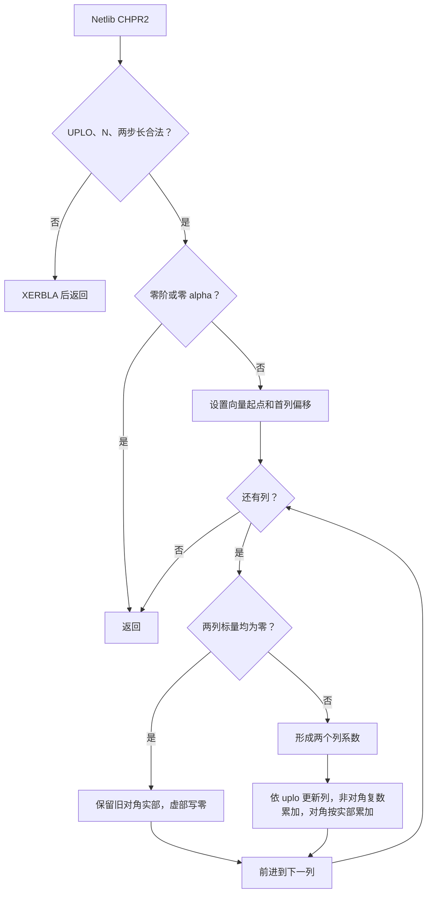
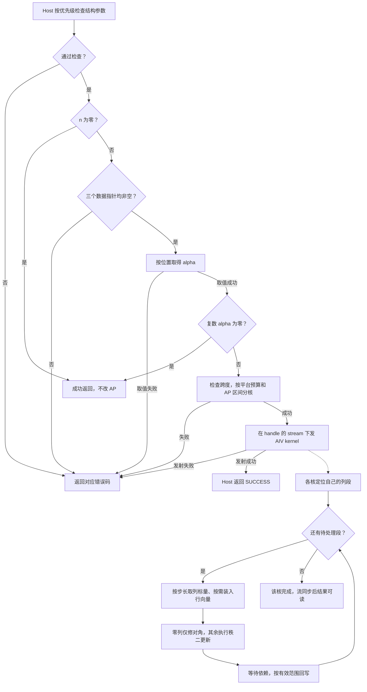

# 一、需求背景

## 1.1 需求来源

11 月社区任务要求在 Atlas A2/A3 上通过 ops-blas 实现 `aclblasChpr2`，对齐 cuBLAS 的单精度复数 Hermitian 压缩秩二更新。交付范围为一个公开接口、两种三角存储方向和对应的 arch22 测试。正式任务书为 `aclblasChpr2_AtlasA2_A3_task_doc.md`，附件 ZIP 的 SHA-256 为 `aa7244b8284cef52a79ad050ba9044b12a61adcf0f0b131989cc9ea82b95a194`。[任务中心](https://www.hiascend.com/activities/task-center/details/7a1275ee6b654459957fc27c8dde32b0) · [正式任务书及测试附件](https://www.hiascend.com/p/resource/202611/f53c06f0f5424111989b19e7f12fe444.zip)

## 1.2 背景介绍

HPR2 将两个共轭转置的秩一贡献累加到 Hermitian 矩阵。只存一侧三角即可恢复整个矩阵，因而读写规模为 `P = n(n+1)/2` 个复数。若把 AP 当成有行距的矩形，会从第二列起错读或覆盖相邻列。

### 1.2.1 aclblasChpr2 实现优化

任务书编写时以 arch35 为参考并要求补齐 arch22。核对 ops-blas 固定提交 `187d56dafbd373cb32e0a032bf4d7dc883bfcdf0`，两个架构均已有实现。arch22 的 `aclblasChpr2` 已使用 handle 上的 stream，以 `chpr2_kernel_do` 直调 AIV kernel。现有 Host 在校验 handle 和 n 后立即对零阶返回成功，非法 uplo 返回 `INVALID_VALUE`，并在 Host 解引用 alpha。本设计在既有 arch22 入口补齐任务书的校验、Device 标量和验收数据路径。该调用链没有 TBE 算子文件、图算子信息库或 ACLNN executor。[arch22 Host](https://gitcode.com/cann/ops-blas/blob/187d56dafbd373cb32e0a032bf4d7dc883bfcdf0/blas/spr2/arch22/chpr2_host.cpp) · [arch22 kernel](https://gitcode.com/cann/ops-blas/blob/187d56dafbd373cb32e0a032bf4d7dc883bfcdf0/blas/spr2/arch22/chpr2_kernel.cpp) · [arch35 Host](https://gitcode.com/cann/ops-blas/blob/187d56dafbd373cb32e0a032bf4d7dc883bfcdf0/blas/spr2/arch35/chpr2_host.cpp)

### 1.2.2 标杆算子现状分析

接口与 GPU 计时标杆为 `cublasChpr2`，CPU 数值标杆为 Netlib BLAS 3.10.0 的 `cblas_chpr2`。下图按可读的 Netlib 参考源码绘制，cuBLAS 只取公开契约及附件提供的 kernel 耗时。[cuBLAS HPR2](https://docs.nvidia.com/cuda/cublas/index.html#cublas-t-hpr2) · [Netlib 3.10.0 参考源码](https://github.com/Reference-LAPACK/lapack/blob/aa631b4b4bd13f6ae2dbab9ae9da209e1e05b0fc/BLAS/SRC/chpr2.f)

#### 1.2.2.1 标杆支持的数据类型和数据格式

| 对象 | 表示与位置 | 长度与访问 |
| --- | --- | --- |
| alpha | complex64 标量，Host 或 Device | 1 个复数，只读 |
| x、y | Device 上实部、虚部交错的 complex64 一维向量 | 逻辑长度均为 n，步长各自以复数元素计 |
| AP | Device 上连续的 complex64 一维缓冲区 | 列主序 packed，原地读写 P 个元素，隐含另一侧共轭三角 |

#### 1.2.2.2 标杆算子实现描述

Netlib 检查 `UPLO/N/INCX/INCY`，非法参数交给 `XERBLA`。零阶或复数 alpha 为零时直接返回。其余情形依步长计算两路向量起点，逐列前进。若当前列的 `xj` 与 `yj` 均为复零，只清该列对角虚部；否则预计算 `p = alpha·conj(yj)` 和 `q = conj(alpha·xj)`。非对角处依次加上 `xi·p`、`yi·q`。对角处取旧 AP 实部，加上两个乘积之和的实部，作为实数写回。上三角的对角在列尾，下三角在列首。此分支顺序也决定含零和 NaN 的参考结果。[CHPR2 列循环](https://github.com/Reference-LAPACK/lapack/blob/aa631b4b4bd13f6ae2dbab9ae9da209e1e05b0fc/BLAS/SRC/chpr2.f#L181)

#### 1.2.2.3 标杆算子实现流程图



# 二、需求分析

## 2.1 外部组件依赖

目标运行环境为 CANN 9.1.0。AscendCL 提供设备、地址属性及流，Ascend C 提供 AIV 计算和 GM 与 UB 间搬运。精度自验通过 ops-blas ATK/GTest 调用 CPU Netlib CBLAS 3.10.0，性能自验通过 `msprof op` 采集 NPU kernel。GPU 侧仅使用附件中同参数的 cuBLAS kernel 基线。

## 2.2 内部适配模块

| 固定提交中的模块 | 已有能力 | arch22 拟适配内容 |
| --- | --- | --- |
| `include/cann_ops_blas.h`、`include/cann_ops_blas_common.h` | 公共声明、复数结构、fill 枚举及状态码 | 复用现有 ABI |
| `blas/spr2/arch22/chpr2_host.cpp`、`chpr2_tiling_data.h` | 参数检查、取核数、按值下发 tiling | 重排检查顺序，解析标量位置，计算分核与 UB 预算 |
| `blas/spr2/arch22/chpr2_kernel.h`、`chpr2_kernel.cpp` | 直调入口、向量步长取数、复数乘加、对角回写 | 复用算术路径，按 packed 区间分配写者，按有效长度搬运 |
| `test/spr2/chpr2/` | 公用 `chpr2_param.h`、`chpr2_golden.h` 及 arch22 测试 | 装载任务包用例，补齐填充、Device 标量和逐例计时 |

公共类型及 golden 的定义可分别从以下文件核查。[公共定义](https://gitcode.com/cann/ops-blas/blob/187d56dafbd373cb32e0a032bf4d7dc883bfcdf0/include/cann_ops_blas_common.h) · [现有 arch22 测试](https://gitcode.com/cann/ops-blas/blob/187d56dafbd373cb32e0a032bf4d7dc883bfcdf0/test/spr2/chpr2/arch22/chpr2_test.cpp) · [CBLAS golden](https://gitcode.com/cann/ops-blas/blob/187d56dafbd373cb32e0a032bf4d7dc883bfcdf0/test/spr2/chpr2/chpr2_golden.h)

## 2.3 需求模块设计

### 2.3.1 Ascend C 算子原型

```cpp
aclblasStatus_t aclblasChpr2(
    aclblasHandle_t handle, aclblasFillMode_t uplo, int n,
    const aclblasComplex* alpha,
    const aclblasComplex* x, int incx,
    const aclblasComplex* y, int incy,
    aclblasComplex* AP);
```

`aclblasComplex` 的两个字段依次为 FP32 的 `real`、`imag`，每元素 8 字节。n、incx、incy 使用公开签名中的 int，地址计算在内部扩宽。uplo 仅接受 `ACLBLAS_UPPER` 和 `ACLBLAS_LOWER`。AP 的旧值参加计算，输出仍是同一块 AP。调用结果以 `aclblasStatus_t` 返回。[公开声明](https://gitcode.com/cann/ops-blas/blob/187d56dafbd373cb32e0a032bf4d7dc883bfcdf0/include/cann_ops_blas.h#L515)

### 2.3.2 算子相关约束

以下按任务书 §2.4–2.5 顺序执行。表中状态省略统一前缀 `ACLBLAS_STATUS_`。首个命中的分支决定结果，任一参数错误均须在写 AP 前返回。

| 次序 | 条件 | 处理 |
| --- | --- | --- |
| 1 | handle 为空 | 返回 `HANDLE_IS_NULLPTR` |
| 2 | n < 0 | 返回 `INVALID_VALUE` |
| 3 | alpha 指针为空 | 返回 `INVALID_VALUE` |
| 4 | uplo 枚举非法 | 返回 `INVALID_ENUM`，区别于 cuBLAS 的枚举错误码 |
| 5 | incx 或 incy 为 0 或 `INT_MIN` | 返回 `INVALID_VALUE` |
| 6 | n = 0 | 返回 `SUCCESS`，允许 x、y、AP 为空，跳过所有数据读取和 kernel |
| 7 | n > 0 且 x、y、AP 任一个为空 | 返回 `INVALID_VALUE`，即使 alpha 数值为零也执行此项 |
| 8 | alpha 两分量都等于零（包括带符号零） | 返回 `SUCCESS`，不读 x、y 或 AP，不改对角线 |
| 9 | 需要更新 | 检查地址跨度可表示，完成 tiling 和流上下发；发射失败返回 `EXECUTION_FAILED` |

alpha 指针的有效位置仅在第 7 项通过后才需解析。Host 负责元数据，不扫描设备上的数值。调用方保证分配覆盖物理跨度，x、y 均只读，因此可以引用同一份输入。AP 的写区不得覆盖 x、y 的读区。任意视图、张量广播、0 维张量接口均不适用。

# 三、需求详细设计

## 3.1 调用方式

调用方创建 ops-blas handle，经 `aclblasSetStream` 绑定流，准备两路向量及目标 AP，调用现有公开符号。拟复用 `blas/common/helper/host_utils.h` 的 `ReadScalarFromHostOrDevice` 解析 alpha，arch22 的 Crot 已用该 helper 读取复数标量。它通过 `aclrtPointerGetAttributes` 区分地址位置，查询失败返回 `ACLBLAS_STATUS_INVALID_VALUE`。Host 标量在调用期间按值读出。[共享标量读取实现](https://gitcode.com/cann/ops-blas/blob/187d56dafbd373cb32e0a032bf4d7dc883bfcdf0/blas/common/helper/host_utils.h) · [arch22 调用先例](https://gitcode.com/cann/ops-blas/blob/187d56dafbd373cb32e0a032bf4d7dc883bfcdf0/blas/rot/arch22/crot_host.cpp)

对 Device 标量，先在绑定流上将 8 字节 alpha 拷入本次调用独占、满足运行时 D2H 要求的 Host 目标，再等待该流完成。这样能读到同流先前写入的值，并能在零标量时免发计算 kernel。此路径的 Host 等待包括该流此前的工作；拷贝或同步失败时传播 helper 的 `ACLBLAS_STATUS_INTERNAL_ERROR`。Host 暂存在拷贝结束前保持有效。分别测试普通 Host、页锁定 Host 和同流生成的 Device 标量。非零路径将两分量按值随 tiling 下发，计算 kernel 异步执行。调用方在读回 AP 或复用设备缓冲前同步绑定流或建立事件依赖。

## 3.2 需求总体设计

采用零基下标。令 `s(j)` 为列首的 packed 元素号，`lo(j)` 为该列第一行，列内偏移为 `i-lo(j)`。

| uplo | 行范围 | s(j) | A(i,j) 的偏移 | 对角位置 |
| --- | --- | --- | --- | --- |
| UPPER | 0 ≤ i ≤ j | j(j+1)/2 | s(j)+i | s(j)+j |
| LOWER | j ≤ i < n | j(2n−j+1)/2 | s(j)+i−j，即 i+j(2n−j−1)/2 | s(j) |

取哨兵 `s(n)=P`。例如 n=3，UPPER 顺序为 00、01、11、02、12、22，LOWER 为 00、10、20、11、21、22。没有 lda、转置选项、批数、指针数组或批间 element-stride；共轭转置由公式固定。运行时 n 决定容量，无需图编译时的动态 shape 描述。

### 3.2.1 Host 侧设计

对 n>0 的有效向量，跨度 `V(d)=1+(n−1)·abs(d)`，基址取分配区低地址，正步长时 `idx(k,d)=k·d`，负步长时 `idx(k,d)=(n−1−k)·abs(d)`。例如 n=3、incx=−2、incy=1 时，x 取 4、2、0，y 取 0、1、2。先提升到 64 位再取绝对值、加一或相乘，分别检查 P、V(incx)、V(incy) 与可寻址字节上限除以 8 的关系，再求字节偏移，避免有符号溢出或 `size_t` 回绕。参数不能表达实际分配长度，检查不能代替调用方的容量保证。

#### 3.2.1.1 分核策略

现有 kernel 将列按核数组成一轮，奇数轮反向分列，并在每个行 tile 中复用 x、y。拟比较一种按 AP 写出量均分的方案，解决短矩阵启动开销和尾轮长短列不均。Host 查询实际 AIV 核数 C。设 L 为在目标平台确认的独立写入粒度（字节），将 AP 的实际地址范围在 L 对齐且恰好位于复数边界的位置切分，首尾残段归相邻区间。把这些不可再分的区段按累计元素数划成至多 C 个连续组，近似等长，小问题可合成单组。可在第 k 个理想边界 `floor(k·P/B)` 附近对齐、去除重复边界；实现用商余分解避免 `k·P` 溢出。若地址与粒度无法形成安全内部切点则用单核，不能要求用户补齐 AP。

每核拥有半开区间 `[begin,end)`，用单调列首表的公式二分找到 begin 所在列，再逐列递增列首，不分配列首数组。首列或末列可以只含一段。每个 AP 元素只有一个写者，包括跨核分割列的对角；每核工作量以实际元素数计，额外开销为切分列的重复标量读取。

#### 3.2.1.2 数据分块和内存优化策略

核内按行 tile 与所属列段求交。令 T 为一块最多处理的逻辑行数，W 为跨步取数时最多暂存的物理复数数，B 为平台查询的单核 UB 可用字节。以已有交错向量计算实现为预算起点，模板参数 T=1024 时，8 个 float 数据/工作缓冲和 2 个 int32 索引缓冲各含 2112 项，另有 1024 项 int32 拆分索引和 64 项 float 标量区。显式用量为 `10×2112×4+1024×4+64×4=88832` 字节；启用 W=4096 的单个共用窗口另需 32768 字节。这些数字描述代码分配，不代表芯片容量。[既有 tiling 常量](https://gitcode.com/cann/ops-blas/blob/187d56dafbd373cb32e0a032bf4d7dc883bfcdf0/blas/spr2/arch22/chpr2_tiling_data.h) · [缓冲分配与事件](https://gitcode.com/cann/ops-blas/blob/187d56dafbd373cb32e0a032bf4d7dc883bfcdf0/blas/spr2/arch22/chpr2_kernel.cpp) · [arch22 UB 查询先例](https://gitcode.com/cann/ops-blas/blob/187d56dafbd373cb32e0a032bf4d7dc883bfcdf0/blas/iamin/arch22/icamin_host.cpp)

拟选取 T 为不超过 1024 的 32 的倍数，交错缓冲项数 `F=roundUp(2T+64,64)`，拆分工作区的第二平面从 T+8 项开始，保留向量对齐和尾部空间。按 `10·4F+4T+256+8W+R ≤ B` 选择 T、W，R 包含对齐、运行时预留和其他实占；单位步长可令 W=0。优先单缓冲，若尝试把搬入与计算重叠，则将新增槽的对齐后字节逐项计入预算，约束不满足时缩小 T 或 W。所有向量调用的 mask、有效元素数及 repeat 上限随 T 核对，UB 内的补位不得扩大 GM 访问长度。

单次调用的 Device GM 数据容量为 `8·(P+V(incx)+V(incy))` 字节（按独立分配计），无需展开全矩阵或分配归约空间。计算路径额外 GM workspace 为 0。UB 仅在当前 kernel 内存活；Device 标量的 8 字节 Host 暂存由当前调用管理，和 handle 默认 workspace 分开。

#### 3.2.1.3 tilingKey 规划策略

现有直调入口按值传递 `Chpr2TilingData`，其中有 n、uplo、numBlocks、alpha 的两个分量以及两路有符号步长。拟在内部传递选定的 T、W 及分界计算所需的对齐信息；Host 和 kernel 共享定义。分支依次由工作量（单核或多核）、uplo、两路独立步长决定。无需注册图引擎的 tilingKey，亦不把标量存储位置扩展为公共参数。

### 3.2.2 Kernel 侧设计

#### 3.2.2.1 Kernel 实现描述

1. 在核的 packed 区间内枚举有交集的列和行 tile。对列 j，取 xj、yj，能命中本地 tile 时复用；两者均为复零时跳过非对角更新，若本段拥有对角，将其虚部清零。这一分支防止 `0·NaN` 改写参考实现保留的非对角元素。
2. 一般分支计算本列的 p、q。两路行向量分别选择搬运方式：步长 +1 时连续搬入；步长 −1 时正向读物理窗后逆序取数；其他步长下，m 个逻辑元素需覆盖 `1+(m−1)·abs(d)` 个物理位置。窗口适配 W 且搬入成本合适时连续读取并在 UB 抽取；跨度很大时按有效元素分段或逐个取 8 字节。窗口不得越出已声明的物理跨度。
3. 读入本列段的旧 AP。对非对角，复数 z 乘列系数 `r+it` 可以交错 FP32 向量 `(Re z, Im z)·r + (−Im z, Re z)·t` 计算。先做 x 的贡献，再加 y 的贡献。对角单独取旧实部，写 `(oldReal+Re(xj·p+yj·q), +0.0f)`。避免降为半精度，保留计算次序，尤其在抵消、极值和非有限数处不将两项重写为倍乘捷径。
4. 使用有效字节数读写列段，局部非对齐 lane 在 UB 内整理后按 `8·count` 写回 AP。核内用搬入完成事件约束向量/标量读取，向量完成后才执行对角修正，标量及向量写完成后才允许搬出；搬出完成前不能复用同一缓冲。各核各自完成所属区间，全过程无跨核归约、原子加或核间屏障。

#### 3.2.2.2 Ascend C 实现流程图



#### 3.2.2.3 与标杆流程的差异及原因

Netlib 对 AP 作单遍列扫描。AIV 将这些元素分给不同核，在 UB 中合并连续搬运和复数分量运算。列系数可以在不同核重复计算，每个输出元素的两项贡献仍由其所属核完成。Host 的空指针、错误码、标量位置和异步生命周期属于 ops-blas C 接口，CPU 标杆仅用于合法数值输入；负向用例依据任务书直接断言状态。

## 3.3 支持硬件

| 系列 | 适配与自验 |
| --- | --- |
| Atlas A2（含 Atlas 800T A2） | arch22，正式性能采集设备为 Atlas 800T A2（910B3） |
| Atlas A3（含 Atlas 800T A3） | arch22，按所选型号查询核数与 UB 并验证同一接口 |

任务书允许自验证覆盖一种款型，推荐精度选 910B3 或 A3，性能选 910B3。报告须写明实测型号及 CANN 9.1.0 环境。

## 3.4 算子约束限制

单次更新一个矩阵。AP 为连续 packed 区，步长只描述 x、y，`inc=0` 不能用作广播。输入通常为有限 FP32 分量，任务书另要求 Inf/NaN 特殊测试；非有限值属于数值待比对项，不触发 Host 全量扫描。允许测试注入非零甚至 NaN 的对角虚部，一般更新需忽略该输入分量，零阶或零 alpha 则逐字节保留原缓冲。计算无随机性，任务书按误差阈值验收，不承诺跨架构逐位相等。

# 四、特性交叉分析

| 交叉场景 | 设计与验证要点 |
| --- | --- |
| 空阶 × 多重错误 | `n=0, uplo=999, incx=0` 应先报枚举错；`n=-1, uplo=999` 应先报数值错；有效零阶允许三路数据指针同时为空 |
| 零 alpha × 写保护 | 叠加空 y 必须报错；叠加合法指针、NaN 向量、非零对角虚部须成功且 AP 逐字节相同 |
| 存储方向 × 跨步 | 两侧分别测试正负混合、同向反转和大步长，物理孔洞填哨兵。比较 x、y 全物理区及 AP 前后保护区，核对最后一列和首尾对角 |
| 不同流 × 原地输出 | 同一 AP 先后更新由同一流排序；并发写同一 AP 或跨流生成 alpha 时由调用方建立事件依赖。并发独立调用不得复用仍在途的标量暂存 |
| 平台 × 访存 | 以单位步长和大步长分别比较现有按列方案与 packed 等量分段。小 n 检查单核及索引初始化成本，大 n 检查 AP 带宽和行向量重复搬入。常规非零列至少读写 AP 各 8P 字节，用 `16P/时间` 辅助判断带宽，不将其用作验收时延 |

# 五、可维可测分析

## 5.1 精度标准/性能标准

**用例与输入。** 附件 `test_cases/chpr2_test.csv` 实有 1200 个不同名称，其中 1000 条为精度与边界用例（982 条期望成功、16 条 INVALID_VALUE、2 条 INVALID_ENUM），200 条为 `TC_PF`。精度类别 L0/SQ/AB/INC/ST/FL/CV/ED/EX 的实际条数依次为 4/68/16/72/8/18/16/29/769。覆盖上下三角、n=0、1、幂次前后和最高 4096、两向量 ±1/±2/±3 与抽样的大步长。固定 arch22 仓内 CSV 有 1002 条且没有 PF，用例清单以任务附件为准。4096 是附件覆盖上界，接口上界取决于 int、可寻址跨度与真实分配。[任务书与 CSV](https://www.hiascend.com/p/resource/202611/f53c06f0f5424111989b19e7f12fe444.zip) · [仓内测试 CSV](https://gitcode.com/cann/ops-blas/blob/187d56dafbd373cb32e0a032bf4d7dc883bfcdf0/test/spr2/chpr2/arch22/chpr2_test.csv)

随机输入按任务书的 50% 均匀分布于 [−5,5]、50% 标准正态 N(0,1)，实虚部分别采样，固定种子可重放。按填充列正确解析 `RANDOM_NORM_5_5`、`RANDOM_GAUSS_0_1` 和对角专用的 `RANDOM_DIAG_IMAG`，另测零、极值、交替值、正负 Inf 和 NaN。固定版 arch22 测试在均匀 token 路径交替取均匀和另一高斯生成器的结果；实施时须逐 token 验证分布，按实发清单记录随机类别，补齐 §3.5 的配比。附件 alpha 由离散常量或空指针构成，另补实虚部独立采样的固定种子标量。独立 fixture 覆盖空 handle、Host/Device alpha、零阶叠加非法 incy、零 alpha 叠加空 y；补测相同 x/y、保护区、列切点及尾段。附加用例不冲减附件的 1000/200 条。

**逐例精度。** 以同一份初始 AP 分别调用 `cblas_chpr2(CblasColMajor,...)` 和被测入口，同步后比较全部 P 个复数。实、虚部分开计算 `e=abs(actual−golden)`，有限点匹配条件为 `e ≤ 2⁻¹³ + 2⁻¹³·abs(golden)`。每个分量的匹配率至少 0.99，且有限点最大误差不超过 `max(0.01, 32·ULP(g))`，g 为该最大误差点的 FP32 golden。非有限点核对同位置 NaN 或同号 Inf，记录匹配与失配，特殊值不参与有限最大误差；无有限点时单独记录。对角虚部置零、只读区保护、空操作逐字节不变、预期错误码分别作强制断言。数值相消处保留最差点的 packed 偏移、行列、实虚分量、两路步长和种子。[任务指定的固定版精度标准](https://gitcode.com/cann/opbase/blob/28a1ce52ae856353589841226a0002af73314a6b/docs/zh/ops_precision_standard/mixed_tolerance_standard.md)

**逐例性能。** 200 个 PF 均固定 alpha=(1,0)，按归一化 `(uplo,n,incx,incy)` 与 `gpu_baseline.csv` 一一匹配。188 个双单位步长、9 个含正非单位步长、3 个含负步长，均有正数 `gpu_ms`。small ≤64 KiB、medium >64 KiB 且 ≤2 MiB、large >2 MiB；若以 AP 占用 8P 字节分档，实得 10/19/171 条。任务书未指定分档字节包含哪些操作数，报告需注明口径。附件给出的四个双单位步长实例可用于核对单位和映射。

| uplo | n | 附件 GPU kernel（ms） | NPU 平均上限（µs，GPU 值 × 1250） |
| --- | ---: | ---: | ---: |
| UPPER | 512 | 0.0206592 | 25.824 |
| LOWER | 1024 | 0.0491967 | 61.495875 |
| UPPER | 2048 | 0.1640791 | 205.098875 |
| LOWER | 4096 | 0.8605967 | 1075.745875 |

正式采集在 910B3 上使用 `msprof op`。逐例预热 5 次后连续取 10 个成功且完整的 kernel 样本，在 `OpBasicInfo.csv` 按 kernel、流及调用顺序提取 `Task Duration(us)` 算术平均。异常、缺样或关联不清均记录并补采；每例必须满足 `mean_us/1000 ≤ 1.25·gpu_ms`。GPU 基线采用 Host 标量、GPU kernel-only 口径。地址分配、AP 复位、拷贝和 golden 校验均在测量区间外，200 例分别判定。

**附件差异与报告口径。**

| 已核对的差异 | 验收处理 |
| --- | --- |
| README 把 ED 写为 28 条，将 `n0_incx_intmin` 注为 SUCCESS；生成器的零阶注释也早于结构校验 | CSV 有 29 条 ED，任务书 §2.5 和 CSV 对该例均要求 INVALID_VALUE。按正式顺序独立验证 |
| README 称基线为占位，生成器重新生成时确实写空耗时；发放 CSV 已回填 200 个值 | 保留原始基线与四字段键。生成器的 512 MiB 是 Host 用例选择预算，不是设备 UB 或算子内存验收阈值 |
| CSV 附 MERE 阈值 0.00012207031、MARE 倍率 10.0；`verify_accuracy.py` 仅解析 GTest 日志，零条匹配也可能以退出码 0 结束 | 分列保留工程诊断与 §3.2 混合容差结果。核对 1000 个唯一名称、预期状态及每例统计，缺例或无分量数据须调查 |
| `verify_performance.py` 优先在 arch35 目录找用例参数，解析 `[PERF] case=… avg_us=…`；有 NO_REF 的汇总也可能正常退出 | 明确使用 arch22 的附件参数清单，检查 200 个键完整。事件计时为预热 5 次后用 aclrtEvent 包围连续 10 次调用的均值，含下发影响，仅作回归；正式报告使用 msprof |
| §4 列出 cases.json、perf、inputs、golden、facts.json 等冻结产物；实发 ZIP 含任务书、图片、CSV、README 及 Python 工具 | 实施时按 §4 补齐可重现数据与版本清单，记录 case 参数、代码提交、设备和日志，附精度两分量与正式性能截图。§3.4 无独立内存指标，在报告中说明适用性 |

## 5.2 兼容性分析

公开签名、数据布局、原地语义和 stream 绑定方式沿用现有 ops-blas。对合法 Host 标量调用，沿用既有数值功能；对 Device 标量和多个同时非法的入参，以 §2.3.2 的顺序作为 arch22 回归契约。已有依赖旧零阶宽松校验或旧非法枚举状态的调用方须按任务书调整。验收时分别记录 A2/A3 的实际验证范围、CANN 与 BLAS 版本和生成用例的种子；本设计阶段无上板精度或时延结论。
