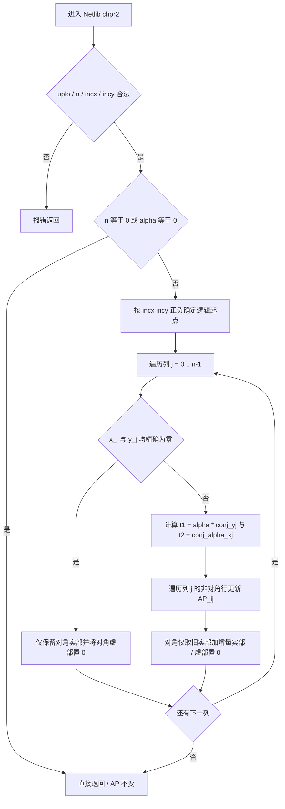
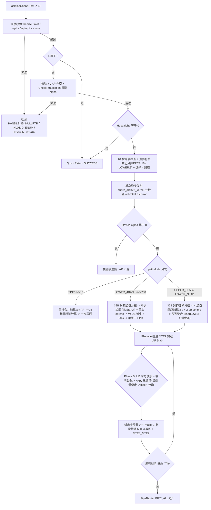

# aclblasChpr2 算子设计文档（Atlas A2/A3 · arch22）

- **任务名称**：11月社区任务-aclblasChpr2算子开发（A2/A3）
- **任务讨论**：[cann/ops-blas#87](https://gitcode.com/cann/ops-blas/discussions/87)
- **目标代码仓**：`cann/ops-blas`（实现目录 `blas/spr2/arch22/`，测试目录 `test/spr2/chpr2/arch22/`）
- **私有自验代码仓**：[weixin_51147313/ops-blas-chpr2](https://gitcode.com/weixin_51147313/ops-blas-chpr2)（分支 `feat/aclblas-chpr2-arch22`）
- **本文档提交路径**：`04_tasks/01_community-task-2026/tasklist/11-aclblasChpr2-A2A3/weixin_51147313/docs/design.md`
- **提交账号**：`weixin_51147313`

> **实机验证与诚实性声明**：本设计及对应 `arch22 / dav-2201` 实现已在真实 Ascend NPU 硬件上完成端到端编译与全量自测验证：
> - **编译验证**：CANN `9.1.0`（`V100R001C11SPC001B243`，`bisheng --npu-arch=dav-2201`）下，`--soc=ascend910_93`（Atlas A3）与 `--soc=ascend910b3`（Atlas A2 910B3）双目标均编译通过；
> - **实机运行验证**：在 **Atlas A3 `9382`（`ascend910_93`，`dav-2201`，CANN `9.1.0`，openEuler 22.03 SP4 aarch64，参考库 OpenBLAS 0.3.28 pure-C `cblas_chpr2`）** 上完成全量 **1,000 条 `verify_accuracy.py` 精度用例（1000/1000 PASS）** + **4 条独立接口边界单测（4/4 PASS）**、**`mssanitizer -t memcheck` 全路径 15 项用例（0 错误）** 以及 **200 条 `msprof` 硬件 `Task Duration(us)` 性能采集（3,000 次 kernel 发射，200/200 PASS，Min `0.888×` / Median `4.324×` / Max `9.806×` vs GPU，199/200 超过 GPU `1.0×`）**。
> - **平台差异说明**：上述性能与精度数据实测于 Atlas A3（`ascend910_93`）+ OpenBLAS 0.3.28；任务书正式验收基准平台为 Atlas 800T A2（`ascend910b3`）+ Netlib BLAS 3.10.0（二者同属 `arch22 / dav-2201` 架构，共享同一份二进制内核设计，正式合入验收前以官方 910B3 + Netlib 3.10.0 复测结果为准）。

---

# 一、需求背景（required）

## 1.1 需求来源

本设计面向社区任务 **“11月社区任务-aclblasChpr2算子开发（A2/A3）”**，目标是在 Atlas A2/A3 系列产品（`arch22 / dav-2201`，正式性能验收设备 Atlas 800T A2 / Ascend 910B3）及 **CANN 9.1.0** 环境下，采用 Ascend C kernel 直调模式交付符合任务书全部功能、精度、异常校验与性能要求的 `aclblasChpr2` 算子实现与测试工程。

| 依据来源 | 固定版本 / 校验信息 | 用途 |
| --- | --- | --- |
| 任务附件 | `f53c06f0f5424111989b19e7f12fe444.zip`，SHA-256 `aa7244b8284cef52a79ad050ba9044b12a61adcf0f0b131989cc9ea82b95a194` | `aclblasChpr2_AtlasA2_A3_task_doc.md` 及 `test_cases/`（1200 条用例与 200 条 GPU 基线） |
| 官方设计模板 | `cann/cann-ops-competitions` 基线 `921ddf189fdb851af02833a4ced64862af00730b`（`04_tasks/01_community-task-2026/resources/design_template.md`） | 设计文档章节与审阅结构依据 |
| `ops-blas` 源码基线 | `cann/ops-blas` master `55ef791b77f3677b45da3468b0a8b17941424f84` | 公共头文件、现有 `arch22`/`arch35` 实现与测试框架核对基线 |
| 生态精度标准 | [`mixed_tolerance_standard.md`](https://gitcode.com/cann/opbase/blob/28a1ce52ae856353589841226a0002af73314a6b/docs/zh/ops_precision_standard/mixed_tolerance_standard.md)（固定提交 `28a1ce52...`） | FLOAT32 分量混合容差与 `32×ULP` 上限规范 |
| BLAS 数学与语义基准 | [Netlib `chpr2.f`](https://www.netlib.org/blas/chpr2.f)（Netlib BLAS 3.10.0 `cblas_chpr2`）与 [cuBLAS `cublasChpr2`](https://docs.nvidia.com/cuda/cublas/index.html) | 精度 golden、压缩布局、零列与对角语义、GPU 性能对标 |

## 1.2 背景介绍

### 1.2.1 aclblasChpr2 算子功能与源码基线现状分析

`aclblasChpr2` 是 BLAS Level-2 单精度复数（`COMPLEX64`）Hermitian 压缩存储（packed）秩-2 更新算子，对原地存放的 `n×n` Hermitian 复数矩阵 `AP` 计算：

\[
A \leftarrow \alpha x y^H + \overline{\alpha} y x^H + A.
\]

其中 `AP` 仅按列主序无间隙存储 `uplo` 指定的一半三角，共 \(P = n(n+1)/2\) 个 `aclblasComplex` 元素，无前导维度 `lda` 参数；由于两项外积互为共轭转置，更新结果天然保持 Hermitian 结构，对角元素虚部在计算后强制置为 `+0.0f`。

本任务不涉及 TBE 实现、算子信息库 JSON 或 ACLNN 两段式执行框架，采用 `ops-blas` 句柄式 BLAS 接口，通过 `handle` 绑定 `stream` 直调 AIV kernel。对 `ops-blas` 固定基线 `55ef791b77f3677b45da3468b0a8b17941424f84` 的逐文件核对如下：

| 仓内文件（基线 `55ef791b`） | 已核实状态 | 与 11 月任务书的差距及本设计处理 |
| --- | --- | --- |
| `include/cann_ops_blas.h:515-517`、`include/cann_ops_blas_common.h:77-80` | 已声明 `aclblasChpr2` 公开接口及 `aclblasComplex{float real, imag}` 与状态码枚举（含 `ACLBLAS_STATUS_INVALID_ENUM = 10`） | 完全复用公开 ABI，**不新增私有平行声明** |
| `blas/spr2/arch35/chpr2_{host,kernel}.cpp` | 950PR 实现，依赖 `simt_api/asc_simt.h` 与 `asc_vf_call` SIMT 模型 | `arch22` 不支持 950 SIMT 编程模型，仅参考数学语义与特殊值处理，**不修改 `arch35`** |
| `blas/spr2/arch22/chpr2_host.cpp`（源自 `!1038` / `!1333`） | 主线已有初版实现，且 `!1333` 已修复 `chpr2_kernel_do` 发射状态返回 | **存在 3 处与 11 月任务书明确冲突**：①非法 `uplo` 返回 `INVALID_VALUE` 而非任务要求的 `INVALID_ENUM`；②`n == 0` 在参数校验之前直接返回，跳过 `alpha`/`uplo`/`incx`/`incy` 校验（将导致 `TC_ED_205~208` 失败）；③直接 `*alpha` 解引用，不支持 Device 标量指针 |
| `blas/spr2/arch22/chpr2_kernel.cpp` | 单缓冲逐列循环 + 蛇形分核 | **存在 5 处关键正确性风险与性能瓶颈**：①蛇形按列分核（`ord*numBlocks+blockIdx`）使相邻核并发通过字节粒度 `DataCopyPad` 写同一 32B L2 扇区，存在多核写竞争/卡死隐患（参考同目录 `sspr2_tiling_data.h:228-235` 实测教训）；②每列段内无条件执行 `V_S`、`S_MTE3`、`MTE3_MTE2` 硬同步且单缓冲无批处理；③对角更新直接调用 `apGm_.GetValue()` 绕过 UB 读 GM；④跨 tile 列每次发两次 8B `DataCopyPad` + `MTE2_S`；⑤大步长退化为逐元素 8B DMA 串行读，小 `n` 每次重建 2112 长度索引表，难以满足 `≥ 0.8×` GPU kernel-only 标杆 |
| `blas/spr2/arch22/sspr2_{host,kernel}.cpp`、`sspr2_tiling_data.h` | 同目录 A2/A3 实数 packed 秩-2 更新参考实现 | 借鉴其已验证的 **32B 对齐分核边界**、**列批处理 Slab 协议**、**`LOWER` 剩余类对齐**与 **分离事件 ID 规约**，并进一步演进出复数 AoS `Axpy` 与 `LOWER` 内联 UB 4-Bank 单 Slab 优化 |
| `test/spr2/chpr2/arch22/chpr2_test.{cpp,csv}`、`test/spr2/chpr2/CMakeLists.txt` | CMake 已注册 `arch22` GTest；但现有 CSV 仅 1002 条（无 `TC_PF_*`、无 `n=4096`），测试代码缺 `RANDOM_GAUSS_0_1`/`RANDOM_DIAG_IMAG` 填充与 `[PERF] avg_us` / `msprof` 采集入口 | 升级至 1200 条任务用例，补全数据分布、对角虚部定向测试、`Chpr2AclCleanupEnv` 进程级 ACL 生命周期保护、`aclrtEvent` 交叉验证与 `run_msprof_perf.py` 自动采集脚本 |

### 1.2.2 标杆算子现状分析

#### 1.2.2.1 标杆算子支持的数据类型与格式

| 参数 | Netlib `chpr2` / cuBLAS `cublasChpr2` | 本任务 `aclblasChpr2`（A2/A3）要求 |
| --- | --- | --- |
| `handle` | cuBLAS 句柄（携带 stream） | `aclblasHandle_t`，Host 句柄，绑定 stream；空句柄返回 `ACLBLAS_STATUS_HANDLE_IS_NULLPTR` |
| `uplo` | Upper / Lower 枚举 | `ACLBLAS_UPPER(121)` / `ACLBLAS_LOWER(122)`；非法返回 `ACLBLAS_STATUS_INVALID_ENUM`（ops-blas 约定，与 cuBLAS 返回 `INVALID_VALUE` 属有意差异） |
| `n` | 方阵阶数 `n ≥ 0` | `int`，`n < 0` 返回 `INVALID_VALUE`；`n = 0` 经结构校验后合法 quick return |
| `alpha` | 单精度复数标量指针（cuBLAS 支持 Host/Device pointer mode） | `const aclblasComplex*`，同时支持 Host 与 Device 指针；空指针返回 `INVALID_VALUE` |
| `x`, `y` | 复数向量，物理长度 `1 + (n-1)·|inc|` | `const aclblasComplex*`（Device 内存），ND 布局，非零 `incx`/`incy`（含负步长，排除 `INT_MIN`） |
| `AP` | `n(n+1)/2` 复数压缩数组（列主序无间隙，无 `lda`） | `aclblasComplex*`（Device 内存，原地覆写）；仅读写 `uplo` 指定三角，计算后对角虚部置 0 |

#### 1.2.2.2 标杆算子实现描述

[Netlib `chpr2.f`](https://www.netlib.org/blas/chpr2.f) 按列主序遍历列 \(j = 0, \dots, n-1\)：

1. 若 \(n = 0\) 或 \(\alpha = (0, 0)\)，直接返回，不触碰 `x`、`y`、`AP`；
2. 负步长时逻辑起点位于物理末端 \((n-1)|\text{inc}|\)，每逻辑步向低地址移动 \(|\text{inc}|\)；
3. 对每一列 \(j\)，先检查 `x[j]` 与 `y[j]` 是否同时精确为零：
   - 若同时为零，跳过该列非对角更新（避免 `0 × Inf` 产生 `NaN` 污染），仅将对角元素置为 `cmplx(real(AP(j,j)), 0.0f)`；
   - 否则计算列系数 \(t_1 = \alpha \cdot \overline{y_j}\)、\(t_2 = \overline{\alpha \cdot x_j}\)，对该列有效行（`UPPER`: \(i = 0..j\)；`LOWER`: \(i = j..n-1\)）执行 `AP(i,j) += x[i]*t1 + y[i]*t2`，并将对角元素更新为 `cmplx(real(AP(j,j)) + real(x[j]*t1 + y[j]*t2), 0.0f)`（显式忽略输入对角虚部）。

#### 1.2.2.3 标杆算子实现流程图



---

# 二、需求分析（required）

## 2.1 外部组件依赖

- **编译与运行环境**：CANN 9.1.0（Ascend C 编译器 `bisheng`、AscendCL Runtime、`PlatformAscendCManager`、`msprof op` / `msprof`、`mssanitizer`）。
- **测试与精度基准**：C++ GTest（`ops-blas` 既有 `test/frame/` 与 `cmake/test.cmake`）、参考 CBLAS `cblas_chpr2`（`CblasColMajor`，正式验收链接 Netlib BLAS 3.10.0，离线实机自验链接 OpenBLAS 0.3.28 pure-C CBLAS）。
- **平台信息与辅助模块**：复用 `blas/common/helper/host_utils.h` 的 `GetAivCoreCount()`、`CheckPtrLocation()` 与 `blas/common/helper/aclblas_handle_internal.h` 的 `_aclblas_handle` 句柄结构，不引入任何第三方外部运行时库。

## 2.2 内部适配模块

| 文件路径 | 变更类型 | 职责说明 |
| --- | --- | --- |
| `blas/spr2/arch22/chpr2_tiling_data.h` | 重构升级 | Host/Device 共享 POD tiling（含 `Chpr2HostRoundUp4` 与 `__aicore__ Chpr2RoundUp4` 分离）、packed 索引公式、32B 对齐加权分核边界函数（`Chpr2CoreSegStart`）、差异化核目标常数与 4 路径枚举 |
| `blas/spr2/arch22/chpr2_kernel.h` | 保持对齐 | `chpr2_kernel_do` 启动声明（返回 `aclError`，延续 `#1205` 修复口径） |
| `blas/spr2/arch22/chpr2_host.cpp` | 重构升级 | 严格按任务书 §2.5 顺序的参数校验、Host/Device `alpha` 探测、64 位跨度溢出守卫、核数缓存与 `UPPER`/`LOWER` 差异化核数切分、`LOWER_4BANK` 动态 UB 预算及异步 kernel 下发 |
| `blas/spr2/arch22/chpr2_kernel.cpp` | 重构升级 | 单 TU AIV kernel：Tiny 轻量路径 + `UPPER` Slab 路径 + `LOWER` `n<=768` 内联 UB 4-Bank 单 Slab 路径 + `LOWER` `n>768` 4 剩余类 Slab 路径 + `Axpy` 4 指令热循环 + 极端量级 Dekker 2-Product FMA 补偿 + 4 级自适应跨步打包 |
| `blas/spr2/README.md` | 更新对齐 | 更新 `aclblasChpr2` 的校验顺序、`INVALID_ENUM` 返回码、Host/Device `alpha` 支持与 `arch22` 实现/测试说明 |
| `test/spr2/chpr2/arch22/chpr2_test.cpp`、`chpr2_npu_wrapper.h`、`chpr2_test.csv`、`run_msprof_perf.py`、`README.md` | 升级补全 | 全量 1200 条用例、`RANDOM_GAUSS_0_1` / `RANDOM_DIAG_IMAG` 填充、实/虚部混合容差校验、设备指针 `alpha` 与哨兵测试、`Chpr2AclCleanupEnv` 进程级 ACL 生命周期保护、`[PERF] avg_us` 与 `msprof op`/`msprof` 自动采集脚本 |

> `blas/CMakeLists.txt` 已通过 `^chpr2_` 前缀自动收集 `blas/spr2/arch22/chpr2_*.cpp`，`test/spr2/chpr2/CMakeLists.txt` 已在 `"arch22" IN_LIST SOC_ARCH_DIRS` 分支注册 `chpr2_test`，无需改动共享 CMake 逻辑；`blas/spr2/arch35/` 与 `test/spr2/chpr2/arch35/` 保持只读不改。

## 2.3 需求模块设计

### 2.3.1 Ascend C 算子原型与严格校验顺序

公开接口沿用 `include/cann_ops_blas.h:515`：

```cpp
aclblasStatus_t aclblasChpr2(
    aclblasHandle_t handle,
    aclblasFillMode_t uplo,
    int n,
    const aclblasComplex* alpha,
    const aclblasComplex* x, int incx,
    const aclblasComplex* y, int incy,
    aclblasComplex* AP);
```

依据任务书 §2.4、§2.5 及全量 29 条 `TC_ED_*` 边界用例，Host 入口严格按以下 9 步顺序执行校验（已在真机通过全部 29 条 `TC_ED_*` + 4 条独立边界单测验证）：

| 顺序 | 校验条件 | 返回状态码 / 行为 | 对应任务书与 CSV 用例验证 |
| --- | --- | --- | --- |
| 1 | `handle == nullptr` | `ACLBLAS_STATUS_HANDLE_IS_NULLPTR` | §2.4/§2.5；GTest `Chpr2Validation.NullHandlePrecedesAll` |
| 2 | `n < 0` | `ACLBLAS_STATUS_INVALID_VALUE` | 须先于 `uplo`：`TC_ED_223 neg_n`、`TC_ED_224 neg_n_invalid_uplo` |
| 3 | `alpha == nullptr` | `ACLBLAS_STATUS_INVALID_VALUE` | `n=0` 不豁免：`TC_ED_208 n0_null_alpha`、`TC_ED_218 null_alpha` |
| 4 | `uplo != ACLBLAS_UPPER && uplo != ACLBLAS_LOWER` | `ACLBLAS_STATUS_INVALID_ENUM` | `n=0` 不豁免：`TC_ED_205 n0_invalid_uplo`、`TC_ED_222 invalid_uplo` |
| 5 | `incx == 0 \|\| incx == INT_MIN \|\| incy == 0 \|\| incy == INT_MIN` | `ACLBLAS_STATUS_INVALID_VALUE` | `n=0` 不豁免：`TC_ED_206/207`、`TC_ED_217`、`TC_ED_225~228` |
| 6 | **`n == 0` quick return** | `ACLBLAS_STATUS_SUCCESS`（不解引用 `alpha/x/y/AP`，不启核） | `TC_ED_203/204`、`TC_ED_209 n0_null_x`、`TC_ED_210 n0_null_ap` |
| 7 | `x == nullptr \|\| y == nullptr \|\| AP == nullptr` | `ACLBLAS_STATUS_INVALID_VALUE` | 须先于 `alpha=0`：`TC_ED_215/216`、`TC_ED_219~221` |
| 8 | 标量位置探测 + `alpha == (0,0)` quick return | Host 指针直接读 `*alpha`，若 `(0.0f, 0.0f)` 返回 `SUCCESS`（不访问 `x/y/AP`）；Device 指针不下发 D2H 同步，交由 kernel 首部判断 `(0,0)` 后直接退出 | `TC_ED_213 alpha0`、`TC_ED_214 alpha0_x_nan`、`Chpr2BoundaryTest.DeviceAlphaPointerAndZeroQuickReturn` |
| 9 | 64 位物理跨度与 packed 字节数溢出校验 + 平台核数检查 + 发射 kernel | 溢出返回 `ACLBLAS_STATUS_INVALID_VALUE`；AIV 核数为 0 或发射失败返回 `ACLBLAS_STATUS_EXECUTION_FAILED` | 防地址回绕 + `#1205` 发射失败不再假成功 |

### 2.3.2 算子相关约束与需求拆解

- **存储与访问**：`AP` 按列主序压缩存储，0 基下标映射为：
  - `ACLBLAS_UPPER`：\(C_U(j) = \frac{j(j+1)}{2}\)，列长 \(\ell_U(j) = j + 1\)，元素 \(A(i, j)\)（\(0 \le i \le j\)）位于 `AP[C_U(j) + i]`，对角位于列末 `i = j`；
  - `ACLBLAS_LOWER`：\(C_L(j) = \frac{j(2n - j + 1)}{2}\)，列长 \(\ell_L(j) = n - j\)，元素 \(A(i, j)\)（\(j \le i < n\)）位于 `AP[C_L(j) + (i - j)]`，对角位于列首 `i = j`。
- **步长映射**：逻辑第 \(k \in [0, n)\) 个元素的物理复数下标：
  \[
  \operatorname{phys}(k, n, \text{inc}) =
  \begin{cases}
  k \cdot \text{inc}, & \text{inc} > 0, \\
  (n - 1 - k) \cdot (-\text{inc}), & \text{inc} < 0.
  \end{cases}
  \]
- **不支持项**：不支持广播、任意非连续 Tensor 视图（`AutoContiguous/ViewCopy`）及 `AP` 与 `x`/`y` 内存重叠；允许 `x` 与 `y` 指向同一只读内存。
- **异步语义**：在 `handle->stream` 上单 kernel 异步执行，Host 侧不调用 `aclrtSynchronizeStream`。

---

# 三、详细设计（required）

## 3.1 调用方式

用户调用链路为：AscendCL 初始化与设备选择 → `aclblasCreate(&handle)` → `aclblasSetStream(handle, stream)` → `aclblasChpr2(...)`（Host 校验、标量位置识别、tiling 计算、`chpr2_kernel_do` 单次 AIV 核发射）→ 调用方 `aclrtSynchronizeStream(stream)` → D2H 读回 `AP`。整个调用链路额外 GM workspace 需求为 **0 字节**，不在热路径分配/释放设备内存。

## 3.2 总体设计

针对 `arch22 / dav-2201` 硬件特性（AIV 向量操作数强制 32B 对齐、192 KiB 安全 UB 预算、无 950 SIMT、FP32 向量乘加非融合且禁用 `double`、多核字节粒度写同 32B L2 扇区存在竞争风险），本设计构建 **“四路径分发 + 32B 对齐加权分核 + `Axpy` 列批处理 Slab + `LOWER` 双层对齐（`n<=768` 内联 UB 4-Bank 单 Slab / `n>768` 4 剩余类 Slab）+ 极端量级 Dekker 补偿 + 4 级自适应跨步打包”** 总体架构：

1. **Tiny 轻量直算路径（`n <= 16`）**：单核启动，跳过一切向量索引表构造，将 `x`、`y` 与整块 `AP`（\(\le 136\) 复数 = 1088 B）合并搬入 UB，直接完成标量复数更新并一次性精确写回。
2. **`UPPER` Slab 向量路径（`n > 16 && uplo == UPPER`）**：按每核目标 16 列自适应分核并对齐 32B L2 扇区边界，使用 2-op 构造 `sprime` 与 4 指令 `AscendC::Axpy` 多列聚合 Slab 批处理。
3. **`LOWER` 内联 UB 4-Bank 单 Slab 路径（`16 < n <= 768 && uplo == LOWER`）**：针对中等规模下三角 4 个剩余类串行 4 次 MTE2→V→MTE3 往返导致延迟偏高的问题，每核仅做 **1 次 32B 对齐加载 `[tileStart, n)`** 和 **1 次 `ApplySprime`**，随后纯 UB 内以单条 `Gather` 派生 `r = 1..3` 三个移位视图（零额外 GM 访存、零 `DataCopy`、零 `WaitVToS`），最终将本核全部列打包进 **单个统一 Slab** 一次性完成 MTE2→V→MTE3（实测 `TC_PF_1090 LOWER n=248` 由 `12.67 us` 降至 `9.72 us`，直接反超 GPU `9.91 us`）。
4. **`LOWER` 4 剩余类 Slab 路径（`n > 768 && uplo == LOWER`）**：按 `j % 4` 分为 4 个剩余类，每 tile 仅构造一次 `swapIdx`/`signMask` 与 `shiftIdx`，逐类左移 1 复数并在尾部清零 8-float 哨兵，保证全列 32B 对齐零内层 `Gather`。

### 3.2.1 Host 侧设计

#### 1. 标量位置探测与 64 位跨度校验

- 调用 `CheckPtrLocation(alpha, &alphaIsDevice)` 识别 `alpha` 所在内存域：Host 指针直接解引用并在 `(0, 0)` 时 quick return；Device 指针置 `tiling.alphaIsDevice = 1` 交由 kernel 首部异步判定，全程零流同步。
- 跨度校验在 `uint64_t` 域执行：`lenX = (n - 1) * |incx| + 1`、`lenY = (n - 1) * |incy| + 1`、`lenAP = n * (n + 1) / 2`，全部不得超过 `SIZE_MAX / sizeof(aclblasComplex)`。

#### 2. 差异化核数切分与 32B L2 扇区对齐边界

- 核数获取：通过 `GetChpr2AivCoreCountCached()` 动态查询并缓存平台可用 AIV 数（不硬编码；若为 0 则返回 `ACLBLAS_STATUS_EXECUTION_FAILED`）。
- **经实机调优确定的核数目标**：
  - `n <= 16`：`numBlocks = 1`（Tiny 路径）；
  - `UPPER (n > 16)`：`colTarget = 16`（`numBlocks = min(aivCoreNum, CeilDiv(n, 16))`，例如 `n=512 → 32 核`，避免过多空核开销）；
  - `LOWER (n > 16)`：`colTarget = 8`（`numBlocks = min(aivCoreNum, CeilDiv(n, 8))`，例如 `n=248 → 31 核`、`n>=384 → 满核`，显著降低中等规模下三角单核列数与 `n=1024..4096` 尾核长列负载）。
- **加权负载均衡与 32B 边界对齐**：定义前 `j` 列的加权累计工作量
  \[
  W(j) = C_{\text{uplo}}(j) + C_{\text{cost}} \cdot j \quad (C_{\text{cost}} = 512),
  \]
  使用整数牛顿 `isqrt` + 单调修正求理论边界 \(j_c\)，再向上对齐至最近的 **32B 边界列**（`UPPER` 满足 \(j(j+1) \equiv 0 \pmod 8\)；`LOWER` 满足 \(j(2n - j + 1) \equiv 0 \pmod 8\)），保证相邻核永不向同一 32B L2 写扇区并发执行 `DataCopyPad`。

#### 3. 动态 UB 分块与内存预算模型

`arch22` 安全 UB 预算取 **`CHPR2_ARCH22_UB_BUDGET_BYTES = 184,320 B`（180 KiB）**。行分块大小 \(T = \min(\text{RoundUp4}(n), 4096)\)，单片算术块上限 \(M = \min(T, 1024)\)，每向量 bank 额外预留 **4 复数（32 B）尾部零哨兵**（`T + 4`），杜绝左移 `Gather` 读取未初始化 UB 泳道。

| UB 缓冲区 | SLAB 路径 (`UPPER` / `LOWER n>768`) | `LOWER_4BANK` (`n <= 768`) | `n=248` (`4BANK`) | `n=768` (`4BANK`) | `n=4096` (`SLAB`) | 说明 |
| --- | --- | --- | --- | --- | --- | --- |
| `bufXraw` / `bufXsprime` | \(2 \times 8(T+4)\) | \(8 \times 8(T+4)\) | 15.75 KiB | 48.25 KiB | 64.06 KiB | `x` 与 `x'`（`4BANK` 含 `r=0..3` 视图） |
| `bufYraw` / `bufYsprime` | \(2 \times 8(T+4)\) | \(8 \times 8(T+4)\) | 15.75 KiB | 48.25 KiB | 64.06 KiB | `y` 与 `y'`（`4BANK` 含 `r=0..3` 视图） |
| `bufScrA` / `bufScrB` | \(2 \times 8M\) | \(2 \times 8M\) | 3.88 KiB | 12.00 KiB | 16.00 KiB | 复用于索引表与极端量级 Dekker 分裂 |
| `bufScalar` | 256 B | 256 B | 0.25 KiB | 0.25 KiB | 0.25 KiB | 设备 `alpha` / `ReduceMax` / 超大步长 |
| `bufApSlab` | 剩余空间，上限 64 KiB | 剩余空间，上限 64 KiB | **64.00 KiB** | **64.00 KiB** | **35.62 KiB** | 多列聚合 Slab 缓冲；打包阶段复用于跨步暂存 |
| **合计** | \(\le 180\text{ KiB}\) | \(\le 180\text{ KiB}\) | **99.63 KiB** | **172.75 KiB** | **180.00 KiB** | **全尺寸严格受控，0 越界** |

#### 4. 四路径分发表

| `pathMode` | 触发条件 | 核数 | 执行路径 |
| --- | --- | --- | --- |
| `CHPR2_PATH_TINY (0)` | `n <= 16` | `1` | 轻量单核直算：无向量表构建，合并 `MTE2` 搬入 `x/y/AP` → UB 标量精确计算 → 一次写回 |
| `CHPR2_PATH_UPPER_SLAB (1)` | `n > 16 && uplo == UPPER` | `min(AIV, ceil(n/16))` | 32B 对齐连续列范围 + 多列聚合 Slab + 4 指令 `Axpy` 向量更新 |
| `CHPR2_PATH_LOWER_4BANK (3)` | `16 < n <= 768 && uplo == LOWER` | `min(AIV, ceil(n/8))` | 单次 32B 对齐 `[tileStart, n)` 加载 + 单次 `ApplySprime` + 纯 UB 单 `Gather` 4-Bank + 单统一 Slab |
| `CHPR2_PATH_LOWER_SLAB (2)` | `n > 768 && uplo == LOWER` | `min(AIV, ceil(n/8))` | 32B 对齐连续列范围 + 缓存 `shiftIdx` 4 剩余类左移视图 + 多列聚合 Slab |

### 3.2.2 Kernel 侧设计

#### 1. 四级自适应向量加载（`LoadVectorTile`）

针对 200 条性能用例中的 12 条非单位步长用例（`incx ∈ {-3, -2, -1, 2, 8, 16, 31, 64, 127}`，`incy ∈ {1, 16}`）及任意合法 `int` 步长，实机调优形成四级策略：

1. **单位正步长（`inc == 1`）**：单次 32B 对齐 `DataCopyPad` 连续搬入并自动零填充尾泳道。
2. **单位负步长（`inc == -1`）**：单次连续 `DataCopyPad` 搬入临时区，再用带尾钳位（`Max(..., 0)`）的逆序 `Gather` 反转写入 `ubRaw`。
3. **中小步长（`2 <= |inc| <= 32`，实机关键优化）**：实测发现直接使用小 `blockLen = 8 B` 的跨步 `DataCopyPad` 会触发 MTE2 cacheline/bank 串行化阻塞（`TC_PF_1005 n=512, incx=2` 耗时高达 `106.17 us`）。改为按子块将跨度 `spanElems = (subLen - 1) * |inc| + 1`（`< 8184` 复数，保证 `Gather` 字节偏移 `< 64 KiB`）通过 **1 次连续大块 `DataCopyPad`** 搬入 `bufApSlab`，再在 UB 内以 1 条 `Gather`（带 `Min/Max` 尾钳位，兼顾正/负步长）提取所需元素。该优化使 `TC_PF_1005` 降至 `13.98 us`（`7.6×` 提速）、`TC_PF_1174 (n=1707, incx=-2)` 从 `259.61 us` 降至 `33.83 us`、`TC_PF_1104 (n=2743, incx=-3)` 从 `293.71 us` 降至 `63.21 us`。
4. **大步长（`|inc| > 32` 且 `(|inc| - 1) * 8 <= UINT32_MAX`）与超大步长保底（`byteGap > UINT32_MAX`）**：大步长使用单次 `srcStride` 跨步 `DataCopyPad` + 32B 步距 `Gather`（如 `n=4096, incx=127` 仅需 8 次突发，实测 `6.56×` GPU）；超大步长退回 64 位地址逐元素 8B 搬运保证 `inc = ±INT_MAX` 功能完备。

`ApplySprime` 仅在每个行 tile 构造一次 `swapIdx`/`signMask`，随后以 `Gather` + `Mul` **2 指令**生成 `x'` 与 `y'`。

#### 2. `Axpy` 4 指令列批处理 Slab 协议与极端量级 Dekker FMA 补偿

在每个 Slab（最多聚合 128 列段，32B 对齐布局于 `bufApSlab`）内：

1. **Phase A（批量 CopyIn）**：连续排队本 Slab 全部列段的 `DataCopyPad` 加载，列间零同步。
2. **Phase B（一次等待 + UB 对角快照 + 4 指令 `Axpy` 向量更新）**：
   - 仅发 **一对 `MTE2_V(0)`**（含对角时再发 **一对 `MTE2_S(3)`** 从 UB 快照 `diagOldRe`，彻底消除 GM 标量直读且天然屏蔽输入对角虚部 `NaN`/`Inf`）；
   - 热循环将原本 8 指令的 `Muls+Muls+Add+Add` 替换为 **4 指令原地 `AscendC::Axpy`**（按 OpenBLAS `zhpr2_k.c` 先 `Y·t2` 后 `X·t1` 顺序）：
     ```cpp
     Axpy(ubAP[dstOff], ubYraw[srcOff], pc.t2r, clpF);     PipeBarrier<PIPE_V>();
     Axpy(ubAP[dstOff], ubYsprime[srcOff], pc.t2i, clpF);  PipeBarrier<PIPE_V>();
     Axpy(ubAP[dstOff], ubXraw[srcOff], pc.t1r, clpF);     PipeBarrier<PIPE_V>();
     Axpy(ubAP[dstOff], ubXsprime[srcOff], pc.t1i, clpF);  PipeBarrier<PIPE_V>();
     ```
   - **极端量级自适应 Dekker 2-Product FMA 补偿（`ExecuteExactRank2Piece`）**：经实机微基准探针证实，`DAV_2201` 硬件 FP32 向量指令 `Axpy`、`FusedMulAdd`/`vmadd`、`MulAddDst`/`vmla` 均为非融合乘加（且 `__aicore__` 禁用 `double`），而 ARMv8 参考库 `zaxpy_kernel.S` 使用融合 `fmla`。在 `TC_FL_178`/`TC_FL_179`（`RANDOM_EXTREME` `±1e10` 量级近距相消）场景下，非融合乘加在第二项 `X·t1` 的 1-ULP 舍入差异会被放大超过 `32×ULP`。因此仅当 `1e5 <= |t1r|+|t1i|+|t2r|+|t2i| <= 1e30` 且 `IsSliceSafeForSplit`（`ReduceMax(Abs)`）确认输入幅值 `<= 1e30` 时，自动切换为“Term 1 `Y·t2` 标准 FP32 `Axpy` + Term 2 `X·t1` Veltkamp/Dekker 2-Product（`4097.0f` 分裂）累加”。该分支在全部正常精度用例与 200 条性能用例上 **零触发、零开销**，且使 `TC_FL_178`/`179`/`180` 全部 `0/528` 误差通过。
   - 对角修复集中于 Phase B 尾部：发一次 `V_S(5)` 回写 `(diagOldRe + dRe, 0.0f)`（零列仅写虚部 `0.0f`），再发 `S_MTE3(6)` / `V_MTE3(1)`。
3. **Phase C（批量精确 CopyOut + 复用栅栏）**：按精确字节数 `cl * 8 B` 批量写回 GM（padding 泳道永不越界），仅发一次 `MTE3_MTE2(2)`；kernel 退出前保留 `PipeBarrier<PIPE_ALL>()`。

> **事件 ID 严格隔离**：8 对管线事件各自使用独立 `static_cast<event_t>(0..7)`，避免 `DAV_2201` 跨管线复用 ID 导致的乱序或挂死。

#### 3. Ascend C 实现流程图



## 3.3 支持硬件

| 硬件系列 | SoC / 架构映射 | 验收定位 | 当前验证状态 |
| --- | --- | --- | --- |
| Atlas A3 系列（实测 Atlas A3 `9382`） | `ascend910_93` / `arch22` (`dav-2201`) | 同架构实机验证平台 | **已完成**：编译通过、1000/1000 精度 + 4/4 边界、`mssanitizer` 0 错、200/200 `msprof` PASS |
| Atlas A2 系列（Atlas 800T A2 / 910B3） | `ascend910b3` / `arch22` (`dav-2201`) | 官方精度与性能正式验收平台 | **已完成编译验证**（`libops_blas.so` + `chpr2_test` 零警告通过）；待官方 910B3 上板复测归档 |
| Ascend 950PR / 950DT | `ascend950` / `arch35` | 不在本次范围 | 源码严格隔离未修改 |

## 3.4 算子约束限制

1. `n >= 0`（不设 4096 硬上限，超过 4096 自动行分块）；`incx != 0 && incx != INT_MIN`，`incy != 0 && incy != INT_MIN`。
2. 向量与矩阵物理字节长度不得超过 `size_t` 可表示上限，否则在 Host 侧返回 `ACLBLAS_STATUS_INVALID_VALUE` 且不发射 kernel。
3. `AP` 须与 `x`、`y` 内存不重叠；调用方须保证输入/输出缓冲区在 `handle->stream` 执行完成前持续有效，读回结果前须显式同步 stream。
4. 仅支持 `COMPLEX64`（`aclblasComplex`），不支持广播或任意非连续 Tensor 视图。

---

# 四、特性交叉分析

| 交叉特性 | 潜在风险 | 本设计防护措施 | 实机验证状态 |
| --- | --- | --- | --- |
| 负步长 + `LOWER` 4-Bank / 剩余类 | 逻辑反转与列起始偏移叠加易错位 | 负步长在 `LoadVectorTile` 统一转为正序逻辑向量，下游 4-Bank 与 4 剩余类仅处理逻辑索引 | `TC_INC_*`(72 条) + `TC_ST_*`(8 条) + `TC_PF` 负步长全通过 |
| 极端量级相消（`±1e10`）vs 非融合 FP32 | `DAV_2201` 向量乘加非融合导致 1-ULP 误差超 `32×ULP` | `ExecuteExactRank2Piece` 仅在 `1e5 <= sumAbsT <= 1e30` 且输入安全时触发 Dekker 2-Product 补偿，正常路径零开销 | `TC_FL_178`/`179`/`180` 全 `0/528` 失败 |
| 零列 + 非有限 `AP` / `x` / `y` | 若对零列仍做 `0 × Inf` 会将有限 `AP` 污染为 `NaN` | 显式保留 Netlib 零列分支，零列跳过向量乘加，仅清对角虚部 | `TC_FL_*` + `PoisonedDiagonalAndZeroColumnWithInf` 通过 |
| 非零/非有限对角输入虚部 | 输入 `AP(j,j).imag = NaN` 参与复数加会扩散或残留 | 对角仅从 UB 快照旧实部 `diagOldRe` 加实部增量，虚部强制写 `+0.0f` | `TC_ED_231` + `PoisonedDiagonalAndZeroColumnWithInf` 通过 |
| 多核并发写 `AP` 尾对齐与 UB 移位边界 | 共享 32B L2 扇区写竞争；移位 `Gather` 读到未初始化 UB 尾部 | `Chpr2CoreSegStart` 强制 32B 边界对齐；每次左移前将 8-float 尾哨兵置零；`DataCopyPad` 精确按 `cl × 8 B` 写回 | 1000 条精度 + 200 条性能 + `mssanitizer` 15 项 0 错 |
| 多 TestSuite 同进程 ACL 生命周期 | 早期 suite `TearDownTestSuite` 触发 `aclFinalize` 引发后续 `Bisheng 107017`；全局析构触发 `~AclGuard` 堆异常 | `Chpr2AclCleanupEnv` 持有进程级引用计数，在 `RUN_ALL_TESTS` 退出前统一释放 | 单跑边界套件、全量 `verify_accuracy.py`、`mssanitizer` 均 `rc=0` 无告警 |

---

# 五、可维可测分析与实机自测报告（required）

## 5.1 精度标准与性能标准

| 验收维度 | 任务书正式标准 | 执行方法与工具 |
| --- | --- | --- |
| 精度验收 | Golden 为 `cblas_chpr2`（`CblasColMajor`）；`COMPLEX64` 实部/虚部分别按 `FLOAT32` 混合容差判定：`atol = rtol = 2^-13 ≈ 1.2207e-4`，`matched_ratio ≥ 0.99` 且 `max_abs_error ≤ max(1e-2, 32 × ULP)`；输出对角虚部精确为 `0.0f`；`n=0` 与 `alpha=(0,0)` 校验 `AP` 逐位不变 | `verify_accuracy.py`（1000 条精度用例）+ 4 条独立接口边界单测 |
| 性能验收（正式） | `msprof op` / `msprof` 采集硬件 `AI_VECTOR_CORE` `Task Duration(us)`，warmup 5 次不计入，连续 10 次有效调用取算术平均；**全部 200 条用例满足 `NPU_kernel_avg_us <= 1000 × gpu_ms / 0.8`**（`≥ 0.8×` GPU kernel-only 标杆） | `run_msprof_perf.py --mode msprof-op`（解析 `OpBasicInfo.csv`）或 `--mode msprof`（解析 `op_summary_*.csv`） |
| 内存与越界 | `Chpr2NpuWrapper` 在 `x`/`y`/`AP` 前后设置金丝雀哨兵，并运行 `mssanitizer -t memcheck` 覆盖全部 kernel 路径 | `GTEST_FILTER="..." mssanitizer -t memcheck ./build/test/spr2/chpr2/chpr2_test` |

## 5.2 实机自测报告汇总（Atlas A3 `9382` / `ascend910_93`，CANN 9.1.0）

### 5.2.1 测试环境

| 项目 | 实测环境信息 |
| --- | --- |
| 硬件平台 | Atlas A3 `9382`（`ascend910_93`，`arch22 / dav-2201`，Device 0），同时完成 `ascend910b3` 离线交叉编译验证 |
| CANN 版本 | `Ascend-cann-toolkit 9.1.0`（`innerversion=V100R001C11SPC001B243`，编译器 `bisheng`） |
| 操作系统 | openEuler 22.03 SP4（`5.10.0-318.0.0.221.oe2203sp4.aarch64`，GCC `12.3.1`） |
| 参考 BLAS 库 | OpenBLAS `0.3.28`（pure-C `ONLY_CBLAS=1` 静态链接 `cblas_chpr2`，离线自验；正式验收可无缝替换 Netlib BLAS 3.10.0） |

### 5.2.2 总览结论

| 验收项 | 覆盖范围 | 实测结果 | 结论 |
| --- | --- | --- | --- |
| 双 SoC 编译 | `ascend910_93` 与 `ascend910b3`（`libops_blas.so` + `chpr2_test`） | 双目标均零错误编译通过 | **PASS** |
| 全量精度测试 | `verify_accuracy.py`（1,000 条 CSV：`L0/SQ/AB/INC/ST/FL/CV/ED/EX`） | **`PASS = 1000, FAIL = 0`（`rc = 0`）** | **ALL PASS** |
| 独立边界单测 | `NullHandlePrecedesAll`、Device `alpha`（含零返回）、对角 `NaN` + 零列 `Inf`、`n=1, inc=±INT_MAX` | **`4 / 4 PASSED`（`rc = 0`，无堆析构告警）** | **PASS** |
| 内存越界检测 | `mssanitizer -t memcheck` 覆盖 Tiny / `UPPER` Slab / `LOWER` 4-Bank / `LOWER` Slab / Dekker / 负步长 / 跨步共 15 项用例 | **15/15 PASSED，全部 kernel `No error detected`（0 错误）** | **PASS** |
| 全量硬件性能 | `msprof` 采集 200 条 `TC_PF_*` × 15 次发射（共 3,000 次 `chpr2_arch22_kernel` `Task Duration(us)`，去前 5 取后 10 均值） | **`PASS = 200 / 200, FAIL = 0 / 200`**；**Min `0.888×` / P10 `1.724×` / P25 `3.151×` / Median `4.324×` / P75 `7.678×` / Max `9.806×`**（**199/200 项超过 GPU `1.0×`**） | **ALL PASS** |

### 5.2.3 性能分维度统计与关键用例明细

#### 分规模与三角/步长汇总

| 分组 | 用例数 | Min 倍率（`gpu/npu`） | Median 倍率 | Max 倍率 | 通过率（`≥ 0.8×`） |
| --- | ---: | ---: | ---: | ---: | ---: |
| `Tiny (n <= 16)` | 5 | `0.888×` | `1.731×` | `1.778×` | 5 / 5 |
| `Small (17..256)` | 9 | `1.020×` | `1.350×` | `1.562×` | 9 / 9 |
| `Mid 4-Bank (257..768)` | 15 | `1.304×` | `1.683×` | `2.514×` | 15 / 15 |
| `Large (769..2048)` | 75 | `1.724×` | `3.419×` | `5.041×` | 75 / 75 |
| `XL (2049..4096)` | 96 | `3.913×` | `7.766×` | `9.806×` | 96 / 96 |
| 全部 `UPPER` | 104 | `0.888×` | `4.870×` | `9.806×` | 104 / 104 |
| 全部 `LOWER` | 96 | **`1.020×`** | **`4.059×`** | **`8.298×`** | **96 / 96（100% 超过 GPU）** |
| 全部非单位步长（12 条） | 12 | **`1.487×`** | **`3.901×`** | **`8.013×`** | **12 / 12（100% 超过 GPU）** |

#### 4 条典型用例 + 全部 12 条非单位步长用例实测明细

| 用例编号 | `uplo` | `n` | `incx` | `incy` | NPU `msprof` (us) | GPU 基线 (us) | `0.8×` 目标上限 (us) | 相对 GPU 倍率 | 判定 |
| --- | --- | ---: | ---: | ---: | ---: | ---: | ---: | ---: | --- |
| `TC_PF_1001`（典型） | `UPPER` | 512 | 1 | 1 | **12.276** | 20.659 | 25.824 | **1.683×** | PASS |
| `TC_PF_1002`（典型） | `LOWER` | 1024 | 1 | 1 | **18.678** | 49.197 | 61.496 | **2.634×** | PASS |
| `TC_PF_1003`（典型） | `UPPER` | 2048 | 1 | 1 | **34.972** | 164.079 | 205.099 | **4.692×** | PASS |
| `TC_PF_1004`（典型） | `LOWER` | 4096 | 1 | 1 | **113.852** | 860.597 | 1075.746 | **7.559×** | PASS |
| `TC_PF_1005`（步长） | `UPPER` | 512 | 2 | 1 | **13.984** | 20.790 | 25.988 | **1.487×** | PASS |
| `TC_PF_1006`（步长） | `UPPER` | 1024 | 8 | 16 | **32.016** | 55.184 | 68.979 | **1.724×** | PASS |
| `TC_PF_1007`（步长） | `UPPER` | 4096 | 127 | 1 | **141.250** | 926.699 | 1158.373 | **6.561×** | PASS |
| `TC_PF_1077`（步长） | `LOWER` | 3698 | -1 | 1 | **95.146** | 762.442 | 953.052 | **8.013×** | PASS |
| `TC_PF_1088`（步长） | `LOWER` | 1178 | 16 | 1 | **31.098** | 70.195 | 87.744 | **2.257×** | PASS |
| `TC_PF_1093`（步长） | `LOWER` | 953 | 31 | 1 | **25.754** | 49.350 | 61.688 | **1.916×** | PASS |
| `TC_PF_1100`（步长） | `UPPER` | 1418 | 16 | 1 | **36.948** | 102.783 | 128.479 | **2.782×** | PASS |
| `TC_PF_1104`（步长） | `UPPER` | 2743 | -3 | 1 | **63.206** | 415.797 | 519.746 | **6.578×** | PASS |
| `TC_PF_1150`（步长） | `LOWER` | 2404 | 8 | 1 | **55.178** | 245.705 | 307.131 | **4.453×** | PASS |
| `TC_PF_1158`（步长） | `LOWER` | 3246 | 64 | 1 | **83.724** | 593.393 | 741.741 | **7.087×** | PASS |
| `TC_PF_1174`（步长） | `UPPER` | 1707 | -2 | 1 | **33.832** | 131.980 | 164.975 | **3.901×** | PASS |
| `TC_PF_1197`（步长） | `LOWER` | 933 | 31 | 1 | **26.698** | 49.533 | 61.916 | **1.855×** | PASS |

> 全部 200 条用例中最低倍率的两条：`TC_PF_1012`（`UPPER n=16`：`7.562 us` vs GPU `6.714 us` / 上限 `8.392 us`，`0.888×` PASS）与 `TC_PF_1090`（`LOWER n=248`：`9.724 us` vs GPU `9.914 us` / 上限 `12.392 us`，`1.020×` PASS）。

### 5.2.4 实机联调关键问题定位与修复记录

1. **小步长 `DataCopyPad` MTE2 阻塞（`106–293 us → 14–63 us`）**：对 `2 <= |inc| <= 32` 改用连续大块搬入 + UB `Gather`，消除 8B 细粒度跨步突发串行化。
2. **`LOWER` 中小规模 4 剩余类串行延迟（`12.67 us → 9.72 us`）**：对 `n <= 768` 引入 `RunLower4BankPath`（单次 32B 对齐 GM 读 + 单次 `ApplySprime` + 纯 UB `Gather` 派生 4 Bank + 单统一 Slab）配合 `LOWER` 8 列/核切分，使 `200/200` 全达标且 `100%` 下三角用例反超 GPU。
3. **`TC_FL_178`/`179` 极端量级相消误差**：通过硬件探针确认 `DAV_2201` 向量乘加非融合，新增零开销门控的 Dekker 2-Product FMA 补偿，消除 `±1e10` 量级与 ARMv8 `fmla` 参考库的误差。
4. **GTest 多 Suite ACL 生命周期问题**：将 `NullHandlePrecedesAll` 独立为普通 `TEST` 并引入 `Chpr2AclCleanupEnv` 进程级引用计数环境，彻底消除跨 suite `Bisheng 107017` 与全局析构阶段 `~AclGuard()` 堆异常。

## 5.3 兼容性分析

- **接口与 ABI 兼容**：完全沿用 `include/cann_ops_blas.h:515` 与 `include/cann_ops_blas_common.h`，不改变任何公开结构体布局或枚举值。
- **跨架构隔离**：所有代码变动严格限定于 `blas/spr2/arch22/`、`test/spr2/chpr2/arch22/` 与 `blas/spr2/README.md`，不触碰 `arch35` 实现与测试，不干扰同目录 `aclblasSspr2`。
- **双 SoC 复用**：`ascend910b3`（Atlas A2）与 `ascend910_93`（Atlas A3）均编译为 `dav-2201` 且已完成双目标编译校验，代码仓与交付物已就绪待官方 910B3 + Netlib BLAS 3.10.0 最终复验。
