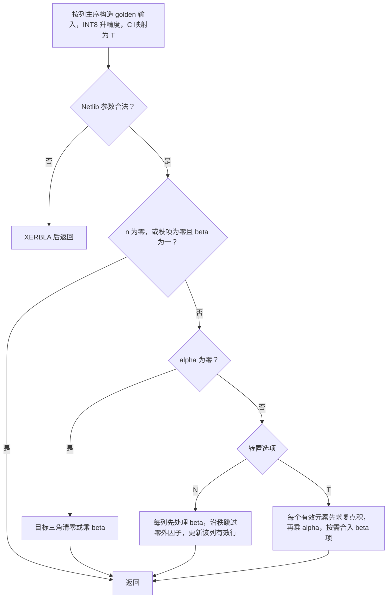
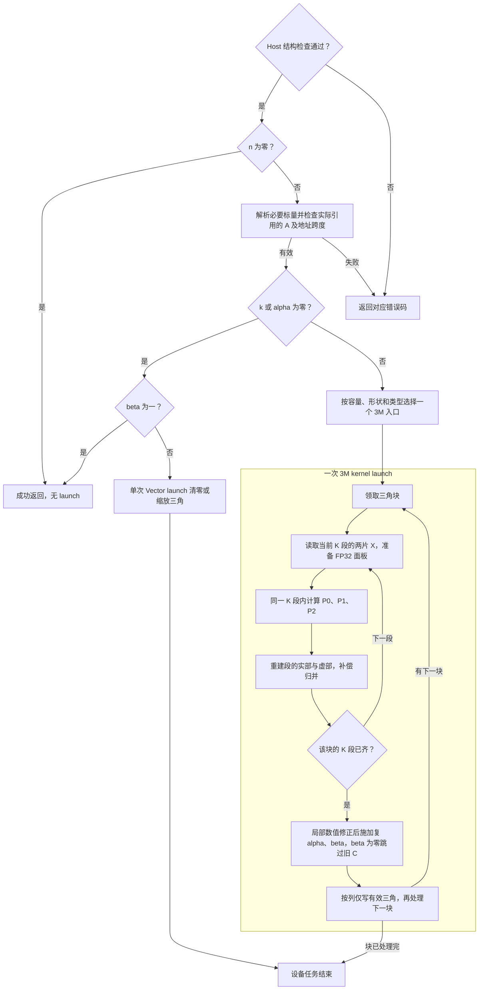

# 一、需求背景

## 1.1 需求来源

CANN 社区任务《aclblasCsyrk3mEx_Atlas950PR_task_doc.md》要求在昇腾 950PR 上新增句柄式 BLAS 接口。一个典型调用从列主序复矩阵得到复对称 Gram 型乘积，只更新结果的一个三角。功能以任务书 §2 为准，数值参考为 Netlib BLAS 3.10.0，性能参考为任务包提供的 cuBLAS kernel 时间。本文给出实现与自验设计。

## 1.2 背景介绍

### 1.2.1 aclblasCsyrk3mEx 算子实现优化

令 `X = op(A)`。对 uplo 选中的元素执行 `C ← alpha·X·Xᵀ + beta·C`。普通复乘需要四个实乘。把实部、虚部和两者之和分别作为实矩阵，可以用三个实矩阵积重建 `X·Xᵀ`。设计将每个有效 C 块的三个积留在同一 kernel 内，省去整矩阵临时结果的写回与再读取。另一个三角由对称性隐含，无需生成。

工程基线取自 ops-blas 官方仓提交 `60d9d0b153e22a154b8de9b7d89f21c5443c5f98`。该快照在 `include/cann_ops_blas.h` 有非 Ex 的 `aclblasCsyrk` 声明，在 `include/cann_ops_blas_common.h` 定义复数、枚举及返回码。SYRK 的 arch35 目录和公开头文件中均无本任务入口。调用链是公共 C 接口、handle 中的 stream 和编译好的设备入口。模板所列 TBE 实现文件、op-info 信息库及 ACLNN executor 在这条链上均不适用。[公开接口][header]、[公共类型][common]、[SYRK 源码目录][syrk]

| 已有源码（相对 ops-blas 根目录） | 可复用的依据 |
| --- | --- |
| `blas/syrk/arch35/csyrk_host.cpp`、`csyrk_kernel.cpp`、`csyrk_kernel.h`（后两者同目录） | Host 将 C 转置选项归一到普通 T，识别退化情况。其常规分阶段路径拆分 A、调 Cube、再按三角合并。另有小形状直算和特殊值回退。原指针检查、三角读写边界及 launch 数需要按本任务重新审视。[非 Ex Host][syrkhost] |
| `blas/syrk/arch35/csyrk_cube_kernel.cpp` | 四个实积对应实实、虚虚、实虚、虚实。可参考左右操作数的列主序布局，不能作为本任务的 3M 计算体。[Cube 源码][syrkcube] |
| `blas/gemm/arch35/cgemm3m_host.cpp`、`cgemm3m_rounding_kernel.cpp` | 前者通过 `LaunchComplexGemm(..., true)` 选择 3M。后者的 `ThreeProductTerms` 演示等价的三乘重建，舍入修正有单独的筛选与重算下发。本设计只借鉴数值问题。[3M 入口][gemmhost]、[舍入处理][rounding] |
| `blas/gemm/arch35/cgemm_onchip_kernel.h`、`cgemm_compute_kernel.cpp` | `ProducePanel/MultiplyPanel` 展示 UB 打包、L1 双缓冲及跨核交接。`PublishProducts/ConsumePart` 展示三个 L0C 块经 Fixpipe 交给 Vector 消费。这里将输入改为 A 的两片、输出改为三角列段。[片上流水][onchip]、[乘积交接][compute] |

### 1.2.2 aclblasCsyrk3mEx 算子现状分析

#### 1.2.2.1 标杆算子支持的数据类型和数据格式

cuBLAS `cublasCsyrk3mEx` 的矩阵组合为 `CUDA_C_32F → CUDA_C_32F` 和 `CUDA_C_8I → CUDA_C_32F`。前者每个复元素 8 B，后者的 A 每元素 2 B。对外映射分别为 `ACL_COMPLEX64` 和 `ACL_INT8`。两种路径的 alpha、beta 均按任务书定义为单精度复标量，C 均为交错的 FP32 实虚对。物理布局均为列主序稠密矩阵，支持列尾填充。上三角为 `i ≤ j`，下三角为 `i ≥ j`，均含对角。[cuBLAS 函数及类型表][cublas]

#### 1.2.2.2 标杆算子实现描述

GPU 耗时来自 cuBLAS。下图按生成 CPU golden 的公开源码绘制。测试适配层对 INT8 的两个有符号字节分别升为 FP32，按原 lda 组织临时复矩阵。按 `CblasColMajor` 调用 `cblas_csyrk`，N 传 `CblasNoTrans`，T、C 均传 `CblasTrans`。Netlib 的 Fortran 内核只接受 N/T，不能向它直传字符 C。[CBLAS 包装][cblasref]、[Netlib 3.10.0 内核][netlib]

`CSYRK` 先检查 uplo、trans、n、k 和两项前导维，非法则调用 `XERBLA`。当 `n=0`，或秩项为零且 `beta=1` 时返回。`alpha=0` 时只在目标三角清零或缩放。其余路径的运算顺序随转置而变。N 按列 j 先处理 beta，再沿 l 遍历 k，遇到 `A(j,l)=0` 跳过该项，否则把 `(alpha·A(j,l))·A(i,l)` 加到该列的有效行。T 按每个有效的 (i,j) 先求 `Σ A(l,i)·A(l,j)`，随后乘 alpha 并合入 beta 项。`beta=0` 时直接产生目标值。这些循环使用直接复乘，N 路径的零值跳过及 alpha 结合位置对异常值尤其重要。[Netlib 3.10.0 内核][netlib]

#### 1.2.2.3 标杆算子实现流程图



# 二、需求分析

## 2.1 外部组件依赖

运行依赖 CANN 9.1.0 及以上的 AscendCL、Ascend C 编译器与 arch35 设备运行时。平台接口提供可用核数及各级本地存储容量。测试侧使用 ops-blas 的 ATK/GTest、CPU Netlib BLAS/CBLAS 3.10.0 和 `msprof op`。cuBLAS 已采集数据随包交付，NPU 接口调用不依赖 CUDA。逐 case 计时和精度标准见 5.1 节。[平台容量接口][platform]、[Netlib 3.10.0][netlib]

## 2.2 内部适配模块

| 状态 | 文件/目录 | 职责 |
| --- | --- | --- |
| 已有，拟扩展 | `include/cann_ops_blas.h`、`blas/syrk/README.md` | 增加公开声明及 950PR 使用说明，沿用公共复数类型和 ABI。 |
| 已有，拟复用 | `blas/common/helper/host_utils.h`、`aclblas_handle_internal.h`、`aclblas_auxiliary.cpp`（均在同一目录） | 指针位置查询、设备核数、stream 与 workspace 所有权。[Host 辅助函数][utils]、[handle 定义][handle] |
| 拟新增 | `blas/syrk/arch35/csyrk3m_ex_host.cpp`、`csyrk3m_ex_kernel.cpp`、`csyrk3m_ex_kernel.h`（同目录） | 分别负责公共入口与分派、3M 及退化核、内部 POD 参数和 launch 声明。 |
| 拟新增 | `test/syrk/csyrk3m_ex/CMakeLists.txt`、`arch35/csyrk3m_ex_test.cpp`、`arch35/csyrk3m_ex_test.csv`（后二者相对该测试目录） | 注册独立 GTest 目标，加载任务 CSV、链接独立 CBLAS、逐用例输出结果。 |
| 已有构建入口 | `build.sh`、`blas/CMakeLists.txt`、`test/CMakeLists.txt` | 对接 `--ops=csyrk3m_ex` 的源文件前缀与家族测试目录选择，验证单算子链接。 |

## 2.3 需求模块设计

### 2.3.1 Ascend C 算子原型

```cpp
aclblasStatus_t aclblasCsyrk3mEx(
    aclblasHandle_t handle, aclblasFillMode_t uplo, aclblasOperation_t trans,
    int n, int k, const aclblasComplex* alpha,
    const void* A, aclDataType Atype, int lda,
    const aclblasComplex* beta, aclblasComplex* C, aclDataType Ctype, int ldc);
```

头文件沿用 ops-blas 的 C 链接约定。A 为 Device 只读矩阵，C 为 Device 原地输入/输出，alpha 和 beta 分别由 `{float real, float imag}` 表示，支持 Host 或 Device 指针。n、k、lda、ldc 为 32 位接口参数。一次调用更新一幅矩阵，调用方保证 A 的可读区域与 C 的可写区域不重叠。

### 2.3.2 Ascend C 算子相关约束

令逻辑矩阵 `X` 为 `n×k`。以下地址均用零基复元素偏移，最后乘元素字节数。所有乘加、字节换算和地址末端检查先扩到 64 位并检查溢出。

| 对象 | 物理行数 × 列数（含填充） | 元素偏移及合法区间 |
| --- | --- | --- |
| A，N | `lda × k`，`lda ≥ max(1,n)` | `X(i,t) ← A[i+t·lda]`，`0 ≤ i < n, 0 ≤ t < k` |
| A，T 或 C | `lda × n`，`lda ≥ max(1,k)` | `X(i,t) ← A[t+i·lda]`，不改变虚部符号 |
| C | `ldc × n`，`ldc ≥ max(1,n)` | `C(i,j) ↔ C[i+j·ldc]`，仅访问所选三角内的 `0 ≤ i,j < n` |

对 `e` 号 INT8 复元素，地址 `2e`、`2e+1` 处各取一个有符号 int8 后分别精确转换。`−128+(−128)` 须在 FP32 得到 `−256`。无量化 scale、零点或饱和回写。对角线也执行完整复数更新。例如 `n=k=1, A=1+2i, alpha=1, beta=0` 时输出 `−3+4i`。不需要调用方构造另一个三角，不支持任意视图步长、广播、批处理或 Hermitian 更新。

# 三、需求详细设计

## 3.1 调用方式

调用方创建 handle，使用 `aclblasSetStream` 绑定 stream，传入矩阵基址和标量指针。Host 入口按下表顺序处理。状态名均带 `ACLBLAS_STATUS_` 前缀。

| 顺序 | 校验与动作 | 返回或后续行为 |
| --- | --- | --- |
| 1 | handle 为空 | `HANDLE_IS_NULLPTR` |
| 2 | uplo 不属于 UPPER/LOWER，或 trans 不属于 N/T/C | `INVALID_ENUM`。合法 C 归一为 T |
| 3 | `n<0`、`k<0`，或 lda、ldc 不满足 2.3.2 | `INVALID_VALUE`，包括空尺寸时前导维不足 |
| 4 | alpha 或 beta 为空。随后检查类型组合。`n>0` 时检查 C 非空 | 标量或必需的 C 为空返回 `INVALID_VALUE`，不支持的 Atype/Ctype 返回 `NOT_SUPPORTED`。`n=0` 在这些结构检查后返回 `SUCCESS`，允许 A/C 为空，无搬运和 launch |
| 5 | `n>0` 时取得必要标量值。`k=0` 只需 beta 的值。`k>0` 且 alpha 非零时检查 A 非空 | 需要 A 但为空返回 `INVALID_VALUE`。任务书 §2.4 指针表的通则由 §2.5 明确的 `alpha=0` 例外细化，此时可传空 A |
| 6 | 对实际引用的矩阵检查可表示地址跨度。对物理有效行数 r、列数 c 非零的矩阵，以 `((c−1)·ld+r)·元素字节数` 为末端开区间的跨度 | checked multiply/add 同时检查偏移、指针加法与内部类型的可表示性，越界返回 `INVALID_VALUE`。调用方负责实际分配大小。退化路径不构造 A 的地址。无访存路径不构造空矩阵末端 |

标量比较按两个分量判断，正负零均视作零。Host 指针在调用期间复制为值传参。Device 指针由 `CheckPtrLocation` 区分位置，按各自位置处理。需要回读时在同一 stream 将所需的至多 16 B 复制到符合运行时要求的页锁定 Host 缓冲，合并等待该批复制，再据值校验 A、选择 quick return。若一份提交成功而下一份失败，已提交目标须等复制完成再回收。位置查询失败返回 `ACLBLAS_STATUS_INVALID_VALUE`，D2H 或同步失败返回 `ACLBLAS_STATUS_INTERNAL_ERROR`，分配回读缓冲失败返回 `ACLBLAS_STATUS_ALLOC_FAILED`。这样可见同流上先前写入的标量，Host 不解引用 Device 地址。非 Ex 的特定调用路径要求两个标量同位置。本设计对二者独立处理，覆盖同在 Host、同在 Device 及混合位置。[指针查询][utils]、[已有标量读取路径][syrkhost]

| 已通过结构检查的条件 | A | 旧 C | 设备工作 |
| --- | --- | --- | --- |
| `n=0` | 不读 | 不读 | 直接返回 |
| `n>0`，`k=0` 或 `alpha=0`，且 `beta=1` | 不读 | 不读 | 直接返回，C 仍须非空 |
| 同一退化秩项，`beta=0` | 不读 | 不读 | 清零所选三角 |
| 同一退化秩项，其他 beta | 不读 | 只读目标三角 | 写回 `beta·C` |
| `n,k>0` 且 `alpha≠0` | 读 | 仅 `beta≠0` 时读目标三角 | 一次 launch 完成 3M、复数缩放与写回 |

计算 kernel 异步提交到 handle 的 stream。标量 D2H 的等待发生在提交前。调用成功表示已下发或已快速返回。调用方在同步该 stream 后消费结果或释放矩阵。提交失败返回相应运行时映射状态，异步执行错误在同步点检查。Host 不回拷 A/C 做元素筛查。

## 3.2 需求总体设计

### 3.2.1 Host 侧设计

#### 3.2.1.1 分核策略

以方形输出块边长 B 切分两轴，`T=ceil(n/B)`，三角任务数 `H=T(T+1)/2`。定义 `F(y)=y(y+1)/2`。对编号 `0≤q<H`，以整数二分找出 `F(y)≤q<F(y+1)`，令 `x=q−F(y)`。UPPER 处理行块 x、列块 y。LOWER 对调为行块 y、列块 x。相等时为对角块。每个有效块只出现一次，无需扫描 T² 个候选块。块起点及三角数计算采用检查过的 64 位整数。

混合核中一个逻辑工作组包含一个 Cube 任务及平台匹配的 Vector 子任务。按实际核数和所选混合核的配比获得可调度组数 G，使用 `g=min(H,G)` 组。组 b 依次领取 `q=b,b+g,…`，负责该块的全部 k。组内按列段或行片划分 Vector 写者。不跨组切 K，不做全局原子累加。小矩阵若 Cube 填充工作量过大，可改用单次 Vector 3M 内核。仅缩放时直接按三角有效列段分给可用 Vector 核。候选实现用相同输入测量切换点，记录输出块数、有效 k、尾块比例和占用核数。

#### 3.2.1.2 数据分块和内存优化策略

每块沿 k 以 Kb 为面板宽度分段，边缘只读取 `m=min(B,n−i₀)`、`v=min(B,n−j₀)`、`d=min(Kb,k−t₀)` 的有效域。N 布局按 t 搬连续行片，T/C 布局按行索引搬连续 k 片。在 UB 解交错与局部重排，L1 中形成 Cube 左、右操作数所需的分形布局。同一 A 基址供两侧取片。对角块复用同一输入面板是可测优化，容量计算按两份计。

每个候选布局先按所选指令的分形、行 pitch 和起始地址要求补齐。令 `M,N,K` 为补齐后的块尺寸，`a(x)` 为**对所在存储层单个缓冲区**向上对齐后的字节数。记 `L=a(4MK), R=a(4NK), O=a(4MN)`。在不同层分别用该层的对齐和分形实际占用代入。若逐行搬运有额外 pitch，则先计入每行 padding 再计算总长。`raw(L/R)` 取两种物理方向下逐行补齐后可容纳交错输入的字节数，元素宽 `sA∈{2,8}`。各层独立检查下表的保守峰值，不能把不同核的 UB 容量相加。

| 存储 | 单核/工作组的预算（字节） | 活跃数据 |
| --- | --- | --- |
| UB（每个 AIV） | `dU·[raw(L)+raw(R)+3(L+R)] + 3dO·O + 4O + 2a(8MN) + Uaux ≤ UB可用量` | `dU` 组输入与打包区，`dO` 组三实积回传，实虚各一组和及补偿，旧 C/输出交错缓冲。保守地按整块计，同一时间片能证明互斥后才复用。`Uaux` 逐项计入掩码、风险标记、INT8 转换、重算小片和 API 临时区 |
| L1 | `d1·3(L+R) + L1aux ≤ L1可用量` | 每槽左右各三平面。双缓冲 `d1=2` 时预取下一段 |
| L0A、L0B | `d0·a(4·m₀·k₀)+Aaux ≤ L0A可用量`，`d0·a(4·k₀·n₀)+Baux ≤ L0B可用量` | 每次仅装当前实乘的左右微块，`m₀,n₀,k₀` 是合法的 Cube 指令分块 |
| L0C | `3O + Caux ≤ L0C可用量` | 当前 K 段三个 FP32 累加块。Fixpipe 完成前不覆盖 |

纯 Vector 3M 也可用此 UB 上界，以 `dU=dO=1`、小 B、短 Kb 逐条处理，L1/L0 分配均为 0。仅缩放时对 w 个有效元素分条，UB 峰值至多 `2a(8w)+Uscale`（输入和输出，`Uscale` 为掩码与暂存），清零可省去输入缓冲。

`dU,dO,d1,d0` 从已编译的 1 或 2 槽候选中选取。各 aux 项是实现的实际分配及保留量，包含事件或布局所需的固定缓冲。实现阶段须用内存布局表逐项确定，不能假定为零。Host 通过 `PlatformAscendCManager::GetInstance()` 的平台实例与 `GetCoreMemSize` 按字节查询 `UB/L1/L0_A/L0_B/L0_C`，结合可用核数筛选。若某模板不适配，尝试块或缓冲槽更小的已编译模板，随后按 UB 预算尝试分条 Vector 3M 路径。缺少所需平台信息或核数为零时返回 `ACLBLAS_STATUS_INTERNAL_ERROR`。查询成功但连最小合法模板也放不下时，返回 `ACLBLAS_STATUS_ALLOC_FAILED`。[CANN 9.1 平台接口][platform]、[直调 Host 的查询入口][utils]

**Workspace 生命周期。** 本设计三条设备路径（清零/缩放、Vector 3M、混合核 3M）的算子额外 GM workspace 上限均为 **0 B**。块描述符、标量值随 launch 传递，输入平面、段和与异常修正均在所属组片上周转。发布 tile 后复用槽位。各流只共享只读代码，不保存上次调用的矩阵或标量。已有 handle 的库管默认初值为 32 MiB，库管增长上限为 2 GiB。用户 workspace 由用户持有。本入口无需 `EnsureDefaultWorkspace`、替换已有缓冲或在返回时释放异步资源。这里的 0 B 指算子新增的设备全局暂存，不含输入输出、handle 自身及 Host 标量回读缓冲。[handle 分配及所有权][handle]、[stream 与释放][auxiliary]

#### 3.2.1.3 tilingKey 规划策略

内部 key 是 Host 与预编译入口之间的分派值。拟以 `kind` 区分 `SCALE/VEC3M/CUBE3M`，3M 再以 `input∈{C64,I8PAIR}`、`layout∈{N,T}` 和有限的 `tileId` 选择模板实例。可用整数编码 `kind | (input<<2) | (layout<<3) | (tileId<<4)`，其中 kind 依次取 0/1/2，C64 与 N 编为 0，I8PAIR 与 T 编为 1。`SCALE` 清除无关位。Host 对 key 查表选择同架构内已编译的 launch 包装函数，未知值作为内部分派错误处理。`n=0` 和纯返回无 key、无 launch。

拟先编译两档混合核做对照。`tileId=1` 取 `B=32, Kb=16`、单输入/输出槽，`tileId=2` 取 `B=32, Kb=32`、L1 与 L0A/B 双槽，UB 输入/输出各一槽。初始各以一块面板为一个归约段。以上数字是候选模板参数。实例须通过目标指令合法性、3.2.1.2 全部预算及编译核查后才加入分派表。`tileId=0` 留给逐条 Vector 路径。例如 I8PAIR、T、第二档混合核的 key 为 `2+4+8+32=46`。运行时 POD 携带 n、k、lda、ldc、uplo、alpha/beta 分量、组数和实际尾长的计算依据。beta 零读保护、对角掩码由这些值导出。T/C 共享同一实例，UPPER/LOWER 共享计算体。编译期选项区分原生 FP32 乘积和其他数学模式，此版默认使用原生 FP32。形状阈值由 950PR 上的对照实验确定，不依赖 case 名、种子或 golden。该分派无需 GE tiling 注册。

### 3.2.2 Kernel 侧设计

#### 3.2.2.1 Kernel 侧实现描述

**三乘计算。** 对当前两行块 I、J 和秩区间 D，将 `X(I,D)` 拆成 `Rᵢ, Sᵢ`，将 `X(J,D)` 拆成 `Rⱼ, Sⱼ`。同一设备入口依次计算下列局部积。

```text
P0 = Rᵢ · Rⱼᵀ
P1 = Sᵢ · Sⱼᵀ
P2 = (Rᵢ + Sᵢ) · (Rⱼ + Sⱼ)ᵀ
ΔRe = P0 − P1
ΔIm = (P2 − P0) − P1
```

展开 P2 后剩下 `Rᵢ·Sⱼᵀ + Sᵢ·Rⱼᵀ`，两项同号。每个 K 段起始清零三个累加块，段内面板按固定顺序累加，段末交给 Vector 重建，再在片上归并各段。小形状的 Vector 入口按同一恒等式计算点积。主路径内的三次实乘均属于**一次 kernel launch**。无外部 GEMM 调用、第二次修正下发或 `aclblasCsyrkEx` 依赖。

**舍入与异常。** 两个大实积相减可能得到很小的实部，虚部重建还会丢失预加 `R+S` 的低位。基线路径保留 FP32 输入、原生 FP32 乘积和累加，按已有 arch35 实现用 `SetHF32Mode(HF32Mode::DISABLE)` 关闭会截短尾数的模式。先按较短 K 段求 ΔRe/ΔIm，再分别用补偿加法归并。对有限段和 x 和已有和 s，可用 TwoSum 得 `t=fl(s+x), z=fl(t−s), e=fl((s−(t−z))+(x−z))`，保留 t 和累计残差 e。段末重建中的两次减法也记录残差，最终在复标量运算前合入。编译需保留这些运算的次序，验证构建选项和指令生成。缩短分段控制了累加误差，对预加时丢失的低位还需单独补偿。[arch35 FP32 计算路径][compute]

- 对 INT8，提升后实部、虚部及其和均精确。最大单项为 `(−256)²=65536`。在原生 FP32 下每段至多 256 项，三个整值点积的任意部分和绝对值均不超过 `2²⁴`。据此选取 `段长≤256`，段末可将三个精确段积转成 int64，重建实虚部并只保留两个 int64 跨段累加值，最后转 FP32 进行复数缩放。即使 `k=INT_MAX`，总和也在有符号 64 位内。实现时为宽累加的实、虚和预留与四个 FP32 平面等量的字节。精确整数和与 CBLAS 长 K 逐次 FP32 舍入可能有差异，仍需按冻结的同一 golden 验收。
- 对 COMPLEX64，根据面板的分量绝对值上界、段长以及重建结果识别预加溢出和强抵消。例如以 `Σ|Pq|` 与 `|ΔRe|`、`|ΔIm|` 比较以筛出大数相减的点。对每个实点积，用 `d·max|left|·max|right|` 上界估算段内绝对项之和。误差估计随复标量幅值传播到最终分量，接近零时用绝对尺度判定，避免用结果直接作除数。拟在**同一 kernel 写回前**由负责该元素的 Vector 子任务重读有效 A 片，对高风险点用短段逐项 3M 重算。有限数预加保留 TwoSum 的高、低部。乘积保留 FMA 残差并合入高低部交叉项。必要时以二的幂缩放操作数并记录指数，避免只因 3M 预加或中间积溢出而改变最终分类。风险阈值、额外寄存器和耗时待以全量精度及 200 条性能数据共同验证。
- NaN/Inf 不进入 TwoSum 或 FMA 残差路径，避免由 `Inf−Inf` 引入与参考不一致的 NaN。打包和计算时为实际读取的输入、段和及标量运算建立异常标记。标记只触发有效输出分量的处理。对含非有限数的点，在同一 kernel 内按 Netlib N/T 的操作顺序逐项判定复乘各分量的零、符号与有限/Inf/NaN 类别（包括 `0×Inf`、异号无穷相加及 N 路径的零外因子），每个输出分量独立维护有限累加值或有符号无穷/NaN 状态。异常项只对该点受影响的标量表达式分类，另一分量仍按其有效项累加。此过程没有额外矩阵乘下发。若有限输入触发溢出，还须按参考的结合次序检查中间量，区分参考本身的 FP32 溢出和仅由 3M 引入的溢出。N 分支跳过零乘子、beta 为一时保留原列等规则，也要纳入异常回放。实现需对照冻结的 CBLAS 编译版本验证非有限点及其邻近有限点，不能把整块一律改成 NaN。补偿、分类和标记缓冲均计入 UB 预算。

**流水与回写。** AIV 按字节数搬运两片 A，拆分、升精度并把三种实面板按 Cube 所需顺序送入本组的 L1 槽。AIC 从 L1 搬到 L0A/B 并顺序发出三组实乘加。段完成后 Fixpipe 把 L0C 三积送至配对 AIV 的 UB。每槽的生产、消费和再次使用遵循下列依赖。[同架构输入流水][onchip]、[同架构 Fixpipe 输出流水][compute]

| 缓冲交接 | 就绪条件 | 槽何时可以复用 |
| --- | --- | --- |
| GM → UB → Vector → L1 | 搬入完成后执行打包。MTE3 完成 UB→L1 后各生产者发 input-ready。AIC 等齐本槽双方的信号 | AIC 已把该槽最后一个所需操作数装入 L0，向每个生产者返回 input-free。L0 槽另等 Cube 读完 |
| L0C → Fixpipe → UB | 全部本段乘加完成，且目标 UB 槽空闲。Fixpipe 完成后发 output-ready | Fixpipe 读完才覆写 L0C。各 AIV 完成本段消费和相关搬出后返回 output-free，才覆写对应 UB 槽 |

逻辑标志由组、方向和槽位区分，按目标混合核的配比映射实际事件，初始化空槽令牌，段末和退出时排空在途搬运。没有有效行的 Vector 子任务也消费并归还令牌。单槽与双槽、末段以及局部异常重算使用同一套交接，防止对角裁剪或提前返回造成死锁。只需配对核之间的等待。

设归并后的实、虚部为 `r,s`，对于 `alpha=a+ib, beta=c+id, C旧=u+iv`，两个写入分量为 `ar−bs+cu−dv` 和 `as+br+cv+du`。标量是复数，不能用单个实系数替代。`beta=0` 直接省掉旧 C 载入及其乘法。缩放专用入口在 `beta=0` 时直接写复零。整个秩归约完成后才应用一次 alpha 和 beta。对角使用同一表达式。

每列 j 的实际写段由块的行区间 `[i₀,i₁)` 与 `[0,j+1)`（上三角）或 `[j,n)`（下三角）求交。交集空则跳过该列的访存。只有本地面板向上补零，A/C 的 GM 地址和长度始终由有效元素数给出。对齐段批量搬运，对非对齐段使用目标架构支持的精确字节数搬入/搬出。步长或计数字段装不下时拆成逐列分段。输出不允许整块读改写来保留无效半边。若所用搬出指令对跨核共享同一对齐块无独立写入保证，Host 改按列带分核，带的分界取物理列首地址对齐处，一个组独占带内全部行块，组内按完整列交付结果片，使同列归于同一写者。若没有安全切点，最小方案由一个写者处理。各方案仍只搬有效字节。用奇数 ldc、多核交界和守卫区验证后再确定并行搬出条件。

#### 3.2.2.2 Ascend C 实现流程图



#### 3.2.2.3 Ascend C 实现流程图与标杆算子流程图存在的差异点和原因

Netlib 按列或按元素执行直接复乘，N/T 分支的累加顺序不同。设备设计将转置吸收到读址和局部重排中，以同一组的三个实积换取 Cube 利用率。块内补零、分片归约和对角列段裁剪保持相同的有效元素集合，但会改变舍入顺序。仅缩放时两者均绕过 A。NPU 另需 handle、标量位置、设备类型和启动校验，错误通过 ops-blas 状态码传回。正式性能对比采用 cuBLAS kernel 时间。黄金流程图不推断 cuBLAS 内部的分块或实现。

## 3.3 支持硬件

目标设备为昇腾 950PR，ops-blas 的 SoC 构建参数为 `ascend950`，实现目录为 `arch35`。以一款 950PR 完成自验，记录实际设备型号、CANN 版本、设备编译选项和查询到的资源。不同 SKU 的核数和片上可用容量不写入公共 ABI。

## 3.4 算子约束限制

仅支持 2.3 节的两种 A/C 类型组合、复数标量、列主序及两种三角。接口没有批维、任意行步长、显式输出矩阵、workspace 参数或图编译动态 shape 接口。n、k 仍可在每次调用时变化。C 的对称性由调用方解释，kernel 不复制镜像、不校验两半相等。常规值域为有限 FP32 或有符号 INT8，任务书指定的 Inf/NaN 另做传播验证。浮点路径不承诺跨形状、分块策略或后端的逐位一致。

# 四、特性交叉分析

| 交叉项 | 失效情形 | 设计与验证方法 |
| --- | --- | --- |
| 转置 × 填充 × 双字节输入 | 把 lda 当字节或把 OP_C 当共轭，方阵上可能漏检 | 非方阵同时做 T、C，并使用不同的 lda/ldc。令实虚不等、对角虚部非零，INT8 同时取 −128 和 127。 |
| 三角 × 异步写回 | 对角块整块搬出覆盖另一半，或多核尾段互相覆盖 | 给另一三角和每列 padding 写入不同位模式，调用前后逐字节比较。结合越界检测与访存指令审查检查越界读。 |
| 快速返回 × 指针位置 | 提前检查 A 或读旧 C 会误报空指针或传播 NaN | 分别在 Host/Device 标量、`A=nullptr`、旧 C 为 NaN、k=0 及 n=0 条件下核对状态、访存和 launch 数。 |
| 精度 × 分段 × 调度 | 抵消、低尾数数学模式或槽位过早覆盖会在长 K 和末段放大误差 | 固定输入对照不同 K 段长和单/双槽，在相同 golden 上记录误差坐标。压力覆盖一核、多核、尾块与长 K。 |
| stream × 生命周期 | 上一次调用仍在读 A/C，或 Dev 标量尚未更新 | 测同流先写标量再调用、连续两次原地更新、两条流各自持有 handle。切流/销毁遵循 handle 契约。无全局可变 scratch。 |

# 五、可维可测分析

## 5.1 精度标准/性能标准

**用例清单。** 按任务附件 `test_cases/csyrk3m_ex_test.csv` 实际数据行（不含表头）统计，共 1200 个不同的 case_name。表中列出各组的输入覆盖和预期状态。

| 集合 | Atype 与 Ctype | trans、uplo 及预期结果 |
| --- | --- | --- |
| 精度及负向 1000 条 | A 为 COMPLEX64 505 条、INT8 493 条、负向 FLOAT 2 条。C 为 COMPLEX64 998 条、负向 FLOAT 2 条。三条不支持组合分别为 FLOAT/C64、INT8/FLOAT、FLOAT/FLOAT | N/T/C 为 361/330/308，另有非法 trans 1 条。UPPER/LOWER 为 520/479，另有非法 uplo 1 条。预期 SUCCESS 982、INVALID_VALUE 13、INVALID_ENUM 2、NOT_SUPPORTED 3。两种合法输入在成功用例中均覆盖 2×3 种 uplo/trans |
| 性能 `TC_PF` 200 条 | 全部 COMPLEX64/COMPLEX64，紧凑 lda/ldc，alpha=1，beta=0 | N/T/C 为 85/69/46。UPPER/LOWER 为 92/108。按 A+C 逻辑字节数划分 small（≤64 KiB）7 条、medium（>64 KiB 且 ≤2 MiB）6 条、large（>2 MiB）187 条 |
| `gpu_baseline.csv` 200 条 | 8 列为 `id,uplo,trans,n,k,Atype,Ctype,gpu_ms`，200 个时间均已填写，六参数键有 198 个 | 按参数与出现顺序核对后对应全部 200 条 PF。两组重复各代表两个独立 case |

**精度执行与判定。** 使用 ATK/GTest 读取 20 列用例表，保留种子、填充、输入和期望状态。COMPLEX64 常规精度输入按均匀 `[−5,5]` 与正态 `N(0,1)` 两类产生，实虚独立。INT8 按 `[−128,127]` 独立采样。每个用例冻结原始 C、golden 及生成环境。以非 3M 的 `cblas_csyrk` 为主参考，INT8 逐分量提升。需用高精度参考时预先固定 `cblas_zsyrk`、输入提升和结果收窄方式，在报告中区分两种参考域。错误码用例单独比较状态和输出保护。

1. 仅比较指定三角内的 `n(n+1)/2` 个复元素，对角含虚部。对实虚分量分别计数、记最大误差坐标，并记录全部 `n(n+1)` 个分量的汇总。对有限分量，`abs(actual−golden) ≤ 2⁻¹³ + 2⁻¹³·abs(golden)` 计为 matched。
2. 每条数值用例同时要求 `matched_ratio ≥ 0.99` 和 `max_abs_error ≤ max(1e−2, 32·ULP(g_low))`。最大绝对误差只取双方均有限的点。`g_low` 为**最大绝对误差点**的 golden 按输出 FP32 收窄的值。报告实部、虚部各自指标及任务书的全分量联合判定。两阈值不能互相抵销。NaN 要求双方在同一分量为 NaN，Inf 须同位置同符号。分类不一致单列为错误，不以剔除异常点提高匹配率。高精度有限 golden 超出范围时先按 nearest-even 收窄到 FP32 再比较，记录全部异常分类差异。无有限点时记录该项不适用，n=0 通过状态、未访问矩阵和无 launch 验证。[任务书引用的固定版本精度标准][precision]
3. 附件 `verify_accuracy.py` 只解析 GTest 的 OK/FAILED 和耗时，并对预期非 PF 名单查缺。脚本本身不生成 golden 或计算以上两项指标。CSV 附带 `mere_threshold=0.00012207031`、`mare_multiplier=10.0`，README 提到的 MERE/MARE 属工程辅助指标。GTest 要显式计算正式判据并保存分量级证据，单有脚本 PASS 不足以证明达标。
4. 四条 `TC_3M_414…417` 分别覆盖 N 交替值、T 极值、INT8 极值和 T 下对角虚部。另跑 0/1、奇数边、向量/分形长度前后、矩形、ld 多出 1/8/64、alpha/beta 纯实/纯虚/一般复数及 ±1e4、Inf/NaN 和 beta=0 读保护。逐字节核查另一三角、A 和 padding。附加 null handle（CSV 无此列）、n=0 同时含非法枚举或非法前导维、退化且 A 为空、同流写 Device 标量、不可表示跨度及分派覆盖。以空 A/保护页或内存检查配合静态审查区分“未写”与“未读”。
5. 用小矩阵可手算地定位错误。例如令 `X=[1+i, 2−i]ᵀ, k=1, alpha=1, beta=0`，期望三角对角分别为 `2i`、`3−4i`，交叉项为 `3+i`。分别改用同一 X 的 N 与转置存储，T/C 结果应保持一致。翻转 uplo 后检查另一半哨兵。此例能区分共轭、虚部符号和对角清零三种问题。
6. §3.5 还要求若干随机复标量。当前 CSV 的标量列为固定取值，故须补充带可复现种子的独立实虚随机标量，以及 alpha 虚部 −1e4 的边界，单列附加结果。README 概览把 k=0 简记作 no-op。按任务书及 `TC_ED_401/402`，beta=2 必须缩放，beta=0 必须清零。

**性能执行与判定。** 在同款 950PR 上按 `bash build.sh --ops=csyrk3m_ex --soc=ascend950` 构建测试目标，逐 PF 用例用 `msprof op` 和单 case GTest filter 采集。由 `OPPROF_*/OpBasicInfo.csv` 取该算子 kernel 的 `Task Duration(us)`，排除 5 次 warmup 后取 10 次有效下发的算术平均。记录 API 状态、实际 kernel 名、每次调用的 launch 数和原始样本。非 SUCCESS 另记原因并补足有效样本，缺 case 或缺样本不能形成全量验收结论。预期每次一般更新只有一个计算 kernel。

令 `npu_ms = mean(Task Duration(us))/1000`，`sᵢ = gpu_msᵢ/npu_msᵢ`。每一条均须 `sᵢ ≥ 0.4`（NPU 时间 ≤ GPU 的 2.5 倍），且 **全部 200 条**的 `Σsᵢ/200 ≥ 0.5`。平均对象是逐例倍率，每条 case 各计一次。GPU 时间是包内 cuBLAS 的 nsys/profiling kernel-only 数据。

| 重复参数（均为 UPPER/N，A、C 均为 COMPLEX64） | PF 与 baseline id 的逐行关联 | gpu_ms（ms） |
| --- | --- | --- |
| n=k=512 | `TC_PF_1001 ↔ csyrk3m_ex-base-000`，`TC_PF_1006 ↔ csyrk3m_ex-perf-005` | 0.045306，0.0453154 |
| n=k=1024 | `TC_PF_1002 ↔ csyrk3m_ex-base-001`，`TC_PF_1007 ↔ csyrk3m_ex-perf-006` | 0.2543576，0.2549783 |

正式报告须冻结 case_name、baseline id、六项参数及原行时间的对应表，防止按六键去重。`verify_performance.py` 的 `load_baseline` 以六键建字典，同键保留后行。脚本读取 GTest 的 `[PERF] avg_us`（也识别 `average_us`），换算得到事件耗时列 `npu_ms`，与 `baseline_ms` 相比。该计时用预置缓冲和同流事件夹住下发，有别于纯 kernel 时间。脚本不读取 OpBasicInfo，也未将测试进程退出码直接计入最终汇总。自验需独立核查进程正常结束及运行时状态。缺 GTest 状态/事件时间判 FAIL，缺基线默认 NO_REF 失败，开发选项 `--allow-noref` 不能用于正式验收。

任务书 §3.3 明确要求补采 INT8，README 中“两条 INT8 性能用例”的文字与 CSV 不符。补测沿用与 COMPLEX64 同 uplo/trans/n/k/Ctype 的 `gpu_ms`，明确标为借用基线。按 INT8 A 与 C 的实际字节数 `2nk+8n²` 选择 small/medium/large，覆盖两三角和 N/T/C。逐条列出相同的 kernel 口径、倍率和分层结果，保留原 200 条的逐条/平均门槛，另列补充集及合并集的逐条与平均判定。任务书 §3.4 写明无独立内存验收阈值。生成器采用的 512 MiB 是用例矩阵预算。片上预算、额外 GM 空间与边界检查仍需在实现时验证。

**后续自验记录。** 保存源提交、CANN/CBLAS 与编译参数、实际设备、用例清单、冻结输入/golden、GTest 状态及误差表、profiler 原始文件和逐 case 汇总。任务书 §4 列出的完整验收交付包还要求 cases.json、perf/、inputs/、golden/ 和 facts.json。当前附件提供任务书、用例说明、CSV 与辅助脚本，冻结数据和运行报告须在自验阶段生成。

## 5.2 兼容性分析

公开符号按 §2.3.1 新增，不调整 `aclblasCsyrk`、公共结构体或既有枚举值。cuBLAS 的非法 uplo/trans 使用 `CUBLAS_STATUS_INVALID_VALUE`，本接口按 ops-blas 约定返回 `ACLBLAS_STATUS_INVALID_ENUM`。任务书的 OP_C 明确等价于不共轭的 OP_T，复数 alpha/beta 和对角虚部均按任务签名处理。其他架构的同名实现可共享声明，本次产品支持范围限于 950PR。

实现阶段需验证公开头文件编译、单算子目标链接、既有 `csyrk` 调用、两种输入与 Host/Device 标量组合、同流有序和多流隔离。本文的分派阈值、补偿与异常修正、跨核事件、片上内存峰值及正式精度/性能均为待验证设计项。

[header]: https://gitcode.com/cann/ops-blas/blob/60d9d0b153e22a154b8de9b7d89f21c5443c5f98/include/cann_ops_blas.h
[common]: https://gitcode.com/cann/ops-blas/blob/60d9d0b153e22a154b8de9b7d89f21c5443c5f98/include/cann_ops_blas_common.h
[syrk]: https://gitcode.com/cann/ops-blas/tree/60d9d0b153e22a154b8de9b7d89f21c5443c5f98/blas/syrk/arch35
[syrkhost]: https://gitcode.com/cann/ops-blas/blob/60d9d0b153e22a154b8de9b7d89f21c5443c5f98/blas/syrk/arch35/csyrk_host.cpp
[syrkcube]: https://gitcode.com/cann/ops-blas/blob/60d9d0b153e22a154b8de9b7d89f21c5443c5f98/blas/syrk/arch35/csyrk_cube_kernel.cpp
[gemmhost]: https://gitcode.com/cann/ops-blas/blob/60d9d0b153e22a154b8de9b7d89f21c5443c5f98/blas/gemm/arch35/cgemm3m_host.cpp
[rounding]: https://gitcode.com/cann/ops-blas/blob/60d9d0b153e22a154b8de9b7d89f21c5443c5f98/blas/gemm/arch35/cgemm3m_rounding_kernel.cpp
[onchip]: https://gitcode.com/cann/ops-blas/blob/60d9d0b153e22a154b8de9b7d89f21c5443c5f98/blas/gemm/arch35/cgemm_onchip_kernel.h
[compute]: https://gitcode.com/cann/ops-blas/blob/60d9d0b153e22a154b8de9b7d89f21c5443c5f98/blas/gemm/arch35/cgemm_compute_kernel.cpp
[utils]: https://gitcode.com/cann/ops-blas/blob/60d9d0b153e22a154b8de9b7d89f21c5443c5f98/blas/common/helper/host_utils.h
[handle]: https://gitcode.com/cann/ops-blas/blob/60d9d0b153e22a154b8de9b7d89f21c5443c5f98/blas/common/helper/aclblas_handle_internal.h
[auxiliary]: https://gitcode.com/cann/ops-blas/blob/60d9d0b153e22a154b8de9b7d89f21c5443c5f98/blas/common/helper/aclblas_auxiliary.cpp
[cublas]: https://docs.nvidia.com/cuda/archive/11.8.0/cublas/index.html#cublas-csyrk3mEx
[cblasref]: https://github.com/Reference-LAPACK/lapack/blob/v3.10.0/CBLAS/src/cblas_csyrk.c
[netlib]: https://github.com/Reference-LAPACK/lapack/blob/v3.10.0/BLAS/SRC/csyrk.f
[platform]: https://www.hiascend.com/document/detail/en/CANNCommunityEdition/910/API/ascendcopapi/docs/en/api/Utils-API/platform_info/PlatformAscendC/GetCoreMemSize.md
[precision]: https://gitcode.com/cann/opbase/blob/28a1ce52ae856353589841226a0002af73314a6b/docs/zh/ops_precision_standard/mixed_tolerance_standard.md
