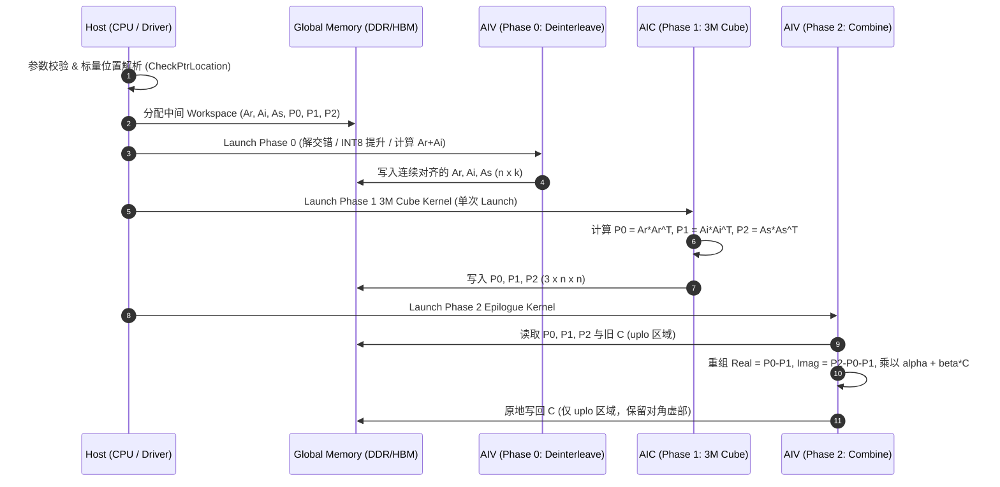

# aclblasCsyrk3mEx 算子设计文档

> **任务名称**：2026 年 11 月社区任务「aclblasCsyrk3mEx 算子开发（950）」  
> **适配硬件**：昇腾 950PR（`ascend950`，NPU_ARCH `dav-3510`，架构目录 `arch35`）  
> **CANN 版本**：CANN 9.1.0 及以上  
> **开发语言**：Ascend C（Kernel 直调工程模式）  
> **目标代码仓**：https://gitcode.com/cann/ops-blas （master 分支）  
> **代码合入路径**：实现代码合入 `blas/syrk/arch35/`，测试代码合入 `test/syrk/csyrk3m_ex/arch35/`  
> **公开头文件**：`include/cann_ops_blas.h`  
> **提交团队/开发者**：`qingkouwei`  

---

# 1. 需求背景（required）

## 1.1 需求来源

在昇腾 950PR（arch35）芯片架构上，使用 Ascend C 编程语言并基于 `ops-blas` 开源仓（https://gitcode.com/cann/ops-blas ）句柄式 BLAS 工程框架，设计并开发单精度复数（complex64）对称矩阵秩-k 更新（扩展版）算子 `aclblasCsyrk3mEx`。该接口功能和参数语义完全对标 cuBLAS `cublasCsyrk3mEx` 接口，完成算法设计、高性能 Kernel 开发、测试用例验证及自测交付，合入昇腾开源算子仓。

## 1.2 背景介绍

### 1.2.1 算子功能定位与对称秩-k 更新

`aclblasCsyrk3mEx` 属于标准 BLAS Level-3 矩阵秩-k 更新算子的扩展 3M 高性能变体。数学计算表达式为：

$$C = \alpha \cdot \text{op}(A) \cdot \text{op}(A)^T + \beta \cdot C$$

其中：
- $C$ 为 $n \times n$ 单精度复数（complex64）对称矩阵，采用列主序（Column-Major）存储；
- **对称存储与读写语义**：根据参数 `uplo`，仅引用并更新 $C$ 的上三角（`ACLBLAS_UPPER`）或下三角（`ACLBLAS_LOWER`）区域，未指定的另一半三角由对称数学关系 $C = C^T$ 隐含，**物理内存不进行任何读写**；
- **对称语义 vs Hermitian 语义**：本算子为纯**对称（Symmetric）**运算而非埃尔米特（Hermitian）运算：
  1. `trans = ACLBLAS_OP_C` 按 `ACLBLAS_OP_T` 等价处理，**严禁进行复数共轭**；
  2. 对角线元素 $C(i, i)$ 的虚部为**合法有效数据**，计算后必须原样保留并根据公式更新，**绝对不能置 0**（区别于 `cherk` 等埃尔米特算子强制对角虚部为 0）；
- **操作数 $\text{op}(A)$ 规格**：
  - `trans = ACLBLAS_OP_N` 时：$\text{op}(A) = A$ 为 $n \times k$ 矩阵，物理存储尺寸要求 $lda \ge \max(1, n)$；
  - `trans = ACLBLAS_OP_T` 或 `ACLBLAS_OP_C` 时：$A$ 物理存储为 $k \times n$，$\text{op}(A) = A^T$ 为 $n \times k$ 矩阵，要求 $lda \ge \max(1, k)$；
- **输入数据类型组合**：
  - 矩阵 $C$ 恒为 `ACL_COMPLEX64`；标量 $\alpha, \beta$ 为单精度复数标量指针；
  - 矩阵 $A$ 支持两种类型枚举：
    1. `ACL_COMPLEX64`：标准复数 float32，每个复元素按 $(\text{real}, \text{imag})$ 交错占用 8 字节；
    2. `ACL_INT8`：复数 complex-int8（对标 cuBLAS `CUDA_C_8I`），每个复元素按 $(\text{int8 real}, \text{int8 imag})$ 交错占用 2 字节，计算时在片上精确无损提升为 float32 后参与 3M 矩阵乘；
  - 其余不支持的数据类型组合统一拦截并返回 `ACLBLAS_STATUS_NOT_SUPPORTED`。

### 1.2.2 3M 算法（对称专用分解）数学推导与证明

直接复数矩阵乘法（4M 算法）需要进行 4 次实数矩阵乘法。3M 算法（高斯复数乘法技巧在对称矩阵乘中的特化）通过数学恒等变换，将乘积操作降为 3 次实数矩阵乘。

令 $X = \text{op}(A) = X_r + i \cdot X_i$（当 $Atype=\text{ACL\_INT8}$ 时，先精确提升为 float32 的 $X_r, X_i$）。  
本算子的核心乘积为复对称矩阵乘 $X \cdot X^T$：

$$\text{Real}(X \cdot X^T) = X_r \cdot X_r^T - X_i \cdot X_i^T$$

$$\text{Imag}(X \cdot X^T) = X_r \cdot X_i^T + X_i \cdot X_r^T$$

定义三路实数矩阵乘积：
- $P_0 = X_r \cdot X_r^T$
- $P_1 = X_i \cdot X_i^T$
- $P_2 = (X_r + X_i) \cdot (X_r + X_i)^T$

**数学恒等性证明**：  
展开 $P_2$：
$$P_2 = (X_r + X_i) \cdot (X_r^T + X_i^T) = X_r \cdot X_r^T + X_r \cdot X_i^T + X_i \cdot X_r^T + X_i \cdot X_i^T$$
代入 $P_0$ 和 $P_1$：
$$P_2 = P_0 + (X_r \cdot X_i^T + X_i \cdot X_r^T) + P_1$$
由此立即可得：
$$\text{Real}(X \cdot X^T) = P_0 - P_1$$
$$\text{Imag}(X \cdot X^T) = P_2 - P_0 - P_1$$

**关键实现约束**：
1. **单次 Kernel Launch 强制约束**：三次实数矩阵乘（$P_0, P_1, P_2$）**必须在同一次 Kernel Launch 内完成**，严禁使用三次独立的 GEMM 调用进行外部拼接；
2. **严防套用埃尔米特分解陷阱**：埃尔米特秩-k 更新计算的是 $X \cdot X^H$，其虚部展开为 $X_i X_r^T - X_r X_i^T$（由于 $(X_i X_r^T)^T = X_r X_i^T$，在实对称转置下为反对称，若套用会导致虚部计算彻底错误）；本算子为纯对称分解，虚部符号为加号 $X_r X_i^T + X_i X_r^T$，必须采用上述对称分解公式；
3. **舍入与精度差异说明**：3M 算法在重组阶段引入浮点相减操作（$P_0 - P_1$ 与 $P_2 - P_0 - P_1$），中间 FP32 舍入轨迹与 4M 直接复数乘法不同，数值上与非 3M 实现 `aclblasCsyrk` / `cblas_csyrk` 不保证逐位一致（Bitwise Identical），但数学语义完全等价，按任务书 mixed_tolerance 精度标准判定。

### 1.2.3 业界对标与依据

| 对标项 | 对标依据 | 对齐策略与要求 |
| :--- | :--- | :--- |
| **cuBLAS `cublasCsyrk3mEx`** | NVIDIA cuBLAS 官方 API 规范 | 接口参数序列、列主序存储、`uplo`/`trans` 语义、`CUDA_C_8I` 对应 `ACL_INT8` 映射完全一致。 |
| **Netlib BLAS `csyrk.f` / CBLAS** | Netlib BLAS 3.10.0 参考实现 | 精度比对 Golden 标杆。CBLAS 无 3mEx 独立符号，通过 CPU 侧 CBLAS `cblas_csyrk`（float64 走 `cblas_zsyrk`）生成数学真值；`ACL_INT8` 先精确提升为 float32 后调用。 |
| **返回码规范** | ops-blas 仓约定（`include/cann_ops_blas_common.h`） | 枚举类非法参数返回 `ACLBLAS_STATUS_INVALID_ENUM`（此为 ops-blas 统一约定，故意区别于 cuBLAS 的 `INVALID_VALUE`）；阶数、秩、前导维及指针非法返回 `ACLBLAS_STATUS_INVALID_VALUE`；类型不支持返回 `ACLBLAS_STATUS_NOT_SUPPORTED`。 |

### 1.2.4 仓内现状与本任务架构定位

在 `ops-blas` 代码仓中：
1. 1125 之前仓内仅有非 Ex 的 `aclblasCsyrk`（`blas/syrk/arch35/`）与 `cgemm3m`（`blas/gemm/arch35/`），尚无 `aclblasCsyrk3mEx` 声明与实现；
2. `aclblasCsyrkEx` 与本任务 `aclblasCsyrk3mEx` 均为独立新算子，彼此不得产生任何符号依赖；
3. 本任务在 `include/cann_ops_blas.h` 中新增公开原型声明，在 `blas/syrk/arch35/` 下新建 `csyrk3m_ex_host.cpp`、`csyrk3m_ex_kernel.cpp` 等模块，在 `test/syrk/csyrk3m_ex/arch35/` 下新增完整自动化测试工程。

---

# 2. 需求分析（required）

## 2.1 需求描述

基于昇腾 950PR（arch35，`dav-3510`）硬件，开发 `aclblasCsyrk3mEx` 算子：
- 严格遵循 Ascend C 编程规范与 Handle 句柄式调用架构；
- 支持 $Atype \in \{\text{ACL\_COMPLEX64}, \text{ACL\_INT8}\}$ 和 $Ctype = \text{ACL\_COMPLEX64}$；
- 恒定走 3M 矩阵乘分解路径，单次 Kernel Launch 内完成三乘积计算；
- 支持任意合法的列主序前导维跨度 $lda, ldc$（紧凑与 padding 场景）；
- 严格保持对角元素虚部不变（不置 0），仅读写 `uplo` 三角；
- 精度满足生态算子开源精度标准（FLOAT32 分量 $rtol = atol = 2^{-13}$，`matched_ratio >= 0.99`）；
- 性能达到 GPU cuBLAS `cublasCsyrk3mEx` kernel-only 耗时的 0.4× 以上（单 case），全用例算术平均加速比 $\ge 0.5$。

## 2.2 接口定义与参数说明

### 2.2.1 接口原型声明

头文件 `include/cann_ops_blas.h` 中新增声明：

```cpp
aclblasStatus_t aclblasCsyrk3mEx(
    aclblasHandle_t handle,
    aclblasFillMode_t uplo,
    aclblasOperation_t trans,
    int n, int k,
    const aclblasComplex* alpha,
    const void* A, aclDataType Atype, int lda,
    const aclblasComplex* beta,
    aclblasComplex* C, aclDataType Ctype, int ldc);
```

### 2.2.2 详细参数规格表

| 参数名 | 传递方式 | 语义描述 | 数据类型 | 格式 | 逻辑形状/约束 | 异常行为与返回状态码 |
| :--- | :--- | :--- | :--- | :--- | :--- | :--- |
| `handle` | 输入 | ops-blas 上下文句柄，绑定 stream | `aclblasHandle_t` | 指针 | 有效句柄 | 若为 `nullptr` 返回 `ACLBLAS_STATUS_HANDLE_IS_NULLPTR` |
| `uplo` | 属性 | 三角矩阵存储模式 | `aclblasFillMode_t` | 枚举 | `ACLBLAS_UPPER` 或 `ACLBLAS_LOWER` | 不在上述集合返回 `ACLBLAS_STATUS_INVALID_ENUM` |
| `trans` | 属性 | $\text{op}(A)$ 变换模式（OP_C等价OP_T） | `aclblasOperation_t` | 枚举 | `ACLBLAS_OP_N`, `ACLBLAS_OP_T`, `ACLBLAS_OP_C` | 不在上述集合返回 `ACLBLAS_STATUS_INVALID_ENUM` |
| `n` | 属性 | 方阵 $C$ 的阶数 | `int` | 标量 | $n \ge 0$ | $n < 0$ 返回 `ACLBLAS_STATUS_INVALID_VALUE`；$n = 0$ 为合法 no-op |
| `k` | 属性 | 秩-k 更新维度 | `int` | 标量 | $k \ge 0$ | $k < 0$ 返回 `ACLBLAS_STATUS_INVALID_VALUE`；$k = 0$ 秩贡献为 0 |
| `alpha` | 输入 | 复数乘数标量指针 | `const aclblasComplex*` | 标量 | 有限 float32 实部/虚部 | 若为 `nullptr` 返回 `ACLBLAS_STATUS_INVALID_VALUE` |
| `A` | 输入 | 输入矩阵指针（Host/Device） | `const void*` | ND | `OP_N`: $n \times k$；`OP_T/C`: $k \times n$ | $n > 0 \land k > 0$ 时若为 `nullptr` 返回 `ACLBLAS_STATUS_INVALID_VALUE` |
| `Atype` | 属性 | 矩阵 $A$ 的数据类型 | `aclDataType` | 枚举 | `ACL_COMPLEX64`, `ACL_INT8` | 不在集合或与 Ctype 组合不支持返回 `ACLBLAS_STATUS_NOT_SUPPORTED` |
| `lda` | 属性 | 矩阵 $A$ 的前导维度 | `int` | 标量 | `OP_N`: $lda \ge \max(1, n)$；`OP_T/C`: $lda \ge \max(1, k)$ | 低于下界返回 `ACLBLAS_STATUS_INVALID_VALUE` |
| `beta` | 输入 | 复数累加标量指针 | `const aclblasComplex*` | 标量 | 有限 float32 实部/虚部 | 若为 `nullptr` 返回 `ACLBLAS_STATUS_INVALID_VALUE` |
| `C` | 输入输出 | 原地更新对称矩阵 | `aclblasComplex*` | ND | 逻辑 $n \times n$，跨度 $ldc \times n$ | $n > 0$ 时若为 `nullptr` 返回 `ACLBLAS_STATUS_INVALID_VALUE` |
| `Ctype` | 属性 | 矩阵 $C$ 的数据类型 | `aclDataType` | 枚举 | 固定为 `ACL_COMPLEX64` | 取值不为 `ACL_COMPLEX64` 返回 `ACLBLAS_STATUS_NOT_SUPPORTED` |
| `ldc` | 属性 | 矩阵 $C$ 的前导维度 | `int` | 标量 | $ldc \ge \max(1, n)$ | 低于下界返回 `ACLBLAS_STATUS_INVALID_VALUE` |

## 2.3 参数校验顺序与规则

为保证在各类非法及边界入参下返回码的绝对一致性，Host 侧严格遵循以下固定校验级联顺序：

```mermaid
flowchart TD
    Start([进入 aclblasCsyrk3mEx]) --> C1{handle == nullptr ?}
    C1 -- 是 --> R_HANDLE[返回 ACLBLAS_STATUS_HANDLE_IS_NULLPTR]
    C1 -- 否 --> C2{uplo 非法 ?}
    C2 -- 是 --> R_ENUM[返回 ACLBLAS_STATUS_INVALID_ENUM]
    C2 -- 否 --> C3{trans 非法 ?}
    C3 -- 是 --> R_ENUM
    C3 -- 否 --> C4{n < 0 或 k < 0 ?}
    C4 -- 是 --> R_VAL[返回 ACLBLAS_STATUS_INVALID_VALUE]
    C4 -- 否 --> C5{lda / ldc 低于下界 ?}
    C5 -- 是 --> R_VAL
    C5 -- 否 --> C6{alpha == nullptr 或 beta == nullptr ?}
    C6 -- 是 --> R_VAL
    C6 -- 否 --> C7{Atype / Ctype 不在支持集 ?}
    C7 -- 是 --> R_NOT_SUPP[返回 ACLBLAS_STATUS_NOT_SUPPORTED]
    C7 -- 否 --> C8{n > 0 且 C == nullptr ?}
    C8 -- 是 --> R_VAL
    C8 -- 否 --> C9{n > 0 且 k > 0 且 A == nullptr ?}
    C9 -- 是 --> R_VAL
    C9 -- 否 --> C10{n == 0 ?}
    C10 -- 是 --> R_NOP[快速返回 SUCCESS (合法 No-op)]
    C10 -- 否 --> C11{k == 0 或 alpha == 0 ?}
    C11 -- 是 --> C12{beta == (1, 0) ?}
    C12 -- 是 --> R_NOP2[快速返回 SUCCESS (C 不变)]
    C12 -- 否 --> B_SCALE[启动 Beta 缩放 Kernel (C = beta * C)]
    C11 -- 否 --> NORMAL[进入 3M 正常计算流水线]
```

## 2.4 Quick Return 与退化逻辑

1. **$n = 0$ 场景**：方阵阶数为 0，为标准合法 no-op，直接返回 `ACLBLAS_STATUS_SUCCESS`，不引用 $A$ 与 $C$（即使指针为 nullptr），不发射任何 NPU Kernel；
2. **$k = 0$ 场景**：秩-k 贡献项为零，不发生矩阵乘法更新：
   - 若 $\beta = (1, 0)$，则 $C = 1 \cdot C$，直接快速返回成功，保持 $C$ 不变；
   - 若 $\beta \ne (1, 0)$，则只需对 $C$ 的 `uplo` 指定三角区域执行原地标量缩放 $C = \beta \cdot C$。此时不引用矩阵 $A$（$A$ 可为 nullptr）；
3. **$\alpha = (0, 0)$ 场景**：秩-k 贡献项由于乘数为零退化：
   - 若 $\beta = (1, 0)$，直接快速返回成功，$C$ 保持不变；
   - 若 $\beta \ne (1, 0)$，仅执行 $C = \beta \cdot C$ 缩放，不引用矩阵 $A$（即使 $A$ 中含有 NaN/Inf 也绝不读取，严格隔离数值污染）；
4. **$\beta = (0, 0)$ 场景**：旧矩阵 $C$ 的贡献被清零，Kernel 计算时不得读取旧 $C$ 的内容（若旧 $C$ 包含未初始化数值或 NaN，不能导致 $0 \times \text{NaN} = \text{NaN}$），直接覆写为 $\alpha \cdot \text{op}(A)\text{op}(A)^T$。

---

# 3. 详细设计（required）

## 3.1 总体架构设计与执行流

算子采用三阶段解耦流水架构：
- **Phase 0 (AIV 向量核)**：输入解包与 3M 操作数构造。根据 $Atype$ 将矩阵 $A$ 解交错为 $X_r, X_i$，当 $Atype=\text{ACL\_INT8}$ 时执行无损精度提升，并在核内直接完成向量加法得到 $X_s = X_r + X_i$；
- **Phase 1 (AIC 矩阵核)**：3M Cube 矩阵乘。在同一个 Kernel Launch 内，利用 Cube 阵列并发或流水执行三路实数自乘：
  - $P_0 = X_r \cdot X_r^T$
  - $P_1 = X_i \cdot X_i^T$
  - $P_2 = X_s \cdot X_s^T$
- **Phase 2 (AIV 向量核 / SIMT 核)**：Epilogue 重组与三角写回。重组复数结果：
  $$\text{Real} = P_0 - P_1, \quad \text{Imag} = P_2 - P_0 - P_1$$
  完成复数标量运算 $C = \alpha \cdot (\text{Real} + i \cdot \text{Imag}) + \beta \cdot C$，仅写回 `uplo` 三角，严格保留对角线元素虚部。



## 3.2 数据解包与预处理阶段（Phase 0）

### 3.2.1 COMPLEX64 输入处理
当 $Atype = \text{ACL\_COMPLEX64}$ 时，矩阵 $A$ 每个元素为 8 字节 $(real, imag)$。
- 无论 $trans$ 取何值，AIV 核心利用 `DataCopy` 批量将列主序数据分块读入 Unified Buffer（UB）；
- 使用 `Deinterleave` 指令将实部与虚部解开为连续向量 $X_r$ 与 $X_i$；
- 紧接着使用向量加法指令 `Add` 直接计算 $X_s = X_r + X_i$；
- 批量搬出至 Global Memory 中紧凑对齐的临时工作区 $dAr, dAi, dAs$。

### 3.2.2 INT8 输入无损提升处理
当 $Atype = \text{ACL\_INT8}$ 时，每个复元素为 2 字节 $(int8\_r, int8\_i)$（对应 cuBLAS `CUDA_C_8I`）：
- AIV 核一次搬入连续的 2 字节交错数据到 UB；
- 提取实虚部后，调用 Ascend C 向量转换指令 `Cast`，将 `int8_t` 直接转为 `float`（单精度浮点），整个提升过程在数值上绝对精确、无任何精度损失；
- 提升为 float 后，同样核内核内计算 $X_s = X_r + X_i$ 并输出至工作区。后续 Phase 1 与 Phase 2 完全复用 float32 计算链路，确保核心算子代码极致精简与高复用。

### 3.2.3 转置（$\text{op}(A)$）在解包阶段的对齐处理
- `trans = ACLBLAS_OP_N`：输入 $A$ 逻辑尺寸为 $n \times k$（列主序，行数 $n$，列数 $k$，前导维 $lda$），解包输出 $X_r, X_i, X_s$ 尺寸均为 $n \times k$；
- `trans = ACLBLAS_OP_T` 或 `ACLBLAS_OP_C`：输入 $A$ 逻辑尺寸为 $k \times n$（列数 $n$），在解包搬运阶段保持其维度，Cube 矩阵乘配置其输入矩阵属性为转置读取，从而保证对齐且零额外转置搬运开销。

## 3.3 3M 核心矩阵乘设计（Phase 1: 3M Cube Kernel）

### 3.3.1 单次 Launch 内的三路实数自乘实现
根据任务书核心要求，三次实数乘法必须在同一个 Kernel Launch 中完成。设计采用如下方案：
- **逻辑核划分**：AIC 矩阵计算中，分配 $BlockDim = N_{\text{aic}}$；
- **任务打包模式**：单个 Kernel 接收三对输入张量地址指针 $(dAr, dAr)$、$(dAi, dAi)$、$(dAs, dAs)$ 以及对应的输出地址 $(dP_0, dP_1, dP_2)$；
- **批次展开流水**：Cube 计算主循环内，按分块 Tile 对三个乘积进行流水计算。由于三个乘积共享相同的维度 $n$ 与 $k$，其 Tiling 分块参数（`tileM`, `tileN`, `tileKChunk`）完全一致，极大地提升了指令缓存（I-Cache）命中率与流水线饱满度。

### 3.3.2 分块（Tiling）与片上内存（L1/L0）预算
昇腾 950PR 拥有超大片上 L1 Buffer 与 L0A/L0B/L0C 矩阵乘缓存：
- 设基础对齐矩阵块 $\text{BaseM} = 16, \text{BaseN} = 16, \text{BaseK} = 16$；
- 分块大小设定：
  - 默认 $\text{TileM} = 128, \text{TileN} = 128$；
  - 根据 L1 限制，按公式动态计算单次 K 轴切片 $\text{TileKChunk} = \min(256, \text{MaxAlignedK})$；
- **三角计算裁剪优化**：由于对称矩阵仅需输出 `uplo` 指定的三角分块，对于完全落在非活跃三角区内的分块块号 $(tileI, tileJ)$，Kernel 直接跳过计算，节约近 50% 的 Cube 浮点计算量！

## 3.4 后处理与重组累加（Phase 2: Epilogue Combine Kernel）

Phase 2 负责执行结果的最终重组与写回：
1. **重组计算**：
   $$Cr = P_0 - P_1$$
   $$Ci = P_2 - P_0 - P_1$$
2. **复数乘标量与累加**：
   设 $\alpha = \alpha_r + i \alpha_i$，$\beta = \beta_r + i \beta_i$，$C_{old} = C_r^{old} + i C_i^{old}$：
   $$C_r^{new} = \alpha_r \cdot Cr - \alpha_i \cdot Ci + (\beta_r \cdot C_r^{old} - \beta_i \cdot C_i^{old})$$
   $$C_i^{new} = \alpha_r \cdot Ci + \alpha_i \cdot Cr + (\beta_r \cdot C_i^{old} + \beta_i \cdot C_r^{old})$$
3. **三角掩码与对角线保护**：
   - 采用行带状（Row-band）并行分配机制，每个 AIV 核心负责若干行的处理；
   - 遍历元素列号 $j$：
     - 若 $uplo = \text{ACLBLAS\_UPPER}$，仅处理 $j \ge i$；
     - 若 $uplo = \text{ACLBLAS\_LOWER}$，仅处理 $j \le i$；
   - **对角线虚部严格保留**：在对角线位置 $j = i$，上述公式正常计算并将 $C_i^{new}$ 完整写回，不执行任何清零操作；
4. **小尺寸 SIMT 融合快速路径**：
   对于 $n \le 64$ 的微小规模，直接启用 SIMT 线程网格直调模式，每个线程处理一个三角元素，消除多次 Kernel 启动的 Host 下发开销。

## 3.5 内存与 Workspace 预算规划

### 3.5.1 工作区容量精确计算
临时中间变量均分配在 Handle 绑定的统一 Workspace 中，所需缓冲区包含：
1. $dAr$: 大小 $arLdc \times arCols \times sizeof(float)$；
2. $dAi$: 大小 $arLdc \times arCols \times sizeof(float)$；
3. $dAs$: 大小 $arLdc \times arCols \times sizeof(float)$；
4. $dTemp (P_0, P_1, P_2)$: 大小 $3 \times n \times tempLdc \times sizeof(float)$。

为防止大尺寸输入下整数相乘溢出，Host 侧采用 64 位防溢出安全乘加逻辑：
```cpp
static bool SafeMulU64(uint64_t a, uint64_t b, uint64_t& out) {
    if (a != 0 && b > UINT64_MAX / a) return false;
    out = a * b;
    return true;
}
```
计算总字节数并按 32 字节向上对齐。若所需内存超过系统上限 `ACLBLAS_MAX_WORKSPACE_SIZE`，立即返回 `ACLBLAS_STATUS_ALLOC_FAILED`，杜绝未定义非法访问。

---

# 4. 质量保证与测试设计

## 4.1 测试用例矩阵与覆盖集规划

测试工程严格基于 `test_cases/` 交付包，用例通过 CSV 文件驱动，分为全量精度集与性能子集：

### 4.1.1 精度测试集（1000 条）
- **L0 基础功能集（12 条）**：6 组 $uplo \times trans$ 全组合，覆盖微小尺寸 $(4, 8)$；
- **L1 尺寸阶梯扫描（204 条）**：覆盖 $n, k \in [1, 4096]$ 的关键点，包含 2 的幂次（16, 32, 64, 128, 512, 1024, 2048, 4096）、2 的幂次 $\pm 1$（31, 33, 63, 65, 127, 129, 1023, 1025）等典型非对齐场景；
- **L2 复数标量覆盖（48 条）**：覆盖标量实虚部独立组合，包括 $(0,0)$、$(1,0)$、$(0,1)$、$(1,1)$、$\pm 1e4$ 等；
- **L3 宽窄矩形矩阵（24 条）**：测试 $k \gg n$（例如 $n=32, k=2048$）以及 $n \gg k$（例如 $n=2048, k=32$）；
- **L4 前导维 Padding（27 条）**：测试 $lda, ldc$ 紧凑排列以及 $+1, +8, +64$ 字节填充对齐；
- **L5 随机与极值分布（12 条）**：均匀分布（[-5, 5]）、高斯分布（$\mathcal{N}(0, 1)$）、全零、交替填充及 Inf/NaN；
- **L5b 中等尺寸覆盖（48 条）**：覆盖工程常见规模；
- **L6 边界与负向防御（38 条）**：
  - $n = 0$ 快速成功；
  - $k = 0$ 且 $\beta \ne (1,0)$（验证 $C = \beta \cdot C$ 正确执行）；
  - $\alpha = (0,0)$ 且 $A$ 包含 NaN（验证完全不引用 $A$）；
  - $\beta = (0,0)$ 且 $C$ 包含 NaN（验证不读旧 $C$）；
  - 空指针拦截（`handle=null`, `alpha=null`, `beta=null`, $n>0 \land C=null$, $n>0 \land k>0 \land A=null$）；
  - 非法枚举拦截（非法 `uplo`, 非法 `trans` 返回 `ACLBLAS_STATUS_INVALID_ENUM`）；
  - 不支持类型拦截（非法 `Atype/Ctype` 返回 `ACLBLAS_STATUS_NOT_SUPPORTED`）；
  - 前导维越界拦截（$lda < n$, $ldc < n$ 返回 `ACLBLAS_STATUS_INVALID_VALUE`）；
- **3M 专项测试集（4 条，`TC_3M_*`）**：
  - 交替/极值填充下的实虚部抵消（验证 3M 相减精度）；
  - INT8 极值输入；
  - 对角线虚部严格保留验证。

### 4.1.2 性能测试集（200 条）
- 标识前缀为 `TC_PF`；
- 包含典型 Benchmark Case：
  - `N/512/512`, `N/1024/1024`, `N/2048/2048`, `T/2048/2048`, `C/1024/256`（$\alpha=(1,0), \beta=(0,0)$）；
  - 2 条专门的 `Atype = ACL_INT8` 性能用例（`pf_int8_*`）；
- 按数据规模分层（Small $\le 64\text{KiB}$, Medium $\le 2\text{MiB}$, Large $> 2\text{MiB}$）。

## 4.2 精度与性能判定标准

### 4.2.1 精度评定准则
- 精度 Golden 采用 CPU 侧 CBLAS `cblas_csyrk`（Netlib BLAS 3.10.0）计算生成；
- 实部与虚部分别按生态标准 FLOAT32 阈值判定：
  $$|actual - golden| \le atol + rtol \cdot |golden|$$
  其中 $rtol = atol = 2^{-13} \approx 1.22 \times 10^{-4}$；
- 判定通过条件：
  1. 满足容差的分量占比 $\text{matched\_ratio} \ge 0.99$；
  2. 最大绝对误差 $\text{max\_abs\_error} \le 1\times 10^{-2}$ 或 $32 \times \text{ULP}$。

### 4.2.2 性能评定准则（Kernel-to-Kernel 正式验收口径）
- 基线耗时 $gpu\_ms$ 取自 cuBLAS `cublasCsyrk3mEx` 经 NVIDIA Nsys 采集的纯 Kernel 耗时；
- 昇腾 NPU 侧使用 `msprof op` 采集单算子 Kernel `Task Duration(us)`（warmup 5 次，后续有效采样 10 次取算术平均，除以 1000 转换为毫秒）；
- **验收达标红线**：
  1. **单 Case 门槛**：单用例 NPU 耗时 $\le gpu\_ms / 0.4$（即单 case 性能达到 GPU 标杆的 0.4× 以上）；
  2. **综合加速比门槛**：全部 200 条性能用例的加速比（$gpu\_ms / npu\_ms$）算术平均值 $\ge 0.5$。

## 4.3 编码规范与合规性（OpenLibing GOAT 规范）

- **R1**：全流程杜绝使用 `GetValue` / `SetValue`，完全依赖批量 `DataCopy` 与向量指令；
- **R7**：函数逻辑解耦，控制函数非空非注释行（NBNC）严格在 50 行以内；
- **R8**：所有除法与取模操作均设立显式非零与非负防御；
- **G.FMT.04**：一行仅声明/执行一个语句，宏定义拆解为清晰的单行分支；
- **CQ.09**：剔除所有未引用头文件与废弃变量；
- **OAT.1**：分支与 PR 中绝不引入任何二进制制品（如 `.o`、`.zip` 等）。

---

# 5. 交付件规划与总结

依据任务书要求，本任务在社区任务 IT 系统及 GitHub/GitCode 提交的交付件规划如下：

| 序号 | 交付件 | 提交位置与形态 | 说明 |
| :--- | :--- | :--- | :--- |
| 1 | 算子设计文档 | `cann-ops-competitions` PR (`04_tasks/01_community-task-2026/tasklist/11-aclblasCsyrk3mEx-950/qingkouwei/docs/design.md`) | 本文档，按模板完整呈现架构与算法设计 |
| 2 | 算子代码与测试用例 | `ops-blas` PR (`blas/syrk/arch35/`, `test/syrk/csyrk3m_ex/arch35/`) | 包含 `aclblasCsyrk3mEx` 声明、Host/Kernel 实现及 1200 条测试工程 |
| 3 | 自测试报告与日志 | `ops-blas` 私仓目录 `task_submission/` | 包含自验证步骤说明、精度、性能与内存验证 Markdown 文本报告及运行日志 |
| 4 | 待验收代码地址 | 任务 IT 系统登记 | 登记个人 GitCode 仓代码分支，并邀请账号 `Ascend-CANN` 为开发者 |
