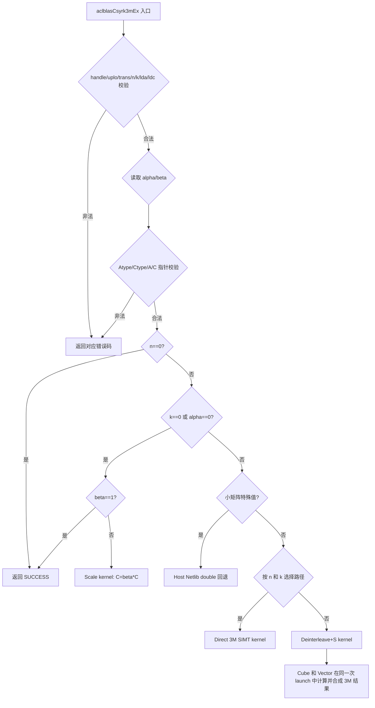

# aclblasCsyrk3mEx 算子设计文档

| 项目 | 内容 |
| --- | --- |
| 算子名称 | `aclblasCsyrk3mEx` |
| 任务名称 | 社区任务-aclblasCsyrk3mEx 算子开发（950） |
| 目标硬件 | Ascend 950PR（arch35） |
| 软件版本 | CANN 9.1.0 及以上 |
| 开发方式 | Ascend C Kernel 直调 |
| 数据类型 | C 为 COMPLEX64；A 为 COMPLEX64 或 complex-int8（ACL_INT8） |
| 对齐基线 | cuBLAS `cublasCsyrk3mEx`；CBLAS `cblas_csyrk`（float64 参考可用 `cblas_zsyrk`） |
| 合入仓及目录 | `ops-blas`，`blas/syrk/arch35/`；测试 `test/syrk/csyrk3m_ex/arch35/` |
| 文档状态 | 设计完成，已完成 950PR 精度/性能自验 |

# 1. 需求背景（required）

## 1.1 需求来源

本需求来源于 CANN 社区任务《aclblasCsyrk3mEx 算子开发（950）》。任务要求在 Ascend 950PR（arch35）上，基于 `ops-blas` 开源仓使用 Ascend C 实现单精度复数对称矩阵秩-k 更新扩展接口 `aclblasCsyrk3mEx`，与 cuBLAS `cublasCsyrk3mEx` 的参数语义和数学定义对齐，并完成公共 API、Host 参数校验、Device Kernel、3M 算法、测试工程、算子 README 与自测报告。

本算子不是将既有 ACLNN/TBE 算子迁移为 Ascend C：ops-blas 在 1125 之前没有 `Ex` 后缀的 syrk 接口，也不存在对应的 TBE 实现。因此“TBE 源码路径”“算子信息库路径”等审核项不适用；数学与接口语义以 cuBLAS `cublasCsyrk3mEx`、Netlib `csyrk` 和任务书为准。

## 1.2 背景介绍

`aclblasCsyrk3mEx` 是 BLAS Level 3 的复数对称秩-k 更新接口，计算：

$$
C \leftarrow \alpha\,op(A)\,op(A)^T + \beta C
$$

其中：

- `trans = ACLBLAS_OP_N` 时，`op(A)=A`，A 的逻辑形状为 `n x k`，物理按列主序存储，`lda >= max(1,n)`；
- `trans = ACLBLAS_OP_T` 时，`op(A)=A^T`，A 的物理形状为 `k x n`，`lda >= max(1,k)`；
- `trans = ACLBLAS_OP_C` 在本对称算子中按 `ACLBLAS_OP_T` 等价处理，**不做共轭**；
- C 为 `n x n` 复数对称矩阵，列主序存储，仅 `uplo` 指定的上三角或下三角被读写；另一三角由 `C = C^T` 隐含；
- 对称语义下对角元素 `C(i,i)` 的虚部是有效数据，计算后原样保留，**不置 0**；
- `alpha`、`beta` 为 COMPLEX64 标量，支持 Host/Device 指针；
- C 的类型固定为 COMPLEX64；A 支持 COMPLEX64 与 complex-int8（`ACL_INT8`，每个复元素按 `(int8 real, int8 imag)` 交错 2 字节存储，对应 cuBLAS `CUDA_C_8I`）。

与 Hermitian 的 `cherk` 不同，本算子的乘积是 `X·X^T` 而不是 `X·X^H`。3M 分解必须使用：

- `P0 = Xr·Xr^T`
- `P1 = Xi·Xi^T`
- `P2 = (Xr+Xi)·(Xr+Xi)^T`
- `实部 = P0 − P1`，`虚部 = P2 − P0 − P1`

若误用 Hermitian 的 `X·X^H` 交叉项，虚部会变成 `Xi·Xr^T − Xr·Xi^T`，与正确值 `Xi·Xr^T + Xr·Xi^T` 符号/组成不同，属于原则性错误。

## 1.3 标杆算子现状分析

ops-blas 已有非 Ex 的 `aclblasCsyrk`（arch35）实现，其 Host 参数校验、uplo 三角访问、对称对角虚部保留、特殊值回退等逻辑可以复用；但非 Ex 的 csyrk 使用 4M 分解（`Q0=ArAr^T`、`Q1=AiAi^T`、`Q2=ArAi^T`、`Q3=AiAr^T`），不满足本任务“3M + 单次 kernel launch”的算法要求。本任务新增独立的 `aclblasCsyrk3mEx` 入口与 3M kernel 路径，不调用尚未合入的 `aclblasCsyrkEx`，也不使用三次独立 GEMM 调用拼接。

仓内 `blas/gemm/arch35/cgemm3m_*` 提供了复数 3M GEMM 的舍入与分解参考；本算子的 3M 乘积是 `X·X^T`，因此只借鉴其“将复数乘拆成实数乘、在单次 device 执行中组合”的思想，不套用其 GEMM 结果布局。

# 2. 需求分析（required）

## 2.1 接口定义

在 `include/cann_ops_blas.h` 新增公共声明：

```cpp
aclblasStatus_t aclblasCsyrk3mEx(
    aclblasHandle_t handle,
    aclblasFillMode_t uplo,
    aclblasOperation_t trans,
    int n, int k,
    const aclblasComplex* alpha,
    const void* A, aclDataType Atype, int lda,
    const aclblasComplex* beta,
    aclblasComplex* C, aclDataType Ctype, int ldc);
```

`aclblasComplex` 以 `include/cann_ops_blas_common.h` 中的定义为准（实部/虚部各 float32）。接口通过 `handle` 取得绑定 stream，所有 Device 计算按该 stream 异步执行；接口返回不代表 Device 计算完成，Host 读回结果前需同步 stream。

## 2.2 参数与约束

| 参数 | 位置 | 类型 | 约束和语义 |
| --- | --- | --- | --- |
| `handle` | Host | `aclblasHandle_t` | 必须是有效句柄；空指针返回 `ACLBLAS_STATUS_HANDLE_IS_NULLPTR` |
| `uplo` | Host | `aclblasFillMode_t` | 仅 `ACLBLAS_UPPER` / `ACLBLAS_LOWER`；非法值返回 `ACLBLAS_STATUS_INVALID_ENUM` |
| `trans` | Host | `aclblasOperation_t` | `OP_N` / `OP_T` / `OP_C`；`OP_C` 按无共轭 `OP_T` 执行；非法值返回 `ACLBLAS_STATUS_INVALID_ENUM` |
| `n` | Host | `int` | `n >= 0`；`n = 0` 为合法 no-op |
| `k` | Host | `int` | `k >= 0`；`k = 0` 时不读取 A，只处理 beta 路径 |
| `alpha` | Host/Device | `const aclblasComplex*` | 不可为空；Host/Device 位置自动探测，alpha 与 beta 必须同为 Host 或同为 Device |
| `A` | Device | `const void*` | 执行秩-k 更新时必需，按列主序和 `Atype` 解释 |
| `Atype` | Host | `aclDataType` | 仅 `ACL_COMPLEX64` / `ACL_INT8`；其他值或组合不支持返回 `ACLBLAS_STATUS_NOT_SUPPORTED` |
| `lda` | Host | `int` | N：`lda >= max(1,n)`；T/C：`lda >= max(1,k)`；否则 `ACLBLAS_STATUS_INVALID_VALUE` |
| `beta` | Host/Device | `const aclblasComplex*` | 不可为空；位置约束同 alpha |
| `C` | Device | `aclblasComplex*` | `n>0` 时不可为空；`n x n` 列主序，原地更新指定三角 |
| `Ctype` | Host | `aclDataType` | 仅 `ACL_COMPLEX64`；其他值返回 `ACLBLAS_STATUS_NOT_SUPPORTED` |
| `ldc` | Host | `int` | `ldc >= max(1,n)`；否则 `ACLBLAS_STATUS_INVALID_VALUE` |

校验顺序：先校验 handle，再校验 uplo/trans，然后校验 n/k、lda/ldc，最后校验 alpha/beta、Atype/Ctype 与 A/C 指针；结构合法后再执行 quick return。`n = 0` 时允许 A、C 为 NULL；`k = 0` 或 `alpha = (0,0)` 时 A 可为 NULL，但 `n > 0` 时 C 必须非空（beta ≠ 1 时仍需 `C = beta·C`）。

## 2.3 特殊语义

- `n = 0`：合法 no-op，接口返回成功，不引用 A/C、不启动 kernel。
- `k = 0` 或 `alpha = (0,0)`：
  - 若 `beta = (1,0)`：quick return，C 不变；
  - 若 `beta ≠ (1,0)`：只对 C 的 uplo 三角执行 `C = beta·C`，不引用 A；
  - `beta = (0,0)` 时不读取 C 旧值，直接写 0。
- `OP_C` 与 `OP_T` 等价，不做共轭。
- 对角元素虚部保留，不做 Hermitian 置零。
- 非 uplo 三角和 `ldc` padding 不写；测试用哨兵值验证未被改写。
- `Atype = ACL_INT8`：每个复元素 2 字节 `(int8 real, int8 imag)`，`lda`/`ldc` 仍以复元素为单位；golden 将 int8 实部/虚部精确提升到 float/double 后计算。

## 2.4 数学公式与 3M 分解

输入复数矩阵 `X = op(A) = Xr + i·Xi`，则：

```text
C = alpha * (X * X^T) + beta * C

P0 = Xr * Xr^T
P1 = Xi * Xi^T
P2 = (Xr + Xi) * (Xr + Xi)^T

real(X * X^T) = P0 - P1
imag(X * X^T) = P2 - P0 - P1
```

三次实数矩阵乘 `P0/P1/P2` 在**同一次 cube kernel launch** 内完成；没有用三次独立 GEMM host 调用拼接，也没有套用 Hermitian 的 `X·X^H` 分解。

小尺寸使用单次 SIMT kernel，由一个或多个 lane 累加每个输出的三个实数乘积，再完成 K 归约和复数缩放。

# 3. 详细设计（required）

## 3.1 总体流程



## 3.2 Host 侧设计

### 3.2.1 参数校验

Host 入口按任务书 §2.4/§2.5 逐参数校验并返回对应状态码。Atype/Ctype 校验先于 A/C 指针校验；uplo/trans 非法返回 `INVALID_ENUM`，n/k/lda/ldc 非法或 alpha/beta/A/C 空指针返回 `INVALID_VALUE`，Atype/Ctype 不在支持集返回 `NOT_SUPPORTED`。

### 3.2.2 标量读取

alpha/beta 使用 `aclrtPointerGetAttributes` 判断 Host/Device 位置：

- 两者均为 Host：直接解引用；
- 两者均为 Device：按 handle stream 执行两次 8 字节 D2H，再同步 stream；
- 一 Host 一 Device：返回 `INVALID_VALUE`。

读取后把 `alphaReal/alphaImag/betaReal/betaImag` 放入 tiling，Device 侧无需再次解引用 Host 指针。

### 3.2.3 quick return 与 beta-only 路径

- `n == 0`：直接返回成功。
- `(k == 0 || alpha == 0) && beta == (1,0)`：直接返回成功，不启动 kernel。
- `k == 0 || alpha == 0` 且 `beta != 1`：启动 `csyrk3m_ex_scale_kernel`，仅遍历 uplo 三角执行 `C = beta*C`；beta=0 时不读取旧 C，避免旧 C 中的 NaN 污染结果。

### 3.2.4 特殊值/大标量回退

3M 分解在 Inf/NaN/FLT_MAX 量级输入或超大 alpha（|α| > 1e3）下，其部分积的 Inf/NaN 传播和相消舍入与 Netlib/cblas 直接复数乘不同。对 `n*k <= 128*128` 的 COMPLEX64 输入，Host 在调用时执行以下步骤。

1. D2H 复制 A（仅 COMPLEX64）并扫描 alpha/beta 与逻辑 A 区域；
2. 若存在非有限值、`|v| > 1e19`、subnormal 或超大标量，则 D2H C，使用共享的 double Netlib `csyrk` 参考循环计算，再 H2D 写回 C；
3. 否则继续正常 NPU 路径。

该回退只在极小规模触发，不进入大 shape 热路径；测试 golden 对同一条件使用同一个 double Netlib 参考，保证特殊值比对稳定。有限、常规量级输入仍由 3M cube/direct 路径在 NPU 上计算。

### 3.2.5 Tiling 与 workspace

- direct 路径：无 workspace；tiling 携带 n/k/lda/ldc、trans、uplo、int8 标志、alpha/beta。
- Cube 路径的 `arRows = trans==N ? n : k`，`arCols = trans==N ? k : n`，`arLdc = CeilAlign(arRows, 16)`。工作区需求为 `3 * arLdc * arCols * bytesPerElement`，COMPLEX64 的实数平面使用 FP32，INT8 输入精确打包为 FP16。工作区上限为 2 GiB。
- 根据阶数选择 32、64 或 128 的方形分块。Host 按有效三角块数和 Cube 核数确定 block 数，L1 和 L0 容量决定每级可容纳的 K 分块。

## 3.3 Kernel 侧设计

### 3.3.1 Direct 3M SIMT

`n <= 32 && k <= 64` 或 `n <= 16 && k > 256` 使用 `csyrk3m_ex_direct_kernel`。按 K 选择一组 lane 协同计算一个三角输出。长 K 路径先用融合 3M 公式形成每项实部和虚部，再补偿累加。

### 3.3.2 输入打包

`csyrk3m_ex_deinterleave_kernel` 将 A 拆为 `Ar`、`Ai` 和 `S=Ar+Ai`。COMPLEX64 使用 SIMD 与 DMA 双缓冲，INT8 转为精确的 FP16 值。三个实数平面都按列主序打包，保留逻辑前导维访问。

### 3.3.3 Cube 与 Vector 融合

`csyrk3m_ex_cube_kernel` 中，每个 Cube block 负责若干三角块。Cube 以 L1 和 L0 双缓冲计算 `P0/P1/P2`，对角块复用左右输入面板。Fixpipe 将 FP32 部分积交给配对 Vector 核。Vector 在 UB 合成复数、归约 K 分段、应用 `alpha/beta` 并写回目标三角。`beta=(0,0)` 时跳过旧 C 的 DMA 读取。

<details>
<summary>优化前的 Cube 和合成实现</summary>

#### 原 3M Cube

`csyrk3m_ex_cube_kernel` 在**一个 AIC kernel** 内依次完成三个实数 GEMM：

```text
P0 = Ar * Ar^T
P1 = Ai * Ai^T
P2 = S  * S^T
```

- `trans=N`：left = `DNExt(arLdc,k)`（A 的 n×k 列主序），right = `NDExt(k,arLdc)`（A^T）；
- `trans=T/C`：left = `NDExt(n,arLdc)`（op(A)=A^T），right = `DNExt(arLdc,n)`；
- 三个结果分别写入 temp 的 q0/q1/q2 段；`k > 512` 时每个产品再按 K 拆成 3 或 4 段（512<k<=2048 为 3 段，k>2048 为 4 段），各段写独立 temp 平面，段偏移为 `(q*kSplit+s)*n*tempLdc`；
- 使用 `SyrkGemmKernelImpl` 的 FP32 mmad，`SetHF32Mode(DISABLE)`；每个 owned 64x64 C tile 只处理 uplo 三角；
- 三个实数 GEMM 在同一个 cube kernel launch 内完成；K 分段只是同一 GEMM 的累加拆分，不改变“三次实数乘”的算法语义；
- 三个 GEMM 共享同一 `Csyrk3mExCubeTilingData`，block 数与 tile 划分一致；temp 布局为列主序，供 combine 读取。

选择 K 分段的阈值 `k > 512`：k 较大时单条 FP32 累加链的相消误差会在 `P0-P1`、`P2-(P0+P1)` 中被放大；拆成 3 段（512<k<=2048）或 4 段（k>2048）后每段累加长度降为 k/3 或 k/4，combine 再对分段求和，可把误差压回 `1e-2`/32ULP 阈值内；自验全量 1000 条精度用例通过。

#### 原 Combine（AIV/SIMT）

`csyrk3m_ex_combine_kernel` 按 uplo 三角遍历 `n*n`：

- 普通元素：从 temp 读各 K 分段的 `p0/p1/p2` 并累加，`cr=p0-p1`、`ci=p2-(p0+p1)`；
- `k > 256` 时 combine 跳过对角，由独立 `csyrk3m_ex_diag_kernel` 用分组 lane（16 或 32 lane/元素）+ Kahan 重算对角：`sr += ar^2 - ai^2`、`si += 2*ar*ai`，避免 3M 中间量相消；
- 复乘 alpha：实部/虚部分别计算，零分量显式跳过；
- beta=(0,0) 时不读旧 C，否则叠加 `beta*C`，零分量显式跳过；
- 只写 uplo 三角，非 uplo 与 padding 不动；
- 对角虚部按普通复数元素处理，不做置零。

</details>

### 3.3.4 Scale（AIV/SIMT）

`csyrk3m_ex_scale_kernel` 用于 `k==0` 或 `alpha==0` 且 beta != 1：仅遍历 uplo 三角，`C = beta*C`；beta=0 时直接写 0，不读旧 C。

## 3.4 分核与内存设计

| 阶段 | 执行单元 | 并行方式 | 说明 |
| --- | --- | --- | --- |
| Direct | AIV/SIMT | 多 lane 协作归约 K | 单次 launch |
| 打包 | AIV | 按输入列的面板或元素分核 | 写入 Ar、Ai、S |
| 3M 与回写 | AIC + AIV | 三角块 | 计算三个部分积，在 UB 归约和缩放 |
| Scale | AIV/SIMT | 按列分核 | 只写 uplo 三角 |

工作区存放三个输入平面。Cube 结果在片上传给配对 Vector 核处理。

<details>
<summary>优化前的工作区布局</summary>

Temp 与 Ar/Ai/S 均位于 handle 默认 workspace；Cube 阶段通过 L1/L0A/L0B/L0C 的 tensor_api 流水线完成搬运与 mmad。每个 owned 64x64 tile 只计算 uplo 三角；非 uplo 三角不写入，避免破坏调用方哨兵/旧值。

</details>

## 3.5 精度设计

- FP32 一般块按 384 个 K 元素分段。`k > 256` 时，对角块按 64 个 K 元素分段。当 alpha 实部和虚部均非零时，对角块使用 32 元素分段。
- INT8 的三个实数输入平面可用 FP16 精确表示。按 256 个 K 元素分段，使单段乘积的累加在 FP32 的整数精确范围内完成。
- 特殊值/超大标量/小矩阵：double Netlib 回退，测试 golden 使用同一参考。
- 测试按任务书 §3.2：COMPLEX64 实部/虚部分别按 FLOAT32 判定，`rtol = atol = 2^-13`，`matched_ratio >= 0.99`，`max_abs_error <= 1e-2`（或 32×ULP）；golden 由 CBLAS `cblas_csyrk`（int8 精确提升后用 `cblas_zsyrk`）生成；3M 与直接复数乘不要求逐位一致。

## 3.6 性能设计

- 小规格用单次 launch 减少固定开销。常规规格用两次 launch 完成输入打包和融合计算，消除三个部分积在全局内存中的中转。
- 测试按任务书 §3.3：warmup 5 次 + 有效采样 10 次；正式 kernel 时间用 `msprof op` 的 `Task Duration(us)` 采集，单 case 与全部 case 平均倍率同时判定。

## 3.7 支持硬件

| 芯片版本 | 支持情况 |
| --- | --- |
| Ascend 950PR（arch35） | 支持，本任务自验目标 |
| Ascend 950DT（arch35） | 支持（同一 arch35 实现） |
| Atlas A2/A3（arch22） | 不在本任务范围；当前新增实现位于 arch35 |

## 3.8 算子约束限制

- 不支持广播：A、C 为独立操作数，shape 不做广播。
- 不要求支持超出 `lda/ldc` 语义的任意非连续布局；不产生 ViewCopy/AutoContiguous 临时空间。
- C 为原地覆写；调用方须保证 C 可写区域与 A 可读区域不重叠。
- 不支持动态 shape 的图模式；n/k 为运行时入参，Host 按实际值 tiling/launch。
- 确定性：不要求逐位确定；3M 的 K 分段/归约顺序由 shape 与片上容量决定，不按测试编号或随机种子分派。
- COMPLEX64 小矩阵的特殊值检测和 Device 标量读取会同步 handle stream。

# 4. 可维可测分析（required）

## 4.1 精度标准/性能标准

| 验收标准 | 描述 | 标准来源 |
| --- | --- | --- |
| 精度标准 | COMPLEX64 实部/虚部分别按 FLOAT32：rtol=atol=2^-13，matched_ratio>=0.99，max_abs_error<=1e-2（或 32×ULP） | 任务书 §3.2、生态算子开源精度标准 |
| 性能标准 | kernel-to-kernel：单 case NPU msprof kernel 时间 <= GPU `gpu_ms` / 0.4；全部性能 case 平均加速比 >= 0.5 | 任务书 §3.3、`gpu_baseline.csv` |

## 4.2 测试设计

测试位于 `test/syrk/csyrk3m_ex/`，由 CSV 驱动：

- `csyrk3m_ex_param.h`：解析 uplo/trans/n/k/alpha/beta/Atype/lda/Ctype/ldc 及期望状态；
- `csyrk3m_ex_golden.h`：CBLAS golden；int8 精确提升；beta=0 不读旧 C；OP_C 按 CblasTrans 处理；特殊值走共享 double Netlib 参考；
- `arch35/csyrk3m_ex_npu_wrapper.h`：Host 数据分配、Atype 相关 A 拷贝、C 回读；
- `arch35/csyrk3m_ex_test.cpp`：GTest CSV 驱动，uplo 三角按实部/虚部分别使用 mixed tolerance，非 uplo 三角 EXACT 比对；性能用例打印 `[PERF] case=<name> ... avg_us=<数值>`（warmup 5 + 10 次事件平均）。

用例覆盖：

- uplo × trans（N/T/C）全组合；
- Atype = ACL_COMPLEX64 / ACL_INT8；
- n/k 尺寸扫描（0、1、2、3、5、7、16、31、32、33、63、64、65、127、128、129、255、256、511、512、1023、1024、2047、2048、4095、4096 等）；
- alpha/beta 特殊值（0、1、i、±1e4）与随机复数；
- lda/ldc 紧凑、+1/+8/+64 padding、低于下界/0/负数负向；
- 非法枚举、非法 Atype/Ctype、空指针；
- k=0/beta 缩放、alpha=0 不引用 A、beta=0 不读旧 C、对角虚部保留；
- Inf/NaN/EXTREME/ALTER 特殊填充；
- int8 边界值与 int8 极值；
- TC_3M_* 专项：3M 实/虚部抵消、int8 极值、对角虚部保留。

## 4.3 兼容性分析

新增独立接口 `aclblasCsyrk3mEx`，不修改既有 `aclblasCsyrk`/`aclblasCherk` 的签名或数值路径；新增声明位于公共头文件，按 ops-blas 规范可与其他产品线共用。测试目录新增 `test/syrk/csyrk3m_ex/arch35/`，不影响已有 syrk 测试。

# 5. 交付件

| 交付件 | 路径/说明 |
| --- | --- |
| 公共声明 | `include/cann_ops_blas.h` |
| 实现 | `blas/syrk/arch35/csyrk3m_ex_host.cpp`、`csyrk3m_ex_kernel.cpp/.h`、`csyrk3m_ex_tiling_data.h`、`csyrk3m_ex_netlib_reference.h` |
| 算子文档 | `blas/syrk/README.md` 的 `aclblasCsyrk3mEx` 章节 |
| 测试 | `test/syrk/csyrk3m_ex/`（param/golden/wrapper/test.cpp/CSV/CMakeLists） |
| 用例包 | `test_cases/csyrk3m_ex_test.csv`、`gpu_baseline.csv`、`verify_accuracy.py`、`verify_performance.py` |
| 自测 | `task_submission/`（自验证步骤、精度/性能/内存日志，均不带时间戳） |

编译与运行：

```bash
source /usr/local/Ascend/cann-9.1.0/set_env.sh
bash build.sh --ops=csyrk3m_ex --soc=ascend950
./build/test/syrk/csyrk3m_ex/csyrk3m_ex_test --gtest_filter='-*TC_PF*'
msprof op --application="./build/test/syrk/csyrk3m_ex/csyrk3m_ex_test --gtest_filter=*TC_PF*" --output=./prof_csyrk3m_ex
```

# 6. 参考

1. cuBLAS `cublasCsyrk3mEx` 文档。
2. Netlib BLAS `csyrk.f`。
3. ops-blas 仓 `blas/syrk/arch35/csyrk_*`、`blas/gemm/arch35/cgemm3m_*`。
4. 生态算子开源精度标准（mixed tolerance）。
5. CANN Ascend C 算子开发文档。
