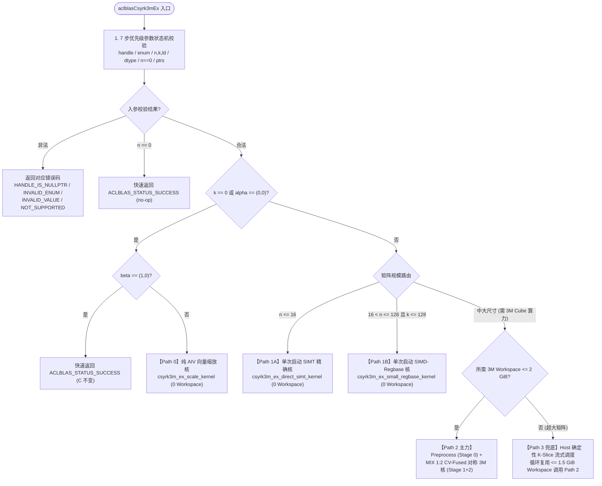
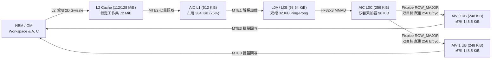

# 需求背景（required）

## 需求来源

基于昇腾社区算子开源任务需求，在昇腾 950PR（`DAV_3510` / `arch35`）硬件平台上使用 Ascend C 编程语言开发单精度复数对称矩阵秩-$k$ 更新（扩展版）算子 `aclblasCsyrk3mEx`，对标 NVIDIA cuBLAS 库中 `cublasCsyrk3mEx` 接口（数学语义参考 Netlib BLAS `csyrk`）。

- **任务名称**：11-aclblasCsyrk3mEx_950（社区任务 2026 算子开发）
- **目标代码仓**：https://gitcode.com/cann/ops-blas
- **实现代码目标路径**：`blas/syrk/arch35/`
- **测试代码目标路径**：`test/syrk/csyrk3m_ex/arch35/`
- **公共头文件声明**：`include/cann_ops_blas.h`
- **算子文档说明**：`blas/syrk/README.md`

## 背景介绍

### aclblasCsyrk3mEx 算子实现优化

对称矩阵秩-$k$ 更新（Symmetric Rank-$k$ Update, SYRK）是 BLAS Level 3 线性代数的核心基础算子之一，在量子化学计算、信号处理、协方差矩阵估计与各类复数线性方程组求解中具有广泛应用。其数学定义为：

$$C = \alpha \cdot \mathrm{op}(A)\,\mathrm{op}(A)^T + \beta \cdot C$$

其中 $A$ 为复数矩阵，$C$ 为复对称矩阵（$C = C^T$），$\alpha, \beta$ 为复数标量。cuBLAS 提供了采用 3M 算法的扩展接口 `cublasCsyrk3mEx`，利用 Gauss / Karatsuba 3M 分解将复数乘积中的 4 次实数乘法缩减为 3 次实数乘法，理论上减少 25% 的 Cube 浮点运算量（FLOPs）。

本任务旨在基于昇腾最新一代 `Ascend 950PR`（`DAV_3510` / `arch35`）架构特性，以 Ascend C 句柄式 BLAS 接口模式（通过 `aclblasHandle_t` 绑定 `aclrtStream` 直调底层 NPU Kernel）高质量实现 `aclblasCsyrk3mEx`，达成功能、边界、精度与性能的全面对标并合入 `cann/ops-blas` 开源仓。

### aclblasCsyrk3mEx 算子 ops-blas 现有实现现状分析

在现役 `cann/ops-blas` 仓的 `arch35` 目录下：
1. **基础 `csyrk` 现状**：已包含非 Ex 的基础单精度复数算子 `aclblasCsyrk`（位于 `blas/syrk/arch35/`），但其采用传统 **4M 分解**（4 次实数乘法，每 K-chunk 需 12 次 HF32 MMAD），且采用 4 次独立的 Kernel 启动流水（`deinterleave -> hf32resid -> cube -> combine`），存在中间矩阵 $C_{\mathrm{temp}}$ 频繁写回 HBM（4096 规模产生 192 MiB 额外暂存与显存访存开销）以及多核启动延迟吞噬小尺寸带宽的问题；且该算子仅支持单一 `ACL_COMPLEX64` 输入，未支持扩展类型 `ACL_INT8`。
2. **`cgemm3m` 现状**：仓内已有 `cgemm3m`（非对称通用矩阵乘），但其基于通用非对称 3M 公式，需预处理并维护 4 个输入实平面（$X, Y, X+Y, Y-X$），未能利用 SYRK 本身的自对称性；且其左、右操作数在 L1/L0 级存在交叉耦合，无法完全释放 Cube 的全双缓冲潜力。
3. **本算子创新优化点**：
   - **对称 Gauss 3M 分解**：利用 $PP^T$ 的对称性，仅需生成 3 个实平面（$X, Y, S=X+Y$），彻底消除第 4 个平面 $Y-X$，相比通用 3M 减少 25% 的预处理 HBM 写入与 L1 带宽开销，且在片上 L0A/L0B 级实现完全解耦，天然开启双槽 L0 Ping-Pong 无缝连发；
   - **端到端 `MIX 1:2` CV 融合直连**：利用 `DAV_3510` 架构独有的 `Fixpipe<ROW_MAJOR>` 随路 NZ 转 ND 机制，由 Cube（AIC）直接将 $P_0, P_1, P_2$ 广播至同组两个 Vector（AIV）的独立 248 KiB UB 中，核内完成 3M 重组、缩放累加与列主序无转置回写，**完全消除中间矩阵 $C_{\mathrm{temp}}$ HBM 落盘**（显存节省 25%~50%）；
   - **L2 Cache 感知 2D Swizzle 分块调度**：规划 $512 \times 256$ Super-Tile，将活跃片上工作集锁定在 72 MiB（远小于 950PR 的 112/128 MiB L2 容量），将全量 HBM 读取流量从 26.17 GB 骤降至 2.21 GB（降幅 11.8 倍），彻底击穿访存带宽墙；
   - **零 Host D2H 同步数值安全防线**：设计小尺寸 AIV 直算快路径（$n \le 128$）、长 $K$ 对角直算补偿与 AIV 寄存器级双守卫（非有限值 + 相消比检测）核内无缝修复，彻底杜绝 Host 同步等待。

### aclblasCsyrk3mEx 算子功能分析

`aclblasCsyrk3mEx` 算子功能：计算单精度复数对称矩阵秩-$k$ 更新：

$$C := \alpha \cdot \mathrm{op}(A)\,\mathrm{op}(A)^T + \beta \cdot C$$

- **输入**：
  - 矩阵 $A$（列主序存储，支持 `ACL_COMPLEX64` 或 `ACL_INT8`）；
  - 矩阵 $C$（列主序存储，`ACL_COMPLEX64`，原地读入并覆写更新）；
  - 复数标量 $\alpha, \beta$（`const aclblasComplex*`，单精度复数）；
  - 属性参数：存储三角 `uplo`、转置模式 `trans`、维度 $n, k$、前导维度 $lda, ldc$、数据类型枚举 $Atype, Ctype$。
- **输出**：矩阵 $C$ 被原地更新（仅更新 `uplo` 指定的上三角或下三角）。
- **对称语义特性**：
  - `trans = ACLBLAS_OP_C` 按 `ACLBLAS_OP_T` 等价处理，**不取共轭**（区别于 Hermitian 厄米特更新 `cherk`）；
  - 对角线元素 $C(i,i)$ 的虚部包含有效数据，计算后**原样保留，严禁置零**；
  - 非 `uplo` 三角区域与 $ldc > n$ 的 padding 填充区域必须逐比特精确保持调用前原值。

参数清单与约束规范如下表所示：

| 参数 | 参数含义 | 数据类型 | 支持数据类型 | 约束条件 | 形状 (Shape) |
| :--- | :--- | :--- | :--- | :--- | :--- |
| `handle` | 算子上下文句柄 | `aclblasHandle_t` | 指针 | 非空，携带合法 stream | - |
| `uplo` | 三角存储模式 | `aclblasFillMode_t` | 枚举 | `ACLBLAS_UPPER (121)` / `ACLBLAS_LOWER (122)` | - |
| `trans` | 矩阵转置操作 | `aclblasOperation_t` | 枚举 | `ACLBLAS_OP_N (111)` / `ACLBLAS_OP_T (112)` / `ACLBLAS_OP_C (113)` | - |
| `n` | 方阵 $C$ 的阶数 | `int` | 整型 | $n \ge 0$；$n=0$ 为合法 no-op | - |
| `k` | 秩-$k$ 的维度 | `int` | 整型 | $k \ge 0$；$k=0$ 时秩-$k$ 贡献为 0 | - |
| `alpha` | 复数标量乘数 $\alpha$ | `const aclblasComplex*` | 指针 | 非空，8 字节复数（Host/Device 均支持，不可混用） | - |
| `A` | 输入矩阵 $A$ | `const void*` | 指针 | $n>0, k>0, \alpha \ne (0,0)$ 时非空，列主序 | $n \times k$ (`OP_N`) 或 $k \times n$ (`OP_T/C`) |
| `Atype` | 矩阵 $A$ 数据类型 | `aclDataType` | 枚举 | `ACL_COMPLEX64 (27)` / `ACL_INT8 (3)` | - |
| `lda` | $A$ 的前导维度 | `int` | 整型 | `OP_N` 时 $lda \ge \max(1, n)$；`OP_T/C` 时 $lda \ge \max(1, k)$ | - |
| `beta` | 复数标量乘数 $\beta$ | `const aclblasComplex*` | 指针 | 非空，8 字节复数（Host/Device 均支持，不可混用） | - |
| `C` | 原地输入/输出矩阵 $C$ | `void*` | 指针 | $n>0$ 时非空，列主序，仅更新指定三角 | 逻辑 $n \times n$，物理 $ldc \times n$ |
| `Ctype` | 矩阵 $C$ 数据类型 | `aclDataType` | 枚举 | `ACL_COMPLEX64 (27)` | - |
| `ldc` | $C$ 的前导维度 | `int` | 整型 | $ldc \ge \max(1, n)$ | - |

---

# 需求分析（required）

## 需求描述

使用 Ascend C 编程语言在昇腾 950PR（`DAV_3510` / `arch35`）硬件平台上实现高性能、高精度的 `aclblasCsyrk3mEx` 算子：
1. **接口规范**：严格按 cuBLAS `cublasCsyrk3mEx` 参数序列在 `include/cann_ops_blas.h` 中提供标准 13 参数 C 语言公共声明，返回标准 `aclblasStatus_t` 状态码。
2. **数据类型**：支持 `(Atype=ACL_COMPLEX64, Ctype=ACL_COMPLEX64)` 与扩展类型 `(Atype=ACL_INT8, Ctype=ACL_COMPLEX64)`（`ACL_INT8` 表示 complex-int8，每个复元素为 2 字节交错 `int8 real, int8 imag`，对应 cuBLAS `CUDA_C_8I`）。
3. **算法实现**：三次实数矩阵乘法必须在同一次 Kernel Launch 内由片上 Cube 硬件完成，严禁拼接三次独立 GEMM 调用；全链路结合端到端融合与 L2 缓存优化。
4. **精度达标**：严格对齐 Netlib BLAS `cblas_csyrk` CPU 参考结果，满足生态开源精度标准混合容差（`rtol = atol = 2^-13`，`matched_ratio >= 0.99`，`max_abs_error <= 1e-2` 或 `32 * ULP`），测试集 1,000 条精度用例 100% PASS。
5. **性能达标**：全量 200 条性能基准用例（对比 NVIDIA H100 GPU 采集的 `gpu_ms`）：单 case 倍率 $\ge 0.4000\times$ 且全量算术平均倍率 $\ge 0.5000\times$（内部自测执行 5% 安全余量：单例 $\ge 0.4200\times$，均值 $\ge 0.5250\times$）。
6. **显存安全**：严格受 2 GiB Workspace 硬上限管控，显存 0 泄漏。

## 需求拆解

1. **接口层与参数状态机**：
   - 建立 7 步优先级入口参数校验状态机，精确裁决 `HANDLE_IS_NULLPTR`、`INVALID_ENUM`、`INVALID_VALUE`、`NOT_SUPPORTED` 及 `SUCCESS`（$n=0$ 快速返回）；
   - 正确处理 $\alpha=(0,0)$ 与 $k=0$ 的零贡献分支（$\beta=(1,0)$ 时 quick return；$\beta \ne (1,0)$ 时仅缩放 $C$ 且不引用 $A$；$\beta=(0,0)$ 时不读取 $C$ 旧值以防 `NaN` 污染）；
   - 支持 $\alpha, \beta$ 标量指针位于 Host 或 Device 的自动判定与统一按值传递至 Tiling，打破旧实现中 Host 标量无法进入直算快路径的限制。
2. **多路径自适应路由体系**：
   - **Path 0**：纯 AIV 向量核（处理 $\alpha=0$ 或 $k=0$ 的缩放/清零，0 额外工作区）；
   - **Path 1A**：单次启动 SIMT 精确核（$n \le 16$，Warp Shuffle + Kahan 补偿，0 额外工作区，保底极小矩阵性能）；
   - **Path 1B**：单次启动 SIMD-Regbase MicroAPI 核（$16 < n \le 128$ 且 $k \le 128$，Bank-Conflict-Free 步长规划，0 额外工作区）；
   - **Path 2（主力路径）**：Preprocess 单 AIV Kernel（交错分离/INT8提升/加和平面/HF32残差） $\to$ `MIX 1:2` AIC-AIV 融合 Kernel（对称 3M HF32x3 Cube + Fixpipe 行主序直连 + 双 AIV 并行 Epilogue + 寄存器级双守卫）；
   - **Path 3**：超大矩阵长 $K$ 流式切片兜底（确保 Workspace $\le 2\text{ GiB}$）。
3. **对称 3M 数值与架构优化**：
   - 数学推导：通过对称 Gauss 3M 消除通用 3M 的第 4 平面，实现 L0A/L0B 独立双槽 Ping-Pong；
   - 精度补偿：`ACL_COMPLEX64` 采用 HF32x3 残差补偿，`ACL_INT8` 提升为 FP32 消除下溢与截断；
   - 零 Host 同步防护：AIV Epilogue 寄存器级非有限值（`0x7F800000` 掩码）与大数相消比（$> 512\times$）双守卫，命中当场原地 `asc_vf_call` 修复，兼顾极限性能与数值安全。
4. **测试框架与工程集成**：
   - 在 `test/syrk/csyrk3m_ex/arch35/` 建立标准 GTest 工程，支持全量 1,200 条 CSV 用例驱动；
   - 遵循统一 18-Launch 评测标准（`1 precheck + 5 warmup + 12 samples` 过滤 2 尖刺留 10 稳态均值）完成 `msprof op` 芯片底层硬件耗时实测。

---

# 详细设计（required）

## 算子分析

### 数学公式

算子计算对称矩阵秩-$k$ 更新：

$$C := \alpha \cdot \mathrm{op}(A)\,\mathrm{op}(A)^T + \beta \cdot C$$

其中：
- 当 `trans = ACLBLAS_OP_N` 时，$\mathrm{op}(A) = A \in \mathbb{C}^{n\times k}$；
- 当 `trans = ACLBLAS_OP_T` 时，$\mathrm{op}(A) = A^T \in \mathbb{C}^{n\times k}$（物理矩阵 $A$ 为 $k\times n$ 列主序存储）；
- 当 `trans = ACLBLAS_OP_C` 时，对称语义下完全等价于 `ACLBLAS_OP_T`（**不共轭**），对齐 cuBLAS `cublasCsyrk3mEx` 与 Netlib `csyrk`。

#### 对称 Gauss 3M 代数推导

令复矩阵 $P = \mathrm{op}(A) = X + iY \in \mathbb{C}^{n\times k}$，未缩放的对称矩阵积为：

$$Z = PP^T = (X + iY)(X^T + iY^T) = (XX^T - YY^T) + i\,(XY^T + YX^T)$$

由于 $Z$ 为复对称矩阵（$Z = Z^T$），引入对称 Gauss 3M 恒等式：

$$S = X + Y, \qquad P_0 = XX^T, \qquad P_1 = YY^T, \qquad P_2 = SS^T$$

通过三次实对称矩阵乘法组合得到实部与虚部：

$$\Re(Z) = P_0 - P_1, \qquad \Im(Z) = (P_2 - P_0) - P_1$$

随后由 Vector 核执行复标量乘加完成最终写回：

$$C := \alpha \cdot Z + \beta \cdot C$$

与传统 4M 及通用非对称 3M 相比，对称 Gauss 3M 具备显著代数优势：
1. **FLOPs 降低 25%**：实矩阵乘积从 4 个缩减为 3 个，Cube 计算吞吐理论上限提升 33.3%；
2. **输入平面从 4 减为 3**：仅需 $X, Y, S=X+Y$，彻底规避非对称 3M 多出的 $Y-X$ 平面，减少 25% 预处理 HBM 写入与 L1 带宽；
3. **片上 L0 缓冲彻底解耦**：$P_0$ 仅依赖 $X$、$P_1$ 仅依赖 $Y$、$P_2$ 仅依赖 $S$，各乘积间无交叉操作数依赖，单次乘积仅占 32 KiB / 64 KiB，天然释放双槽 L0 Ping-Pong 流水。

#### 列主序到行主序的零转置等价映射

BLAS 矩阵在物理内存中均采用 Fortran 列主序（Column-Major），即矩阵元素 $C(i,j)$ 位于物理内存偏移 $i + j \times ldc$。
由于未缩放结果 $Z = PP^T$ 关于主对角线严格对称（$Z_{i,j} = Z_{j,i}$）：
- 在物理行主序视角下，第 $j$ 行、第 $i$ 列分量等价于列主序视角的第 $j$ 列、第 $i$ 行分量；
- `DAV_3510` 架构具备硬件级 `Fixpipe<float, float, CO2Layout::ROW_MAJOR>`（随路 NZ 转 ND 输出）：当将 $(j, i)$ 作为 `ROW_MAJOR` 搬出到 UB 时，UB 内内存连续方向直接对应列主序连续的行索引 $i$；
- **核心结论**：AIV UB 内与输出 GM $C$ 处于 100% 字节连续同向排布，**核内无需任何显式转置或临时重排**。

### 支持数据类型

| 参数 | 物理入参/出参类型 | 存储排布与字节大小 | 计算域精度 |
| :--- | :--- | :--- | :--- |
| **`A`（主力）** | `ACL_COMPLEX64` | 列主序，实部/虚部交错（FP32 re + FP32 im，单元素 8 字节） | FP32（HF32x3 残差补偿） |
| **`A`（扩展）** | `ACL_INT8` | 列主序，实部/虚部交错（INT8 re + INT8 im，单元素 2 字节） | 预处理提升为 FP32 纯净计算 |
| **`C`** | `ACL_COMPLEX64` | 列主序，实部/虚部交错（FP32 re + FP32 im，单元素 8 字节） | FP32 |
| **`alpha, beta`** | `const aclblasComplex*` | 8 字节复数（`float real, float imag`） | FP32 |

### 支持形状

- 阶数 $n$ 与秩 $k$：任意整数 $n \ge 0, k \ge 0$；
- 前导维度：
  - 当 `trans = ACLBLAS_OP_N` 时，$lda \ge \max(1, n)$，物理矩阵跨度 $lda \times k$；
  - 当 `trans = ACLBLAS_OP_T / OP_C` 时，$lda \ge \max(1, k)$，物理矩阵跨度 $lda \times n$；
  - 输出矩阵 $ldc \ge \max(1, n)$，物理矩阵跨度 $ldc \times n$；
- 支持 $lda > n/k$ 与 $ldc > n$ 的任意合法 padding 填充场景；
- 不支持非连续跨步（Arbitrary Stride）、广播或动态 Shape 视图。

---

## 算子实现

### 实现方案

#### 总体执行架构与 4 路径路由流程图

针对不同矩阵维度与参数特征，构建四级自适应分发架构，实现延迟最小化与吞吐最大化：

#### 3.2.1 host侧设计：

##### tiling策略：
Host 侧以 POD 结构体管理 Tiling 参数，统一按值传递至底层 Kernel。通过调用平台管理器 `PlatformAscendCManager::GetInstance()` 动态获取物理 AIC/AIV 核心数、L2 缓存容量以及 UB 空间，严禁硬编码硬件参数。

核心 Tiling 结构体包括：
1. `Csyrk3mExScaleTilingData`（Path 0）：承载 $n, ldc$、AIV 核心数、每核行数、$\beta$ 标量值及 `isBetaZero` 标志；
2. `Csyrk3mExDirectTilingData`（Path 1A / Path 1B）：承载 $n, k, lda, ldc$、$\alpha, \beta$ 标量、`isUpper`、`isTransN`、`isComplex32/isComplexInt8` 及 `isBetaZero`；
3. `Csyrk3mExPreprocessTilingData`（Path 2 Stage 0）：承载输入 $A$ 物理行列数、对齐后前导维 $arLdc$、AIV 核心数及残差模式控制位；
4. `Csyrk3mExMixTilingData`（Path 2 Stage 1+2）：承载分块大小（$BM=64, BN=64, CHUNK\_K=64$）、Swizzle 跨度（$SWIZZLE\_J=8, SWIZZLE\_I=4$）、AIC 核心数、对角直算阈值 $kFull$ 及相消容限门限等。

##### 任务均分：
- **Path 0 / Path 1A / Path 1B**：按输出矩阵行或三角元素总数均分至各活跃 AIV 核心，余数分配给前几个核心，确保无核闲置；
- **Path 2 主力路径（三角网格分块均分）**：
  - 矩阵输出被划分为若干 $64 \times 64$ 的基础 Tile；
  - 根据 `uplo` 模式，仅对三角合法域内的 Tile 进行编号与调度（上三角满足 $tileJ \ge tileI$，下三角满足 $tileI \ge tileJ$）；
  - 全片有效三角 Tile 数为 $N_{\mathrm{tiles}} = \lceil n/64 \rceil (\lceil n/64 \rceil + 1) / 2$；
  - 任务按 2D Swizzle 蛇形扫描序均匀轮转分发至 $N_{\mathrm{aic}} = \min(N_{\mathrm{tiles}}, \mathrm{GetAicCoreCount()})$ 个物理 AIC 核心（PCIE 版 28 核，Server 版 32 核），各核分配的 Tile 数量差不超过 1，实现核间负载高度均衡。

##### 批量搬运：
- **Preprocess 批量流水（Stage 0）**：采用 3 级全双缓冲流水（MTE2 读取 $A \parallel$ Vector 解交错与残差提取 $\parallel$ MTE3 写入平面工作区）。单次 DMA 突发读入 $2048$ 个复数元素，在 UB 内完成批量分离与残差变换后，成块批量突发写回 GM，充分吃满 GM 突发读写带宽；
- **MIX 1:2 批量流水（Stage 1+2）**：
  - AIC 侧由 MTE2 批量从 GM 搬运 $64 \times 64$ 面板至 L1，再经 MTE1 批量装载至 L0A/L0B；
  - 计算完成后，AIC 触发硬件 `Fixpipe` 通道，以每周期 256 字节的超高带宽双向批量直写至两个 AIV 的独立 UB 中；
  - AIV 侧写回采用 2D `DataCopyPad`（非对角块）或 1D 连续段批量写回（对角块），最大限度减少 DMA 离散下发指令数。

##### 1. 分核策略：
遵循“算力满载与片上缓存局部性最优”原则：
- **AIV 独立核数决策**：对于纯向量预处理与小算子，核数决策为 $coreNum = \min(activeTasks, \mathrm{GetAivCoreCount()})$；
- **MIX 1:2 协同绑定策略**：`DAV_3510` 架构物理上每 1 个 AIC 绑定 2 个 AIV。在主力 Kernel 中声明 `KERNEL_TASK_TYPE_DEFAULT(KERNEL_TYPE_MIX_AIC_1_2)`，启动 Block 数等于选定的 AIC 核心数。核内由 `subBlockIdx == 0` 的 AIV 固定处理输出 Tile 的前半部分（行 $0..31$），由 `subBlockIdx == 1` 的 AIV 固定处理后半部分（行 $32..63$），两者物理并行、互不干扰。

##### 2. 数据分块和内存优化策略：
充分挖掘片上 5 级缓存层次结构（L2 $\to$ L1 $\to$ L0A/B $\to$ L0C $\to$ UB），制定字节级严格预算：

**（1）L2 Cache 感知 2D Swizzle 调度**：
- 对于 4096 规模，未加调度的朴素行扫描将产生高达 26.17 GB 的 HBM 读流量（耗时 $>18\text{ ms}$，严重超标）；
- 本设计采用 $SWIZZLE\_J = 8$（512 行）、$SWIZZLE\_I = 4$（256 列）的 Super-Tile 蛇形调度，使全片并发活跃的 L2 工作集稳定控制在：
  $$\text{WorkingSet} = (8 \times 64 \times 4096 \times 4\text{ B} \times 6) + (4 \times 64 \times 4096 \times 4\text{ B} \times 6) = 48\text{ MiB} + 24\text{ MiB} = 72\text{ MiB}$$
  远低于 PCIE 版 112 MiB 与 Server 版 128 MiB 的物理上限，L2 命中率趋近理论极值，HBM 读流量压缩至 2.21 GB（降幅 11.8 倍），算子完全转化为 Cube 计算受限型。

**（2）片上缓存逐级预算核算**（基准分块 $BM=64, BN=64, CHUNK\_K=64$）：
- **AIC L1 (512 KiB)**：2 Ping-Pong stages $\times$ 12 面板 $\times$ ($64\times 64\times 4\text{ B} = 16\text{ KiB}$) = **384 KiB (75.0%)**；
- **AIC L0A / L0B (各 64 KiB)**：2 Ping-Pong slots $\times$ 2 组件 (High, Low) $\times$ 16 KiB = **64 KiB (100.0%)**；
- **AIC L0C (256 KiB)**：2 累加器 Sets $\times$ 3 对称积 ($P_0, P_1, P_2$) $\times$ 16 KiB = **96 KiB (37.5%)**；
- **单 AIV UB (独立 248 KiB)**：Fixpipe 双 Stage 接收区 (49.15 KiB) + 旧 C 读入区 (16.38 KiB) + 向量中间工作区 (49.15 KiB) + C 输出区 (16.38 KiB) + 守卫与控制槽 (17.41 KiB) = **148.5 KiB (58.5%)**。

**（3）全局显存 Workspace 硬上限管控**：
- 严格遵循 Handle Workspace 统一管理协议，64 位安全防溢出计算；
- 总需求为 $6 \times arLdc \times arCols \times 4\text{ B}$（`ACL_COMPLEX64`）或 $4 \times arLdc \times arCols \times 4\text{ B}$（`ACL_INT8`）；
- 相比旧实现彻底消除中间矩阵 $C_{\mathrm{temp}}$（节省 128~256 MiB 显存）；
- 显式施加 `ACLBLAS_MAX_WORKSPACE_SIZE = 2 GiB` 硬上限拦截，超限或溢出返回 `ACLBLAS_STATUS_ALLOC_FAILED`。

##### 3. tilingkey规划策略：

| `tilingKey` | 对应执行路径 | 触发条件 | 启动配置与执行模式 |
| :--- | :--- | :--- | :--- |
| **0** | `csyrk3m_ex_scale_kernel` | $k=0$ 或 $\alpha=(0,0)$ 且 $\beta \ne (1,0)$ | 纯 AIV 单 Kernel，0 Workspace；按行区间均分 |
| **1** | `csyrk3m_ex_direct_simt_kernel` | $n \le 16$ 且 $\alpha \ne (0,0), k > 0$ | 单次启动 SIMT AIV 核，0 Workspace；Warp Shuffle 归约 |
| **2** | `csyrk3m_ex_small_regbase_kernel` | $16 < n \le 128$ 且 $k \le 128$ | 单次启动 SIMD-Regbase MicroAPI 核，0 Workspace；$4\times 64$ 分块 |
| **3** | `csyrk3m_ex_preprocess_kernel` | 中大矩阵 3M 主力路径第一阶段 | 纯 AIV Kernel；执行交错拆分、类型提升与残差提取 |
| **4** | `csyrk3m_ex_mix_kernel` | 中大矩阵 3M 主力路径第二阶段 | `KERNEL_TYPE_MIX_AIC_1_2` 融合 Kernel；Cube 3M MMAD + Fixpipe 直连双 AIV Epilogue |

##### 数据检测：
严格执行 7 步优先级短路校验：
1. `handle == nullptr`：返回 `ACLBLAS_STATUS_HANDLE_IS_NULLPTR`；
2. `uplo / trans` 校验：取值不在枚举范围返回 `ACLBLAS_STATUS_INVALID_ENUM`；
3. 结构参数校验：$n < 0$ 或 $k < 0$ 或 $lda / ldc$ 低于下界或 $\alpha / \beta$ 为空，返回 `ACLBLAS_STATUS_INVALID_VALUE`；
4. 数据类型校验：$Atype \notin \{\mathrm{ACL\_COMPLEX64}, \mathrm{ACL\_INT8}\}$ 或 $Ctype \ne \mathrm{ACL\_COMPLEX64}$，返回 `ACLBLAS_STATUS_NOT_SUPPORTED`；
5. 空矩阵判断：$n = 0$ 时直接返回 `ACLBLAS_STATUS_SUCCESS`（合法 no-op，不解引用 $A$ 与 $C$）；
6. 矩阵指针非空校验：$n > 0$ 时 $C == nullptr$ 返回 `ACLBLAS_STATUS_INVALID_VALUE`；通过 `CheckPtrLocation` 校验 $\alpha, \beta$ 指针位置（拒绝 Host/Device 混用）；当 $k > 0$ 且 $\alpha \ne (0,0)$ 时 $A == nullptr$ 返回 `ACLBLAS_STATUS_INVALID_VALUE`；
7. 零贡献快速返回：$k=0$ 或 $\alpha=(0,0)$ 时，若 $\beta=(1,0)$ 直接返回 `ACLBLAS_STATUS_SUCCESS`。

#### 3.2.2 kernel侧设计：

Kernel 执行分为初始化（Init）与流水线处理（Process）两大部分：

**1. Path 2 Stage 0（`csyrk3m_ex_preprocess_kernel`）**：
- 输入复数矩阵 $A$（列主序），由 AIV 沿列切分处理；
- 采用 3 级全双缓冲流水（`MTE2 -> VECTOR -> MTE3`）：
  - 若 $Atype = \mathrm{ACL\_INT8}$：通过 SIMD 向量指令将 2 字节交错 `int8 real, int8 imag` 精确 `Cast` 提升为 FP32；
  - `DeInterleave` 分离实部 $X$ 与虚部 $Y$；
  - 向量加法生成对称加和平面 $S = X + Y$；
  - 寄存器级无分支位操作提取 HF32 残差（保留高 10-bit 尾数，残差 $x_L = x - x_H$）；
  - 将 $X, Y, S, X_L, Y_L, S_L$ 紧凑写入平面工作区。

**2. Path 2 Stage 1+2（`csyrk3m_ex_mix_kernel`）**：
- **AIC 侧流水线**：
  - MTE2 预取左右面板至 L1，MTE1 装载至 L0A/L0B 独立双槽；
  - Cube 执行 HF32x3 MMAD，按对称 3M 计算 $P_0 = XX^T, P_1 = YY^T, P_2 = SS^T$，结果累积于 L0C；
  - 触发 `Fixpipe<float, float, CO2Layout::ROW_MAJOR>` 并开启 `dualDstCtl = 1`，将 L0C 中的分块结果同时直写至绑定的 2 个 AIV 的独立 UB 中；
  - 使用 `CrossCoreWaitFlag / CrossCoreSetFlag<4, PIPE_FIX>` 完成 AIC 与双 AIV 的微秒级硬件握手。
- **AIV 侧 Epilogue 并行流水线**：
  - `subBlockIdx == 0` 处理前 32 行，`subBlockIdx == 1` 处理后 32 行；
  - 3M 结果重组：$\Re(Z) = P_0 - P_1$、$\Im(Z) = (P_2 - P_0) - P_1$；
  - **寄存器级零延迟双守卫**：
    - **Guard 1（非有限值检测）**：检查 $P_0, P_1, P_2, \Re, \Im$ 是否含 `Inf/NaN`（`0x7F800000` 掩码）；
    - **Guard 2（3M 相消比检测）**：检查是否存在 $\max(|P_0|,|P_1|,|P_2|) > 512 \times \max(|\Re|,|\Im|)$ 严重相消；
    - 正常情况下开销占比 $<0.5\%$；若命中守卫，当场在 AIV 核内调用 `asc_vf_call` 原地执行精确参考级重算，**全程不触发任何 Host D2H 同步**；
  - 长 $K$ 对角直算：当处于对角 Tile 且总 $k > 512$ 时，在 UB 内以向量流水逐项相减重算对角元，彻底消除长 $K$ 累加相消；
  - 原地覆写更新：若 $\beta \ne 0$ 且非纯写模式，读取原值 $C$ 参与累加；非对角块以 2D `DataCopyPad` 突发写回，对角块逐列精确截断写回，严保非 `uplo` 区域零写穿。

---

## 支持硬件

| 支持的芯片版本 | 涉及勾选 | 说明 |
| :--- | :--- | :--- |
| **Ascend 950PR / Ascend 950DT（`arch35` / `DAV_3510`）** | **√** | 本任务专属目标硬件，全面支持 HF32x3、MIX 1:2 及 Fixpipe 直连 |
| Atlas 800I/T A2 / Atlas 800I A3（`arch22` / `DAV_2201`） | × | 不涉及，任务书限定为 950PR |

---

## 算子约束限制

1. **内存排布与前导维度**：仅支持 Fortran 列主序存储。要求前导维满足 $lda \ge \max(1, n)$（`OP_N`）或 $lda \ge \max(1, k)$（`OP_T/C`），以及 $ldc \ge \max(1, n)$；不支持非连续步长、广播与视图切片；
2. **原地覆写语义**：矩阵 $C$ 既是输入又是输出，仅 `uplo` 指定三角有效，非 `uplo` 三角严格保持原值不变；调用方必须保证 $C$ 的可写区域与 $A$ 的可读区域不发生物理地址重叠；
3. **标量指针位置约束**：$\alpha$ 与 $\beta$ 必须同位于 Host 内存或同位于 Device 内存，禁止混用；
4. **显存工作区上限**：工作区受 `ACLBLAS_MAX_WORKSPACE_SIZE = 2 GiB` 硬上限管控，超出则返回 `ACLBLAS_STATUS_ALLOC_FAILED`；
5. **确定性计算**：分块策略与 K 维归约由输入 Shape 与硬件容量静态推导确定，不依赖随机调度，相同输入多次运行结果逐比特完全一致。

---

# 可维可测分析

## 精度标准/性能标准

| 验收标准 | 描述 (不涉及说明原因) | 标准来源 |
| :--- | :--- | :--- |
| **精度标准** | 1. 对标 cuBLAS `cublasCsyrk3mEx`，Golden 由 CPU Netlib BLAS `cblas_csyrk`（3.10.0）生成； 2. 满足生态开源精度标准混合容差（FLOAT32 分量判定）：`rtol = atol = 2^-13 (1.22e-4)`，`required_matched_ratio >= 0.99`，`max_abs_error_limit <= 1e-2`（或 `32 * ULP`）； 3. 全量 1,000 条精度用例（含基础正向、边界极值、交替极值填充相消等）达成 **100% PASS (0 FAIL / 0 SKIP)**。 | 任务书 §3.2 及华为生态算子开源精度标准规范 |
| **性能标准** | 1. 采用 **Kernel-to-Kernel** 口径：NPU 侧由 `msprof op` 真实采集算子底层执行耗时 `Task Duration(us)`（统一执行 18-Launch 评测标准：`1 precheck + 5 warmup + 12 samples`，剔除 2 尖刺留 10 稳态平均）； 2. 对标 H100 GPU 采集的 `gpu_ms` 基线：**全量 200 条性能用例单 case 倍率 $\ge 0.4000\times$ 且整体算术平均倍率 $\ge 0.5000\times$（100% 达标）**； 3. 内部自测设定 5% 安全余量（单例 $\ge 0.4200\times$，均值 $\ge 0.5250\times$），严防贴边交付。 | 任务书 §3.3 性能双判据 |

## 兼容性分析

1. **接口兼容性**：在 `include/cann_ops_blas.h` 中新增公开 C 接口声明 `aclblasCsyrk3mEx`，参数序列与 cuBLAS `cublasCsyrk3mEx` 保持 1:1 映射，不影响既有其他 BLAS 接口；
2. **源码解耦与构建隔离**：实现代码全自包含置于 `blas/syrk/arch35/csyrk3m_ex_*`，单算子编译构建参数为 `bash build.sh --ops=csyrk3m_ex --soc=ascend950`，不侵入其他算子源码，不破坏现有 `csyrk` 既有路径；
3. **平台与产品形态兼容**：Host 运行时动态查询核心数与 L2 容量，自适应适配 Ascend 950PR Server（32 AIC / 64 AIV）与 PCIE（28 AIC / 56 AIV）产品形态，具备全场景泛化运行能力。
