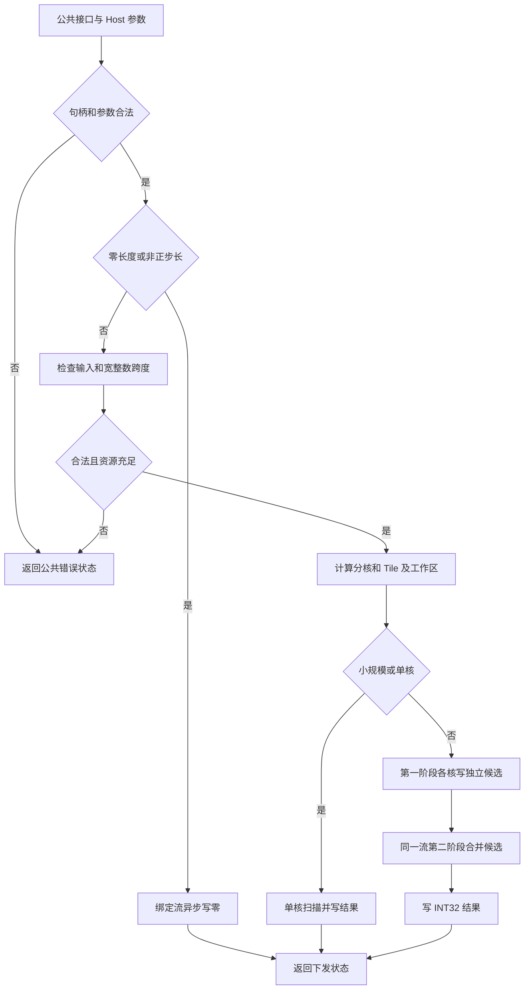
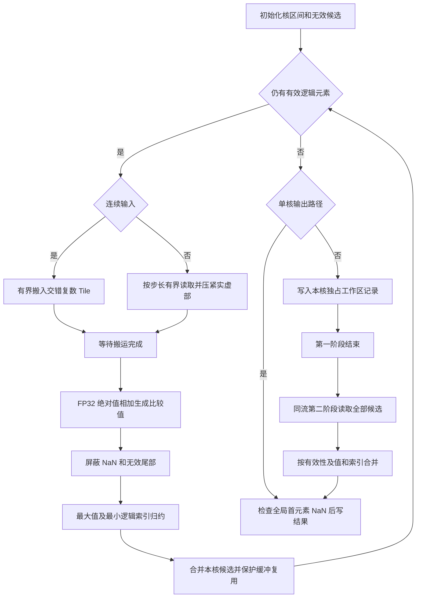

# aclblasIcamax 算子设计文档（A2/A3）

## 需求背景（required）

### 需求来源

[11月社区任务-aclblasIcamax算子开发（A2/A3）](https://www.hiascend.com/activities/task-center/details/3187f64ea116468190cabc7779a7cb03?menu=guide)要求使用 Ascend C 为 Atlas A2/A3 实现句柄式 BLAS 接口 `aclblasIcamax`。设计依据为任务页下载包中的 `aclblasIcamax_AtlasA2_A3_task_doc.md`、`test_cases/icamax_test.csv`、`gpu_baseline.csv`、`gen_csv.py`、两份验证脚本及测试 README。

| 项目 | 任务要求 |
| --- | --- |
| 算子仓库与工程 | `cann/ops-blas`，Ascend C Kernel 直调，通过 handle 绑定 stream |
| 算子实现 | `blas/iamax/arch22/` |
| 测试实现 | `test/iamax/icamax/arch22/`，补齐父级 CMake 的 arch22 GTest 注册 |
| 公共声明 | 复用 `include/cann_ops_blas.h` 中同名声明，各产品线共用 |
| 产品与软件 | Atlas A2/A3；CANN 9.1.0；golden 使用 Netlib BLAS 3.10.0 |
| 自验范围 | 任务书允许一种款型自验；性能指定 Atlas 800T A2（910B3） |
| 贡献者 | ASpringDay；远端仓库与任务平台操作限定在其 Edge 账号环境 |

设计文档目标仓库为 `cann/cann-ops-competitions`，目标基分支为 `master`。按用户指定的“月份-算子-平台/贡献者/docs/design.md”结构，本任务文档路径为 `04_tasks/01_community-task-2026/tasklist/11-aclblasIcamax-A2A3/ASpringDay/docs/design.md`。任务书中的 `cann/cann-competitions` 为旧地址；本任务使用独立的 11 月 A2/A3 目录。

### 背景介绍

本算子读取一个复数向量并输出一个整数索引，主要成本是访存、复数 1-范数计算和带索引归约。拟参考 `arch22` 的 `aclblasIsamax` 工程接入方式及 `arch35` 的复数数据组织，但按 A2/A3 能力重新实现 Kernel，不直接移植 arch35 专属 SIMT 或寄存器 API。

离线仓库快照中，公共 `aclblasIcamax` 声明存在，`test/iamax/icamax/CMakeLists.txt` 仅注册 arch35；同族 arch22 Isamax 快速返回和同步方式与本任务契约并不完全一致。因此只复用工程组织，不继承 Host 直接解引用 Device 输出、无条件同步或旧特殊值处理。实时主仓差异需在实施前再次核实。

### 任务材料中的差异

| 编号 | 差异 | 设计处理 |
| --- | --- | --- |
| Q1 | 任务书 §3.3 指定 msprof task duration；README 和性能脚本采用 GTest 的 aclrtEvent `avg_us` | 同时保留两种口径，分别判定；正式发布前确认验收口径，不相互替代 |
| Q2 | README 写 ED=13、EX=900；原始 CSV 为 ED=17、EX=896 | 以实际 1200 行 CSV 清单核对执行覆盖 |
| Q3 | 基线 200 行只有 198 个唯一 `(n,incx)`，脚本按 shape 覆盖重复基线 | 保留原文件，报告记录原行和实际脚本选择，不静默修改基线 |
| Q4 | 任务书前文称声明存在，§7 又要求新增声明 | 实施时检查公共头文件，仅缺失时新增，禁止重复或私有接口 |
| Q5 | 生成器没有满足均匀/正态各 50% 的随机输入要求 | 原始用例冻结，另建补充集实现等量正态覆盖 |
| Q6 | ASpringDay 的 Edge 配置和 GitCode 账号菜单均显示 ASpringDay；文档目录按用户指定结构确定，当前算子主仓细节仍需复核 | 完成主仓复核后准备设计专属 diff |

## 需求分析（required）

### 需求描述

实现 COMPLEX64 输入、INT32 Device 标量输出的 `aclblasIcamax`。正常路径输出逻辑向量中比较值最大的最小 1-based 索引；快速返回写 0。输入保持只读，不涉及广播、原地更新或负步长反向遍历。`n` 是运行时参数，不把测试规模作为接口上限。

### 接口与参数分析

```cpp
aclblasStatus_t aclblasIcamax(
    aclblasHandle_t handle, int n,
    const aclblasComplex* x, int incx, int* result);
```

| 参数 | 位置与类型 | 形状/布局 | 行为与约束 |
| --- | --- | --- | --- |
| handle | Host 句柄 | 标量 | 有效上下文及绑定 stream；空句柄返回 `ACLBLAS_STATUS_HANDLE_IS_NULLPTR` |
| n | Host int | 标量 | `n<0` 非法；`n==0` 合法快速返回 |
| x | Device 只读 COMPLEX64 | 逻辑 `[n]`；实虚 FLOAT32 交错 | 正常路径非空；物理长度至少 `1+(n-1)*incx` 个复数 |
| incx | Host int | 标量 | 单位为复数元素；`incx<=0` 合法快速返回 |
| result | Device INT32 | 一个 int | 任意路径必须非空；正常为 `[1,n]`，快速返回为 0 |

Host 拟按下列优先级校验；多个错误同时出现时按先命中的条件返回：

1. handle 为空：返回句柄为空状态。
2. `n<0` 或 result 为空：返回 `ACLBLAS_STATUS_INVALID_VALUE`。
3. `n==0 || incx<=0`：在 handle 的 stream 上异步清零 result，返回成功，不读取 x，不执行归约。
4. 正常路径 x 为空：返回非法参数。
5. 先以 `int64_t` 计算 `(n-1)*incx`，大于 `INT32_MAX` 时返回非法参数；随后以宽整数计算 float 偏移、字节地址及存储跨度。
6. 检查平台资源及所需 workspace；资源或运行时调用失败返回公共状态码，不启动后续依赖阶段。

调用方应提供有效设备存储；Host 的非空检查不能证明任意非空指针可访问。x 与 result 应为独立存储，输入与工作区也不应重叠。接口拟保持异步语义，读回前由调用方同步绑定 stream。

### 需求拆解

| ID | 必须满足的需求 | 设计落点 | 计划验证 |
| --- | --- | --- | --- |
| R1 | 公共接口、complex64/INT32、arch22 直调 | 接口表、工程集成 | 链接公共符号、A2/A3 目标构建 |
| R2 | 1-范数、1-based、最小并列索引 | 数学语义、候选合并 | 全部正式精度及排序反例 |
| R3 | quick return、空指针、负 n、跨度溢出 | Host 校验顺序 | 17 条 ED、框架负向与补充组合 |
| R4 | Inf/NaN 与 Netlib 精确一致 | 特殊值设计 | 首/中/分块首 NaN、多个 Inf |
| R5 | 步长、非对齐、只读与异步 | CopyIn、尾部、生命周期 | 间隙哨兵、偏移、连续调用和不同 stream |
| R6 | 正式精度 1000 条，补齐随机分布 | 精度测试设计 | case 集合闭合及逐条整数相等 |
| R7 | 正式性能 200 条、5 次预热和至少 10 次有效采样、0.8 倍门槛 | 性能测试设计 | 原始样本、完整 API 计时、双口径报告 |
| R8 | GTest arch22 注册和可复现测试 | 工程集成、构建计划 | 测试发现、CSV 部署哈希与退出码 |
| R9 | 设计、自测代码、精度/性能/内存报告、代码仓与产品表 | 交付计划 | 交付模板逐文件核对 |

## 详细设计（required）

### 算子分析

#### 数学语义

使用 0-based 内部逻辑下标 `j`，物理复数下标为 `p(j)=j*incx`。比较值采用 FLOAT32 绝对值和 FLOAT32 加法：

$$
s_j=\operatorname{FP32}\left(\left|\Re(x_{j\cdot incx})\right|+\left|\Im(x_{j\cdot incx})\right|\right),\quad 0\le j<n.
$$

不含 NaN 时：

$$
r=1+\min\{j\mid s_j=\max_{0\le k<n}s_k\}.
$$

不计算平方、平方根或 FP64 模值；不得用 FLOAT32 保存整数索引，避免较大索引丢失精度。物理 float 偏移为 `2*j*incx`，字节偏移为 `8*j*incx`，二者都使用 64 位运算。

#### 特殊值与可并行合并规则

Netlib 参考从首逻辑元素初始化，只在后续比较值严格更大时更新。设计应保持：

- `s_0` 为 NaN：输出 1，即使后面出现更大有限值或 Inf。
- `s_0` 非 NaN：后续 NaN 不参与最大候选；多个 Inf 取最小索引。
- 有限输入的 FLOAT32 加法溢出为 Inf 后，按 Inf 的规则比较；正负零的比较值均为 0，取最早者。

拟以 `(valid, score, index)` 为归约候选，index 保存 1-based INT32。所有 NaN score 在普通候选归约中均为无效候选；全局首元素 NaN 只由最终特判处理，补齐元素也无效。两个候选合并时，先选择有效项，再比较更大 score，相等选择更小 index。每个分块使用独立无效初值，不能以该块首元素的 NaN 固定块内结果。

最终输出阶段单独读取全局首元素并判断 `s_0`。若为 NaN，输出 1；否则使用归约候选索引。此规则让普通候选合并具有结合性，并保留首元素 NaN 的特殊行为。n=1 可直接异步写 1。

### 实现方案

#### 总体结构与 Host 流程

拟设快速返回、单核归约和多核两阶段归约三条路径。规模阈值仅由实测成本确定，按 n、incx 和平台资源选择，不按 case ID、填充 token 或输入答案选择。



该图描述 Host 校验与下发关系；图中的设备步骤异步排入同一 stream，API 不等待 Device 归约完成。快速返回的清零通过 stream 有序设备操作执行，不在 Host 上执行 `*result=0`。

#### Host 分核与 Tiling

从当前平台接口获取可用 AIV 数与 UB 容量，不固定为旧 Isamax 的核数常量。设实际参与核数 P，需满足 `1<=P<=min(n,可用AIV数)`。逻辑区间为：

$$
q=\lfloor n/P\rfloor,\quad t=n\bmod P,\quad
start_c=cq+\min(c,t),\quad count_c=q+[c<t].
$$

正常每个逻辑元素仅由一个核处理；最终阶段读取首元素用于 NaN 特判是有意的额外读取。连续路径可再按适当向量组对齐主体划分，余量交给尾核，仍应证明区间不重叠且覆盖 `[0,n)`。

拟传递 n、incx、P、每核起点/数量的计算参数、tile 长度、尾长与 workspace 布局。优先沿用仓库按值传递 Tiling 的直调形式；若当前 arch22 launcher 要求 Device Tiling，必须使用仓库已有的生命周期管理，不能在异步完成前释放数据。

#### Kernel 数据流



该图描述有效元素扫描、局部归约和最终写回。两阶段之间使用同流 Kernel 完成顺序建立依赖，首版不使用自旋计数器或核间全局屏障。

#### 连续输入路径

`incx==1` 时，GM 中实虚交错的输入按 Tile 搬入 UB。拟用 arch22 支持的向量搬运/重排形成实部、虚部视图，执行绝对值与加法。先检测并屏蔽 NaN，再对有效 score 求最大值；对等于该最大值的通道选择最小整数逻辑索引，合并到核级候选。

不能依赖未核实的 ReduceMax 对 NaN、并列或索引编码规则。若具体向量原语只返回值，采用“最大值归约 + 相等掩码 + 最小整数索引归约”实现；所选基础 API 的型号支持、掩码范围和临时空间应在 CANN 9.1.0 的 A2/A3 文档及编译验证中确认。

#### 正步长路径与尾部处理

`incx>1` 的精度路径拟分两类：小步长在 UB 允许时搬入跨度受限的物理片段，再按间隔提取复数；大步长先采用每个逻辑元素读取两个 FLOAT32 的保守路径，保证正确性。物理片段长度为 `1+(m-1)*incx` 个复数，tile 的 m 按该跨度重新限制。大步长不申请全跨度副本，不要求 arch35 SIMT 能力。

所有搬运以实际有效输入末地址为界。非对齐起点、短尾部及最后一个复数须使用 arch22 支持的精确长度拷贝或合法标量读取，不能向上取整读取调用方未分配的 GM 数据。UB 内部补齐项必须标无效，不能用 0 补齐后让其以较小索引胜出。测试将把未采样间隙填为更大模值，检查算法是否误读。

#### UB、workspace 与生命周期

首版可先串行搬运并计算；只在代表性测量证明收益后启用双缓冲。双缓冲的保守容量规划为：

$$
U(T)=2\cdot8T+2\cdot4T+4T+4T+S(T)+R=32T+S(T)+R\le U_{platform}.
$$

其中两份交错输入共 16T 字节，实虚视图共 8T，score 4T，整数索引 4T；S(T) 包含掩码、归约临时空间与额外重排空间，R 为运行时保留空间。T 拟从 4096 个复数的候选值开始按平台容量下调并对齐；此值为设计起点，不是固定硬件限制。跨步跨度缓冲另行计入，不能仍按 8T 估算。

| 资源 | 所有者与写者 | 生命周期与依赖 |
| --- | --- | --- |
| 输入 x / 输出 result | 调用方提供；x 只读，最终阶段独占 result | 调用方同步 stream 后读回或释放 |
| UB Tile | 单核持有 | CopyIn 完成后计算，计算读者结束后才能重用；双缓冲需每槽独立事件 |
| 核间记录 | 每核写独占记录，后续单核读 | 同流第二阶段消费，禁止多个并发调用覆盖同一工作区 |
| Tiling | Host 构造，launcher/设备消费 | 按值传递或使用仓库管理的 Device 缓冲，避免异步悬垂 |
| 工作区 | 复用 handle 当前公共 workspace 抽象 | 容量校验成功后使用，遵守公共 handle 与 stream 并发约定，不在每次调用内分配/同步/释放 |

拟令每核记录按 32 字节独占槽保存 FLOAT32 score、INT32 index、有效标记和保留字段，暂存规模为 `align_up(32*P+metadata,256)`。该布局是实现提案，实际要求由所选搬运 API 复核。最终输出只写 4 字节，禁止为满足 DMA 对齐覆盖 result 后的字节；需使用支持精确长度的写回或合法标量存储。

第一阶段每次都覆盖全部活跃记录，第二阶段只读本次 P 条记录，无需依赖历史清零。跨 handle/stream 的独立调用应有独立工作区；同一 workspace 的调用重叠方式按现有仓库契约处理，不能通过隐藏同步掩盖竞争。若第一阶段下发成功而第二阶段下发失败，第一阶段仍可能在执行，工作区必须保持至对应 stream 工作完成，不能立即释放或转作其他调用使用。

#### 复杂度与优化方向

连续路径主要读取 `8n` 字节，每元素执行两次绝对值和一次加法；总工作量 O(n)，核间记录 O(P)，UB 空间 O(T)。正步长路径逻辑读取 O(n)，实际事务与步长、搬运策略有关。拟以小向量减少启动数、大向量提升带宽利用率为优化方向；两阶段总设备耗时为扫描和合并之和。

### 工程集成与兼容性

| 位置 | 拟变更 |
| --- | --- |
| `blas/iamax/arch22/` | 新增 Icamax Host、Kernel 和必要 Tiling；文件数量沿用同族最小组织 |
| `include/cann_ops_blas.h` | 保持同名公共签名；若实时主仓仍有声明则不改 |
| `test/iamax/icamax/arch22/` | CSV 驱动 GTest、NPU wrapper，接入原始正式 CSV 和独立补充集 |
| `test/iamax/icamax/CMakeLists.txt` | arch22 注册 `ops_blas_add_gtest_tests(${OPS_BLAS} icamax_test)`，保留 arch35 |
| 同族公共 golden/param | 复用可适用的 cblas golden 和解析；新增 token 不改变 arch35 原行为 |
| `blas/iamax` 及测试 README | 说明接口、步长、NaN、运行步骤与 A2/A3 产品支持 |

计划分别构建 `ascend910b` 和 `ascend910_93`。共享头文件、公共测试解析和 CMake 变更须检查 arch35 回归；不因新增 arch22 路径删除、重定向或改变 950 实现。实际注册位置、文件名和贡献规范以实施时的实时主仓为准。

## 可维可测分析

### 精度标准与正式用例

| 项目 | 标准/数量 | 来源 |
| --- | --- | --- |
| 正式精度 | 1000 条；NPU 与 golden 整数索引逐条精确相等，负向同时比对状态码 | 任务书 §3.2/3.5、原始 CSV |
| 正式性能 | 200 条 PF，全部具有 GPU 基线 | 原始 CSV 与基线 |
| 分类 | L0 10、SQ 38、INC 21、FL 18、ED 17、EX 896、PF 200 | 实际 CSV 清单 |
| golden | Netlib BLAS 3.10.0 `cblas_icamax`；正常结果加 1，快速返回直接期望 0 | 任务书 §3.2 |
| 浮点容差 | 不用于索引输出 | 任务书明确整数精确相等 |
| 内存 | 无专项性能门槛，但交付仍包含内存报告和日志 | 任务书 §3.4/§4 |

原始 ZIP、逐成员哈希、CSV 与 GPU 基线应冻结。不得重新运行生成器覆盖正式基线；其输出可能把测量值恢复为空占位。

### 精度测试设计

先运行正式基础、边界、步长及发生变更的路径，再在冻结候选上运行全部 1000 条精度。cblas 的版本、实现与链接目标需明确固定为 Netlib 3.10.0，不能用不同优化 BLAS 的 NaN 行为替代。quick return 与负向用例只用单元素 dummy 或空指针，不按极大 n/步长分配输入。

| 补充族 | 计划覆盖与判定 |
| --- | --- |
| 复数模定义 | 如 `(3,0)` 与 `(2,2)`，1-范数应选择后者，排除欧氏模误实现 |
| 并列与分核 | 最大值跨 Tile、跨核、首尾重复；后部唯一最大值；输出最小逻辑索引 |
| NaN/Inf | 全局首 NaN、后续 NaN、非首分块首 NaN 后跟最大值、多个 Inf、全 NaN；逐条与 Netlib 对齐 |
| FP32 计算 | 正负零、极大有限值加法溢出、近舍入边界和次正规数；验证设备运算模式是否改变比较结果 |
| 参数组合 | 空 handle、负 n、result 空与 quick return 组合、x 空与 quick return 组合、INT32_MIN 步长、跨度溢出 |
| 地址边界 | 8 字节合法复数偏移、短尾部、页边界、超大 incx 的 n=1；只读与输出 4 字节保护区 |
| 异步生命周期 | 非默认 stream、连续多次不同规模、独立 handle/stream，调用方同步后检查输出和保护区 |

原始精度 CSV 中均匀随机 token 共 853 行，其中只有 434 行满足正常成功归约条件（n>0、incx>0 且期望 SUCCESS），其余 419 行不应实际造数归约。拟冻结原始 1000 行，并另加 434 条正常正态归约用例，逐一镜像这 434 条均匀归约参数，使实际随机归约输入中的均匀/正态各占 50%。快速返回、负向和结构/特殊值输入单独统计，不计入随机分布比例。正态实部/虚部分别独立采样，μ 在 `[-5,5]`，σ 在 `[0.1,2]`，拟使用 `GAUSS_NORM_5_2` token 并记录种子、参数及分布元数据。其他语义补充族另计，不伪称原包条目。

正式 1000 条、434 条正态补充与其他补充均分别列出预期/执行/通过/失败/未验证数量。验证包装应核对 GTest 实际 case 集合与 CSV 期望集合一致、无重复、无过滤遗漏，并检查进程退出码、XML 和每条状态；不能仅凭“有 PASS、零 FAIL”得出全覆盖。

### 性能测试设计

任务书规定：910B3 上预热 5 次，再采集至少 10 次有效调用，取算术平均，要求：

$$
\overline{T}_{NPU}=\frac{1}{M}\sum_{j=1}^{M}\sum_{k\in API_j}T_{kernel,k},\quad M\ge10,
$$
$$
\overline{T}_{NPU}\le1.25\,T_{GPU},\qquad
T_{GPU}(\mu s)=1000\cdot gpu\_ms,\qquad speedup=T_{GPU}/\overline{T}_{NPU}\ge0.8.
$$

同一次 API 的扫描及合并 kernel 都计入；API 返回 SUCCESS 且同步无错、采样完整才计为有效调用。异常样本保留并说明原因，不能选择性丢弃合法慢样本。采用单 case 采集或明确调用分组，核对每次调用 kernel 数、名称集合及有效样本数；预热数据不能混入均值。

| n（incx=1） | 原始对应基线 μs | 1.25 倍上限 μs |
| --- | ---: | ---: |
| 1048576 | 17.4592003 | 21.824000375 |
| 2097152 | 19.6437326 | 24.554665750 |
| 4194304 | 27.6309334 | 34.538666750 |

上表仅展示原始前三条基线，不代表只验三条。`(4194304,1)` 另有重复行 27.5285333 μs；原验证脚本按 shape 覆盖后会采用该值，上限为 34.410666625 μs。计划同时记录原行身份及脚本实际选中值，重复映射待发布方确认。其余全部 PF 同样逐条报告，不以整体均值代替单例门槛。

任务书的 msprof 口径与脚本的 aclrtEvent `avg_us` 口径必须分列。前者按单次 API 全 kernel duration 汇总，后者按框架事件区间连续调用均值记录，均排除 Host 造数、golden、H2D/D2H；不得把一种数据填入另一种字段。若两者结论不同，应保持冲突与未确认状态，不能宣称性能验收通过。

### 测试执行、回归与交付计划

| 阶段 | 环境/范围 | 预期证据 |
| --- | --- | --- |
| 构建与发现 | CANN 9.1.0、A2/A3 两目标；arch22 GTest | 构建退出码、测试清单、算子库绑定及 CSV 哈希 |
| 代表集 | 小向量、步长、尾部、NaN、参数错误；每条修改路径的性能代表 | 原始日志、输出及同口径耗时 |
| 冻结全量 | 正式精度 1000、性能 200、独立补充集 | 逐条 case 集合闭合、XML、样本、基线映射与 verdict |
| 共享回归 | 公共声明、参数解析、CMake 受影响的 arch22/arch35 路径 | 原路径构建和必要测试，不以本算子通过替代 |
| 内存与生命周期 | 代表规模、重复调用、非法/快速返回路径 | UB/workspace 上界、保护区及内存观测日志 |
| 交付核对 | 官方 `task_submission` 模板及算子 README | 设计、测试步骤、精度/性能/内存报告和日志与实际证据一致 |

自验拟选择 910B3 满足性能指定设备；A3 的目标构建与接口兼容仍须保留。若只有 A3 自验或使用 CANN 9.0.0，则不能认定达到本任务指定的性能设备/软件环境要求。

官方交付计划包括 `1 自验证步骤说明.md`、`2.1 精度自验证报告.xlsx`、`2.2 精度自验证日志.log`、`3.1 性能自验证报告.xlsx`、`3.2 性能自验证日志.log`、`4.1 内存自验证报告.xlsx`、`4.2 内存自验证日志.log`。模板、截图、README 产品表和代码 commit 地址应在真实验证后准备；个人仓授权、设计 PR、设计评审、实现 PR 及任务平台验收分别跟踪。

本文提出开发方案与验证计划，不作为构建、精度、性能、设计审批或官方验收结果。Q1/Q3/Q6 等未决项关闭后，方可冻结正式提交内容和验收口径。
