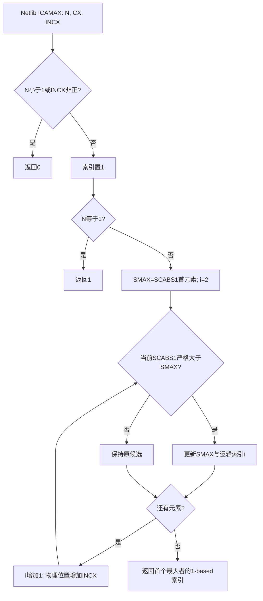
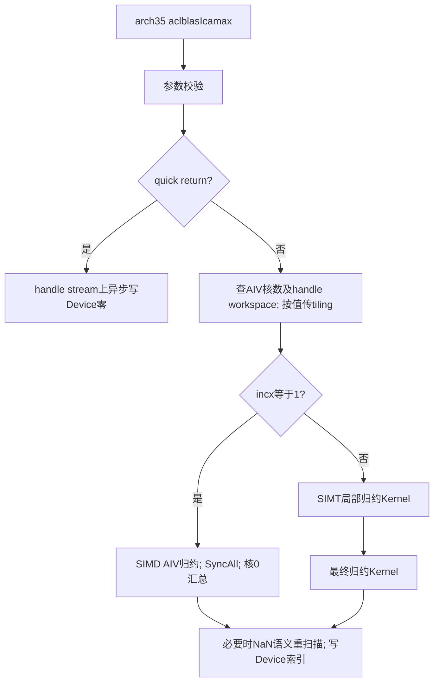
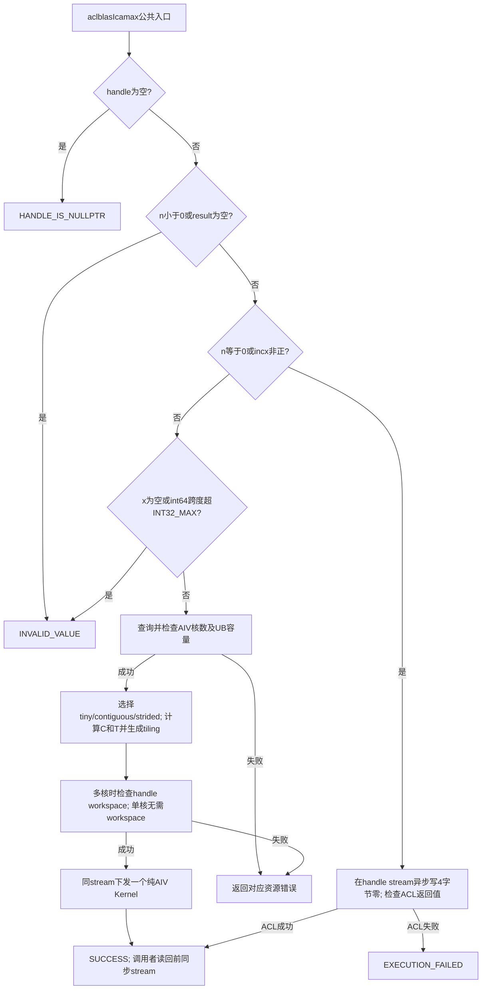
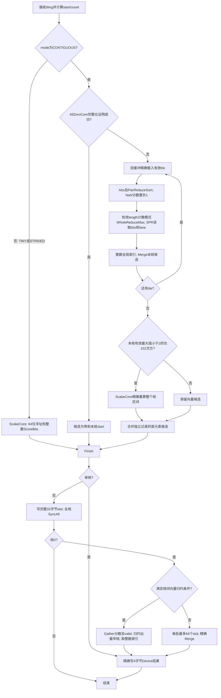

# 需求背景（required）

## 需求来源

本设计对应 **aclblasIcamax 算子开发（Atlas A2/A3，arch22）**，修订日期为 2026-11-11，状态为 **按当前实现修订、重新提交评审**。本稿对应下述 round49 源码快照；原 PR !2871 的官方意见要求只提交设计文档，本次移除 CSV 附件，仍在原 PR 更新。机器人检查与人工设计评审分别记录，不以自验代替官方批准。

本稿以R-001～R-048标识任务要求、V-001～V-018标识验证项、D-001～D-016标识交付项、Q-001～Q-017标识已核实或遗留问题；各项内容在本稿表格中展开。本稿区分原始基线事实、当前实现和验证计划；R/V/D/Q 是本任务的追踪编号，表中已展开对应内容。

| 依据 | 本次采用版本及用途 |
| --- | --- |
| 任务书 | 收到的任务书文件`aclblasIcamax_AtlasA2_A3_task_doc.md`；[官方11月任务总览][task]可核对任务名称和平台，任务书正文未给版本号或任务编号；SHA256：`2cf70bbeb0dd93ad771ed85e74314ef5258f053765a35c3add21295d242200df`。个人提交目录为`gang1022`；正式编号未能从官方任务表取得，采用`11-aclblasIcamax-A2A3`描述性目录，目录规范问题见Q-010。 |
| 正式代码仓 | [cann/ops-blas](https://gitcode.com/cann/ops-blas)，实现目录 `blas/iamax/arch22/`，测试目录 `test/iamax/icamax/arch22/`。 |
| 实际查阅源码 | 官方仓完整 commit **`5bd95145a9c499e43ebad44a313a1029c63d54bc`**，提交日期 2026-11-10；本次实现亦基于该提交。任务书未指定源码基线，该版本是本次工程选择。下文外链固定到原始基线；新增实现由下述快照哈希标识，不将基线链接误认为新增代码链接。 |
| 官方设计模板 | [design_template.md][template]，已读模板正文；按其需求背景、需求分析、详细设计、可维可测内容展开，并补入特性交叉分析。Addcdiv/TBE/广播为模板示例，不适用于本题。 |
| 设计检查表 | [设计文档CheckList][checklist]：网页检索不可读，HTTP 页面仅取得标题及初始化信息，未读到单元格；Q-017。先覆盖已取得的官方模板及流程图、需求映射等内容要求，不声称已核对表格全文。 |
| 语义及精度基线 | cuBLAS `cublasIcamax`；[Netlib icamax][netlib] 的严格大于更新语义；正式 golden 固定为 **Netlib BLAS 3.10.0 的 `cblas_icamax`**。输入生成采用[固定 commit 的生态精度标准][precision]；索引输出按本题 bit-exact 特例判定。 |
| 性能基线 | 原始 `gpu_baseline.csv`，200 行，SHA256：`c15d6c794559f77f1fb6ab2aa1078a37e3983f6f7e9c75aa3cb8538cdbc6001e`；附件记录 A100-SXM4-80GB、CUDA 12.8、cuBLAS 12.8.4。 |
| 官方用例 | `icamax_test.csv`，1200 行；收到的原件SHA256：`1c2a4cdf42d9e772f9853cef1bccd3896739b0def1efa206ad43e3ee08c21e51`；保持原 ID、参数和种子。 |

本 PR 仅保留本文件。任务书与 CSV 原件、实现和原始运行证据留在后续代码/验收交付，不放入设计 PR。下文 CSV 名称指收到的任务附件；原始用例仅在实现测试目录规范 CRLF 为 LF，字段、行序、ID、种子不变，副本 SHA256 为 `a10d533a6d1fc14947d5bbcf9a2d1dd1ffcfced9fbdb61e2bb83885559927d04`，GPU 基线逐字节不变。

**实现对应版本。** 本次修订逐函数核对 `impl/icamax-a2a3-202611` 的 round49 冻结快照（尚未创建实现 commit）。完整源码清单为开发证据 `source-optimized-49.json`；核心文件 SHA256 如下，后续代码提交须与该快照核对。设计 PR 的 commit 不能冒充实现 commit。

| 实现文件（相对 ops-blas） | SHA256 |
| --- | --- |
| `blas/iamax/arch22/icamax_host.cpp` | `ff435d703837851330d2d4b25403d16a72e9d9a14fe6f826cc06bf3852ae0c32` |
| `blas/iamax/arch22/icamax_tiling_data.h` | `18dea52a1ff1b36fd14112692b8b205842218656fdaf151c6dfa733dcfdcb891` |
| `blas/iamax/arch22/icamax_kernel.cpp` | `d88f711a1cf427cc8a0a83b966d0dc182f957af64d1670fc147d541febf8775a` |
| `blas/iamax/arch22/icamax_bits.h` | `7a9cecbda8f9b096c96d906ca7d25fb958a8196c36524f59c346826aac34db0b` |

原方案中的 2048 元素分块、64T UB 预算、Gather 拆分实虚部和逐组索引归约已由本稿的实际方案替换。外部语义、原用例和性能阈值保持任务要求。

本设计不涉及 TBE 实现替换或算子信息库注册，没有本题的 TBE 源文件、op-info 文件路径；本题通过 ops-blas 公共句柄接口直调 Ascend C Kernel。

## 背景介绍

### aclblasIcamax 实现优化

目标是在 A2/A3 上提供 complex64 向量最大复数 1-范数的首个逻辑索引。公共 API 已存在，新增 arch22 实现和测试，并保持公共 ABI。性能工作集中于连续输入的搬运、向量计算、分块和核间归约，减少每次调用的内存申请、Host 同步及 Kernel 数量。

固定参考版本中已核实以下事实。表中“现有”仅描述参考提交，不代表本题待实现代码已完成。

| 参考文件及入口 | 已核实的现有行为 | 对本设计的影响 |
| --- | --- | --- |
| [include/cann_ops_blas.h][api]，`aclblasIcamax`；[公共类型头][types] | 已有五参数声明；`aclblasComplex` 为 `float real; float imag;`；已有所需状态码 | 复用公共声明和类型，不定义平行 API。 |
| [arch22/isamax_host.cpp][isamax-host]，`ValidateIsamaxParams`、`LaunchIsamax` | 空 handle 返回 `NOT_INITIALIZED`；quick return 对非空 result 作 Host 解引用且允许空 result；正常调用申请 workspace/tiling、拷贝 tiling、同步后释放 | 只参考工程组织。本题改为规定的空句柄码、先检查 result、Device 异步写零；复用 handle workspace、按值传 tiling，避免照搬这些行为。 |
| [arch22/isamax_kernel_impl.h][isamax-kernel]，`Process` | 使用传统 Ascend C 向量 API、分核临时结果及 `SyncAll()` 后的汇总；其调度还涉及混合模式核数换算 | 参考 arch22 的搬运及同步 API；本题明确采用纯 AIV，不沿用“启动块数除以2”的混合模式公式。 |
| [arch35/icamax_host.cpp][icamax-host35]，`ValidateIcamaxParams`、`WriteIcamaxQuickReturn`、`LaunchIcamaxKernel` | 已按 handle→n→result→quick return→x→int64 跨度顺序校验；用 `aclrtMemsetAsync` 写零；复用 handle workspace；按值传 tiling | 复用校验顺序及资源管理思路，不复制 arch35 专用计算指令。 |
| [arch35/icamax_kernel.cpp][icamax-kernel35]，`icamax_kernel_do` | incx=1 为 SIMD AIV 单 Kernel、核间同步归约；incx>1 为 SIMT 计算和最终归约两个 Kernel；检测到 NaN 后有重新扫描路径 | arch22 使用传统向量 API；每次正常调用设计为一个 Kernel，NaN 在候选合并规则中处理，不依赖 arch35 SIMT/VF。 |
| [test/iamax/icamax/CMakeLists.txt][test-cmake] | 仅 arch35 调用 `ops_blas_add_gtest_tests` | 新增 arch22 注册，保留 arch35 注册。 |
| [icamax_param.h][param]、[icamax_golden.h][golden] | 参数解析已有 result 空指针标志；golden 正常路径调用 cblas 后加1，覆盖 quick return，但没有大跨度保护 | 可复用正常路径 golden；非法参数直接按任务书状态码判断，不向 cblas 传非法跨度。 |
| [arch35/icamax_test.cpp][test35]、[wrapper][wrapper35] | 测试按种子阈值把部分 RANDOM/NORM 改成正态；wrapper 正常输入按跨度申请设备内存，且用 device 级同步 | 本题按填充 token 选分布；分配前先分类负向/quick return，用 dummy 隔离错误条件；使用绑定 stream 的同步。 |
| [test/frame/fill.h][fill]，`GaussGenerator`、`makeBlasComplexMatrix` | 公共框架已经能解析 GAUSS，实/虚部使用独立随机序列；公共正态生成器还把值裁剪到[-5,5] | Q-005 的本地附件无正态仍成立；“仓内尚不支持”不适用于此参考版本。本题专用输入工厂生成不裁剪的正态，避免改变公共生成器和其他算子行为。 |
| [cmake/test.cmake][cmake-test]，`_ops_blas_ensure_refblas_found` | 默认查找 `openblas` 或 `blas`，没有保证 Netlib 3.10.0 | 自验构建显式固定 `REFBLAS_INCLUDE_DIR`、`REFBLAS_LIB`，检查实际链接库；不能仅因找到 cblas.h 就宣布 golden 合规。 |

### aclblasIcamax 现状分析

| 参数 | 参数含义 | 数据类型 | 支持数据类型 | 约束 | 形状 |
| --- | --- | --- | --- | --- | --- |
| handle | Host 输入，上下文、stream 和 workspace | `aclblasHandle_t` | 有效已创建句柄 | 正常测试固定有效句柄；空句柄返回 `ACLBLAS_STATUS_HANDLE_IS_NULLPTR` | 标量句柄 |
| n | Host 输入，逻辑复数元素个数 | `int` | INT32 | n<0 非法；n=0 合法 quick return；无默认值 | 标量 |
| x | Device 输入，只读复数向量 | `const aclblasComplex*` | COMPLEX64，分量 FLOAT32 全集 | ND；正常路径非空；物理跨度须满足 int32 限制 | 逻辑[n]；正常路径物理复数长度 `1+(n-1)*incx` |
| incx | Host 输入，复数元素步长 | `int` | INT32 | ≥1 正常；≤0 合法 quick return，不反向遍历；无默认值 | 标量 |
| result | Device 输出，首个最大者的1-based逻辑索引 | `int*` | INT32 | 任意路径均须非空；独立于x；正常1..n，quick return为0 | 单值标量 |

图1给出语义标杆 Netlib 的顺序流程。Netlib 自身对 n≤0 返回0；本题 Host 对 n<0 返回 INVALID_VALUE，优先采用任务书特例（Q-014）。



图2概括固定参考版本的 arch35 实现数据流，用于说明可复用的框架和需要重写的计算部分。



### aclblasIcamax 功能分析

令逻辑下标 `j=0..n-1`，物理复数下标 `p=j*incx`，分量偏移为 `2*p` 和 `2*p+1`。单个候选分数为 binary32 运算下的 `abs(real)+abs(imag)`，不是欧氏模。输出是使该分数最大的最小逻辑下标加1。

特殊值按 Netlib 顺序比较理解：首元素任一分量为 NaN 时，首个分数为 NaN，结果保持1；其余 NaN 分数不更新候选；正常候选中首个 +Inf 分数胜出。同模选择最小逻辑索引，包含零、常量、溢出得到 +Inf 和跨块并列情形。

# 需求分析（required）

## 需求描述

使用 **CANN 9.1.0、Ascend C、ops-blas 句柄式直调框架**，新增 arch22 Icamax，支持 Atlas A2/A3。正常调用在 handle 绑定的 stream 上下发一个纯 AIV Kernel，输出 Device INT32；quick return 只异步写零，不进入归约。自验至少覆盖一种 A2/A3 款型，正式性能使用 Atlas 800T A2（910B3）。精度建议910B3或A3，不升级为两平台都必须实测。

连续输入采用小输入/向量分块两种计算分支，非连续正步长采用有界、64位寻址的标量收集归约分支。所有分支共用相同候选合并规则。原始官方1000条精度、200条性能用例全部保留，补齐输入分布、尺寸组合、特殊值、指针对齐和句柄测试。

## 需求拆解

| 需求或对象 | 需实现或保持的行为 | 适用条件、例外与边界 |
| --- | --- | --- |
| R-001、R-002、R-014 | 公共API→arch22 Host→单AIV Kernel；复用complex64和Device输出 | 不新增私有API，不修改arch35 ABI；ND逻辑一维。 |
| R-003、R-004、R-005 | 计算1-范数分数、保留整数逻辑索引、支持任意合法正incx | 不使用欧氏模；不把物理地址偏移作为结果；并列跨tile/核仍选最小索引。 |
| R-006～R-011 | 按下文固定校验顺序处理空句柄、负n、空result、quick return、空x和跨度 | result空指针、负n不能被quick return吞掉；非正步长不求abs，不计算大跨度。 |
| R-012、R-013 | 绑定stream、保持异步输出；NaN/Inf及严格比较可观察 | 测试读回前同步同一stream；首NaN分支不能造成部分核绕过全核屏障。 |
| R-015、R-026 | arch22 GTest注册、CSV加载、Python驱动公共API | 原CSV八列保持；新增case另列；不能落回非GTest runner。 |
| R-016、R-017、R-018 | A2/A3支持、CANN9.1.0、Netlib3.10.0；保存设备版本证据 | 正式性能910B3；替代环境另按Q-007处理。 |
| R-019、R-020 | 正常cblas索引+1，quick return比较0，错误路径比较状态码 | INT32逐值精确相等；浮点rtol/atol/0.99阈值不用于输出。 |
| R-021、R-022、R-023、R-024、R-025 | 输入工厂按token生成；随机精度507均匀+507正态；补齐属性、特殊值和对齐 | 580条新增随机精度为本设计选择；特殊/负向不做全笛卡尔积；先分类再分配。 |
| R-027、R-028 | 单case单Kernel msprof task duration；5次工具warmup后≥10有效样本，算术平均 | 逐case NPU≤1.25×GPU；按ID关联200行；不能拿event或整例GTest毫秒替代。 |
| R-029、R-030 | 不设内存性能阈值；不涉及broadcast、原地更新等专项 | 仍采PF场景内存占用并交报告/日志；运行时n和正步长不是被排除项。 |
| R-031、R-041、R-045、R-046、R-047、R-048 | 本稿映射到设计PR、进展和评审流程；后续核实当前页面 | 本PR只提交docs/design.md；CSV与其他证据不进入设计PR。标题、账号、附件要求见交付计划；Q-010/Q-012/Q-017保留。 |
| R-032、R-033、R-034、R-035、R-036、R-037、R-040 | README、原始证据、7个文件、验收commit和仓权限可追溯 | 报告不得把未测/缺项写成通过；日志不替代要求的截图。 |
| R-038、R-039、R-042、R-043、R-044 | 遵守仓规范、无冗余；特殊标杆异常有清单；有条件地管理算力 | 过滤仅限有证据的标杆异常；免费算力闲置关闭、耗尽前保存，备份为建议。 |

## 外部组件依赖与内部适配模块

| 组件/模块 | 版本或路径 | 职责及本次处理 |
| --- | --- | --- |
| CANN/Ascend C/ACL | 9.1.0，A2/A3工具链 | 内存、stream、向量指令和launch。已在910B3/CANN9.1.0完成编译及1750项精度验证，A3未实机验证。 |
| 平台查询 | `icamax_platform.h`、`PlatformAscendCManager`、`aclrtGetDeviceInfo` | A取平台物理AIV和运行时可用VECTOR_CORE_NUM的较小值；UB取平台查询。避免vNPU可用核数不足而在SyncAll等待。 |
| 句柄及workspace | [aclblas_handle_internal.h][handle] | 使用 `handle->stream`、`GetEffectiveWorkspace`、`GetEffectiveWorkspaceSize`；正常调用不临时malloc/free，不扩充公共句柄结构。 |
| 算子Host | 新增 `blas/iamax/arch22/icamax_host.cpp` | 校验、quick return、平台信息、分核/分块、workspace检查及下发。 |
| 算子Kernel | 新增 `blas/iamax/arch22/icamax_kernel.cpp` | 同一编译单元内实现tiny/contiguous/strided分支、候选合并和核间同步，避免arch22设备跨编译单元链接问题。 |
| 参数结构 | 新增 `blas/iamax/arch22/icamax_tiling_data.h` | `IcamaxArch22TilingData`及MakeTiling；launch声明在icamax_kernel.h，固定宽度整数、按值传递。 |
| 测试入口 | 新增 `test/iamax/icamax/arch22/icamax_test.cpp`、`icamax_npu_wrapper.h` | 参数化官方/补充用例、特殊场景、Device缓冲、同stream同步、精度/性能/内存证据。正常golden复用父目录helper；非法值不送入cblas。 |
| 构建注册 | 修改 `test/iamax/icamax/CMakeLists.txt` | arch22分支调用 `ops_blas_add_gtest_tests(${OPS_BLAS} icamax_test)`；保持arch35。`blas/CMakeLists.txt`已自动收集源码，不新建算子级CMake。 |
| 测试数据/驱动 | arch22下的 `icamax_test.csv`、新增 `icamax_supplement.csv`、保留的 `gpu_baseline.csv`，以及适配后的 `gen_csv.py`、`verify_accuracy.py`、`verify_performance.py` | 原件从任务附件复制且校验哈希；新增用例另输出；驱动补msprof解析、完整集合及进程码检查，保留基线不覆盖。 |
| 测试输入工厂 | arch22 `icamax_input.h`与`icamax_special.h` | 均匀使用明确RANDOM token；GAUSS使用独立实虚序列、随机μ/σ且不裁剪；特殊数据按bit pattern显式构造。保持公共fill和arch35代码不变。 |
| 精度基线库 | Netlib BLAS 3.10.0 + CBLAS | 随测试交付获取/构建说明及版本/哈希；显式配置链接路径，禁止默认OpenBLAS替代。 |
| 文档 | 更新 `blas/iamax/README.md`、`test/iamax/icamax/README.md` | A2/A3产品支持、接口边界、真实构建/运行命令、数据和证据位置。 |

上述模块已在 round49 工作区实现。整数数值助手在 `icamax_bits.h`，平台查询在 `icamax_platform.h`，launch 声明在 `icamax_kernel.h`；输入工厂、特殊值、工程场景和 profiler 记录分为测试专用头文件。共享 CSV loader 的非法字段检测及测试构建适配纳入兼容性回归，不改变公共输入生成器。

## 需求模块设计

公共入口保持原声明，无可选参数和默认参数：

```cpp
aclblasStatus_t aclblasIcamax(
    aclblasHandle_t handle,
    int n,
    const aclblasComplex* x,
    int incx,
    int* result);
```

模块之间的数据流为：公共入口校验Host参数→生成小型tiling→Kernel从Device x读取→局部候选写workspace→核0合并并写Device result。Host不读取x内容，不把结果搬回Host。测试wrapper另负责输入H2D、同步及结果D2H，这些动作不进入正式性能计时窗口。

对cuBLAS的明确差异只有本题限定：n<0返回INVALID_VALUE、result为Device标量；不增加Host result模式。对Netlib的索引转换仅发生在正常golden路径，不能把quick return的0加成1。

# 详细设计（required）

## 算子分析

### 数学公式

对正常路径定义：

\[
p_j=j\cdot incx,\quad s_j=\operatorname{RN}_{32}(|\Re(x[p_j])|+|\Im(x[p_j])|),\quad 0\le j<n.
\]

`RN32`表示与正常Netlib binary32加法一致的最近偶数舍入；正的有限溢出成为+Inf。若`s_0`为NaN，返回1；否则忽略NaN分数，取最大`s_j`中最小的`j`，输出`j+1`。非法参数和quick return在Host分支处理，不进入此公式。

**候选结构与合并规则**：`{scoreBits:uint32, index:uint32, valid:uint32, firstNan:uint32}`。`index`始终为0-based整数，`scoreBits`保存非负binary32分数的原始位，不以float表示全局索引。

1. 首逻辑元素的NaN候选优先于所有其他候选，结果固定1。
2. 其余NaN及padding为无效候选；有效候选优先于无效候选。
3. 非负非NaN分数按无符号`scoreBits`从大到小比较；位值相同时，较小整数index优先。±0统一为+0。
4. 跨tile及标量合并使用Merge；tile内及满足保护条件的核间归约使用下述等价硬件首最大规则。该规则等价于一个全序上的最大选择，具有结合性；因此改变归约分组不会改变首个最大者。

只在最终写出时将`index+1`转换为INT32；最大合法逻辑索引为n-1，n≤INT32_MAX，因此结果不会溢出。全局寻址则一律使用uint64/int64，不能把合法复数跨度再乘2后存入int32。

### 支持数据类型

输入仅complex64（两个float32），输出仅INT32；格式ND。零、常规有限值、极小正规数、次正规数、最大有限值、±Inf和NaN均在分量值域内。NaN payload不参与排序；按原始指数/尾数位判断NaN，避免编译优化把`x!=x`消除。

快速连续路径采用float32 Abs/PairReduceSum；禁止启用改变NaN/Inf语义的fast-math。针对设备可能把次正规输入清零的情况，使用下文“微小值精确处理”保持索引语义，而不依赖设备恰好保留次正规数。

### 支持形状

正常路径为`1≤n≤INT32_MAX`、`incx≥1`、`(int64(n)-1)*int64(incx)≤INT32_MAX`；物理复数长度为跨度+1，字节数为`8*(跨度+1)`。数据必须由调用者实际分配，合法参数不等于允许越过分配边界。n=1时incx可为INT32_MAX，实际仅需一个复数。

n=0或incx≤0的合法quick return不需要实际x数据，允许x=nullptr。负n、空result、空handle等检查先行。无broadcast、无原地输出、无一般非连续Tensor视图机制；正步长直接表达逻辑非连续，运行时n仍受支持。

## 调用方式

调用者创建句柄，按需用`aclblasSetStream`绑定stream，准备Device x及4字节Device result，再调用公共API。正常返回SUCCESS表示校验通过并完成异步下发；执行期设备错误还须由stream同步结果检查。读result前同步同一stream，再D2H。

测试构建入口沿用`bash build.sh --soc=ascend910b --ops=icamax`，A3为`ascend910_93`；这是参考仓已有入口，实际自验命令还必须附带经过验证的Netlib链接配置。参考build.sh不会透传任意`--warmup`或`--iterations`参数；不照搬交付模板的csymm命令。驱动在固定CMake配置中设置Netlib路径后构建，记录最终CMakeCache和动态链接解析结果，避免一次默认重配置又选到OpenBLAS。

## 算子实现

### 实现方案

图3为当前实现的Host流程。错误分支返回具体状态码；quick return只下发Device写零。正常路径不按数据内容选择Host分支，不需要D2H探测。



与图1/图2的主要差异及依据：

| 差异 | 原因及正确性依据 |
| --- | --- |
| Host先处理任务书规定的非法参数 | 任务书n<0、空result等特殊规则优先于Netlib通用quick return；沿参考arch35校验顺序。 |
| 顺序循环变为tile/core候选合并 | 合并规则保留分数最大、索引最小和首NaN，结合性保证结果与顺序扫描一致。 |
| arch22不采用SIMT/VF | A2/A3采用传统Ascend C向量API；参考arch35结构而非直接移植指令。 |
| 每次正常API只启动一个Kernel | 小输入不产生额外归约launch；多核使用同Kernel内SyncAll，PF case均可直接对应单次task duration。 |
| 不做整向量NaN重扫描 | 首NaN通过标志传递，其后NaN直接剔除；候选规则足以表示Netlib行为。 |
| 不临时申请Device tiling/workspace、不在API内同步 | tiling按值传入，workspace由handle持有；同stream顺序复用，降低调用开销。 |

#### Host 侧设计

校验顺序固定为下表。多重错误中不同状态码的优先级是**本设计选择，沿用参考arch35实现**；任务书未规定额外优先级，不能把该选择反写为官方新要求。

| 顺序 | 条件 | 返回/处理 | 是否读取x或写result |
| --- | --- | --- | --- |
| 1 | handle=nullptr | HANDLE_IS_NULLPTR | 均不访问 |
| 2 | n<0 | INVALID_VALUE | 均不访问 |
| 3 | result=nullptr | INVALID_VALUE | 均不访问 |
| 4 | n=0或incx≤0 | `aclrtMemsetAsync(result, sizeof(int), 0, sizeof(int), handle->stream)`；成功则SUCCESS，失败则EXECUTION_FAILED | 不读x；恰好写4字节；不下发归约 |
| 5 | 正常路径x=nullptr | INVALID_VALUE | 均不访问 |
| 6 | `last=(int64(n)-1)*int64(incx)>INT32_MAX` | INVALID_VALUE | 均不访问；不以int乘法计算 |
| 7 | 正常路径 | 生成tiling并下发 | 由Kernel读x、写result |

正参数最大乘积小于INT64_MAX；仍使用64位中间量计算字节偏移。INT32_MIN步长在第4步返回，不能求`abs(INT32_MIN)`。本题不在Host检查x中的值，也不通过访问非法指针探测分配大小。

平台查询失败、AIV数为0、UB预算不能容纳最小向量tile时返回INTERNAL_ERROR；多核所需workspace为空或不足时返回EXECUTION_FAILED，沿参考arch35资源不足约定。该资源码为工程行为，另补测试，不能与任务书规定的参数INVALID_VALUE混淆。默认句柄已有32MiB workspace；本题只使用下述少量区域，不将默认预留量误记为本算子的新增申请量。

同一handle连续调用在同一stream中顺序使用workspace。调用方切换stream、替换workspace或销毁句柄须遵守已有句柄API的同步和所有权契约；本题不在Kernel完成前释放或覆盖其资源，不承诺同一workspace可由多个stream并发无序使用。

##### 分核策略

以下常量为**当前工程参数**，不是验收阈值：tiny上限32个复数；按每8192个逻辑复数增加一个核的粒度估算核数，再受内存带宽核数上限和完整向量组数限制；向量分组宽度64个复数。这不保证每核至少8192个元素，例如n=8193、A≥2时分为4096和4097个元素。设实际AIV核数为`A`，正常n为正数：

```text
G = floor(n / 64)
M = A >= 5 ? floor(A / 5) * 4 : A
C = min(M, ceil(n / 8192), max(1, G))
q = floor(G / C)
r = G mod C
t = n mod 64
start(c) = 64 * (c*q + min(c,r))
count(c) = 64 * (q + (c<r ? 1 : 0)) + (c==C-1 ? t : 0)
```

tiny路径直接设`C=1`；其他路径采用上式。启动恰好C个纯AIV块，块号c=0..C-1，不再除以2。各核负责连续逻辑区间`[start, start+count)`，相邻区间首尾相接且总数为n；尾部只放末核。计算用64位临时量，保存到tiling的计数均在uint32范围。

`n<64`时C=1、q=r=0、t=n；没有空核。多核时C≤G，各核至少有一个64元素组，因此没有提前退出的空块。实际核数来自设备，不固定为40或某个SKU的数值。M为带宽型归约采用的工程核数上限；本次B3运行时A=40，因此M=32。这样减少核间同步和内存竞争；对其他合法A继续按公式计算，不能把本机32硬编码进算法。

##### 数据分块和内存优化策略

连续路径最大分块为6400个复数，按设备UB容量U及最大核区间长度动态收缩，所有量以字节/逻辑复数计：

```text
capacity = floor((U - 16384) / 20)
Tcap = 64 * floor(min(6400, capacity) / 64)
maxCount = 64 * ceil(G / C) + n mod 64
needed = 64 * ceil(maxCount / 64)
T = min(Tcap, needed)
UB_allocated = 20*T + 16384
```

U≤16384或Tcap<64时返回INTERNAL_ERROR。最小有效预算为17664字节。实际B3平台查询U=196352，最大T=6400，申请144384字节，剩余51968字节；小输入会按needed收缩。maxCount是安全上界，余数和尾部未必落在同一核，不影响正确性。

| UB用途 | 字节数/偏移 | 生命周期与边界 |
| --- | --- | --- |
| 双缓冲AoS输入队列 | 两份8T，共16T | 原始实虚交错uint32/float，每份容纳T复数；队列控制预取与消费。 |
| 单个scratch分配 | 4T+16384 | 以下全部视图从该缓冲切分，不另申请旧方案的Gather数组。 |
| scores/laneScores别名 | scratch首地址+64字节，长度4T | 普通路径存分数，全零证明阶段存OR位；阶段互斥。64字节偏移降低输入与分数的bank冲突。 |
| aux基址 | scratch首地址+4T+96字节 | 与scores间留32字节；剩余辅助区内布局见下表。 |

aux偏移以float/uint32元素（4字节）计，mask字节视图除外：

| 辅助视图 | 相对aux范围 | 用途 |
| --- | --- | --- |
| mask0 | 字节0～799（T=6400） | NaN/valid比较掩码，向量Select后才复用。 |
| groupMax | 元素672～927 | WholeReduceMax结果和全零证明分组归约，容量256。 |
| 临时归约/标量结果 | 元素928～991 / 1000 | 全零证明中的多级最大值归约。 |
| slot | 元素1024～1535 | 单核候选写出、最多64核候选搬入与最终4字节结果。 |
| 核间Gather临时区 | 元素2560～2751 | 64偏移、64分数、64有效位；只在最终核间归约使用。 |

最高使用字节为`4T+96+2752*4 = 4T+11104`，低于scratch的`4T+16384`，全部视图起点满足32字节对齐。mask不会覆盖groupMax，slot不会覆盖Gather区；scores和laneScores显式别名且顺序复用，不把它们重复计入预算。

tile有效数`m=min(T, remaining)`。使用字节长度的`DataCopyPad`读取恰好`8*m`字节，最大51200<65536，适合现有uint16 blockLen重载；不为对齐而越界读取GM。尾部仅在UB补到64倍数。Abs原地作用于交错实虚分量，PairReduceSum直接生成每个复数的1-范数，无实虚Gather。每次PairReduceSum输出段≤8128，repeat≤254，避免8位repeat截断；当前T≤6400时最多200次repeat。

输入队列深度2，先预取下一tile再归约当前tile；释放后才复用对应缓冲。PrepareTile的padding/首候选读取使用MTE2→S→V依赖，向量链之间用PIPE_V屏障；SPR读取前V→S，slot写出前S→MTE3，候选写出完成后MTE3→MTE2及SyncAll。全零证明读完或早退时已释放已取出的队列元素，常规路径重新搬入，不使用过期输入。

多核workspace每核占独立32字节slot，前16字节为候选，其余初始化为0；总需求`W=align_up(32*C,256)`字节。C=1直接写result，W=0。所有slot在本次调用写完整后才屏障，禁止依赖上次结果或对旧workspace预置状态。最终输出使用DataCopyPad恰好写4字节，不向只分配一个int的result写32字节。

非连续路径每核在自己的逻辑区间以`uint64(j)*uint64(incx)`计算物理下标，按有效复数读取两个分量；不一次申请覆盖整个大跨度的UB。首先采用标量收集及精确分数比较，保证任意合法incx；官方200条PF全部incx=1，非连续性能另作工程观测，不给它套用无对应基线的正式阈值。

##### tilingKey 规划

本题没有aclnn tiling注册。`mode`作为内部tilingKey语义字段由Host写入，同一Kernel内分支处理；不增设外部API。

| mode/路径 | Host触发条件（已通过校验） | 核数/参数 | Kernel行为 |
| --- | --- | --- | --- |
| Q，不传入Kernel | n=0或incx≤0 | 无tiling、无归约workspace | ACL异步写0。 |
| 1，TINY | 1≤n≤32，任意合法正incx | C=1，n/incx；n=1也执行ScalarCore读取 | 标量读取、原始位分数计算、整数候选合并，无核间同步。 |
| 2，CONTIGUOUS | n>32且incx=1 | C及q/r/t、T | AoS搬入、向量计算、局部精确处理、候选合并；C>1时SyncAll后核0写出。 |
| 3，STRIDED | n>32且incx>1 | C及q/r/t，逻辑划分同上 | 64位物理寻址、逐个有效复数归约；C>1时同样同步并合并。 |

`IcamaxArch22TilingData`含8个uint32字段：`totalN, incx, useCoreNum, groupsPerCore, groupRemainder, scalarTail, tileN, mode`，共32字节，Host/Kernel共用定义并做静态大小断言。内部launch将它按值传递，避免Host栈上数据作为异步H2D源的生命周期问题。mode仅由n/incx决定，数据是否NaN或次正规由Kernel检测。

#### Kernel 侧设计

本算子仅用Vector/AIV与标量单元，不使用Cube、矩阵乘或Tensor API。Kernel明确声明纯AIV任务类型，参考同仓arch22 [Sasum入口][sasum-kernel]的`KERNEL_TASK_TYPE_DEFAULT(KERNEL_TYPE_AIV_ONLY)`；`SyncAll()`采用arch22现有全核同步机制。

图4与Host三条正常路径逐一对应。多核分支（包括全零和首NaN）都通过Finish写slot并进入同一次屏障。



**连续tile的确定性归约。** PrepareTile在第0核第0tile用原始位计算首元素候选。向量分数通过`Compare(scores,scores,EQ)`识别有序值，再Select将NaN设为-1，不能用会传播NaN的Max替换。WholeReduceMax采用计数模式且长度为实际m，padding不参与；随后恢复普通mask。`GetReduceRepeatMaxMinSpr<float>(uint32_t &bits, uint32_t &lane)`直接读分数位和首个最大位置，构造`start+done+lane`整数索引。当前实现使用硬件首最大索引语义，并通过tile内、跨tile/核、NaN混合及大于2^24的索引工程测试核对；旧版“逐组Compare/Select求最小局部索引”不再存在。全NaN的tile归约到-1，按`bits>INF_BITS`标为无效。跨tile仍用Merge选择最早整数索引。

**全零的完整位证明。** AllZeroCore先读取本核首复数的两个uint32；任一绝对值位非零即可拒绝全零，进入普通路径。首复数为零不代表整个核全零：继续搬入完整有效区间，将所有原始位OR到laneScores；忽略符号位后用整数转float及Maximum判断是否存在非零幅值。OR使用uint16视图并将计数加倍，确保CANN重载实际覆盖所有uint32的上下半字；尾padding显式清零。只有完整证明成功才输出`{0,start,valid=1}`，±0相同；次正规、Inf和NaN均会拒绝全零。只验证首块或用浮点零判断全零会漏掉极小值，禁止如此简化。

**微小值精确处理。** 常规向量归约完成后，若本核候选有效且`scoreBits < (26U<<23)`（2^-101），就从GM原始位重新扫描**整个核区间**并调用ScalarCore。实际代码不先做“存在次正规”筛选，也不是逐tile回退。全零已由位证明提前处理；候选无效表示所有分数NaN，不需要微小值回退。之后Merge独立保存的首元素候选，首NaN始终返回1。

门限依据：次正规小于2^-126；若另一分量指数≥25（量级≥2^-102），次正规严格小于半ULP，不改变最近偶数舍入；若另一分量更小，真实和不可能达到2^-101。已有至少2^-101的候选时，FTZ不影响最终胜者；小于门限则用整数加法保证渐进下溢和并列行为。门限是正确性保护条件，不是输出容差。

精确处理使用无符号位运算，逻辑如下；tiny和strided也复用此分数函数，避免标量浮点FTZ差异：

```text
absBits = rawBits & 0x7fffffff
任一分量 exp==255 且 fraction!=0 -> NaN候选
否则任一 exp==255 -> scoreBits=0x7f800000 (+Inf)
有限分量：E=max(exp,1)，M=fraction + (exp!=0 ? 2^23 : 0)
按E从大到小排列两个分量，令d=Ea-Eb
S=(Ma<<3) + shiftRightJam(Mb<<3,d)
若S>=2^27：S=shiftRightJam(S,1)，Ea加1
Q=S>>3，R=S&7
若R>4或(R==4且Q为奇数)：Q加1
若Q>=2^24：Q右移1，Ea加1
Ea>=255 -> +Inf
Ea==1且Q<2^23 -> 次正规/零；否则按Ea和Q低23位编码
```

`shiftRightJam(v,d)`保留右移丢失位的“是否非零”到最低位；d≥32时直接返回`v!=0`，不能执行未定义的大位移。27～28位中间值放在uint32内足够；零和次正规相加无需先归一化为正规数。NaN判断在Inf判断前，避免把Inf+NaN错误变成Inf。

**核间同步及输出。** C>1时每核完整写32字节slot，等待写出后SyncAll；仅核0在屏障后重新从GM搬入本次候选。首NaN和全零分支也参加屏障。若C≤64、核0候选valid、非firstNan且分数≥2^-101，ReduceWorkspace用Gather提取各核分数/valid，屏蔽无效项，以计数模式WholeReduceMax求首个最大核，再从slot读取该核的**整数**index。因为核区间按逻辑索引递增排列，最早最大核的最早最大索引就是全局答案；核0的大分数证明其他核微小分数不可能获胜。

上述条件不满足时，按最多64个slot一批搬入并使用整数Merge，保证首NaN、微小值及更大核数仍精确。索引从未经过float转换，n>2^24时也不丢精度。C=1直接写result，无workspace和SyncAll；WriteResult用DataCopyPad恰好写4字节。正常n>0时首NaN或至少一个有效候选必然存在。

## 支持硬件

| 支持的芯片版本 | 涉及勾选 |
| --- | --- |
| Atlas A2，含Atlas 800T A2（910B3），arch22 | ✓，本题支持；正式性能验收设备为910B3 |
| Atlas A3，含Atlas 800T A3，arch22 | ✓，本题支持 |
| 950PR，arch35 | 非本题新增实现；公共API兼容性及存量构建不应受影响 |

产品支持与实测范围分开记录：精度至少在一种A2/A3款型执行；另一款型的源码兼容和构建情况如实记录，未实测不能填实测通过。性能替代设备/版本需要按Q-007核实可接受性，不能自动用A3数据代替910B3正式结果。

## 算子约束限制

1. 只支持本题complex64→INT32、ND逻辑一维和Device输出；不是Isamax/Izamax，不增加Host result模式。
2. 负步长不反向遍历，非正步长合法quick return；负n、空result等非法条件优先处理。
3. 支持合法正步长，字节地址计算用64位；输入长度和分配有效性由调用方保证。
4. result独立于x，不涉及原地输出、broadcast和通用视图；不要求专门的dynamic shape机制。
5. 正常调用异步；输入、输出和workspace生命周期覆盖stream执行。API返回SUCCESS本身不是设备执行成功证据。
6. 采用单Kernel归约，不依赖跨Kernel耗时合并；内部tile、分核及缓冲预算不是任务方规定的数值。改变已评审方案时同步设计和验证计划，并遵循后续开发指南的变更流程。

# 特性交叉分析

| 条件组合 | 预期行为/实现路径 | 关键验证 |
| --- | --- | --- |
| 有效handle，n=0，x可空，result非空 | SUCCESS，Device result=0，无归约 | 官方TC_ED_088～095/100及补充quick return，V-005 |
| 有效handle，n>0，incx=0/-1/-2/-3/INT32_MIN | 同上；不求abs步长、不按跨度申请 | TC_ED_092～095/101；结果初值哨兵被置0 |
| n<0，incx≤0 | INVALID_VALUE先于quick return | 补充单元素dummy，不读取x；V-006 |
| result空，n=0或incx≤0 | INVALID_VALUE，不执行写零 | TC_ED_102及补充组合；V-006 |
| handle空且其他合法 | HANDLE_IS_NULLPTR | 专门GTest，避免空x/result掩盖错误；V-007 |
| n=1，incx=INT32_MAX | 跨度0合法，结果1，只需一个复数 | tiny与地址边界；V-003/V-006 |
| n=4，incx=INT32_MAX | 跨度6442450941非法，INVALID_VALUE | TC_ED_104；非空dummy隔离跨度检查 |
| incx=1，n跨32/64/8192/tile/core边界 | tiny或contiguous；划分无遗漏、重复、空核 | 分支两侧及C*T±1、C*64±1；尾部guard检查 |
| incx>1，最大值在逻辑首/中/末 | strided，返回逻辑索引而非物理偏移 | incx=2/3/17；间隙填更大值验证不读间隙 |
| 首元素NaN，后有Inf；或其他核全NaN | 首NaN结果1；其他NaN被忽略；全部核仍参加同步 | 特殊值多shape、跨tile/核、超时与正确性检查 |
| 正负零/常量/不同分量但相同1-范数 | 结果为最小逻辑索引 | 不同tile/核放相同最大值；核内首最大语义与有序核区间共同保证最早索引 |
| 有限分量相加溢出为Inf | 与Netlib float32分数一致，首个Inf分数胜出 | FLT_MAX组合及Inf混合 |
| 次正规与普通值/极小正规值混合 | 高分候选安全路径或微小值精确路径 | bit-pattern输入、半ULP/最近偶数边界、门限两侧 |
| 非32字节对齐且尾部不足整块 | 合法complex偏移仍精确，不越界 | offset=1/2/3个复数、n=1/33/65/T±1；输出前后guard |
| 同handle、同stream重复调用，改变输入/输出 | 本次slot覆盖，不受旧workspace影响 | 交替输入、不同n、多次调用后统一同步 |
| 两handle绑定不同stream | 独立workspace、结果互不污染 | 并发工程补充；不测试无授权共享workspace的竞争为支持能力 |

上述工程边界组合用于验证具体实现；标准明确特殊场景不与全部常规属性作笛卡尔积，不额外要求NaN×所有尺寸×所有步长的无限组合。

# 可维可测分析

## 精度标准/性能标准

| 验收标准 | 描述(不涉及说明原因) | 标准来源 |
| --- | --- | --- |
| 精度标准 | 正常路径cblas_icamax返回0-based索引后+1；NPU INT32逐值相等，任一不等失败。quick return期望SUCCESS且0；负向比较规定状态码，不调用cblas归约 | 任务书§2.4、§3.1、§3.2、§3.5；R-006～R-011/R-019/R-020 |
| 输入覆盖 | 均匀[-5,5]、正态μ∈[-5,5]/σ∈[0.1,2]各50%，实虚独立；正常属性组合、尺寸扫描和特殊值覆盖；原1200条及补充清单可追踪 | 任务书§3.5；固定commit精度标准§1；R-021～R-026 |
| 性能标准 | CANN9.1.0、910B3；msprof op的单次task duration(us)，排除工具5次warmup，连续有效SUCCESS样本m≥10，Avg=Σduration/m；每case `Avg_NPU_us≤gpu_ms*1000*1.25`，即GPU/NPU≥0.8 | 任务书§3.3、§7-4；R-027/R-028；Q-001/Q-006/Q-007 |
| 内存标准 | 内存性能阈值不涉及；仍记录200条PF场景占用数据、采集范围/方法及报告日志。附件没有GPU内存基线，不造占用比值或通过结论 | 任务书§3.4与§4并列执行；README“用例规模”；R-029/R-033；Q-002 |
| 交付标准 | 自验完成后提供源码、README、设计PR和指定7文件；证据绑定验收commit、用例哈希和环境，不用模板示例代替真实结果 | 任务书§4、§5、§7；R-031～R-040 |

任务书表中的FLOAT32 `rtol=atol=2^-13`、`required_matched_ratio=0.99`、`max_abs_error_limit=1e-2 or 32*ULP`不用于本题离散索引。不能因浮点范数“接近”而接受不同索引。

### 测试清单及输入生成

原始1200条的完整八列清单继续引用任务附件 `icamax_test.csv`。ID区间含端点，不删减区间内记录：

| 分组 | 原ID完整区间 | 数量 | 正常/quick return/INVALID_VALUE |
| --- | --- | --- | --- |
| L0 | TC_L0_001～TC_L0_010 | 10 | 4/6/0 |
| SQ | TC_SQ_011～TC_SQ_048 | 38 | 38/0/0 |
| INC | TC_INC_049～TC_INC_069 | 21 | 9/12/0 |
| FL | TC_FL_070～TC_FL_087 | 18 | 18/0/0 |
| ED | TC_ED_088～TC_ED_104 | 17 | 0/10/7 |
| EX | TC_EX_0105～TC_EX_1000 | 896 | 439/457/0 |
| PF | TC_PF_1001～TC_PF_1200 | 200 | 200/0/0 |

精度原集为508正常+485 quick return+7负向=1000条；PF全为incx=1，不替代精度脚本排除PF之后的尺寸覆盖。README的ED13/EX900已过时，沿Q-004按实物17/896执行。

**新增随机精度矩阵。** 令S为官方正常精度n值与`1≤2^k+d≤2^20, d∈{-1,0,1}`的并集，再加入2^21、2^22，共61个n值：

```text
1,2,3,4,5,7,8,9,15,16,17,31,32,33,63,64,65,127,128,129,
255,256,257,511,512,513,1000,1023,1024,1025,2047,2048,2049,
4095,4096,4097,8191,8192,8193,16383,16384,16385,32767,32768,
32769,65535,65536,65537,131071,131072,131073,262143,262144,
262145,524287,524288,524289,1048575,1048576,2097152,4194304
```

官方正常精度均匀case为434条、覆盖110个唯一(n,incx)。对`S×{1,2,3}`的183个组合，新增缺失的73个均匀case，计划ID为`TC_SU_U_0001～TC_SU_U_0073`，按(n,incx)排序分配。随后给全部507个均匀case逐一配对同n/incx的正态case，ID为`TC_SU_G_0001～TC_SU_G_0507`，按官方原顺序再接新增均匀顺序配对。

新增CSV随机精度共580条，精度CSV总数为1580条（官方1000+新增580），其中实际参与随机归约的均匀/正态各507条；独立GTest工程补充场景另计。由于逐case配对n/incx，逻辑元素数与物理填充分量数也配平。特殊值、常量、quick return、负向不计入随机分布分母，PF单列。这是本设计对Q-005的明确统计方式，不是新增官方固定用例数量。

缺失的21个正常精度尺寸因此全部纳入；2^21/2^22为工程补充大规模精度。高于常规矩阵的寻址边界用Host tiling算术检查及可执行的合法小分配例覆盖，不能把只做Host计算的测试冒充大向量NPU精度实测。若额外极限合法分配受设备容量限制，记录未执行范围，不降低官方全集要求。

种子确定性生成并保存：新增U使用固定独立种子段，新增G使用另一独立种子段，禁止种子碰撞；保留每条实际种子和配对ID。新增U的x列为`RANDOM_NORM_5_5`，新增G为任务书点名的`GAUSS_NORM_5_2`。输入工厂仅依据token选择分布，绝不沿用参考arch35的种子阈值切换。正态实/虚各随机选μ∈[-5,5]、σ∈[0.1,2]，然后分别独立采样，不把样本裁剪到[-5,5]；[-5,5]是μ的范围，不是正态样本硬边界。日志保存μ/σ、随机库/编译器版本及输入哈希，确保验收环境可复现。

官方7种填充模式沿实际含义实现；`RANDOM_EXTREME`含次正规分量，不能假定极端数据只有大数。测试先判断期望状态和quick return，再决定分配；正常物理长度用64位计算，负向及quick return只用一元素dummy或CSV指定NULLPTR。跨度错误测试必须使用非空Device dummy，不能被空x检查提前返回同一错误码掩盖。

### 工程补充测试

| 计划ID族 | 输入与边界 | 期望/目的 |
| --- | --- | --- |
| ICAMAX_SU_NORM | `(3,0)`与`(2,2)`，以及首/中/末位置最大值 | 1-范数应选后者；欧氏模会选前者；正常结果仍以Netlib校验。 |
| ICAMAX_SU_TIE | 相同最大分数位于不同64组、tile及核；不同分量但同分数 | 最小逻辑索引；覆盖零和常量。 |
| ICAMAX_SU_SPECIAL | n∈{1,33,65,2049,8193,16385}、incx∈{1,2}的代表组合；首/后NaN、全NaN、±Inf、混合NaN/Inf、有限和溢出；在实际C>1时另构造非首核全NaN | 首NaN为1，后NaN忽略；其余与Netlib精确一致。多核例检查屏障无挂起；特殊场景不与全常规矩阵正交。 |
| ICAMAX_SU_BITS | 最小/最大次正规、最小正规、相邻float、舍入半ULP两侧、2^-101门限两侧、±0 | bit-pattern构造；校验精确分数逻辑与向量安全分支，检查CPU golden未启用FTZ/DAZ或fast-math。 |
| ICAMAX_SU_PARTITION | n=31/32/33、63/64/65、8191/8192/8193、T±1、C*T±1、C*64±1 | Host/Kernel分支一致，尾部不漏读、不重复；C/T取实际平台值。 |
| ICAMAX_SU_POINTER | x偏移1/2/3个复数；result前后guard；incx=2/3/17间隙填超大值 | 合法非32字节对齐正确，只写4字节，忽略非逻辑元素。 |
| ICAMAX_SU_STATUS | 空handle单独测；result空×quick return；负n×非正incx；非空dummy×跨度溢出；n=1/incx=INT32_MAX | 分别返回HANDLE_IS_NULLPTR、INVALID_VALUE或合法结果1；逐项隔离检查条件。 |
| ICAMAX_SU_STREAM | 非默认stream；同handle异步连续调用；两handle独立stream；反复改变输入/尺寸 | 同stream同步后正确，无旧workspace污染、竞态或提前释放。 |
| ICAMAX_SU_RESOURCE | 用新建句柄首次绑定非空但不足W的用户workspace，分别测多核和单核；充足workspace用独立句柄；空有效workspace另作内部故障注入 | 多核不足返回EXECUTION_FAILED，单核不使用workspace。[现有SetWorkspace][auxiliary]对空指针/零大小返回INVALID_VALUE，且用户workspace只增不减，不能用清空或缩小已绑定缓冲构造不足例；内部故障注入须隔离并恢复句柄状态。 |

上述场景已展开为164条工程CSV（156条特殊值/舍入组合与8条状态/跨度边界）及6个工程GTest；与官方1000和随机补充580合为1750项精度测试，逐例manifest纳入报告。不能只输出“特殊测试已覆盖”而无清单。输出与x前后哨兵检查属于工程补充内存安全验证，不是新的内存性能阈值。

### 性能采集与判定

正式性能路径预先分配输入、result和handle workspace，H2D/造数/golden/报告输出不进入task duration。每次API正常执行只有一个命名稳定的Icamax Kernel，记录case、调用序号、stream、Kernel任务标识及返回状态。msprof使用单case过滤，避免同名Kernel的不同case混合。

本轮采用msprof op的独立算子采集组件msopprof，调用形态已在B3执行：

```bash
"$ICAMAX_PROFILER" --application="$ICAMAX_PROFILE_OUT/app.sh" \
  --output="$ICAMAX_PROFILE_OUT/profiler" --aic-metrics=BasicInfo \
  --launch-count=10 --warm-up=5
```

app.sh运行指定PF GTest并保存XML、日志与退出码，测试设置`ICAMAX_PROFILE=1`后实际调用公共API10次，各次检查返回值及stream同步结果；不再添加应用层warmup。每case独立目录。使用CANN官方msopprof上游修复的隔离副本（主仓commit `56632dc4a944410c791538451dc2156a151bd105`，injection commit `a0eb0c6262110140ad16645f5514994da07ab1c7`），修复环境设备映射/采集通道问题，系统工具不替换。保留原始Task Duration(us)、工具标准L2清理和重放策略，不修改计时值。适配器交叉核对CSV与ACSQ原始duration、任务顺序/PID、10次实际成功调用及warmup排除，ticks按50/us解释。

软件版本、工具二进制哈希、原始采样和库链接随代码/验收材料交付，不附在本设计PR；环境使用Docker访问B3，不能据此证明整卡独占。设备HCCS lane-drop告警保留在环境记录，未证明其与某次性能结果存在因果关系。

每case排除warmup，至少10次返回SUCCESS且同步确认未发生设备执行错误的样本，计算task duration的算术平均。错误样本剔除并记原因，若不足10次则该case未通过有效性检查；不能悄然忽略异常后报通过。采集失败、空数据、非有限/非正耗时、缺任务归属或缺case均不能算通过。aclrtEvent可另作辅助观察，与正式列分开。

GPU基线用显式case_name↔id映射，沿生成器PF顺序，不以(n,incx)作唯一键：前3行id为`icamax-base-000/001/002`，第i行（0-based i≥3）为`icamax-perf-{i:03d}`。特别保留：

| case | 基线id | GPU毫秒 | NPU上限微秒 |
| --- | --- | --- | --- |
| TC_PF_1001 | icamax-base-000 | 0.0174592003 | 21.824000375 |
| TC_PF_1002 | icamax-base-001 | 0.0196437326 | 24.55466575 |
| TC_PF_1003 | icamax-base-002 | 0.0276309334 | 34.53866675 |
| TC_PF_1028 | icamax-perf-027 | 0.0275285333 | 34.410666625 |
| TC_PF_1029 | icamax-perf-028 | 0.0275285333 | 34.410666625 |

后3条均为n=4194304/incx=1，但填充及基线ID不同。全部200条逐case比较，任一超限则该case失败；缺基线为NO_REF/待判。性能瓶颈依profile定位，可在评审方案范围内调整C/T等工程参数，但必须重验受影响分支和全部正式PF，不声称本设计已达到阈值。

### 内存采集与脚本可靠性

对200条PF记录：输入实际申请`8*n`字节、result有效4字节、handle workspace实际预留量、算子使用的W、Host测试输入与golden缓冲峰值，以及可获取的运行时设备内存占用变化。区分“有效数据大小”“申请量”“进程设备占用”；报告说明采集API/工具、测量时点、单位换算、是否包括句柄默认32MiB。预热后在隔离测试进程记录申请/释放账本，采用已核可用运行时内存查询补充观测；分配器缓存和其他进程干扰如实说明。GPU内存未给基线，模板对应字段注明未提供，`rato`与通过标志不虚填。

改造驱动时按Q-016增加：

1. 用GTest枚举与输入manifest生成预期case集合；精度集合为官方1000、随机补充580和展开的工程补充，性能集合恰好官方200。
2. 收集逐例结构化记录，包含case、期望/实际状态、actual/golden、数据种子/哈希；集合缺失、重复、解析失败、非预期SKIP均失败。
3. 检查测试进程退出码与GTest断言结果；退出非0即失败，不能因已有一条PASS覆盖崩溃。正式性能同时要求全部200条采样/基线/计时有效。
4. 保留附件默认精度过滤`-*TC_PF*`及性能`*TC_PF*`的含义；修正带`--filter`时的组合格式，并用实际枚举证明正负过滤生效。筛选调试运行不得报为全量验收。
5. 仅当特殊场景确使标杆异常、测试无意义时，按R-042保存原ID、原输入、异常证据、修改/过滤原因及受影响判定；不得借此删除算子失败例。已获允许的例外与预期集合显式协调，不能将丢失记录默认为豁免。

### V项验证与证据对应

| V编号 | 本设计的输入、方法及判定 | 证据去向 |
| --- | --- | --- |
| V-001 | 检查公共签名、complex布局、arch22路径、README A2/A3支持；保持单一声明 | D-002/D-011，源码commit及差异记录 |
| V-002 | A2/A3架构构建、arch22 GTest注册、CSV枚举、公共API调用；编译/链接/完整枚举失败即失败 | D-003/D-004，构建日志、CMakeCache及枚举manifest |
| V-003 | 官方508正常+补充正常；指定Netlib+1，SUCCESS且整数相等 | D-005/D-006，逐caseactual/golden/参数及截图 |
| V-004 | FL/EX特殊值及SPECIAL/TIE/BITS；首NaN、后NaN、Inf、并列遵循Netlib | D-005/D-006，特殊模式、bit-pattern和输出 |
| V-005 | 官方485 quick return+补充；dummy/NULLPTR，不调用cblas归约；SUCCESS且0且无归约 | D-005/D-006，状态/输出及profiling或路径证据 |
| V-006 | 官方7负向+STATUS；先分类分配，隔离负n、空x/result、跨度；必须INVALID_VALUE | D-005/D-006，独立输入条件与状态；不以分配失败代替接口结果 |
| V-007 | 空handle、其他合法；必须HANDLE_IS_NULLPTR | D-005/D-006，独立GTest记录 |
| V-008 | POINTER/STREAM；同stream同步后精确相等，guard完好 | D-005/D-006，偏移/stream/重复调用及哨兵记录 |
| V-009 | CANN9.1.0、Netlib3.10.0、A2/A3型号及910B3性能；条件性算力时长保存 | D-004及报告环境页，版本输出、库链接和设备信息 |
| V-010 | 原集及S×incx补齐、507∶507、真实正态μ/σ、特殊场景；未实际生成/执行不通过 | D-003/D-005，生成manifest、种子、分布统计及覆盖表 |
| V-011 | 全1200原ID与补充清单、退出码、无漏测/重复/漏解析；例外单列 | D-003/D-006/D-008，全量运行清单与汇总 |
| V-012 | 每PF单case profiling；5次工具warmup排除、有效m≥10、task duration均值可复算 | D-007/D-008，原始profiler记录、采样表及异常说明 |
| V-013 | 200个基线ID逐例对应；Avg≤gpu_ms×1250；任一超限失败、缺基线待判 | D-007/D-008，基线哈希、映射和未四舍五入的计算结果 |
| V-014 | 200 PF内存场景、占用账本及方法；材料齐全，不捏造阈值通过 | D-009/D-010，申请/占用记录、方法和不适用字段说明 |
| V-015 | 本设计章节、图表、R/V映射、设计PR标题/流程；外部缺口按Q-010/Q-012/Q-017 | D-001，后续评审及合入记录；D-015/D-016适用时逐项核验 |
| V-016 | 真实步骤、全部测试材料、7个命名文件、截图和commit一致；不能用模板示例 | D-003～D-011，交付核对清单；在线表Q-011待核 |
| V-017 | 个人仓权限、分支/目录/commit、IT说明、设计合入及先自验；当前字段限制补核 | D-012/D-013/D-016，验收访问与提交记录 |
| V-018 | 官方ops-blas PR、CLA、编译/测试/静态检查、Markdown、无冗余、人工评审 | D-014；D-015及SIG适用性按Q-010；需求Issue按已核社区流程执行 |

### 交付及可维护性计划

| D编号 | 计划交付物及位置 | 与本方案对应的内容 |
| --- | --- | --- |
| D-001 | `04_tasks/01_community-task-2026/tasklist/11-aclblasIcamax-A2A3/gang1022/docs/design.md` | 按本稿提交评审，目录Q-010；正式标题`【CANN社区任务】aclblasIcamax算子设计文档`。 |
| D-002 | `blas/iamax/arch22/`实现、复用公共API | Host/Kernel/tiling及可复核资源账本。 |
| D-003 | `test/iamax/icamax/arch22/`及父CMake/共享golden/README | 官方CSV、补充CSV、工程用例、基线、驱动和复现步骤；保留原始附件及哈希。 |
| D-004 | `task_submission/1 自验证步骤说明.md` | 实际工具链、Netlib链接、构建/功能/性能/内存采集命令；原模板命令不是可执行保证。 |
| D-005 | `task_submission/2.1 精度自验证报告.xlsx` | 参数、整数actual/golden/状态、覆盖统计、分布及截图。 |
| D-006 | `task_submission/2.2 精度自验证日志.log` | 全case可追踪原始结果和异常；不复用cherk示例。 |
| D-007 | `task_submission/3.1 性能自验证报告.xlsx` | 200行msprof/GPU逐例数据、采样数、阈值、环境、截图及解释。 |
| D-008 | `task_submission/3.2 性能自验证日志.log` | 原始运行、采样归属及profile证据索引，能复算均值。 |
| D-009 | `task_submission/4.1 内存自验证报告.xlsx` | 200 PF占用、范围/方法、无GPU基线及不设通过阈值说明。 |
| D-010 | `task_submission/4.2 内存自验证日志.log` | 实际申请/占用采集数据及方法。 |
| D-011 | `blas/iamax/README.md` | Atlas A2/A3支持、类型、Device输出、quick return、负向及stream约束。 |
| D-012 | 个人验收仓链接、分支、算子目录、访问权限 | 验收代码私仓须向Ascend-CANN提供Developer权限；实际邀请和接受状态以成员记录为准。 |
| D-013 | IT验收材料及【说明】中的固定commit链接 | 设计阶段【设计文档链接】填PR、【代码链接】填“暂无”；验收前设计评审合入且完成自验。 |
| D-014 | 官方ops-blas代码PR及门禁/评审记录 | 测试通过后申请，遵循贡献规范，不混入无关修改。 |
| D-015 | 通用社区README额外文档/目录（条件性） | Q-010核实适用性；不据aclnn范例添加私有平行API或无用op_host目录。 |
| D-016 | 字段无法表达时的.txt说明附件（条件性） | 截图同时提示zip且≤100M，现行提交方式Q-012待核；不是第8个必交文件。 |

7个文件名称和工作簿结构沿[官方ZIP模板][submission]，个人仓`task_submission/`与ZIP内位置分别按已核模板处理。精度/性能截图可单例或汇总通过截图；日志不替代截图。在线腾讯报告表仍待Q-011核对，不能把未知字段写成“不涉及”。

设计PR后续提交/更新时，按可读截图记录需通知`@condfuse_3`、`@fullt`、`@Ascend-CANN`，修改后再次通知；通知账号与评审流程已由03阶段读取的[官方讨论39][workflow]核实；当前IT字段及截图例外仍按Q-012处理。任务讨论区评论账号与报名账号一致，设计修改在PR中进行，不重复更新进展。提交状态与检视通知以本PR的实际记录为准。若使用提供的100小时算力，闲置关闭、耗尽前保存，建议及时备份（R-043/R-044）。

维护上将候选规则、地址计算和tile分区各集中为单一内部实现，测试独立用Netlib而非复用Kernel比较函数生成golden。代码提交只包含必要源码/测试/说明；正式运行证据存放在约定交付目录，避免源码树散落多个临时实现和无用CMake。

## 兼容性分析

公共函数签名、complex布局、枚举及Device输出约定不变。新增arch22实现由已有SOC选择机制收集；不修改arch35计算代码，不给公共头重复声明。父测试CMake增加arch22分支，共享param/golden正常路径继续可用；本题专用分布和负向分配逻辑局限于arch22测试入口，不改变其他算子的公共fill行为。

存量Isamax仅作为参考，其状态码/Host输出写法不扩散到新Icamax，也不借本任务顺带修改。兼容性检查包括A2/A3编译、公共符号唯一性、arch35构建注册未被破坏、已有CSV八列仍能解析、同一stream的现有调用方式有效。共享文件若因实际实现需要修改，扩大相应回归范围并记录原因。

### 当前实现验证状态

以下仅对应round49源码快照，原始日志和哈希在开发证据中保存，后续代码PR/验收交付可复核：

| 验证 | 当前结果及边界 |
| --- | --- |
| 实机环境 | 910B3/64GB，运行时40 AIV，UB196352字节，CANN9.1.0、Netlib3.10.0；A3未实机运行。 |
| 编译及精度 | B3编译成功；1750/1750项精度PASS，无跳过；所有官方精度和补充工程项保留。 |
| PF功能与内存 | 200/200项功能PASS，2000次API调用；200份申请与200份释放记录。内存无任务性能阈值，不称作“内存性能达标”。 |
| 完整性能 | 同一round49的200项×10有效样本采集进行中，未完成全量判定，不能用代表用例通过替代完整达标。 |
| 本地数值/工程检查 | CPU严格告警与UBSan检查：2000361组binary32、50448分区、100000候选合并三元组通过；Python26项通过；OAT扫描无问题。 |

文档自查包括Host校验、分核/分块公式、UB视图上下界、NaN/FTZ/全零分支、索引精度、全核屏障、采样判据及官方单文件要求。后续实现若改动上述算法或参数，必须同步本稿并对新快照重新验证；本次机器人检查通过也不代表人工设计评审通过。

### 遗留问题与下一步边界

| Q编号 | 本稿状态及设计处理 | 可继续与须补核的环节 |
| --- | --- | --- |
| Q-001 | 正式计时按正文msprof；本方案每次正常API单Kernel，消除多Kernel耗时相加歧义 | 驱动已在B3校准，CSV与ACSQ及实际调用数交叉核验；全量正式判定仍依赖完整200项结果，event不能替代。 |
| Q-002 | 无内存性能阈值但保留占用和两文件；PF范围200条；基线无GPU内存 | 已采集200项PF申请/释放账本；报告不能填写虚构GPU占用或内存达标结论。 |
| Q-003 | 已对完整参考commit核实声明存在、arch22 Icamax不存在及GTest注册缺失 | 实现采用同一基线并新增arch22入口；其为工程选择，不冒充官方指定基线。 |
| Q-004 | 采用ED17/EX896，前三条数值来自附件而非本版正文表格 | 已可确定，保留全部原ID。 |
| Q-005 | 定为507均匀/507正态随机精度；公共GAUSS支持已存在但裁剪，arch35另有种子切换 | 本题专用工厂按token且不裁剪，补充580条；已生成并执行，均匀/正态随机精度为507:507。 |
| Q-006 | 基线200个ID映射已确定，修复仅按(n,incx)查表 | 已实现显式映射；生成补充CSV不覆盖已有gpu_ms。 |
| Q-007 | CANN9.1.0、至少一款精度、910B3正式性能 | 可按正文准备；只有拟替代环境时核实是否被接受。 |
| Q-008 | 采用正文固定commit输入标准，旧experimental_standard链接失效 | 不影响已知整数精确比较判据。 |
| Q-009 | ZIP内容为示例，7文件/表格结构可沿用 | 可准备报告结构；填写时必须换成本题真实命令/结果/截图。 |
| Q-010 | 已读官方设计仓固定commit `f90187f2646933961fa7e3c15fca2036f6c6fdc6`；08-46为8月950任务，不用于本题；讨论39已明确后续代码贡献需要需求Issue | 官方表暂未列本题11月编号；本PR以`11-aclblasIcamax-A2A3/gang1022/docs/design.md`提交，不将月份误称为正式任务编号；请维护者确认或调整任务目录。SIG及通用额外交付待核。Issue在后续代码贡献环节执行，不在本步额外创建。 |
| Q-011 | 在线自测报告表单元格未读，ZIP字段已核 | 可按ZIP设计证据；最终交付前取得在线表或确认现行模板。 |
| Q-012 | 03阶段已通过CLI读到讨论39全文（更新时间2026-11-02），设计评审/通知账号已核；讨论22列本题最晚验收日2026-11-23 | 本人报名获准信息、本题任务详情/讨论帖及当前IT字段、.txt/zip例外仍待核；标题按本题明确要求处理，不将其他月份同名任务当作本题。 |
| Q-013 | 已核对CANN9.1.0头文件和API重载；B3编译及1750项精度通过，纯AIV/SyncAll/尾块/NaN/次正规已覆盖 | 见本稿实际分块/同步及预算账本；未验证的A3运行不冒充已验证。 |
| Q-014 | n<0非法、Device结果等本题特例保留 | 不照搬cuBLAS n≤0或Host输出通用行为。 |
| Q-015 | 21个缺失尺寸已进入S矩阵；handle/偏移/特殊值另列工程用例 | 已在1750项精度中执行；完整用例及逐项结果随实现证据交付。 |
| Q-016 | 驱动补完整集合/进程码；测试分配先分类；不复制arch35种子切换；固定Netlib链接 | 已实现，26项Python回归覆盖集合、采样和失败传播；完整日志随实现交付。 |
| Q-017（新增） | 官方流程引用的设计CheckList仅读到标题和初始化信息；公开正文请求返回401，未取得单元格 | 本稿覆盖官方模板、流程图及要求映射，并落实本次官方反馈的单文件限制；在线表未知条目不宣称满足，设计评分与批准以官方复核为准。 |

**评审范围**：本PR只保留 `tasklist/11-aclblasIcamax-A2A3/gang1022/docs/design.md`，继续更新 [!2871](https://gitcode.com/cann/cann-ops-competitions/merge_requests/2871)。已知官方反馈要求删除多余文件，本次移除两份CSV附件；保留实现对应哈希与可独立理解的设计。任务目录、官方设计评分及人工评审仍由维护者确认。重新检查当前提交的CLA与compile，不将旧提交标签或开发自验当作本次人工批准。

[task]: https://gitcode.com/org/cann/discussions/22
[template]: https://gitcode.com/cann/cann-ops-competitions/blob/master/04_tasks/01_community-task-2026/resources/design_template.md
[checklist]: https://docs.qq.com/sheet/DUHVGUFdmSFRjVFFU?tab=000001
[netlib]: https://www.netlib.org/blas/icamax.f
[precision]: https://gitcode.com/cann/opbase/blob/28a1ce52ae856353589841226a0002af73314a6b/docs/zh/ops_precision_standard/mixed_tolerance_standard.md
[submission]: https://cann-op.obs.cn-north-4.myhuaweicloud.com/task_submission.zip
[api]: https://gitcode.com/cann/ops-blas/blob/5bd95145a9c499e43ebad44a313a1029c63d54bc/include/cann_ops_blas.h
[types]: https://gitcode.com/cann/ops-blas/blob/5bd95145a9c499e43ebad44a313a1029c63d54bc/include/cann_ops_blas_common.h
[isamax-host]: https://gitcode.com/cann/ops-blas/blob/5bd95145a9c499e43ebad44a313a1029c63d54bc/blas/iamax/arch22/isamax_host.cpp
[isamax-kernel]: https://gitcode.com/cann/ops-blas/blob/5bd95145a9c499e43ebad44a313a1029c63d54bc/blas/iamax/arch22/isamax_kernel_impl.h
[icamax-host35]: https://gitcode.com/cann/ops-blas/blob/5bd95145a9c499e43ebad44a313a1029c63d54bc/blas/iamax/arch35/icamax_host.cpp
[icamax-kernel35]: https://gitcode.com/cann/ops-blas/blob/5bd95145a9c499e43ebad44a313a1029c63d54bc/blas/iamax/arch35/icamax_kernel.cpp
[test-cmake]: https://gitcode.com/cann/ops-blas/blob/5bd95145a9c499e43ebad44a313a1029c63d54bc/test/iamax/icamax/CMakeLists.txt
[param]: https://gitcode.com/cann/ops-blas/blob/5bd95145a9c499e43ebad44a313a1029c63d54bc/test/iamax/icamax/icamax_param.h
[golden]: https://gitcode.com/cann/ops-blas/blob/5bd95145a9c499e43ebad44a313a1029c63d54bc/test/iamax/icamax/icamax_golden.h
[test35]: https://gitcode.com/cann/ops-blas/blob/5bd95145a9c499e43ebad44a313a1029c63d54bc/test/iamax/icamax/arch35/icamax_test.cpp
[wrapper35]: https://gitcode.com/cann/ops-blas/blob/5bd95145a9c499e43ebad44a313a1029c63d54bc/test/iamax/icamax/arch35/icamax_npu_wrapper.h
[fill]: https://gitcode.com/cann/ops-blas/blob/5bd95145a9c499e43ebad44a313a1029c63d54bc/test/frame/fill.h
[cmake-test]: https://gitcode.com/cann/ops-blas/blob/5bd95145a9c499e43ebad44a313a1029c63d54bc/cmake/test.cmake
[handle]: https://gitcode.com/cann/ops-blas/blob/5bd95145a9c499e43ebad44a313a1029c63d54bc/blas/common/helper/aclblas_handle_internal.h
[auxiliary]: https://gitcode.com/cann/ops-blas/blob/5bd95145a9c499e43ebad44a313a1029c63d54bc/blas/common/helper/aclblas_auxiliary.cpp
[sasum-kernel]: https://gitcode.com/cann/ops-blas/blob/5bd95145a9c499e43ebad44a313a1029c63d54bc/blas/asum/arch22/sasum_kernel.cpp

[workflow]: https://gitcode.com/org/cann/discussions/39
