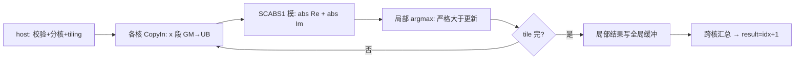

# aclblasIcamax 算子设计文档

# 需求背景（required）

## 需求来源
- 任务名称/批次：2026 年 11 月社区任务 — aclblasIcamax 算子开发（A2A3）。
- 合入目标仓：https://gitcode.com/cann/ops-blas ，算子代码 `blas/iamax/arch22/`，测试代码 `test/iamax/icamax/arch22/`。
- 验收流程：cann-competitions 社区任务流程（任务书 §4 交付件 / §5 PR 申请合入）。

## 背景介绍
### 算子功能定位
- aclblasIcamax 在单精度复数向量 x 中查找"模"最大元素的索引：`result = argmax_i ( |Re(x[k])| + |Im(x[k])| )`（1-范数口径 SCABS1，非欧氏模），返回 1-based int 索引；相同最大值取最小索引；结果写 Device 标量。
- n=0 或 incx≤0 时 quick return：不触发归约，直接写 result=0 并返回 SUCCESS；本算子不支持负步长反向遍历（Netlib 1993 起口径）。

### 业界对标
- 对标 cuBLAS `cublasIcamax`：参数语义、quick return 口径以 cuBLAS 文档为唯一依据；语义参考 Netlib `icamax.f`（SCABS1 严格大于才更新的比较语义）。
- 与同族实数接口 `aclblasIsamax`（include/cann_ops_blas.h L241，blas/iamax/arch22 已合入）逐参数对齐（int n / int incx / int* result）。

### 工程形态
- 工程模式：Ascend C kernel 直调（host 入口 + 校验 + tiling + device kernel，handle 绑定 stream）。
- 代码落位：`blas/iamax/arch22/`（icamax_host.cpp / icamax_kernel.cpp / icamax_kernel.h / icamax_tiling_data.h，与同目录 isamax 分层一致）；测试落位 `test/iamax/icamax/arch22/`，并在 `test/iamax/icamax/CMakeLists.txt` arch22 分支补 `ops_blas_add_gtest_tests(${OPS_BLAS} icamax_test)`（当前仅 arch35 注册，随本任务补齐）。
- 仓内近亲：`blas/iamax/arch35/icamax_*`（950PR 复数 1-范数归约已合入，算法/host 校验/tiling 直接移植）；`blas/iamax/arch22/isamax_*`（实数同族 arch22 骨架：分核归约树与 CMake 接入样例）。
- 现场核验：`include/cann_ops_blas.h` **L242 已有 `aclblasIcamax` 声明**（任务书 §2.1 写 L239，行号小幅漂移），签名与 §2.3 逐参一致，本任务无需改公共头。

### 接口规格
- 接口声明（与 include/cann_ops_blas.h L242 既有声明逐参一致）：

```cpp
aclblasStatus_t aclblasIcamax(aclblasHandle_t handle, int n, const aclblasComplex* x, int incx, int* result);
```

- 参数规格表（官方栏目）：

| 参数 | 参数含义 | 数据类型 | 支持数据类型 | 约束 | 形状 |
| --- | --- | --- | --- | --- | --- |
| handle | 库上下文句柄（携带 stream），Host 内存 | scalar | - | nullptr 返回 ACLBLAS_STATUS_HANDLE_IS_NULLPTR | - |
| n | x 复数元素个数，Host 内存 | scalar | int32 | n≥0；n<0 返回 INVALID_VALUE；n=0 合法 quick return：写 result=0 返回 SUCCESS，不触发归约 | - |
| x | 复数向量（实/虚交错存储，2n 个 float），Device 只读 | tensor | COMPLEX64 | 实/虚取值 FLOAT32 全集；n>0 且 incx≥1 时 nullptr 返回 INVALID_VALUE | 逻辑 [n]，物理 1+(n−1)×incx（incx≥1） |
| incx | x 步长，Host 内存 | scalar | int32 | incx≥1 正常计算；incx≤0（含 0 与负步长）合法 quick return：写 result=0 返回 SUCCESS；(n−1)×incx 超 int32 返回 INVALID_VALUE（host int64，issue #745） | - |
| result | "模"最大元素 1-based 索引（同值取最小索引），Device 标量 | scalar | INT32 | 正常路径 1..n；quick return 为 0；任意 n（含快返路径）下 nullptr 返回 INVALID_VALUE | 单值 |

### 数学公式
- `|x[k]| := |Re(x[k])| + |Im(x[k])|`（SCABS1 口径）；`result = min{ i : |x[k]| = max_j |x[j]| }`，1-based；与 §3.2 golden（cblas icamax，0-based +1 转 1-based）同一判定形态，bit-exact。

# 需求分析（required）

## 需求描述
- 使用 Ascend C 在 Atlas A2/A3（arch22）上以 kernel 直调实现 aclblasIcamax：COMPLEX64 向量的 1-范数模最大索引归约，输出 1-based int（bit-exact），n=0/incx≤0 快速返回 result=0，性能达到 cublasIcamax（910B3 实测）平均单次耗时的 0.8 倍以上。

## 需求拆解

| # | 必须回答 | 本算子结论 |
| --- | --- | --- |
| 1 | 数学定义与可复用的代数量 | SCABS1 模归约 argmax；可分解为"逐核局部 (模值, 索引) 归约 → 跨核/单核汇总"，且最小索引平局规则使归约可结合可交换；arch35 icamax 已合入实现整体移植，isamax arch22 提供分核归约骨架 |
| 2 | 接口原型 | include/cann_ops_blas.h L242 声明已存在（现场核验），无需新增；与 aclblasIsamax 逐参数对齐 |
| 3 | 参数规格 | 见接口规格表；异常码：HANDLE_IS_NULLPTR / INVALID_VALUE；quick return 返回 SUCCESS 且 result=0 |
| 4 | 支持数据类型 | x：COMPLEX64；result：INT32 标量（Device） |
| 5 | 目标芯片与 arch 映射 | Atlas A2/A3（arch22）；自验精度 910B3 或 A3、性能 910B3；标杆 cublasIcamax |
| 6 | 精度要求 | 输出为 int 索引，与 golden 精确相等（bit-exact），无浮点容差；golden=cblas icamax（0-based +1）；输入数据按 FLOAT32 档生成（mixed_tolerance_standard 约束输入面） |
| 7 | 性能预期 | msprof op（warmup 5 + 采样 ≥10 取平均）≤ GPU 标杆 1.25 倍；标杆 gpu_baseline.csv |
| 8 | 代码架构选型 + 可行性 | 两级归约：各核 UB 内向量指令批量算 SCABS1 模 + 局部 argmax（严格大于更新保最小索引），再跨核汇总（tiling 结构或全局标量二次 kernel）。已排除死路：单核全量扫描（大规模带宽受限，不满足性能判据）；欧氏模口径（与 cuBLAS/Netlib 语义不符，直接否决） |
| 9 | 评测来源 | golden：cblas icamax（test/iamax 测试工程内 +1 转 1-based，参照 test/isamax/isamax_golden.h 范式）；性能标杆：cublasIcamax（gpu_baseline.csv）；用例：test_cases CSV + GTest（CSV 列格式对齐 test/isamax/isamax_param.h） |

# 详细设计（required）

## 算子分析
### 数学公式
- SCABS1 模：`m[k] = |Re(x[k])| + |Im(x[k])|`；归约：`result = 1 + min{ i : m[k_i] == max_j m[k_j] }`（0 基 i，1 基输出）。
- 平局规则：严格大于才更新（> 而非 ≥），等值保留更小索引；该规则使局部→全局归约满足结合律与"最小索引胜出"一致性。

### 支持数据类型
- x：COMPLEX64（实/虚各 float32，交错存储）；result：INT32（Device 标量）。

### 支持形状
- 一维向量，物理长度 1+(n−1)×incx（incx≥1）。
- 退化：n=0 → quick return（result=0）；incx≤0 → quick return（result=0，不遍历数据）；n<0 → INVALID_VALUE。

## 算子实现
### 实现方案
#### 总体架构与数据流
- 两级归约数据流：GM(x 段)→UB（double buffer）→向量指令批量计算 SCABS1 模 → 各核 UB 内局部 argmax（保最小索引）→ 跨核汇总得全局 (最大模, 最小索引) → +1 写 result。跨核汇总采用 arch35 icamax 同款方案（按核局部结果写入全局缓冲，末核或轻量二段归约出全局结果）。

#### host 侧设计
- **分核策略**：n 按 AIV 核数均分（均分 + 余块），每核处理一段逻辑下标（物理下标 = 逻辑 × incx），满核原则；n 小于核数时按实际 n 启用。
- **数据分块和内存优化策略**：x 段分 tile 载入 UB，double buffer；模值与局部 argmax 在寄存器/UB 内完成，不落 GM（仅各核最终局部结果落一次）。
- **tilingkey 规划策略**：无路径分叉需求（incx≥1 单一路径，快返在 host 侧短路），不引入 tiling key；n/incx 走 tiling 结构体。
- **数据检测（校验顺序，#765/#861 口径）**：
  1. handle==nullptr → ACLBLAS_STATUS_HANDLE_IS_NULLPTR（最优先）；
  2. n<0 → INVALID_VALUE；
  3. result==nullptr（任意 n，含快返路径）→ INVALID_VALUE；
  4. (n−1)×incx 超 int32（host int64，issue #745）→ INVALID_VALUE；
  5. n==0 或 incx≤0 → 快返：写 result=0 返回 SUCCESS（不访问 x）；
  6. n>0 且 incx≥1 时 x==nullptr → INVALID_VALUE。
- **输出下发**：result 为 Device 标量，kernel 直写；异步执行依赖 handle 绑定 stream，读回前须同步 stream。

#### kernel 侧设计
- Init：解析 tiling（n/incx/各核起止/汇总缓冲布局），SetGlobalBuffer，InitBuffer。
- Process：逐 tile CopyIn → 向量指令计算 SCABS1（Abs 实/虚后 Add）→ 局部 argmax（严格大于更新，比较对为 (模值, 取反索引) 处理平局方向）→ 各核写局部结果 → 全局汇总（arch35 同款：末核汇总或二段轻量归约）→ result = 全局索引 +1 写出。
- 流程图：



- workspace 布局：跨核汇总全局缓冲（各核局部 (模, 索引) 对，核数量级，静态布局于 tiling）；除此无额外 workspace。

#### 性能优化要点（终态）
- 优化项：向量指令批量 Abs/Add（非逐元素标量比较）；UB double buffer；各核仅一次局部结果落 GM。目标 ≤1.25× cublasIcamax 标杆，实测数据回填自测报告。
- 未采用路线：欧氏模 sqrt（语义错误）；单核全量扫描（大规模性能不达标）；原子操作逐元素竞争更新（平局最小索引语义难保证且性能差）。

## 支持硬件

| 支持的芯片版本 | 涉及 |
| --- | --- |
| Atlas A2/A3 训练系列（910B，arch22） | ✅（本任务目标，自验精度 910B3 或 A3、性能 910B3） |
| Atlas 950PR（arch35） | ❌（arch35 已有 icamax 实现，本任务不改） |

## 算子约束限制
- 不支持负步长反向遍历（incx≤0 为合法 quick return，result=0）；向量非连续由 incx≥1 表达。
- 不涉及原地更新（result 为独立输出）、broadcast、dynamic shape；归约划分顺序不要求固定，但须满足"首个最大者（最小索引）"语义与 golden bit-exact 一致。
- 异步执行：依赖 handle 绑定 stream，读回 result 前须同步 stream。

# 可维可测分析（required）

## 精度标准/性能标准

| 验收标准 | 描述 | 标准来源 |
| --- | --- | --- |
| 精度标准 | 输出 int 索引与 golden 精确相等（bit-exact），无容差比对；golden=cblas icamax（0-based +1 转 1-based，参照 test/isamax/isamax_golden.h 范式）；输入数据按 FLOAT32 档生成（mixed_tolerance_standard 约束输入面）；quick return 路径 result==0 | 任务书 §3.2（EXACT 判定，对齐仓内 copy 族惯例） |
| 性能标准 | COMPLEX64 平均单次耗时 ≤ GPU 标杆（cublasIcamax）×1.25；msprof op 采集，warmup 5 + 有效采样 ≥10 取平均，仅 SUCCESS 计入 | 任务书 §3.3 + test_cases/gpu_baseline.csv |

## 测试概览
- 测试工程：`test/iamax/icamax/arch22/` 新建（CSV + C++ GTest；CSV 列格式对齐 test/isamax/isamax_param.h：n / incx / x 填充模式，扩展 result 列 "NULLPTR" 标记负向用例），补 `test/iamax/icamax/CMakeLists.txt` arch22 注册。
- 覆盖：尺寸扫描（0/1/小质数/2 的幂 ±1/非对齐/大规模）、步长 ≥1 组合与 incx≤0 快返（含 0 与负步长，期望 result=0 & SUCCESS）、平局构造用例（重复模值取最小索引）、特殊值（±Inf/NaN/±0 分量；NaN 分量按 SCABS1 得 NaN，与 golden 同序即同索引）、负向（n<0、result/x 空指针、跨度溢出期望 INVALID_VALUE；handle 空指针期望 HANDLE_IS_NULLPTR）、性能用例。
- 输入生成：均匀 [-5,5] 50% + 正态 GAUSS_NORM_5_2 50%（实/虚独立采样）；负向用例不按 (n−1)×incx 预分配缓冲；任务自带 gen_csv.py 仅均匀分布，正态用例本任务补齐并在自测报告说明。
- 性能口径：msprof op，warmup 5 + 有效采样 ≥10 取平均；复现入口见交付件测试 README。

## 兼容性分析
- 公共头零改动：`aclblasIcamax` 声明已存在于 include/cann_ops_blas.h L242（现场核验，任务书行号 L239 有小幅漂移），本任务不新增不修改任何声明。
- `blas/iamax/arch22/` 新增 icamax 文件、`test/iamax/icamax/arch22/` 新增测试工程与 arch22 CMake 注册，均不影响同目录 isamax 与 arch35 既有行为。
