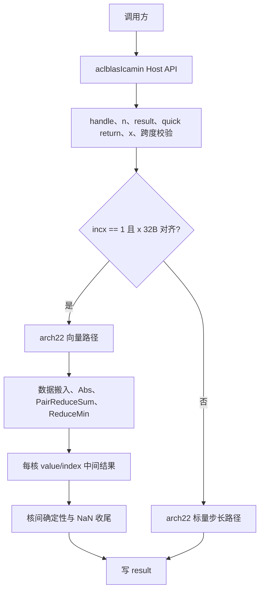

# 【CANN社区任务】aclblasIcamin算子设计文档

## 一、需求背景

### 1.1 需求来源

本设计对应 CANN 社区任务 `aclblasIcamin`（Atlas A2/A3）。任务要求使用 Ascend C 在
[cann/ops-blas](https://gitcode.com/cann/ops-blas) 工程中实现单精度复数向量的最小模元素索引，
覆盖算子实现、公共接口说明、CSV 驱动测试、精度自验和性能自验，验收通过后合入 ops-blas。

| 项目 | 内容 |
| --- | --- |
| 算子 | `aclblasIcamin` |
| 目标硬件 | Atlas A2 训练/推理系列、Atlas A3 训练/推理系列 |
| CANN 版本 | 9.1.0 |
| 代码仓 | `https://gitcode.com/cann/ops-blas` |
| 实现目录 | `blas/iamin/arch22/` |
| 测试目录 | `test/iamin/icamin/arch22/` |
| 对标接口 | cuBLAS `cublasIcamin` |
| 参考实现 | 仓内 `aclblasIsamin`、`aclblasIcamax` 和 arch35 `aclblasIcamin` |

### 1.2 算子功能

对于逻辑长度为 \(n\) 的 COMPLEX64 向量 \(x\)，第 \(i\) 个逻辑元素的实际位置为

\[
k_i = 1 + (i-1)\cdot incx,\quad i=1,\ldots,n
\]

算子返回使 1-范数模最小的 1-based 索引：

\[
\operatorname{result}
= 1+\operatorname*{arg\,min}_{i=1,\ldots,n}
\left(\left|\operatorname{Re}(x[k_i])\right|
+\left|\operatorname{Im}(x[k_i])\right|\right)
\]

复数模采用 BLAS icamin 的 \(|Re|+|Im|\)，不使用欧几里得模。比较过程严格小于才更新，
因此模值相同时保留最小逻辑索引。

`aclblasComplex` 的实部和虚部均为 FP32，Device 内存按
`real0, imag0, real1, imag1, ...` 交错存放。输出为单个 INT32 标量。

### 1.3 现有实现关系

ops-blas 已有 arch35 `aclblasIcamin`，其算法语义与本任务一致，但使用 Ascend 950PR
的架构能力。Atlas A2/A3 对应 arch22，本任务新增：

```text
ops-blas/
├── include/cann_ops_blas.h
├── blas/iamin/
│   ├── README.md
│   └── arch22/
│       ├── icamin_host.cpp
│       ├── icamin_kernel.cpp
│       ├── icamin_kernel.h
│       └── icamin_tiling_data.h
└── test/iamin/icamin/
    ├── CMakeLists.txt
    └── arch22/
        ├── icamin_test.cpp
        ├── icamin_test.csv
        ├── gpu_baseline.csv
        └── README.md
```

公共声明 `aclblasIcamin` 已在 `include/cann_ops_blas.h` 中提供，arch22 与 arch35
共用该接口，不新增架构私有公开 API。

## 二、需求分析

### 2.1 对外接口

```cpp
aclblasStatus_t aclblasIcamin(
    aclblasHandle_t handle,
    int n,
    const aclblasComplex* x,
    int incx,
    int* result);
```

参数顺序与 `cublasIcamin` 一致。`handle` 携带调用方绑定的 stream；`x` 和 `result`
均为 Device 指针。调用方在读取结果前同步 handle 绑定的 stream。

### 2.2 参数和返回码

| 参数 | 方向/位置 | 类型 | 语义和约束 |
| --- | --- | --- | --- |
| `handle` | 输入，Host | `aclblasHandle_t` | 空指针返回 `ACLBLAS_STATUS_HANDLE_IS_NULLPTR` |
| `n` | 输入，Host | `int` | 复数元素个数；`n < 0` 返回 `ACLBLAS_STATUS_INVALID_VALUE` |
| `x` | 输入，Device | `const aclblasComplex*` | 正常计算路径为空返回 `ACLBLAS_STATUS_INVALID_VALUE` |
| `incx` | 输入，Host | `int` | `incx >= 1` 正常计算；`incx < 1` quick return |
| `result` | 输出，Device | `int*` | 空指针在任意路径返回 `ACLBLAS_STATUS_INVALID_VALUE` |

参数处理顺序为：

1. 检查 `handle`；
2. 检查 `n < 0`；
3. 检查 `result`；
4. 若 `n == 0` 或 `incx < 1`，异步写 `result=0` 并返回成功，不读取 `x`、不启动计算 kernel；
5. 正常计算路径检查 `x`；
6. 以 int64 计算最后复数元素跨度 \((n-1)\cdot incx\)，超过 `INT32_MAX` 时返回
   `ACLBLAS_STATUS_INVALID_VALUE`。

### 2.3 支持范围

| 类别 | 支持范围 |
| --- | --- |
| 硬件 | Atlas A2、Atlas A3，arch22 |
| 输入 | COMPLEX64，两个交错 FP32 分量 |
| 输出 | INT32 单标量，1-based 索引 |
| 正常步长 | `incx >= 1`；性能用例覆盖 `incx=1` |
| 空输入 | `n=0`，返回成功并输出 0 |
| 负步长 | `incx < 1` quick return，不反向遍历 |
| 广播、矩阵布局、原地更新 | 不涉及 |
| 动态 shape | `n` 为运行时 Host 参数 |

### 2.4 精度和特殊值语义

输出为离散整数索引，验收采用整数精确比较：

\[
\text{actual}=\text{golden}
\]

CPU golden 使用 cblas 风格手写循环。初始化候选为第一个复数元素的
\(|Re|+|Im|\)，之后只在候选模值严格小于当前最小值时更新。该规则产生以下行为：

- 多个元素模值相同时返回最小逻辑索引；
- 后续出现 NaN 时永不更新；
- 首元素模值为 NaN 时，其初始候选保持不变，结果为 1；
- 全 NaN 输入返回 1；
- Inf 作为普通候选参与比较，多个相同 Inf 保留最小索引。

### 2.5 性能口径

任务书要求 NPU 平均单次耗时不超过 GPU 标杆耗时的 1.25 倍，即

\[
\frac{\text{GPU baseline}}{\text{NPU avg}}
\ge 0.8
\]

每个性能用例先 warmup 至少 5 次，再采集至少 10 个成功样本并取平均。任务包
`verify_performance.py` 解析 GTest 输出的 `[PERF] avg_us=`，这是正式脚本判据；
`msprof op` 的 task duration 用于交叉验证。

三组典型规模的门槛如下：

| case | n | incx | GPU baseline (ms) | NPU 上限 (us) |
| --- | ---: | ---: | ---: | ---: |
| icamin-base-000 | 1,048,576 | 1 | 0.0181589339 | 22.698667375 |
| icamin-base-001 | 2,097,152 | 1 | 0.0216234665 | 27.029333125 |
| icamin-base-002 | 4,194,304 | 1 | 0.0366080012 | 45.760001500 |

## 三、详细设计

### 3.1 总体结构



连续且地址 32B 对齐的路径承担全部性能用例。非连续或未对齐地址走与 golden 完全一致的
标量严格小于扫描，优先保证接口正确性。

### 3.2 Host 侧设计

#### 3.2.1 参数校验和 quick return

Host 侧完成全部不依赖 Device 数据的校验。quick return 通过
`aclrtMemsetAsync` 在绑定 stream 上写 `result=0`，不提交 Icamin kernel。

跨度检查使用 int64：

```cpp
const int64_t lastComplex =
    static_cast<int64_t>(n - 1) * static_cast<int64_t>(incx);
```

仅当 `n > 0 && incx >= 1` 时检查 `lastComplex <= INT32_MAX`。

#### 3.2.2 连续路径分核

将 `n` 个复数视为 `2n` 个交错 FP32。根据浮点元素数选择最多 40 个 AIV 逻辑核：

\[
\text{targetCores}
=\min\left(40,\left\lceil\frac{2n}{2048}\right\rceil\right)
\]

每个核的初始范围按 8 个 FP32（32B）向上对齐，确保 `DataCopy` 起点和块长满足对齐条件。
最后实际使用的核数由对齐后的每核元素数反推，不启动多余逻辑核。

当对齐后只使用 1 个逻辑核时，该核直接写 INT32 结果，不执行跨核同步和第二阶段归约。
其中 `n <= 128` 使用一次 UB 搬入后的标量严格小于扫描，避开小尺寸下的向量归约启动成本；
更大尺寸使用向量归约主路径。

#### 3.2.3 workspace

workspace 布局：

```text
offset 0 : 40 × (min_value, logical_index)，每项 2 个 FP32 word
```

每个第一阶段核写一个候选，第二阶段只读取最多 40 个候选。workspace 需求量与输入
长度无关。tiling data 作为 kernel 参数按值传入，避免每次调用额外执行 H2D tiling 拷贝。

### 3.3 Kernel 设计

#### 3.3.1 连续路径

连续路径使用 8192 个 FP32 的 tile，并在 TQue 中双缓冲。单个 tile 的处理流程为：

1. GM → UB 搬入交错的实部/虚部；
2. 非完整尾块使用 `DataCopyPad`，不足部分以 `+Inf` 补齐；
3. 对全部 FP32 分量执行 `Abs`；
4. 使用 `PairReduceSum` 将相邻两个绝对值相加，得到 \(|Re|+|Im|\)；
5. 使用 `Compare(value, value, EQ)` 生成非 NaN 掩码，将 NaN 模值替换为 `+Inf`；
6. 使用 `ReduceMin(..., calIndex=true)` 取得 tile 内最小值和局部索引；
7. 将局部索引换算为全局 1-based 前的 0-based 逻辑索引。

双缓冲允许 tile \(t+1\) 的 MTE2 搬入与 tile \(t\) 的向量计算重叠。

#### 3.3.2 首元素 NaN 修正

连续路径中的 NaN 统一改写为 `+Inf`，使后续归约稳定。与顺序 golden 的唯一差异是：
首元素为 NaN 时，后续有限值可能成为向量最小值；golden 则始终保持索引 1。

最终输出阶段读取 `x[0].real` 和 `x[0].imag`。任一为 NaN 时将索引强制设为 1，
与严格小于的 CPU 循环一致。

#### 3.3.3 核间归约与 tie-break

每个核将 `(minValue, minIndex)` 写入 workspace。所有核通过 `SyncAll` 完成后，
0 号核顺序读取最多 40 个候选，并使用：

```cpp
candidateValue < bestValue ||
(candidateValue == bestValue && candidateIndex < bestIndex)
```

合并规则保证核调度顺序不影响结果。最终写入 `bestIndex + 1` 作为 INT32 输出。

#### 3.3.4 非连续路径

`incx != 1` 或输入地址未满足 32B 对齐时，使用单 AIV 标量扫描。每个逻辑元素按：

```cpp
float score = fabsf(x[i * incx].real) + fabsf(x[i * incx].imag);
if (score < bestScore) {
    bestIndex = i;
}
```

处理。该路径直接复用 golden 的比较顺序，不需要额外的 NaN 修正。

### 3.4 输出和异步语义

`aclblasIcamin` 返回成功表示任务已提交到 handle 绑定的 stream。普通路径使用
`DataCopyPad` 写 4 字节结果；quick return 使用 `aclrtMemsetAsync` 写 0。
Host 不隐式同步 stream，也不读取 Device 数据。

## 四、测试设计

### 4.1 固定用例集

任务包提供的 `icamin_test.csv` 共 1200 条，名称和 seed 均唯一：

| 类别 | 数量 | 覆盖内容 |
| --- | ---: | --- |
| `TC_L0` | 6 | n=1/8、incx=1/2、全零 tie |
| `TC_SQ` | 38 | 1 到 \(2^{20}\) 的尺寸扫描 |
| `TC_INC` | 17 | 正步长 1/2/3，0/负步长 quick return |
| `TC_FL` | 14 | 均匀、全零、交替、极端值、Inf、NaN、首/中 NaN |
| `TC_ED` | 17 | n=0、负 n、空 x、空 result、跨度溢出 |
| `TC_EX` | 908 | 尺寸 × 步长 × 填充的确定性扩展 |
| `TC_PF` | 200 | 3 条典型 case、规模扫描和特殊填充性能 |

正式精度筛选为排除 `TC_PF` 的 1000 条用例；正式性能筛选只运行 200 条
`TC_PF`。随机输入按固定 seed 奇偶选择均匀分布和正态分布，实部和虚部独立采样。
正态参数的均值为 \(\mu\in[-5,5]\)，标准差为 \(\sigma\in[0.1,2]\)。

### 4.2 精度测试

测试工程加载 CSV，Host 侧构造输入并复制到 Device，调用 `aclblasIcamin`，同步后
逐用例执行 `EXPECT_EQ(actual, golden)`。负向用例比较返回码；quick return 同时检查
`result=0`。

任务包脚本：

```bash
python3 verify_accuracy.py \
  --repo "$REPO_ROOT" \
  --soc ascend910b \
  --csv "$TASK_ROOT/test_cases/icamin_test.csv" \
  --device 0 --timeout 3600
```

Atlas A3 使用 `--soc ascend910_93`。

### 4.3 性能测试

GTest 仅对 `TC_PF` 成功用例分配 Device 输入，先 warmup 10 次，再使用 ACL Event
统计连续 100 次 API 调用的平均设备时间。计时窗口不包含 Host 造数、H2D/D2H 和
golden 比对。

每个用例输出：

```text
[PERF] case=... n=... incx=... warmup=10 samples=100 avg_us=...
```

任务包 `verify_performance.py` 按 `(n, incx)` 关联 `gpu_baseline.csv` 并逐条判定。

### 4.4 内存测试

任务书 §3.4 明确内存要求为“不涉及”。自测报告和内存日志记录该项不适用，不设置
峰值内存门槛。

## 五、性能设计

### 5.1 连续访存

性能用例全部为 `incx=1`。连续路径避免逐元素标量 GM 读取，使用：

- 32B 对齐的 GM → UB 批量搬入；
- 双缓冲重叠搬运与计算；
- 一次 `Abs` 处理 8192 个 FP32 分量；
- `PairReduceSum` 一次完成实部/虚部绝对值相加；
- tile 级 `ReduceMin`，而不是输出完整模值张量；
- 每核只向 GM 写一个 `(value,index)` 候选。

### 5.2 小尺寸和大尺寸

小 `n` 时减少实际使用的 AIV 核数，避免空核和过多核间同步。大 `n` 时最多使用
40 个 AIV 逻辑核，并将输入均分到与 32B 对齐的连续区间。

### 5.3 特殊值处理成本

NaN 归一化只增加一次 `Compare` 和一次 `Select`，不改变主路径的数据宽度。
首元素 NaN 修正只在最终 0 号核读取两个标量，不进入逐元素循环。

## 六、兼容性、风险和回滚

### 6.1 兼容性

- 新增 arch22 实现，不修改 arch35 `aclblasIcamin` 的算法和 ABI；
- 公共接口沿用 `include/cann_ops_blas.h` 已声明签名；
- `test/iamin/icamin/CMakeLists.txt` 同时为 arch22 和 arch35 注册 GTest；
- CANN 9.1.0 缺少 `ACL_HIFLOAT4` 时，测试框架通过版本宏跳过该 token，避免构建失败。

### 6.2 风险与控制

| 风险 | 控制措施 |
| --- | --- |
| 交错复数地址计算错误 | 统一以 FP32 分量处理，`PairReduceSum` 每两个分量生成一个模值 |
| NaN 在向量归约中行为不稳定 | 非 NaN 掩码 + `+Inf` 替换，最终显式修正首元素 NaN |
| tie 受核执行顺序影响 | 最终归约使用值和索引的字典序比较 |
| 未对齐地址触发向量限制 | 未满足 32B 对齐时切换标量路径 |
| 尾块 padding 被误选为最小值 | padding 使用 `+Inf` |
| Host 跨度溢出 | int64 完成乘法后与 `INT32_MAX` 比较 |
| 性能计时混入 Host 操作 | ACL Event 只包住 Device 调用区间，最终判据使用 `[PERF] avg_us` |

出现连续路径精度问题时，可临时回退到标量步长路径定位问题，但正式提交保持连续路径
用于性能、标量路径用于非连续和未对齐输入。

## 七、交付与验收映射

| 验收项 | 交付证据 |
| --- | --- |
| 公共接口与参数语义 | `include/cann_ops_blas.h`、Host 参数校验 |
| arch22 实现 | `blas/iamin/arch22/icamin_*` |
| 产品支持说明 | `blas/iamin/README.md` |
| 1000 条精度/边界 | 固定 CSV、GTest 原始日志、逐条结果汇总 |
| 200 条性能 | 固定 baseline、`[PERF]` 原始日志、逐条判定 |
| 内存要求 | 报告和日志记录“不涉及” |
| 可复现性 | `test/iamin/icamin/arch22/README.md` 和任务包脚本命令 |
| 七文件交付包 | 官方模板命名，不超过 50 MiB 和 150 个文件 |

## 八、参考资料

- [Ascend C 算子开发文档](https://www.hiascend.com/document/detail/zh/CANNCommunityEdition/850/opdevg/Ascendcopdevg/atlas_ascendc_map_10_0002.html)
- [Ascend C 算子 API](https://www.hiascend.com/document/detail/zh/canncommercial/850/API/ascendcopapi/atlasascendc_api_07_0003.html)
- [ops-blas](https://gitcode.com/cann/ops-blas)
- [生态算子开源精度标准](https://gitcode.com/cann/opbase/blob/28a1ce52ae856353589841226a0002af73314a6b/docs/zh/ops_precision_standard/mixed_tolerance_standard.md)
- [cuBLAS cublasIcamin](https://docs.nvidia.com/cuda/cublas/index.html#cublas-t-amin)
- [Netlib BLAS isamin](https://www.netlib.org/blas/isamin.f)
- 任务包 `test_cases/README.md`、`gen_csv.py`、`icamin_test.csv`、`gpu_baseline.csv`、
  `verify_accuracy.py`、`verify_performance.py`
