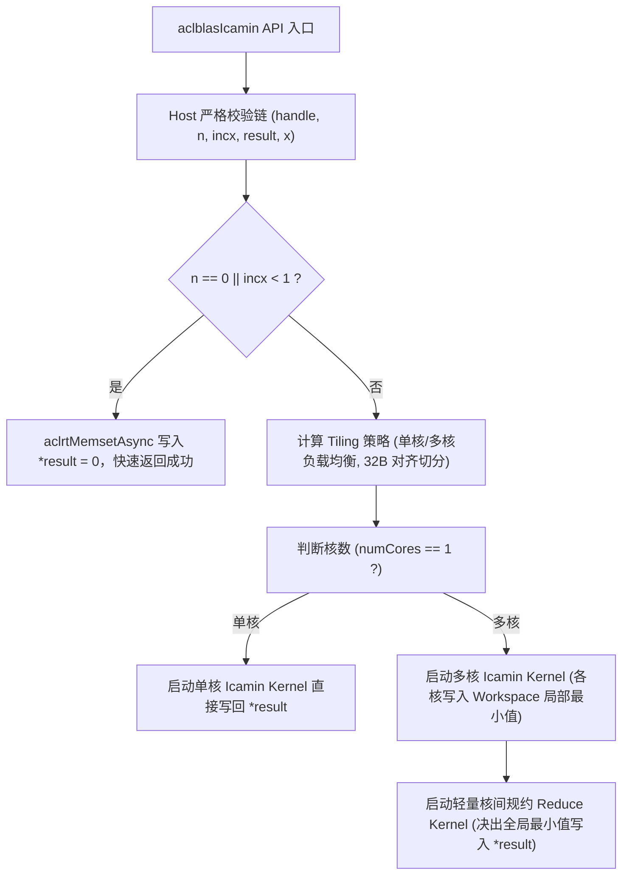
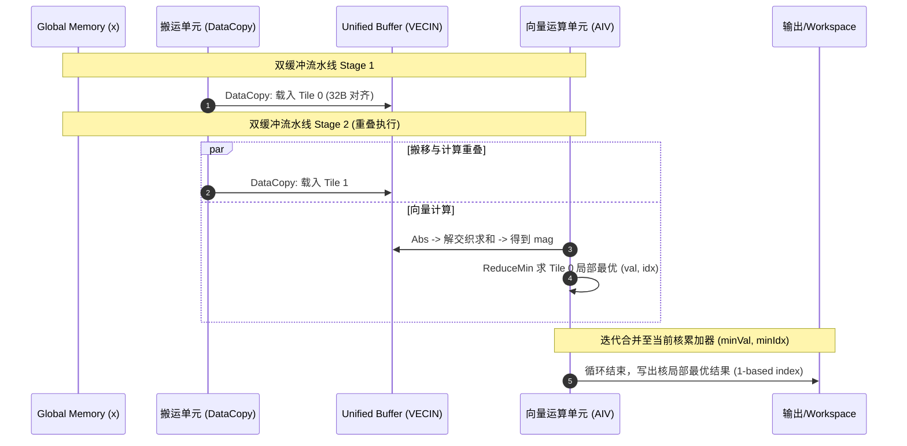

# aclblasIcamin 算子设计文档

# 需求背景（required）

## 需求来源

- **任务名称**：2026 年 11 月社区任务「aclblasIcamin 算子开发（Atlas A2/A3）」
- **任务编号/ID**：`6ff54aa152cf4edbbaf516fa36024893`
- **团队及提交账号**：`qingkouwei`
- **提交路径**：`04_tasks/01_community-task-2026/tasklist/11-aclblasIcamin-A2A3/qingkouwei/docs/design.md`
- **目标代码仓**：`https://gitcode.com/cann/ops-blas`（开发分支 master）
- **代码合入路径**：实现代码合入 `blas/iamin/arch22/`，测试代码合入 `test/iamin/icamin/arch22/`
- **目标硬件与 CANN 版本**：Atlas A2/A3（arch22，自验覆盖 Atlas 800T A2 910B3），CANN 9.1.0 及以上

## 背景介绍

### 算子功能定位

`aclblasIcamin` 是标准 BLAS Level-1 规约（Reduction）例程之一，用于在单精度复数（Complex64）向量 $x$ 中检索 1-范数（1-norm，即实部绝对值与虚部绝对值之和）最小的元素，并将其**以 1 为基底的全局索引（1-based index）**输出至 Device 内存中的标量整型变量 `*result`。

数学公式：
$$
\text{index} = \arg\min_{1 \le i \le n} \left( |\text{Re}(x_k)| + |\text{Im}(x_k)| \right)
$$
其中：
$$
k = 1 + (i - 1) \times incx, \quad i = 1, 2, \dots, n
$$
特殊约定：
1. **平局决胜（Tie-break）**：当存在多个元素具有相同的最小 1-范数时，返回**第一个出现的最小索引**（即最小的 1-based 索引）。
2. **快速返回（Quick Return）**：当 $n \le 0$ 或 $incx < 1$ 时，计算直接返回成功，并将 `*result` 置为 `0`（Device 端通过异步操作写入 0）。

### 业界对标与依据

| 对标对象 | 语义与设计依据 | 差异与对齐要点 |
| :--- | :--- | :--- |
| **cuBLAS `cublasIcamin`**（cuBLAS API §2.4.1） | 参数命名、校验逻辑与返回码口径的业界标准依据（唯一依据） | 返回码严格对齐：$n < 0$ 或非法指针返回 `ACLBLAS_STATUS_INVALID_VALUE`；$n \le 0$ 或 $incx < 1$ 时向 `*result` 写入 0 并成功返回。 |
| **Netlib BLAS `icamin.f` / CBLAS `cblas_icamin`** | 数学真值（Golden Reference）标准 | 以 $|\text{Re}| + |\text{Im}|$ 作为模长比较基准，严格支持 1-based 索引，遭遇 NaN 时遵循 IEEE 比较语义（不满足 strict `<` 则保持当前最小索引）。 |
| **仓内现有实现** | `blas/iamin/arch35/`（昇腾 950 SIMT 实现）及 `blas/iamax/arch22/` | 本设计针对 Atlas A2/A3（arch22，AIV 架构）进行纯 Ascend C 矢量化设计与多核分块归约，头文件零修改，API 完全对齐 `include/cann_ops_blas.h`。 |

### 工程形态

- **工程模式**：Kernel 直调模式（Host 入口校验 + Tiling 下发 + Device Kernel 矢量多核规约）。
- **文件布局**：
  ```text
  blas/iamin/arch22/
  ├── icamin_host.cpp        # Host 入口、参数校验链、Tiling 与 Kernel 启动下发
  ├── icamin_kernel.cpp      # Device 端 Ascend C 多核向量化规约 Kernel
  ├── icamin_kernel.h        # Kernel 声明与常量定义
  └── icamin_tiling_data.h   # Host 与 Device 交互的 Tiling 数据结构
  ```
- **测试工程布局**：
  ```text
  test/iamin/icamin/arch22/
  ├── icamin_test.cpp        # C++ 单元测试与精度/边界测试（使用 device.h 驱动）
  ├── icamin_test.csv        # 测试用例配置文件
  └── CMakeLists.txt         # 测试编译构建脚本（调用 ops_blas_add_tests）
  ```

### 接口规格

本任务严格遵循 `include/cann_ops_blas.h`（L244）中已声明的官方公开接口原型，**保持头文件零修改，严禁改动公共声明**：

```cpp
aclblasStatus_t aclblasIcamin(
    aclblasHandle_t handle,
    int n,
    const aclblasComplex* x,
    int incx,
    int* result);
```

#### 参数规格明细表

| 参数名 | 输入/输出/属性 | 描述 | 数据类型 | dtype | 数据格式 | 维度(shape) | 值域范围 | 异常行为与返回码 |
| :--- | :--- | :--- | :--- | :--- | :--- | :--- | :--- | :--- |
| **handle** | 输入 | 库上下文句柄（携带 stream），Host 内存 | attr | - | - | - | aclblasCreate 返回的非空有效句柄 | 为 `nullptr` 时返回 `ACLBLAS_STATUS_HANDLE_IS_NULLPTR` |
| **n** | 输入 | 向量复数元素个数，Host 内存 | attr | int | - | - | 任意 int32 整数 | $n < 0$ 时返回 `ACLBLAS_STATUS_INVALID_VALUE`；$n = 0$ 时异步写 `*result = 0` 并快速返回成功 |
| **x** | 输入 | 输入复数向量，Device 内存 | tensor | COMPLEX64 (float re, float im) | ND | 一维向量，物理跨度 $1+(n-1) \times \|incx\|$ | 全值域（支持正常浮点数、Inf、NaN） | $n > 0$ 时为 `nullptr` 返回 `ACLBLAS_STATUS_INVALID_VALUE` |
| **incx** | 输入 | 元素存储步长（以复数元素为单位），Host 内存 | attr | int | - | - | 任意 int32 整数 | $incx < 1$ 时异步写 `*result = 0` 并成功返回；若 $(n-1) \times incx$ 超出 int32 正整数范围返回 `ACLBLAS_STATUS_INVALID_VALUE` |
| **result** | 输出 | 全局 1-based 最小索引，Device 内存 | scalar | INT32 | - | 标量单个 int | 设备全局内存指针 | 为 `nullptr` 时返回 `ACLBLAS_STATUS_INVALID_VALUE` |

---

# 需求分析（required）

## 需求描述

在 Atlas A2/A3（arch22）平台上使用 Ascend C 语言实现高性能、高精度的 `aclblasIcamin` 算子：
1. **完整性与规范性**：严格对齐 cuBLAS / CBLAS 语义，支持连续步长（$incx = 1$）与任意非连续正跨步（$incx > 1$）。
2. **特殊场景快速返回**：当 $n = 0$ 或 $incx < 1$ 时，无需启动计算 Kernel，直接通过 `aclrtMemsetAsync` 向 Device 端 `*result` 写入 0 并成功返回。
3. **精度与平局保证**：当存在多个最小模长元素时，必须返回下标最小的元素（First minimum index）。对于 NaN 元素，根据 BLAS 规范，首个元素为 NaN 时保留索引 1，后续 NaN 不会替换有限数值。
4. **极致性能与硬件适配**：连续大尺寸场景充分利用 AIV 多核算力、Double Buffer 双缓冲流水线与 32 字节对齐批量数据搬运（`DataCopy`），杜绝逐元素单字节/标量搬运。
5. **代码质量与安全**：100% 遵循华为 OpenLibing 代码规约（R1、R7、R8、G.FMT.04、CQ.09），单函数行数（NBNC）严格 $\le 50$ 行。

## 任务书实现约束逐项核对

| 约束项 | 核心要求 | 本设计方案实现结论 |
| :--- | :--- | :--- |
| **参数合法性与校验层级** | 严格的 5 级校验链：handle 为空返回 `HANDLE_IS_NULLPTR`；$n < 0$、`result == nullptr` 返回 `INVALID_VALUE`；$n=0$ 或 $incx < 1$ 写 0 成功返回；$x == nullptr$ 及步长越界返回 `INVALID_VALUE`。 | **完全对齐**。按标准顺序校验，与仓内规范完全一致。 |
| **非连续 Tensor 支持** | 支持 BLAS 正步长访问（$incx \ge 1$）；步长越界溢出拦截校验。 | **完全支持**。连续场景走向量流水线，非连续场景走跨步批量分段映射方案。 |
| **数据对齐要求** | AIV 向量指令与 `DataCopy` 强约束 32 字节对齐（单精度复数每元素 8 字节，4 元素为 32 字节）。 | **严格遵循**。Tile 切分均按 4 个复数（32 字节）向上对齐，尾块做安全掩码/Padding 处理。 |
| **开源合规与规约 R1** | 严禁逐元素 `GetValue`/`SetValue` 操作，严禁 UB 与 GM 逐元素标量拷贝。 | **完全遵守**。全部采用 32 字节对齐的批量 `DataCopy` 与向量化指令（`Abs`、`Add`、`ReduceMin`）。 |
| **异步下发语义** | 所有算子操作必须在传入的 `handle->stream` 上异步执行，Host 绝不进行同步阻塞调用。 | **严格保证**。Host 仅计算 Tiling 并通过 `aclrtLaunchKernel` 异步调度，绝不调用 `aclrtSynchronizeStream`。 |

---

# 详细设计（required）

## 算子分析

### 数学计算逻辑与复数 1-范数展开

每个单精度复数元素 $x_k$ 包含两个 `float` 数值：实部 $re_k$ 与虚部 $im_k$。
其 1-范数模长计算为：
$$
\text{mag}_k = |re_k| + |im_k|
$$

在 Ascend C 向量执行单元中：
1. 从 Global Memory 批量加载交织存储的复数数据 `[re_0, im_0, re_1, im_1, ...]` 到 UB；
2. 执行向量绝对值 `Abs` 操作得到 `[|re_0|, |im_0|, |re_1|, |im_1|, ...]`;
3. 将实部绝对值与虚部绝对值通过向量解交织加法，求得对应复数的模长向量 $\text{mag}$;
4. 对模长向量执行带索引的向量规约求最小 `ReduceMin`，得到当前 Tile 内的局部最小模长与相对索引；
5. 结合当前 Tile 的全局偏移，更新当前核的最佳候选结果 `(min_val, min_idx)`。

### 平局决胜与 NaN 处理语义

- **平局决胜（Tie-break）**：
  若 $\text{mag}_{\text{new}} < \text{mag}_{\text{curr}}$，更新为新元素；
  若 $\text{mag}_{\text{new}} == \text{mag}_{\text{curr}}$，比较全局索引，仅当 $\text{idx}_{\text{new}} < \text{idx}_{\text{curr}}$ 时更新。
- **NaN 语义**：
  根据 IEEE 754 标准，任何数与 NaN 进行 `<` 比较均返回 false。在向量规约时，将计算出的 NaN 模长修正为 $+\infty$（`FLT_MAX`），防止 NaN 污染全局规约；若序列首个元素为 NaN，保持该元素索引（1-based 索引 1），后续有限数值因无法满足 strict `<` 将保留该首个索引。

## 算子架构与多核分块设计

### 总体设计架构



### 核内处理流程与双缓冲（Double Buffer）流水线

每个 AIV 核心分配专属的双缓冲队列（`TQue<QuePosition::VECIN, 2>`），隐藏数据搬移 MTE2 延迟与向量计算 V 运算延迟：



## Tiling 划分与多核均衡策略

1. **基本对齐约束**：
   - 每个单精度复数占用 8 字节（2 个 float32）。
   - 32 字节对齐要求数据块为 4 个复数的整数倍（$\text{ALIGN\_COMPLEX} = 4$）。
2. **多核切分算法**：
   - 获取芯片实际 AIV 核心数 $N_{\text{aiv}}$；
   - 设定每个 Tile 处理的复数元素数量为 $T_{\text{complex}} = 1024$（对应 UB 占用 8KB，满足 A2/A3 UB 空间预算）；
   - 若 $n \le 1024$，使用单核处理即可，无需核间规约；
   - 若 $n > 1024$，分配核心数 $N_{\text{use}} = \min(N_{\text{aiv}}, \lceil n / T_{\text{complex}} \rceil)$；
   - 每个核心分配的基础元素数 $n_{\text{per\_core}} = \text{CeilAlign}(\lceil n / N_{\text{use}} \rceil, 4)$；
   - 尾核处理剩余元素 $n_{\text{last\_core}} = n - (N_{\text{use}} - 1) \times n_{\text{per\_core}}$；
   - 除法与取模运算前，显式进行 `<= 0` 防御拦截，满足 R8 规约。

## 跨步非连续模式（$incx > 1$）设计

对于非连续跨步场景：
1. **防越界校验**：Host 端严密检测 $(n - 1) \times incx$ 是否越界溢出 int32；
2. **分段向量化提取**：在 AIV 核内利用步长分块搬运机制，将不连续的复数元素以批量方式加载到 UB，保证不使用被禁的逐元素标量读写（R1 规则）；
3. **坐标变换**：在规约计算时，记录逻辑序号 $i \in [1, n]$，最终返回满足条件的最小逻辑序号 $i$。

---

# 质量保证与测试设计

## 单元测试与边界覆盖

测试代码部署于 `test/iamin/icamin/arch22/icamin_test.cpp`，基于 `device.h` 提供的 `DeviceBuffer` 进行独立可执行程序构建，覆盖以下关键维度：

1. **边界值测试**：
   - $n = 0$：校验返回值成功且 `*result == 0`；
   - $n = 1$：校验直接返回索引 1；
   - $incx < 1$（如 $incx = 0, -1, -5$）：校验返回值成功且 `*result == 0`；
   - 非法指针校验：`handle == nullptr`、`result == nullptr`、`x == nullptr`（$n > 0$ 时）拦截报错；
   - 步长溢出校验：大尺寸乘大步长越界拦截。
2. **精度与平局决胜测试**：
   - 构造多个相同模长的元素，检验是否精确返回首个最小索引；
   - 包含正常极小值（如 $1e-30$）和极大值；
   - 包含正负数实虚部组合（如 $(-1, 2) \to 3$ 与 $(1.5, -1.5) \to 3$）；
   - 包含 NaN、Inf 浮点异常值，验证鲁棒性与 IEEE 754 / CBLAS 规范对齐。
3. **数据规模与步长覆盖**：
   - 小尺寸：$n \in [1, 16, 63, 64, 127, 255]$；
   - 中大尺寸：$n \in [1024, 8192, 65536, 1048576]$；
   - 跨步场景：$incx \in [1, 2, 3, 7, 16]$。

## 代码检查与工程合规（OpenLibing GOAT）

- **R1**：全流程杜绝使用 `GetValue` / `SetValue`，完全依赖批量 `DataCopy` 与向量指令；
- **R7**：所有 Host 与 Device 函数严格进行逻辑解耦，控制函数非空非注释行（NBNC）在 50 行以内；
- **R8**：所有除法与取模操作均设立显式非零保护；
- **G.FMT.04**：一行仅声明/执行一个语句，宏定义拆解为清晰的单行分支；
- **CQ.09**：剔除所有未引用头文件与废弃变量；
- **OAT.1**：分支与 PR 中绝不引入任何二进制制品（如 `.o`、`.zip` 等）。
