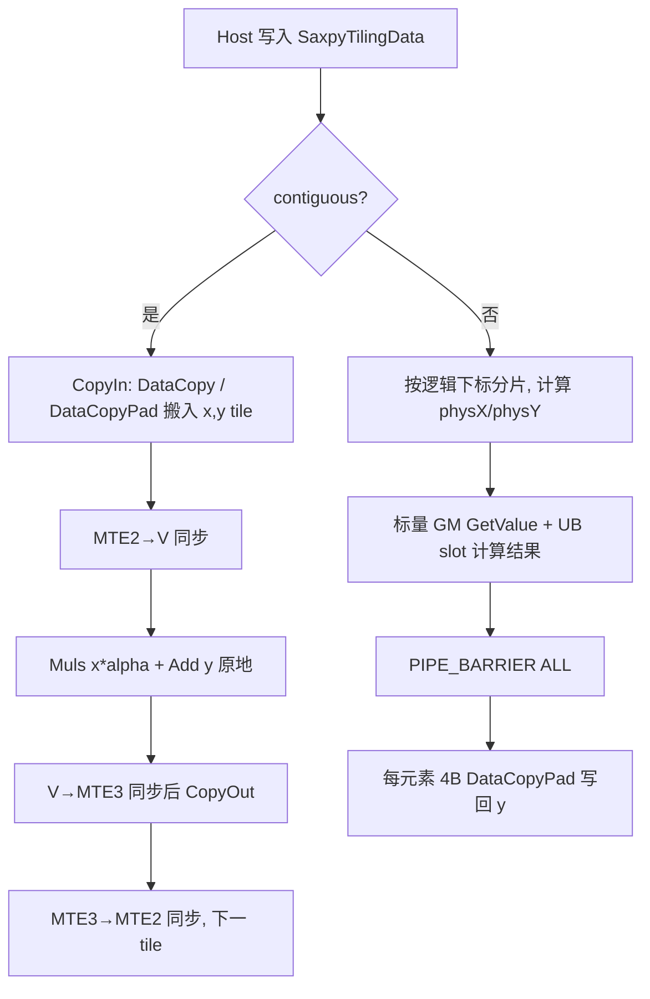

# 【CANN社区任务】aclblasSaxpy 算子设计文档

| 项目 | 内容 |
| --- | --- |
| 任务名称 | 11月社区任务-aclblasSaxpy算子开发（A2/A3），任务编号 2 |
| 提交团队 / 贡献者 | JaneConan |
| 设计文档提交目录 | `04_tasks/01_community-task-2026/tasklist/11-aclblasSaxpy-A2A3/JaneConan/docs/design.md` |
| 设计 PR 标题 | `【CANN社区任务】aclblasSaxpy算子设计文档`（目标 `cann/cann-ops-competitions:master`） |
| 代码仓 / 分支 | `https://gitcode.com/JaneConan/ops-blas`，`master` |
| 代码提交 | `https://gitcode.com/JaneConan/ops-blas/commit/bdcf6d955334db87cad803d1034b0fc09335077f?ref=master` |
| 代码目标目录 | `blas/axpy/arch22/`、`test/saxpy/arch22/` |
| 适配硬件 | Atlas A2 / A3，`arch22` / `NpuArch=DAV_2201`；自验证平台 Atlas 800T A2（910B3） |
| CANN / 语言 | CANN 9.1.0，Ascend C（SIMD-MemBase），Kernel 直调 |
| 数据类型 | FLOAT32（`x`、`y`、`alpha`） |
| 文档状态 | 设计与代码均已完成；本次仅单独提交本设计文档，代码与自验证证据在 `ops-blas` 仓 |

# 需求背景（required）

## 需求来源

本任务来自 2026 年 11 月 CANN 社区任务「11月社区任务-aclblasSaxpy算子开发（A2A3）」，目标是在 `cann/ops-blas` 中补齐 Atlas A2/A3 系列产品 BLAS-1 能力缺口，对标 cuBLAS `cublasSaxpy`，采用 Ascend C Kernel 直调方式实现，随 PR 合入 `blas/axpy/arch22/` 与 `test/saxpy/arch22/`。

语义依据按以下顺序裁决：

1. cuBLAS 官方文档 `CUBLAS_Library.pdf` §2.5.4：参数序列、返回码与快速返回口径；
2. Netlib `saxpy.f`：`IF (N.LE.0) RETURN`、`IF (DA.EQ.ZERO) RETURN`；
3. 仓内 Ascend 950PR 既有实现 `blas/axpy/arch35/saxpy_host.cpp`（`ValidateSaxpyParams` 与 `aclblasSaxpy` 入口，L20-160）：校验层级与工程模式。

## 背景介绍

### 标杆算子与可复用工程现状核查

| 审核对象 | 核查结论 | 依据及替代参考 |
| --- | --- | --- |
| 原 TBE 算子源码路径 | 不适用：任务书未给出 `aclblasSaxpy` 的 TBE 实现，目标仓也不存在该接口的 TBE 版本 | 数学与 API 语义以 cuBLAS `cublasSaxpy` / Netlib `saxpy.f` 为准 |
| 算子信息库路径 | 不适用：本任务不注册 ACLNN 算子 | 公共声明位于 `ops-blas/include/cann_ops_blas.h` L472；接口不是 `aclnn*` |
| 可复用工程实现 | 适用 | `blas/axpy/arch35/saxpy_*`（同接口 Host 校验、tiling、stream 直调）；`blas/axpy/arch22/caxpy_*`、`blas/swap/arch22/sswap_kernel.cpp`（DAV_2201 跨步长标量 GM 先例）；`test/saxpy/saxpy_golden.h`（cblas golden） |

本任务**不新增公共接口**：`include/cann_ops_blas.h` 中 `aclblasSaxpy` 声明已存在且与 950PR 共用，禁止另立私有平行接口。实现只补齐 `arch22` 目录下 Host + Kernel + tiling，两者由构建系统按 `SOC_ARCH_DIRS` 隔离，不产生同名符号冲突。

### 标杆实现分析

`cublasSaxpy` 与 Netlib `saxpy.f` 的核心语义是逐元素 `y ← α·x + y`，`y` 原地覆写；步长 `incx`/`incy` 决定逻辑元素与物理下标的映射，负步长从物理向量尾端起算。`arch35` 既有实现的非单位步长路径依赖 SIMT（`simt_api/asc_simt.h`、`asc_vf_call`），该能力在 DAV_2201（SIMD-MemBase）上**不可用**，因此 arch22 必须重新设计跨步长路径。

`arch22` 兄弟算子（scopy/sscal/sswap/sdot）普遍采用「Host `aclrtMalloc` + H2D tiling + `aclrtSynchronizeStream` + `aclrtFree`」的 GM tiling 缓冲方案。该方案每次调用引入设备内存分配与流同步，既破坏纯异步语义，也会把 Host 开销带进 BLAS-1 的调用耗时窗口；本设计改为 **tiling 结构体按值随 `<<<>>>` 下发**（仓内 `blas/trsmbatched/arch22/` 已有按值传 tiling 的先例）。

## 算子功能分析

计算公式（`i = 1..n`，`k = 1+(i-1)*incx`，`j = 1+(i-1)*incy`）：

```text
y[j] = alpha * x[k] + y[j]
```

- 输入：`handle`（Host，携带 stream）、`n`（Host）、`alpha`（Host FP32 标量指针）、`x`（Device FP32 向量）、`incx` / `incy`（Host int）。
- 输出：`y`（Device FP32 向量，输入兼输出，原地覆写）；`x` 只读。
- 支持数据类型：仅 FLOAT32。
- 支持广播：不涉及（BLAS-1 向量算子，参与运算的 `x`/`y` 逻辑元素个数同为 `n`）。
- 物理缓冲长度：`1 + (n-1)*|incx|` 与 `1 + (n-1)*|incy|` 个 FP32 元素。

# 需求分析（required）

## 需求描述

使用 Ascend C 在 Atlas A2/A3 上实现 `aclblasSaxpy` 的 Kernel 直调版本：Host 完成参数校验与运行期 tiling，Device 侧完成连续与非连续（正负）步长的原地更新；计算经 handle 绑定 stream 异步下发；补齐 `test/saxpy/arch22/` 的 CSV 驱动 GTest 工程，并在 `test/saxpy/CMakeLists.txt` 的 arch22 分支注册 GTest（原仓仅在 `ascend950` 分支注册，A2/A3 会退回非 GTest runner）。

## 需求拆解

1. 参数校验层级与返回码严格对齐任务书 §2.4 / §2.5；`n<=0` 不访问 `alpha`/`x`/`y`。
2. 支持非零正负步长（含 `incx`/`incy` 不同符号、不同绝对值），间隔元素保持不变。
3. `alpha == 0.0` 快速返回，`y` 不变且不读取 `x`；`alpha` 值本身不校验（含 Inf/NaN）。
4. 计算为单次乘加、跨次执行确定性；不要求动态 shape 图模式。
5. 精度满足任务书 §3.2 FLOAT32 mixed_tolerance；性能满足 §3.3（单次耗时 ≤ GPU A100 标杆 / 0.8）。
6. 不申请额外 workspace；API 内不做流同步。
7. 测试覆盖 §3.5 的精度全量 1000 条、性能子集 200 条与负向 / quick-return 场景。

## 外部组件依赖

| 组件 | 适配状态 | 用途 |
| --- | --- | --- |
| CANN 9.1.0 Ascend C / ACL Runtime | 已适配 | `--npu-arch=dav-2201` 编译 Kernel、Device 内存与 stream 下发 |
| Atlas A2/A3（DAV_2201，UB 192 KiB） | 已适配 | 唯一正式验收硬件；A2 用 `ascend910b3`，A3 用 `ascend910_93` |
| Netlib BLAS 3.10.0 `cblas_saxpy` | 仅测试期依赖 | 精度 Golden，不作为运行时依赖 |
| GTest / CBLAS / LAPACK | 仅测试期依赖 | CSV 驱动 ST 与 golden |

不新增 CATLASS、GEMM、TBE、ACLNN 或 SIMT 依赖；不引入 950PR 专用 API。

## 内部适配模块

| 模块 | 仓内位置 | 适配内容 |
| --- | --- | --- |
| 公共 API | `include/cann_ops_blas.h` L472 | 复用既有 `aclblasSaxpy` 声明，不修改 |
| Host | `blas/axpy/arch22/saxpy_host.cpp` | 参数校验、quick return、tiling 计算、按值下发 |
| Kernel / tiling ABI | `blas/axpy/arch22/saxpy_kernel.cpp`、`saxpy_kernel.h`、`saxpy_tiling_data.h` | 连续向量路径、跨步长路径、`SaxpyTilingData` |
| 构建 | `blas/CMakeLists.txt`（自动 GLOB，无需新增 CMake）、`test/saxpy/CMakeLists.txt` | arch22 GTest 注册 |
| 测试 | `test/saxpy/arch22/`、`test/saxpy/saxpy_golden.h` | CSV 用例、GTest、H2D/D2H wrapper、性能采集、报告生成 |
| 文档 | `blas/axpy/aclblasSaxpy_arch22_design.md`、`blas/axpy/README.md` | 算子仓内设计说明与 README；本文为竞赛仓独立提交件 |

# 详细设计（required）

## 算子分析

### 数学公式与调用方式

```text
y[physY(i)] = alpha * x[physX(i)] + y[physY(i)],  i = 0..n-1
phys(i, inc) = (inc > 0) ? i * |inc| : (n - 1 - i) * |inc|
```

采用 **ops-blas 句柄式 BLAS API + Ascend C Kernel 直调**，不是 ACLNN / 框架算子。调用方以 `aclblasSetStream` 绑定 stream，传入 Host `alpha` 与 Device `x`/`y`；Host 只入队，调用方在读取 `y` 前负责 `aclrtSynchronizeStream`。


### 支持数据类型、形状与布局

| 项目 | 支持范围 |
| --- | --- |
| `alpha` | FP32，Host 标量指针，值不校验 |
| `x` / `y` | FP32，Device，ND 一维向量 |
| `n` | 任意 int32；`n<=0` 为合法 no-op |
| `incx` / `incy` | 非零 int32，不含 `INT32_MIN`；`(n-1)*abs(inc)` 需在 int32 元素下标范围内 |
| 负步长 | 从物理 span 尾端起算；`x`、`y` 各自独立映射 |
| 广播 / 0 维 Tensor | 不涉及 / 不涉及 |

## 算子实现

### Host 侧设计

Host 职责为校验接口契约、构造紧凑 tiling、在 handle stream 上异步入队；**不做 `aclrtSynchronizeStream`、不申请 Device tiling 缓冲**。

#### 参数校验与启动边界

| 顺序 | 条件 | 行为 |
| --- | --- | --- |
| 1 | `handle == nullptr` | `ACLBLAS_STATUS_HANDLE_IS_NULLPTR` |
| 2 | `n <= 0` | `ACLBLAS_STATUS_SUCCESS`；不访问 `alpha`/`x`/`y`，不启动 Kernel |
| 3 | `alpha`/`x`/`y` 为 `nullptr`；`incx`/`incy` 为 `0` 或 `INT32_MIN`；`(n-1)*abs(inc) > INT32_MAX` | `ACLBLAS_STATUS_INVALID_VALUE` |
| 4 | `alpha == 0.0f` | `ACLBLAS_STATUS_SUCCESS`；`y` 不变，不读取 `x`（Netlib `IF (DA.EQ.ZERO) RETURN`） |
| 5 | 其他合法输入 | 计算 tiling，异步下发 Kernel，返回 SUCCESS |

跨度校验用 `int64_t` 计算 `static_cast<int64_t>(n-1) * absInc`，避免 int 相乘溢出（issue #780/#866 口径）；`INT32_MIN` 单独拦截，因为其绝对值不可在 int32 内表示。`alpha` 在 Host 侧同步解引用并拷入 tiling，提交后修改 Host 标量不影响已入队任务。

#### Tiling 数据结构与下发

`SaxpyTilingData` 约 48 B，**按值**传入 Kernel：`totalN`、`perCoreN`、`remainder`、`tileSize`、`useCoreNum`、`contiguous`、`incx`/`incy`（`int64_t`）、`alpha`。相较 GM tiling 缓冲方案，省去 `aclrtMalloc` / H2D `aclrtMemcpy` / `aclrtSynchronizeStream` / `aclrtFree`，不占 workspace，且保持纯异步；仓内 `blas/trsmbatched/arch22/strsmbatched_small_aiv.cpp` 已验证 DAV_2201 支持按值传结构体。

#### 分核策略

AIV 核数由 `GetAivCoreCount()` 获取，上限 64；该值是设备属性，进程内缓存以避免 BLAS-1 每次调用查询平台带来的 Host 开销（查询失败保持可重试）。

| 路径 | 条件 | 分核 |
| --- | --- | --- |
| 连续向量 | `incx == incy == 1` 或 `incx == incy == -1` | `numBlocks = min(coreNum, max(1, n/8))`；`perCoreN = alignDown(n/numBlocks, 8)`；`remainder` 全部给尾核 |
| 跨步长 | 其余合法步长组合 | `numBlocks = min(coreNum, n)`；按逻辑下标均分 `perCoreN` 与 `remainder` |

连续路径把每个 block 的 GM 起始地址保持 32 B 对齐（8 个 float），从而可用 `DataCopy` 全速搬运；`incx == incy == -1` 时 `x`/`y` 参与的物理下标集合同为 `[0, n)`，等价于连续路径。`remainder` 只归尾核，保证覆盖 `[0, n)` 且无跨核写重叠。

#### UB 切分与 Buffer 规划

DAV_2201 单核 UB 192 KiB。

| Buffer | 路径 | 大小 | 用途 |
| --- | --- | --- | --- |
| `xBuf_`（`TBuf<VECIN>`） | 连续 | `16384*4 = 64 KiB` | 搬入 x tile |
| `yBuf_`（`TBuf<VECIN>`） | 连续 | `16384*4 = 64 KiB` | 搬入 y tile，原地计算并写回 |
| `outBuf_`（`TBuf<VECOUT>`） | 跨步长 | `1024*8*4 = 32 KiB` | 每逻辑元素一个 32 B 对齐 UB slot |

连续路径 `tileSize = 16384` 元素，合计 128 KiB / 192 KiB，留出 `TPipe` 与栈余量；计算为 `Muls(xLocal, xLocal, alpha, count)` + `Add(yLocal, yLocal, xLocal, count)`，`yLocal` 复用为输出，无第三份临时缓冲，符合 UB 复用原则。

#### 分支与同步策略

| 分支 | 条件 | 处理 |
| --- | --- | --- |
| 快速返回 | `n<=0`、`alpha==0`、非法参数 | Host 直接返回 |
| 连续向量 | 单位步长（含双负） | 多核 + UB tile + `DataCopy`/`Muls`/`Add` |
| 非 32 B 对齐尾部 | `count % 8 != 0` | `DataCopyPad` 补齐读入、按有效字节写回 |
| 跨步长 | 其余合法步长 | 标量 GM 读取 + 4 B `DataCopyPad` 写回 |
| 特殊值 | alpha/x/y 为 Inf/NaN/极值 | 不拦截、不清洗，按 IEEE 自然传播 |

连续路径以 `SetFlag/WaitFlag<MTE2_V>`、`<V_MTE3>`、`<MTE3_MTE2>` 约束流水，并在 `Muls` 与 `Add` 之间加 `PipeBarrier<PIPE_V>`；跨步长路径因标量写 UB 与 MTE3 读 UB 跨 pipe，用 `PIPE_BARRIER(ALL)` 保证可见性。

#### 分派标识（等价于 tilingKey）

本工程不使用 ACLNN/TBE 的 `tilingKey`，分派信息由 `SaxpyTilingData.contiguous` 与 Host launch 条件传递，不虚构未实现的 key 值；分派仅依据输入布局，不读取 case 名称、随机种子或性能基线。

### Kernel 侧设计



#### 连续向量 Kernel

每个 block 依据 `GetBlockIdx()` 取 `myOffset = blockIdx * perCoreN`、`myCount = perCoreN + (尾核 ? remainder : 0)`，按 `tileSize` 循环处理：

1. `CopyIn`：对齐部分用 `DataCopy`；尾部 `tail` 个元素用 `DataCopyPad`，`DataCopyPadExtParams<float>{true, 0, 8-tail, 0.0f}` 补齐到 32 B。
2. `Compute`：`vectorCount = ceil(count/8)*8`，`Muls` 后 `Add`，仅对有效元素生效。
3. `CopyOut`：对齐部分 `DataCopy` 写回；尾部 `DataCopyPad` 只写 `tail*4` 有效字节，不污染间隙。

#### 跨步长 Kernel

DAV_2201 为 SIMD-MemBase，无 SIMT 线程、无硬件 strided-gather 指令，故按仓内 `blas/swap/arch22/sswap_kernel.cpp` 的成熟做法：每趟处理 1024 个逻辑元素，逐元素计算

```text
xPhys = (incx > 0) ? logical*|incx| : (n-1-logical)*|incx|
yPhys = (incy > 0) ? logical*|incy| : (n-1-logical)*|incy|
out.SetValue(i*8, alpha * xGM.GetValue(xPhys) + yGM.GetValue(yPhys))
```

每个结果占一个 8-float（32 B）对齐 UB slot，再通过 `DataCopyExtParams{1, 4, 0, 0, 0}` 以 4 B burst 写回 `yGM[yPhys]`；`PIPE_BARRIER(ALL)` 分隔标量 UB 写与 MTE3 读、以及 MTE3 写与下一趟标量 GM 读。`xGM` 仅 `GetValue` 读，`yGM` 读写同址；间隙元素不被访问。

#### 浮点顺序与特殊值

计算顺序为 `y + (alpha * x)`，与 Netlib `saxpy.f` 及 `cblas_saxpy` 一致；不对 `alpha=1` 设置数值捷径。Inf/NaN 不做拦截或清洗，按 IEEE 规则自然传播，由测试按任务书 §3.2 的等效规则单独判定。

## 支持硬件

| 支持的芯片版本 | 涉及勾选 | 说明 |
| --- | --- | --- |
| Atlas A2 训练/推理系列（910B3，`--soc=ascend910b3`） | √ | 正式自验证平台；CANN 9.1.0 |
| Atlas A3 训练/推理系列（`--soc=ascend910_93`） | √ | 同为 `arch22` / DAV_2201，共用实现 |
| Ascend 950PR/DT（arch35） | × | 使用 `blas/axpy/arch35/` 既有实现，本文不改动 |
| Ascend 310P（arch20） | × | 需独立 Kernel 适配，不在本次范围 |

## 算子约束限制

1. 仅实现 FLOAT32 单精度实数 AXPY；不包含 complex / double 的平行 API。
2. `incx`、`incy` 必须非零且不为 `INT32_MIN`；`(n-1)*abs(inc)` 必须落在 int32 元素下标范围内，调用方按 `1+(n-1)*abs(inc)` 分配 Device 缓冲。
3. 不支持广播、高维 ND 语义、批处理；`x` 只读，`y` 原地覆写，不返回视图。
4. `alpha` 为 Host 标量指针；不支持 Device 侧 alpha 指针。
5. API 只向 handle 绑定 stream 入队，返回成功仅表示 Host 已提交；读取 `y` 前须同步该 stream。
6. 跨步长路径为标量 GM 访问，吞吐低于连续向量路径；性能优化目标针对任务书 §3.3 的连续访存子集。
7. `tileSize`/UB 常量针对 DAV_2201 的 192 KiB；arch35 由构建系统隔离，不共用。

## 任务书 §2.5 约束逐项核对结论

| 约束项 | 结论 | 实现依据 |
| --- | --- | --- |
| 参数合法性与校验层级 | 满足：handle 判空 → `n<=0` no-op → 指针/步长/跨度校验 → `alpha==0` 快返 → 下发；返回码与 cuBLAS / arch35 一致 | `saxpy_host.cpp` `ValidateSaxpyParams`、`aclblasSaxpy` |
| 非连续 Tensor 支持 | 满足：正负非零步长均生效，间隔元素跳过；负步长自物理 span 尾端起算 | `saxpy_kernel.cpp` `PhysicalIndex`、`SaxpyStridedAIV` |
| broadcast 规则 | 不涉及：`x`/`y` 逻辑元素个数同为 `n` | 单一 `totalN` 描述 |
| dynamic shape 要求 | 满足（静态 shape 即可）：`n`/`incx`/`incy` 为运行期入参，Host 按运行期值 tiling | `CalSaxpyTilingData` |
| 原地与视图语义 | 满足：`y` 同址读写，`x` 只读，不返回视图 | 两个 Kernel 均只写 `yGM_` |
| 确定性计算要求 | 满足：单次乘加、无原子累加、无跨核归约、无随机数 | 无跨核写冲突 |
| 空 Tensor 处理 | 满足：`n<=0` 不访问数据、不启动 Kernel、返回 SUCCESS | Host 早返回分支 |
| 0 维 Tensor 处理 | 不涉及：标量语义由 `n<=0` 快返与 Host `alpha` 承担 | 接口无 0 维输入 |
| 异步执行 | 满足：仅 `<<<numBlocks, nullptr, handle->stream>>>`，无流同步、无 Device tiling 缓冲 | `saxpy_kernel_do`；tiling 按值下发 |

# 可维可测分析

## 精度标准/性能标准

| 验收标准 | 描述 | 标准来源 |
| --- | --- | --- |
| 数学正确性 | 逐逻辑元素与 Netlib BLAS 3.10.0 `cblas_saxpy` Golden 比对，`y` 原地更新后的 FP32 向量 | 任务书 §3.2 |
| FLOAT32 精度 | `atol = rtol = 2^-13`；`abs(actual-golden) <= atol + rtol*abs(golden)`；`matched_ratio >= 0.99`；`max_abs_error <= max(1e-2, 32*ULP)` | 任务书 §3.2 / mixed_tolerance 标准 |
| 特殊值 | Inf/NaN 不计入 matched_ratio 与 max_abs_error；同为 NaN、同为同号 Inf、一方 NaN 一方 ±Inf 视为等效；一方有限一方非有限判定失败 | 任务书 §3.2 |
| 性能 | warmup 5 次后有效采样 ≥10 次取算术平均；`NPU 平均单次耗时 <= gpu_ms/0.8` | 任务书 §3.3、`gpu_baseline.csv`（A100 / CUDA 12.8 / cuBLAS 12.8.4） |
| 内存 | 不涉及硬判据；静态核对无额外 workspace | 任务书 §3.4 |

### 测试工程与数据流

```text
任务包 saxpy_test.csv（1000 精度 + 200 性能，含正态分布补齐）
  -> C++ CSV 参数化 GTest（arch22）
      -> CPU Golden：cblas_saxpy（test/saxpy/saxpy_golden.h）
      -> NPU wrapper：H2D -> aclblasSaxpy -> stream 同步 -> D2H
          -> Host 校验/tiling -> arch22 Kernel
  <- [ACC] 逐用例统计 + [PERF] avg_us + verify_*.py 官方汇总
```

- Golden 与 Kernel 独立，不复用 Kernel 的索引 helper 或计算函数。
- 按任务书 §3.5，期望返回非 SUCCESS 的用例以及 `n<=0` / 非正步长的 quick-return 用例，**不按 `(n-1)*abs(inc)` 预分配缓冲**，改用单元素 dummy 缓冲或 `NULLPTR` 占位，避免 `INT32_MIN` 与跨度溢出用例因测试工程自身分配失败而误判。
- 另设 6 条接口单测：handle / alpha / x / y 空指针、零步长、`INT32_MIN`、`n=3 & inc=INT_MAX`、`n=2^30 & inc=8` 跨度溢出，以及 `n<=0`、`alpha==0` 快返且 `y` 保持不变。
- 正态分布补充：在任务包均匀分布基础上，按行号轮换把 x 497 条、y 492 条替换为 `GAUSS_NORM_5_2`（μ∈[-5,5]、σ∈[0.1,2]），涉及精度用例 746 条，x/y 输入分布各约 50%；200 条 `TC_PF_*` 逐字节保持不变，确保与 `gpu_baseline.csv` 的 `(n,incx,incy,alpha)` 联合键对齐。
- 精度用例分层：L0 基础、尺寸扫描、步长组合、alpha 取值、填充模式（均匀分布 / 正态 / 全零 / 交替 / 极端值 / Inf / NaN）、边界负向、扩展采样。

### 覆盖要求

| 维度 | 覆盖内容 |
| --- | --- |
| 用例数量 | 精度 1000 条全量、性能 200 条子集 |
| 形状 | `n = 0 / 负值 / 1 / 2 / 3 / 1024 / 16384 / 262144 / 1048576`，含质数、2 的幂 ±1、非对齐值；性能上限 4194304 |
| 步长 | `incx/incy ∈ {1,2,7,-1,-3}` 及全组合；零步长、`INT32_MIN`、跨度溢出负向 |
| 标量 | `alpha ∈ {0.0, 1.0, 2.5, -1.5, 0.1, 10.0}`、`±1`、`1e10`、`1e-30`、Inf、NaN |
| 特殊值 | `x`/`y` 的 Inf/NaN/极端值/全零/交替填充及组合 |
| 返回码 | 空 handle / alpha / x / y、零步长、`INT32_MIN`、跨度溢出、quick return 优先级 |
| 异步 | wrapper 显式同步 handle stream，验证返回成功仅表示已提交 |

### 性能采集口径

测试工程在预置 Device 缓冲上直接调用算子，H2D/D2H、host 造数与 golden 比对均在计时窗口外：warmup 5 次不计样本；每个有效样本用一对 `aclrtEvent` 夹住**连续 20 次** kernel 下发，取 `elapsed/20` 为单次耗时，共 10 个有效样本取算术平均，打印 `[PERF] case=<name> ... avg_us=<v>`，由 `verify_performance.py` 与 `gpu_baseline.csv` 逐 case 判定。

`msprof op` 用于交叉验证单算子 `Task Duration`（任务书 §3.3）；本次自验证容器内 `Profiling channel start failed`、`OpBasicInfo.csv` 的 `Task Duration(us)` 为 `NA`，按 `test_cases/README.md` 该工具仅作交叉验证、不参与判定，判定数据取自上述 GTest 采集口径。该限制已如实记录于自测报告。

### 实现与验证状态

| 项目 | 结果 |
| --- | --- |
| 编译 | `bash build.sh --soc=ascend910b3 --ops=saxpy` 通过；`clang-format 18.1.8`、`#pragma once`、OAT 增量扫描（20 文件 0 issue）通过 |
| 精度 | 1000 / 1000 PASS，0 FAIL（另 6 条接口单测通过） |
| 性能 | 200 / 200 PASS，全部满足 ≥ 0.8× A100 标杆 |
| 内存 | 200 条静态核对，额外 workspace = 0，无 Device tiling 缓冲 |
| 环境 | Atlas 800T A2（910B3，逻辑设备 0）/ CANN 9.1.0 / Netlib BLAS 3.10.0 |

代码提交：`bdcf6d955334db87cad803d1034b0fc09335077f`（`JaneConan/ops-blas:master`）；自验证 7 件交付物同时提交于该仓 `task_submission/`。完整步骤、逐用例数据与原始日志见上述仓库 `task_submission/1 自验证步骤说明.md` 及 `2.2` / `3.2` / `4.2` 日志。

## 兼容性分析

复用 `include/cann_ops_blas.h` 既有公共声明，不改变 `arch35` 的 `aclblasSaxpy` 或其他 BLAS API 的参数与行为；不新增私有平行接口。`arch22` 与 `arch35` 源码由 `SOC_ARCH_DIRS` 隔离编译，同名 `SaxpyTilingData` / `saxpy_kernel_do` 不会进入同一编译单元，Kernel 入口额外加 `arch22` 后缀避免链接期冲突。`arch20` 不提供伪实现或错误宣称支持。

## 已知限制与规避

1. **跨步长路径吞吐较低**：DAV_2201 无 SIMT 与硬件 strided-gather，只能按元素标量 GM 读取 + 4 B `DataCopyPad` 写回。规避：单位步长（含双负）走完全向量化路径；任务书 §3.3 的 200 条性能用例全部为连续访存，跨步长场景由精度用例覆盖。若后续出现大规模跨步长性能需求，可参考 `blas/axpy/arch22/caxpy` 的 Host 侧打包方案扩展。
2. **跨度上限**：`(n-1)*abs(inc)` 需落在 int32 范围，Host 在读取数据前返回 `INVALID_VALUE`；负向用例须用 dummy 缓冲（§3.5）。
3. **UB 常量平台相关**：192 KiB 与 `tileSize=16384` 针对 DAV_2201；arch35 使用自有实现。
4. **CANN 9.1.0 枚举兼容**：本机 `acl_base_rt.h` 无 `ACL_HIFLOAT4`，而共享 `test/frame/csv_loader.h` 无条件引用；测试工程在 `saxpy_test.cpp` 顶部放置仅本文件可见的占位宏，避免改动公共测试框架（saxpy 只使用 `ACL_FLOAT`）。
5. **门禁适配**：任务书要求私仓提交 3 个 `.xlsx` 报告，仓内 OAT 默认判其为 `Invalid File Type`；已在 `ops-blas/OAT.xml` 的 `binaryFileTypePolicyFilter` 增加 `*.xlsx` 白名单条目。
6. **设计文档与代码分仓提交**：按任务书 §4 / §5，设计 PR 提交至 `cann/cann-ops-competitions`，代码 PR 提交至 `cann/ops-blas`，两者不可混为一谈；设计 PR 评审合入后再进行 IT 验收。
