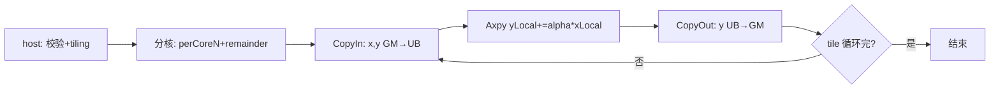

# aclblasSaxpy 算子设计文档

# 需求背景（required）

## 需求来源
- 任务名称/批次：2026 年 11 月社区任务 — aclblasSaxpy 算子开发（A2A3）。
- 合入目标仓：https://gitcode.com/cann/ops-blas ，算子代码 `blas/axpy/arch22/`，测试代码 `test/saxpy/arch22/`。
- 验收流程：cann-competitions 社区任务流程（任务书 §4 交付件 / §5 PR 申请合入）。

## 背景介绍
### 算子功能定位
- aclblasSaxpy 完成单精度实数向量加法 `y ← α·x + y`（逐元素累加，y 原地覆写），是 BLAS Level-1 最基础的向量组合算子。
- 数学公式：`y[j] = α × x[k] + y[j]`，其中 `k = (i-1)·incx`、`j = (i-1)·incy`（0 基下标），`i = 1..n`；`n ≤ 0` 时 y 不修改（no-op）。

### 业界对标
- 对标 cuBLAS `cublasSaxpy`（https://docs.nvidia.com/cuda/pdf/CUBLAS_Library.pdf §2.5.4）：参数序列、返回码语义、快速返回口径以该文档为唯一依据。
- 语义参考 Netlib BLAS `saxpy.f`：`IF (N.LE.0) RETURN`（n≤0 合法 no-op）、`IF (DA.EQ.ZERO) RETURN`（alpha=0.0 直接返回，y 不变且不读取 x）。
- 行为对齐仓内 950PR 既有实现 `blas/axpy/arch35/saxpy_host.cpp` 的 `ValidateSaxpyParams` 与 `aclblasSaxpy` 入口（L20-160），本任务为同族实现向 Atlas A2/A3（arch22）的移植，不存在语义分叉。

### 工程形态
- 工程模式：Host C API + Kernel 直调（host 入口 + 参数校验 + tiling 下发 + device kernel），与仓内 `blas/axpy/` 既有 arch22/arch35 实现同一模式。
- 代码落位：`blas/axpy/arch22/`（saxpy_host.cpp / saxpy_kernel.cpp / saxpy_kernel.h / saxpy_tiling_data.h，与同目录 arch22 兄弟算子 caxpy 的文件分层一致）。
- 仓内近亲：`blas/axpy/arch35/`（saxpy 950PR 实现，算法与校验直接复用）；`blas/axpy/arch22/caxpy_*`（arch22 工程骨架与 CMake 接入样例）。测试工程落位 `test/saxpy/arch22/`，并在 `test/saxpy/CMakeLists.txt` 的 arch22 分支补 `ops_blas_add_gtest_tests(${OPS_BLAS} saxpy_test)` 注册（当前仓内仅 arch35 注册，A2/A3 构建退回非 GTest runner，须随本任务补齐）。

### 接口规格
- 接口声明（与 ops-blas 仓 `include/cann_ops_blas.h` 既有声明一致，实际位于该头文件 aclblasSaxpy 行，与 950PR 共用声明，禁止另立私有平行接口）：

```cpp
aclblasStatus_t aclblasSaxpy(aclblasHandle_t handle, int n, const float* alpha, float* x, int incx, float* y, int incy);
```

- 参数规格表（官方栏目）：

| 参数 | 参数含义 | 数据类型 | 支持数据类型 | 约束 | 形状 |
| --- | --- | --- | --- | --- | --- |
| handle | 库上下文句柄（内部携带 stream），Host 内存 | attr | - | aclblasCreate 返回的非空句柄；为 nullptr 返回 ACLBLAS_STATUS_HANDLE_IS_NULLPTR | - |
| n | 向量元素个数，Host 内存 | attr | int32 | 任意 int32；n≤0 走 no-op 不报错，不访问 alpha/x/y | - |
| alpha | 标量乘数 α 指针，Host 内存 | scalar | FLOAT32 | 任意 FLOAT32 值（含 0.0/1.0/Inf/NaN，值不校验）；n>0 时为 nullptr 返回 ACLBLAS_STATUS_INVALID_VALUE | 标量 |
| x | 输入向量，Device 内存 | tensor | FLOAT32 | 全值域（Inf/NaN 按 IEEE 规则自然传播）；n>0 时 nullptr 返回 ACLBLAS_STATUS_INVALID_VALUE | 一维，物理长度 1+(n−1)×\|incx\| |
| incx | x 相邻元素存储步长（元素单位），Host 内存 | attr | int32 | 非零且不为 INT32_MIN；n>0 时 incx==0 或为 INT32_MIN 返回 ACLBLAS_STATUS_INVALID_VALUE；(n−1)×\|incx\| 超 int32 表示范围返回 ACLBLAS_STATUS_INVALID_VALUE（host 侧 int64 计算） | - |
| y | 输入兼输出（y ← α·x + y 原地覆写），Device 内存 | tensor | FLOAT32 | 同 x；n>0 时 nullptr 返回 ACLBLAS_STATUS_INVALID_VALUE | 一维，物理长度 1+(n−1)×\|incy\| |
| incy | y 相邻元素存储步长（元素单位），Host 内存 | attr | int32 | 同 incy | - |

### 数学公式
- `y[i] = α × x[i·incx] + y[i·incy]`，i = 0..n−1（0 基展开）；与 §3.2 精度判定的 golden（cblas_saxpy float32 参考实现，与仓内 `test/saxpy/saxpy_golden.h` 一致）为同一计算形态。

# 需求分析（required）

## 需求描述
- 使用 Ascend C 在 Atlas A2/A3（arch22）上以 kernel 直调方式实现 aclblasSaxpy：支持 FLOAT32 dtype、任意非零步长（正负）、n≤0 快速返回，精度按 mixed_tolerance FLOAT32 阈值对齐 cblas golden，性能达到 cublasSaxpy（910B3 实测）平均单次耗时的 0.8 倍以上（≤1.25×标杆）。

## 需求拆解

| # | 必须回答 | 本算子结论 |
| --- | --- | --- |
| 1 | 数学定义与可复用的代数量 | y ← α·x + y 逐元素；无归约、无依赖链，天然按核并行；连续（incx==incy==1）与跨步两条路径可完全复用 arch35 已合入实现 |
| 2 | 接口原型 | `aclblasSaxpy(handle, n, alpha, x, incx, y, incy)`，与 include/cann_ops_blas.h 既有声明逐参一致，与 cublasSaxpy 参数序列一一对应 |
| 3 | 参数规格 | 见接口规格表；异常码三类：HANDLE_IS_NULLPTR / INVALID_VALUE / SUCCESS（no-op） |
| 4 | 支持数据类型 | FLOAT32（x/y 向量、alpha 标量均为单精度实数）；本接口无多 dtype 面 |
| 5 | 目标芯片与 arch 映射 | Atlas A2/A3（910B 系）→ arch22；自验设备 910B3；性能标杆 cublasSaxpy 同规模同 dtype 同步长 |
| 6 | 精度要求 | 逐元素 \|actual−golden\| ≤ atol + rtol×\|golden\|，FLOAT32 rtol/atol=2^-13，required_matched_ratio=0.99，max_abs_error_limit=1e-2 or 32ULP（mixed_tolerance_standard）；Inf/NaN 按 §3.2 特殊值规则等效判定 |
| 7 | 性能预期 | 平均单次耗时（msprof op 采集，warmup 5 次 + 有效采样 ≥10 次取平均）≤ GPU 标杆 1.25 倍；标杆数据取 test_cases/gpu_baseline.csv |
| 8 | 代码架构选型 + 可行性 | 双 kernel 变体（连续 AIV DataCopy 流水 + 跨步 SIMT __simt_vf__），直接移植 arch35 已验证设计；已排除死路：跨步路径不走 UB 间接寻址的 DataCopy 方案（非对齐跨步访问 pad 语义复杂、SIMT 直接计算更简且 arch35 已实测合入）；alpha 在 Host 侧同步解引用后随 tiling 下发，不做 Device 侧二次拷贝 |
| 9 | 评测来源 | 精度 golden：cblas_saxpy（float32，Netlib saxpy.f 语义，仓内 saxpy_golden.h 同口径）；性能标杆：cublasSaxpy（gpu_baseline.csv）；用例：test_cases/{saxpy_test.csv, gpu_baseline.csv} |

# 详细设计（required）

## 算子分析
### 数学公式
- `y[j] = α·x[k] + y[j]`，j/k 为 0 基物理下标，k=i·incx、j=i·incy，i=0..n−1。
- 快速返回：n≤0 返回 SUCCESS（不访问 alpha/x/y）；alpha==0.0 时按 Netlib 语义直接返回（y 不变，不读取 x）。

### 支持数据类型
- x/y：FLOAT32（ND 排布一维向量）；alpha：FLOAT32 Host 标量。

### 支持形状
- 一维向量，物理长度 1+(n−1)×|incx|（x）、1+(n−1)×|incy|（y）；(n−1)×|inc| 在 host 侧以 int64 计算并校验不超 int32 表示范围（issue #780/#866 口径），超限返回 INVALID_VALUE。
- 退化：n=0/n<0 → 快速返回 SUCCESS；n=1 → 单元素；全零向量、alpha=0/1 由测试用例覆盖（边界域）。
- 不涉及：0 维 tensor、broadcast、空 Device 指针参与计算路径。

## 算子实现
### 实现方案
#### 总体架构与数据流
- 双 kernel 变体，由 tiling 阶段按 (incx==1 && incy==1) 分派：

| 变体 | 触发条件 | 职责 |
| --- | --- | --- |
| saxpy_aiv_kernel（AIV/UB 流水） | incx==1 && incy==1 | 连续访问：多核均分 n，每核 CopyIn(x,y) → Axpy 向量指令 → CopyOut(y)，double buffer 分 tile 循环 |
| saxpy_simt_kernel（SIMT） | incx≠1 或 incy≠1 | 跨步访问：按核分片，`asc_vf_call` 启动线程束，每线程直接按下标公式读写 GM，支持正负步长 |

- 数据流（连续路径）：GM(x)→UB(xBuf)、GM(y)→UB(yBuf) → Axpy(yLocal, xLocal, alpha) → UB→GM(y)；两路 VECIN buffer，tile 内按 SAXPY_ELEMENTS_PER_BLOCK（32B/4B=8 元素）对齐切块，尾部 DataCopyPad 补齐后写回裁剪。
- 数据流（跨步路径）：无 UB 中转，SIMT 线程直接 `yGm[yElement] = alpha*xGm[xElement] + yGm[yElement]`；负步长按 BLAS 语义自物理 span 尾端反向遍历（保留步长符号，issue #483 口径）。

#### host 侧设计
- **分核策略**：连续路径 `numBlocks = min(coreNum, n)`，每核 perCoreN 按 alignUnit 向下取整对齐，余块 remainder 归末核；跨步路径 `useCoreNum = min(aivCoreNum, n, SAXPY_MAX_CORE_NUM=64)`，baseCount 均分 + 前 remain 核各 +1，逐核记录 startOffset/calCount。满足满核原则：n≥核数时所有核均有负载。
- **数据分块和内存优化策略**：tileSize = UB_SIZE/(2 路 queue×4B) 向下按 alignUnit 对齐，上限 32768 元素；两路 VECIN buffer 供 DataCopy/Axpy/CopyOut 流水，连续路径天然可 double buffer；跨步路径无 UB 占用。
- **tilingkey 规划策略**：不引入 tilingkey——路径分派在 host 侧完成（连续/跨步选不同 kernel 入口），kernel 内无分支重编译需求；步长符号在 kernel 内按下标公式处理。
- **数据检测（校验顺序，逐条对齐任务书 §2.4）**：
  1. handle==nullptr → ACLBLAS_STATUS_HANDLE_IS_NULLPTR；
  2. n≤0 → 直接返回 SUCCESS（no-op，不访问 alpha/x/y）；
  3. alpha/x/y == nullptr → ACLBLAS_STATUS_INVALID_VALUE；
  4. incx==0 或 incy==0 → ACLBLAS_STATUS_INVALID_VALUE；
  5. incx/incy == INT32_MIN → ACLBLAS_STATUS_INVALID_VALUE（host 侧 int64 校验，避免取绝对值溢出）；
  6. (n−1)×|incx| 或 (n−1)×|incy| 超 int32 表示范围（host 侧 int64 计算）→ ACLBLAS_STATUS_INVALID_VALUE；
  7. alpha 标量值不校验（含 0.0/Inf/NaN），GetAivCoreCount 失败 → ACLBLAS_STATUS_INTERNAL_ERROR。
  - 校验分支与返回码逐条对齐 arch35 `ValidateSaxpyParams` 与入口实现（L20-160），移植时保持顺序与语义不变。
- **alpha 处理**：Host 侧同步解引用 `*alpha` 后写入 tiling 结构随 kernel 下发（异步执行约束：alpha 为 Host 内存，必须在提交前读取，不在 Device 侧引用 Host 指针）。

#### kernel 侧设计
- Init 阶段：解析 tiling（totalN/perCoreN/remainder/tileSize/alpha 或 incx/incy/useCoreNum/startOffset[]/calCount[]/nthreads）、SetGlobalBuffer、InitBuffer。
- Process 阶段（连续路径）：按 tileSize 分 tile 循环 CopyIn→Axpy→CopyOut，末尾余块走 SingleIteration（对齐块 DataCopy + 尾部 DataCopyPad）；myCount_==0 的核直接返回。
- Process 阶段（跨步路径）：每核取自身 calCount/startOffset，`asc_vf_call` 启动 nthreads 线程，线程束 grid-stride 循环按下标公式计算；calCount==0 直接返回。
- 流程图（连续路径）：



- workspace 布局：无额外 workspace（逐元素原地覆写，无临时量；workSpace 形参传 nullptr）。

#### 性能优化要点（终态）
- 连续路径走 UB 向量指令 Axpy + DataCopy 流水（带宽友好），跨步路径走 SIMT 直接计算（避免 pad/对齐开销）——继承 arch35 已合入的终态设计，本任务在 910B3 按 §3.3 口径实测，目标 ≤1.25× cublasSaxpy 标杆；实测数据回填自测报告，不预填未经测试的数字。
- 未采用路线：跨步路径用 UB+DataCopy 间接寻址（非对齐 pad 语义复杂、性能劣于 SIMT 直接计算）；大 n 单核大数据量 tile（多核均分已满足满核带宽）。

## 支持硬件

| 支持的芯片版本 | 涉及 |
| --- | --- |
| Atlas A2/A3 训练系列（910B，arch22） | ✅（本任务目标，自验覆盖 910B3） |
| Atlas 950PR（arch35） | ❌（已有 950PR 实现，本任务不改） |

## 算子约束限制
- 非连续 tensor：以 BLAS 步长语义支持（x 按 incx、y 按 incy 间隔访问，正负步长均生效）；incx==0 或 incy==0 为非法输入。
- 不支持：broadcast（BLAS-1 无操作数间广播）、0 维 tensor、图模式 dynamic shape（n/incx/incy 为运行时入参，host tiling 按运行时 n 一次适配，无需动态 shape）。
- 原地语义：y 输入旧值与输出新值复用同一内存，不返回视图；x 只读。
- 确定性：单次执行内确定，同输入同步长跨次执行 bit 级一致。
- 异步执行：计算经 handle 绑定 stream 异步下发，返回成功仅表示 Host 已提交；读输出前须 aclrtSynchronizeStream；alpha 为 Host 标量，Host 侧同步解引用后下发。
- 空向量：等价口径 n=0，不启动 kernel，快速返回。

# 可维可测分析（required）

## 精度标准/性能标准

| 验收标准 | 描述 | 标准来源 |
| --- | --- | --- |
| 精度标准 | FLOAT32：rtol=atol=2^-13(1.2e-4)，required_matched_ratio=0.99，max_abs_error_limit=1e-2 or 32ULP；逐元素 \|actual−golden\| ≤ atol+rtol×\|golden\|；Inf/NaN 按等效规则单独判定（同为 NaN/同号 Inf 视为等效，有限值 vs 非有限值判不通过，非有限值不计入 matched_ratio/max_abs_error 统计） | mixed_tolerance_standard（opbase docs/zh/ops_precision_standard），任务书 §3.2 |
| 性能标准 | 平均单次耗时 ≤ GPU 标杆（cublasSaxpy 同规模同 dtype 同步长）×1.25；msprof op 采集 task duration（us），warmup 5 次 + 有效采样 ≥10 次取算术平均，仅 SUCCESS 样本计入 | 任务书 §3.3 + test_cases/gpu_baseline.csv |

## 测试概览
- 测试工程：`test/saxpy/arch22/` 新建（CSV 用例描述 + C++ GTest 加载执行），并在 `test/saxpy/CMakeLists.txt` arch22 分支补 `ops_blas_add_gtest_tests(${OPS_BLAS} saxpy_test)` 注册。
- 用例分层与口径：精度全量 1000 条、性能子集 200 条（本接口单 dtype，条数按 dtype 面 100% 分摊）；覆盖边界域（n=0/n=1/全零向量/alpha=0.0/1.0）、跨步组合 {1,2,7,−1,−3}、负向域（handle nullptr、n>0 时 alpha/x/y nullptr、incx/incy==0 或 INT32_MIN、跨度溢出）。
- 输入生成：均匀分布 [-5,5] 50% + 正态分布（μ∈[-5,5]、σ∈[0.1,2]，GAUSS_NORM_5_2 token）50%；任务自带 gen_csv.py 仅含均匀分布，正态用例由本任务补充生成器/CSV 并在自测报告说明。
- 负向用例缓冲区规则：期望非 SUCCESS 及 quick-return 用例不按 (n−1)×|inc| 预分配缓冲（防测试工程自身分配溢出误判），以单元素 dummy 或 nullptr 占位。
- 性能口径：msprof op 模式，warmup 5 次 + 有效样本 ≥10 次取平均；复现入口：test_cases/README.md 步骤。

## 兼容性分析
- 本任务为新增 arch22 实现，不修改公共头 `include/cann_ops_blas.h`（声明已存在、与 950PR 共用），无接口兼容性问题。
- 附带修改仅两处且向后兼容：`test/saxpy/CMakeLists.txt` 增加 arch22 GTest 注册（arch35 行为不变）；`blas/axpy/arch22/` 目录新增 saxpy 文件（不影响同目录既有 caxpy）。
- arch35 路径零改动；其他产品线不受影响。
