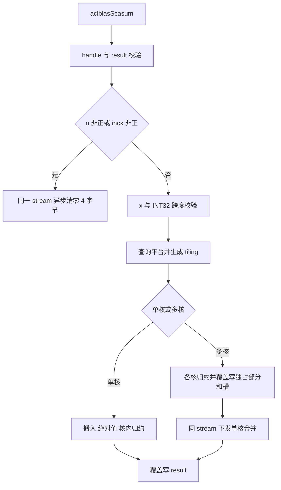

# aclblasScasum 算子（Atlas A2/A3）设计文档

| 项目 | 内容 |
| --- | --- |
| 任务名称 | 11月社区任务-aclblasScasum算子开发（A2/A3） |
| 任务 ID | `a698b640487f434ca332f08fb23eb899` |
| 贡献者目录 | `Aiminer` |
| 目标仓库 | `cann/ops-blas` |
| 目标产品与架构 | Atlas A2/A3 系列，`arch22` |
| CANN 版本 | 9.1.0 |
| 实现方式 | Ascend C，句柄式 BLAS 接口，Kernel 直调 |
| 文档版本 | v1.0，2026-11-11 |
| 文档状态 | 开发前设计稿；分核阈值、API 编译与性能待真机验证 |

## 一、需求背景（required）

### 1.1 需求来源

本任务来自 CANN 社区 2026 年 11 月社区任务，要求补齐 `aclblasScasum` 在 Atlas A2/A3 上的实现，完成设计、实现、测试及开源仓集成。

- [任务详情](https://www.hiascend.com/activities/task-center/details/a698b640487f434ca332f08fb23eb899)
- [官方任务包](https://www.hiascend.com/p/resource/202611/df073824cc6647d5b7fbfb64889e5eb9.zip)
- 任务书文件：官方任务包内的 `aclblasScasum_AtlasA2_A3_task_doc.md`。
- [历史设计 PR #1157：aclblasSrotmg](https://gitcode.com/cann/cann-ops-competitions/pull/1157)
- [历史设计 PR #1960：aclblasStbsv](https://gitcode.com/cann/cann-ops-competitions/pull/1960)
- [实现仓库](https://gitcode.com/cann/ops-blas)

本文沿用历史设计的需求背景、需求分析、详细设计、可维可测分析、交付计划和风险章节；接口语义、精度与性能要求以本次任务书为准，不沿用历史任务的阈值。

设计文档提交路径：

```text
04_tasks/01_community-task-2026/tasklist/11-aclblasScasum-A2A3/Aiminer/docs/design.md
```

当前任务列表未列出本次 11 月 A2/A3 任务的编号，既有 Scasum 目录对应往期任务。本提交沿用历史设计的“月份-算子名-平台”命名方式创建目录，后续如分配正式编号，再按评审意见调整。本次仅提交设计文档，算子实现和测试后续提交至 ops-blas。

### 1.2 算子功能与价值

`SCASUM` 是 BLAS Level 1 归约算子。输入为单精度复数向量，输出为所有有效元素实部、虚部绝对值之和：

\[
r=\sum_{i=0}^{n-1}\left(|\operatorname{Re}(x_{i\cdot incx})|+|\operatorname{Im}(x_{i\cdot incx})|\right).
\]

复数的“绝对值”采用 BLAS 的分量绝对值之和，**不是**欧氏模长，也不执行平方或开方。算子可用于复数向量幅度统计、数值算法中的量级估计等场景。

### 1.3 仓库现状与复用边界

2026-11-11 查阅的公共源码表明：

1. `include/cann_ops_blas.h` 已有 `aclblasScasum` 声明，复用现有签名，不重复新增。
2. `blas/asum/arch22/sasum_host.cpp`、`sasum_kernel.cpp` 提供实数绝对值归约参考，但 Host 路径存在 tiling 的 Device 分配、拷贝与流同步，不能直接照搬到本任务的异步接口。
3. `blas/asum/arch35/scasum_host.cpp` 提供复数接口参考，但其跨度检查采用 `UINT32_MAX`；本次任务书明确要求 **INT32 范围**，应按本任务限制实现。
4. 测试需接入 `test/asum/scasum/arch22/`，并在同族 CMake 的 arch22 分支注册 GTest，避免退回整数毫秒计时的旧 runner。

当前 master 查询得到的提交为 `5bd95145a9c499e43ebad44a313a1029c63d54bc`；正式编码时锁定工作分支基线，并复核上述文件与公共辅助函数。

## 二、需求分析（required）

### 2.1 接口定义

```cpp
aclblasStatus_t aclblasScasum(
    aclblasHandle_t handle,
    int n,
    const aclblasComplex* x,
    int incx,
    float* result);
```

| 参数 | 方向与位置 | 含义 |
| --- | --- | --- |
| `handle` | Host 输入 | 已创建的 BLAS 句柄，提供 stream 与内部 workspace |
| `n` | Host 标量 | 逻辑复数元素个数；`n <= 0` 为合法快速返回 |
| `x` | Device 只读输入 | `complex64`，实部和虚部均为 float32，交错存储 |
| `incx` | Host 标量 | 以复数元素为单位的步长；正数参与计算，非正数快速返回 |
| `result` | Device 输出 | 独立的一个 float32 标量，至少可写 4 字节 |

正常路径的物理长度为 `1 + (n - 1) * incx` 个复数。`result` 不要求提供 32 字节可写空间，不得用对齐搬运覆盖其相邻内存。调用方保证输入、输出的有效存储满足接口契约且不重叠。

不引入 ACLNN 两阶段接口、图注册、额外 dtype、Host 输出模式或负步长反向遍历。

### 2.2 参数校验与快速返回

按以下顺序处理，所有正常路径的地址乘法提升为 64 位后计算：

| 顺序 | 条件 | 行为 |
| --- | --- | --- |
| 1 | `handle == nullptr` | 返回 `ACLBLAS_STATUS_HANDLE_IS_NULLPTR` |
| 2 | `result == nullptr`，包括快速返回输入 | 返回 `ACLBLAS_STATUS_INVALID_VALUE` |
| 3 | `n <= 0 || incx <= 0` | 在句柄 stream 上将 result 的 4 字节置零，不下发归约 kernel；清零成功入队后返回 SUCCESS |
| 4 | 正常路径 `x == nullptr` | 返回 `ACLBLAS_STATUS_INVALID_VALUE` |
| 5 | `int64_t(n - 1) * int64_t(incx) > INT32_MAX` | 返回 `ACLBLAS_STATUS_INVALID_VALUE` |
| 6 | 其余合法输入 | 生成 tiling 并下发计算 |

注意：`n < 0`、`incx == 0`、`incx < 0`、`incx == INT32_MIN` 都进入合法快速返回路径，不先计算 `abs(incx)`，也不按物理跨度分配或读取输入。`n == 1` 时跨度为零，任意正 `incx` 都不能仅因步长大而拒绝。

快速返回拟调用 `aclrtMemsetAsync(result, sizeof(float), 0, sizeof(float), stream)`。不在 Host 解引用 Device 指针，不使用栈上的零值作为异步 H2D 源；调用方仍须在读回结果前同步。清零、配置查询或核下发失败必须返回相应失败状态，不能返回默认成功。

### 2.3 需求拆解

| 模块 | 工作内容 |
| --- | --- |
| Host | 参数校验、stream 顺序清零、平台资源获取、分核和 UB 预算、下发状态传递 |
| Kernel | 连续/跨步搬入、绝对值、分块归约、部分和合并、精确长度写回 |
| 集成 | arch22 构建、公共 API 复用、GTest 注册、产品支持表 |
| 验证 | 官方用例、正态分布补充、特殊值、溢出、异步/内存与完整调用性能 |
| 交付 | 设计、源码、CSV、复现步骤、精度/性能/内存报告 |

## 三、详细设计（required）

### 3.1 数学定义与地址映射

以下为 0-based 索引。把 `x` 看作 float32 交错数组 `xf`，逻辑第 i 个复数的两个分量位于：

\[
p_r(i)=2i\cdot incx,\qquad p_i(i)=2i\cdot incx+1.
\]

字节地址为 `base + 8 * i * incx` 和 `base + 8 * i * incx + 4`。即使复数跨度满足 INT32 上限，float 偏移和字节偏移也可能超出 int32，因此上述地址计算在 Host 和 Device 都使用 64 位。

连续路径 `incx == 1` 等价于对 `2*n` 个连续 float 做 `Abs + ReduceSum`；不必拆出实部和虚部数组。任务允许改变归约顺序，扁平化后的分量求和在数学上等价，数值上须按第 4.2 节验收。

跨步路径只读有效复数对，不将步长空洞纳入归约；空洞中的 NaN/Inf 不得污染输出。

### 3.2 总体实现架构



首版采用单核直接写出、多核两阶段归约。两个 kernel 在同一 stream 排序，第二阶段在第一阶段结束后读取部分和；无核内自旋屏障，无核间计数器，不依赖某个核最后完成。

不采用“所有核同时清零 result 再原子加”的方式。普通计算路径不读取 result 初值：单核覆盖写，多核由合并核覆盖写，因此重复调用无需在调用方预先清零结果。

该方案的成本是大规模有两次下发，优势是输出无需额外对齐约束、工作区规模小、生命周期清晰。是否引入单 kernel 原子合并优化，以完整调用 profiling 和实际对齐约束为依据，不作为首版正确性前提。

### 3.3 文件与工程组织

```text
blas/asum/arch22/
├── scasum_host.cpp
├── scasum_kernel.cpp
└── scasum_tiling_data.h

test/asum/scasum/
├── CMakeLists.txt                 # 补齐 arch22 GTest 注册
└── arch22/
    ├── test_aclblas_scasum.cpp    # 文件名随同族工程约定核对
    ├── npu_wrapper.h
    └── scasum_test.csv
```

复用同族已有参数解析和 golden 包装；仅在现有结构不能表达本任务契约时扩展。更新 `blas/asum/README.md` 的接口说明与 A2/A3 支持矩阵。测试文件最终命名和构建入口服从锁定基线，不另建平行测试框架。

### 3.4 Host 与资源生命周期

1. 完成第 2.2 节校验；快速返回无需读取 AIV 核数或占用 workspace。
2. 正常路径查询可用 AIV 核数和 UB 容量，查询失败显式返回错误，不用固定核数掩盖失败。
3. 生成紧凑 tiling，以值参数传入直调 launcher，避免每次申请 Device tiling 和同步 H2D；以 CANN 9.1.0 arch22 编译验证实际传参形式。
4. 单核路径不申请 workspace。多核路径从句柄有效 workspace 取得 `32 * blockDim` 字节，核实可用大小；不足时返回执行失败，不临时分配后立即释放。
5. 同一 stream 依次下发部分和 kernel、合并 kernel，返回可取得的下发状态；设备异步错误由调用方同步观察，不为捕获所有设备错误而在接口内部同步。

内部 workspace 使用仓内 `GetEffectiveWorkspace` / `GetEffectiveWorkspaceSize` 机制。连续调用同一 handle、同一 stream 时按流顺序复用；不同 stream 的并发调用需使用独立 handle/workspace，或由调用方通过事件建立依赖。不能在上一调用尚未结束时并发切换同一 handle 的 stream 并复用同一工作区。

输入、输出、handle workspace 均须存活到相应 stream 完成。无函数级静态 Device scratch，无每次调用分配/释放，无 Host 数据回拷。

### 3.5 分核与 Tiling

#### 3.5.1 核间切分

按逻辑复数元素均分，不把实部和虚部拆给不同核。设有效核数为 B：

\[
q=\lfloor n/B\rfloor,\quad r=n\bmod B,
\]

\[
start_b=bq+\min(b,r),\quad count_b=q+[b<r].
\]

满足各核区间无交集、并集覆盖 `[0,n)`、每核工作量最多相差 1。核数选择：

```text
n <= smallThreshold: B = 1
其他: B = min(availableAivCores, ceil_div(n, targetComplexPerCore))
```

`smallThreshold` 与 `targetComplexPerCore` 是开发阶段调优参数，不按测试编号特判。首轮以单 tile 可容纳的复数数量作为小规模候选，再用完整调用时延确定阈值。连续与跨步输入可选择不同的 tile 容量，但使用同一切分公式。

#### 3.5.2 Tiling 字段

| 字段 | 用途 |
| --- | --- |
| `n`、`incx` | 逻辑长度与正步长，地址运算前提升为 64 位 |
| `blockDim` | 本次实际使用核数 |
| `perCoreN`、`remainder` | 各核推导起点与长度，无固定 40 核数组 |
| `tileComplex` | 每 tile 逻辑复数数量 |
| `loadMode` | 连续或跨步搬入 |
| `partialPitch` | 内部部分和槽的字节间隔，首版 32 字节 |

形状、步长为运行时标量，不需要 GE 的 `TilingContext` 或注册式 tilingKey。只使用本算子的少量路径标志。

### 3.6 核内搬运和归约

#### 3.6.1 连续路径

当前 tile 含 m 个有效复数时，从 `xf[2*start]` 搬入 `2*m` 个 float。

- 连续主体只有在起址与长度均满足 32 字节要求时才使用普通 DataCopy；非对齐起址与尾块使用 DataCopyPad。
- GM 实际读取长度为 `8*m` 字节；UB 对齐长度仅用于分配和补零，不扩大 GM 有效读范围。
- 在输入 UB 原位执行 Abs，ReduceSum 处理有效分量数 `2*m`；tile 的部分和进入核内累加器。
- 输入队列用 EnQue/DeQue 建立搬运到计算的依赖；Abs 与归约、归约与后续读取之间保留相应流水依赖，禁止未完成计算即复用队列。

#### 3.6.2 正跨步路径

为避免读取大片空洞，采用每块一个复数对的批量 DataCopyPad：

```text
blockCount = 当前批复数数 m
blockLen   = 8 字节
srcStride  = 8 * (incx - 1) 字节
dstStride  = 0
UB 每行: [real, imag, 0, 0, 0, 0, 0, 0]，32 字节
```

显式零填充每行的 6 个冗余 float，再对 `8*m` 个 float 做 Abs 与 ReduceSum。这些零只存在于 UB，不来自 GM 空洞。该路径以 4 倍 UB 空间换取简单且可验证的跨步搬运，连续性能基线不走此路径。

每批 m 不超过 UB 容量和 DataCopyPad 的 blockCount 上限。源 stride 用 64 位计算后再检查目标参数字段范围；如果合法 `incx` 的字节间隔不能用搬运参数表示，则按逻辑地址分次发起 8 字节、单块、零 stride 的搬运，每个目的槽仍保持 32 字节对齐。这是支持极大正步长的必要路径，不把 DMA 字段限制转成未授权的 API 入参限制。

### 3.7 UB 与工作区预算

令 `Align32(x)` 表示字节数向上对齐到 32，T 为 tile 的复数数量，U 为查询到的可用 UB 预算：

| 缓冲区 | 连续路径 | 跨步路径 | 生命周期 |
| --- | ---: | ---: | --- |
| 输入双缓冲 | `2 * Align32(8*T)` | `2 * 32*T` | 每 tile，Abs 原位复用 |
| ReduceSum 临时区 | `W(2*T)` | `W(8*T)` | 每 tile 共用 |
| 输出、累加与合并暂存 | 初始预算 256 B | 初始预算 256 B | 每核 |

`W(D)` 为 CANN 9.1.0 所选 ReduceSum 实现要求的临时空间；实现阶段依据实际 API 契约计算，不以输入长度代替未经核实的 scratch 公式。初始保守预算给临时区预留 `4*D` 字节，并在编译及最小测试中核实其覆盖实际需求。

据此，连续路径的初始上界为 `24*T+256` 字节，跨步路径为 `96*T+256` 字节。示例：连续 T=4096、跨步 T=1024 均约 96.25 KiB，示例用于核算，**不是固定配置**。最终在 U 和搬运/归约限制内增大 T，再以流水效率调优；每项 InitBuffer 必须计入总和。

核内 tile 部分和使用分层合并，避免超大 n 时无限串行累加小量导致精度损失：可用最多 32 个 FP32 层级槽，按二进制进位规则合并相同层级部分和，最后合并占用槽。32 槽共 128 B，计入上述暂存预算；它覆盖 int32 长度下的 tile 数量。层级槽与结果暂存不得同时越过预算。

多核阶段每核独占 32 字节 workspace 槽，其中首个 float 为部分和、其余置零并覆盖写出。合并核分块读取 B 个槽，求和后仅向 result 写 4 字节。工作区大小 `32*B`；例如 B=40 时为 1280 B，此例不代表固定硬件核数。B 由实际平台决定，合并阶段不能假设所有槽总能放入固定小缓冲。

### 3.8 同步、边界与特殊值

- 第一阶段完整覆盖写每个使用中的槽，合并只读本次 B 个槽，不读历史残留或未初始化槽。
- 两个 kernel 依靠同 stream 顺序建立跨核完成边界；核内队列只负责本核流水，不冒充跨核屏障。
- 正常路径的最终写回为非原子、精确 4 字节的 DataCopyPad，UB 源起址按 32 字节对齐。
- 不访问最后一个有效复数之后的存储，不读步长空洞；结果前后保护区保持不变。
- Float32 计算不降成 FP16/BF16，不以 saturate 或截断修饰 Inf/NaN。
- 输入 NaN、Inf、极端值可能产生 NaN 或 Inf；最终按任务特殊值规则比对。
- 无要求跨次 bit-exact；固定分层合并有助于减少运行波动，但不以此承诺跨平台逐位一致。

### 3.9 API 依据与待验证项

| 能力 | 设计使用 | 当前依据与验证边界 |
| --- | --- | --- |
| 异步清零 | `aclrtMemsetAsync`，4 字节，同 stream | 官方接口明确为异步；CANN 9.1.0 目标环境仍需编译运行核实 |
| 搬入搬出 | DataCopyPad 的 GM/UB 重载及 Ext 参数 | 按字节 blockLen、GM 字节 stride、UB 32B 对齐组织；验证 8B 跨步与 4B 输出 |
| 绝对值 | `Abs<float>` | arch22 Sasum 已使用；验证全值域与原位模式 |
| 归约 | `ReduceSum<float>(dst, src, tmp, count)` | arch22 Sasum 已使用；scratch 和调用长度按安装版本核实 |
| 流水 | TPipe/TQue、EnQue/DeQue 与必要事件 | 验证双缓冲复用及 V/MTE3 依赖 |
| workspace | `GetEffectiveWorkspace`、`GetEffectiveWorkspaceSize` | arch35 Scasum 已使用；核实 arch22 同一公共 handle 契约 |

以上是设计依据，不标记为已通过 NPU 验证。实现阶段首先验证搬运、ReduceSum 临时空间和值参数启动这三个最小单元，再接入完整 kernel。

### 3.10 硬件支持与约束

| 产品 | 本次范围 |
| --- | --- |
| Atlas A2 系列，性能设备 910B3 | 支持目标与主要性能验证平台 |
| Atlas A3 系列 | 支持目标；任务允许自验证只覆盖一种款型 |
| Ascend 950 / arch35 | 仅参考，不修改其实现 |

主要使用 AIV、UB、GM 与数据搬运单元，不使用 Cube。无广播、无额外张量布局、无输入原地修改。正常输入输出由用户提供，内部 workspace 由 handle 管理。

## 四、可维可测分析

### 4.1 环境与用例来源

环境使用 CANN 9.1.0，优先 Atlas 800T A2（910B3）。保存实际 SoC、驱动、CANN、编译参数、仓库提交和 golden 库版本，不能只记录笼统的“A2”。

官方 CSV 实际含 1200 条，按前缀统计如下；随包 README 对 ED/EX 的旧统计分别是 13/921，本文采用当前 CSV 的 18/916：

| 类别 | 数量 | 用途 |
| --- | ---: | --- |
| TC_L0 | 4 | 基础语义 |
| TC_SQ | 38 | 尺寸扫描 |
| TC_INC | 9 | 正步长 |
| TC_FL | 12 | 填充与特殊值 |
| TC_OV | 3 | 累加溢出 |
| TC_ED | 18 | 快速返回、空指针及边界 |
| TC_EX | 916 | 扩展覆盖 |
| TC_PF | 200 | 性能子集 |
| 合计 | 1200 | 非性能用例 1000，性能用例 200 |

保留原始包不修改，在实现仓中增加补充用例并记录差异。`GAUSS_NORM_5_2` 正态输入与均匀输入按任务规定组织 50%/50% 的随机分布覆盖，实虚部分别采样；先统计既有随机用例，再补齐相应分布，特殊值和非法参数用例独立统计。

### 4.2 精度标准与 golden

正式 golden 使用任务要求的 Netlib BLAS 3.10.0 / CBLAS scasum，固定实际链接库与计算精度。快速返回 golden 为 `0.0f`。Float64 参考求和可用于诊断舍入差异，不能擅自替代验收 golden。

有限标量采用：

\[
atol=rtol=2^{-13}=0.0001220703125,
\]

\[
|actual-golden|\le atol+rtol\cdot|golden|.
\]

标量 matched_ratio 只有 0 或 1，必须为 1；还须同时满足任务书最大绝对误差限制 `1e-2 or 32*ULP`。ULP 的计算与“or”的实际执行规则依据任务指定标准和验收代码核对，不能只保留混合容差而省略第二道门限。

非有限结果单独判定：双方均为 NaN、双方同号 Inf，或一方 NaN 另一方 ±Inf，按任务书视为通过；有限与非有限不匹配为失败。此宽松等效仅用于验收判定，算子仍执行原始数学运算。

长向量分层求和与 Netlib FP32 顺序累加可能存在误差，不能预先断言一定通过。若不通过，保留最小复现，区分实现错误、参考累加误差和验收口径；不放宽阈值，也不静默换 golden。

### 4.3 性能目标

逐例要求 `GPU_time / NPU_time >= 0.8`，即：

\[
NPU_{us}\le gpu\_ms\times1000/0.8.
\]

以下来自随包 gpu_baseline.csv，为目标而非实测：

| n | incx | GPU 基线（μs） | NPU 上限（μs） |
| ---: | ---: | ---: | ---: |
| 1,048,576 | 1 | 19.8655993 | 24.8319991 |
| 2,097,152 | 1 | 22.1525334 | 27.6906668 |
| 4,194,304 | 1 | 33.5530668 | 41.9413335 |
| 1 | 1 | 10.6325332 | 13.2906665 |

全部 200 条性能基线 incx=1，仍须保证非单位步长功能正确。基线环境由随包资料标注为 NVIDIA A100-SXM4-80GB、CUDA 12.8、cuBLAS 12.8.4。

**计时口径差异必须在验收前闭环：**任务书 §3.3 要求 msprof op task duration；随包 README 明确称 GTest 的 aclrtEvent `avg_us` 用于判定、msprof 仅供交叉验证。设计暂按双口径留存：

1. GTest 用事件覆盖完整 API 调用序列，排除造数、golden 和 H2D/D2H；预热 5 次，至少 10 次有效采样取平均，输出脚本要求的 `[PERF] case=... avg_us=...`。
2. msprof 按单用例关联本次全部 Device 任务。多核路径记录部分和与合并两个阶段及其合计，不能只取其中一个 kernel 或把两阶段平均为一次调用。
3. 若快速返回清零在 runtime 中表现为内部任务，也要如实记录；“不触发 kernel”在本设计指不下发自定义归约 kernel。
4. 保存原始数据和双口径结果，向任务方确认最终口径；不选取较快口径宣布验收达标。

性能优化顺序为：小规模减少下发 → 连续读取合并 → 核数和 tile 调整 → 双缓冲重叠。只有完整调用超标且 profiling 指向跨阶段开销时，再评估替换合并机制。

### 4.4 补充测试矩阵

| 类别 | 具体覆盖与判定 |
| --- | --- |
| 手算 | `(3,-4),(-1,2)` 得 10；单元素；全零；只实部/只虚部 |
| 快速返回 | n=0、负 n、INT32_MIN；incx=0、负数、INT32_MIN；x=nullptr 允许，result 非空且写零 |
| 错误码优先级 | 空 handle 与其他错误组合；快速返回时 result=nullptr 仍报错 |
| 正常空指针 | n>0、incx>0、x=nullptr 返回 INVALID_VALUE |
| 跨度边界 | `(n-1)*incx` 等于及超过 INT32_MAX；n=1、incx=INT32_MAX 合法 |
| 搬运边界 | 32B 前后、tile 前后、核切分边界、最短尾块、非 32B 对齐但类型对齐的输入/输出起址 |
| 正步长 | incx=1/2/3/较大值；空洞填 NaN/Inf，结果不受影响 |
| 浮点特殊值 | ±0、极小值、正负交替、NaN、±Inf、接近 FLT_MAX、长向量累计溢出 |
| 只读与越界 | 输入逐位保持；result 前后保护区保持；只提供 4B 合法输出区域 |
| 异步与生命周期 | 同 stream 连续调用、输入生产事件依赖、结果消费；独立 handle/workspace 多流并发 |
| 残留隔离 | 先大后小、先 NaN 后有限、先大值后全零、重复调用未清零 result |
| 分支交叉 | 单核/多核阈值邻域、连续/跨步、完整 tile/尾块、极大 stride 的分次搬运路径 |

非法跨度用例使用最小 dummy 缓冲，不先申请巨大输入。合法上界的大跨度用例若资源不足，区分 Host 参数校验覆盖与实际 Device 计算覆盖，不能把空指针报错冒充跨度边界测试通过。

任务书内存要求虽写“不涉及”，仍要求内存报告；报告记录内部 workspace 上界、UB 预算、越界检查与资源释放检查，不虚构未规定的峰值门限。

### 4.5 可复现测试入口

沿用官方包命令形式，实际路径在交付 README 填入：

```bash
python verify_accuracy.py --repo /path/to/ops-blas --soc ascend910b --csv ./scasum_test.csv
python verify_performance.py --repo /path/to/ops-blas --soc ascend910b --skip-build --device 0
```

A3 使用随包支持的 `--soc ascend910_93`。GTest 注册名为 `scasum_test`，保证日志可被官方脚本识别。原始包中的 msprof 示例存在末尾引号问题，实际复现命令按安装版本核实后写入报告，不直接复制错误命令。

### 4.6 兼容性与维护性

公共 API 不变；仅新增 arch22 实现和测试接入。参数、地址映射和分核规则分别保持单一实现来源。Host 日志记录失败参数与状态，调试时可记录核数、tile 和路径；不在性能热路径打印数据。

只对实际可观察的 runtime/launcher 状态做错误传递，不吞掉失败，不以单核或其他架构的路径静默掩盖平台查询失败。部分和 workspace 不足属于明确执行失败；后续若需要改用其他算法，需更新设计和对应测试。

## 五、交付件与计划

| 阶段 | 交付与完成条件 |
| --- | --- |
| 设计 | 本文、任务契约核对、计时与精度标准疑点闭环 |
| 最小实现 | Host、快速返回、单核连续路径；搬运与归约最小验证通过 |
| 完整实现 | 正步长、多核两阶段、尾块、状态码、构建与 GTest 接入 |
| 精度验证 | 官方 1000 条非性能用例及补充用例；固定 golden 版本，逐例结果可追溯 |
| 性能验证 | 官方 200 条逐例对比，完整调用与 msprof 双口径原始记录 |
| 工程交付 | README、代码、CSV、日志、报告、内存与并发验证记录 |

最终按任务要求组织 `task_submission/`：

```text
1 自验证步骤说明.md
2.1 精度自验证报告.xlsx
2.2 精度自验证日志.log
3.1 性能自验证报告.xlsx
3.2 性能自验证日志.log
4.1 内存自验证报告.xlsx
4.2 内存自验证日志.log
```

本次交付范围为设计稿，其余为后续开发计划，不表示代码、测试或验收已完成。

## 六、风险与应对

| 风险 | 应对 |
| --- | --- |
| 两阶段下发占比过大 | 小规模单核；计完整调用时延，按 profiling 调整阈值 |
| 长归约与 FP32 golden 不一致 | 分层归约、保留误差分布与参考版本，定位后修复或确认契约 |
| 跨步 DMA 字段溢出 | 64 位计算、检查字段范围，极大 stride 按逻辑地址分次搬运 |
| 4 字节结果被扩大写回 | 使用精确字节数搬出，测试非 32B 起址与保护区 |
| 工作区被并发复用 | 同 stream 顺序复用；不同流独立 handle/workspace 或显式依赖 |
| 任务书与参考源码不一致 | 本次 INT32 跨度契约优先；不照搬 arch35 UINT32 守卫 |
| 文档接口声明描述矛盾 | 任务书 §2.1 说已有、§2.3 说新增；已核实公共头文件存在，采用复用 |
| 计时协议冲突 | 同时记录事件时延与 msprof，最终规则需任务方确认 |
| 未验证 API 组合 | CANN 9.1.0 arch22 最小验证后再定实现参数，失败不标记为支持 |

## 七、评审检查项

- [ ] 复用公共接口与 complex64 交错布局，未增加私有 API。
- [ ] handle、result、quick return、x、跨度校验顺序一致。
- [ ] 正步长以复数为单位；所有 GM 字节偏移使用 64 位。
- [ ] n<=0、incx<=0 成功写零且不读取 x。
- [ ] 输出仅写 4 字节；输入与空洞不被修改。
- [ ] tiling 参数、UB scratch、DataCopyPad 字段均在 API 限制内。
- [ ] 两阶段使用同一 stream，workspace 生命周期和并发约束明确。
- [ ] 官方 1000+200 用例与正态、特殊值、内存、异步补充用例齐全。
- [ ] 标量混合容差与最大误差门限同时校验。
- [ ] 性能覆盖完整调用，目标与实测明确区分。

## 八、参考资料与修订记录

1. 本批官方任务书、`test_cases/scasum_test.csv`、`gpu_baseline.csv`、README 和校验脚本。
2. [PR #1157 文档版本](https://raw.gitcode.com/cann/cann-ops-competitions/raw/b2d81fe5b1bafd06a42a6ba4390187b223238077/04_tasks/01_community-task-2026/tasklist/08-Srotmg/Aiminer/docs/design.md)。
3. [PR #1960 文档版本](https://raw.gitcode.com/cann/cann-ops-competitions/raw/78b2d1be7f7658d359796fcb1bafe2a921ebaf8e/04_tasks/01_community-task-2026/tasklist/09-aclblasStbsv-A2A3/Aiminer/docs/design.md)。
4. [公共头文件](https://gitcode.com/cann/ops-blas/blob/master/include/cann_ops_blas.h)、[arch22 Sasum](https://gitcode.com/cann/ops-blas/tree/master/blas/asum/arch22)、[arch35 Scasum](https://gitcode.com/cann/ops-blas/blob/master/blas/asum/arch35/scasum_host.cpp)。
5. [生态精度标准指定版本](https://gitcode.com/cann/opbase/blob/28a1ce52ae856353589841226a0002af73314a6b/docs/zh/ops_precision_standard/mixed_tolerance_standard.md)。
6. [cuBLAS asum](https://docs.nvidia.com/cuda/cublas/index.html#cublas-t-asum)、[Netlib scasum](https://www.netlib.org/blas/scasum.f)。
7. [aclrtMemsetAsync 接口说明](https://www.hiascend.com/doc_center/source/en/canncommercial/601/inferapplicationdev/aclcppdevg/aclcppdevg_03_0080.html)：用于核对异步清零签名；目标 9.1.0 的运行验证仍需完成。

| 版本 | 日期 | 修改说明 |
| --- | --- | --- |
| v1.0 | 2026-11-11 | 基于本批任务书、实际 CSV、两份历史设计及当前公共参考源码形成开发前设计稿 |
