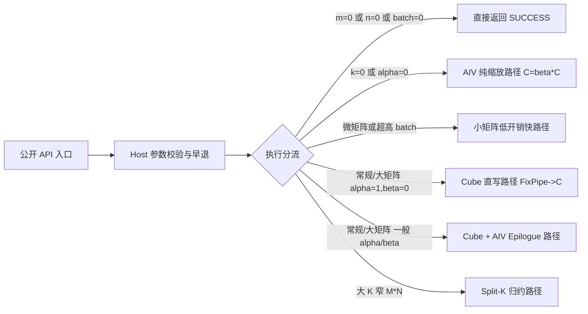

# aclblasSgemmBatched / aclblasHgemmBatched 算子设计文档（Atlas A2/A3）

| 文档项 | 内容 |
| --- | --- |
| 版本 / 日期 | v1.0 / 2026-11-25 |
| 需求依据 | 《11月社区任务-aclblasSgemmBatched_HgemmBatched算子开发（A2A3）》任务书及随附 S/H 测试包 |
| 目标工程 | [cann/ops-blas](https://gitcode.com/cann/ops-blas)，实现目录 `blas/gemm_batched/arch22/` |
| 目标环境 | Atlas A2/A3（`arch22` / `DAV_2201`），CANN 9.1.0；性能验收设备 Atlas 800T A2（Ascend 910B3） |
| 参考源码版本 | `cann/ops-blas` `55ef791b77f3677b45da3468b0a8b17941424f84` |
| 文档状态 | 设计方案；文中阈值为验收目标，Tiling 参数与分流阈值为候选设计，尚未宣称编译、精度或性能已通过 |

# 需求背景（required）

## 需求来源

依据 2026 年 CANN 社区任务书，在 Atlas A2/A3 系列产品上使用 Ascend C 编程语言、基于 `cann/ops-blas` 句柄式 BLAS 工程框架，补齐单精度浮点（FLOAT32）批量通用矩阵乘算子 `aclblasSgemmBatched` 与半精度浮点（FLOAT16，`aclblasHalf`）批量通用矩阵乘算子 `aclblasHgemmBatched` 的 `arch22` 实现及自验证测试工程。设计文档结构严格遵循社区模板 [design_template.md](https://gitcode.com/cann/cann-competitions/blob/master/04_tasks/01_community-task-2026/resources/design_template.md)。

接口签名与数学语义对标 cuBLAS `cublasSgemmBatched` / `cublasHgemmBatched`（S 数学参考 Netlib `sgemm`），状态码与 Host 标量内存约定遵循 `ops-blas` 仓库及本任务书口径。

## 背景介绍

### 现状分析

在参考提交 `55ef791b77f3677b45da3468b0a8b17941424f84` 中：

1. **公开接口已存在**：`include/cann_ops_blas.h` 已声明 `aclblasSgemmBatched`（L606）与 `aclblasHgemmBatched`（L616），本任务无需新增或修改公开 API 声明，禁止定义私有平行接口。
2. **arch35 参考实现已存在**：`blas/gemm_batched/arch35/gemm_batched_host.cpp`（S）与 `blas/gemm_batched/arch35/hgemmBatched_host.cpp`（H）已实现 Ascend 950PR 版本，可供参考指针数组组织、列主序转置视角与 FP16 缩放回退路径；但 `arch35` 依赖 `DAV_3510` 专属组件，且对 `m=0/n=0` 空指针的校验口径与本任务 A2/A3 要求不同，不能直接照搬。
3. **arch22 同族资产现状**：`blas/gemm_batched/arch22/` 当前仅有复数算子 `cgemm_batched_*`，尚无实数 `SgemmBatched` / `HgemmBatched` 实现；同仓 `blas/gemm_batched_ex/arch22/`、`blas/gemm_strided_batched/arch22/` 与 `blas/gemm/arch22/` 提供了在 Atlas A2/A3 上经验证的 `MatmulImpl` 多档配置、Split-K、小矩阵快速路径与 `handle` workspace 复用范式，可作为 `arch22` 实现的重要工程参考。
4. **测试目录现状**：`test/gemm_batched/sgemm_batched/` 当前仅有 `arch35/` 子目录及公用参数/golden 头文件，缺少 `arch22/` 测试实现与目标注册，需随本任务补齐，并兼容随包 `sgemm_batched` 与 `hgemm_batched` 两套验证脚本。

### 算子功能分析

`aclblasSgemmBatched` 与 `aclblasHgemmBatched` 对 `batchCount` 组地址独立、形状与转置方式相同的矩阵执行批量通用矩阵乘加：

```text
C[i] = alpha * op(A[i]) * op(B[i]) + beta * C[i],   i = 0, 1, ..., batchCount - 1
```

其中各批矩阵按列主序存储于由 Device 侧指针数组 `Aarray` / `Barray` / `Carray` 指向的独立内存区，前导维分别为 `lda` / `ldb` / `ldc`；`alpha` / `beta` 为 Host 侧标量指针；`C[i]` 原地覆写且仅更新逻辑 `m × n` 区域，`ldc` padding 列保持不被修改。

# 需求分析（required）

## 需求描述

在 `cann/ops-blas` 仓 `blas/gemm_batched/arch22/` 下实现 `aclblasSgemmBatched`（FP32）与 `aclblasHgemmBatched`（FP16），通过 `aclblasHandle_t` 绑定的 stream 异步直调 Ascend C kernel：

- 支持全部 9 种 `(transa, transb) ∈ {N, T, C} × {N, T, C}` 组合，两个实数算子均满足 `ACLBLAS_OP_C ≡ ACLBLAS_OP_T`（不做共轭）；
- 支持任意合法运行时 `m, n, k, batchCount ≥ 0` 与 `lda, ldb, ldc` padding（含非对齐尺寸、4095³/4096³ 立方大矩阵及高达 65536 的高 batch 小矩阵）；
- 完整落实任务书参数校验顺序、状态码、`m=0/n=0/batchCount=0` 合法 no-op、`k=0/alpha=0` 纯缩放、`beta=0` 不读旧 `C` 及 `ldc` padding 写保护；
- 精度通过 1000 条全量用例（S 500 + H 500，混合容差标准）；性能在 Atlas 800T A2（910B3）上通过 200 条性能用例（S 100 + H 100），正式判据 `msprof op` kernel Task Duration 逐条及平均达到 A100 `gpu_ms` 的 0.8 倍以上。

## 需求拆解

| 编号 | 需求项 | 设计落实位置 |
| --- | --- | --- |
| R1 | 复用既有 `aclblasSgemmBatched` / `aclblasHgemmBatched` 公开声明，不新增私有 API | 接口定义、工程改动 |
| R2 | 严格 Host 参数校验顺序与 A2/A3 退化语义（含 `m=0/n=0/batchCount=0` 允许空指针数组） | Host 侧参数校验与早退表 |
| R3 | 9 种转置组合、列主序 `lda/ldb/ldc` padding 与写保护、`beta=0` 不读旧 `C` | 列主序对偶转换、Kernel 读写边界 |
| R4 | FP32（关闭 HF32）与 FP16（FP32 累加 + IEEE 舍入，覆盖次正规数/65504/Inf/NaN）高精度计算 | 双精度 Cube 路径与 AIV Epilogue |
| R5 | 全尺寸覆盖（1×1×1×65536 至 4096³）与高吞吐性能（尤其 Hgemm ≥178 TFLOPS 与非默认标量场景） | 多路分流、L2 友好的 2D/Batch 调度、融合/轻量 Epilogue |
| R6 | 1000 条精度验收与 200 条性能验收（`msprof op` 正式口径 + GTest `[PERF] avg_us` 交叉验证） | 可维可测分析、测试工程设计 |
| R7 | 仓内规范 `README.md`、测试工程、私仓 `task_submission/` 全套交付件 | 工程改动、复现与交付 |

# 详细设计（required）

## 算子分析

### 数学公式

对批次索引 `i ∈ {0, 1, ..., batchCount - 1}`，矩阵按列主序存储，逻辑维度为 `op(A[i]) ∈ R^(m×k)`、`op(B[i]) ∈ R^(k×n)`、`C[i] ∈ R^(m×n)`：

```text
C[i](r, c) = alpha * sum_{p=0}^{k-1} op(A[i])(r, p) * op(B[i])(p, c) + beta * C_old[i](r, c)
```

其中物理元素索引与转置映射（实数算子 `ACLBLAS_OP_C` 等价于 `ACLBLAS_OP_T`）为：

- `transa == ACLBLAS_OP_N`：`op(A[i])(r, p) = A[i][r + p * lda]`，物理存储 `lda × k`；
- `transa ∈ {ACLBLAS_OP_T, ACLBLAS_OP_C}`：`op(A[i])(r, p) = A[i][p + r * lda]`，物理存储 `lda × m`；
- `transb == ACLBLAS_OP_N`：`op(B[i])(p, c) = B[i][p + c * ldb]`，物理存储 `ldb × n`；
- `transb ∈ {ACLBLAS_OP_T, ACLBLAS_OP_C}`：`op(B[i])(p, c) = B[i][c + p * ldb]`，物理存储 `ldb × k`；
- 输出矩阵 `C[i](r, c) = C[i][r + c * ldc]`，物理存储 `ldc × n`，仅逻辑范围 `0 ≤ r < m, 0 ≤ c < n` 允许写入。

利用列主序与行主序的转置对偶恒等式：

```text
col_major(C) = col_major(op(A)) * col_major(op(B))
  <=>  row_major(C^T) = row_major(op(B)^T) * row_major(op(A)^T)
```

记内部行主序计算维度为 `(M_in, N_in, K_in) = (n, m, k)`，左操作数为 `B[i]`（逻辑转置标志 `innerTransA = !isTransB`），右操作数为 `A[i]`（逻辑转置标志 `innerTransB = !isTransA`），输出为 `C[i]`（行主序 `n × m`，行跨度 `ldc`）。该转换使 Ascend C `MatmulImpl` 直接按行主序访问列主序矩阵，无需额外物理转置。

### 支持数据类型和形状

| 参数 | SgemmBatched 类型 | HgemmBatched 类型 | 内存位置 | 形状与合法范围 |
| --- | --- | --- | --- | --- |
| `handle` | `aclblasHandle_t` | `aclblasHandle_t` | Host | 非空有效句柄，携带绑定 `aclrtStream` 与复用 workspace |
| `transa`, `transb` | `aclblasOperation_t` | `aclblasOperation_t` | Host | `{ACLBLAS_OP_N, ACLBLAS_OP_T, ACLBLAS_OP_C}` |
| `m`, `n`, `k` | `int` | `int` | Host | `m ≥ 0, n ≥ 0, k ≥ 0` |
| `alpha`, `beta` | `const float*` | `const aclblasHalf*` | Host | 非空指针；H 侧按 IEEE-754 binary16 位模式解析并提升至 FP32 |
| `Aarray` | `const float* const[]` | `const aclblasHalf* const[]` | Device | 长度 `batchCount`，元素指向 Device 上 `lda×k`（N）或 `lda×m`（T/C） |
| `lda` | `int` | `int` | Host | `lda ≥ max(1, isTransA ? k : m)` |
| `Barray` | `const float* const[]` | `const aclblasHalf* const[]` | Device | 长度 `batchCount`，元素指向 Device 上 `ldb×n`（N）或 `ldb×k`（T/C） |
| `ldb` | `int` | `int` | Host | `ldb ≥ max(1, isTransB ? n : k)` |
| `Carray` | `float* const[]` | `aclblasHalf* const[]` | Device | 长度 `batchCount`，元素指向 Device 上 `ldc×n` 原地输出且互不重叠 |
| `ldc` | `int` | `int` | Host | `ldc ≥ max(1, m)` |
| `batchCount` | `int` | `int` | Host | `batchCount ≥ 0` |

### 接口定义

沿用 `include/cann_ops_blas.h`（L606、L616）既有声明：

```cpp
aclblasStatus_t aclblasSgemmBatched(
    aclblasHandle_t handle,
    aclblasOperation_t transa, aclblasOperation_t transb,
    int m, int n, int k,
    const float* alpha,
    const float* const Aarray[], int lda,
    const float* const Barray[], int ldb,
    const float* beta,
    float* const Carray[], int ldc,
    int batchCount);

aclblasStatus_t aclblasHgemmBatched(
    aclblasHandle_t handle,
    aclblasOperation_t transa, aclblasOperation_t transb,
    int m, int n, int k,
    const aclblasHalf* alpha,
    const aclblasHalf* const Aarray[], int lda,
    const aclblasHalf* const Barray[], int ldb,
    const aclblasHalf* beta,
    aclblasHalf* const Carray[], int ldc,
    int batchCount);
```

## 算子实现

### 实现方案

面向 Atlas A2/A3（`arch22` / `DAV_2201`，AIC/AIV 分离架构），采用“**统一 Host 调度 + 多路径专精 Kernel**”架构，对 `aclblasSgemmBatched`（FP32）与 `aclblasHgemmBatched`（FP16）共享调度与 Epilogue 框架，并针对不同规模档位与标量特征分流，兼顾严格精度与全规模段性能：



核心设计取舍如下：

1. **列主序零转置直算**：统一采用 `C^T = op(B)^T * op(A)^T` 映射，按 4 种有效转置组合 `(innerTransA, innerTransB) ∈ {FF, FT, TF, TT}` 编译期实例化 `MatmulImpl` 模板，避免运行时转置分支与显式转置搬运。
2. **SgemmBatched（FP32）严格精度**：Cube 侧采用 FP32 `MatmulImpl` 并关闭 HF32（`EnableHF32` 置关，防止 FP32 尾数截断引入超标误差），确保 `4096³` 与大标量用例满足 FLOAT32 混合容差（`atol = rtol = 2^-13`）。
3. **HgemmBatched（FP16）高吞吐与高精度兼顾**：Cube 侧采用 FP16 输入、FP32 L0C 累加（`MatmulType<GM, ND, half>` → FP32 累加器）。当 `alpha == 1 && beta == 0` 时，通过 Cube FixPipe 直接由 FP32 累加器舍入写回 FP16 `C[i]`（单次 kernel、零临时 GM 读写、逼近 910B3 FP16 Cube 峰值以对标 A100 222.6 TFLOPS）；当 `alpha != 1 || beta != 0` 时，由 FP32 中间结果（或 MIX Cube+AIV 流水融合）在 FP32 域完成 `alpha * prod + beta * fp32(C)` 后按 `RoundMode::CAST_ROUND` 写回 FP16，既保留精度又规避 FP16 中间溢出/下溢；对含极端值或 `ldc` 非对齐写回场景保证不触碰 padding 区域。
4. **多尺寸段路径分流**：
   - **大中矩阵路径**：根据 `(M_in, N_in, K_in, batchCount)` 选用最优静态/MDL Cube Tiling（FP16 优先大块 `128×256` / `256×128` / `128×128`，FP32 优先 `128×128` / `128×64` / `64×128` / `64×64`），配合 L2 友好块序（Swizzle / 蛇形遍历）与负载均衡核间调度。
   - **Split-K 路径**：当 `batchCount * ceil(M_in/tileM) * ceil(N_in/tileN) < coreNum` 且 `K_in` 足够大时，沿 K 维切分到多核并行计算部分和至 handle workspace，再由 AIV 归约并融合 `alpha/beta` 写回 `C[i]`。
   - **微矩阵 / 超高 batch 路径**：针对 `m, n, k ≤ 32` 或 `batchCount` 高达 `1024~65536` 的场景（如 `1×1×1 × 65536`、`8³ × 64`、`16³ × 64`），采用轻量 batch 并行 AIV/Cube 融合核，避免逐 batch 重复初始化 `MatmulImpl` 及多 kernel 调度延迟，将微矩阵耗时压低至 ~10μs 级别。

### Host 侧设计

#### 1. 严格参数校验与早退顺序

Host 入口严格遵循任务书 §2.4 / §2.5 规定的顺序，先校验全部结构参数合法性，再执行早退与指针数组判空：

| 顺序 | 检查项 | 失败返回值 | 说明 |
| --- | --- | --- | --- |
| 1 | `handle == nullptr` | `ACLBLAS_STATUS_HANDLE_IS_NULLPTR` | 最高优先级 |
| 2 | `transa` / `transb` 非 `{N, T, C}` | `ACLBLAS_STATUS_INVALID_ENUM` | 枚举错误优先于维度错误 |
| 3 | `m < 0 \|\| n < 0 \|\| k < 0` | `ACLBLAS_STATUS_INVALID_VALUE` | 维度非负 |
| 4 | `lda < max(1, physRowsA)` / `ldb < max(1, physRowsB)` / `ldc < max(1, m)` | `ACLBLAS_STATUS_INVALID_VALUE` | `physRowsA = isTransA ? k : m`，`physRowsB = isTransB ? n : k` |
| 5 | `batchCount < 0` | `ACLBLAS_STATUS_INVALID_VALUE` | 批数非负 |
| 6 | `alpha == nullptr \|\| beta == nullptr` | `ACLBLAS_STATUS_INVALID_VALUE` | Host 标量指针不可为空 |
| 7 | `batchCount == 0 \|\| m == 0 \|\| n == 0` | `ACLBLAS_STATUS_SUCCESS` | 合法 no-op；不检查 `Aarray/Barray/Carray`（允许为 `nullptr`），不启动 kernel |
| 8 | 读取 Host 标量 `alphaVal, betaVal`（H 通过 `blas_common::HalfToFloat` 转 FP32） | — | 若 `k == 0 \|\| alphaVal == 0.0f` 进入退化分支 |
| 9 | `Carray == nullptr` | `ACLBLAS_STATUS_INVALID_VALUE` | `m>0 && n>0 && batchCount>0` 时 `Carray` 必非空 |
| 10 | 非退化分支（`k > 0 && alphaVal != 0.0f`）时检查 `Aarray == nullptr \|\| Barray == nullptr` | `ACLBLAS_STATUS_INVALID_VALUE` | 退化分支（`k == 0` 或 `alpha == 0`）允许 `Aarray/Barray` 为 `nullptr` |
| 11 | 退化分支中若 `alphaVal == 0.0f && betaVal == 1.0f`（或 `k == 0 && betaVal == 1.0f`） | `ACLBLAS_STATUS_SUCCESS` | quick return，不启动 kernel；否则进入 `C = beta * C` 缩放核 |

> 特别注意：对于 `k == 0`，不读取 `Aarray/Barray`，且不让非有限 `alpha` 污染 `beta * C`；对于 `beta == 0`（精确判定 `+0.0f / -0.0f`，`NaN` 不视为 0），Kernel 不读取旧 `C[i]`，避免 `C[i]` 含 `NaN` 时产生 `0 * NaN = NaN`。

#### 2. 平台查询与 Tiling 数据结构

Host 通过 `PlatformAscendCManager` 动态查询当前设备 AIC 核数（`GetCoreNumAic()`，910B3 为 20）、AIV 核数（`GetCoreNumAiv()`，910B3 为 40）及片上 L1/UB 容量，不硬编码芯片核数。内部传递结构体如下（按 8 字节对齐，随 kernel 参数按值下发，无需额外 Tiling GM 拷贝）：

```cpp
struct GemmBatched22Tiling {
    int32_t m, n, k;             // 原始列主序维度 (m, n, k)
    int32_t lda, ldb, ldc;       // 列主序物理前导维
    int32_t transA, transB;      // 0: N, 1: T/C
    int32_t dtype;               // 0: FP32 (S), 1: FP16 (H)
    int32_t outputLd;            // 临时输出跨度（32B 对齐）或 ldc
    uint32_t firstBatch;         // 当前分片起始 batch（供大 workspace 分批复用）
    uint32_t batches;            // 当前分片 batch 数
    uint32_t splitK;             // Split-K 切分数（1 表示不切分）
    uint32_t tileM, tileN, tileK;// Cube 块候选尺寸
    uint32_t usedCores;          // 实际启动核数
    uint32_t mode;               // 执行路径模式枚举
    float alpha;                 // 提升为 FP32 的 alpha
    float beta;                  // 提升为 FP32 的 beta
    uint32_t betaIsZero;         // 显式标志：beta == 0.0f 时禁止读旧 C
    uint32_t flags;              // 附加标志（直写/临时输出/Swizzle 等）
};
```

#### 3. Workspace 规划与分批/分条复用

- **直写路径（`alpha == 1 && beta == 0` 且满足直写条件）**：算法 GM workspace 为 **0B**。
- **纯缩放与微矩阵路径**：算法 GM workspace 为 **0B**。
- **一般 `alpha/beta` 路径与 Split-K 路径**：优先复用 `aclblasHandle_t` 内置 workspace（通过仓内 `EnsureWorkspace` / `GetWorkspace` 获取，单次不重复 `aclrtMalloc/Free`）。若 `batchCount * alignedM * n * sizeof(float)` 超出默认 workspace 预算（例如默认 32 MiB），Host 自动按批次分片（chunk over `batchCount`）或对单批大矩阵沿输出列分条，在同一绑定 stream 上串行复用 workspace，保证峰值临时显存受控。对于 Hgemm 大性能用例（如 `1024³ × 8, alpha=3, beta=2`），优先评估 MIX 核内融合 Epilogue 或大块流水覆盖，消除全矩阵落盘带宽瓶颈。

### Kernel 侧设计

#### 1. 核间任务映射与 L2 局部性优化

记内部行主序单批输出 tile 网格为 `gridM = ceil(n / tileM)`、`gridN = ceil(m / tileN)`，总逻辑任务数 `totalTasks = batches * gridM * gridN`：

- **常规/大矩阵任务调度**：
  - 将 `(b, tm, tn)` 映射为一维任务索引，按 `usedCores = min(aicCores, totalTasks)` 均匀切分，避免跨核原子竞争；
  - 当 `batches` 较小且 `gridM * gridN` 较大（如 `2048³ × 2`、`4096³ × 1`）时，在单批二维网格内采用 L2 Swizzle 分组遍历（例如 `swizzleSize = 4` 或 `8` 列/行分组 + 蛇形反转），提升 A/B 在 L2 Cache 中的复用率；
  - 当 `batches` 较大且单批为单 tile（如 `64³ × 64`、`128³ × 32`）时，直接按 `batch` 维度连续分发，最小化每核指针数组加载与索引计算开销。
- **指针数组读取**：Kernel 通过 `GlobalTensor<uint64_t>` 绑定 `Aarray/Barray/Carray`（Device 指针数组），在切换 batch 时按标量读取第 `b` 个矩阵基址（单次 `DataCacheCleanAndInvalidate` 保护或标量读取），切分同一 batch 内多个 tile 时在寄存器中复用该批基址，避免重复访存指针数组。

#### 2. Cube 计算路径与候选 Tiling 配置

基于 Atlas A2/A3（L1 = 512KB，L0A = 64KB，L0B = 64KB，L0C = 128KB，UB = 192KB）的片上存储约束，规划如下候选配置（实际最优分界由 910B3 `msprof op` 实测确定）：

| 算子 / 场景 | 候选 `tileM × tileN` | 候选 `baseK` | L0A / L0B / L0C 估算（双缓冲） | 说明 |
| --- | --- | --- | --- | --- |
| Hgemm 大矩阵（`≥512`） | `128×256` / `256×128` / `128×128` | `64` / `128` | L0A/B ≤ 32KB×2，L0C ≤ 128KB | FP16 输入、FP32 累加；`alpha=1,beta=0` FixPipe 直出 FP16 |
| Hgemm 中小矩阵 | `64×128` / `128×64` / `64×64` | `64` | 降低尾块浪费，填满 20 AIC | 提升 `256³`、`128³` 等多 batch 并行度 |
| Sgemm 大矩阵（`≥512`） | `128×128` / `128×64` / `64×128` | `32` / `64` | FP32 L0A/B 单块减半，保持双缓冲 | 严格关闭 HF32，保证 FLOAT32 精度 |
| Sgemm 窄形 / 中小矩阵 | `64×64` / `32×64` / `64×32` | `32` | 避免低核利用率 | 配合 Split-K 覆盖大 K 窄 M/N 场景 |
| 微矩阵（`m,n,k ≤ 32`） | AIV/Cube 轻量批处理核 | — | 按 UB 分块，40 AIV 并发按 batch 切分 | 覆盖 `1×1×1 × 65536`、`3³~32³`，极低启动与调度开销 |

#### 3. Epilogue、纯缩放与 `ldc` 写保护

- **纯缩放核（`k == 0` 或 `alpha == 0`，且 `beta != 1`）**：
  - 由全部可用 AIV 核按 `(batch, col)` 切分，按列内有效长度 `m` 逐段搬运；
  - `beta == 0` 时直接在 UB 中 `Duplicate(outUb, 0)` 后写回，**严格不读取旧 `C[i]`**；
  - `beta != 0` 时对 Hgemm 先 `Cast(fp32, cFp16, CAST_NONE)`，在 FP32 域执行 `Muls(fp32, fp32, betaVal)`，再 `Cast(outFp16, fp32, CAST_ROUND)` 写回；对 Sgemm 直接 FP32 `Muls` 写回；
  - 对非 32B 对齐尾部统一使用 `DataCopyPad` 按精确字节数 `segLen * sizeof(T)` 搬出，严格限定在 `[0, m)` 行内，**不覆写 `[m, ldc)` padding 区**。
- **一般 `alpha/beta` 合并核**：
  - 将 Cube 输出的 FP32 乘积 `P` 与旧 `C` 在 UB 内以 FP32 域完成 `alpha * P + beta * C`（`betaIsZero` 为真时跳过读旧 `C`），最后按目标类型写回 `C[i]`（H 经 `CAST_ROUND` 收窄为 FP16）；
  - UB 分配采用 `BUFFER_NUM = 2` 双缓冲，单次列块元素数按 32B 对齐并在 `GetCoreMemSize(UB)` 预算内最大化（典型占可用 UB 60%~85%）。

#### 4. FP16 特殊值与数值健壮性处理

- **次正规数（`5E-8`）与接近上限（`65504`）**：Cube 累加及 Epilogue 缩放均在 FP32 域执行，防止 FP16 中间乘加提前下溢或溢出；仅最终写回时按 IEEE round-to-nearest 转回 FP16，与任务书 §3.2 golden 语义对齐。
- **Inf / NaN 传播**：`alpha == 0` 且 `A/B` 含 `NaN` 时在 Host 侧直接进入纯缩放路径，不触碰 `A/B`；`beta == 0` 且 `C` 含 `NaN` 时由 `betaIsZero` 标志禁止读旧 `C`；一般计算路径中不人为裁剪或替换有限计算外的 `Inf/NaN`，确保正常传播。

### 工程改动

遵循 `ops-blas` 仓库 `blas/<family>/arch22/` 与 `test/<family>/<op>/arch22/` 目录规范，不引入多余临时文件、不修改 `include/cann_ops_blas.h`：

```text
blas/gemm_batched/
├── README.md                                    # 补充 aclblasSgemmBatched / aclblasHgemmBatched 的 Atlas A2/A3 支持与约束
└── arch22/
    ├── cgemm_batched_*                          # 保持既有复数实现不变
    ├── gemm_batched_tiling_data.h               # S/H arch22 内部 Tiling 与模式定义
    ├── gemm_batched_kernel.h                    # S/H arch22 kernel launcher 声明
    ├── gemm_batched_host.cpp                    # aclblasSgemmBatched / aclblasHgemmBatched Host 入口、校验、Tiling、分流
    └── gemm_batched_kernel.cpp                  # S/H Cube/AIV/Split-K/微矩阵 kernel 实现（按需拆分 S/H 独立编译单元以控编译时长）

test/gemm_batched/
├── sgemm_batched/
│   ├── CMakeLists.txt                           # 补齐 arch22 分支注册 sgemm_batched_test（及 hgemm_batched_test）
│   └── arch22/
│       ├── sgemm_batched_test.cpp               # 兼容 S/H CSV 驱动、生态混合容差判定与 [PERF] avg_us 输出
│       ├── sgemm_batched_test.csv               # 随包 600 条 S 用例
│       └── ...
└── hgemm_batched/                               # 与随包 hgemm_batched/verify_*.py 默认路径对齐（共用测试逻辑，无重复代码）
    ├── CMakeLists.txt
    └── arch22/
        └── hgemm_batched_test.csv               # 随包 600 条 H 用例
```

> 注：需在 `CMakeLists.txt` 与 `build.sh` 中确认 `--ops=sgemm_batched,hgemm_batched` 以及单编 `--ops=sgemm_batched`、`--ops=hgemm_batched` 均能正确编译并生成对应 GTest 可执行文件，确保随包两套 `verify_accuracy.py` / `verify_performance.py` 原样可跑通。

## 支持硬件

| 产品系列 | 构建架构 | 构建 `--soc` | 支持状态与验证规划 |
| --- | --- | --- | --- |
| Atlas A2 系列（含 Atlas 800T A2） | `arch22` | `ascend910b3` | 本次目标；在 Atlas 800T A2（910B3）完成全量 1000 精度 + 200 性能自验 |
| Atlas A3 系列（含 Atlas 800T A3） | `arch22` | `ascend910_93` | 本次目标；共享 `arch22` 实现并完成适配构建；自测报告严格标注实测款型 |

## 算子约束限制

1. 仅支持列主序存储、带 `lda/ldb/ldc` 前导维的独立批量矩阵，不支持任意非连续视图或广播。
2. `alpha`、`beta` 须为 Host 侧有效指针；`Aarray`、`Barray`、`Carray` 指针数组本体及其指向的各批矩阵数据均须位于 Device 内存。
3. 各批输出矩阵 `C[i]` 之间不得重叠，且 `C[i]` 可写区域不得与任意 `A[j]`、`B[j]` 可读区域重叠，由调用方保证。
4. 接口在 `handle` 绑定的 stream 上异步执行，Host 读取结果前须同步该 stream；不保证多次执行逐 bit 确定性，以混合容差标准验收。

# 可维可测分析

## 精度标准/性能标准

| 验收项 | 验收标准 | 标准来源 |
| --- | --- | --- |
| S 精度标杆 | CPU 侧 Netlib BLAS 3.10.0 `cblas_sgemm`（float64 累加后收窄至 float32）逐 batch 全矩阵比对 | 任务书 §3.1 / §3.2 |
| H 精度标杆 | 测试工程以 float64 累加 → 收窄至 float32 → IEEE round-to-nearest 收窄至 FP16，逐 batch 全矩阵比对 | 任务书 §3.1 / §3.2 |
| S 精度容差 | FLOAT32 档：`atol = rtol = 2^-13 (1.2207e-4)`，`matched_ratio ≥ 0.99`，`max_abs_error ≤ max(1e-2, 32·ULP)` | 任务书 §3.2 / opbase 混合容差标准 |
| H 精度容差 | FLOAT16 档：`atol = rtol = 2^-10 (9.7656e-4)`，`matched_ratio ≥ 0.99`，`max_abs_error ≤ max(1e-1, 32·ULP)` | 任务书 §3.2 / opbase 混合容差标准 |
| 正式性能判据 | 910B3 上 `msprof op` 采集 kernel Task Duration（warmup 5 次 + 有效采样 10 次均值）：单 case `≤ gpu_ms / 0.8` 且均值倍率 `≥ 0.8` | 任务书 §3.3 |
| 辅助性能交叉验证 | GTest `aclrtEvent` 端到端 `[PERF] avg_us`（warmup 5 + 10 次均值）由 `verify_performance.py` 采集对比，仅作回归参考，不替代正式判据 | 任务书 §3.3 / 测试 README |
| 内存专项 | 任务书 §3.4 标注“不涉及”；自验中仍检查 `ldc` padding 写保护、空指针/负向无越界及重复调用无显存泄漏 | 任务书 §3.4 |

### 测试覆盖设计（基于随包 CSV 核对）

随附测试包共 1200 条用例（精度 1000 条 + 性能 200 条），`RANDOM_NORM_5_5` 与 `GAUSS_NORM_0_1` 分布均衡交替覆盖：

| 算子 | CSV 文件与 SHA256 前缀 | 精度总数（SUCCESS / INVALID_VAL / INVALID_ENUM / NULL_HANDLE） | 性能总数 | 关键分类覆盖 |
| --- | --- | --- | ---: | --- |
| `aclblasSgemmBatched` | `sgemm_batched_test.csv` (`6615bb4ddcf336a5`) | 500（474 / 21 / 4 / 1） | 100 | `TC_L0`(18) / `TC_MN`(61, 含 4095³/4096³) / `TC_AB`(22) / `TC_LD`(15) / `TC_FL`(21) / `TC_CV`(24, 含 b=65536) / `TC_ED`(64) / `TC_EX`(275) |
| `aclblasHgemmBatched` | `hgemm_batched_test.csv` (`ff5eb4d59dd5572f`) | 500（474 / 21 / 4 / 1） | 100 | `TC_L0`(18) / `TC_MN`(61, 含 4095³/4096³) / `TC_AB`(22) / `TC_LD`(15) / `TC_FL`(27, 含 `65504`/`5E-8`/Inf/NaN) / `TC_CV`(24) / `TC_ED`(70) / `TC_EX`(263) |

### 典型性能目标（摘自随包 `gpu_baseline.csv`，A100 kernel-only）

两份 `gpu_baseline.csv`（S：`9ff8c4f64e2a211b`，H：`52824602bf16d898`）全部 200 条 `gpu_ms` 均已回填。前 4 条基础用例及最大规模立方用例的目标上限（`gpu_us / 0.8`）如下：

| 算子 | 基线 ID | `transA/B` & `m×n×k` & `batch` | `alpha/beta` | GPU 均值 (μs) | NPU 上限 (μs) | 折合目标算力 |
| --- | --- | --- | --- | ---: | ---: | --- |
| S | `sgemmBatched-base-000` | `N/N` `256³ × 16` | `1 / 0` | 71.680 | 89.600 | 6.00 TFLOPS |
| S | `sgemmBatched-base-001` | `N/N` `512³ × 8` | `1 / 0` | 247.603 | 309.504 | 6.94 TFLOPS |
| S | `sgemmBatched-base-002` | `T/N` `1024³ × 4` | `1 / 0` | 714.445 | 893.056 | 9.62 TFLOPS |
| S | `sgemmBatched-base-003` | `N/T` `2048³ × 2` | `1 / 0` | 2306.253 | 2882.816 | 11.92 TFLOPS |
| S | `sgemmBatched-perf-016` | `N/N` `4096³ × 1` | `1 / 0` | 8807.936 | 11009.920 | 12.48 TFLOPS |
| H | `hgemmBatched-base-000` | `N/N` `256³ × 16` | `1 / 0` | 18.330 | 22.912 | 23.43 TFLOPS |
| H | `hgemmBatched-base-001` | `N/N` `512³ × 8` | `1 / 0` | 30.925 | 38.656 | 55.55 TFLOPS |
| H | `hgemmBatched-base-002` | `T/N` `1024³ × 4` | `1 / 0` | 62.157 | 77.696 | 110.56 TFLOPS |
| H | `hgemmBatched-base-003` | `N/T` `2048³ × 2` | `1 / 0` | 165.478 | 206.848 | 166.11 TFLOPS |
| H | `hgemmBatched-perf-016` | `N/N` `4096³ × 1` | `1 / 0` | 617.370 | 771.712 | 178.10 TFLOPS |

> 性能验收须全部 200 条逐条统计并达标，不得仅以代表点或均值替代单条判定；如一次 API 调用包含多个 kernel（如 Cube + AIV Epilogue），`msprof op` 须按单次调用对全部关联 kernel 的 Task Duration 求和后再取 10 次均值。

### 性能风险与优化重点

1. **Hgemm 大尺寸高算力密度区（`4096³`、`2048³ × 2`、`1024³ × 8`）**：目标高达 166~178 TFLOPS，需确保 L1/L0 双缓冲流水无气泡、采用 L2 Swizzle 降低访存冲突，并尽量保持 `128×256` / `256×128` 满载 Tile。
2. **非默认标量性能用例（约 12%，如 `1024³ × 8, alpha=3, beta=2`）**：若先写全量 FP32 GM 临时矩阵再单独启动 AIV 缩放核，HBM 额外流量与第二次 kernel 延迟将压缩裕量；实测若不达标，将进一步采用 MIX Cube+AIV 块级流水融合 Epilogue 或 FixPipe 量化缩放路径优化。
3. **微矩阵与超高 batch（`3³~32³`、`1×1×1 × 65536`）**：目标延迟低至 10.75~14μs，需避免高阶 `MatmulImpl` 初始化与多核同步开销，优先采用轻量单核/多 AIV 批量计算核。

## 兼容性分析

- **API/ABI 兼容**：直接实现 `include/cann_ops_blas.h` 中已有的 `aclblasSgemmBatched` 与 `aclblasHgemmBatched` 声明，不修改头文件签名、枚举值或 `aclblasHalf` 定义，与其他产品线（如 `arch35`）完全共享接口。
- **同族算子隔离**：实现新增于 `blas/gemm_batched/arch22/`，不修改既有 `cgemm_batched_*` 与 `arch35/` 源码；通过 `arch22` 条件编译与平台能力查询适配 A2/A3，不使用 `arch35` 专属指令。
- **构建与测试兼容**：沿用 `ops-blas` 仓 `build.sh` 与 GTest 框架，合入前完成库编译、符号导出核对及 `cgemm_batched` 回归验证。

## 复现与交付

构建与验证入口（待实现完成后在 Atlas 800T A2 / 910B3、CANN 9.1.0 环境实测并留档）：

```bash
# 1. 编译算子与测试工程
bash build.sh --soc=ascend910b3 --ops=sgemm_batched,hgemm_batched

# 2. 精度全量验收（各 500 条，共 1000 条）
python3 test_cases/sgemm_batched/verify_accuracy.py --repo /path/to/ops-blas --soc ascend910b3 --csv test_cases/sgemm_batched/sgemm_batched_test.csv
python3 test_cases/hgemm_batched/verify_accuracy.py --repo /path/to/ops-blas --soc ascend910b3 --csv test_cases/hgemm_batched/hgemm_batched_test.csv

# 3. 性能交叉验证（GTest [PERF] avg_us）与正式采集（msprof op kernel Task Duration）
python3 test_cases/sgemm_batched/verify_performance.py --repo /path/to/ops-blas --soc ascend910b3 --skip-build
python3 test_cases/hgemm_batched/verify_performance.py --repo /path/to/ops-blas --soc ascend910b3 --skip-build
msprof op --application="./build/test/gemm_batched/sgemm_batched/arch22/sgemm_batched_test --gtest_filter=*TC_PF_*" --output=./prof_sgemm_batched
msprof op --application="./build/test/gemm_batched/hgemm_batched/arch22/hgemm_batched_test --gtest_filter=*TC_PF_*" --output=./prof_hgemm_batched
```

最终按任务书要求在开发者私仓根目录交付 `task_submission/` 全套验收件（`1 自验证步骤说明.md`、`2.1 精度自验证报告.xlsx`、`2.2 精度自验证日志.log`、`3.1 性能自验证报告.xlsx`、`3.2 性能自验证日志.log`、`4.1 内存自验证报告.xlsx`、`4.2 内存自验证日志.log`），并在私仓邀请 `Ascend-CANN` 作为开发者。

## 参考资料

1. 随任务提供的 `aclblasSgemmBatched_HgemmBatched_AtlasA2_A3_task_doc.md` 及 `test_cases/{sgemm_batched,hgemm_batched}/` 全套文件。
2. [cuBLAS Batched GEMM 文档](https://docs.nvidia.com/cuda/cublas/index.html)、[Netlib sgemm 参考实现](https://www.netlib.org/blas/sgemm.f)。
3. [生态算子开源精度标准（混合容差）](https://gitcode.com/cann/opbase/blob/28a1ce52ae856353589841226a0002af73314a6b/docs/zh/ops_precision_standard/mixed_tolerance_standard.md)。
4. [cann/ops-blas 参考提交 `55ef791b`](https://gitcode.com/cann/ops-blas/commit/55ef791b77f3677b45da3468b0a8b17941424f84)：`include/cann_ops_blas.h`、`blas/gemm_batched/arch35/`、`blas/gemm_batched/arch22/`、`blas/gemm_batched_ex/arch22/`、`blas/gemm_strided_batched/arch22/`。
5. [社区任务设计文档模板](https://gitcode.com/cann/cann-competitions/blob/master/04_tasks/01_community-task-2026/resources/design_template.md) 与 [ops-blas 贡献指南](https://gitcode.com/cann/ops-blas/blob/master/CONTRIBUTING.md)。

Ascend KG 核对记录（加载的设计技能 `ascendc-operator-design`、`ascendc-tiling-design`、`ascendc-performance-best-practices`、`npu-arch` 及其配套文档已作为设计依据，无检索 score）：

| 用途 | id | source_file | score |
| --- | --- | --- | ---: |
| Matmul MDL 配置 | `ascdevkit_docs_zh_api_simdapi_advapi_cubecompute_matmulkernel_getmdlconfig_matmulconfig` | `ascend-c-kernel/asc-devkit/docs/zh/api/SIMD-API/adv_api/cube_compute/Matmul_Kernel/GetMDLConfig.md` | 0.960310 |
| 平台核数查询 | `ascdevkit_docs_zh_api_utilsapi_platforminfo_platformascendc_platformascendc_getcorenum` | `ascend-c-kernel/asc-devkit/docs/zh/api/Utils-API/platform_info/PlatformAscendC/PlatformAscendC.md` | 0.965578 |
| 非对齐搬运 | `ascdevkit_docs_zh_api_simdapi_basicapi_datamoveguide_gmubdatamove_非对齐数据搬运_datacopypad` | `ascend-c-kernel/asc-devkit/docs/zh/api/SIMD-API/basic_api/data_move_guide/GM_UB_data_move.md` | 0.962243 |
| 同族 arch35 实现 | `arch35_gemm_batched_host_aclblassgemmbatched` | `cann-ops/ops-blas/blas/gemm_batched/arch35/gemm_batched_host.cpp` | 0.933 |
| 同族 Strided 设计参考 | `cannopscompetitions_04tasks_01communitytask2026_tasklist_0821aclblassgemmstridedbatcheda2a3_shixiangyang225_docs_design_blas_gemm_strided_batched_arch22` | `cluster-infra/cann-ops-competitions/04_tasks/01_community-task-2026/tasklist/08-21-aclblasSgemmStridedBatched-A2A3/shi-xiangyang225/docs/design.md` | 0.908 |
