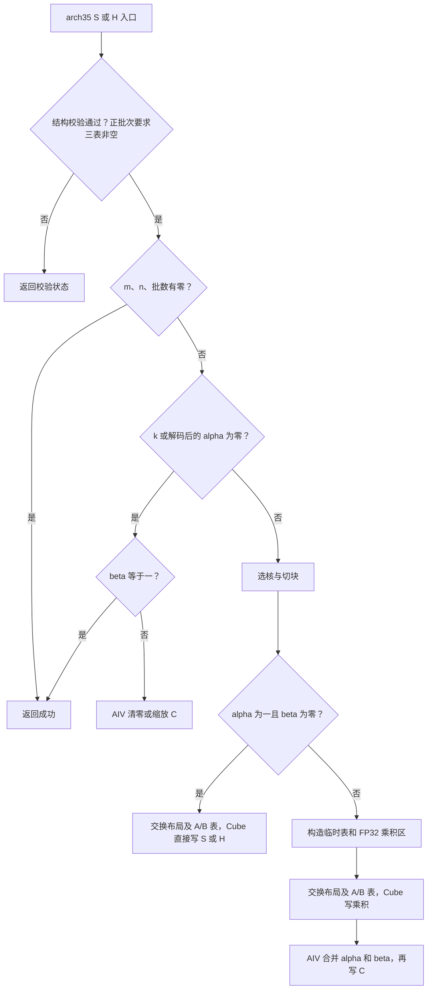
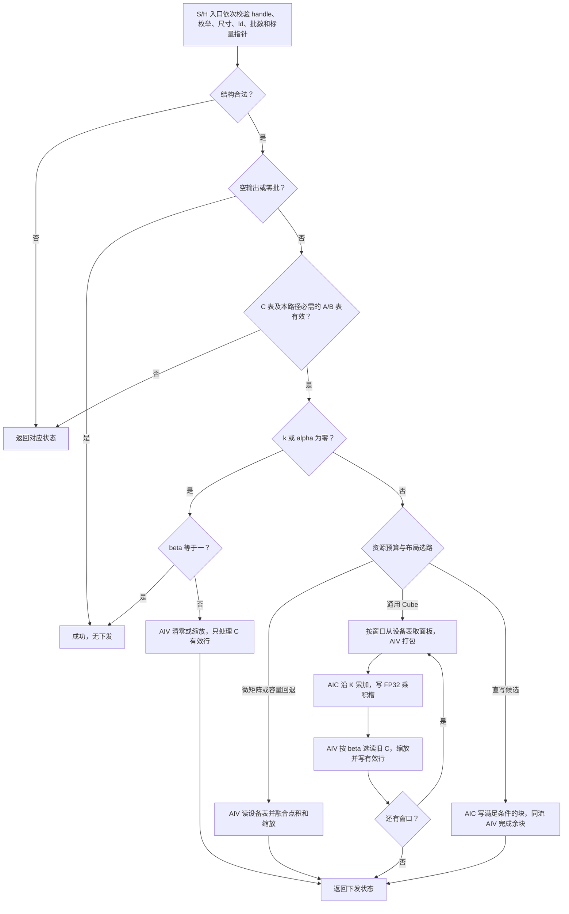

# 一、需求背景

## 1.1 需求来源

社区任务 11 要求在 Atlas A2/A3 上实现 `aclblasSgemmBatched` 和 `aclblasHgemmBatched`。两者在同一条 stream 上完成一批等形状、地址独立的矩阵乘法。S 对标 cuBLAS 单精度接口，H 对标半精度接口。本设计采用任务书 `aclblasSgemmBatched_HgemmBatched_AtlasA2_A3_task_doc.md`（SHA-256 为 `211c773248f9deaa5249c4e5caf1e88b2295fdf95749014d8e5e4bf6cb49b54f`）及其两个自验目录。

## 1.2 背景介绍

批内矩阵按列主序存储，相邻列间可以有填充。批间由三张 Device 指针表索引。设 `b` 为批号，`C₀` 为调用前的 C，则每批原地更新 `C[b] = alpha · op(A[b]) · op(B[b]) + beta · C₀[b]`。全批共享两个标量和一组尺寸、转置、前导维。对小矩阵，逐批下发的成本可能超过乘加本身。对大矩阵，需要在同一批内并行计算多个输出块。

### 1.2.1 批量 GEMM 算子实现优化

源码依据固定为官方 ops-blas 提交 `60d9d0b153e22a154b8de9b7d89f21c5443c5f98`。公开 ABI、状态和产品说明分别见 `include/cann_ops_blas.h`、`include/cann_ops_blas_common.h`、`blas/gemm_batched/README.md`。该快照在 `blas/gemm_batched/arch22/` 已有复数批量实现，在 `blas/gemm/arch22/` 已有非批量 SGEMM，本任务拟补齐两个实数批量入口。工程采用 handle + stream 直调，TBE 实现文件、op-info 信息库、ACLNN 两段式接口均不适用。[公开接口](https://gitcode.com/cann/ops-blas/blob/60d9d0b153e22a154b8de9b7d89f21c5443c5f98/include/cann_ops_blas.h)、[算子说明](https://gitcode.com/cann/ops-blas/blob/60d9d0b153e22a154b8de9b7d89f21c5443c5f98/blas/gemm_batched/README.md)

### 1.2.2 标杆算子现状分析

cuBLAS 提供公开的批量接口契约和 GPU 性能标杆。Netlib `sgemm.f` 给出单批实数乘加语义。以下实现描述及流程图依据 ops-blas 同接口的 arch35 开源代码，便于逐分支复核。[cuBLAS 批量 GEMM](https://docs.nvidia.com/cuda/cublas/index.html#cublas-t-gemmbatched)、[Netlib SGEMM](https://www.netlib.org/blas/sgemm.f)

#### 1.2.2.1 标杆支持的数据类型和数据格式

| 接口及对应 cuBLAS 入口 | A、B、C 存储 | alpha、beta 入参 | 拟用乘积累加与缩放 | 输出 |
| --- | --- | --- | --- | --- |
| aclblasSgemmBatched / cublasSgemmBatched | FP32，4 B/元素 | Host FP32 | FP32 输入、FP32 累加与缩放 | FP32 |
| aclblasHgemmBatched / cublasHgemmBatched | IEEE binary16，2 B/元素 | Host FP16，类型为 `const aclblasHalf*` | FP16 点积累加到 FP32，标量精确扩展到 FP32 后缩放 | 最后一次舍入到 FP16 |

两行均为实数、ND、列主序、Device pointer-array。`aclblasHalf` 的公开载体是 `uint16_t`，数值按半精度位模式解释。H 不接受 FP32 标量指针。BF16、FP32 标量配 FP16/BF16 矩阵等组合属于其他接口，本包没有 BF16 写回或混合类型入口。[公共类型定义](https://gitcode.com/cann/ops-blas/blob/60d9d0b153e22a154b8de9b7d89f21c5443c5f98/include/cann_ops_blas_common.h)

#### 1.2.2.2 标杆实现描述

arch35 的 S、H Host 文件先查 handle、标量指针、维度与 batchCount、转置和 ld，随后在 `batchCount > 0` 时要求三张表均非空。结构通过后才处理空输出。S 读 float，H 通过 `HalfToFloat` 解码。`k=0` 或 `alpha=0` 进入公共退化路径，`beta=1` 直接返回，其余进入 AIV 清零或缩放。此处的表本体检查比 A2/A3 任务书严格。[S Host 源码](https://gitcode.com/cann/ops-blas/blob/60d9d0b153e22a154b8de9b7d89f21c5443c5f98/blas/gemm_batched/arch35/gemm_batched_host.cpp)、[H Host 源码](https://gitcode.com/cann/ops-blas/blob/60d9d0b153e22a154b8de9b7d89f21c5443c5f98/blas/gemm_batched/arch35/hgemmBatched_host.cpp)

常规分支按 batch 和 M/N 空间切块，为行主序 Cube 视图交换 A/B 表、m/n、lda/ldb 和转置标志。Device 取当前批的矩阵地址，分段搬入 L1、L0A/L0B，沿 K 在 FP32 L0C 中累加。`alpha=1, beta=0` 时 S 直接写 FP32，H 走 half-out Fixpipe 写 FP16。其余标量组合在 workspace 放对齐的临时指针表和各批 FP32 乘积，Host 构造临时地址表并复制至 Device。同一 stream 的 AIV 再执行缩放、按需读旧 C、写回逻辑区域。两条入口的下发错误处理也有差异，固定版本中 H 检查 GEMM 和后处理的返回值，S 的 `ExecuteSgemmBatched` 未传递这两处返回值。[公共 Host 调度](https://gitcode.com/cann/ops-blas/blob/60d9d0b153e22a154b8de9b7d89f21c5443c5f98/blas/gemm_batched/arch35/gemm_batched_host_common.h)、[Cube 数据流](https://gitcode.com/cann/ops-blas/blob/60d9d0b153e22a154b8de9b7d89f21c5443c5f98/blas/gemm_batched/arch35/gemm_batched_cube_impl.h)、[Kernel 入口与后处理](https://gitcode.com/cann/ops-blas/blob/60d9d0b153e22a154b8de9b7d89f21c5443c5f98/blas/gemm_batched/arch35/gemm_batched_kernel.cpp)

#### 1.2.2.3 标杆算子实现流程图



# 二、需求分析

## 2.1 外部组件依赖

开发和正式验收固定 CANN 9.1.0，依赖 Ascend C 编译工具、ACL Runtime 的 stream 与 kernel 下发、msprof op。ATK/GTest 驱动验收，CPU 参考使用 Netlib BLAS 3.10.0 及测试工程的高精度计算。GPU 基线使用 NVIDIA A100 上对应的 cuBLAS S/H 函数与 Host pointer mode。README 的“9.1.0 及以上”可作后续兼容验证范围。

## 2.2 内部适配模块

| 模块 | 固定快照中的依据 | arch22 适配内容 |
| --- | --- | --- |
| ABI、handle 与平台 | `include/cann_ops_blas.h`、`blas/common/helper/aclblas_handle_internal.h`、`host_utils.h`、`dtype_cast.h`（后三者同目录） | 共用既有符号，复用 stream、workspace、核数查询及 FP16 解码 |
| Host 和 kernel | `blas/gemm_batched/arch22/cgemm_batched_host.cpp`、`blas/gemm/arch22/gemm_kernel.cpp` | 拟在 `blas/gemm_batched/arch22/` 增加 S/H 共享调度和实数 kernel，复用可适配的列主序映射、FP32 模式与搬运 |
| 测试与产品说明 | `test/gemm_batched/sgemm_batched/CMakeLists.txt`、`test/gemm_batched/sgemm_batched/arch35/sgemm_batched_test.cpp`、`test/gemm/hgemmBatched/arch35/hgemmBatched_test.cpp` | 按 `cmake/test.cmake` 的 arch 目标发现规则接入共享 `sgemm_batched/arch22/` 用例集，保留两份 CSV 的变体身份，在算子 README 中补产品覆盖 |

## 2.3 需求模块设计

### 2.3.1 Ascend C 算子原型

```cpp
aclblasStatus_t aclblasSgemmBatched(
    aclblasHandle_t handle, aclblasOperation_t transa, aclblasOperation_t transb,
    int m, int n, int k,
    const float* alpha, const float* const Aarray[], int lda,
    const float* const Barray[], int ldb, const float* beta,
    float* const Carray[], int ldc, int batchCount);

aclblasStatus_t aclblasHgemmBatched(
    aclblasHandle_t handle, aclblasOperation_t transa, aclblasOperation_t transb,
    int m, int n, int k,
    const aclblasHalf* alpha, const aclblasHalf* const Aarray[], int lda,
    const aclblasHalf* const Barray[], int ldb, const aclblasHalf* beta,
    aclblasHalf* const Carray[], int ldc, int batchCount);
```

任务书给出的 L606/L616 随版本移动，固定快照中声明起于 L611/L621。两个公开签名均与任务书逐参数一致。

### 2.3.2 Ascend C 算子相关约束

以零起点行 `i`、列 `j`、收缩维 `p` 描述单批元素偏移。`0 ≤ i < m`，`0 ≤ j < n`，`0 ≤ p < k`。实时从对应表的第 `b` 项取得基址，字节地址为 `base + sizeof(T) × offset`。下表尺寸含列间的存储填充。

| 对象与操作 | 物理存储尺寸 | ld 下界（元素） | 逻辑元素的 offset |
| --- | --- | --- | --- |
| op(A)，N | lda × k | max(1,m) | `i + p*lda` |
| op(A)，T 或 C | lda × m | max(1,k) | `p + i*lda` |
| op(B)，N | ldb × n | max(1,k) | `p + j*ldb` |
| op(B)，T 或 C | ldb × k | max(1,n) | `j + p*ldb` |
| C，原地输出 | ldc × n | max(1,m) | `i + j*ldc` |

实数 `ACLBLAS_OP_C` 与 `ACLBLAS_OP_T` 完全等价。矩阵共享尺寸而无隐式广播。每张表有 `batchCount` 个 Device 地址，表项偏移为 `b*sizeof(device_pointer)`。相邻两项所指矩阵可以不连续，不从首矩阵推导批间 element-stride。两个接口均无 `incx`、`incy` 或负增量起点调整，负 ld 直接违反下界。调用方保证有效表项、矩阵范围和生命周期，所有 C[b] 互不重叠，且与任意批 A/B 均不重叠。只更新 C 各列前 m 个元素，`[m,ldc)` 是每列尾部填充。

例如 m=2、n=3、k=4，A 转置、B 不转置，lda=5、ldb=6、ldc=4。对输出第 1 行第 2 列（从 0 计），p=3 的一项读取本批 A[8]、B[15]，输出写本批 C[9]。C[10]、C[11] 是这一列的填充，必须保持原值。

# 三、需求详细设计

## 3.1 调用方式

调用方创建 `aclblasHandle_t`，用 `aclblasSetStream` 绑定 stream。先使矩阵及三张指针表在该 stream 上就绪，再传入指向有效有限值的 Host 标量地址调用 S 或 H。Host 只检查表本体的空值，不解引用 Device 地址，不将用户的表拷回 CPU。调用期间读取标量并按值封入 launch 参数，返回后允许复用标量内存。Device 表、被访问的矩阵和 workspace 要覆盖最后一个相关任务的执行期。跨 stream 的生产、消费和复用用事件建立顺序，Host 读回或释放前同步。

拟统一两个入口的校验顺序。只有匹配下表条件才停止后续检查，多个参数同时非法时按先到项返回。

| 顺序 | 检查或动作 | 结果 |
| --- | --- | --- |
| 1 | handle 为空 | `ACLBLAS_STATUS_HANDLE_IS_NULLPTR` |
| 2 | 先 transa 后 transb，只接受 `ACLBLAS_OP_N`、`ACLBLAS_OP_T`、`ACLBLAS_OP_C` | 非法返回 `ACLBLAS_STATUS_INVALID_ENUM` |
| 3 | m、n、k 均非负，再按 2.3.2 校验 lda、ldb、ldc，最后检查 batchCount 非负 | 非法返回 `ACLBLAS_STATUS_INVALID_VALUE`，即使输出为空也执行 |
| 4 | 两个 Host 标量指针均须非空，含空输出场景 | 空标量返回 `ACLBLAS_STATUS_INVALID_VALUE` |
| 5 | `m=0`、`n=0` 或 `batchCount=0` | 三张表可空，不访问表项、标量值或矩阵，不启动 kernel，返回 `ACLBLAS_STATUS_SUCCESS` |
| 6 | 非空输出总要求 Carray 非空。读取标量值，仅在 `k>0` 且 `alpha≠0` 时要求 Aarray、Barray 非空 | 缺少必需表本体返回 `ACLBLAS_STATUS_INVALID_VALUE`，包括 `k=0, beta=1` 缺 Carray |
| 7 | `k=0` 或 `alpha=±0` | `beta=1` 直接成功。`beta=±0` 只写逻辑零。其余只计算 `beta*C₀`。三个分支均不读 A/B 表项和矩阵 |
| 8 | 常规 GEMM | `beta=±0` 的实例不读旧 C。各阶段下发成功后返回 `ACLBLAS_STATUS_SUCCESS` |

入口以有符号类型先验负数，再做受检宽整数运算。表长、最后有效元素 `(cols-1)*ld+rows-1`、元素转字节、向上对齐、块数及临时区偏移分别检查乘加溢出。没有元素的对象不做末元素减一。同一输入可用多次 launch 或分窗表示时拆分处理，仅对不可表示的必要地址跨度返回 `ACLBLAS_STATUS_INVALID_VALUE`。工作区分配失败透传 `ACLBLAS_STATUS_ALLOC_FAILED`，必需的平台资源查询异常返回 `ACLBLAS_STATUS_INTERNAL_ERROR`，kernel 符号解析或下发失败返回 `ACLBLAS_STATUS_EXECUTION_FAILED`。若前序任务已入队，停止追加依赖任务，保留在途缓冲到 stream 完成。异步设备故障在同步点检查，不能仅凭 API 返回成功计入验收。

## 3.2 需求总体设计

大矩阵沿 M/N 切输出块，每块独立完成整个 K 方向点积，只在结束时应用一次 alpha、beta。通用 Cube 路径将散布的输入按窗口整理到有界 workspace，AIV 写回时恢复目标 ld。小矩阵、极窄矩阵可由 AIV 在一次下发中遍历多个 batch，省去中间乘积和逐批启动。

### 3.2.1 Host 侧设计

#### 3.2.1.1 分核策略

取逻辑块高宽 `BM, BN`，令 `RM=ceil(m/BM)`、`CN=ceil(n/BN)`。任务 `t` 映射为 `b=t/(RM*CN)`、`mb=t%RM`、`nb=(t/RM)%CN`，均为整数除法。任务号及其乘积用受检的 64 位整数表示。总块数乘批数不能表示时，将批区间再分段，单次只编码段内任务号。全局顺序先沿列内行块推进，计算边界为 `min(BM,m-mb*BM)` 和 `min(BN,n-nb*BN)`。在窗口 `[first,first+Q)` 内，阶段可用核心数为 `P`，下发 `min(P,Q)` 核。核 `h` 从 `first+h` 开始以实际 blockDim 为步幅取任务。批数大时自然分到不同批，批数小时多个核可处理同一矩阵的不同输出块。清零和缩放可直接按批、列或列内有效片段划分，无 K 维任务。

每个输出元素只有一个写者。对将末尾向对齐边界扩写的指令，不允许相邻任务各写一半。完整块在满足指令地址、跨度与长度约束时整块写，尾部使用按真实字节数的写回。对不能证明能独立提交的相邻窄写，改由同一写者按序提交，使用精确长度存储，不做“读邻居再补写”的读改写。一个基本回归场景是紧凑的奇数行矩阵与乱序、相邻的小 C 子缓冲。

#### 3.2.1.2 数据分块和内存优化策略

通过 `PlatformAscendCManager` 获取本机 AIC、AIV 数量。用 `GetCoreMemSize` 分别查询 L1、L0_A、L0_B、L0_C、UB 的字节数。扣除所选 kernel/API 同期占用、对齐空洞和保留区后记为 `L1u, L0Au, L0Bu, L0Cu, UBu`。按资源逐项筛选静态 tile，优先尝试能覆盖当前尺寸的双缓冲实例，超限则减小块或使用单缓冲。[arch22 平台查询示例](https://gitcode.com/cann/ops-blas/blob/60d9d0b153e22a154b8de9b7d89f21c5443c5f98/blas/lt_matmul/arch22/lt_matmul_host.cpp)、[CANN GetCoreMemSize](https://www.hiascend.com/document/detail/en/CANNCommunityEdition/910/API/ascendcopapi/docs/en/api/Utils-API/platform_info/PlatformAscendC/GetCoreMemSize.md)

下表以 `d=4`（S）或 `2`（H）计字节。`M',N'` 是 BM、BN 按矩阵指令粒度补齐的大小，`K1',K0'` 是 L1 面板、L0 微块各自补齐的深度，`K0' ≤ K1'`。`a(x)` 表示按该层地址及布局粒度向上取整的字节数，槽数 `p1,p0,pC,pU` 分别取 1 或 2。各缓冲独立取整。表中给保守同时存活上界，高阶库若另有临时区，应计入对应资源保留区。

| 资源 | 每核所需字节与可用量约束 |
| --- | --- |
| L1 | `p1*(a(d*M'*K1') + a(d*K1'*N')) ≤ L1u` |
| L0A、L0B | 左右操作数按 Cube 实际次序分配。采用转置输出映射时分别为 `p0*a(d*N'*K0') ≤ L0Au`、`p0*a(d*K0'*M') ≤ L0Bu` |
| L0C | `pC*a(4*N'*M') ≤ L0Cu`，跨 K 面板保留 FP32 累加块 |
| AIV 打包或缩放 | 设每片最多 v 个元素。打包的输入及重排输出各一块，`U_pack=pU*2*a(d*v)`。收尾按 FP32 乘积、旧 C 原型及扩展值、FP32 结果和输出原型预算，`U_post=pU*(2*a(4*v)+a(d*v)+I_beta*(a(d*v)+a(4*v)))`，`I_beta` 在读旧 C 时为 1 |
| AIV 小矩阵点积 | 对 u 行、w 列、深度 s 的微块，额外保留输入两片的原型及 FP32 展开与 FP32 累加，`U_dot=pU*(a(d*u*s)+a(d*s*w)+a(4*u*s)+a(4*s*w))+a(4*u*w)`。取 `v≥u*w`，以 `max(U_pack,U_post,U_dot+U_post)+U_aux ≤ UBu` 验证，`U_aux` 包含索引、标量及规约临时空间 |

**Device workspace。** 通用路径以完整 K 打包窗口内每个输出块所需的两个面板和一个 FP32 乘积块。设 `K'=alignUp(k, K粒度)`。按 GM 对齐字节数 g 定义 `A(x)=alignUp(x,g)`，则 `Wslot=A(d*M'*K')+A(d*K'*N')+A(4*M'*N')`。槽首地址由 `alignedBase+(t-first)*Wslot` 得出，无需临时指针表。对于窗口 Q 个槽，申请 `W=(g-1)+Q*Wslot`，首项预留任意 workspace 基址的对齐余量。各窗按同一 stream 的打包、计算、写回次序复用同一片内存。小矩阵 AIV、退化路径以及满足条件的直写候选，其算子额外 GM workspace 为 0。

库托管上界使用 `ACLBLAS_MAX_WORKSPACE_SIZE`（固定版 2 GiB，默认库工作区大小 32 MiB），用户托管取用户提供的实际容量。按窗口目标和剩余任务数限制 Q，令 `Q ≤ floor((cap-(g-1))/Wslot)`，先检查减法及乘积可表示。单槽放不下时减小 M/N 块或转无工作区 AIV 路径。调用 `EnsureDefaultWorkspace` 只为选定路径申请一次。库在扩容前同步旧 stream，用户缓冲不由算子释放或扩容。传入的 workspace 须与表、输入、输出无别名，且在最后的使用者完成前保持有效。该上界只约束库工作区，与附件 Host 造数预算无关。[handle 与 workspace 管理源码](https://gitcode.com/cann/ops-blas/blob/60d9d0b153e22a154b8de9b7d89f21c5443c5f98/blas/common/helper/aclblas_handle_internal.h)

#### 3.2.1.3 tilingKey 规划策略

拟用 Host 内部枚举组成有穷分派表，键为 `(路径, S/H, TA, TB, 读旧C, tile实例)`。TA/TB 先将 C 规范为 T，得到 NN、NT、TN、TT 四种。在当前 SoC 的已编译实例中选符号，清零和缩放无需转置位，通用路径的转置只作用于打包实例。标量零/一按实际 ABI 解码后比较。m/n/k、ld、批数、标量值、窗口起点和尾块长度按值传入。Tiling key 不依赖用例名、随机种子或 Host 读取 Device 表项。

| 路径 | 选择条件 | 静态实例职责 |
| --- | --- | --- |
| 无下发 / 清零 / 缩放 | 按 3.1 的退化规则 | 无下发直接成功，另两种只带 C 表，清零实例无旧 C 加载 |
| AIV 点积 | 小 K、小输出或极多微矩阵，也作为容量回退 | 按 S/H 和转置取数，FP32 点积、缩放、精确写回融合 |
| Cube 通用 | 可使用 Cube 且窗口与片上预算满足 | AIV 按实际 ld 打包，AIC 计算，AIV 合并缩放。`beta=0` 单独实例 |
| Cube 直写候选 | `alpha=1, beta=0`，经目标 SoC 验证布局及输出转换可直写 | AIC 只处理实际地址、ld 和有效长度均满足搬运约束的任务，未命中的任务由同流 AIV 复核相同条件后完成点积。两者输出集合互斥 |

微矩阵与 Cube 路径的分界拟用 `2*m*n*k*batchCount` 工作量、可并行块数及打包字节估算，经 A2/A3 精度与计时确认。直写候选的 H 入口还须验证 FP32 到 FP16 的舍入与次正规数。未确认该能力的平台使用通用路径。

### 3.2.2 Kernel 侧设计

#### 3.2.2.1 Kernel 侧实现描述

1. **定位与打包。** Device 按窗口解码批号和输出块，只按该路径需要读取表项。通用路径的 AIV 从 2.3.2 给定的偏移取面板元素，将 `op(B)ᵀ`、`op(A)ᵀ` 排为 Cube 左右操作数，以 `Dᵀ=op(B)ᵀ·op(A)ᵀ` 计算。有效区外只在私有面板中补零。UB 每个分段独立按搬运粒度对齐。对非整块列段使用支持非对齐长度的 `DataCopyPad`，每次按有效字节数搬运，超出指令字段上限时拆段。
2. **乘积及流水。** AIC 从 GM 打包槽搬到 L1，由 L1 分微块进入 L0A/L0B。每个输出块首个 K 微块初始化 L0C，其余微块累加，最后一次 Mmad 完成后才把 FP32 乘积导出。双槽按“数据已就绪”和“消费者已释放”成对同步，分别覆盖 GM→L1、L1→L0、Mmad→Fixpipe。下一面板不得覆盖当前 Mmad 仍在用的槽，Fixpipe 结束后才复用 L0C。AIV 的读队列、计算、写队列也须在 DMA 完成后才释放槽。不同 kernel 通过同一 stream 的提交顺序衔接，各核间不做 split-K 原子加。
3. **缩放与写回。** AIV 将私有乘积按 `(i,j)` 映射回用户列主序。只对 `beta≠0` 的实例搬入 C₀，在 FP32 域计算 `alpha*D+beta*C₀`。S 写 FP32，H 在最终写回时执行 IEEE 最近偶数舍入。按每列剩余行数写出有效字节，绝不把补齐的面板尾部复制进用户内存。AIV 点积路径按同一元素公式在 UB 中沿 K 分段累加，跳过 GM 面板及中间结果。最后一个核块释放缓冲前排空在途写。
4. **精度控制。** S 在使用 Cube 的每个入口显式禁用 HF32，保留 FP32 输入尾数，沿 K 面板不中途降精度。H 的 16 位位模式先正确解码，保留半精度次正规输入的贡献，不在 alpha/beta 缩放前收窄。以 `k=1, alpha=5e-8, A=B=1, beta=0` 核对最小次正规写回。如果所选指令冲零或饱和到 65504，需改用有 IEEE 语义的扩展/舍入路径再验收。对长 K、交替符号和大幅抵消，若 FP32 顺序累加未达阈值，评估分段成对求和或补偿累加，计入额外缓冲与时延。特殊值按实际引用的操作数传播。[同平台 SGEMM 精度模式](https://gitcode.com/cann/ops-blas/blob/60d9d0b153e22a154b8de9b7d89f21c5443c5f98/blas/gemm/arch22/gemm_kernel.cpp)

#### 3.2.2.2 Ascend C 实现流程图



#### 3.2.2.3 Ascend C 实现流程图与标杆流程图的差异及原因

arch22 先判断是否需要访问数组，再要求对应表本体有效，满足空输出和零乘积的约定。通用路径以窗口内算术偏移定位私有面板与乘积，无需为所有批次分配整幅 FP32 乘积或在 Host 构建临时表。代价是重复打包相邻块共享的输入，并增加同流 kernel 数。直写和 AIV 微矩阵路径分别针对搬运量与下发次数，须把复核、打包和写回一并计时。S、H 的每次 launch 都检查返回值。arch35 专用 tensor_api、SIMT、片上容量与 tile 常数不作为 arch22 实现条件。

## 3.3 支持硬件

| 产品 | 工程与验证安排 |
| --- | --- |
| Atlas A2 系列，含 Atlas 800T A2 | arch22，正式性能设备 910B3。按任务书使用 `bash build.sh --ops=sgemm_batched,hgemm_batched --soc=ascend910b3` 作为实现阶段构建入口 |
| Atlas A3 系列，含 Atlas 800T A3 | arch22，按实际款型配置 SoC，附件脚本将 `ascend910_93` 映射到 arch22。按设备查询资源、校验同一套精度与行为 |

两系列均在交付范围内，任务书允许自验证覆盖其中一种款型。自测记录须注明实际设备、CANN 版本和构建目标。

## 3.4 算子约束限制

每次调用使用一组运行时尺寸与 ld，支持带 ld 的列主序矩阵及 Host 标量指针。批内异形、任意视图、图模式动态形状和 0 维 Tensor 均不在接口范围内。Host 对非空且有效的标量读取具体值，非有限矩阵数据按任务书特殊值用例处理，入口不扫描 Device 张量。重叠输出和悬空表项违反调用前提，接口不承诺可在 Host 同步诊断。数学运算不含随机数，任务书允许不同调度的舍入差异，不要求跨款型、跨 tiling 逐位一致。

# 四、特性交叉分析

| 交叉项 | 处理与验证点 |
| --- | --- |
| 异步执行与资源复用 | 同一 stream 按入队顺序复用窗口。并发 stream 各有 handle 与独立 workspace，跨流共享输入须保证只读并满足依赖。换流时 `aclblasSetStream` 同步旧流并恢复默认工作区，用户定制 workspace 应在换流后设置。[公共 handle 接口实现](https://gitcode.com/cann/ops-blas/blob/60d9d0b153e22a154b8de9b7d89f21c5443c5f98/blas/common/helper/aclblas_auxiliary.cpp) |
| 原地写与计时迭代 | 测试保存调用前的 C₀。非零 beta 的连续采样用预置的独立等值 C 或在计时区外还原，防止上次输出改变下次输入。GEMM 期间不改写 A/B、表项、列尾及保护区 |
| 布局与框架 | 列主序通过 ld 和转置寻址。打包局限于当前 kernel 需要的面板，不依赖 AutoContiguous、ViewCopy、广播或图融合 |
| 可定位性 | 记录变体、三维尺寸、批数、两个转置、ld、标量、路径、窗口、核数、资源预算和下发状态。保留设备、stream、调用序号，便于将一次 API 的各段 kernel 与 profiler 样本对应 |

# 五、可维可测分析

## 5.1 精度标准/性能标准

**验收清单。** 自验包位于 `test_cases/sgemm_batched/` 和 `test_cases/hgemm_batched/`，各有一张 `*_test.csv` 和一张 `gpu_baseline.csv`。用例表的 20 列依次为 `case_name, description, transA, transB, m, n, k, alpha, aarray_fill, lda, barray_fill, ldb, beta, carray_fill, ldc, batchCount, expect_result, mere_threshold, mare_multiplier, random_seed`。表中没有 `op` 列。共享 GTest 在加载文件时按文件名补变体身份，以 `(变体, case_name)` 作为唯一标识。空 ld 按 2.3.2 推导，显式非法值按原值传入。下表是逐行计数，均不含表头。

| 变体 | L0 | MN | AB | LD | FL | CV | ED | EX | 精度合计 | PF 性能 | 基线键 / 正数 gpu_ms |
| --- | ---: | ---: | ---: | ---: | ---: | ---: | ---: | ---: | ---: | ---: | ---: |
| S | 18 | 61 | 22 | 15 | 21 | 24 | 64 | 275 | 500 | 100 | 100 / 100 |
| H | 18 | 61 | 22 | 15 | 27 | 24 | 70 | 263 | 500 | 100 | 100 / 100 |

每张用例表共 600 行。每个变体的 500 条精度用例中，474 条期望成功、21 条期望 INVALID_VALUE、4 条期望 INVALID_ENUM、1 条期望 HANDLE_IS_NULLPTR。两份 README 将 AB 记为 12，ED 分别记为 63/69，EX 分别记为 286/274，实际如上。验收时 S/H 须分别执行原始 500+100 条，保留扩展标量和未读分支。

| 核对项 | 实际覆盖与验收处理 |
| --- | --- |
| 形状与转置 | 精度、性能各覆盖 9 种 N/T/C 组合及 4095³、4096³（精度 `TC_MN_060/061`、性能 `TC_PF_017/018`）。有矩形、奇数、零维、K 尾块。任务点名的 2047 出现在 PF，精度 CSV 没有 2047，补充独立精度回归。用同一输入、同一初始 C 成对比较 T 与 C |
| 批数与 ld | 正向精度覆盖 0、1、2、3、4、5、8、16、32、64、128、256、512、1024、4096、16384、65536。后三档均配 1×1×1，两表都缺任务书“后四档”中的 `batchCount=1024, m=n=k=1`。保留现有 1024 批用例并补该组合。正向 ld 增量中 lda 有 +1/+4/+8，ldb 有 +4/+8，ldc 有 +4/+8/+64。单独补足各 ld 的 +1/+8/+64 交叉，所有 PF 行均为紧凑 ld，性能 padding 另作扩展同键采集 |
| 标量与指针 | 覆盖 0、±1、0.5、±1e4、独立随机标量，H 另含 ±65504 及 5e-8。两表 `TC_ED_019` 的 alpha 为 0 且 A/B 为 NaN，`TC_ED_020` 的 beta 为 0 且旧 C 为 NaN。结合空表、空 handle、非法 ld+空输出等组合核对短路次序。每批写不同输入，打乱表项并比较各批，给 C 列尾和前后保护区布置按位比较的哨兵，确认 A/B 和三张表未改写 |
| 分布与特殊值 | 任务书要求一般输入均匀 [-5,5]、正态 N(0,1) 各 50%。实际精度表按 A/B/C 单元格统计，两类 token 分别为 S 717/715、H 705/703，另有专门的常量、NULLPTR、交替、极值、Inf/NaN 等。H 含 `VALUE_NORM_65504` 与 `VALUE_NORM_5E-8`。任务书用 `RANDOM_GAUSS_0_1` 描述正态，附件写 `GAUSS_NORM_0_1`。固定版 `GaussGenerator` 会为该 token 抽取 μ、σ 并截断，不能据 token 推断已产生标准正态。保留原始 CSV 与 seed，冻结实际生成的数据，在报告区分按附件回放与按任务书补充的固定 N(0,1)、50/50 采样，记录生成器及输入摘要。[fill.h 源码](https://gitcode.com/cann/ops-blas/blob/60d9d0b153e22a154b8de9b7d89f21c5443c5f98/test/frame/fill.h) |

**精度判据。** 测试端按各批 C 的真实地址和 ldc 读回全部逻辑元素。测试以调用前快照逐批生成 golden。S 对照 Netlib 3.10.0 `cblas_sgemm`（`CblasColMajor`），任务书 3.2 同时规定高精度落盘路径。拟冻结已量化为 FP32 的操作数和标量，在 FP64 中累加及缩放，再收窄 FP32，并记录与直接调用单精度 CBLAS 的差别。Netlib 的单精度例程自身不保证 FP64 累加。H 先将原始矩阵和标量量化至 FP16，再准确扩展到 FP64，点积及缩放后依次收窄至 FP32、FP16（round-to-nearest-even）。Netlib 没有 half GEMM 参考例程。两个 golden 同样执行未读分支，避免把 `0*NaN` 引入预期结果。

| 变体 | 逐有限元素混合容差 rtol = atol | 单用例 matched_ratio | 最大绝对误差点硬上限 | CSV 辅助 MERE / MARE 倍数 |
| --- | --- | --- | --- | --- |
| S / FP32 | 2⁻¹³ = 0.0001220703125 | ≥0.99 | `max(1e-2, 32*ULP(g_low))` | 0.0001220703125 / 10.0 |
| H / FP16 | 2⁻¹⁰ = 0.0009765625 | ≥0.99 | `max(1e-1, 32*ULP(g_low))` | 0.0009765625 / 32.0 |

有限点以 `abs(actual-golden) ≤ atol + rtol*abs(golden)` 计匹配。合并该用例各批逻辑元素，同时检查匹配率与有限点最大绝对误差。`g_low` 为最大误差点的 golden 在输出类型下的值，ULP 随该值的量级取值。特殊值单独比较类别与位置，Inf 要求同号、NaN 要求对应为 NaN。发生输出类型溢出时先按输出类型舍入 golden 再判 Inf。发现特殊值错位应单列报错。匹配率的分母为本用例所有逻辑输出元素数，含特殊值位置。没有有限值时只判特殊值，负向用例核对状态码和写保护，空输出用例检查返回码、无下发及保护区，无数值分母。MERE/MARE 保留作工程诊断，不能代替上述双条件。H 的次正规数额外做已知位模式检查，例如 5e-8 舍入到 `0x0001`，以免混合容差掩盖错误冲零。[任务书固定版本的生态精度标准](https://gitcode.com/cann/opbase/blob/28a1ce52ae856353589841226a0002af73314a6b/docs/zh/ops_precision_standard/mixed_tolerance_standard.md)

**性能判据。** 基线实际表头为 `id, transA, transB, m, n, k, batchCount, alpha, beta, lda, ldb, ldc, gpu_ms`。每个变体将两表转置文本规范为同一枚举、数值规范为同一记法，按去掉 id 和 gpu_ms 的 11 个参数连接，均得到 100 对唯一匹配。每组有 88 条 `alpha=1, beta=0` 和 12 条非默认标量，100 条 gpu_ms 都为正。README 同时出现“全部默认标量”和“非默认待复测”，与实表不符。保留 12 条的原始值和判定键，正式对比时核对这些行同参数的 A100 原始采集记录，缺证则按原参数复测，不用其他标量行的耗时代填。

| 性能项 | S 与 H 各自的执行及通过条件 |
| --- | --- |
| 正式 kernel-to-kernel | Atlas 800T A2（910B3）采 `msprof op` 的 `OpBasicInfo.csv` 中 `Task Duration(us)`。预热 5 次，再取连续 10 个有效调用。对一次 API 的所有同流计算任务（含打包、所有窗口、直写回退、收尾）求耗时和，再取 10 次算术平均除以 1000 得 `npu_ms`。A100 用相同参数、Host 标量模式和对应 cuBLAS 函数，以 nsys/profiling 采 kernel-only 的 `gpu_ms`，预热 5 次后取至少 10 个有效样本的算术平均。逐例要求 `npu_ms ≤ 1.25*gpu_ms`，即 `gpu_ms/npu_ms ≥ 0.8`，并分别报告全部可比用例倍率的算术平均 ≥0.8。只计 API 成功且执行完成的样本，异常留痕并补齐有效样本 |
| 辅助事件计时 | 预置 Device 缓冲，用 `aclrtEvent` 在同流夹住预热后 10 次下发，等待结束事件后取平均，以 `[PERF] case=… avg_us=…` 输出。该口径含下发间隙，排除造数、H2D/D2H、golden 和比对。缺事件行、失败或未执行逐条报 FAIL，不能回退 GTest 整数毫秒。正式与辅助两份数据均需交付 |
| 分层 | 按 `d*batchCount*max(m*k,k*n,m*n)` 分档，排除零维或零批。small ≤64 KiB，medium 为大于 64 KiB 且 ≤2 MiB，large 大于 2 MiB。PF 用例数为 S 17/30/53、H 18/42/40。分档用于定位小矩阵调度成本和大矩阵乘加、搬运成本，逐例门槛对三档一致 |

例如 `TC_PF_001` 为 NN、256³、16 批、紧凑布局、`alpha=1, beta=0`。附件的 S/H GPU 基线分别为 0.0716800019 ms 和 0.0183296004 ms，对应 NPU kernel 平均耗时上限约为 89.600 µs 和 22.912 µs。此处是由附件换算的目标值。

**脚本与交付记录。** 两套 `verify_accuracy.py` 通过 CSV 名单排除 PF、构建并运行 GTest、解析 PASS/FAIL/MISSING 和进程失败，数值、哨兵及状态断言应由 GTest 实施。两套 `verify_performance.py` 按基线表头动态生成键（包含 alpha、beta），解析 `[PERF]` 进行事件耗时交叉验证，默认 NO_REF 失败，开发选项 `--allow-noref` 不能用于正式验收。该脚本不采集正式 kernel 数据，且不把所有非零进程退出码单独计入最终判定，验收需另存进程状态、完整日志及 profiler 原始数据。共享工程须显式绑定对应变体的 CSV、测试二进制和套件过滤条件。H 附件脚本默认寻找 hgemm_batched 目录和二进制，与任务书的共享目录不同，测试适配需同时设置 CSV 路径、可执行文件与套件。两组同名 case 分开记录，验收时核对加载的 CSV 摘要、名单与实际二进制，避免脚本回退搜索到 arch35 或另一个变体。任务书第 4 章列出的 `cases.json`、`perf/`、`inputs/`、`golden/`、`facts.json` 未随本次 CSV 附件提供，正式自验需补齐冻结材料和可复现版本记录。

**内存口径。** 任务书 3.4 未设独立内存验收指标。附件生成器的 512 MiB 是单用例 Host A/B/C 存储估算预算。若三矩阵均分配，单用例字节数为 `d*batchCount*(lda*colsA+ldb*colsB+ldc*n)`，其中 colsA/colsB 取 2.3.2 的物理列数。两份精度表正向用例按此式的最大值分别为 526,860,288 B 和 526,861,312 B。4096³、单批、紧凑 ld 的 S/H 分别为 192/96 MiB。三个 Device 表还需 `3*batchCount*sizeof(device_pointer)`，用户矩阵之外的 Device 工作区按 3.2.1.2 单独记录。Host 端 C₀、FP64 golden、指针列表以及性能迭代用缓冲均需另计，不能由矩阵估算推断 Host RSS 或 NPU 峰值。报告中分别列出基础存储、工作区申请和实测峰值，内存通过阈值栏按任务书填“不涉及”。

## 5.2 兼容性分析

两个新增 arch22 实现共用现有公开声明、handle、状态枚举和 ABI，保持 S/H 分别用 FP32/FP16 标量。调用方式与 cuBLAS 默认 Host 标量模式对应，非法 trans 在 ops-blas 返回 `ACLBLAS_STATUS_INVALID_ENUM`。与既有 arch35 的兼容核查按平台分别断言空表、退化路径和 launch 状态。验证范围包括共享工程实际注册两个变体、能装载各 600 行用例，以及生产库中两个符号各解析到所选 SoC 的实现。当前证据限于任务附件、固定源码及静态核对，CANN 9.1.0 构建、UT/ST、两平台数值行为和正式性能均待实现阶段验证。
