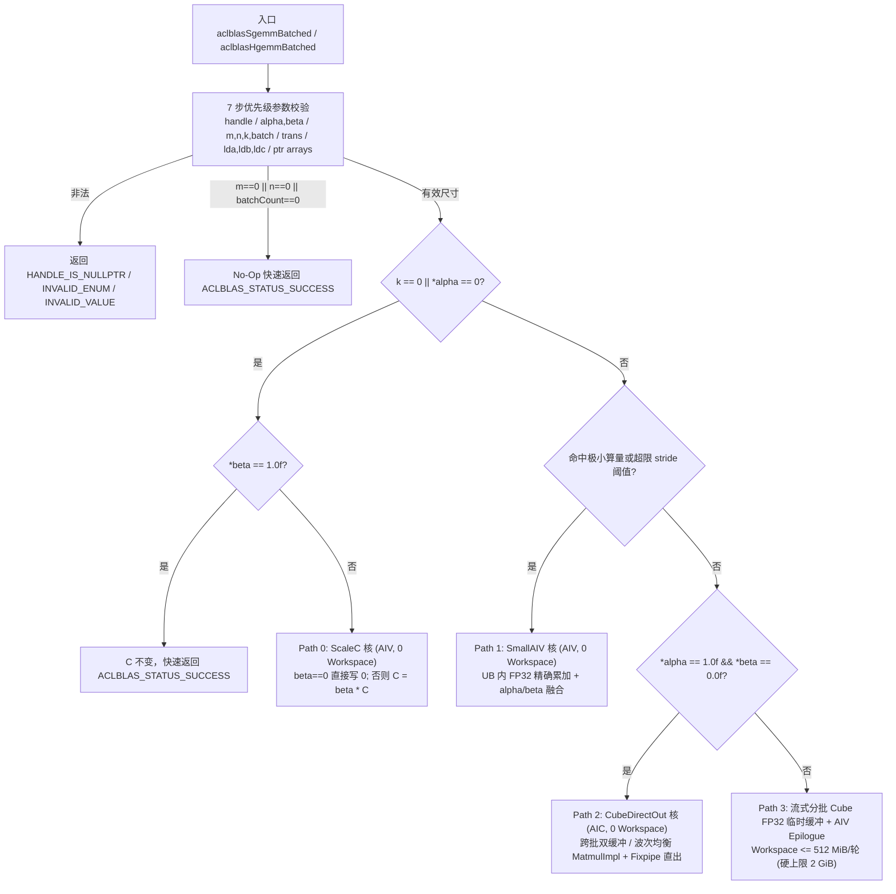

# 需求背景（required）

## 需求来源

基于昇腾算子开源仓社区任务需求，在 Atlas A2 / A3 系列产品（`DAV_2201` / `arch22`，含 Atlas 800T A2 910B3 与 Atlas 800T A3 910_93）上使用 Ascend C 编程语言并基于 `ops-blas` 开源仓工程，开发批量通用矩阵乘算子 `aclblasSgemmBatched`（FP32）与 `aclblasHgemmBatched`（FP16，`aclblasHalf`），分别对标 NVIDIA cuBLAS `cublasSgemmBatched` 与 `cublasHgemmBatched` 接口，完成设计、开发、测试全流程工作，验收通过后合入 `cann/ops-blas` 开源仓。

- **任务名称**：`11-aclblasSgemmBatched-HgemmBatched-A2A3`（社区任务 2026 算子开发）
- **目标代码仓**：https://gitcode.com/cann/ops-blas
- **实现代码目标路径**：`blas/gemm_batched/arch22/`
- **测试代码目标路径**：`test/gemm_batched/sgemm_batched/arch22/`（S/H 复用同一 GTest 测试工程，按 `op` 列分派）
- **公共头文件声明**：`include/cann_ops_blas.h`（`aclblasSgemmBatched` 与 `aclblasHgemmBatched` 声明已存在，无需修改）
- **算子文档说明**：`blas/gemm_batched/README.md`

## 背景介绍

### aclblasSgemmBatched / aclblasHgemmBatched 算子实现优化

批量通用矩阵乘（Batched GEMM）是 BLAS Level 3 的核心算子之一，广泛用于多头注意力批量投影、中小矩阵并发计算、科学计算与物理仿真中大量独立小矩阵或中等规模矩阵的同时求解。对于 `batchCount` 个相互独立的矩阵三元组 $(A[i], B[i], C[i])$，算子统一执行列主序原地更新：

$$C[i] = \alpha \cdot \mathrm{op}(A[i]) \cdot \mathrm{op}(B[i]) + \beta \cdot C[i], \qquad i = 0, 1, \dots, \text{batchCount} - 1$$

相比单矩阵多次循环下发，Batched 接口通过 Device 二级指针数组 `Aarray[]`、`Barray[]`、`Carray[]` 在一次 Kernel 启动内协同调度全批次计算，显著摊薄 Host 下发开销，并充分提升 Cube（AIC）与 Vector（AIV）硬件核利用率。

在 Atlas A2 / A3（`DAV_2201` / `arch22`，单核 L1 = 512 KiB、L0A/L0B = 64 KiB、L0C = 128 KiB、UB = 192 KiB，AIC:AIV = 1:2）硬件上：
1. **FP16（`aclblasHgemmBatched`）**：充分利用 `DAV_2201` Cube `half × half -> float`（`16×16×16`/cycle）高吞吐指令与 FP32 L0C 累加器，并在 `alpha == 1 && beta == 0` 主流场景利用 `FixpipeParamsV220`（`QuantMode_t::F322F16` + `nz2ndEn = true`）实现 **0 Workspace、单次 AIC Kernel 直写 `half` 输出**；
2. **FP32（`aclblasSgemmBatched`）**：启用 `HF32Mode::DISABLE` 的原生 `float × float -> float` Cube `Mmad`（`16×16×4`/cycle，$k_0 = 8$）直接累加至 FP32 L0C，确保严格满足单精度 `2^-13` 混合容差；
3. **高低两端全覆盖**：针对测试集覆盖的极小高频批次（如 `1×1×1, bc=65536`、`8×8×8`）与大计算量矩阵（如 `4096³`、`2049×2047×1023`），结合小算量 AIV 直算核、跨批 L1 双缓冲轻 Cube 核与波次均衡 `MatmulImpl` 持久网格核，确保全尺寸性能与精度双达标。

### aclblasSgemmBatched / aclblasHgemmBatched 算子 ops-blas 现有实现现状分析

对 `cann/ops-blas` 仓内现状核查结果如下：
1. **`arch35`（Ascend 950PR）已有参考实现**：仓内 `blas/gemm_batched/arch35/gemm_batched_host.cpp`（S）与 `hgemmBatched_host.cpp`（H）已实现完整的参数校验顺序、列主序转置映射、波次均衡拆分与 `halfout` 零 Workspace 直出路径；但其 Kernel 依赖 `DAV_3510` 专属 `tensor_api`（`AscendC::Te`）与 SIMT 接口，在 `arch22`（`DAV_2201`）上不可编译运行。
2. **`arch22`（Atlas A2/A3）现状**：`blas/gemm_batched/arch22/` 目录下当前仅有复数算子 `aclblasCgemmBatched` 的实现（`cgemm_batched_*`），**尚缺失 `aclblasSgemmBatched` 与 `aclblasHgemmBatched` 的 `arch22` 实现**；同时 `test/gemm_batched/sgemm_batched/CMakeLists.txt` 尚未注册 `arch22` 测试目标。
3. **同代际技术验证锚点**：仓内 `blas/gemm_batched/arch22/cgemm_batched_*` 与 `blas/gemm_ex/arch22/gemm_ex_matmul_kernel.cpp` 已充分验证了 `DAV_2201` 下基于 `MatmulImpl`（`HF32Mode::DISABLE`）+ `Fixpipe` `nz2ndEn` 的列主序零转置映射、单 `mm.End()` 持久循环及 `DataCopyPad` 精确尾块写回范式，本设计可直接继承上述经验证的硬件通道并针对实数 S/H 批量场景进行深度重构与特化。

### aclblasSgemmBatched / aclblasHgemmBatched 算子功能分析

两个算子均采用句柄式 BLAS C 接口，通过 `aclblasHandle_t` 绑定的 stream 异步执行。
- **计算公式**：$C[i] = \alpha \cdot \mathrm{op}(A[i]) \cdot \mathrm{op}(B[i]) + \beta \cdot C[i]$（$i \in [0, \text{batchCount})$）；
- **转置与对称约束**：`transa, transb ∈ {ACLBLAS_OP_N, ACLBLAS_OP_T, ACLBLAS_OP_C}`；由于是实数算子，`ACLBLAS_OP_C` 与 `ACLBLAS_OP_T` 完全等价（不做共轭）；
- **列主序与独立性**：`op(A[i])` 为 $m \times k$，`op(B[i])` 为 $k \times n$，$C[i]$ 为 $m \times n$，各自按 `lda / ldb / ldc` 列主序存储；各 batch 地址通过 Device 指针数组独立给定，互不广播，且 $C[i]$ 之间及 $C[i]$ 与任意 $A[j]/B[j]$ 不得重叠；
- **退化与零维保护**：
  - `m == 0 || n == 0 || batchCount == 0`：合法 no-op，直接返回 `ACLBLAS_STATUS_SUCCESS`，不解引用设备指针数组；
  - `k == 0 || *alpha == 0`：不引用 `Aarray/Barray`；若 `*beta == 1` 则直接成功返回，否则仅对逻辑 $m \times n$ 区域执行 $C[i] = \beta \cdot C[i]$；
  - `*beta == 0`：严禁读取 $C[i]$ 旧值（防止旧 `C` 中存在 `NaN/Inf` 时通过 `0 * NaN` 污染输出），同时严格保护 `ldc > m` 的列间 padding 不被改写。

参数说明如下表（其中 S 指 `aclblasSgemmBatched`、`FLOAT32`；H 指 `aclblasHgemmBatched`、`FLOAT16` / `aclblasHalf`）：

| 参数 | 参数含义 | 数据类型 | 支持数据类型 | 约束条件 | 形状 (Shape) |
| :--- | :--- | :--- | :--- | :--- | :--- |
| `handle` | 算子上下文句柄 | `aclblasHandle_t` | 指针 | 非空，携带有效 stream | - |
| `transa` | $\mathrm{op}(A[i])$ 操作类型 | `aclblasOperation_t` | 枚举 | `ACLBLAS_OP_N` / `ACLBLAS_OP_T` / `ACLBLAS_OP_C` | - |
| `transb` | $\mathrm{op}(B[i])$ 操作类型 | `aclblasOperation_t` | 枚举 | `ACLBLAS_OP_N` / `ACLBLAS_OP_T` / `ACLBLAS_OP_C` | - |
| `m` | $\mathrm{op}(A[i])$ 与 $C[i]$ 行数 | `int` | 整型 | $m \ge 0$；$m = 0$ 为合法 no-op | - |
| `n` | $\mathrm{op}(B[i])$ 与 $C[i]$ 列数 | `int` | 整型 | $n \ge 0$；$n = 0$ 为合法 no-op | - |
| `k` | $\mathrm{op}(A[i])$ 列数与 $\mathrm{op}(B[i])$ 行数 | `int` | 整型 | $k \ge 0$；$k = 0$ 仅缩放 $C$ | - |
| `alpha` | 标量乘数 $\alpha$（Host 内存） | `const T*` | S: `FLOAT32` / H: `FLOAT16` | 非空指针 | - |
| `Aarray` | $A$ 矩阵 Device 指针数组 | `const T* const[]` | S: `FLOAT32` / H: `FLOAT16` | `batchCount>0 && m>0 && n>0 && k>0 && alpha≠0` 时非空 | 长度 `batchCount`，元素指向 $lda \times k$（N）或 $lda \times m$（T/C） |
| `lda` | $A[i]$ 前导维度 | `int` | 整型 | `OP_N`: $lda \ge \max(1, m)$；`OP_T/C`: $lda \ge \max(1, k)$ | - |
| `Barray` | $B$ 矩阵 Device 指针数组 | `const T* const[]` | S: `FLOAT32` / H: `FLOAT16` | `batchCount>0 && m>0 && n>0 && k>0 && alpha≠0` 时非空 | 长度 `batchCount`，元素指向 $ldb \times n$（N）或 $ldb \times k$（T/C） |
| `ldb` | $B[i]$ 前导维度 | `int` | 整型 | `OP_N`: $ldb \ge \max(1, k)$；`OP_T/C`: $ldb \ge \max(1, n)$ | - |
| `beta` | 标量乘数 $\beta$（Host 内存） | `const T*` | S: `FLOAT32` / H: `FLOAT16` | 非空指针；$\beta=0$ 不读 $C$ 旧值 | - |
| `Carray` | $C$ 矩阵 Device 指针数组（原地输出） | `T* const[]` | S: `FLOAT32` / H: `FLOAT16` | `batchCount>0 && m>0 && n>0` 时非空；元素指向互不重叠 | 长度 `batchCount`，元素指向 $ldc \times n$（逻辑 $m \times n$） |
| `ldc` | $C[i]$ 前导维度 | `int` | 整型 | $ldc \ge \max(1, m)$ | - |
| `batchCount` | 批次数 | `int` | 整型 | $\text{batchCount} \ge 0$；$0$ 为合法 no-op | - |

---

# 需求分析（required）

## 需求描述

使用 Ascend C 编程语言在 Atlas A2 / A3（`DAV_2201` / `arch22`）平台上实现 `aclblasSgemmBatched` 与 `aclblasHgemmBatched` 算子：
1. 复用 `include/cann_ops_blas.h` 既有公开声明，在 `blas/gemm_batched/arch22/` 下补齐 `arch22` Host 校验、Tiling 规划与 Device Kernel 实现；
2. 全面支持 `transa × transb` 共 9 种转置组合、任意合法非对齐形状、前导维度 padding（`lda / ldb / ldc`）、任意规模 `batchCount`（含高频小矩阵 `1×1×1, bc=65536` 与立方大矩阵 `4096³`）、Host 标量 `alpha / beta` 及退化边界语义；
3. 精度满足生态算子开源精度标准（S 按 `FLOAT32` 阈值 `rtol=atol=2^-13`，H 按 `FLOAT16` 阈值 `rtol=atol=2^-10`，`matched_ratio >= 0.99`），全量测试用例 100% PASS；
4. 性能达到或超过 NVIDIA GPU 标杆 `gpu_ms` 的 `0.8×`（以 `msprof op` 真实采集的 `Task Duration(us)` 为正式判据，同时满足 GTest `[PERF] avg_us` 交叉验证）；
5. 完善 `test/gemm_batched/sgemm_batched/arch22/` 与 `CMakeLists.txt` 测试集成，保证单算子编译与验收脚本开箱可用。

## 需求拆解

1. **接口校验与边界状态机**：在 Host 入口严格遵循 `handle -> alpha/beta -> m/n/k/batchCount -> transa/transb -> lda/ldb/ldc -> quick return / 数组基指针条件非空校验` 顺序，确保非法枚举优先返回 `ACLBLAS_STATUS_INVALID_ENUM`，且 `m=0/n=0/batchCount=0`、`k=0/alpha=0` 条件正确放行或短路。
2. **列主序零转置映射**：基于 $C_b^T = \mathrm{op}(B_b)^T \cdot \mathrm{op}(A_b)^T$ 将列主序问题无损转化为行主序 Cube 计算（左矩阵 $B_b$、右矩阵 $A_b$），通过 `SetOrgShape` 5 参数精确表达 `lda/ldb/ldc`，消除全局矩阵显式转置。
3. **四路径自适应执行架构（S/H 共享框架 + dtype 特化）**：
   - **Path 0（`ScaleC` 退化核）**：处理 `k == 0 || *alpha == 0`（且 `*beta != 1`），纯 AIV 单次启动、0 Workspace 完成逐批清零或缩放；
   - **Path 1（`SmallAIV` 极小算量核）**：针对高频极小矩阵（如 `1×1×1`、`8×8×8`、`16×16×16` 及超长 stride 特殊形状），纯 AIV 在 UB 内升至 FP32 累加融合 `alpha/beta`，压低启动延迟并严格保证 `Inf/NaN` IEEE-754 语义；
   - **Path 2（`CubeDirectOut` 零 Workspace 主力快路，`alpha == 1 && beta == 0`）**：
     - 高批次数中小矩阵采用跨批 L1 双缓冲轻 Cube 核，末尾余批自动做 `2×2` 子块均衡切分；
     - 中大尺寸采用波次均衡 `MatmulImpl` 持久循环核（H 使用 `half` 输入 + `F322F16` Fixpipe 直出；S 使用原生 `float` `HF32Mode::DISABLE` + Fixpipe 直出），仅在核函数退出前调用一次 `mm.End()`；
   - **Path 3（`CubeFp32Ws + AivEpilogue` 通用路径，`alpha != 1 || beta != 0`）**：Cube 产出对齐 FP32 临时结果至受 `512 MiB` 流式分批（硬上限 `< 2 GiB`）管控的 Workspace，再由 AIV 在 FP32 域精确融合 $\alpha \cdot P + \beta \cdot C_{\text{old}}$ 并按需要 RNE 收窄写回。
4. **测试与工程对接**：补充 `test/gemm_batched/sgemm_batched/arch22/`（S/H 共用测试驱动，解析 `op`、`alpha/beta`、padding 哨兵、`[PERF] avg_us` 与 `msprof op` 循环控制），并在 `test/gemm_batched/sgemm_batched/CMakeLists.txt` 及 `blas/CMakeLists.txt` 接入构建。

---

# 详细设计（required）

## 算子分析

### 数学公式

对每个独立 batch $b \in [0, \text{batchCount})$，按列主序计算 $C_b \in \mathbb{R}^{m \times n}$：

$$C_b[i + j \cdot ldc] \leftarrow \alpha \sum_{p=0}^{k-1} \mathrm{op}(A_b)[i, p] \cdot \mathrm{op}(B_b)[p, j] + \beta \cdot C_b[i + j \cdot ldc], \qquad i \in [0, m),\; j \in [0, n)$$

其中实数域下 `ACLBLAS_OP_C` 与 `ACLBLAS_OP_T` 等价（无共轭）。

#### 列主序到行主序的零转置等价映射

Ascend C `MatmulImpl` 与 `Fixpipe` 默认按行主序（Row-Major）组织矩阵坐标。利用矩阵转置恒等式：

$$C_b^T = \alpha \cdot \mathrm{op}(B_b)^T \cdot \mathrm{op}(A_b)^T + \beta \cdot C_b^T$$

将列主序 $m \times n$ 矩阵 $C_b$ 直接视作物理布局完全一致的行主序 $n \times m$ 矩阵 $C_b^T$（行步长 `ldc`），并在 Cube 内部交换左右操作数（左矩阵 $L = \mathrm{op}(B_b)^T \in \mathbb{R}^{n \times k}$，右矩阵 $R = \mathrm{op}(A_b)^T \in \mathbb{R}^{k \times m}$）：

| 公开接口参数 | 列主序物理存储 | 等价行主序视图 | Cube 内部角色与逻辑维度 | `SetOrgShape` 参数 | 内部转置标志 |
| :--- | :--- | :--- | :--- | :--- | :---: |
| `transb == OP_N` | $B_b$: $k \times n$（`ldb`） | $[n, k]$，行距 `ldb` | 左矩阵 $L$: $[M_{\text{in}}=n, K_{\text{in}}=k]$ | `orgM = n, orgKa = ldb` | `LeftTrans = false` |
| `transb ∈ {OP_T, OP_C}` | $B_b$: $n \times k$（`ldb`） | $[k, n]$，行距 `ldb` | 左矩阵 $L$: $[M_{\text{in}}=n, K_{\text{in}}=k]$ | `orgM = ldb, orgKa = k` | `LeftTrans = true` |
| `transa == OP_N` | $A_b$: $m \times k$（`lda`） | $[k, m]$，行距 `lda` | 右矩阵 $R$: $[K_{\text{in}}=k, N_{\text{in}}=m]$ | `orgN = lda, orgKb = k` | `RightTrans = false` |
| `transa ∈ {OP_T, OP_C}` | $A_b$: $k \times m$（`lda`） | $[m, k]$，行距 `lda` | 右矩阵 $R$: $[K_{\text{in}}=k, N_{\text{in}}=m]$ | `orgN = m, orgKb = lda` | `RightTrans = true` |
| 输出 $C_b$（快路直出） | $C_b$: $m \times n$（`ldc`） | $[n, m]$，行距 `ldc` | 输出 $D$: $[M_{\text{in}}=n, N_{\text{in}}=m]$ | `orgKc = ldc` | — |
| 临时 $P_b$（Path 3） | $P_b$: $p_m \times n$（`pm`） | $[n, p_m]$，行距 `pm` | 临时 FP32: $[M_{\text{in}}=n, N_{\text{in}}=m]$ | `orgKc = pm`（`Align16(m)`） | — |

该映射使 Cube `Fixpipe` 输出的行主序结果与接口要求的列主序 $C_b$ 逐字节同构，**全程零显式转置**。

### 支持数据类型

| 算子接口 | `A / B` dtype | `C` dtype | `alpha / beta` dtype | Cube L0C 累加精度 | Epilogue / 输出舍入 |
| :--- | :--- | :--- | :--- | :--- | :--- |
| **`aclblasSgemmBatched`** | `FLOAT32` (`float`) | `FLOAT32` (`float`) | `FLOAT32` (`const float*`) | `FLOAT32`（`HF32Mode::DISABLE`，原生 FP32 `Mmad`） | FP32 原位计算与写出 |
| **`aclblasHgemmBatched`** | `FLOAT16` (`aclblasHalf`) | `FLOAT16` (`aclblasHalf`) | `FLOAT16` (`const aclblasHalf*`) | `FLOAT32`（`half × half -> float`） | 快路 `Fixpipe` `F322F16`；通用路 FP32 融合后 `CAST_RINT` (RNE) |

### 支持形状

- 任意合法非负维度 $m \ge 0, n \ge 0, k \ge 0, \text{batchCount} \ge 0$；
- 前导维度约束：`transa == N` 时 $lda \ge \max(1, m)$，否则 $lda \ge \max(1, k)$；`transb == N` 时 $ldb \ge \max(1, k)$，否则 $ldb \ge \max(1, n)$；$ldc \ge \max(1, m)$；
- 全面支持奇数、质数、极长条及带 padding（`lda / ldb / ldc` 大于最小下界）矩阵；不支持任意非列主序步长、广播或视图切片。

---

## 算子实现

### 实现方案

#### 整体调度与四路径分发流程

#### 3.2.1 host侧设计：

##### tiling策略：
Host 侧通过 `GetAicCoreCount()` 与 `GetAivCoreCount()` 运行时动态查询当前 A2 / A3 物理核心数（返回 0 则报 `ACLBLAS_STATUS_INTERNAL_ERROR`），严禁硬编码核数。全部 Tiling 参数封装为标准布局（`std::is_standard_layout`）POD 结构体（含 `ScaleTiling`、`SmallAivTiling`、`CubeTiling`、`EpilogueTiling`），通过 `aclrtLaunchKernelWithHostArgs` 随 Host 参数块零拷贝下发，避免 `<<<>>>` 裸调用无法捕获启动错误的问题。

##### 任务均分：
- **Path 0（`ScaleC`）**：将 `(batchCount, n)` 展平为一维列任务池 $T = \text{batchCount} \times n$（当单列极短如 $m \le 64$ 时按多列打包均分），启动 `min(aivCores, T)` 核；
- **Path 1（`SmallAIV`）**：按 `batchCount`（若 `batchCount < aivCores` 则展开为 `(batchIdx, colTile)`）均分至 `min(aivCores, totalSmallTasks)` 核；
- **Path 2 / Path 3（Cube 路径）**：
  - 总工作块数 $T = \text{batchCount} \times \lceil n / \text{tileHeight} \rceil \times \lceil m / \text{tileWidth} \rceil$，启动 `min(aicCores, T)` 个 AIC 核执行持久化网格步进循环 `for (t = blockIdx; t < T; t += blockNum)`；
  - 对高批次数中小矩阵（$m, n, k \le 128$ 且 $\text{batchCount} \ge \text{aicCores}$），整波次批次 `bulkBatches = (batchCount / aicCores) * aicCores` 按单核整批处理，末尾 `batchCount % aicCores` 个剩余批次自动切分为 `2×2` 子块均摊至所有 AIC 核，消除尾波长尾闲置。

##### 批量搬运：
- **Pointer Array 读取**：`Aarray`、`Barray`、`Carray` 位于 Device 侧，Kernel 内部通过 `GlobalTensor<uint64_t>` 直接读取对应 batch 的矩阵基址，避免额外的指针数组 H2D/D2H 拷贝；
- **Matrix `A/B` 搬运**：Cube 路径利用 `MatmulType<GM, ND, T>` 在 L1 内自动完成 `Nd2Nz` 批量搬运与双向零填充（开启 `intrinsicsCheck = true` 兼容超长前导维）；AIV 路径采用 `DataCopyPad` 按列精准字节搬运；
- **Matrix `C` 写回**：快路 `Fixpipe` 设置 `nz2ndEn = true` 批量将局部 Tile 写回至 $C_b$ 的精确 `[m, n]` 逻辑域，严格保护 `ldc > m` 的列间 padding。

##### 1. 分核策略：
遵循“波次均衡、最大化满核”原则：
- 在 20-AIC / 24-AIC 硬件上，单一固定分块极易产生尾波空转（如 `512×512×512, b=8` 在 `256×256` 下产生 32 块，20 核跑 2 波有 8 核闲置）。Host 侧 `SelectCubeVariant` 在候选块集合中按总波次与单波代价最小化自动选型：
  $$\text{Cost}(H, W) = \left\lceil \frac{\text{batchCount} \cdot \lceil n/H \rceil \cdot \lceil m/W \rceil}{\text{aicCores}} \right\rceil \times \max\!\left(T_{\text{mmad}}(H, W, k),\; T_{\text{mte2}}(H, W, k)\right)$$
- **L2 局部性调度**：多批次中矩阵优先按批连续编号使同批各核在 `192 MiB` 共享 L2 内复用 $A_b, B_b$；单批超大矩阵（如 `4096³`、`8192³`）启用 `GROUP_M = 8` 二维蛇形 Swizzle 提升 L2 命中率。

##### 2. 数据分块和内存优化策略：
严格遵守 Atlas A2 / A3（`DAV_2201`）物理内存上限（L1 = `512 KiB`，L0A = `64 KiB`，L0B = `64 KiB`，L0C = `128 KiB`，UB = `192 KiB`）：

- **Cube 片上缓存分配（H 与 S 按元素字节数自适应调整 `baseK`）**：
  - **H (`FLOAT16`, 2B)**：主力模板 `128×256`（`baseK = 64`）：`L0A` 双缓冲 $128 \times 64 \times 2\text{ B} \times 2 = 32\text{ KiB}$，`L0B` 双缓冲 $64 \times 256 \times 2\text{ B} \times 2 = 64\text{ KiB}$，`L0C` $128 \times 256 \times 4\text{ B} = 128\text{ KiB}$，`L1` 双缓冲 `192 KiB <= 512 KiB`；
  - **S (`FLOAT32`, 4B)**：主力模板 `128×128` / `64×128`（`baseK = 32`，4B 双缓冲）：`L0A` 双缓冲 $128 \times 32 \times 4\text{ B} \times 2 = 32\text{ KiB}$，`L0B` 双缓冲 $32 \times 128 \times 4\text{ B} \times 2 = 32\text{ KiB}$，`L0C` $128 \times 128 \times 4\text{ B} = 64\text{ KiB}$，`L1` 双缓冲 `<= 256 KiB <= 512 KiB`。
- **AIV UB 统一单池化防重叠（规避 `DAV_2201` `TBuf.Get()` 重叠陷阱）**：
  - `ScaleC`、`SmallAIV`、`Epilogue` 均在 `Init()` 阶段仅向 `TPipe` 申请一整段连续 `TBuf<TPosition::VECCALC>` 内存池，子缓冲按 `256 B` 对齐静态切分并通过 `static_assert` 校验总额 $\le 196,608\text{ B}$（`ScaleC`: `96 KiB`、`SmallAIV`: `36 KiB`、`Epilogue`: `160 KiB`）。
- **全局显存 Workspace 硬上限管控**：
  - **Path 0 / Path 1 / Path 2**：**`0 Bytes`**；
  - **Path 3**：临时 FP32 乘积区按行对齐 `pm = AlignUp(m, 16)`，单批字节 $S_{\text{batch}} = \text{Align}_{512\text{B}}(n \cdot p_m \cdot 4\text{ B})$；采用 `uint64_t` 溢出检查 `CheckedMulU64`，单轮目标上限 $512\text{ MiB}$，计算流式批次数 `batchChunk = min(batchCount, floor(W_cap / S_batch))`，严格遵守 `ACLBLAS_MAX_WORKSPACE_SIZE = 2 GiB` 硬上限，超限则返回 `ACLBLAS_STATUS_ALLOC_FAILED`。

##### 3. tilingkey规划策略：

通过运行期枚举（`dtype` $\times$ `pathId` $\times$ `variant`）分派核函数模板：

| 路径 / Variant 标识 | 适用算子 | 触发条件 | 核心实现特征 |
| :--- | :--- | :--- | :--- |
| `Path 0` (`ScaleC`) | S / H | `k == 0 || *alpha == 0`（`*beta != 1`） | 纯 AIV 核，0 WS；`beta == 0` 零读直接写 `0` |
| `Path 1` (`SmallAIV`) | S / H | 极小算量（如 `m,n,k <= 32` 且 FLOPs 达标） | 纯 AIV 核，0 WS；UB 内 FP32 累加 + `alpha/beta` 融合 |
| `Path 2` (`SINGLE_DB_64/128`) | S / H | `alpha == 1 && beta == 0` 且高批次中小矩阵 | 单块跨批 L1 双缓冲 + 尾波 `2×2` 切分，0 WS |
| `Path 2` (`MM_64x64..256x128`) | S / H | `alpha == 1 && beta == 0` 中大矩阵 | 波次均衡 `MatmulImpl` 持久循环 + `Fixpipe` 直出，0 WS |
| `Path 3` (`CubeFP32 + Epilogue`) | S / H | `*alpha != 1 || *beta != 0` 中大矩阵 | 流式 `batchChunk` Cube FP32 暂存 + AIV 缩放累加与 RNE 收窄 |

##### 数据检测：
严格按任务书 §2.4 与 §2.5 优先级在 Host 侧逐项校验：
1. `handle == nullptr` $\to$ `ACLBLAS_STATUS_HANDLE_IS_NULLPTR`；
2. `alpha == nullptr || beta == nullptr` $\to$ `ACLBLAS_STATUS_INVALID_VALUE`；
3. `m < 0 || n < 0 || k < 0 || batchCount < 0` $\to$ `ACLBLAS_STATUS_INVALID_VALUE`；
4. `transa` 或 `transb` 不在 `{ACLBLAS_OP_N, ACLBLAS_OP_T, ACLBLAS_OP_C}` $\to$ `ACLBLAS_STATUS_INVALID_ENUM`；
5. `lda < max(1, transa==N ? m : k)` 或 `ldb < max(1, transb==N ? k : n)` 或 `ldc < max(1, m)` $\to$ `ACLBLAS_STATUS_INVALID_VALUE`；
6. 当 `batchCount > 0 && m > 0 && n > 0` 时：若 `Carray == nullptr`，返回 `ACLBLAS_STATUS_INVALID_VALUE`；若 `k > 0 && *alpha != 0` 且（`Aarray == nullptr || Barray == nullptr`），返回 `ACLBLAS_STATUS_INVALID_VALUE`；
7. 合法快速返回：结构校验通过后，若 `m == 0 || n == 0 || batchCount == 0` 直接返回 `ACLBLAS_STATUS_SUCCESS`（不解引用指针数组）；若 `k == 0 || *alpha == 0` 且 `*beta == 1`，直接返回 `ACLBLAS_STATUS_SUCCESS`。

#### 3.2.2 kernel侧设计：

Kernel 侧按初始化（`Init`）与处理流水（`Process`：`CopyIn -> Compute -> CopyOut`）设计：
1. **Path 0（`ScaleC` AIV Kernel）**：
   - `beta == 0` 时一次 `Duplicate(0)` 填充 UB 零缓冲，仅发起 MTE3 `DataCopyPad` 写回有效 `m * sizeof(T)` 字节，绝不读旧 `C`；
   - `beta != 0` 时双缓冲 `DataCopyPad` 读入列片段 $\to$ （H 路径 `Cast` 升 FP32）$\to$ `Muls(beta)` $\to$ （H 路径 `CAST_RINT` 转回 FP16）$\to$ 写回。
2. **Path 1（`SmallAIV` AIV Kernel）**：
   - 从 `Aarray[b]` / `Barray[b]` 读入小矩阵至 UB，非对齐尾元素在有效 `k` 范围外严格隔离；
   - 在 UB 内以纯 FP32 向量指令按 `p ∈ [0, k)` 累加外积至 `accFp32`；融合 `alpha * acc + beta * C_old`（`beta == 0` 不读旧 `C`）；经 `DataCopyPad` 精确写回 $m$ 行。
3. **Path 2（`CubeDirectOut` AIC Kernel）**：
   - 核内仅构造一次 `MatmulImpl` 实例（针对 S 配置 `HF32Mode::DISABLE` 原生 FP32；针对 H 配置 `half -> float -> F322F16`），在持久循环中通过 `SetOrgShape` + `SetSingleShape` + `SetTensorA/B` 动态切换当前 `(batch, rowTile, colTile)` 并执行 `IterateAll(cGm)`；
   - `Fixpipe` 自动完成 `NZ2ND` 及高精度/半精度输出转换，按精确逻辑宽度 $m$ 与步长 $ldc$ 直写 `Carray[b]`，全程不触碰 `ldc` padding；循环全部结束后统一调用一次 `mm.End()`。
4. **Path 3（`CubeFP32 + Epilogue` 双核流水）**：
   - Stage 1（AIC）：将 `op(A[b]) * op(B[b])` 的 FP32 L0C 累加结果输出至紧凑对齐的 `temp[localB, n, pm]` 缓冲；
   - Stage 2（AIV）：40/48 个 AIV 核按 `(localBatch, colChunk)` 双缓冲流式读取 `temp`（仅 `beta != 0` 时按 `DataCopyPad` 读入原 $C_b$），在 FP32 域执行 `alpha * P + beta * C_old`，H 变体执行一次 `Cast(..., CAST_RINT)`，精确写回 $C_b$。

---

## 支持硬件

| 支持的芯片版本 | 涉及勾选 | 说明 |
| :--- | :---: | :--- |
| **Atlas A2 训练/推理系列产品（910B3，`DAV_2201` / `arch22`）** | **√** | 性能测试基准平台（20/24 AIC，40/48 AIV，UB 192 KiB） |
| **Atlas A3 训练/推理系列产品（910_93，`DAV_2201` / `arch22`）** | **√** | 同微架构兼容支持，核数运行时动态查询 |
| Ascend 950PR / 950DT（`arch35`） | × | 仓内已存在独立 `arch35` 实现，本任务不改动 |

---

## 算子约束限制

1. **存储与布局**：所有矩阵采用列主序带前导维存储（`lda / ldb / ldc` 须满足对应下界）；不支持非连续任意跨步、广播及视图语义；
2. **指针与内存安全**：`alpha`、`beta` 为 Host 侧标量指针；`Aarray`、`Barray`、`Carray` 本身及其中指针元素须为有效 Device 地址；$C[i]$ 之间互不重叠且不与任意 $A[j]/B[j]$ 重叠；
3. **显存 Workspace 约束**：快路（Path 0/1/2）Workspace 为 `0 B`；Path 3 受 Handle 全局 `ACLBLAS_MAX_WORKSPACE_SIZE = 2 GiB` 硬上限管控，超出则返回 `ACLBLAS_STATUS_ALLOC_FAILED`；
4. **确定性声明**：核间调度与 K 维归约顺序由形状和片上容量决定，不引入非确定性跨核原子累加，满足任务书精度标准判定。

---

# 可维可测分析

## 精度标准/性能标准

| 验收标准 | 描述 (不涉及说明原因) | 标准来源 |
| :--- | :--- | :--- |
| **精度标准** | 1. **`aclblasSgemmBatched`**：CPU Golden 由 Netlib BLAS `cblas_sgemm`（3.10.0）生成；按 `FLOAT32` 混合容差判定：`rtol = atol = 2^-13`，`required_matched_ratio >= 0.99`，`max_abs_error <= max(1e-2, 32 * ULP)`； 2. **`aclblasHgemmBatched`**：CPU Golden 按 `float64` 累加后收窄至 `FP32` 再按 IEEE RNE 收窄至 `FP16`；按 `FLOAT16` 混合容差判定：`rtol = atol = 2^-10`，`required_matched_ratio >= 0.99`，`max_abs_error <= max(1e-1, 32 * ULP)`； 3. 覆盖全量 **1,000 条**精度用例（S 500 条 + H 500 条，含特殊值 `Inf/NaN`、次正规数、`ldc` padding 哨兵与负向枚举），达成 **100% PASS (0 FAIL / 0 SKIP)**。 | 任务书 §3.2 及生态算子开源精度标准 |
| **性能标准** | 1. 测试设备：Atlas 800T A2（910B3），全量 **200 条**性能用例（S 100 条 + H 100 条）； 2. 正式判据（Kernel-to-Kernel）：由 `msprof op` 采集 `Task Duration(us)`（warmup 5 次后连续 10 次有效采样取平均），要求单 case 耗时 $\le 1.25 \times \text{gpu\_ms}$（即 **$\ge 0.8\times$ GPU 基线**）； 3. 交叉验证：同步输出 GTest `[PERF] case=... avg_us=...` 供 `verify_performance.py` 校验，且实测显存 **0 泄漏**。 | 任务书 §3.3 性能验收判据 |

## 兼容性分析

1. **接口与头文件兼容**：`include/cann_ops_blas.h` 已包含 `aclblasSgemmBatched` 与 `aclblasHgemmBatched` 声明，本实现 100% 保持既有签名与 ABI，不修改公共头文件；
2. **源码与跨架构隔离**：实现文件全数置于 `blas/gemm_batched/arch22/`，测试文件置于 `test/gemm_batched/sgemm_batched/arch22/`，不改动 `arch35` 及现有 `cgemm_batched` 逻辑；
3. **硬件型号泛化**：通过运行时 `GetAicCoreCount()` 与 `GetAivCoreCount()` 自适应调度，同时兼容 Atlas A2（20/24 AIC）与 Atlas A3 系列产品。
