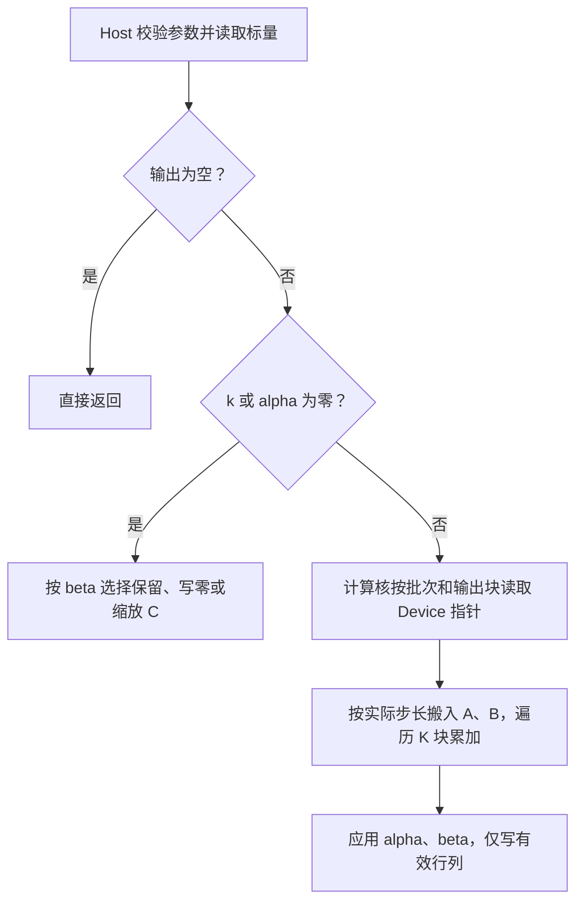

# 需求背景（required）

## 需求来源

为 Atlas A2/A3 增加 ops-blas 的单精度和半精度批量矩阵乘。调用方在同一个 stream 上提交一组形状相同、设备地址各自独立的矩阵，典型用途是将多个小矩阵乘合并下发。[昇腾社区任务](https://www.hiascend.com/activities/task-center/details/55123ab3caa64d089f525f646155094c) · [原始任务书与用例](https://www.hiascend.com/p/resource/202611/50d7f6f055c948219f697c99ae5b0367.zip)

## 仓库现状

上游版本 `55ef791b77f3677b45da3468b0a8b17941424f84` 已声明两个入口。arch35 提供 FP32 和 FP16 的 Host 与 Kernel 实现，arch22 的同族目录仅有复数实现。arch22 的 grouped SGEMM 提供了在 Cube 上按列主序解释输入的参考，其地址包和分组接口与本题的 Device 指针数组有区别。[公开声明](https://gitcode.com/cann/ops-blas/blob/55ef791b77f3677b45da3468b0a8b17941424f84/include/cann_ops_blas.h) · [批量 GEMM 源码](https://gitcode.com/cann/ops-blas/tree/55ef791b77f3677b45da3468b0a8b17941424f84/blas/gemm_batched) · [arch22 grouped SGEMM](https://gitcode.com/cann/ops-blas/tree/55ef791b77f3677b45da3468b0a8b17941424f84/blas/gemm_grouped_batched/arch22)

## 标杆计算流程

比较对象是 cuBLAS 的两个批量接口。下图表示其公开的数学语义。输入类型、布局和各批次独立的指针来自 cuBLAS 文档，点积与缩放的单精度参考可以对照 Netlib 的 `sgemm.f`。GPU 内部分块和指令调度由具体库版本选择。[cuBLAS 批量 GEMM](https://docs.nvidia.com/cuda/cublas/index.html#cublas-t-gemmbatched) · [Netlib SGEMM](https://www.netlib.org/blas/sgemm.f)


本题固定 Host 标量模式，沿用 ops-blas 的空句柄和非法枚举状态码。内部工程依赖是 ops-blas 的 handle、stream 与 arch22 构建路径，运行依赖为 CANN 9.1.0，测试使用仓内 GTest/ATK。Netlib BLAS 用于 S 的独立参考，cuBLAS 对应附件中的 GPU 标杆。

# 需求分析（required）

对每个批次的逻辑元素 `(r,c)`，将 `alpha * sum(op(A)[r,p] * op(B)[p,c]) + beta * C[r,c]` 写回原 C。A、B、C 都按列主序存储。三个 Device 指针数组中相邻项的地址可以无规律，不能用第一项推导后续矩阵基址。

| 参数 | 调用约定 |
| --- | --- |
| `handle`, `transa`, `transb` | handle 给出下发 stream。两组转置各接受 N、T、C，实数的 C 与 T 的索引相同。 |
| `m, n, k, batchCount` | 均非负。逻辑矩阵形状为 A 的 m×k、B 的 k×n 和 C 的 m×n，此处 A/B 指转置之后的形状。 |
| `alpha, beta` | Host 标量指针。S 读 float，H 按 IEEE FP16 位模式解码 `aclblasHalf`，按浮点值判断零和一。 |
| `Aarray, lda` | Device 数组，元素为只读设备地址。N 时 lda ≥ max(1,m)，T/C 时 lda ≥ max(1,k)。 |
| `Barray, ldb` | Device 数组，元素为只读设备地址。N 时 ldb ≥ max(1,k)，T/C 时 ldb ≥ max(1,n)。 |
| `Carray, ldc` | Device 数组，元素为可写地址。ldc ≥ max(1,m)，仅修改每列前 m 项。C 之间及 C 与任意 A/B 的有效区域互不重叠，由调用方保证。 |

# 详细设计（required）

## 算子原型

```cpp
aclblasStatus_t aclblasSgemmBatched(
    aclblasHandle_t handle, aclblasOperation_t transa, aclblasOperation_t transb, int m, int n, int k,
    const float* alpha, const float* const Aarray[], int lda, const float* const Barray[], int ldb, const float* beta,
    float* const Carray[], int ldc, int batchCount);

aclblasStatus_t aclblasHgemmBatched(
    aclblasHandle_t handle, aclblasOperation_t transa, aclblasOperation_t transb, int m, int n, int k,
    const aclblasHalf* alpha, const aclblasHalf* const Aarray[], int lda, const aclblasHalf* const Barray[], int ldb,
    const aclblasHalf* beta, aclblasHalf* const Carray[], int ldc, int batchCount);
```

## Host 分派

在 `blas/gemm_batched/arch22/` 为两个入口共用结构校验与调度。校验顺序为 handle、转置枚举、维度、前导维度、批量数、标量指针和本次计算要用的矩阵指针数组。空 handle 返回 `ACLBLAS_STATUS_HANDLE_IS_NULLPTR`，非法枚举返回 `ACLBLAS_STATUS_INVALID_ENUM`，其余非法结构参数返回 `ACLBLAS_STATUS_INVALID_VALUE`。Host 只读取标量，设备侧按批次解引用指针数组。

| 合法输入条件 | 动作 |
| --- | --- |
| m、n、batchCount 中任一为零 | 三个矩阵数组可空。完成结构校验后直接返回 SUCCESS。 |
| k=0 或 alpha=0 | A/B 数组可空。逻辑输出非空时检查 Carray。beta=1 直接返回，beta=0 写零，其余情况按列缩放 C。 |
| 一般乘法 | 从 handle 取 stream，按形状、类型、转置、物理步长和设备能力选择计算块，在该 stream 异步下发，按仓内约定传回下发错误。 |

## Kernel 计算与写回

1. 每个输出块由一个计算单元负责，调度空间由批次、M 方向块和 N 方向块构成。设备侧按批次加载矩阵指针，用 64 位计算元素偏移。小矩阵任务可由同一核循环领取多个批次，减少每个矩阵各自下发的开销。
2. 对一般矩阵用 Cube 计算转置等式 `Cᵀ = op(B)ᵀ × op(A)ᵀ` 中的乘积，再应用 alpha 和 beta。左、右输入分别使用 B 和 A 的实际物理步长。S 路径使用 FP32 输入与累加，关闭降低尾数精度的模式。H 路径使用 FP16 输入、FP32 累加，完成缩放和加法后一次舍入到 FP16。首版以 CANN 9.1.0 编译和逐例精度结果验证两条路径。
3. K 按片上容量分块并在同一个输出块内完成累加。形状或步长不满足直接访问条件时，分块搬入片上缓冲，尾块按有效行列掩码或精确长度回写。选用缩放后处理时，临时浮点结果使用本次调用可用的工作区，并保持同一 stream 上的先后依赖。beta=0 的写回路径跳过对旧 C 的读取。测试将相邻列的 padding 填为哨兵，并检查整个保留区域。
4. 例如 m=3、n=2、ldc=5，C 的有效偏移为 0、1、2 和 5、6、7。k=0、beta=0 时，这六项即使原来是 NaN 也应写为零，偏移 3、4、8、9 应保持原位模式。该例同时验证退化路径、列主序、尾块和写回边界。

### 分块计算与片上缓冲

设一个输出块的逻辑行、列、归约长度为 `Tm、Tn、Tk`。每批包含 `ceil(m/Tm) × ceil(n/Tn)` 个输出块。核数取设备可用核数与总块数的较小者，块序号按核数递增领取，边缘块用剩余的实际行列数。在同一输出块内循环 K 段可避免不同核对同一 C 元素写入。正常乘法的分派依据是元素类型、两个转置标志、物理前导维度以及是否可直接写回；缩放和空操作的条件见 Host 分派表。

分块时分别核算各级缓冲区。元素宽度记为 `s`（S 为 4 字节、H 为 2 字节）。一对逻辑输入块的有效载荷为 `s × Tk × (Tm + Tn)` 字节，FP32 累加块为 `4 × Tm × Tn` 字节。选取物理块大小时按矩阵单元布局向上对齐，分别检查 A、B、累加区和向量缩放临时区的实际容量；开启双缓冲的层级计入两份相应的输入块。实际块形状和下发策略须用目标 CANN 版本编译并由规定用例验证。



### 特性交叉分析

批次寻址和非紧凑布局共同决定矩阵地址；测试中应同时打乱各批次地址并设置 leading dimension 的 padding。转置只影响源偏移，不改变 C 的物理步长。Host 将所有计算下发到 handle 绑定的 stream，使前序写入对本次调用可见；调用方在同步后检查结果。缩放与乘加复用流时仍需覆盖 beta=0 且原 C 为 NaN 的情况。[arch35 Host 参考](https://gitcode.com/cann/ops-blas/blob/55ef791b77f3677b45da3468b0a8b17941424f84/blas/gemm_batched/arch35/gemm_batched_host.cpp) · [arch22 Cube 参考](https://gitcode.com/cann/ops-blas/blob/55ef791b77f3677b45da3468b0a8b17941424f84/blas/gemm_grouped_batched/arch22/sgemm_grouped_batched_cube_kernel.cpp)

## 集成与兼容

新 Host 与 Kernel 随 arch22 构建，沿用仓内的句柄、返回类型和公开 ABI。按 `--ops=sgemm_batched`、`--ops=hgemm_batched` 单独构建并验证，再验证联合构建。共用 GTest 源码放在 `test/gemm_batched/sgemm_batched/arch22/`，向 S/H 的官方脚本分别提供对应的测试目标和 CSV 入口。两份 CSV 均无 `op` 列，测试程序从当前目标确定 dtype，并以“算子名 + case_name”标识结果。解析时显式读取附件字段 `aarray_fill/barray_fill/carray_fill`，避免旧测试参数解析逻辑套用默认数据。更新 `blas/gemm_batched/README.md` 的产品支持范围、列主序约束和调用示例。

# 可维可测分析

| 验证项 | 方法和通过条件 |
| --- | --- |
| 设备与环境 | 目标为 A2/A3、CANN 9.1.0。功能自验覆盖其中一种款型，正式性能采集使用 Atlas 800T A2（910B3），逐次记录 SoC、CANN、已测代码版本。 |
| 功能和异常 | S/H 各 500 条精度用例，逐条比对状态码和有效输出。覆盖九种转置组合、无规律的批次地址、非紧凑 leading dimension、空数组、有 NaN 的旧 C、H 的次正规数和溢出。另校验各列 padding 和输入保护区。 |
| Golden | S 逐 batch 用 Netlib cblas_sgemm 或按任务书使用 float64 累加再转 float32，报告记录实际口径。H 以原始 FP16 值转为 float64 累加，再经 float32 收窄至 FP16。按预期的非有限值分类比对特殊值。 |
| 误差 | 有限元素满足 abs(actual−golden) ≤ atol + rtol × abs(golden) 计为匹配。每例匹配比例至少 99%，并同时满足最大误差约束。S 的 atol、rtol 均为 2⁻¹³，最大误差按 10⁻² 或 32 ULP；H 对应 2⁻¹⁰、10⁻¹ 或 32 ULP。保留每例最大绝对误差和 ULP 数据。 |
| 正式性能 | 每种精度 100 条。相同参数的 GPU kernel 基线单位为 ms。910B3 上先预热 5 次，再采 10 次成功调用；每个调用若含多段串行 device kernel，应记录完整调用的各段耗时，防止漏计缩放。逐例比较平均 kernel 耗时（µs）≤ 1250 × gpu_ms。 |
| 端到端交叉验证 | 复用预置 device 缓冲区，用同一 stream 上的 aclrtEvent 包围 10 次下发，输出每例平均 `[PERF] ... avg_us`。数据拷贝、造数和 golden 比较在计时区间外。 |
| 回归和交付 | 检查 arch22 子集和全量构建，已有复数接口及 arch35 路径继续由各自目标构建。按任务书提供可复现的命令、测试代码、冻结输入与 golden 清单、逐例日志及两类性能证据。§3.4 未设独立内存性能门限。 |
