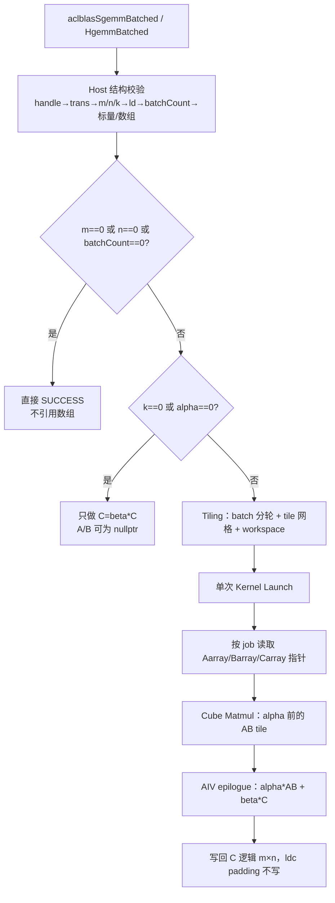

# aclblasSgemmBatched / aclblasHgemmBatched（A2/A3）设计文档

# 需求背景（required）

## 需求来源

- 任务：11 月社区任务-aclblasSgemmBatched/aclblasHgemmBatched 算子开发（A2/A3）。
- 依据：任务方《aclblasSgemmBatched_HgemmBatched_AtlasA2_A3 任务书》及配套 `test_cases/`（S/H 各 600 条用例、各 100 条 GPU 基线）。
- 目标仓：[cann/ops-blas](https://gitcode.com/cann/ops-blas)。实现入 `blas/gemm_batched/arch22/`，测试入 `test/gemm_batched/sgemm_batched/arch22/`。
- 硬件：Atlas A2/A3（arch22，DAV_2201）；CANN 9.1.0。
- 本 PR 仅提交设计文档；实现代码在评审期间并行开发，按 ops-blas 流程单独提交。

## 背景介绍

### 算子功能与工程现状

两个接口计算同一语义的批量 GEMM，仅元素类型不同：

```text
C[i] = alpha * op(A[i]) * op(B[i]) + beta * C[i],  i = 0..batchCount-1
```

- `aclblasSgemmBatched`：alpha/beta/A/B/C 为 FLOAT32。
- `aclblasHgemmBatched`：alpha/beta/A/B/C 为 FLOAT16（`aclblasHalf`）。
- 实数算子，`transa/transb ∈ {N,T,C}`，`OP_C` 与 `OP_T` 等价（不做共轭）。
- 每个 batch 的矩阵由 Device 侧指针数组 `Aarray/Barray/Carray` 给出，按 lda/ldb/ldc 列主序访问。

以 `ops-blas @ 55ef791`（2026-11-25）为基线：

| 能力 | arch35（950PR/DT） | arch22（A2/A3） | 本任务 |
|---|---|---|---|
| 公共声明 | `include/cann_ops_blas.h` L606 / L616 | 共用 | **无需修改** |
| S 实现 | `blas/gemm_batched/arch35/gemm_batched_host.cpp` + `gemm_batched_kernel.cpp` | 无 | 新增 |
| H 实现 | `blas/gemm_batched/arch35/hgemmBatched_host.cpp`（复用同一 batch kernel，FP32 临时 + 转 FP16） | 无 | 新增 |
| 同族 arch22 参考 | — | `blas/gemm_batched/arch22/cgemm_batched_*`（复数 batch、指针数组、workspace 分轮） | 复用调度与 workspace 结构 |
| 单矩阵 arch22 参考 | — | `blas/gemm/arch22/gemm_host.cpp` / `gemm_kernel.cpp`（Matmul + alpha/beta epilogue） | 复用 Matmul 与 epilogue 结构 |
| 测试 | `test/gemm_batched/sgemm_batched/arch35/`、`test/gemm/hgemmBatched/arch35/` | 无 arch22 目标 | 新增并注册 |
| 产品支持表 | 支持 | 未声明 | 本任务补齐 |

### 标杆核查

| 审核对象 | 结论 | 依据 |
|---|---|---|
| 原 TBE 算子源码 | 不适用 | handle 式 BLAS 接口，不涉及 ACLNN/TBE 迁移 |
| 算子信息库 JSON | 不适用 | 不注册 ACLNN 算子 |
| 可复用工程实现 | 适用 | arch35 S/H 语义与校验顺序；arch22 `cgemm_batched` 的指针数组/workspace 分轮；arch22 `gemm` 的 Matmul + epilogue |

### 现状差距

1. arch22 只有复数版 `cgemm_batched`，S/H 实时批处理未实现。
2. arch35 S/H 的 batch 调度、workspace 分轮、FP16 临时缓冲可以借鉴，但 arch22 无 SIMT、Cube 配置不同，不能直接照搬。
3. 指针数组在 Device，Host 不能解引用；Kernel 必须按 batch 索引读取并做边界保护。
4. `beta != 0` 需要保留 C 旧值，不能直接让 Matmul 覆写 C。

# 需求分析（required）

## 需求描述

在 CANN 9.1.0、Atlas A2/A3 上实现 `aclblasSgemmBatched`（FP32）与 `aclblasHgemmBatched`（FP16），语义对齐 cuBLAS `cublasSgemmBatched` / `cublasHgemmBatched`，覆盖全部 trans 组合、batch 规模、lda/ldb/ldc padding 与空 Tensor 边界，精度与性能满足任务书 §3.2/§3.3。

## 需求拆解

1. **功能**：每个 batch 独立执行 `C = alpha*op(A)*op(B) + beta*C`；batch 间无依赖。
2. **数据类型**：S 全 FLOAT32；H 全 FLOAT16，L0C 用 FP32 累加，输出转 FP16。
3. **形状**：`m,n,k >= 0`；`batchCount >= 0`；lda/ldb/ldc 按 trans 取 `max(1,·)` 下界；无广播。
4. **边界**：`m=0 || n=0` 合法 no-op；`batchCount=0` 合法 no-op；`k=0 || alpha=0` 只做 `C=beta*C`；`beta=0` 不读 C 旧值。
5. **校验**：handle → transa/transb → m/n/k → lda/ldb/ldc → batchCount → alpha/beta 与三个指针数组本体；枚举非法返回 `INVALID_ENUM`，其余非法返回 `INVALID_VALUE`。
6. **精度**：S 按 FLOAT32 混合容差（2^-13，matched≥0.99，max_abs≤1e-2）；H 按 FLOAT16（2^-9，matched≥0.99，max_abs≤1e-1）。
7. **性能**：`msprof op` kernel Task Duration，warmup 5 + 10 次均值，≤ GPU `gpu_ms` 的 1.25 倍。
8. **交付**：设计文档 PR、测试用例包、自测报告、私仓 `task_submission/`、ops-blas PR。

# 详细设计（required）

## 算子分析

### 数学公式

```text
C[i] = alpha * op(A[i]) * op(B[i]) + beta * C[i]
op(X) = X            (trans = N)
op(X) = X^T          (trans = T 或 C，实数不共轭)
```

- `op(A[i])` 为 m×k，`op(B[i])` 为 k×n，`C[i]` 为 m×n，均列主序。
- `A[i]` 物理尺寸：transa=N 时 `lda×k`，否则 `lda×m`；`B[i]`：transb=N 时 `ldb×n`，否则 `ldb×k`；`C[i]`：`ldc×n`。

### 支持数据类型

| 算子 | alpha/beta | A/B/C | 累加 |
|---|---|---|---|
| SgemmBatched | FLOAT32（Host） | FLOAT32（Device） | FP32 |
| HgemmBatched | FLOAT16（Host） | FLOAT16（Device） | FP32（L0C） |

### 支持形状

- `m,n,k ∈ [0, INT_MAX]`，`batchCount ∈ [0, INT_MAX]`；指针数组长度 = `batchCount`。
- lda/ldb/ldc 下界：`transa=N ? max(1,m) : max(1,k)`、`transb=N ? max(1,k) : max(1,n)`、`max(1,m)`。
- `batchCount` 很大时（1×1×1 可达 65536）按 batch 分轮，不要求整批同时驻留。

## 算子实现

### 实现方案

#### 3.2.0 整体执行流程图



#### 3.2.1 Host 侧设计

**校验顺序**（严格按任务书 §2.5）：

| 顺序 | 检查 | 返回 |
|---|---|---|
| 1 | `handle == nullptr` | `HANDLE_IS_NULLPTR` |
| 2 | transa/transb 不在 {N,T,C} | `INVALID_ENUM` |
| 3 | m<0、n<0、k<0 | `INVALID_VALUE` |
| 4 | lda/ldb/ldc 低于下界 | `INVALID_VALUE` |
| 5 | batchCount<0 | `INVALID_VALUE` |
| 6 | alpha/beta 为空 | `INVALID_VALUE` |
| 7 | 结构合法后 quick return：m==0 \|\| n==0 \|\| batchCount==0 | `SUCCESS` |
| 8 | k==0 或 alpha==0：只做 `C=beta*C`；Aarray/Barray 可为空，Carray 在 m,n>0 时必须非空 | `SUCCESS` 或启动 beta kernel |
| 9 | 正常路径：三个指针数组本体非空 | `INVALID_VALUE` |

> alpha/beta 为 Host 指针，Host 读取后按值传入 Tiling；不把 Host 指针传到 Device。指针数组元素是否有效、C[i] 是否重叠由调用方保证，Host 不扫描 Device 数组。

**Tiling 字段**：

| 字段 | 含义 |
|---|---|
| `m,n,k`、`batchCount` | 逻辑规模 |
| `lda,ldb,ldc` | 前导维度 |
| `transA,transB` | 0/1 |
| `alpha,beta` | 统一转 FP32 传入 |
| `dtype` | 0=S，1=H |
| `tileM,tileN` | Cube tile，默认 128×128，按 UB/L1 调优 |
| `jobsM,jobsN` | `ceil(m/tileM)`、`ceil(n/tileN)` |
| `jobsPerCore` | 每核连续 job 数 |
| `batchChunk` | 每轮处理 batch 数 |
| `wsTileOffset` | 每核 workspace tile 偏移 |
| `needWorkspace` | `beta!=0` 或 H 转 FP16 时为 1 |

**Job 网格与分核**：

- `jobs = batchCount × jobsM × jobsN`；每个 job = 一个 batch 的一个 C tile。
- `blocks = min(GetAicCoreCount(), jobs)`；每核处理 `[start,end)` 连续 job 区间。
- 小矩阵（m,n 小）时 job 数由 batchCount 提供，天然并行；大矩阵时同一 batch 的多个 tile 分摊到多核。
- batch 分轮：若 `batchCount × perBatchWorkspace` 超过 workspace 上限（沿用 `cgemm_batched` 的 1.5GiB 上限），按 `batchChunk` 分多轮 launch，每轮独立 epilogue。

**Workspace**：

- `beta==0` 且 S：Matmul 直接写 C，epilogue 只做 `C = alpha*C`（可融合到 copy-out），不需要 AB 临时。
- `beta!=0`：每核一块 `tileM×tileN` FP32 临时（128×128×4B=64KiB），Matmul 写入临时，epilogue 读 C 旧值、按 `alpha*AB + beta*C` 合并后写回。
- H：Matmul 的 L0C 为 FP32，copy-out 到临时 FP32 tile，epilogue 转 FP16 写 C；`beta!=0` 时同一临时复用。
- workspace 通过 handle 的 workspace 机制申请，Host 计算并校验总字节数，失败返回 `INVALID_VALUE`。

**Host 侧 beta-only 路径**：`k==0 || alpha==0` 且 `beta!=1` 时，启动轻量 AIV kernel 对每个 C[i] 的逻辑 m×n 区域做 `C=beta*C`，不读 A/B。

#### 3.2.2 Kernel 侧设计

**指针数组读取**：

- `Aarray/Barray/Carray` 为 Device 侧 `T*` 数组；Kernel 以 `GlobalTensor<uint64_t>` 读取第 i 个元素：
  `uint64_t aAddr = aPtrGm.GetValue(batch * sizeof(uint64_t) / sizeof(uint64_t))`（实现时按 8B 对齐读取）。
- 每个 job 只读一次指针，随后构造 `GlobalTensor<T>` 并 `SetGlobalBuffer`。
- 指针数组要求 8B 对齐；调用方保证元素非空。

**Matmul 配置**：

- 按 `transA × transB` 四个组合实例化 `MatmulImpl`：
  `MatmulType<TPosition::GM, CubeFormat::ND, T, isTransA>` / `... isTransB`，输出 `TPosition::GM`。
- `baseK=64`、`tileM=tileN=128` 起步，按 `cgemm_batched` 的 L1 复用档位调优；H 与 S 共用 tile 几何。
- K 方向由 Matmul 内部迭代；不在首版做 split-K（任务书不要求确定性，但 split-K 会增加 workspace 与归约复杂度，性能不足时再评估）。

**padding 处理**：

- `lda/ldb` 等于物理行数时直接以 GM 视图参与 Matmul。
- `lda/ldb` 大于物理行数（padding）或转置后步长不连续时，按 tile 将 A/B 搬入 workspace 的紧凑 tile 再参与 Matmul，避免 Matmul 把 padding 当有效列。
- `ldc` padding 列不写：epilogue 只按 `m×n` 逻辑区域 `DataCopyPad` 回 C。

**alpha/beta epilogue**：

1. Matmul 产出 `AB` tile（FP32）。
2. 读 C 旧 tile（`beta!=0`），`beta*C` 与 `alpha*AB` 在 UB 中按 elementwise 相加。
3. `alpha==0` 分支不启动 Matmul，只做 `C=beta*C`。
4. 写回 C 的逻辑区域；`beta==0` 时不读旧 C。
5. S 直接以 FP32 存储；H 在 UB 内转 FP16（RNE）后存储。

**同步与流水**：

- Matmul 的 L0C→UB/GM copy-out 与 AIV epilogue 之间用 `SetFlag/WaitFlag`（MTE2/MTE3/V）或 `PipeBarrier` 保证顺序；workspace tile 在每核内复用，复用前必须等上一 job 的 epilogue 完成。
- 指针数组读取与 A/B 搬入可预取下一个 job 的指针，隐藏标量延迟。
- Kernel 退出前保留全屏障，避免 MTE3 未排空导致偶发挂死（`sspr2` 已有同类实测）。

**H 专项**：

- 输入 FP16 按 IEEE 位模式解释；Matmul 的 L0C 为 FP32，避免 FP16 累加溢出。
- alpha/beta 由 Host 的 FP16 转 FP32 传入；最终写回 FP16 前做一次 RNE 舍入。
- 覆盖次正规数、接近 FP16 上限、Inf/NaN 传播；`beta=0` 时 C 可为未初始化。

#### 3.2.3 算子泛化设计

- **空 Tensor**：`m=0 || n=0 || batchCount=0` 直接返回，不读任何数组。
- **k=0 / alpha=0**：只做 `C=beta*C`；`beta==1` 直接返回。
- **beta=0**：不读 C 旧值，Matmul 可直写 C。
- **trans 全组合**：N/T/C 九种组合；实数下 T 与 C 走同一实例。
- **padding**：lda/ldb/ldc 大于下界时按 tile pack / 逻辑区域写回。
- **大 batch**：按 batch 分轮，指针数组逐轮索引，不要求整批驻留。
- **特殊值**：Inf/NaN 按 IEEE 传播；任务书用例覆盖 alpha=0 且 A/B 为 NaN、beta=0 且 C 为 NaN。

#### 3.2.4 S/H 差异专项

| 项 | S | H |
|---|---|---|
| 元素 | FP32 4B | FP16 2B |
| Matmul 输入 | FP32 | FP16 |
| 累加 | FP32 | FP32（L0C） |
| 临时 | 可选 FP32 | 必须 FP32 临时 |
| 输出 | FP32 | FP16（RNE） |
| 精度阈值 | 2^-13，max_abs 1e-2 | 2^-9，max_abs 1e-1 |

### 数据检测

- handle 空、trans 非法、m/n/k 负、ld 低于下界、batchCount 负、alpha/beta 空、数组本体空：按上表返回。
- quick return 优先于数组元素检查；`Carray` 在 `m,n>0` 时必须非空。
- 指针数组元素与 C 重叠由调用方保证，接口不做 Device 侧扫描。

### 支持硬件

| 芯片版本 | 勾选 |
|---|---|
| Atlas A2 训练/推理系列 | √ |
| Atlas A3 训练/推理系列 | √ |
| Ascend 950PR/DT（arch35 既有） | 不改动 |

### 算子约束限制

- 不支持广播；C 原地覆写，C[i] 之间及与 A/B 不得重叠。
- alpha/beta 必须位于 Host 内存。
- 仅支持列主序带 padding 布局，不支持任意非连续 Tensor。
- 首版不做 split-K；K 极大时依赖 Matmul 内部 K 迭代。

# 可维可测分析

## 精度标准/性能标准

| 验收标准 | 描述 | 标准来源 |
|---|---|---|
| 精度 S | 混合容差 rtol=atol=2^-13，matched_ratio≥0.99，max_abs≤1e-2 | 任务书 §3.2 |
| 精度 H | 混合容差 rtol=atol=2^-9，matched_ratio≥0.99，max_abs≤1e-1；golden 由 FP32 计算后收窄 | 任务书 §3.2 |
| 性能 | `msprof op` kernel Task Duration，warmup 5 + 10 次均值 ≤ GPU `gpu_ms`×1.25 | 任务书 §3.3 |

## 测试用例规划

直接复用任务书 `test_cases/`：

| 类别 | S | H | 覆盖点 |
|---|---|---|---|
| 基础 | 4 | 4 | 最小 NN/batch |
| 常规形状 | ~ | ~ | m/n/k 1..4096、方阵/长条 |
| trans 组合 | 9 种 | 9 种 | N/T/C 全组合，实数 T=C |
| batch | 1/2/3/8/16/64/256/1024/4096/65536 | 同左 | 小矩阵大 batch |
| padding | lda/ldb/ldc 下界、+1、+8、+64 | 同左 | 列主序带填充 |
| alpha/beta | 0/1/-1/0.5/±1e4 | FP16 可表示值 | alpha=0、beta=0、NaN 传播 |
| 空/负向 | m/n/k=0、batch=0、负值、非法 trans | 同左 | 状态码 |
| 特殊值 | Inf/NaN、次正规、FP16 上限 | H 重点 | 溢出/次正规 |

统计：S 600 条（574 SUCCESS / 21 INVALID_VALUE / 4 INVALID_ENUM / 1 HANDLE_NULLPTR）；H 600 条同分布。性能子集各 100 条，GPU 基线各 100 条。

## 兼容性分析

- 新增 arch22 实现，不改 arch35 行为与公共头。
- 更新 `blas/gemm_batched/README.md` 的 A2/A3 支持矩阵。
- `test/gemm_batched/sgemm_batched/CMakeLists.txt` 增加 arch22 目标。

## 风险与降级预案

| 风险 | 影响 | 预案 |
|---|---|---|
| 指针数组读取延迟 | 小 batch 性能差 | 预取下一 job 指针；小 batch 合并 job |
| beta epilogue 额外带宽 | 大 C 性能下降 | `beta=0` 直写；`beta=1` 用原地加；按 tile 流水 |
| FP16 溢出/次正规 | 精度失败 | FP32 累加；RNE 转 FP16；专项用例 |
| padding/转置组合 | Matmul 读错 | 按 tile pack 到紧凑 workspace |
| workspace 上限 | 大 batch 失败 | 按 1.5GiB 上限分轮 batchChunk |
| 首版无 split-K | 超大 K 性能不足 | 保留 split-K 作为后续优化项 |

## 附录：修订记录

| 日期 | 版本 | 说明 |
|---|---|---|
| 2026-11-25 | v1.0 | 依据任务书与 ops-blas 55ef791 完成初稿 |
