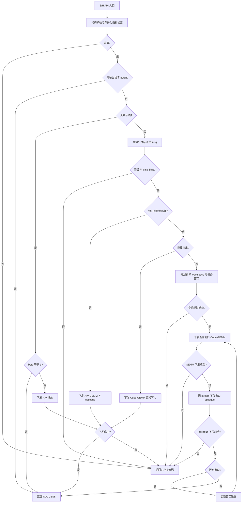
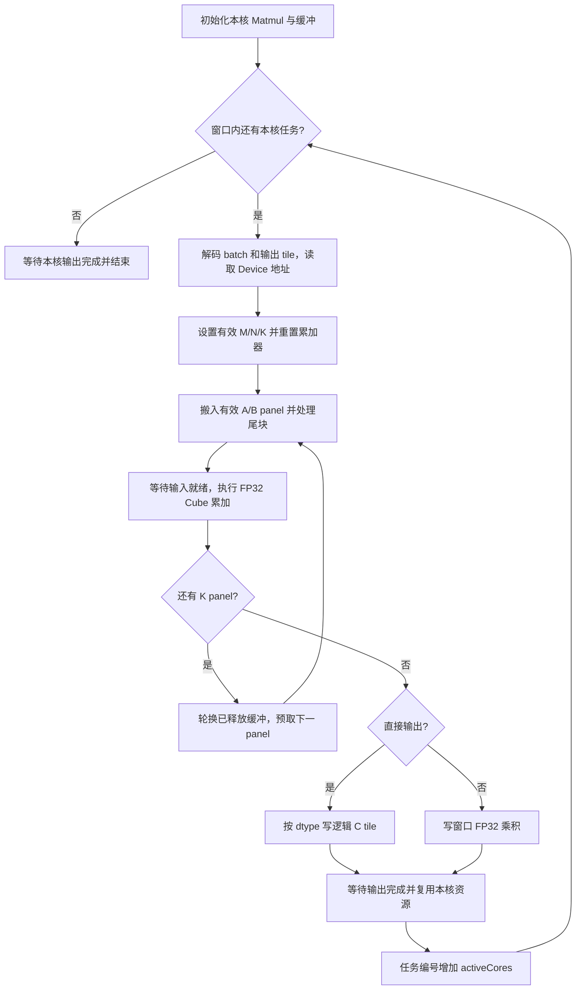

# aclblasSgemmBatched / aclblasHgemmBatched 算子设计文档

## 需求背景（required）

### 需求来源

本设计对应[11月社区任务：aclblasSgemmBatched / aclblasHgemmBatched 算子开发（A2/A3）](https://www.hiascend.com/activities/task-center/details/55123ab3caa64d089f525f646155094c)。设计依据为随包任务书 `aclblasSgemmBatched_HgemmBatched_AtlasA2_A3_task_doc.md`，以及 `test_cases/sgemm_batched/`、`test_cases/hgemm_batched/` 中的 README、原始 CSV、生成器、GPU baseline 和验证脚本。

任务拟使用 Ascend C，为 [cann/ops-blas](https://gitcode.com/cann/ops-blas) 补齐 A2/A3 的批量实数 GEMM。设计文档按社区任务仓规则放在当前任务的 `Twilight-Fanyi/docs/design.md`；后续实现和测试分别集成到 ops-blas 的 `blas/gemm_batched/arch22/` 与 `test/gemm_batched/sgemm_batched/arch22/`。

### 背景介绍

#### 现有实现分析

ops-blas 的 `include/cann_ops_blas.h` 已声明两个公共接口；arch35 已提供 `gemm_batched_host.cpp`、`hgemmBatched_host.cpp` 及相应设备实现。arch22 已有复数批量 GEMM，普通 GEMM 的 arch22 路径已有 FP32 Matmul、转置和关闭 HF32 的用法，可参考其工程接入与精度控制。本任务拟新增 S/H 批量实数实现，复用公共句柄、stream、workspace 和构建机制。

两类接口的计算拓扑一致，主要差异是输入类型、Host 标量解码和最终输出转换。实现拟共用参数检查、任务划分与地址映射；FP32 和 FP16 的设备模板分别实例化。arch35 的调度思路可供参考，设备实现按 arch22 能力设计。

#### 算子功能分析

每个 batch 独立执行 GEMM，所有 batch 共用形状、转置、leading dimension 和 alpha/beta，各矩阵地址由 Device 指针数组给出：

```text
C_i = alpha * op(A_i) * op(B_i) + beta * C_i
op(A_i): [m,k]    op(B_i): [k,n]    C_i: [m,n]
i = 0, ..., batchCount-1
```

矩阵按 Column-Major 存储，`OP_C` 对实数等价于 `OP_T`。C 原地更新，不同 batch 之间不归约。该任务的主要设计问题是：小矩阵的调度与下发成本、大矩阵的 Cube 利用率、独立 batch 地址与转置寻址、FP32 精度、FP16 累加及舍入，以及非默认 alpha/beta 的额外读写。

#### 任务包边界

| 材料 | 内容及设计处理 |
| --- | --- |
| 任务书 | 定义公共接口、条件化指针检查、数学语义、精度性能标准和交付目录 |
| S/H 原始 CSV | 每算子 500 条精度、100 条性能；两份 CSV 分开保存，当前表头无 `op` 列 |
| README、生成器与 verify 脚本 | 定义原始输入 token、加载方式、完整性检查和辅助性能统计；自验拟沿用包内原脚本 |
| GPU baseline | S/H 分别提供 `gpu_baseline.csv`；以实际判定键关联原始性能用例 |

任务书描述共享 GTest 按 `op` 列分派，而附件为分开的 S/H CSV；设计拟保留原 CSV，由测试入口显式选择 S/H，有 `op` 字段时再按字段分派。任务书的正态分布 token 与包内生成器命名存在差异，造数将沿用原生成器和 CSV 的实际 token。测试包对单行造数设定的 512MB 预算属于测试输入约束，任务书 §3.4 未另设算子内存达标门槛。

## 需求分析（required）

### 需求描述

在 CANN 9.1.0 下实现 `aclblasSgemmBatched` 和 `aclblasHgemmBatched`，适配 Atlas A2/A3（arch22），沿用 ops-blas 句柄式 BLAS 调用方式和已有公共声明。m/n/k、batchCount、转置与前导维均作为运行时参数参与 tiling，不限制为测试包中的固定形状。

自验证按任务书 §3.1 只需覆盖一种款型；精度建议 910B3 或 A3，性能建议 910B3。文档将 B3 作为任务书推荐和性能测试参考机型，不将 B3/B4 型号判断写入接口支持条件。具体测试使用实际可用的 A2/A3 设备，报告记录实测 SoC、资源规格、CANN 和驱动版本。任务书 §3.3 列出的 Atlas 800T A2（910B3）测试设备信息同时保留，异机型性能数据应注明测试平台。

### 接口与参数分析

#### 公共接口

```cpp
aclblasStatus_t aclblasSgemmBatched(
    aclblasHandle_t handle, aclblasOperation_t transa, aclblasOperation_t transb,
    int m, int n, int k, const float* alpha,
    const float* const Aarray[], int lda,
    const float* const Barray[], int ldb,
    const float* beta, float* const Carray[], int ldc, int batchCount);

aclblasStatus_t aclblasHgemmBatched(
    aclblasHandle_t handle, aclblasOperation_t transa, aclblasOperation_t transb,
    int m, int n, int k, const aclblasHalf* alpha,
    const aclblasHalf* const Aarray[], int lda,
    const aclblasHalf* const Barray[], int ldb,
    const aclblasHalf* beta, aclblasHalf* const Carray[], int ldc, int batchCount);
```

| 参数 | 角色和位置 | 类型/布局 | 约束 |
| --- | --- | --- | --- |
| handle | Host 句柄 | `aclblasHandle_t` | 有效句柄，提供绑定 stream |
| transa/transb | 运算属性 | `ACLBLAS_OP_N/T/C` | 实数下 C 与 T 等价 |
| m/n/k | 输出行、输出列、归约维度 | int | 非负 |
| alpha/beta | Host 标量输入，全 batch 共用 | S：FP32；H：`aclblasHalf` | 指针非空；H 按 IEEE FP16 位模式解码 |
| Aarray | Device 指针数组及 Device 矩阵 | S：FP32；H：FP16；Column-Major | N 时存储 lda×k，否则 lda×m |
| Barray | Device 指针数组及 Device 矩阵 | S：FP32；H：FP16；Column-Major | N 时存储 ldb×n，否则 ldb×k |
| Carray | Device 指针数组及原地输出 | S：FP32；H：FP16；Column-Major | 存储 ldc×n，仅写逻辑 m×n |
| lda | A 的前导维，单位为元素 | int | N：≥max(1,m)；T/C：≥max(1,k) |
| ldb | B 的前导维，单位为元素 | int | N：≥max(1,k)；T/C：≥max(1,n) |
| ldc | C 的前导维，单位为元素 | int | ≥max(1,m) |
| batchCount | batch 数 | int | 非负，各 batch 共享形状和属性 |

Host 拟只检查指针数组本体，不扫描 Device 数组元素。调用方保证元素地址有效，C[i] 之间互不重叠，且任意 C[i] 不与任意 A[j]/B[j] 重叠。独立地址不能按固定 batch stride 推算；本接口不提供广播语义或任意 Tensor view 转换。

#### 错误处理与边界

| 条件 | 预期行为 |
| --- | --- |
| handle 为空 | 返回 `ACLBLAS_STATUS_HANDLE_IS_NULLPTR` |
| 转置枚举非法 | 返回 `ACLBLAS_STATUS_INVALID_ENUM` |
| 维度/batch 为负、ld 不合法、应提供的指针为空 | 返回 `ACLBLAS_STATUS_INVALID_VALUE` |
| m=0、n=0 或 batchCount=0 | 结构参数校验后返回 SUCCESS，不访问矩阵数组或启动 kernel |
| k=0 或 alpha=0 | 不访问 A/B，只执行 `C=beta*C`；Aarray/Barray 可为空 |
| beta=0 | 不读取 C 旧值；乘法退化时直接生成零 |
| k=0 或 alpha=0，且 beta=1 | C 保持原值，无需启动 kernel |
| padding/尾块 | 不参与数学运算，C padding 保持原样 |

校验顺序拟遵循任务书：handle → 枚举 → m/n/k → lda/ldb/ldc → batchCount → 标量及条件化数组指针 → quick return。alpha/beta 始终要求非空；Carray 仅在 batchCount>0 且 m,n>0 时要求非空；Aarray/Barray 再要求 k>0 且 alpha≠0。校验过程中应避免因无效标量指针而解引用。

### 需求拆解

| 工作项 | 设计落点 | 验证方式 |
| --- | --- | --- |
| 已有 API 和状态码 | 公共声明复用、Host 校验与快路径 | 符号检查、原始负向用例 |
| S/H、N/T/C 和列主序 | dtype 模板、等价转置映射、ld 寻址 | 两套原始 CSV、九种转置组合 |
| 大 batch 与边界尺寸 | 展平输出任务、核间步进、尾块裁剪 | batch 至 65536、小矩阵及 4095/4096 用例 |
| alpha/beta 和特殊值 | 缩放分支、FP32 epilogue、条件化读取 | poison 输入、Inf/NaN、次正规与舍入边界 |
| 性能目标 | 小矩阵融合候选、Cube 分块、缓冲复用 | 每算子完整 100 条性能用例 |
| 内存与异步语义 | 有界 workspace、stream 内顺序、handle 生命周期 | 大尺寸、多次执行和 workspace 复用检查 |
| 工程兼容 | arch22 接入、共享 GTest、README | 现有算子和构建路径回归 |

### 交付件与证据

| 交付件 | 计划内容 |
| --- | --- |
| 算子设计文档 | 当前任务贡献者目录的 `docs/design.md`，经设计 PR 评审 |
| 算子实现与 README | arch22 Host/Kernel、产品支持和约束说明，后续提交 ops-blas |
| 测试代码与用例包 | 共享 GTest、原始 S/H CSV 和验证脚本；按任务书整理 cases/perf/inputs/golden/facts 交付材料 |
| 自测报告 | 全量精度统计、两种性能计时、环境信息、原始日志与截图 |
| 验收材料 | 私仓 `task_submission` 中的自验证步骤、精度/性能/内存说明及报告日志，提供可复现 commit |

设计提交、设计评审、代码提交、设备测试和任务验收分别记录，不以设计方案代替后续实测证据。

## 详细设计（required）

### 算子分析

#### 数学公式

令 r∈[0,m)、c∈[0,n)、p∈[0,k)，逻辑输入寻址拟按下式实现：

```text
Aop_i(r,p) = Aarray[i][r + p*lda]    transa=N
           = Aarray[i][p + r*lda]    transa=T/C
Bop_i(p,c) = Barray[i][p + c*ldb]    transb=N
           = Barray[i][c + p*ldb]    transb=T/C
P_i(r,c)   = sum(Aop_i(r,p) * Bop_i(p,c), p=0..k-1)
C_i(r,c)   = alpha * P_i(r,c) + beta * Carray[i][r+c*ldc]
```

beta=0 时拟使用不含旧 C load 的分支，避免 `0*NaN` 污染结果；alpha=0 或 k=0 时拟跳过整个乘积，避免 A/B 的 NaN 传播。其余特殊值按实际运算语义处理，不对输入做静默清零或有限值替换。

为复用 row-major 输出的 Matmul 路径，列主序乘法拟映射为：

```text
C_i^T = alpha * op(B_i)^T * op(A_i)^T + beta * C_i^T
M' = n, N' = m, K' = k
```

原始列主序缓冲按 row-major 解释时就是物理矩阵的转置，拟采用下表映射；leading dimension 仍对应原始物理矩阵。

| 原始参数 | row-major Matmul 操作数 | 原始为 N | 原始为 T/C | 物理行跨度 |
| --- | --- | --- | --- | --- |
| transb/Barray | 左操作数，逻辑 n×k | 按 row-major 不转置 | 按 row-major 转置 | ldb |
| transa/Aarray | 右操作数，逻辑 k×m | 按 row-major 不转置 | 按 row-major 转置 | lda |
| Carray | row-major n×m 输出 | 不转置写回 | 不转置写回 | ldc |

例如原始 B 为 N 时，其列主序 k×n 缓冲按 row-major 解释为 n×k，正好是 B 的转置。该映射拟用矩形、padding 和九种转置组合逐项验证。

#### 支持数据类型

| 路径 | GM 输入/标量 | 乘积累加 | epilogue | GM 输出 |
| --- | --- | --- | --- | --- |
| S | FP32 | FP32，拟显式关闭 HF32 | FP32 | FP32 |
| H | FP16（`aclblasHalf`） | FP32 | 标量和旧 C 转 FP32 后计算 | 最后按 RNE 转 FP16 |

H 拟在全部 K 分块累加结束后才转换最终输出，避免部分积反复收窄。S 拟沿用仓内 arch22 的 HF32 禁用方式，以完整 FP32 尾数满足任务阈值。不得仅根据性能默认启用降精度乘法；计算路径的精度由原始 golden 和容差共同检验。

#### 支持形状

| 项目 | 支持设计与正式覆盖 |
| --- | --- |
| m/n/k | 运行时非负整数；原用例覆盖 0、1、奇数、对齐边界及 4095/4096 |
| batchCount | 非负；含 0 和最高 65536，小矩阵用于大 batch 覆盖 |
| 转置 | N/T/C 共九种组合，C 等价 T |
| 前导维 | 合法下界以及 padding；A/B/C 可具有独立物理跨度 |
| 地址 | 每 batch 独立的 Device 矩阵地址，输出无重叠 |

形状池是验证覆盖，不作为 Host 的白名单。tile 数、任务总数、元素偏移和 workspace 字节数拟用 64 位中间值计算，检查溢出后再转换到 launcher 支持的字段类型。

### 算子实现

#### 实现方案

##### 整体架构

Host 拟完成结构校验、快路径、资源查询和 tiling；Device 拟完成矩阵寻址、乘积和 C 更新。正常路径采用 Cube Matmul，退化路径采用 AIV 缩放。alpha=1、beta=0 时，拟优先直接输出；其余标量组合采用 FP32 乘积加 AIV epilogue 的通用路径，再以完整调用的性能数据评估融合优化。

对于每 batch 工作量很小、batch 数较大的场景，拟评估单 AIV kernel 完成短 K 乘加与 epilogue，以减少 Cube 启动、padding 和中间写回成本。选择条件仅使用 m/n/k、dtype、batchCount、布局与资源预算，阈值由同口径全量性能结果决定，其他合法输入保留通用路径。

##### Host 侧设计

**参数校验与路径选择**

Host 拟按前述顺序校验元数据，读取 Host 标量。H 使用仓内 Half 转换函数按位解码。零输出直接返回；无乘积项时 beta=1 返回，否则启动缩放 kernel。正常乘法再选择短归约 AIV 候选或 Cube 路径。

**分核与 tiling**

Host 拟查询实际 AIC/AIV 核数、L1/L0/UB 容量，避免硬编码 B3/B4 的核数。以等价输出 M'=n、N'=m 为基准：

```text
Tm = ceil_div(n, BM)
Tn = ceil_div(m, BN)
T  = batchCount * Tm * Tn
window = [windowBegin, windowEnd), 0 <= windowBegin < windowEnd <= T
activeCores = min(windowEnd-windowBegin, availableAicCores)
q = windowBegin + coreId + j * activeCores, q < windowEnd
batch = q / (Tm*Tn)
tileM = (q % (Tm*Tn)) / Tn
tileN = q % Tn
```

同一输出 tile 的 K 归约拟由一个核完成，不做跨核 split-K，避免额外 workspace、原子写和累加顺序复杂化。大 batch 利用 batch 并行，小 batch 利用 M/N tile 并行。

候选 BM/BN 拟从 32、64、128 等满足 arch22 指令与 Matmul 约束的块中选择，BK 由 dtype、K 尾块和片上容量联合决定；这些是调优候选而非固定验收参数。先过滤资源不合法的 tile，再比较有效计算占比和任务数。矩形形状拟调整长短边 tile，减少无效 padding。

**片上存储规划**

| 区域 | 计划数据 | 预算和生命周期 |
| --- | --- | --- |
| L1 | 当前/下一 K panel 的 A/B | 双缓冲须满足约 `2*(BM*BK+BK*BN)*inputBytes` 加 API 固定开销 |
| L0A/L0B | Cube 指令子块 | 各自满足当前平台容量与对齐约束 |
| L0C | 当前 BM×BN 的 FP32 累加 | 约 `4*BM*BN`，驻留至当前输出 tile 的 K 归约结束 |
| UB | AIV 的 FP32 临时、旧 C、输出队列及转换区 | 按实际共存缓冲计算，保留库临时区和对齐预算 |

由 Matmul API 管理的内部搬运拟遵循其 tiling 和队列协议，不重复分配同用途缓冲。epilogue 按列连续的有效行段处理，向量块长度由 UB 剩余空间、输入输出类型和队列深度共同限制；H 的 FP16/FP32 转换缓冲应计入预算。

**Tiling 数据与分派**

| 字段组 | 计划内容 |
| --- | --- |
| 语义参数 | m/n/k、lda/ldb/ldc、batchCount、归一化 N/T 标志 |
| 标量 | FP32 alpha/beta；H 在 Host 解码后传入 |
| 调度 | 路径类型、有效核数、BM/BN/BK、tile 数、任务窗口起止 |
| 临时存储 | workspace stride/容量、窗口中输出 tile 的映射 |
| API 数据 | 当前 arch22 Matmul 所需 tiling 结构与系统 workspace 信息 |

分派 key 拟编码 dtype、转置组合、scale-only/normal、direct/epilogue 和经验证的调度类别。batch 地址仍从传入的 Device 数组读取，不写入 Host 扫描得到的缓存表。

**Workspace 与异步生命周期**

直接输出和缩放路径拟仅使用 API 必需资源。通用 epilogue 路径拟保存 FP32 乘积，完整乘积的逻辑容量约为 `4*batchCount*m*n` 字节，实际另计对齐和系统 workspace。Host 应先检查 handle 可用容量。

完整乘积超过预算时，拟将输出任务划成窗口。窗口内任务 q 对应槽位 `slot=q-windowBegin`；槽位按固定 `slotBytes=align_up(4*BM*BN, workspaceAlignment)` 分配，尾 tile 仍占完整槽位。生产者和 epilogue 共用同一 q 解码及槽位布局，仅处理有效行列。设扣除系统 workspace 后剩余容量为 W，则窗口任务数应满足 `windowTasks*slotBytes <= W`，并在计算前检查乘加溢出。

Host 拟依次提交 `GEMM(window) → epilogue(window)`，再复用同一空间处理下一窗口；零空间、不能容纳一个合法 tile 或 API 资源不足时返回仓内相应错误。该设计限制峰值临时容量，窗口大小及额外 launch 成本将纳入性能评估。

workspace 拟由 handle/公共管理器分配和释放；接口返回前不得释放仍被 stream 使用的内存。相邻 kernel 通过同一绑定 stream 保证生产与消费顺序，不在 Host 做全局同步。重复调用遵循仓内 handle 的并发与 workspace 复用规则；如允许跨 stream 使用，必须按 stream 隔离资源或建立依赖。tiling/标量等每次调用的元数据应使用 launcher 按值参数或独立存储，不能在前一异步任务消费前覆盖。用户通过 `aclblasSetWorkspace` 提供的缓冲只借用，算子不释放、不静默替换；库持有的空间遵循公共管理器生命周期。分配、tiling 和每次下发均立即检查；GEMM 下发失败时不再提交 epilogue 或后续窗口，已排队任务的资源仍保留至安全释放时点。接口返回只反映 Host/下发状态，设备异步错误由调用方 stream 同步和测试日志捕获。

下图说明 Host 的分支和下发顺序，窗口内的两个 kernel 均由 Host 启动。



##### Kernel 侧设计

**Init 与任务解码**

各核拟按核号和 activeCores 步进遍历本窗口输出任务；解码 batch/tile 后读取该 batch 的 Device 指针。初始化 Matmul、有效尺寸和本核缓冲。每个输出逻辑元素只能由一个任务写入。

**CopyIn 与 Compute**

按归一化转置和 ld 定位有效 A/B panel，拟以 Matmul 支持的搬运完成 ND 到片上计算布局转换。K 循环中拟预取下一 panel，与当前 Cube 计算流水；队列消费前等待搬运完成，缓冲释放后才允许复用。所有 K 分块累加到 FP32，新的输出任务必须重新初始化累加状态。

M/N/K 尾块拟通过 API 有效尺寸、合法裁剪和零填充处理。逻辑无效位置填零仅用于内部 tile，不允许越界读取用户矩阵或覆盖用户 padding。不能默认用户指针、ld 或尾长满足完整 DMA 块对齐。

**CopyOut 与 epilogue**

直接路径拟在 alpha=1、beta=0，且 API 支持相应输出类型、ld 和尾部精确写回时写逻辑 C tile；不满足安全写回条件时转通用 workspace 加 epilogue 路径；H 仅在 K 全部完成后转换 FP16。通用路径将乘积写到窗口 FP32 workspace，Cube kernel 完成后由 Host 在同 stream 提交 AIV epilogue。

AIV 按 batch、列和有效行段分核，读取乘积后计算 alpha 项；beta 非零才读取旧 C。H 在 FP32 中完成乘加后 RNE 转 FP16，S 写 FP32。每次只写有效元素，padding 保留。不满 DMA 块的短行/FP16 尾部拟使用平台支持的精确长度写回或合法标量存储，不能将对齐扩写范围覆盖到下一列或另一核的输出；按实际字节范围检查写所有权。AIV 缩放 kernel 不访问 A/B；beta=0 时直接写零，beta=1 的无乘积路径由 Host 返回。

下图描述单个 Cube kernel 的任务与 K 循环；通用输出的后处理由前一张 Host 图负责调度。



**短归约融合候选**

小矩阵 AIV 路径拟按独立输出块分核，在 UB 中复用短 K 输入片段，以 FP32 乘加完成输出，再直接进行 alpha/beta 和类型转换。该路径同样遵循 beta=0 不读 C、K 尾部和 padding 规则；正式性能比较应包含完整调用，只有精度与收益均得到验证后才启用相应调度范围。

##### 复杂度与数据量

单次调用主要计算量约为 `2*batchCount*m*n*k` FLOPs；无 split-K 时，每个输出元素只产生一个最终累加结果。理想输入/输出数据量为：

```text
inputBytes = 4 (S) or 2 (H)
A/B logical bytes = batchCount * (m*k + k*n) * inputBytes
C bytes = batchCount * m*n * inputBytes * (1 + (beta != 0))
```

实际 A/B 读取会受 tile 复用与缓存命中影响。FP32 workspace 路径另增加约 `8*batchCount*m*n` 字节的乘积写入和读取；窗口限制峰值空间但不消除这部分流量。性能优化拟依次评估：小矩阵减少 launch、direct 输出、tile 和双缓冲、按布局复用 panel、具备 API 支持时融合 epilogue；每项均以原始用例全量结果判断收益。

### 支持硬件

| 硬件/环境 | 设计范围与验证安排 |
| --- | --- |
| Atlas A2 系列 | arch22 目标，按实际 SoC 查询核数及片上容量 |
| Atlas A3 系列 | arch22 目标，选择对应编译 SoC，不套用 A2 固定资源 |
| 自验证设备 | 按任务书只需覆盖一种款型，记录实际硬件与资源配置 |
| 910B3 | §3.1 推荐精度/性能自测，§3.3 列为性能测试参考设备；不作为唯一支持型号 |
| 910B4 | 按 A2 目标平台适配，不因型号不同排除；使用实际资源做 tiling 并报告本机验证数据 |
| CANN | 任务书指定 9.1.0；附件 README 写 9.1.0 及以上，首版按 9.1.0 设计和验证 |

### 算子约束限制

- 仅 S/H 两种实数 dtype，公共接口和参数顺序保持不变，按 handle stream 异步执行。
- 仅支持指针数组描述的列主序矩阵及合法 ld padding；所有 batch 共享形状和属性，不做广播或任意非连续 view 转换。
- 输出区域的有效性和别名约束由调用方保证；算子拟只写逻辑 m×n 区域。
- 不要求跨调度方案逐位一致，按任务精度阈值判断。设备内存不足、整数溢出或运行时失败应明确返回，资源预算不得被静默突破。

## 可维可测分析

### 精度标准/性能标准

| 验收项 | S | H | 来源 |
| --- | --- | --- | --- |
| rtol / atol | 均为 2⁻¹³ | 均为 2⁻¹⁰ | 任务书 §3.2 |
| matched ratio | ≥0.99 | ≥0.99 | 任务书 §3.2 |
| 最大绝对误差限 | FLOAT32 档：1e-2 或 32 ULP | FLOAT16 档：1e-1 或 32 ULP | 任务书 §3.2、混合容差规范 |
| 正式性能 | 每 case NPU 平均 kernel 时间≤GPU kernel 基线的 1.25 倍 | 同 S | 任务书 §3.3 |
| 性能汇总 | 全部可比项平均倍率≥0.8 | 同 S | 附件 README/verify 规则 |
| 辅助性能 | GTest `[PERF] avg_us` 必须可解析，作为交叉检查 | 同 S | 任务书 §3.3、原脚本 |
| 内存 | 无独立量化达标门槛，按模板说明输入输出和 workspace 占用 | 同 S | 任务书 §3.4、交付要求 |

逐元素以 `abs(actual-golden) <= atol + rtol*abs(golden)` 判 matched；每条 case 同时检查匹配率与最大误差限。ULP 的取值及特殊值比较拟沿用任务指定混合容差规范和测试工程，报告注明所用规则，不自行扩大阈值。

#### 正式用例与目标

| 集合 | S | H | 覆盖与目标 |
| --- | ---: | ---: | --- |
| 精度/接口 | 500 | 500 | 全量执行，保留负向状态码、零维、标量、转置、padding、特殊值 |
| 性能 | 100 | 100 | 原始 TC_PF 全量执行，匹配各自 GPU baseline |
| 尺寸和 batch | 原 CSV | 原 CSV | 奇数、非对齐、4095/4096、大 batch 小矩阵 |
| 生命周期回归 | 补充 | 补充 | stream 顺序、workspace 多窗口复用、重复调用及其他 arch22 算子 |

附件 CSV 为实际执行输入，任务书 §4 所述 cases.json、perf、inputs、golden 和 facts 是交付材料要求，后续应按原 CSV 建立可追溯映射，不能用自行生成的简化用例替代原包验收集合。

#### 精度测试设计

S 拟遵循 Netlib `cblas_sgemm` 数学语义。任务书允许直接用 FP32 cblas 对照，也说明输入/标量转 FP64 累加后收窄 FP32 的生成方式；自测应保存实际 golden 生成实现与差异说明。H 拟按任务要求 FP64 累加，收窄至 FP32 后再 RNE 转 FP16，不使用不存在的 `cblas_hgemm`。

精度自验拟使用包内原始 `verify_accuracy.py` 调用仓内 GTest，原脚本、CSV、输入生成、golden 和阈值保持不变。测试源码及公共用例逻辑统一放在任务书的共享测试目录，CMake 拟从共享源码产生 `sgemm_batched_test`、`hgemm_batched_test` 两个薄入口，各入口只加载对应原始 CSV，并放到原脚本 `BINARY_CANDIDATES` 已支持的位置。原脚本的 `--csv` 仍按自身目录规则安装 CSV；测试入口按对应 S/H 路径加载，H 路径只承接数据安装和构建输出，不复制用例实现。

先按仓内实际构建选择机制完成共享目标编译，再使用原脚本已有的 `--skip-build` 验证，避免因其固定 `--ops` 选择与共享目标不一致而修改脚本。S/H 分别保留原 GTest case_name 和原始 PASS/FAIL/MISSING 判据；报告逐项核对预期 case 数、实际执行数和状态，进程退出失败或 MISSING 不能视为通过。

重点核对 beta=0 的 NaN C、alpha=0 的 poison A/B、k=0、空维与空 batch、条件化 nullptr、非法参数、FP16 极值/次正规数、Inf/NaN 传播，以及 C 物理缓冲 padding 哨兵。额外采用矩形和不同 ld 验证列主序映射；多次调用验证累加器与 workspace 无残留。

#### 性能测试设计

性能拟在实际自验证 A2/A3 设备上采集，记录 SoC、核数/切片、CANN、驱动、频率和并行负载。B3 作为任务书建议及参考测试机型记录，其他机型的数据须标明实际环境，不写成 B3 实测。

每个原始性能 case 先 warmup 5 次，再取至少 10 次成功执行的有效样本求算术平均。以 `msprof op` 的 kernel `Task Duration(us)` 对比同参数 cuBLAS A100 kernel-only `gpu_ms`；单位换算后逐项判定 `npu_us <= 1000*gpu_ms/0.8`。判定键应包含转置、m/n/k、ld、alpha/beta 和 batchCount，缺基线、缺样本或执行失败均需报告。

对于 GEMM 加 epilogue 或多个窗口的一次 API 调用，拟累加该次调用的全部相关 kernel task duration，再计算 10 次调用均值；不得仅保留主 GEMM 耗时。小矩阵 AIV 候选同样按完整 kernel 计时。若 profiler 展开子任务，应按其层级去重，保留原始数据和归并依据。

同时以原包未修改的 `verify_performance.py` 及其现有 `--skip-build` 入口运行 S/H 对应测试二进制，保留 GTest `aclrtEvent` 的 `[PERF] avg_us`、原始日志和完整性检查。该时间含调用下发影响，不含造数、H2D/D2H 和 golden；与 msprof 正式 kernel 时间分列，不能相互替代。最终报告拟列出所有 200 项的参数、GPU 基线、NPU 样本均值、倍率和判定，并保存终端截图。

### 兼容性分析

| 影响面 | 计划措施 |
| --- | --- |
| 公共 API | 复用 `include/cann_ops_blas.h` 声明、状态码和 stream 约定 |
| 算子源码构建 | S/H 实现放入 `blas/gemm_batched/arch22/`，由仓内源码收集机制接入，避免增加无用构建文件 |
| 测试构建 | 在 `test/gemm_batched/sgemm_batched/CMakeLists.txt` 注册 arch22 共享 GTest，兼容原始 S/H 分文件 |
| 既有 arch22 路径 | 执行已有 GEMM/复数批量 GEMM 回归，避免 dtype 模板或公共 helper 影响其他入口 |
| arch35 | 保持架构文件隔离，公共测试/构建变更须检查旧目标，避免要求额外真机作为本任务自验前置条件 |
| 文档与交付 | 补充 `blas/gemm_batched/README.md` 产品支持、限制和复现步骤；后续按任务书整理验收材料 |
