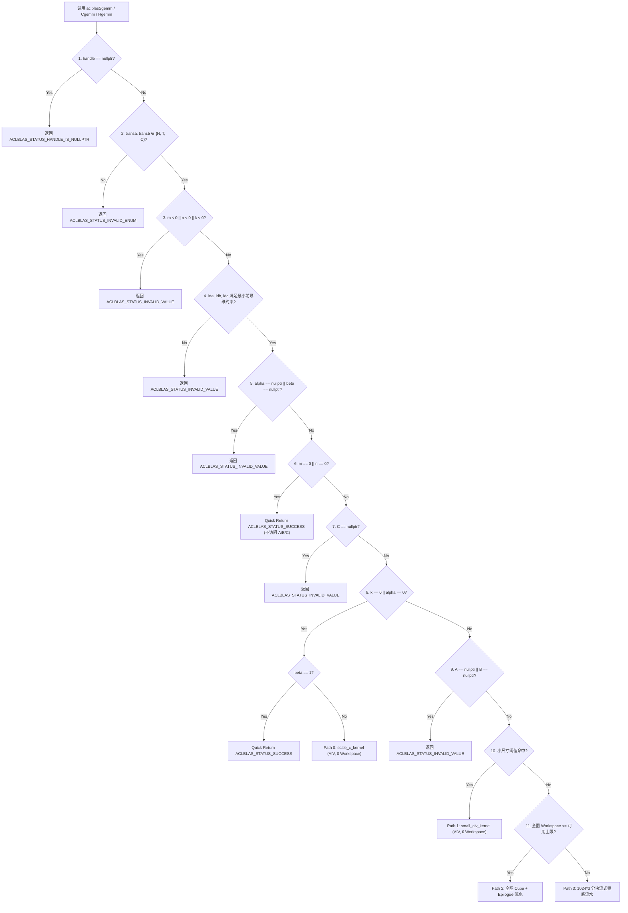

# aclblasSgemm / aclblasCgemm / aclblasHgemm（Atlas A2 / A3）算子设计文档

| 项目 | 内容 |
| :--- | :--- |
| **社区任务** | `11-aclblasSgemm_Cgemm_Hgemm-A2A3` |
| **贡献者 / 团队** | QianYiPan |
| **文档版本** | v1.0，设计评审稿 |
| **编写日期** | 2026-11-25 |
| **目标产品** | Atlas A2 系列、Atlas A3 系列（Atlas 800T A2 / Atlas 800I A2 / Atlas 800T A3） |
| **指定性能设备** | Atlas 800T A2（`ascend910b3`，兼容 `ascend910_93`；架构标识 `DAV_2201`，仓内目录 `arch22`） |
| **开发环境** | CANN 9.1.0、Ascend C、Netlib BLAS 3.10.0（S/C CPU Golden） |
| **目标代码仓** | [cann/ops-blas](https://gitcode.com/cann/ops-blas) |
| **目标代码路径** | 实现：`blas/gemm/arch22/`；测试：`test/gemm/arch22/` |

---

# 需求背景（required）

## 需求来源

- **任务页面**：CANN 社区任务 2026（2026 年 11 月）——`11-aclblasSgemm_Cgemm_Hgemm-A2A3` 算子开发任务
- **任务目标**：在 Atlas A2 / A3 系列产品（Ascend 910B3 / 910_93，`arch22`，`DAV_2201`）上，基于 [ops-blas](https://gitcode.com/cann/ops-blas) 开源仓工程框架，使用 Ascend C 编程语言开发并完善 BLAS Level-3 通用矩阵乘族算子 `aclblasSgemm`（FP32）、`aclblasCgemm`（COMPLEX64）与 `aclblasHgemm`（FP16，`aclblasHalf`），分别对标 cuBLAS `cublasSgemm` / `cublasCgemm` / `cublasHgemm` 接口，完成设计、开发、测试全流程工作，验收通过后合入昇腾算子开源仓。
- **适配硬件**：Atlas 800I/T A2、Atlas 800I/T A3（架构标识 `DAV_2201`，仓内目录 `arch22`）
- **软件栈版本**：CANN 9.1.0，Ascend C 基础 API / 高阶 Matmul API
- **目标代码仓**：https://gitcode.com/cann/ops-blas
- **提交团队/账号**：QianYiPan

## 背景介绍

### aclblasSgemm / aclblasCgemm / aclblasHgemm 算子实现优化

`aclblasSgemm`、`aclblasCgemm`、`aclblasHgemm` 是 BLAS Level-3 核心通用矩阵乘（General Matrix-Matrix Multiplication）标准算子，统一执行如下矩阵乘加更新计算：

$$C \leftarrow \alpha \cdot \operatorname{op}(A) \cdot \operatorname{op}(B) + \beta \cdot C$$

其中：
- `aclblasSgemm`：输入输出矩阵 $A, B, C$ 与标量 $\alpha, \beta$ 为单精度实数 `FLOAT32`（`float`）；
- `aclblasCgemm`：输入输出矩阵与标量为单精度复数 `COMPLEX64`（`aclblasComplex`，实部/虚部各占 4B `float32`，单元素 8B），采用标准 4M 直接复数乘加（与 `aclblasCgemm3m` 独立，不混用 3M 路径）；
- `aclblasHgemm`：输入输出矩阵与标量为半精度实数 `FLOAT16`（`aclblasHalf`，IEEE 754 16-bit FP16 位模式）；
- $\operatorname{op}(X) \in \{X \text{ (`ACLBLAS_OP_N`)},\; X^T \text{ (`ACLBLAS_OP_T`)},\; X^H \text{ (`ACLBLAS_OP_C`)}\}$，其中 `aclblasCgemm` 的 `OP_C` 为共轭转置、`OP_T` 为非共轭转置；`aclblasSgemm` / `aclblasHgemm` 为实数算子，`OP_C` 与 `OP_T` 等价；
- 矩阵均按列主序（Column-Major）存储，$\operatorname{op}(A) \in \mathbb{K}^{m \times k}$，$\operatorname{op}(B) \in \mathbb{K}^{k \times n}$，$C \in \mathbb{K}^{m \times n}$。

在昇腾 Atlas A2 / A3（`DAV_2201`）达芬奇架构上，三类 GEMM 算子面向不同精度与计算特征，存在以下核心优化点：
1. **FP32 精度与 Cube 吞吐平衡（`aclblasSgemm`）**：默认状态下 `DAV_2201` FP32 Cube 会启用 HF32 尾数截断，必须显式关闭 HF32 以满足 `rtol = 2^-13` 精度要求；同时需针对小尺寸与非对齐尾块设计低延迟路径与安全 `ldc` padding 写回。
2. **复数 4M 多平面并发（`aclblasCgemm`）**：若在 Host 侧串行下发 4 次实数 GEMM，会导致多次下发开销与中小尺寸核闲置；通过小尺寸单次 AIV 直算（0 Workspace）与中大尺寸 4-Plane 联合网格 Cube 流水，可充分打满 AIC/AIV 算力。
3. **FP16 高吞吐与 FP32 累加防溢出（`aclblasHgemm`）**：利用 Cube 原生 FP16 乘加 + L0C FP32 累加器，在 AIV 后处理阶段以 FP32 完成 $\alpha \cdot \text{acc} + \beta \cdot C$ 融合后再按 IEEE RNE 舍入回 FP16，兼顾极致算力与数值稳定性。

### aclblasSgemm / aclblasCgemm / aclblasHgemm 算子实现路径和相关API路径

- **接口声明路径**：`include/cann_ops_blas.h`（`aclblasSgemm` 位于 L575、`aclblasCgemm` 位于 L579，均已存在无需修改；`aclblasHgemm` 非 batch 声明当前不存在，需按同族风格新增声明）
- **Host 侧实现路径**：`blas/gemm/arch22/gemm_host.cpp`、`blas/gemm/arch22/cgemm_host.cpp`、`blas/gemm/arch22/hgemm_host.cpp`、`blas/gemm/arch22/cgemm_tiling_data.h`
- **Kernel 侧实现路径**：`blas/gemm/arch22/gemm_kernel.cpp/.h`、`blas/gemm/arch22/cgemm_kernel.cpp/.h`、`blas/gemm/arch22/hgemm_kernel.cpp/.h`
- **算子说明文档**：`blas/gemm/README.md` 的 `aclblasSgemm` / `aclblasCgemm` / `aclblasHgemm` 章节
- **测试工程路径**：`test/gemm/arch22/`（在仓内既有通用 `gemm_test.cpp` / `gemm_test.csv` 基础上扩展三算子用例，不新建 `test/gemm/sgemm/arch22/`）
- **相关 API 路径**：
  - Ascend C Cube API：`MatmulImpl`、`GetMatmulApiTiling`、`AscendC::SetHF32Mode(AscendC::HF32Mode::DISABLE)`
  - Ascend C Vector / DMA API：`DataCopyPad`、`Gather`、`Cast`、`Axpy`、`Mul`、`Add`、`Sub`、`Duplicate`、`SetFlag` / `WaitFlag` 等

### aclblasSgemm / aclblasCgemm / aclblasHgemm 算子现状分析

通过对 BLAS Level-3 规范与 ops-blas 开源仓现有实现的分析，三算子统一参数契约如下（S=`FLOAT32`，C=`COMPLEX64`，H=`FLOAT16`）：

| 参数 | 参数含义 | 方向 | 内存位置 | 数据类型 | 约束条件 | 形状 |
| :--- | :--- | :---: | :---: | :--- | :--- | :--- |
| `handle` | ops-blas 库上下文句柄，携带 stream | 输入 | Host | `aclblasHandle_t` | 非空指针，内部包含有效 `aclrtStream` | scalar |
| `transa` | $\operatorname{op}(A)$ 的运算类型 | 属性 | Host 值 | `aclblasOperation_t` | `ACLBLAS_OP_N / T / C`（S/H 中 `C` 等价 `T`） | attr |
| `transb` | $\operatorname{op}(B)$ 的运算类型 | 属性 | Host 值 | `aclblasOperation_t` | `ACLBLAS_OP_N / T / C`（S/H 中 `C` 等价 `T`） | attr |
| `m` | $\operatorname{op}(A)$ 与 $C$ 的行数 | 属性 | Host 值 | `int` | $m \ge 0$；$m < 0$ 报错，$m == 0$ 快速成功返回 | attr |
| `n` | $\operatorname{op}(B)$ 与 $C$ 的列数 | 属性 | Host 值 | `int` | $n \ge 0$；$n < 0$ 报错，$n == 0$ 快速成功返回 | attr |
| `k` | $\operatorname{op}(A)$ 的列数、$\operatorname{op}(B)$ 的行数 | 属性 | Host 值 | `int` | $k \ge 0$；$k < 0$ 报错，$k == 0$ 只做 $C = \beta C$ | attr |
| `alpha` | 标量乘数 | 输入 | Host | `const T*`（S/C/H） | 非空指针 | scalar |
| `A` | 列主序输入矩阵 A | 输入 | Device | `const T*`（S/C/H） | $m>0 \land n>0 \land k>0 \land \alpha \ne 0$ 时必须非空 | $\operatorname{op}(A) \in \mathbb{K}^{m \times k}$ |
| `lda` | 矩阵 A 的前导维度 | 属性 | Host 值 | `int` | `transa=N`: $\text{lda} \ge \max(1,m)$；`T/C`: $\text{lda} \ge \max(1,k)$ | attr |
| `B` | 列主序输入矩阵 B | 输入 | Device | `const T*`（S/C/H） | $m>0 \land n>0 \land k>0 \land \alpha \ne 0$ 时必须非空 | $\operatorname{op}(B) \in \mathbb{K}^{k \times n}$ |
| `ldb` | 矩阵 B 的前导维度 | 属性 | Host 值 | `int` | `transb=N`: $\text{ldb} \ge \max(1,k)$；`T/C`: $\text{ldb} \ge \max(1,n)$ | attr |
| `beta` | 标量乘数 | 输入 | Host | `const T*`（S/C/H） | 非空指针；$\beta == 0$ 时严格不读 $C$ 旧值 | scalar |
| `C` | 列主序输入/输出矩阵 C | 输入/输出 | Device | `T*`（S/C/H） | $m>0 \land n>0$ 时必须非空，原地覆写 | $C \in \mathbb{K}^{m \times n}$，物理 $\text{ldc} \times n$ |
| `ldc` | 矩阵 C 的前导维度 | 属性 | Host 值 | `int` | $\text{ldc} \ge \max(1,m)$ | attr |

仓内现状：
1. `blas/gemm/arch22/gemm_host.cpp` 当前仅导出 `aclblasSgemm`，缺少 `aclblasCgemm` 与 `aclblasHgemm` 的 `arch22` 实现；
2. `blas/gemm/arch35/` 已有 `cgemm_host.cpp`、`gemm_host.cpp` 及 `hgemmStridedBatched` 参考实现，但其依赖 950 专属特性，不可直接复用，仅作为参数校验语义与 dtype 分派参考；
3. `include/cann_ops_blas.h` 已存在 `aclblasSgemm`（L575）与 `aclblasCgemm`（L579）声明，需新增 `aclblasHgemm`（非 batch）公共声明。

### aclblasSgemm / aclblasCgemm / aclblasHgemm 算子功能分析

- **算子功能**：分别实现 FP32、COMPLEX64（4M 直接复数乘）、FP16 三种数据类型的通用矩阵乘加更新 $C = \alpha \cdot \operatorname{op}(A) \cdot \operatorname{op}(B) + \beta \cdot C$；
- **输入**：`handle`、`transa`、`transb`、`m`、`n`、`k`、`alpha`、`A`、`lda`、`B`、`ldb`、`beta`、`ldc`，以及原地输入/输出矩阵 `C`；
- **输出**：原地更新后的列主序矩阵 `C`（仅修改逻辑 $m \times n$ 区域，`ldc` padding 保持不变）；
- **支持数据类型**：`FLOAT32`、`COMPLEX64`（`aclblasComplex`）、`FLOAT16`（`aclblasHalf`）；
- **支持广播**：不支持广播；
- **核心优化方向**：
  1. **列主序到行主序零转置映射**：统一利用 $C^T = \operatorname{op}(B)^T \cdot \operatorname{op}(A)^T$ 消除片上 2D 转置开销；
  2. **按 dtype 与规模分级路由**：小尺寸走零 Workspace AIV 直算或小 Tile，中大尺寸走高并发 AIC Cube + AIV Epilogue，超大尺寸走分块流式兜底；
  3. **精度与防溢出保护**：S/C 强制禁用 HF32 保证 IEEE FP32 精度；H 采用 Cube FP16 乘 + FP32 累加 + FP32 标量融合后再舍入回 FP16，规避中间溢出与精度劣化。

---

# 需求分析（required）

## 需求描述

使用 Ascend C 编程语言在 Atlas A2 / A3（`arch22`，Ascend 910B3 / 910_93）硬件上开发并完善句柄式 BLAS Level-3 算子 `aclblasSgemm`、`aclblasCgemm` 与 `aclblasHgemm`，支持 `FLOAT32`、`COMPLEX64`、`FLOAT16` 三种数据类型，通过 `handle` 绑定的 `aclrtStream` 异步下发 NPU kernel，计算语义、参数校验与数值精度严格对标 cuBLAS 同名接口及 Netlib BLAS 参考实现。

## 需求拆解

1. **公共接口补齐与统一 11 步参数防御校验**：在 `include/cann_ops_blas.h` 新增 `aclblasHgemm` 声明；三算子统一执行严格的 `handle` / 枚举 / 维度 / 前导维 / 空指针校验与 `m=0||n=0`、`k=0||alpha=0` 快速路径；
2. **`aclblasSgemm`（FP32）高精度高吞吐优化**：禁用 HF32，完善全尺寸 Cube/AIV 分流、`ldc` padding 保护与非对齐尾块处理；
3. **`aclblasCgemm`（COMPLEX64）4M 直接复数乘实现**：严格按 4M 复数乘法公式实现（禁止混用 3M），支持 `OP_N / OP_T / OP_C` 九种组合，实现小尺寸 AIV 直算与中大尺寸 4-Plane 联合网格 Cube 流水；
4. **`aclblasHgemm`（FP16）高吞吐与数值稳定实现**：基于 `aclblasHalf` 位模式，采用 Cube FP16 乘 + FP32 L0C 累加 + FP32 Epilogue 融合，正确处理次正规数、接近上限值（$\pm 65504$）及 `Inf/NaN`；
5. **片上缓存与全局 Workspace 管控**：UB（$\le 192\text{ KiB}$）、L1（$\le 512\text{ KiB}$）、L0C（64 KiB Ping-Pong）严格不溢出，全局 Workspace 设定 2 GiB 硬上限并提供分块流式兜底；
6. **测试工程扩展与双百验收**：复用并扩展 `test/gemm/arch22/`，完成全量 1000 条精度用例（S/C/H 约 333/333/334 条）100% PASS，以及全量 200 条性能用例 100% 达标（$\ge 0.80\times$ GPU Baseline，内控目标 $\ge 0.84\times$）。

---

# 详细设计（required）

## 算子分析

### 数学公式

三算子统一计算：

$$C \leftarrow \alpha \cdot \operatorname{op}(A) \cdot \operatorname{op}(B) + \beta \cdot C$$

1. **实数算子（`aclblasSgemm` / `aclblasHgemm`）**：
   $$C_{i, j}^{\text{new}} = \alpha \sum_{p=0}^{k-1} \operatorname{op}(A)_{i, p} \cdot \operatorname{op}(B)_{p, j} + \beta \cdot C_{i, j}^{\text{old}}$$
   其中 `OP_C` 与 `OP_T` 等价，均表示转置。`aclblasHgemm` 在硬件内以 FP32 累加中间乘积并完成 $\alpha, \beta$ 融合后，按 IEEE round-to-nearest-even 舍入为 FP16 写回。

2. **复数算子（`aclblasCgemm`，标准 4M 直接复数乘）**：
   设 $\operatorname{op}(A) = A_r + \text{i} A_i$，$\operatorname{op}(B) = B_r + \text{i} B_i$（当 `trans == ACLBLAS_OP_C` 时虚部先取反完成共轭），按 4 路实数 GEMM 直接展开：
   $$P_0 = A_r B_r, \quad P_1 = A_i B_i, \quad P_2 = A_r B_i, \quad P_3 = A_i B_r$$
   $$\text{Re}\big(\operatorname{op}(A)\operatorname{op}(B)\big) = P_0 - P_1, \qquad \text{Im}\big(\operatorname{op}(A)\operatorname{op}(B)\big) = P_2 + P_3$$
   随后融合复数标量 $\alpha = \alpha_r + \text{i}\alpha_i$ 与 $\beta = \beta_r + \text{i}\beta_i$：
   $$C_{\text{new}, r} = (\alpha_r \text{Re} - \alpha_i \text{Im}) + (\beta_r C_r - \beta_i C_i)$$
   $$C_{\text{new}, i} = (\alpha_r \text{Im} + \alpha_i \text{Re}) + (\beta_r C_i + \beta_i C_r)$$
   当 $\beta = 0$（复数为 $(0, 0)$）时，严格跳过旧 $C$ 读取。

### 支持数据类型

| 算子接口 | 矩阵 $A, B, C$ 类型 | 标量 $\alpha, \beta$ 类型 | 单元素字节数 | 计算与累加精度域 |
| :--- | :--- | :--- | :---: | :--- |
| `aclblasSgemm` | `FLOAT32` (`float`) | `const float*`（Host） | 4 B | 完整 IEEE FP32（禁用 HF32） |
| `aclblasCgemm` | `COMPLEX64` (`aclblasComplex`) | `const aclblasComplex*`（Host） | 8 B | 实/虚拆分完整 IEEE FP32（禁用 HF32） |
| `aclblasHgemm` | `FLOAT16` (`aclblasHalf`) | `const aclblasHalf*`（Host） | 2 B | FP16 乘 + FP32 L0C 累加 + FP32 标量融合 |

### 支持形状

- 逻辑维度：$m \ge 0, n \ge 0, k \ge 0$ 运行时任意维度（覆盖 $0, 1 \dots 4096$ 及以上大尺寸）；
- 前导维度约束：
  - `transa == OP_N` 时 $\text{lda} \ge \max(1, m)$；`transa ∈ {OP_T, OP_C}` 时 $\text{lda} \ge \max(1, k)$；
  - `transb == OP_N` 时 $\text{ldb} \ge \max(1, k)$；`transb ∈ {OP_T, OP_C}` 时 $\text{ldb} \ge \max(1, n)$；
  - $\text{ldc} \ge \max(1, m)$；
- **列主序到行主序的零转置等价映射**：
  利用 $C^T = \operatorname{op}(B)^T \cdot \operatorname{op}(A)^T$，将内部 Cube 左矩阵设为 $\operatorname{op}(B)^T \in \mathbb{K}^{N \times K}$、右矩阵设为 $\operatorname{op}(A)^T \in \mathbb{K}^{K \times M}$，则行主序输出 $C^T \in \mathbb{K}^{N \times M}$ 的内存排布与列主序 $C \in \mathbb{K}^{M \times N}$ 完全一致，无需片上 2D 转置：

| 公开参数 | 公开物理形状（列主序） | 等价行主序视图 | `MatmulImpl` 转置标志 |
| :--- | :--- | :--- | :--- |
| `transb == OP_N` | $B$: $K \times N$ (`ldb`) | $[N, K]$（行距 `ldb`） | `LeftTrans = false` |
| `transb ∈ {OP_T, OP_C}` | $B$: $N \times K$ (`ldb`) | $[K, N]$（行距 `ldb`） | `LeftTrans = true` |
| `transa == OP_N` | $A$: $M \times K$ (`lda`) | $[K, M]$（行距 `lda`） | `RightTrans = false` |
| `transa ∈ {OP_T, OP_C}` | $A$: $K \times M$ (`lda`) | $[M, K]$（行距 `lda`） | `RightTrans = true` |

---

## 算子实现

### 实现方案

#### 3.2.1 host侧设计：

##### tiling策略：

三算子在 Host 侧采用统一的分级路由架构，按规模与标量特征动态选择最优执行路径：

| 路径 | 判定条件 | 执行核函数与硬件 | 额外 Workspace | 设计目标 |
| :--- | :--- | :--- | :---: | :--- |
| **Path 0** (`SCALE_C`) | $k == 0 \lor \alpha == 0$（且 $\beta \ne 1$） | 单次 AIV `scale_c` 核 | **0 Bytes** | 极速完成 $C = \beta C$（$\beta=0$ 直接清零不读旧 $C$） |
| **Path 1** (`SMALL_AIV`) | 小尺寸（如 $m \cdot n \cdot k \le 128^3$ 且维度受限） | 单次 AIV 直算核 | **0 Bytes** | 消除多核 Launch 间隙，延迟压至 $5 \sim 12\ \mu\text{s}$ |
| **Path 2** (`CUBE_WHOLE`) | 中大尺寸，且 Workspace $\le$ 可用上限 | S/H：AIC Cube + AIV Epilogue； C：AIV 拆包 + AIC 4-Plane Cube + AIV 合并 | S/H：按需临时输出或 0； C：4 平面紧凑缓冲 | 吞吐主力，满核并发超越 `0.80x` GPU 标杆 |
| **Path 3** (`CUBE_TILED`) | 超大矩阵全图 Workspace 超限 | Host 按 $1024^3$ 分块循环流式下发 | 固定 $\le 64\text{ MiB}$ | 支持任意合法 `int32` 超大尺寸，防 OOM |

##### 任务均分：

- **AIV 核（Path 0 / Path 1 / 拆包 / 后处理）**：按输出列块或二维子块 $(\text{tileM}, \text{tileN})$ 均匀切分，`blockDim = min(aivCores, totalTasks)`，余数块均摊至前若干核；
- **AIC 核（Path 2 / Path 3）**：
  - `aclblasSgemm` / `aclblasHgemm`：将输出矩阵按 $(tileN, tileM)$ 划分为二维网格，中小尺寸采用 `128×128` 提升并发块数，大尺寸采用 `256×256` 提升数据复用；
  - `aclblasCgemm`：将 4 路实数乘积纳入统一 4-Plane 联合网格 `(plane ∈ 0..3, nTile, mTile)`，总任务数扩大 $4\times$，中小尺寸即可打满全部 20/24 个 AIC 核心。

##### 批量搬运：

- 所有 GM $\leftrightarrow$ UB 搬运对齐 32B 边界，采用 `DataCopyPad` 支持任意 `lda/ldb/ldc` 非对齐步长；
- 输入拆包与输出合并均启用双缓冲 Ping-Pong 队列隐藏搬运延迟；
- 写回 $C$ 时按列有效长度精确写出，严格保护 `ldc` padding 区域不被修改。

##### 1. 分核策略：

- 优先满核原则：AIV 核数上限 40/48，AIC 核数上限 20/24；
- 极小矩阵按实际有效块数缩减 `blockDim`，避免空核启动与同步开销。

##### 2. 数据分块和内存优化策略：

###### （1）片上缓存（UB / L1 / L0C）预算表（Atlas A2/A3 `DAV_2201`：UB = 192 KiB，L1 = 512 KiB，L0C = 128 KiB）

| 算子 / 核函数 | 主要片上 Buffer 分配 | 总占用量 | 硬件上限 | 安全余量说明 |
| :--- | :--- | :---: | :---: | :--- |
| **`Sgemm / Hgemm` Cube 核** (AIC) | L1: `baseA` + `baseB` 双缓冲 $\le 256\text{ KiB}$； L0C: FP32 累加块 `64×256×4B = 64 KiB`（双缓冲 128 KiB） | L1 $\le 256\text{ KiB}$ L0C = 64 KiB/块 | L1: 512 KiB L0C: 128 KiB | 50% 单块 L0C Ping-Pong，规避 `128×256` 满载溢出 |
| **`Cgemm` Small AIV 核** (AIV) | `rawA` + `Ar/Ai` + `rawB/Br/Bi` + `accP0..P3` + `gatherIdx` | **$\le 184\text{ KiB}$** | 192 KiB (UB) | 预留 $\ge 8\text{ KiB}$ 栈与寄存器余量 |
| **`Cgemm` DeinterleavePack 核** (AIV) | `inQueue` 双缓冲 (64 KiB) + `outPlanes` (32 KiB) + `tmp & idx` (64 KiB) | **160 KiB** | 192 KiB (UB) | 32 KiB 高吞吐突发搬运 |
| **`Cgemm` CombineEpilogue 核** (AIV) | `p0..p3` 双缓冲 (64 KiB) + `cIn` (24 KiB) + `cOut` 双缓冲 (48 KiB) + `work` (32 KiB) | **168 KiB** | 192 KiB (UB) | `beta=0` 时不读 `cIn`，进一步降低带宽压力 |
| **`Hgemm` Epilogue 核** (AIV) | `accFp32` 双缓冲 (64 KiB) + `cFp16/cFp32` (48 KiB) + `outFp16` 双缓冲 (32 KiB) | **144 KiB** | 192 KiB (UB) | 全程 FP32 融合后 RNE 舍入回 FP16 |

###### （2）全局显存 Workspace 管控

- 全局硬上限：`ACLBLAS_MAX_WORKSPACE_SIZE = 2ULL * 1024 * 1024 * 1024`（2 GiB）；
- **Path 0 / Path 1**：`0 Bytes`；
- **Path 2（`Cgemm` 4-Plane）**：存储 `Ar, Ai`（$2 p_m p_k$）、`Br, Bi`（$2 p_n p_k$）及 `P0..P3`（$4 p_n p_m$），在 $4096^3$ 下总占用约 **512 MiB**（仅占 2 GiB 上限的 25%）；
- **Path 3（超大矩阵分块）**：固定 $1024^3$ 分块，Workspace $\le 64\text{ MiB}$，超出上限或分配失败主动返回 `ACLBLAS_STATUS_ALLOC_FAILED`。

##### 3. tilingkey规划策略：

三算子在 Host 侧根据 `dtype`、规模路径（Path 0～3）与 `transa/transb` 静态分发至对应特化核函数，核函数入参采用纯 POD 结构体按值传递（0 次额外 Tiling 显存拷贝），无需动态 tilingkey 查找开销。

##### 数据检测：

三算子统一执行严格的 11 步前置参数校验与快速返回状态机：

---

#### 3.2.2 kernel侧设计：

##### 1. `aclblasSgemm`（FP32）Kernel 流水

- **Cube 计算**：入口强制调用 `AscendC::SetHF32Mode(AscendC::HF32Mode::DISABLE)`，采用 `MatmulImpl` 执行行主序等价乘加 $C^T = \operatorname{op}(B)^T \cdot \operatorname{op}(A)^T$，`baseM=64, baseN=256, baseK=32/64`；
- **Epilogue 融合**：当 $\alpha=1, \beta=0$ 且 `ldc == m` 对齐时直接由 Cube Fixpipe 写出；其余情况由 AIV 核完成 $\alpha \cdot \text{acc} + \beta \cdot C$ 融合，并通过 `DataCopyPad` 保护性写回 $C$（$\beta=0$ 绝不读取旧 $C$）。

##### 2. `aclblasCgemm`（COMPLEX64，4M 直接复数乘）Kernel 流水

```mermaid
flowchart LR
    subgraph Stage1["Kernel 1: DeinterleavePack (AIV)"]
        GM_AB["GM: 交错复数 A, B"] --> Split["UB: Gather 奇偶分离 + OP_C 共轭"]
        Split --> Pack["写出紧凑对齐 Ar, Ai, Br, Bi (尾块清零)"]
    end
    subgraph Stage2["Kernel 2: Cube4Plane (AIC, HF32 DISABLE)"]
        Pack --> Grid["4-Plane 联合网格 (plane∈0..3, nTile, mTile)"]
        Grid --> WS_P["Workspace: P0=ArBr, P1=AiBi, P2=ArBi, P3=AiBr"]
    end
    subgraph Stage3["Kernel 3: CombineEpilogue (AIV)"]
        WS_P --> ReIm["UB: Re = P0 - P1, Im = P2 + P3"]
        ReIm --> Scale["复数 alpha/beta 融合 + 交错打包"]
        Scale --> GM_C["GM: DataCopyPad 写回 C (保护 ldc padding)"]
    end
```

- **Path 1（小尺寸单次 AIV 直算）**：在 UB 内直接解交错并累加 4 路乘积，完成复数 $\alpha/\beta$ 融合写回，0 Workspace；
- **Path 2（中大尺寸 4-Plane 流水）**：
  - `DeinterleavePack`：AIV 将交错复数拆为紧凑对齐的 `Ar, Ai, Br, Bi`，`OP_C` 时对虚部乘 `-1.0f`，对齐尾块显式写 `0.0f`；
  - `Cube4Plane`：AIC 禁用 HF32，统一调度 4 路实数 GEMM；
  - `CombineEpilogue`：AIV 双缓冲读入 `P0..P3`，计算 `Re = P0 - P1`、`Im = P2 + P3`，融合复数 `alpha/beta` 后交错写回 $C$。

##### 3. `aclblasHgemm`（FP16，`aclblasHalf`）Kernel 流水

- **Cube 计算**：输入为 `half`，L0C 累加器为 `float`（FP32），利用 `DAV_2201` 原生 FP16 Cube 算力实现高吞吐矩阵乘，避免 FP16 中间累加溢出；
- **Epilogue 融合**：AIV 将 `alpha/beta` 及旧 `C`（仅 $\beta \ne 0$ 时读取）转为 FP32，在 FP32 域完成 `alpha * acc + beta * C` 计算，再通过 `Cast<half, float, RoundMode::CAST_RINT>` 按 IEEE RNE 舍入回 FP16，经 `DataCopyPad` 精确写回逻辑 $m \times n$ 区域。

---

## 支持硬件

| 支持的芯片版本 | 涉及勾选 |
| :--- | :---: |
| Atlas 800I/T A2（`ascend910b3`） | √ |
| Atlas 800I/T A3（`ascend910_93`） | √ |

---

## 算子约束限制

1. **数据类型**：`aclblasSgemm` 仅支持 `FLOAT32`，`aclblasCgemm` 仅支持 `COMPLEX64`（`aclblasComplex`），`aclblasHgemm` 仅支持 `FLOAT16`（`aclblasHalf`）；
2. **存储格式**：矩阵 $A, B, C$ 严格要求列主序（Column-Major），前导维度满足 `lda/ldb/ldc` 最小下界约束；
3. **内存排布**：仅写回 $C$ 的逻辑 $m \times n$ 区域，`ldc` padding 区域保持原样不变；
4. **内存重叠**：矩阵 $C$ 与输入矩阵 $A, B$ 的存储区域不得重叠；
5. **广播限制**：不支持张量维度广播；
6. **路径隔离**：`aclblasCgemm` 严格采用 4M 直接复数乘，不混入 `aclblasCgemm3m` 的 3M 路径。

---

# 可维可测分析

## 精度标准/性能标准

| 验收标准 | 描述(不涉及说明原因) | 标准来源 |
| :--- | :--- | :--- |
| **精度标准** | 1. 采用生态算子 **Mixed Tolerance（混合容差）** 标准：    - `aclblasSgemm`（FLOAT32）与 `aclblasCgemm`（COMPLEX64 实/虚部分别统计）：$\text{rtol} = \text{atol} = 2^{-13} \approx 1.22 \times 10^{-4}$，$\text{matched\_ratio} \ge 0.99$，$\text{max\_abs\_error} \le \max(10^{-2}, 32 \cdot \text{ULP})$；    - `aclblasHgemm`（FLOAT16）：$\text{rtol} = \text{atol} = 2^{-10} \approx 10^{-3}$，$\text{matched\_ratio} \ge 0.99$，$\text{max\_abs\_error} \le \max(10^{-1}, 32 \cdot \text{ULP})$； 2. Golden 口径：S/C 为 Netlib BLAS `cblas_sgemm` / `cblas_cgemm`；H 为测试工程 FP64 累加后收窄至 FP16； 3. 全量 1000 条精度用例（S/C/H 约 333/333/334 条）100% PASS（0 FAIL / 0 SKIP）。 | 任务书 §3.2 验收规范 |
| **性能标准** | 1. 全量 200 条性能基准 CSV 用例（S/C/H 分摊）100% 达标（0 FAIL / 0 SKIP）； 2. 正式判据（kernel-to-kernel）：`msprof op` 采集 NPU kernel Task Duration（warmup 5 次 + 有效采样 $\ge 10$ 次取平均），逐例达到 `gpu_baseline.csv`（`gpu_ms`）的 $\ge 0.80\times$ 性能（`NPU_us <= GPU_us * 1.25`），内部自测预留 5% 安全余量（$\ge 0.84\times$）； 3. 辅助交叉验证：同步输出 GTest `[PERF] avg_us` 端到端事件计时，不替代正式判据。 | 任务书 §3.3 验收规范 |

## 兼容性分析

1. **接口兼容性**：`aclblasSgemm` 与 `aclblasCgemm` 严格沿用 `include/cann_ops_blas.h` 既有声明；新增的 `aclblasHgemm` 声明与同族接口及 cuBLAS `cublasHgemm` 逐参数对齐，不破坏既有应用与跨代际接口契约；
2. **工程与构建兼容性**：实现代码收敛于 `blas/gemm/arch22/`，测试代码扩展自既有 `test/gemm/arch22/gemm_test.cpp`，支持 `bash build.sh --ops=sgemm,cgemm,hgemm --soc=ascend910b3` 单算子与全量编译，与 `aclblasCgemm3m` 无符号耦合；
3. **生态对标兼容性**：列主序布局、前导维约束、原地覆写、`beta=0` 不读旧 $C$、以及 `OP_C`/`OP_T` 在实数与复数算子中的差异均与 cuBLAS 及 Netlib BLAS 保持完全一致。
