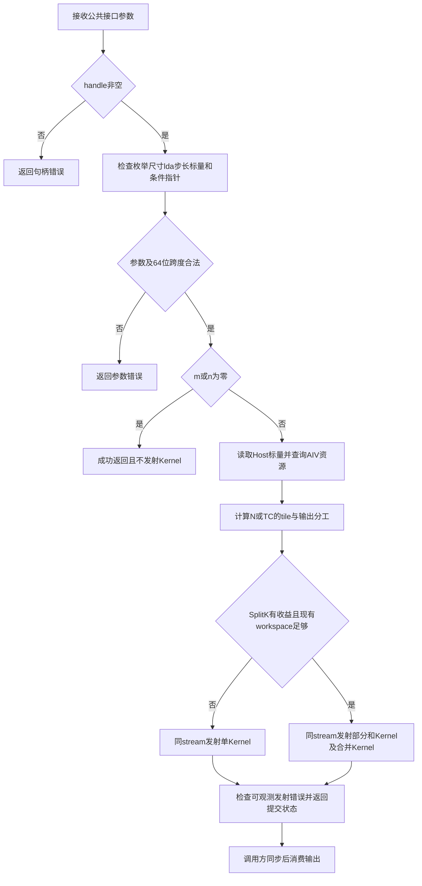
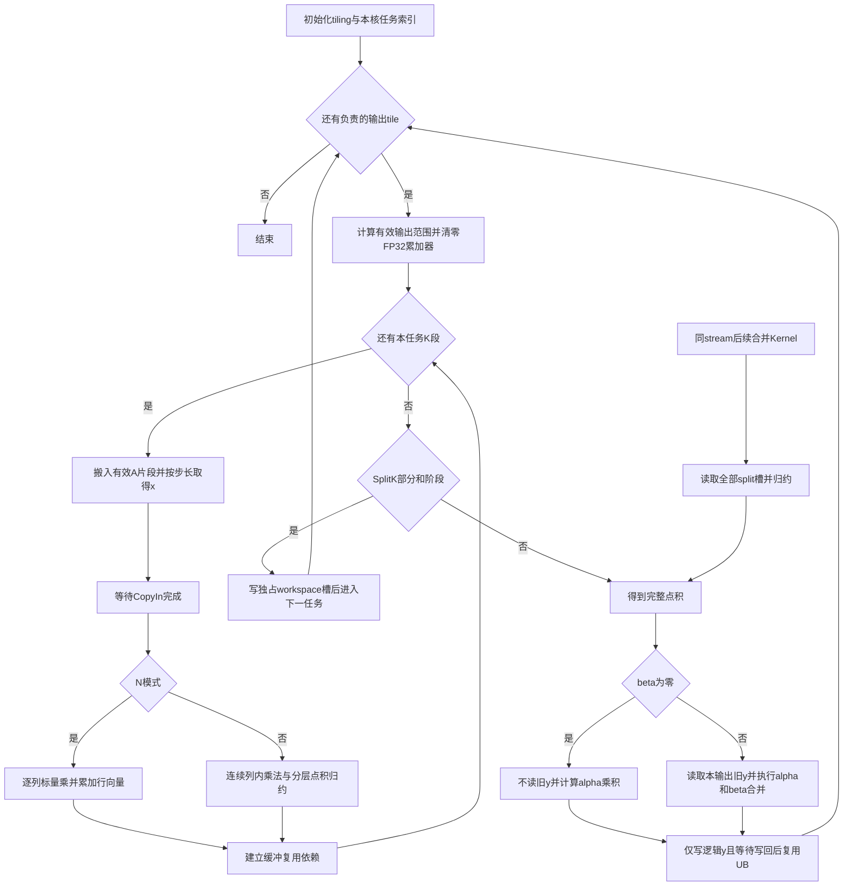

# aclblasSgemv 算子设计文档

## 需求背景（required）

### 需求来源

本设计对应 [11月社区任务-aclblasSgemv算子开发（A2/A3）](https://www.hiascend.com/activities/task-center/details/a8c0b7d0985349c59503ec0c34ca7344?menu=guide)。设计依据为任务页提供的 `8caf097923a04a20bfaeee0cce0ede06.zip` 中的任务书、`test_cases/sgemv_test.csv`、`gpu_baseline.csv`、生成器、两个验证脚本和测试说明。

计划使用 Ascend C kernel 直调方式，在 `cann/ops-blas` 的 `master` 分支对应目录补齐 Atlas A2/A3 单精度实数矩阵向量乘法。公开接口复用 `include/cann_ops_blas.h` 中的 `aclblasSgemv` 声明，实现位于 `blas/gemv/arch22/`，测试位于 `test/gemv/sgemv/arch22/`。目标软件为 CANN 9.1.0，自验证平台为 910B3；A2/A3 适配要求与仅需 910B3 自验证的范围分别记录。

本文为拟实现方案，精度、性能、编译和验收结论均须由后续实际执行产生。设计文档按当前社区任务仓README允许贡献者创建任务目录的约定，拟提交至 `04_tasks/01_community-task-2026/tasklist/11-aclblasSgemv-A2A3/MissingPastDays/docs/design.md`；代码与设计分仓提交。

### 背景介绍

#### 现有实现与工程边界

核对的 `ops-blas master` 页面提交为 `5bd95145a9c499e43ebad44a313a1029c63d54bc`。下载源码中，`blas/gemv/arch35/sgemv_host.cpp` 提供 Host 参数检查及 SIMT 下发，`arch22` 仅有复数 Cgemv 的 Host 和 N/T Kernel，尚无单精度实数 Sgemv 实现。950 的 SIMT 内核不能直接作为 A2/A3 Vector 实现。

| 现有模块 | 可复用内容 | 本任务需要处理的差异 |
| --- | --- | --- |
| `include/cann_ops_blas.h` | 公共函数声明、枚举、状态码 | 不新增平行接口，不改变 ABI |
| `blas/gemv/arch35/sgemv_host.cpp` | 参数检查顺序、N/T/C、空矩阵语义 | arch22 另行实现；补齐向量跨度溢出守卫 |
| `blas/gemv/arch22/cgemv_host.cpp` 及内核 | 同架构构建与设备入口组织 | 不照搬复数拆分、原子写回、调用内同步及临时分配机制 |
| `test/gemv/sgemv/{sgemv_param.h,sgemv_golden.h}` | CSV 参数映射、Netlib `cblas_sgemv` 参考调用 | 负例须在造数前分流；核查 golden 与任务书精度口径 |
| `test/gemv/sgemv/CMakeLists.txt` | 已无条件调用 `ops_blas_add_gtest_tests(${OPS_BLAS} sgemv_test)` | 新增 arch22 测试源后验证发现过程，避免重复注册 |
| `blas/common/helper/aclblas_handle_internal.h` | stream、核数相关公共辅助及有效 workspace 查询 | Split-K 只借用已有 workspace，不在异步调用内释放 |

任务书关于“当前 CMake 只在 arch35 分支注册 GTest”的描述与源码快照不符。计划保留当前统一注册方式，通过构建产物、测试清单及 GTest 列举证明 arch22 被正确发现。

#### 功能分析

Sgemv 计算列主序矩阵与向量的乘加，主要工作量为约 `2mn` 次浮点运算，矩阵读取量约为 `4mn` 字节。大矩阵场景计算密度接近 `0.5 FLOP/Byte`，因此首版拟优先提高连续矩阵访问、向量复用和核间负载均衡，不引入降低 FP32 精度的计算路径。

N 模式下矩阵每列内部连续，可对一组输出行同时累加；T/C 模式下每个输出对应矩阵的一列，适合连续读取后做点积。两种模式将采用不同的数据流。极端矩形中输出维很短时，单纯按输出分核可能无法充分利用核数，将按收益评估归约维拆分。

## 需求分析（required）

### 需求描述

计划支持 FLOAT32、列主序、`trans=N/T/C`、任意合法 `lda`、正负非零 `incx/incy`、运行时尺寸、原地 y 更新和句柄 stream 异步执行。C 对实数等价于 T；不涉及广播、额外 dtype、图模式动态 shape 或零维 Tensor 接口。

### 接口与参数分析

```cpp
aclblasStatus_t aclblasSgemv(
    aclblasHandle_t handle, aclblasOperation_t trans, int m, int n,
    const float* alpha, const float* A, int lda,
    const float* x, int incx, const float* beta, float* y, int incy);
```

| 参数 | 位置、类型及角色 | 约束与处理 |
| --- | --- | --- |
| handle | Host，库句柄 | 空句柄返回 `ACLBLAS_STATUS_HANDLE_IS_NULLPTR`；使用其 stream |
| trans | Host，枚举 | 仅 N/T/C 合法；非法值返回 `ACLBLAS_STATUS_INVALID_VALUE` |
| m、n | Host，int32，矩阵行列数 | 非负；校验完成后任一为 0 则不启动 Kernel、不修改 y |
| alpha、beta | Host，`const float*` | 必须非空；取值不限制，含零、Inf、NaN；非空运算读取后按值传给 Kernel |
| A | Device，只读 FLOAT32 | 列主序物理存储 `lda*n`；仅前 m 行有效；m、n 均大于 0 时必须非空 |
| lda | Host，int32，列间距 | `lda >= max(1,m)`；列间空洞条件为 `lda>m` |
| x | Device，只读 FLOAT32 | N 时逻辑长 n，T/C 时逻辑长 m；逻辑长度非零则指针必须非空 |
| incx | Host，有符号 int32 | 拒绝 0、INT32_MIN；用 int64 计算跨度，超 INT32_MAX 返回 INVALID_VALUE |
| y | Device，FLOAT32，输入兼输出 | N 时逻辑长 m，T/C 时逻辑长 n；逻辑长度非零则指针必须非空；仅更新逻辑元素 |
| incy | Host，有符号 int32 | 与 incx 相同的合法性及跨度规则；空洞元素保持原样 |

调用方传入 x/y 物理存储的低地址端。非空向量物理元素数为 `1+(L-1)*abs(inc)`；L=0 时物理元素数记为 0，不套用负长度公式。A、x 只读，y 原地更新；任务未定义 A/x 与 y 重叠时的结果，不将这种输入视为已承诺支持的别名关系。

### 需求拆解与覆盖矩阵

| 编号 | 强制要求及来源 | 设计落点 | 计划验证 |
| --- | --- | --- | --- |
| R01 | 任务书 §2.1～2.4：公共接口、FLOAT32、N/T/C、列主序 | 接口表、数学公式、N/T 路径 | 正式 L0/SQ/LD，T/C 对照 |
| R02 | §2.4～2.5：参数错误、负步长、跨度守卫 | Host 检查、64 位索引 | 正式 ED/INC 及补充状态码组合 |
| R03 | §2.1、§2.5：β=0 不读旧 y；α=0 不短路 | epilogue、特殊值设计 | β=0 且旧 y 为 NaN/Inf；α=0 冲突用例单独处理 |
| R04 | §2.5：空矩阵、原地、无广播、异步 | Host quick return、所有权、stream 生命周期 | 空矩阵无 launch、padding/只读检查、连续调用 |
| R05 | §2.2、§5：kernel 直调、arch22 源码与 GTest | 工程集成、测试注册 | A2/A3 编译、910B3 GTest 发现与运行 |
| R06 | §3.1～3.2：CANN9.1.0、910B3、混合容差 | 支持硬件、精度计划 | 1000 条正式精度、独立 NullHandle |
| R07 | §3.3、§3.5：200 条性能，每条达到 0.8×A100 | tiling、计时与基线关联 | 全量200条；event和msprof分别记录 |
| R08 | §3.5：均匀/正态分布覆盖 | 测试输入设计 | 原始包保持不变，另建补充用例与覆盖统计 |
| R09 | §4～§5：设计、代码、README、自测报告及模板 | 交付规划、兼容性 | 设计与代码分轨评审，报告逐项可追溯 |
| R10 | §3.4：无专项内存性能要求 | 内存安全作为实现约束 | 不虚构内存验收条数；模板项按不涉及填写 |

### 任务材料冲突与待确认事项

| 编号 | 材料差异 | 本设计处理方案 | 对验收的影响 |
| --- | --- | --- | --- |
| Q01 | 任务书 §3.3 指定 msprof task duration；附件 README/性能脚本指定 aclrtEvent，msprof 不参与脚本判定 | 同时保留两套独立结果，不将二者混为同一耗时；请求需求方明确最终 gate | 未明确前不得只据更快的一种口径宣称性能通过 |
| Q02 | §3.2 出现 float64 真值收窄；§3.5、§7 及仓内 golden 为 float32 `cblas_sgemv`；§3.1 另有逐 batch `cblas_sgemm` 描述 | 拟按实数 GEMV 与现有 float32 Netlib3.10.0 参考主测；float64仅作诊断，不替换正式 golden | 需明确长归约误差参考及最大误差规则 |
| Q03 | 任务书排除 α=0 且 A/x 非有限值组合；实际 CSV 含 `TC_EX_0396`、`TC_EX_0880` | 保留原始 CSV；独立列出这两条和参考差异，等待官方勘误或认可的处理规则 | 不静默删行、不把非等价参考失败归为 Kernel 数值错误 |
| Q04 | 任务书要求50%正态分布；实际1200行没有 GAUSS token；README与生成器描述也有差异 | 原始精度1000条继续保留；另建1000条补充分布测试，500条均匀、500条正态，参数与正式性能基线不混用 | 补充条数与覆盖单独报告，不改写原始通过数；500/500仅指补充集，正式与补充合并后的比例及特殊值是否纳入分母仍需确认 |
| Q05 | 部分文字误写 `lda>n` 表示列空洞 | 按参数表及列主序公式采用 `lda>m` | 不让padding进入有效矩阵计算 |
| Q06 | README分类计数与实际CSV不同，且验证脚本不强制预期全集 | 精度以实际1000行、性能200行及唯一用例名清单逐条核对 | 不能用脚本退出码或部分PASS替代全量覆盖 |
| Q07 | GPU基线200行只有197个唯一联合参数键，3组同参行耗时不同；性能脚本后值覆盖前值 | 保留200行原始基线及脚本现状；记录N/512²、N/1024²、C/2004²的重复组，逐case映射待需求方确认 | 不静默选较宽阈值；正式脚本结果与逐行审计结果分开 |
| Q08 | 仓内共享MixedToleranceStrategy与任务特殊值规则不同：不接受NaN与Inf等效，匹配比例分母也包含非有限元素 | 拟在Sgemv测试层适配有限/非有限分类与阈值，不全局放宽共享Verifier | 不能只调用默认Verifier就声称符合§3.2 |

当前 `cann/cann-ops-competitions master` 未预建本任务Sgemv目录，2026社区任务README明确允许贡献者创建任务目录。本次按十一月任务、算子名与平台创建 `11-aclblasSgemv-A2A3/MissingPastDays/docs/design.md`，设计PR目标分支为master；该路径与ops-blas中的实现路径分别管理。

## 详细设计（required）

### 算子分析

#### 数学公式与地址映射

以零基索引定义列主序矩阵：

$$
A_{i,j}=A[i+j\cdot lda],\quad 0\le i<m,\;0\le j<n.
$$

定义步长映射：

$$
p(t,L,s)=\begin{cases}ts,&s>0,\\(L-1-t)(-s),&s<0.\end{cases}
$$

令 `K = trans==N ? n : m`，`O = trans==N ? m : n`，则：

$$
y[p(r,O,incy)]\leftarrow
\alpha\sum_{k=0}^{K-1}B_{r,k}x[p(k,K,incx)]+\beta y_{old}[p(r,O,incy)],
$$

其中 N 模式 `B[r,k]=A[r+k*lda]`；T/C 模式 `B[r,k]=A[k+r*lda]`。所有地址乘积先转为64位；合法 int32 参数并不意味着 `lda*n` 能用32位表示。

β=0（含负零）时将直接写 `alpha*sum`，不加载旧 y，也不计算 `0*y_old`。α=0 时仍计算矩阵向量乘积，不采用参考 BLAS 的 α=0 短路。Inf/NaN 自然传播，不开启会消除特殊值语义的 fast-math。不得跳过零 x 对应列以仿照 Netlib 稀疏短路；含特殊值时可能改变数学公式结果。

#### 支持范围与复杂度

| 项目 | 设计范围 |
| --- | --- |
| 数据类型 | A/x/y/alpha/beta 均 FLOAT32，向量计算与中间累加均 FP32 |
| 尺寸 | m、n 为任意合法非负 int32；通过 tile 循环处理，不把测试最大尺寸当接口上限 |
| 内存有效性 | 调用方提供与物理布局匹配的有效Device存储；Host检查算术溢出，不扫描元素内容 |
| 计算量 | 约2mn FLOP，另含O个输出缩放和合并 |
| 数据量 | 常规路径A约4mn字节，x按核与tile复用，y读写约4O或8O字节，布局不连续时额外搬运另计 |
| 确定性 | 不承诺跨切分策略、硬件或编译版本逐bit一致；单次执行的输出所有权明确 |

### 算子实现

#### 整体架构与工程集成

拟新增 `blas/gemv/arch22/sgemv_host.cpp`、`sgemv_kernel.cpp`、`sgemv_tiling_data.h`，Kernel内部区分 N 与 T/C 数据流；如代码复杂度需要可按两种数据流拆文件，但不复制整套框架。源码由既有 `blas/CMakeLists.txt` 自动收集，不为该算子新增无用 CMake。

测试拟新增 `test/gemv/sgemv/arch22/sgemv_test.cpp`、`sgemv_npu_wrapper.h`、`sgemv_test.csv`，复用家族参数结构与 golden，在 `blas/gemv/README.md` 补齐支持范围、布局、异常、异步调用和构建说明。拟复用 `cmake/test.cmake` 的架构源发现与现有 GTest 注册，保留 arch35 行为。

下面的 Host 流程图说明参数校验、tiling与异步发射边界。



#### Host侧设计

校验顺序拟为：handle；trans；m/n；lda；incx/incy的0及INT32_MIN；alpha/beta指针；按m/n/trans决定的A/x/y指针；向量跨度。前三类异常分别使用任务要求的状态码。对跨度，先将 inc 提升为 int64 再取绝对值；L=0 时跨度为0，L>0 时计算 `(L-1)*abs(inc)`，超过 INT32_MAX 即拒绝。quick return 位于全部检查后，不读取任何 Device 数据、不解引用Host标量值、不查核数。

非空计算读取 Host alpha/beta 一次并按值传递；T/C归一为一个模式。查询实际AIV核数与可用UB容量，资源查询失败返回执行错误并记录日志。核数不固定为40，不沿用arch35的SIMT线程配置。

tiling拟包含：m/n/lda、O/K、transMode、alpha/beta、incx/incy、xStart/yStart、rowTile、kTile、taskCount、blockDim、splitCount、workspacePitch。尺寸及偏移用足够宽的字段；Host和Device共用同一定义。首版拟用R=64/128/256、Ktile=128/256/512等候选进行小集合评估，这些是调优候选，不是接口常量或已测最优值。

设输出tile数 `T=ceil(O/R)`。普通路径 `blockDim=min(T,AIV核数)`，各核处理 `tileId=blockIdx+q*blockDim`，覆盖恰好一次且尾波负载差至多一个tile。对极短输出长K，评估S路Split-K，任务空间为 `(outputTile,split)`；S按核数、K长度、工作区预算限制，禁止根据正式case名分派。第s段范围为 `kBegin=floor(s*K/S)`、`kEnd=floor((s+1)*K/S)`，形成不重不漏的半开区间；S不超过K，不产生参与归约的虚构padding元素。

#### N模式Kernel设计

一个输出tile负责R个连续矩阵行，初始化R个FP32累加器。K维按tile遍历：将若干列的有效R行搬入UB，按逻辑步长取相应x；将每列乘对应x标量后累加到行向量。x在同输出tile内复用，单个核完成所负责输出的完整归约。K和R尾部仅处理有效范围，不能把矩阵padding或向量空洞作为输入。

普通模式可用多组独立累加器缩短依赖链，最终树形合并；累加方式的变更需在长归约、抵消与特殊值样本上确认精度。输出所有权保持完整，不在y上执行跨核原子加。

#### T/C模式Kernel设计

每个输出对应A的一列，按连续行段读取A及逻辑x，FP32乘法后分层归约。若输出足够多，一核负责若干完整列；若每列很长，在UB内分段累加，最后只执行一次alpha/beta epilogue。C与T共用此路径，不执行实数共轭操作。

当incx非1时，按负步长起点和有符号stride将有效元素重排到紧凑UB；普通连续路径避免多余gather。大跨度通用路径拟采用受界的分段/标量读取，不能为了少量元素一次搬入整个物理span。输出incy非1时逐逻辑位置精确写回，禁止覆盖其间空洞。

下面的Kernel图说明tile循环、数据依赖、Split-K与最终写回的职责。



Split-K的部分和Kernel只写workspace；合并Kernel按相同输出分工读取全部S段后完成epilogue。因此旧y和beta只在合并阶段处理一次。两Kernel同stream先后下发，不采用Kernel内全核屏障。图中B分别表示部分和/普通Kernel与合并Kernel各自的输出任务循环，不是跨Kernel跳转；S节点代表由Host独立发射的后续Kernel入口。

#### UB、尾部与同步

设A的UB物理行距为 `P=AlignUp(R,8)` 个FP32，A/x双缓冲、两组输出累加和临时区的示例预算为：

$$
U=2\cdot4PK_t+2\cdot4\operatorname{AlignUp}(K_t,8)+2\cdot4P+U_{tmp}+U_{guard}\le U_{available}.
$$

T/C模式将R替换为并行列数并沿Ktile对齐，单独推导预算，不能直接套用N模式pitch。实际容量、归约临时空间与保留量由目标CANN/设备核实后确定，超预算候选直接排除。对多block DMA，分别记录GM有效字节、GM列距、UB对齐pitch和每个stride字段单位；不以逻辑blockLen代替UB实际pitch。

CopyIn→Compute、Compute→CopyOut、CopyOut→下一轮覆盖同一UB区间分别建立匹配的事件/队列依赖。双缓冲需验证至少两轮外层迭代，不能用单tile结果证明生命周期正确。非32字节尾部拟使用目标9.1.0支持的精确长度搬运，必要时标量处理，禁止越界读写。索引元素数使用64位，换算为分配或搬运字节数时使用经过乘法边界检查的size_t，不能先在int32中相乘再提升。向量尾部用有效mask，UB补零区域不得引入非有限值与零相乘的额外传播。

#### workspace与异步生命周期

普通路径不需要外部workspace。Split-K拟使用句柄现有有效workspace，令 `P_o=AlignUp(O,8)`，容量需求 `W=4*S*P_o` 字节；部分和地址为 `split*P_o+r`。每次调用写满后续合并实际读取的全部有效槽，不依赖历史零值。

Host使用 `GetEffectiveWorkspace`、`GetEffectiveWorkspaceSize` 查询现有缓冲。只有指针、容量、对齐均满足时启用Split-K，否则退回完整输出归约路径以保持合法调用可执行。不在本接口内扩容、释放或执行同步Memcpy，不将栈上的tiling指针作为异步GM参数保留；拟按值传递tiling，最终ABI需编译核实。

workspace由库句柄或调用方持有，算子仅借用；生命周期必须覆盖两个Kernel及其完成前的使用。相同handle和stream的连续调用按流顺序复用；不承诺同一workspace在不同stream并发下的安全性，调用方应使用独立handle/workspace或外部串行化。Host返回SUCCESS仅表示提交成功，读取y、释放输入输出或切换workspace前由调用方同步。可观测发射失败须透传为库状态码，异步设备失败由后续同步报告。

### 支持硬件与约束逐项核对

| 任务书§2.5条目 | 拟实现结论及验证点 |
| --- | --- |
| 参数合法性及层级 | 先校验再quick return；状态码和跨度检查如Host设计 |
| 非连续Tensor | 支持lda>m、正负inc；低地址基指针；精确逻辑元素读写 |
| broadcast | 不涉及，不新增广播分派 |
| dynamic shape | 运行时m/n生成tiling，无需图模式dynamic shape |
| 原地与视图 | y旧值与新值同址；β=0不读旧值；A/x只读，不返回视图 |
| 确定性 | 不要求跨次bit确定性；不依赖不受控原子写回实现单次结果 |
| 空Tensor | m或n为0，在合法性校验后不发射、不访问Device数据 |
| 0维Tensor | 不涉及，alpha/beta是Host标量指针 |
| 异步执行 | 使用handle stream，不在接口内部同步或过早释放资源 |

| 硬件/软件 | 覆盖计划 |
| --- | --- |
| Atlas A2 / 910B3 / CANN9.1.0 | 构建、1000正式精度、200性能、补充与回归的自验证主环境 |
| Atlas A3 / arch22 | 编译适配；若增加真机执行则单独记录，不把B3结果外推为A3实测 |
| Ascend950 / arch35 | 不改其生产实现；公共测试/构建若调整则验证对应回归 |

## 可维可测分析

### 精度标准与正式用例

| 标准 | 内容 | 来源 |
| --- | --- | --- |
| 有限值混合容差 | `abs(actual-golden) <= 2^-13 + 2^-13*abs(golden)`，匹配比例至少0.99 | 任务书§3.2 |
| 最大绝对误差 | 同时满足任务指定的 `1e-2 or 32*ULP`；ULP锚点及OR实现需核实，不能以通过比例替代此条件 | 任务书§3.2、仓内Verifier |
| 非有限值 | 同NaN、同号Inf、NaN与±Inf按任务视为等效；相反符号Inf不等效；有限/非有限混合失败；单独统计并要求全部匹配 | 任务书§3.2 |
| 性能 | 每case `T_NPU <= T_A100/0.8`，不以平均加速比掩盖失败case | 任务书§3.3、官方基线 |

以实际发布CSV读取的分类数量为准：

| 分类 | 精度/状态码行数 | 主要覆盖 |
| --- | ---: | --- |
| TC_L0 | 14 | 基本运算与标量组合 |
| TC_SQ | 63 | 方形、矩形、极长维度、非对齐 |
| TC_LD | 14 | lda空洞与非对齐 |
| TC_INC | 21 | 正负和混合步长 |
| TC_AB | 26 | alpha/beta及特殊值 |
| TC_FL | 28 | 填充方式 |
| TC_ED | 32 | 参数错误和quick return |
| TC_EX | 802 | 组合覆盖，含待确认特殊值行 |
| 精度与状态码合计 | 1000 | 不包含TC_PF及独立NullHandle |
| TC_PF | 200 | 独立性能队列，存在200行基线，含重复参数键待确认 |

这些数量为计划执行清单，不代表测试执行结果。形状覆盖需包含4096×4096锚点、4095/4097尾部、1048576×4与4×1048576极端矩形，以及N/T/C和非单位步长。

### 精度与异常测试设计

1. 原始任务包、CSV及基线保持冻结并记录SHA256；部署后核对实际加载CSV与预期一致。使用任务脚本调用同架构GTest，另核验完整1000个唯一case名和独立NullHandle，不接受只解析到少数PASS的结果。性能脚本还未检查测试进程返回码或有效采样数，须外层保留退出码与原始日志并审计200条全集，不能用截断输出产生的成功摘要替代。
2. 负例在Host造数前根据原始参数与期望状态分流：仅提供单元素Device dummy或明确NULLPTR，直接调用真实公共接口，尤其NullHandle不能由wrapper预先返回常量，不先计算危险span、不生成golden、不由wrapper代替接口返回错误。
3. 负步长合法非空用例仍按真实span分配，不能将所有inc≤0情况当quick return。零矩阵用例可用dummy，接口校验通过后须不产生任何Kernel。
4. 正常精度以当前仓内float32 `cblas_sgemv` 为拟采用参考，保存Netlib版本和链接库身份；在Sgemv测试层显式适配Q08规则，不修改共享Verifier的默认语义。按逻辑y顺序去stride比较，另比对A/x只读、y空洞与尾部guard。全为非有限值时有限值集合为空，避免除零，非有限值须全部符合任务等效规则。
5. 不把TC_EX_0396/0880静默过滤；保存两条原始参数和NPU/参考差异，待官方明确后执行认可方案。补充alpha0有限值、alpha0非有限值公式语义、beta0旧y污染测试，各自标明参考与所属集合。
6. 另建1000条补充分布用例，500条均匀、500条正态；正态μ∈[-5,5]、σ∈[0.1,2]，记录seed与实际参数，A/x/y分布分别可追溯。补充长链抵消、跨tile尾部、双缓冲多轮、Split-K和普通路径一致性、不同stream独立handle与连续调用生命周期。

### 性能测试设计

GPU标杆由附件指定为A100-SXM4-80GB、CUDA12.8、cuBLAS12.8.4。`gpu_baseline.csv`单位为ms，NPU的us数值必须先除1000，按 `(trans,m,n,alpha,beta,lda,incx,incy)` 匹配，保留200行到case的映射；检查重复键、缺失键和非正基线。当前实际存在Q07所述3组重复参数；原脚本按197个键匹配并以后行覆盖，发布前须明确逐行映射，不能仅以baseline字典长度证明200条逐case绑定。

$$
T_{NPU,ms}=\frac{1}{1000N}\sum_{i=1}^{N}T_{invocation,i,us},\quad
speedup=\frac{T_{A100,ms}}{T_{NPU,ms}}\ge0.8.
$$

计划分别执行以下两套协议，不互换结果：

| 协议 | 采样及边界 | 报告用途 |
| --- | --- | --- |
| 附件脚本协议 | 5次warmup；按GTest约定20/50次有效下发；aclrtEvent计时并打印`[PERF] case=... avg_us=...` | 供原始verify_performance.py解析与判定 |
| 任务书协议 | msprof op；剔除5次预热；每case至少10次有效调用；汇总一次API全部Kernel duration再取算术平均 | 独立证明任务书§3.3目标，待Q01确认最终gate |

测试将在预置Device缓冲上调用公共接口，排除输入造数、H2D/D2H、golden和报告生成。对于β≠0，连续调用会递推改变y；性能队列须核对beta与数据范围，若需恢复初值，在计时窗口外恢复，不让非有限值增长改变被测工作。准确性使用单次调用与同初值golden，不能用多次性能调用后的结果充当单次精度输出。

Split-K计时须包括部分和与合并两个Kernel，并按case、调用序号、Kernel多重集核对样本归属。msprof若自行重复应用，须区分工具重复与GTest内部循环，明确每case实际调用数、预热数和有效样本数。函数返回SUCCESS且后续同步成功的调用才作为有效样本；异常、缺记录、缺基线均不计为通过。

冻结候选前先使用代表集合：正常N/T/C、负步长与lda空洞、β0、最小和最大形状、极端矩形、尾部、长归约抵消，以及最弱性能family。机制调整后只测受影响路径；冻结后执行全量1000精度、200性能及补充分布和回归，低裕量项定向复测。

### 兼容性分析与交付规划

公共签名、状态码和handle调用约定保持一致；新增生产文件仅归属arch22 Sgemv。若修改公共golden、Verifier或CSV生成辅助，应限定变化作用域并回归原arch35 Sgemv及共享调用方；不将Cgemv不同的INVALID_ENUM或alpha0短路规则复制进Sgemv。

| 交付件 | 拟提供内容及完成判据 |
| --- | --- |
| 设计文档 | 本方案、两张职责不同的流程图、约束矩阵及未决契约，经独立设计评审 |
| 算子与README | arch22 Host/Kernel/tiling，接口/布局/状态码/异步与构建说明，仓内门禁通过 |
| 测试工程 | GTest、官方1200行CSV、独立负例入口、补充分布与必要回归，正式/补充集合分开 |
| 自测报告 | 按expected/executed/passed/failed/unverified逐项列出；记录SoC/CANN/commit/二进制/CSV/命令及原始结果 |
| task_submission | 按官方模板准备7个命名文件；内存项按任务“不涉及”如实填写，不生成虚假通过日志 |
| 待验收地址 | 明确账号、仓库、分支、完整commit、算子路径；设计PR、代码PR、真机验证、正式验收各自独立 |

在Q01～Q04及Q07～Q08影响验收的冲突未关闭前，相关项目状态应为待确认或未验证。设计文档完成不表示实现、1000/200全量自验、PR评审或官方验收取得通过结论。
