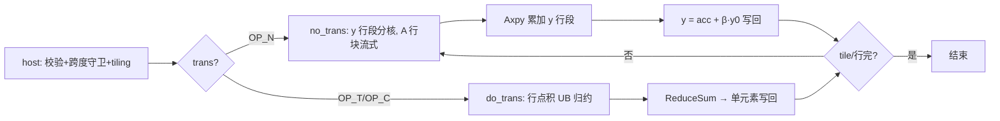

# aclblasSgemv 算子设计文档

# 需求背景（required）

## 需求来源
- 任务名称/批次：2026 年 11 月社区任务 — aclblasSgemv 算子开发（A2A3）。
- 合入目标仓：https://gitcode.com/cann/ops-blas ，算子代码 `blas/gemv/arch22/`，测试代码 `test/gemv/sgemv/arch22/`。
- 验收流程：cann-competitions 社区任务流程（任务书 §4 交付件 / §5 PR 申请合入）。

## 背景介绍
### 算子功能定位
- aclblasSgemv 完成列主序 m×n 单精度实数矩阵与向量的乘加 `y ← α·op(A)·x + β·y`：op(A) 由 trans 决定（N：A 本身；T：Aᵀ；C：实数矩阵等价于 Aᵀ），y 原地覆写，beta 读取 y 旧值参与计算（β=0 时不读 y 输入值）。
- 数学公式：`y[j] = α·Σ_{i=1..k} op(A)[j,i]·x[i] + β·y[j]`；trans=N 时 k=n、len(y)=m，trans=T/C 时 k=m、len(y)=n；元素定位 A[i,j] 位于列主序偏移 (i−1)+(j−1)×lda（1 基）。

### 业界对标
- 对标 cuBLAS `cublasSgemv`（cuBLAS 官方文档 §2.6.2）：参数语义、返回码、快速返回口径以该文档为唯一依据；golden 参考语义见 Netlib `sgemv.f`。
- 行为对齐仓内 950PR 既有实现 `blas/gemv/arch35/sgemv_host.cpp` 的 `ValidateSgemvParams` 与 `aclblasSgemv` 入口（L31-107）。
- alpha=0 口径：实现侧不短路，仍按 y = 0×op(A)x + βy 计算；golden `cblas_sgemv` 在 alpha=0 时短路为 y=βy（不读 A/x）——二者仅在 A/x 含 Inf/NaN 时结果不同，该组合不设精度用例（alpha≠0 的 Inf/NaN 用例照常覆盖）。

### 工程形态
- 工程模式：Ascend C kernel 直调（host 入口 + 校验 + tiling + device kernel，handle 绑定 stream）。
- 代码落位：`blas/gemv/arch22/`（sgemv_host.cpp / sgemv_kernel.cpp / sgemv_kernel.h / sgemv_tiling_data.h；同目录已有复数 cgemv 的 no_trans/do_trans 双 kernel 拆分样例可参考）；测试落位 `test/gemv/sgemv/arch22/`，并在 `test/gemv/sgemv/CMakeLists.txt` arch22 分支补 `ops_blas_add_gtest_tests(${OPS_BLAS} sgemv_test)`（当前仅 arch35 注册，随本任务补齐）。
- 仓内近亲：`blas/gemv/arch35/sgemv_*`（950PR 实数 gemv 已合入：host 校验 + kernel，整体移植）；`blas/gemv/arch22/cgemv_*`（arch22 工程骨架与 no_trans/do_trans 拆分样例）。
- 现场核验：`include/cann_ops_blas.h` **L468 已有 `aclblasSgemv` 声明**（任务书 §2.3 写 L461-463，行号小幅漂移），签名与 §2.3 逐参一致，本任务无需改公共头。

### 接口规格
- 接口声明（与 include/cann_ops_blas.h L468 既有声明逐参一致）：

```cpp
aclblasStatus_t aclblasSgemv(aclblasHandle_t handle, aclblasOperation_t trans, int m, int n, const float* alpha, const float* A, int lda, const float* x, int incx, const float* beta, float* y, int incy);
```

- 参数规格表（官方栏目）：

| 参数 | 参数含义 | 数据类型 | 支持数据类型 | 约束 | 形状 |
| --- | --- | --- | --- | --- | --- |
| handle | 库上下文句柄（携带 stream），Host 内存 | scalar | - | nullptr 返回 ACLBLAS_STATUS_HANDLE_IS_NULLPTR | - |
| trans | 矩阵操作类型，Host 内存 | attr | 枚举 | 仅 {ACLBLAS_OP_N, ACLBLAS_OP_T, ACLBLAS_OP_C}；非法返回 INVALID_VALUE | - |
| m | A 的行数，Host 内存 | scalar | int32 | m≥0；m<0 返回 INVALID_VALUE；校验通过后 m=0 或 n=0 快速返回 | - |
| n | A 的列数，Host 内存 | scalar | int32 | 同 m | - |
| alpha | 标量乘数 α 指针，Host 内存 | scalar | FLOAT32 | nullptr 返回 INVALID_VALUE；值不校验（实现侧 alpha=0 不短路） | 标量 |
| A | 列主序系数矩阵，Device 只读 | tensor | FLOAT32 | m>0 且 n>0 时 nullptr 返回 INVALID_VALUE；前 m×n 为有效矩阵 | lda×n |
| lda | 主维（列主序），Host 内存 | scalar | int32 | lda≥max(1,m)；不足返回 INVALID_VALUE | - |
| x | 输入向量，Device 只读 | tensor | FLOAT32 | 逻辑长度 trans=N 为 n 否则 m；逻辑长度非零时 nullptr 返回 INVALID_VALUE | 1+(len−1)×\|incx\| |
| incx | x 步长，Host 内存 | scalar | int32 | ≠0 且非 INT32_MIN；跨度超 int32 返回 INVALID_VALUE（host int64，issue #866/#860；**arch35 参考实现未含该守卫，arch22 须补齐**） | - |
| beta | 标量乘数 β 指针，Host 内存 | scalar | FLOAT32 | nullptr 返回 INVALID_VALUE；β=0 时 y 输入值不被使用 | 标量 |
| y | 输入/输出向量（原地覆写），Device | tensor | FLOAT32 | 逻辑长度 trans=N 为 m 否则 n；逻辑长度非零时 nullptr 返回 INVALID_VALUE | 1+(len−1)×\|incy\| |
| incy | y 步长，Host 内存 | scalar | int32 | 同 incx | - |

### 数学公式
- 与 §3.2 精度判定 golden（Netlib sgemv.f CPU 实现，fp64 真值计算按 FLOAT32 收窄）同一计算形态。

# 需求分析（required）

## 需求描述
- 使用 Ascend C 在 Atlas A2/A3（arch22）上以 kernel 直调实现 aclblasSgemv：FLOAT32 dtype、trans 三值全覆盖、lda 列间空洞与正负步长、m/n=0 快速返回、跨度溢出守卫补齐，精度按 mixed_tolerance FLOAT32 对齐 cblas_sgemv golden，性能达到 cublasSgemv（910B3 实测）平均单次耗时的 0.8 倍以上。

## 需求拆解

| # | 必须回答 | 本算子结论 |
| --- | --- | --- |
| 1 | 数学定义与可复用的代数量 | 矩阵-向量乘加；op(A)=A（N）为按列点积累加（可列间并行、行内归约），op(A)=Aᵀ（T/C）为按行点积（行间并行）；arch35 sgemv 整体移植，arch22 cgemv 提供双路径骨架 |
| 2 | 接口原型 | include/cann_ops_blas.h L468 声明已存在（现场核验），无需新增；参数序列与 cublasSgemv 逐位一致 |
| 3 | 参数规格 | 见接口规格表；异常码：HANDLE_IS_NULLPTR / INVALID_VALUE；m=0 或 n=0 快速返回 SUCCESS |
| 4 | 支持数据类型 | A/x/y：FLOAT32；alpha/beta：FLOAT32 Host 标量 |
| 5 | 目标芯片与 arch 映射 | Atlas A2/A3（arch22）；自验覆盖 910B3（性能设备 Atlas 800I A2 910B3）；标杆 cublasSgemv |
| 6 | 精度要求 | y 逐元素 FLOAT32：rtol/atol=2^-13，ratio 0.99，max_abs 1e-2 or 32×ULP（mixed_tolerance）；golden=cblas_sgemv（sgemv.f 语义，fp64 收窄）；Inf/NaN 等效规则；alpha=0×(A/x 含 Inf/NaN) 组合不设用例 |
| 7 | 性能预期 | msprof op（warmup 5 + 采样 ≥10 取平均）≤ GPU 标杆 1.25 倍；标杆 gpu_baseline.csv |
| 8 | 代码架构选型 + 可行性 | N 路径：按列分核，各核列段乘 α 后 Axpy 累加进 y 行段（读改写 y 需核间协调 → 采用 y 分核 + A 列块流式）；T/C 路径：按行分核，行内点积 UB 归约。移植 arch35 sgemv 方案 + arch22 cgemv no_trans/do_trans 拆分骨架。已排除死路：N 路径直接按列分核原子累加 y（原子开销大且破坏可重复性）；全矩阵常驻 UB（大规模超容量） |
| 9 | 评测来源 | golden：cblas_sgemv（sgemv.f 语义，仓内 sgemv_golden.h 同口径）；性能标杆：cublasSgemv（gpu_baseline.csv）；用例：test_cases CSV + GTest |

# 详细设计（required）

## 算子分析
### 数学公式
- `y[j] = α·Σ_{i=1..k} op(A)[j,i]·x[i] + β·y[j]`；op(A) 三态见接口规格；β=0 时无 +β·y[j] 项读取。
- m=0 或 n=0（校验通过后）：y 不修改，快速返回 SUCCESS。

### 支持数据类型
- A/x/y：FLOAT32；alpha/beta：FLOAT32 Host 标量（Host 侧同步解引用随 tiling 下发）。

### 支持形状
- A：lda×n 列主序（lda≥max(1,m)，lda>n 时列间有空洞）；x/y 逻辑长度由 trans 决定，物理 1+(len−1)×|inc|。
- 退化：m=0 或 n=0 → 快速返回 SUCCESS；x/y 逻辑长度为 0 时指针可空。

## 算子实现
### 实现方案
#### 总体架构与数据流
- 双 kernel 变体（参照 arch22 cgemv 的 no_trans/do_trans 拆分）：

| 变体 | 触发条件 | 职责 |
| --- | --- | --- |
| no_trans（op(A)=A） | trans==OP_N | y 行段分核：各核负责 y 的一个行段，流式载入 A 的对应行块（沿列遍历），每列先算 α·A[:,j]·x[j] 再 Axpy 累加进 y 行段；y 每核独占，无核间写冲突 |
| do_trans（op(A)=Aᵀ） | trans==OP_T 或 OP_C | 按输出行 j 分核：各核载入 A 的第 j 行段（列主序即 A 的第 j 列下跨 lda 的等距元素）与 x 段，UB 内点积归约，×α + β·y[j] 写回 |

- 数据流（no_trans）：GM(A 行块, x 元素)→UB（double buffer）→标量广播乘 + Axpy 向量累加→终列后 y 行段写回；数据流（do_trans）：GM(A 等距行段, x 段)→UB→点积归约→单元素写回。

#### host 侧设计
- **分核策略**：输出 y 逻辑长度按 AIV 核数均分（均分 + 余块），no_trans 按行段、do_trans 按行逐元素，满核原则。
- **数据分块和内存优化策略**：A 行块/行段分 tile 载入 UB，double buffer；no_trans 路径 x[j] 标量随列块广播；y 行段首读 β·y0 与终写合并（β=0 时跳过初读）。
- **tilingkey 规划策略**：trans（N/T_C）与 β 是否为零进 tiling key；m/n/lda/incx/incy 走 tiling 结构体。
- **数据检测（校验顺序，对齐 arch35 ValidateSgemvParams L31-107 + 任务书补齐项）**：
  1. handle==nullptr → ACLBLAS_STATUS_HANDLE_IS_NULLPTR；
  2. trans 不在 {OP_N, OP_T, OP_C} → INVALID_VALUE；
  3. m<0 或 n<0 → INVALID_VALUE；lda<max(1,m) → INVALID_VALUE；
  4. incx==0 / incy==0 / INT32_MIN → INVALID_VALUE；
  5. **跨度溢出守卫（arch22 新增，arch35 未含）**：(逻辑长度−1)×|incx|、(逻辑长度−1)×|incy| 超 int32 表示范围（host 侧 int64 计算，issue #866/#860）→ INVALID_VALUE；
  6. alpha/beta nullptr → INVALID_VALUE；
  7. m>0 且 n>0 时 A nullptr、x/y 逻辑长度非零时 nullptr → INVALID_VALUE；
  8. 校验通过后 m==0 或 n==0 → 快速返回 SUCCESS（不访问 A/x/y）。
- **alpha/beta 处理**：Host 侧同步解引用随 tiling 下发；实现侧 alpha=0 不短路（按公式计算）；β=0 时 kernel 跳过 y 旧值读取。

#### kernel 侧设计
- Init：解析 tiling（m/n/lda/incx/incy/alpha/beta/各核 y 区间），SetGlobalBuffer，InitBuffer（A 行块 ×2 double buffer）。
- Process：no_trans——逐列块 CopyIn → α·A[:,j]·x[j] 累加进 y 行段累加器 → 列块完 +β·y0 写回；do_trans——按行段载 A 等距元素与 x 段 → UB 点积归约（ReduceSum）→ ×α + β·y[j] 单元素写回。跨步向量按下标映射（负步长自尾端起算）。
- 流程图：



- workspace 布局：无额外 workspace（no_trans 各核独占 y 行段；do_trans 单元素直接写回；y 原地覆写）。

#### 性能优化要点（终态）
- 优化项：A 行块 double buffer；no_trans 列遍历顺序保证 y 行段驻留 UB（一次读写）；do_trans 等距访问按 32B 对齐切块。目标 ≤1.25× cublasSgemv 标杆，实测数据回填自测报告。
- 未采用路线：N 路径按列分核 + 跨核原子累加 y（原子开销、破坏可重复性）；全矩阵常驻 UB。

## 支持硬件

| 支持的芯片版本 | 涉及 |
| --- | --- |
| Atlas A2/A3 训练系列（910B，arch22） | ✅（本任务目标，自验覆盖 910B3） |
| Atlas 950PR（arch35） | ❌（arch35 已有 sgemv/cgemv 实现，本任务不改） |

## 算子约束限制
- 非连续访问：列主序按 lda 跨列（列间空洞）、向量按 incx/incy 步长（正负均生效，负步长自尾端起算）；inc/incy 为 0 或 INT32_MIN 非法。
- 不涉及 broadcast / dynamic shape；y 原地覆写不返回视图（β 读取旧值，β=0 不读）；A/x 只读。
- 确定性：行内点积归约的浮点累加顺序不保证跨次一致（无确定性要求），单次执行内部确定。
- 异步执行：经 handle 绑定 stream 异步下发，读输出前须同步 stream；alpha/beta 为 Host 标量，提交前同步解引用。

# 可维可测分析（required）

## 精度标准/性能标准

| 验收标准 | 描述 | 标准来源 |
| --- | --- | --- |
| 精度标准 | y 逐元素 FLOAT32：rtol=atol=2^-13(1.2e-4)，ratio 0.99，max_abs 1e-2 or 32×ULP；golden=cblas_sgemv（sgemv.f 语义，fp64 真值收窄）；Inf/NaN 等效规则单独判定；alpha=0 与 A/x 含 Inf/NaN 组合不设用例（实现不短路 vs golden 短路口径差异） | mixed_tolerance_standard，任务书 §3.2 |
| 性能标准 | FLOAT32 平均单次耗时 ≤ GPU 标杆（cublasSgemv 同规模同 dtype 同步长）×1.25；msprof op 采集，warmup 5 + 有效采样 ≥10 取平均，仅 SUCCESS 计入 | 任务书 §3.3 + test_cases/gpu_baseline.csv |

## 测试概览
- 测试工程：`test/gemv/sgemv/arch22/` 新建（CSV + C++ GTest，仓内当前仅 arch35），补 `test/gemv/sgemv/CMakeLists.txt` arch22 注册。
- 用例口径：精度全量 1000 条、性能子集 200 条（单 dtype 100% 分摊）；覆盖 trans 三值 × 尺寸扫描（0/1/小质数/2 的幂 ±1/非对齐/大规模）、lda 紧凑与 padding、步长 ±1/±2/±3（含负步长）、标量特殊值（α/β ∈ {0.0,1.0,2.5,-1.5}）、边界与负向（m/n=0 快返、handle/alpha/beta/A/x/y 空指针、非法 trans、lda 不足、inc==0/INT32_MIN、跨度溢出——期望对应错误码）、Inf/NaN 用例（alpha≠0）、性能用例。
- 输入生成：均匀 [-5,5] 50% + 正态 GAUSS_NORM_5_2 50%；负向用例不按跨度预分配缓冲（dummy 占位）；任务自带 gen_csv.py 仅均匀分布，正态用例本任务补齐并在自测报告说明。
- 性能口径：msprof op，warmup 5 + 有效采样 ≥10 取平均；复现入口 test_cases/README.md。

## 兼容性分析
- 公共头零改动：`aclblasSgemv` 声明已存在于 include/cann_ops_blas.h L468（现场核验，任务书行号 L461-463 有小幅漂移），本任务不新增不修改任何声明。
- `blas/gemv/arch22/` 新增 sgemv 文件（与既有 cgemv 并列）、`test/gemv/sgemv/arch22/` 新建测试工程与 arch22 CMake 注册，均不影响同目录 cgemv 与 arch35 既有行为。
- 相对 arch35 参考实现的行为增强仅一处：补齐跨度溢出守卫（issue #866/#860 口径），不改变任何合法输入下的既有语义。
