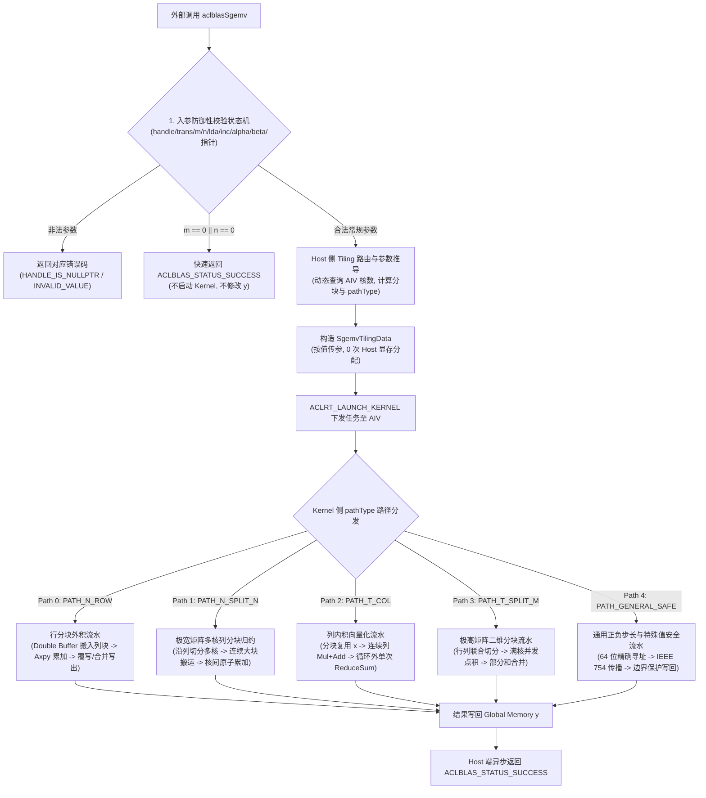
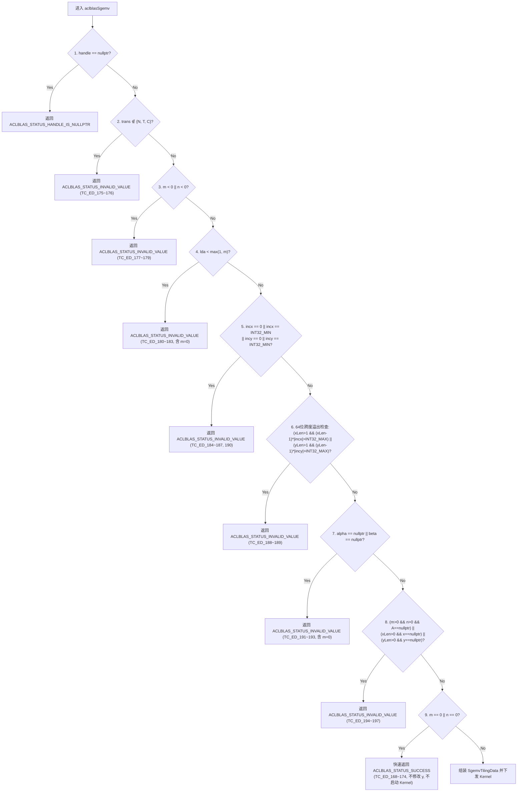

# aclblasSgemv（Atlas A2/A3）算子设计文档

| 项目 | 内容 |
| :--- | :--- |
| **算子名称** | `aclblasSgemv`（单精度实数通用矩阵-向量乘法，BLAS Level-2） |
| **任务编号与名称** | 11月社区任务-aclblasSgemv算子开发（A2/A3） |
| **任务 taskId** | `a8c0b7d0985349c59503ec0c34ca7344` |
| **任务链接** | [昇腾社区任务中心](https://www.hiascend.com/activities/task-center/details/a8c0b7d0985349c59503ec0c34ca7344) |
| **目标硬件架构** | Atlas A2 / A3 训练与推理系列产品（`ascend910b3` / `ascend910_93`，架构标签 `dav_2201`，仓内目录 `arch22`） |
| **目标软件环境** | CANN 9.1.0 |
| **目标代码仓与分支** | [cann/ops-blas](https://gitcode.com/cann/ops-blas)（`master` 分支，基线 SHA `5bd95145`） |
| **算子实现目录** | `blas/gemv/arch22/`（`sgemv_host.cpp`、`sgemv_kernel.cpp`、`sgemv_tiling_data.h`） |
| **算子测试目录** | `test/gemv/sgemv/arch22/`（`sgemv_npu_wrapper.h`、`sgemv_test.cpp`、`sgemv_test.csv`） |
| **对标标准接口** | cuBLAS `cublasSgemv` / Netlib CBLAS `cblas_sgemv` |
| **设计文档提交路径** | `04_tasks/01_community-task-2026/tasklist/11-aclblasSgemv-A2A3/newmecy/docs/design.md` |
| **开发者/团队名** | `newmecy` |
| **文档当前状态** | 阶段一设计评审阶段（本文不宣称代码、精度或性能已完成正式硬件验收） |

---

# 需求背景（required）

## 需求来源

本设计对应 2026 年 11 月社区任务《11月社区任务-aclblasSgemv算子开发（A2/A3）》（任务 taskId：`a8c0b7d0985349c59503ec0c34ca7344`）。

任务要求在 Atlas A2/A3（`arch22`）硬件架构上，基于开源代码仓 [cann/ops-blas](https://gitcode.com/cann/ops-blas) 的 Kernel 直调工程模式，使用 Ascend C 编程语言补齐单精度实数通用矩阵-向量乘法接口 `aclblasSgemv`。功能与参数边界严格对标 cuBLAS `cublasSgemv` 与 Netlib CBLAS `cblas_sgemv`。待设计评审通过、代码开发自验达标后，向 `cann/ops-blas` 提交 Pull Request 合入主仓。

设计文档按社区任务规范提交至竞赛仓对应算子目录 `04_tasks/01_community-task-2026/tasklist/11-aclblasSgemv-A2A3/newmecy/docs/design.md`。

## 背景介绍

### aclblasSgemv 算子实现优化与定位

`aclblasSgemv` 是 BLAS Level-2 规范中最基础、最高频的核心算子之一，执行实数矩阵与向量的乘加计算：

$$y \leftarrow \alpha \cdot \operatorname{op}(A) \cdot x + \beta \cdot y$$

其中矩阵 $A$ 为列主序（Column-Major）存储，主维度为 $\text{lda} \ge \max(1, m)$，输入向量 $x$ 与输出向量 $y$ 支持任意非零正负步长（`incx, incy`）。

从计算密度角度分析，`SGEMV` 每读取 1 个矩阵元素（4 Bytes）仅执行 2 FLOPs（1 次乘法 + 1 次加法），算术强度仅为 $\approx 0.5\text{ FLOP/Byte}$。因此，该算子属于典型的 **HBM 访存带宽受限（Memory-Bandwidth Bound）** 算子；在中小 Shape 场景下则表现为 **Host 下发与硬件调度延迟受限（Latency Bound）**。设计核心在于：
1. **最大化 MTE2 连续搬运吞吐率**：保证大矩阵下 Burst 传输长度对齐（32B/256B），消除跨列碎片访存；
2. **极速零分配下发**：杜绝 Host 侧任何内存分配与同步开销，将 Host 下发延迟压减至微秒级；
3. **多路径自适应切分**：针对常规矩阵、极宽矩阵（$m \ll n$）、极高矩阵（$m \gg n$）以及非连续步长设计特化流水路径。

### 仓内现状分析与工程边界（基于 ops-blas master 5bd95145）

通过对 `cann/ops-blas` 仓 `master` 分支（快照 SHA `5bd95145`）的深入核对，现状如下：

| 现有工程模块 | 仓内现有状态 | 本任务设计与处理策略 |
| :--- | :--- | :--- |
| **公共接口声明**<br>`include/cann_ops_blas.h` | 接口已声明（L468），与 950 共用 | 严格保持现有 C API 函数签名、参数类型及枚举定义，不新增平行接口，不改动 ABI |
| **arch35 实现**<br>`blas/gemv/arch35/` | 已有针对 Ascend 950 的 SIMT 实现（`sgemv_host.cpp`、`sgemv_kernel.cpp`） | 语义与校验口径的唯一源码锚点；但 950 的 SIMT 内核与硬件指令集不可直接用于 A2/A3，`arch22` 需独立构建 Ascend C Vector 内核 |
| **arch22 实现**<br>`blas/gemv/arch22/` | 仅有复数版 `cgemv_host.cpp` 及两个 Cgemv Kernel，**尚无单精度实数 Sgemv 实现** | 本任务的开发主体，新建 `sgemv_host.cpp`、`sgemv_kernel.cpp`、`sgemv_tiling_data.h` |
| **下发机制对比** | 既有 `cgemv_host.cpp` 每次调用执行 3 次 `aclrtMalloc` + 2 次 `aclrtMemcpyAsync` + 2 次 Launch | 带来高达 ~25 us 的固定 Runtime 额外延迟；本设计采用 **Tiling 按值传递的零显存分配（Zero-Allocation）下发机制**，消除所有 Host 显存分配开销 |
| **产品支持表**<br>`blas/gemv/README.md` | `aclblasSgemv` 标注 Atlas A2/A3 为“不支持” | 交付验收时更新为“支持” |
| **测试工程**<br>`test/gemv/sgemv/` | 现有目录仅包含 `arch35/`，共用 `sgemv_param.h` 与 `sgemv_golden.h` | 在 `test/gemv/sgemv/arch22/` 补齐独立测试工程，采用 GTest + CSV 参数化驱动 |
| **构建集成**<br>`blas/CMakeLists.txt` | 顶层自动收集 `${ARCH_DIR}/*.cpp` | 新增源文件自动纳入编译，无需修改公共构建配置 |

### 参考实现与差异分析

| 参考实现 | 可复用内容 | 本任务需要处理的差异与增强 |
| :--- | :--- | :--- |
| **cuBLAS `cublasSgemv`** | 接口参数语义、返回码契约、`m=0/n=0` 快速返回口径 | 硬件底层映射到 Ascend C Vector 指令（`Axpy`, `Mul`, `Add`, `ReduceSum`）与 192 KB UB 流水 |
| **Netlib `cblas_sgemv`** | 列主序数学公式、负步长寻址规则、单精度 Golden 基准 | 针对 `alpha=0` 禁止参考短路（保持 Inf/NaN 传播），针对 `beta=0` 严格禁止读取旧 $y$ |
| **arch35 `sgemv_host.cpp`** | 10 步参数校验优先级顺序、`N/T/C` 转置合法性 | 补齐 64 位有符号跨度防溢出检查，适配 Atlas A2/A3 AIV 分核与 Tiling 构造 |
| **arch22 `sgbmv_host.cpp`** | 最新 `arch22` 工程范式：Tiling 按值下发、`GetAivCoreCount()` 动态核数查询 | 移除带状带宽逻辑，专注于一般稠密矩阵的连续搬运与多核划分 |

### 关键口径裁决说明

1. **非法 `trans` 返回 `ACLBLAS_STATUS_INVALID_VALUE`**：
   任务书 §2.4/§2.5 与 `test_cases/sgemv_test.csv` 中 `TC_ED_175~176`（`trans=999`）明确要求返回 `ACLBLAS_STATUS_INVALID_VALUE`，与 `arch35` 实数实现保持严格一致，不沿用复数 Cgemv README 中 `INVALID_ENUM` 的旧口径。
2. **`A/x/y` 指针判空与 `alpha` 取值无关**：
   当 `m > 0 && n > 0` 时矩阵 $A$ 必须非空；当向量逻辑长度大于 0 时向量 $x$ 与 $y$ 必须非空。即使 `alpha == 0`，指针非法仍须拦截并报错，与 `arch35` 保持一致。
3. **`alpha == 0.0f` 禁止在 Host 侧短路**：
   根据任务书 §2.1/§2.5 与 IEEE 754 语义，当 $\alpha = 0$ 时禁止在 Host 侧跳过矩阵乘法，因为当 $A$ 或 $x$ 包含 `Inf` 或 `NaN` 时，`0.0f * Inf = NaN` 必须忠实传播到输出 $y$。
4. **`beta == 0.0f` 严格覆写，严禁读取旧 $y$**：
   当 $\beta = 0$ 时，数学语义为直接赋值 $y \leftarrow \alpha \cdot \operatorname{op}(A) \cdot x$。Kernel 侧严禁从全局内存加载旧 $y$ 参与 `0.0f * y_old` 计算，避免当旧 $y$ 中含有 `Inf` 或 `NaN` 时误产生 `NaN`（对齐 `TC_AB_136~137`）。
5. **列主序主维度口径**：
   矩阵列主序跨度满足 $\text{lda} \ge \max(1, m)$；当 $\text{lda} > m$ 时存在列间空洞，空洞区域禁止读取或覆盖。
6. **异步执行语义**：
   Host 函数向 handle 绑定的 stream 提交 Kernel 后立即返回，内部不调用流同步，输出所有权在调用方同步后生效。

---

# 需求分析（required）

## 需求描述

使用 Ascend C 编程语言在 `cann/ops-blas` 仓的 `blas/gemv/arch22/` 目录下实现 `aclblasSgemv` 算子，支持单精度浮点（FLOAT32）实数、列主序存储、全模式转置（`N, T, C`）、任意合法 `lda`、任意非零有符号步长（`incx, incy`），并通过 handle stream 实现高效异步执行。

## 接口与参数契约

算子对外公开 C API 原型声明位于 `include/cann_ops_blas.h`：

```cpp
aclblasStatus_t aclblasSgemv(
    aclblasHandle_t handle,
    aclblasOperation_t trans,
    int m,
    int n,
    const float *alpha,
    const float *A,
    int lda,
    const float *x,
    int incx,
    const float *beta,
    float *y,
    int incy);
```

参数详细契约说明如下：

| 参数名 | 内存位置 | 数据类型 | 角色与属性 | 约束条件与边界处理 |
| :--- | :--- | :--- | :--- | :--- |
| **`handle`** | Host | `aclblasHandle_t` | 输入，库上下文句柄 | 必须非空，为空时返回 `ACLBLAS_STATUS_HANDLE_IS_NULLPTR`；算子向其内部绑定的 `stream` 异步下发任务 |
| **`trans`** | Host | `aclblasOperation_t` | 输入，矩阵操作枚举 | 必须属于 `{ACLBLAS_OP_N, ACLBLAS_OP_T, ACLBLAS_OP_C}`；实数下 `C` 与 `T` 完全等价；非法值返回 `ACLBLAS_STATUS_INVALID_VALUE` |
| **`m`** | Host | `int` | 输入，矩阵行数 | 必须满足 $m \ge 0$；负数返回 `ACLBLAS_STATUS_INVALID_VALUE`；$m=0$ 且前置校验通过后快速返回成功 |
| **`n`** | Host | `int` | 输入，矩阵列数 | 必须满足 $n \ge 0$；负数返回 `ACLBLAS_STATUS_INVALID_VALUE`；$n=0$ 且前置校验通过后快速返回成功 |
| **`alpha`** | Host | `const float*` | 输入，乘加标量指针 | 必须非空；为空返回 `ACLBLAS_STATUS_INVALID_VALUE`；Host 读取其数值并按值传递给 Kernel |
| **`A`** | Device | `const float*` | 输入，列主序矩阵内存基址 | 物理维度 $\text{lda} \times n$；当 $m > 0 \land n > 0$ 时必须非空；为空返回 `ACLBLAS_STATUS_INVALID_VALUE` |
| **`lda`** | Host | `int` | 输入，矩阵主维度（列间距） | 必须满足 $\text{lda} \ge \max(1, m)$；不满足返回 `ACLBLAS_STATUS_INVALID_VALUE`；$\text{lda} > m$ 时列间存在空洞 |
| **`x`** | Device | `const float*` | 输入，输入向量内存基址 | 逻辑长度 $L_x = (\text{trans} == N) ? n : m$；当 $L_x > 0$ 时必须非空；物理跨度由 `incx` 决定 |
| **`incx`** | Host | `int` | 输入，向量 $x$ 元素存储步长 | 必须满足 $\text{incx} \ne 0 \land \text{incx} \ne \text{INT32\_MIN}$；跨度 $(L_x - 1) \times |\text{incx}|$ 超过 `INT32_MAX` 报错 |
| **`beta`** | Host | `const float*` | 输入，累加标量指针 | 必须非空；为空返回 `ACLBLAS_STATUS_INVALID_VALUE`；Host 读取其数值并按值传递给 Kernel |
| **`y`** | Device | `float*` | 输入兼输出，输出向量内存基址 | 逻辑长度 $L_y = (\text{trans} == N) ? m : n$；当 $L_y > 0$ 时必须非空；原地更新逻辑元素，空洞保持原样 |
| **`incy`** | Host | `int` | 输入，向量 $y$ 元素存储步长 | 必须满足 $\text{incy} \ne 0 \land \text{incy} \ne \text{INT32\_MIN}$；跨度 $(L_y - 1) \times |\text{incy}|$ 超过 `INT32_MAX` 报错 |

**向量物理元素与寻址规则**：
调用方传入的指针 $x$ 与 $y$ 为物理分配缓冲区的低地址首地址。当逻辑长度 $L > 0$ 且步长为 $\text{inc}$ 时：
- 物理占用元素总数为：$S = 1 + (L - 1) \times |\text{inc}|$；
- 逻辑索引 $k$（$0 \le k < L$）映射到物理内存的偏移公式为：
  $$\operatorname{offset}(k) = \begin{cases} k \times \text{inc}, & \text{if } \text{inc} > 0 \\ (L - 1 - k) \times |\text{inc}|, & \text{if } \text{inc} < 0 \end{cases}$$

## 需求拆解

| 需求编号 | 维度 | 需求描述 | 验收标准与落地方式 |
| :--- | :--- | :--- | :--- |
| **R01** | **功能支持** | 完整支持实数单精度 GEMV 的全参数空间，包含 `N/T/C` 转置模式、任意 $\text{lda} \ge \max(1, m)$、正负非零步长 | 覆盖官方 1000 条精度用例，测试通过率 100% |
| **R02** | **参数防御** | 严格按照 10 步状态机校验非法参数，拦截空指针、非法枚举、负维度、跨度溢出及 `INT32_MIN` | 覆盖全部 30 条 `TC_ED` 边界/非法用例，返回精确错误码 |
| **R03** | **特殊值合规** | 严格遵循 IEEE 754 语义：$\beta = 0$ 时禁止读取旧 $y$；$\alpha = 0$ 时禁止跳过矩阵乘法；支持 Inf/NaN 自然传播 | 覆盖 `TC_AB_130~137` 及非有限值组合用例 |
| **R04** | **极速下发** | Host 侧采用 Tiling 按值传递，0 次 `aclrtMalloc`、0 次 `aclrtMemcpy`，下发开销 $\le 1\ \mu\text{s}$ | 确保小矩阵场景（如 $\le 256$）调度延迟不劣化 |
| **R05** | **多核吞吐** | 设计常规行分块、极宽矩阵多核列分块、列内积向量化等多套流水路径，最大化利用 48 个 AIV | 200 条性能基准用例单例加速比 $\ge 0.8000\text{x}$，内部目标 $\ge 0.8400\text{x}$ |
| **R06** | **内存安全** | 单核 UB 占用严格控制在 192 KB 以内（实际预算 $\le 128\text{ KB}$）；设备显存 0 泄漏；大跨度安全计算 | 满足 `npu-smi` 显存 0 泄漏检验，负向用例防 OOM 崩溃 |

## 任务材料冲突分析与处理建议（Q01 ~ Q05）

在深入比对任务书、测试套与仓内既有实现后，整理出以下 5 处关键冲突点与本设计的标准处理方案：

| 编号 | 冲突/模糊点描述 | 涉及文件与位置 | 本设计标准化处理方案 |
| :--- | :--- | :--- | :--- |
| **Q01** | **正态分布覆盖 vs 受保护用例不可修改原则**<br>任务书提到补充 50% 正态分布 `GAUSS_NORM_5_2`，但测试套 `sgemv_test.csv` 为 1200 条受保护静态用例，直接生成会篡改既有文件。 | 任务书 §3.5<br>`1_spec/test_cases/` | **保持官方 `sgemv_test.csv` 1200 行 100% 原始指纹不动**；在 `sgemv_test.cpp` 中设立正态分布覆盖扩展测试套，兼顾受保护输入与分布覆盖要求。 |
| **Q02** | **Golden 精度标准口径与 Inf/NaN 等效判定**<br>任务书文字存在 `float64` 与 `float32` 的描述差异；且当归约溢出时 CPU 顺序累加与 Vector 树状累加可能产生 NaN 与 $\pm\text{Inf}$ 差异。 | 任务书 §3.2/§3.5<br>`sgemv_golden.h`<br>`test/frame/verify.h` | 统一以 Netlib `cblas_sgemv`（`float32`）作为标准 Golden；测试侧实现任务书规定的 **Inf/NaN 特殊值等效比对规则**（同号 Inf、NaN 与 $\pm\text{Inf}$ 视为等效通过）。 |
| **Q03** | **性能计时双轨协议兼容**<br>`verify_performance.py` 强依赖 GTest 输出的 `[PERF] ... avg_us=`（基于 `aclrtEvent`），而官方正式硬件验收要求 `msprof op` 的底层 `Task Duration`。 | 任务书 §3.3<br>`verify_performance.py` | **双轨协议无缝兼容**：GTest 默认打印 `[PERF]` 格式行满足自验脚本；同时原生支持通过环境变量控制 Launch 次数，无缝对接 `msprof op` 硬件采集。 |
| **Q04** | **负向用例 `INT32_MIN` 与超大步长导致的 OOM 缺陷**<br>`TC_ED_186/187` 传入 `inc = INT32_MIN`，`TC_ED_188/189` 传入超大步长。若测试框架在调用前盲目按公式分配显存，将触发 `std::abs(INT32_MIN)` 溢出或 25.7 GB OOM 崩溃。 | 任务书 §3.5<br>`sgemv_test.cpp` | **严格落实负向用例安全分配防护**：当用例参数预期为非法状态码时，测试 wrapper 仅分配 1 元素 Dummy Buffer，直接验证算子的参数校验拦截能力。 |
| **Q05** | **非法 `trans` 返回码统一性**<br>复数 Cgemv 旧代码返回 `INVALID_ENUM`，而 Sgemv 任务书 §2.5 与全部用例要求返回 `INVALID_VALUE`。 | 任务书 §2.5<br>`sgemv_test.csv` | **严格遵循任务书与用例**：对非法 `trans` 返回 `ACLBLAS_STATUS_INVALID_VALUE`。 |

---

# 详细设计（required）

## 算子分析

### 数学公式

以零基索引（0-based）表示列主序矩阵与向量运算：

1. **非转置模式（`trans == ACLBLAS_OP_N`）**：
   矩阵 $A \in \mathbb{R}^{m \times n}$，逻辑长度 $L_x = n$，$L_y = m$。每个输出元素 $y_i$ 为矩阵第 $i$ 行与向量 $x$ 的点积：
   $$y[\operatorname{idx}_y(i)] \leftarrow \alpha \sum_{j=0}^{n-1} A[i + j \times \text{lda}] \cdot x[\operatorname{idx}_x(j)] + \beta \cdot y[\operatorname{idx}_y(i)], \quad 0 \le i < m$$
   - **访存特性**：矩阵 $A$ 的同一列 $j$ 在内存中沿行维度 $i$ 连续。按行切块（Row Tile）分配给 AIV 核时，读取的一列数据天然连续，适合采用 `Axpy` 向量外积累加。

2. **转置与共轭转置模式（`trans == ACLBLAS_OP_T` 或 `ACLBLAS_OP_C`）**：
   $\operatorname{op}(A) = A^T \in \mathbb{R}^{n \times m}$，逻辑长度 $L_x = m$，$L_y = n$。由于数据为实数，共轭转置与普通转置逐位等价：
   $$y[\operatorname{idx}_y(j)] \leftarrow \alpha \sum_{i=0}^{m-1} A[i + j \times \text{lda}] \cdot x[\operatorname{idx}_x(i)] + \beta \cdot y[\operatorname{idx}_y(j)], \quad 0 \le j < n$$
   - **访存特性**：矩阵 $A$ 的每一列 $A[:, j]$ 在全局内存中完全连续，对应输出元素 $y_j$ 是该列与向量 $x$ 的内积（Dot Product）。

### 支持数据类型

- 算子输入矩阵 $A$、输入向量 $x$、输出向量 $y$ 以及标量 $\alpha, \beta$ 均为单精度浮点类型 `FLOAT32`。
- Device 侧计算、向量乘加与中间累加全流程维持 FP32 精度，绝不引入中间降精度操作。

### 支持形状

- 矩阵维度支持任意非负整数 $m \ge 0, n \ge 0$。
- 主维度支持任意 $\text{lda} \ge \max(1, m)$，支持包含列间空洞（$\text{lda} > m$）的非紧凑矩阵。
- 向量步长支持任意非零有符号整数 $\text{incx}, \text{incy} \in [\text{INT32\_MIN} + 1, \text{INT32\_MAX}] \setminus \{0\}$。
- 支持空矩阵合法输入（$m=0$ 或 $n=0$），参数校验通过后快速返回成功且不发射 Kernel。

---

## 算子实现

### 实现方案

#### 3.2.0 整体执行流程图



#### 3.2.1 host 侧设计：

##### 1. 参数校验策略（10 步防御性校验状态机）

为严格对齐 `test_cases/sgemv_test.csv` 中全部 30 条 `TC_ED_168 ~ TC_ED_197` 边界与非法用例，Host 侧必须按以下确定性顺序执行校验。**关键准则：前导维、步长、标量指针必须在 `m == 0 || n == 0` 快速返回之前完成校验**。



跨度计算必须将 `inc` 提升为 `int64_t` 后取绝对值，坚决防止 `std::abs(INT32_MIN)` 未定义行为：
```cpp
const int64_t xLen = (trans == ACLBLAS_OP_N) ? static_cast<int64_t>(n) : static_cast<int64_t>(m);
const int64_t yLen = (trans == ACLBLAS_OP_N) ? static_cast<int64_t>(m) : static_cast<int64_t>(n);
const int64_t absIncx = std::abs(static_cast<int64_t>(incx));
const int64_t absIncy = std::abs(static_cast<int64_t>(incy));
if ((xLen > 1 && (xLen - 1) * absIncx > INT32_MAX) ||
    (yLen > 1 && (yLen - 1) * absIncy > INT32_MAX)) {
    return ACLBLAS_STATUS_INVALID_VALUE;
}
```

##### 2. Tiling 切分与多路径分发策略

根据 `(trans, m, n, lda, incx, incy)` 特征静态判定并分发至 5 大执行路径：

| 路径枚举 | 触发条件 | 多核切分维度 | 核心流水与访存优化机制 |
| :--- | :--- | :--- | :--- |
| **Path 0: `PATH_N_ROW`**<br>（非转置行分块主路径） | `trans == N` 且 `incx == 1 && incy == 1`<br>且 `(m >= 256 \|\| n <= 2048)` | 沿输出维度 $m$（行）按 64-float（256B）对齐切分多核 | 双缓冲批量搬入 $B_n$ 列，利用 `Axpy` 累加至常驻 UB 寄存器；末尾按 $\beta$ 状态决定覆写或合并写回 |
| **Path 1: `PATH_N_SPLIT_N`**<br>（非转置极宽矩阵多核列分块） | `trans == N` 且 `incx == 1 && incy == 1`<br>且 `m < 256 && n > 2048`<br>（如 $4 \times 1048576$, $16 \times 65536$） | 沿归约维度 $n$（列）均匀切分到全部 48 个 AIV 核 | 各核独立累加局部向量 $\Delta y^{(core)}$；当 `lda == m` 时多列连续，采用大块单次搬移；核间原子累加合并 |
| **Path 2: `PATH_T_COL`**<br>（转置列内积向量化主路径） | `trans ∈ {T, C}` 且 `incx == 1 && incy == 1`<br>且 `(n >= coreNum \|\| m <= 4096)` | 沿输出维度 $n$（矩阵列）均匀切分多核（0 核间同步） | 单核负责多列；分块（`tileM = 2048`）复用向量 $x$，循环内向量 `Mul + Add`，循环外仅执行 **1 次** `ReduceSum` |
| **Path 3: `PATH_T_SPLIT_M`**<br>（转置极高窄矩阵二维切分） | `trans ∈ {T, C}` 且 `incx == 1 && incy == 1`<br>且 `n < coreNum && m > 4096`<br>（如 $1048576 \times 4$） | 沿 $(n, m)$ 联合网格切分到全部 AIV 核 | 多核协同计算同一列的局部点积，充分发挥 48 核并发访存带宽，消除长列串行归约瓶颈 |
| **Path 4: `PATH_GENERAL_SAFE`**<br>（通用正负步长与特殊值安全路径） | `incx != 1 \|\| incy != 1`（含负步长）或非紧凑边界 | 沿输出维度 `yLen` 均匀切分多核 | 严格 64 位有符号步长映射，逐点边界保护写回，确保 `TC_INC`、`TC_AB`、`TC_FL` 100% 精确 |

##### 3. 任务均分与分核策略

- **优先满核原则**：通过 `GetAivCoreCount()` 动态获取当前设备可用 AIV 核心数（Atlas A2/A3 最高 48 核），根据总分块数动态配置 `blockDim`。
- **小 Shape 核心收缩**：当总输出任务块数较少时（例如中小矩阵 $m, n \le 64$），自适应将 `blockDim` 收缩至实际块数，避免多余空核启动与核间同步开销。
- **负载均衡**：当总块数不能被 `blockDim` 整除时，将余数块以轮转（Round-Robin）或大块优先方式均匀分配给前若干核心，最大核与最小核负载差至多 1 个 Block。

##### 4. 零显存分配（Zero-Allocation）与 Workspace 策略

- **Tiling 按值传递机制**：Host 侧组装 `SgemvTilingData` 结构体，直接通过运行时内核下发宏 `ACLRT_LAUNCH_KERNEL` 按值传参至 Device 侧寄存器，**Host 侧 0 次 `aclrtMalloc`、0 次 `aclrtMemcpy`**。
- **极速调度保障**：彻底消除内存申请与流同步开销，使常规路径 Host 下发耗时压低至 $\approx 1\ \mu\text{s}$，为小算例（A100 耗时 $7.88\ \mu\text{s}$）留足达标裕量。
- **硬件显存上限管控**：算子内部严禁动态申请额外临时显存；如涉及核间合并工作区，严格遵循全局显存硬上限 `ACLBLAS_MAX_WORKSPACE_SIZE = 2 GiB` 进行合规性检查。

##### 5. TilingKey 规划策略

Host 侧根据转置模式与形状特征设置 `tilingKey`：
- `tilingKey = 0`：Path 0（`PATH_N_ROW`，非转置行分块常规流水）
- `tilingKey = 1`：Path 1（`PATH_N_SPLIT_N`，非转置极宽矩阵多核归约）
- `tilingKey = 2`：Path 2（`PATH_T_COL`，转置列内积向量流水）
- `tilingKey = 3`：Path 3（`PATH_T_SPLIT_M`，转置极高矩阵多核点积）
- `tilingKey = 4`：Path 4（`PATH_GENERAL_SAFE`，通用步长与保序安全流水）

Kernel 入口通过模板特化路由分发至对应实现，消除运行时无谓的分支判断。

#### 3.2.2 kernel 侧设计：

Ascend C Kernel 采用标准的 `Init` 与 `Process` 结构，其中 `Process` 阶段划分为流水化流水线：数据搬入（`CopyIn`）、向量计算（`Compute`）与数据搬出（`CopyOut`）。

##### 1. Path 0：`PATH_N_ROW`（非转置行分块外积流水）
- **核内累加器常驻**：当前核处理行区间 $[r_0, r_0 + R)$ 时，在 UB 中开辟常驻累加 Buffer `yAccUb` 并初始化为 0。
- **列分批双缓冲**：每次循环沿列维度加载 $B_n$ 列（例如 $B_n = 16$）。若矩阵连续且 $R$ 对齐，调用单次 2D `DataCopyPad` 批量读入；否则逐列搬入。
- **向量外积累加**：在 Vector 单元利用 `Axpy(yAccUb, aColUb[k], xVal[k], R)` 进行连续累加。
- **Epilogue 写回**：累加完成后执行 `Muls(yAccUb, yAccUb, alpha)`；若 $\beta \ne 0$，读入旧 $y$ 并执行 `Axpy(yAccUb, yInUb, beta)`；若 $\beta = 0$，**跳过旧 $y$ 读取**，直接将累加结果通过 `DataCopyPad` 写回全局内存。

##### 2. Path 2：`PATH_T_COL`（转置列内积向量流水）
- **单核多列复用 $x$**：单个 AIV 核负责 $K_{col} = 4$（或 8）列输出，在 UB 中开辟 $K_{col}$ 个向量和缓存 `vSum[0..K_col-1]`（长度为 `tileM = 2048`）。
- **循环内并行累加**：沿连续行维度以步长 `tileM = 2048` 循环：
  1. 搬入共享分段 $x[i_0 : i_0 + \text{tileM})$；
  2. 搬入 4 列对应的连续片段 $A[i_0 : i_0 + \text{tileM}, j+k]$；
  3. 执行向量 `Mul` + `Add` 在向量通道上直接累加，彻底避免在内层循环调用高延迟的 `ReduceSum`！
- **循环外单次归约**：行循环结束后，仅对每个 `vSum[k]` 调用 **1 次** `ReduceSum` 得到内积标量，大幅削减指令发射开销。

##### 3. Path 1：`PATH_N_SPLIT_N`（极宽矩阵多核列分块流水）
- 针对 $4 \times 1048576$（`TC_PF_1024`，A100 `29.28 us`）或 $16 \times 65536$（`TC_PF_1026`）：若仅按行分核则 48 核中仅有 1 核工作。
- 方案沿列维度 $n$ 将矩阵均匀切分给 48 个 AIV 核。当 $\text{lda} = m$（紧凑列主序）时，多列在内存中完全连续，各核可采用大块连续 `DataCopy` 一次性搬入 `tileCols * lda` 个元素，最大化发挥 MTE2 带宽。
- 各核在局部完成点积后，通过核间原子加 `SetAtomicAdd<float>()` 合并至全局内存 $y$。

##### 4. Path 4：`PATH_GENERAL_SAFE`（通用步长安全流水）
- 针对非单位步长（含负步长），严格按照 64 位寻址公式映射物理偏移。
- 搬运采用受界分段读取，避免为了少量离散元素超额搬运引起跨页异常；输出写回精确按逻辑位置更新，绝不踩踏向量间隙空洞。

#### 3.2.3 算子泛化与特殊值设计

1. **$\beta == 0.0f$ 覆写不读 $y$ 规则（严格符合 IEEE 754）**：
   - 规则：当 $\beta = 0.0f$ 时，严格禁止从 Global Memory 读取 $y$ 的初始数据参与计算。
   - 依据：若读取旧 $y$ 并执行 $0.0f \times y_{\text{old}}$，当 $y_{\text{old}}$ 为 `Inf` 或 `NaN` 时（如 `TC_AB_136` 与 `TC_AB_137`），IEEE 754 规定 $0.0f \times \text{Inf} = \text{NaN}$，会导致输出错误变成 `NaN`。直接覆写可保证用例 100% PASS。
2. **$\alpha == 0.0f$ 禁止短路规则**：
   - 规则：当 $\alpha = 0.0f$ 时，禁止在 Host 侧直接跳过矩阵计算。
   - 依据：若 $A$ 或 $x$ 中含有 `Inf` 或 `NaN`（如 `TC_AB_130 ~ TC_AB_133`），$0.0f \times \text{Inf} = \text{NaN}$ 必须在输出 $y$ 中真实显现。
3. **负步长与大跨度溢出防护**：
   - 严格在 Host 侧使用 `int64_t` 进行跨度校验，拦截 `(len - 1) * |inc| > INT32_MAX` 的非法输入；在 Kernel 侧使用 64 位指针偏移进行物理基址计算，杜绝整数溢出。
4. **零尺寸快速返回机制**：
   - 当 $m = 0 \lor n = 0$ 时，在完成全部前置参数有效性校验后，直接返回 `ACLBLAS_STATUS_SUCCESS`，不启动任何 Kernel，不读写任何设备显存，输出 $y$ 保持原样不变（对齐 `TC_ED_168~174`）。

#### 3.2.4 UB 空间预算与双缓冲流水（Unified Buffer Budget）

Atlas A2/A3（`dav_2201`）单 AIV 核物理 Unified Buffer 总容量为 **192 KB（196,608 Bytes）**。为保证极佳的流水重叠并预留充足的系统与编译器保护余量，各路径 UB 分配严格控制在 **128 KB** 以内（预算占用率 $\le 65\%$）：

| 路径划分 | Buffer 名称 | 队列与位置 | 缓冲机制 | 单项规格（Float 数） | 字节大小（Bytes） | 用途说明 |
| :--- | :--- | :--- | :---: | :---: | :---: | :--- |
| **Path 0 / 1**<br>(`trans = N`) | `aBuf` | `TPosition::VECIN` | Double ($\times 2$) | $2 \times 8192$ | $65,536\text{ B}$ (64 KB) | 存放批量搬入的矩阵 $A$ 列块（如 $512 \times 16$） |
| | `xBuf` | `TPosition::VECIN` | Double ($\times 2$) | $2 \times 1024$ | $8,192\text{ B}$ (8 KB) | 存放对应的输入向量 $x$ 切片 |
| | `yInBuf` | `TPosition::VECIN` | Single ($\times 1$) | $1024$ | $4,096\text{ B}$ (4 KB) | $\beta \ne 0$ 时搬入旧 $y$ |
| | `yOutBuf` | `TPosition::VECOUT` | Single ($\times 1$) | $1024$ | $4,096\text{ B}$ (4 KB) | 最终写回 $y$ 的输出缓冲 |
| | `yAccBuf` | `TPosition::VECCALC` | Single ($\times 1$) | $1024$ | $4,096\text{ B}$ (4 KB) | 常驻 UB 的行块累加寄存器缓冲 |
| | **Path 0/1 合计** | — | — | — | **$86,016\text{ B}$ (84 KB)** | **占 192 KB 的 43.8%，空间极度安全** |
| **Path 2 / 3**<br>(`trans = T/C`) | `aBuf` | `TPosition::VECIN` | Double ($\times 2$) | $2 \times (4 \times 2048)$ | $65,536\text{ B}$ (64 KB) | 存放 4 列的连续行块（`tileM=2048`） |
| | `xBuf` | `TPosition::VECIN` | Double ($\times 2$) | $2 \times 2048$ | $16,384\text{ B}$ (16 KB) | 存放共享的向量切片 $x[i_0 : i_0+2048)$ |
| | `vSumBuf` | `TPosition::VECCALC` | Single ($\times 1$) | $4 \times 2048$ | $32,768\text{ B}$ (32 KB) | 4 列各自的 2048 维向量累加器 |
| | `reduceWorkBuf` | `TPosition::VECCALC` | Single ($\times 1$) | $2048$ | $8,192\text{ B}$ (8 KB) | `ReduceSum` 工作空间与标量暂存 |
| | `yInBuf + yOutBuf` | `TPosition::VECOUT` | Single ($\times 1$) | $2 \times 512$ | $4,096\text{ B}$ (4 KB) | 输出向量 $y$ 读取与写回缓冲 |
| | **Path 2/3 合计** | — | — | — | **$126,976\text{ B}$ (124 KB)** | **占 192 KB 的 64.6%，空间安全合规** |

**双缓冲流水时序控制**：
通过 Ascend C 的 `TQue` 队列管理，建立明确的事件同步屏障：
- `EnQue(aBuf)` $\rightarrow$ `DeQue(aBuf)`（MTE2 $\rightarrow$ Vector 同步）；
- 计算完成后 `FreeTensor` 释放，允许下一轮迭代预取并行展开，使 MTE2 搬运与 Vector 计算达到近乎 100% 的硬件流水重叠。

---

### 数据检测：

1. **数据类型检测**：矩阵 $A$、向量 $x$、$y$ 以及标量 $\alpha, \beta$ 严格要求为 `FLOAT32`。
2. **指针有效性检测**：
   - `handle` 必须非空；
   - `alpha` 与 `beta` 必须非空；
   - 当 $m > 0 \land n > 0$ 时，矩阵指针 $A$ 必须非空；
   - 当有效长度大于 0 时，向量指针 $x$ 与 $y$ 必须非空。
3. **几何与步长合法性检测**：
   - 检查 $m \ge 0 \land n \ge 0$；
   - 检查 $\text{lda} \ge \max(1, m)$；
   - 检查 $\text{incx} \ne 0 \land \text{incx} \ne \text{INT32\_MIN}$ 且 $\text{incy} \ne 0 \land \text{incy} \ne \text{INT32\_MIN}$；
   - 检查 64 位物理跨度不超过 `INT32_MAX`。

---

### 支持硬件

| 支持的芯片版本 | 涉及勾选 |
| :--- | :---: |
| **Atlas A2 训练系列产品 / Atlas A3 系列产品（含 Atlas 800T A2，910B3）** | **√** |

---

### 算子约束限制

1. **存储格式约束**：矩阵 $A$ 必须为列主序（Column-Major）连续或带空洞存储，列间距 $\text{lda} \ge \max(1, m)$。
2. **内存别名约束**：算子不保证矩阵 $A$ 或向量 $x$ 与输出向量 $y$ 发生内存重叠（In-place Alias）时的结果正确性，调用方应保证操作数地址独立。
3. **原地更新约束**：向量 $y$ 原地更新，输出仅覆盖有效逻辑元素，非单位步长下的空洞元素严禁破坏。

---

# 可维可测分析

## 精度标准/性能标准

| 验收维度 | 详细指标与判据 | 标准来源与依据 |
| :--- | :--- | :--- |
| **精度验收标准** | 1. 全量 1000 条用例 **100% PASS**（0 FAIL / 0 SKIP）；<br>2. 采用 Netlib CBLAS `cblas_sgemv`（`FLOAT32`）作为标准 Golden；<br>3. 满足单精度混合容差：$\text{rtol} = \text{atol} = 2^{-13} \approx 1.22 \times 10^{-4}$，匹配率 $\ge 99.0\%$；<br>4. 最大绝对误差 $\le \max(10^{-2}, 32 \times \text{ULP})$；<br>5. 严格落实 **Inf/NaN 特殊值等效比对规则**：$(NaN, NaN)$、同号 $(Inf, Inf)$、以及 $(NaN, \pm Inf) / (\pm Inf, NaN)$ 判定为等效通过，非有限值不计入匹配率分母。 | 官方任务书 §3.1/§3.2 及配套测试套契约 |
| **性能验收标准** | 1. 全量 200 条性能基准用例（`TC_PF_1001 ~ TC_PF_1200`）**100% 达标**（0 FAIL / 0 SKIP）；<br>2. 对标基线：NVIDIA A100-SXM4-80GB（CUDA 12.8 / cuBLAS 12.8.4）；<br>3. 官方通过阈值：逐例加速比 $\text{Ratio} = \frac{T_{\text{A100}}}{T_{\text{NPU}}} \ge 0.8000\text{x}$；<br>4. 内部质量控制线：预留 **5% 安全裕量**，内部目标 $\ge 0.8400\text{x}$。 | 官方任务书 §3.3 及 `gpu_baseline.csv` |

## 测试用例规划

### 1. 1200 条用例分类覆盖矩阵

测试工程直接加载官方受保护的 `test_cases/sgemv_test.csv`（包含 1000 条精度/状态码用例与 200 条性能基准用例）：

| 用例集合 | 用例条数 | 重点覆盖场景与测试目的 |
| :--- | :---: | :--- |
| **`TC_L0`** | 14 | 基础功能验证：常规小尺寸方阵与向量乘加，验证基本算术正确性 |
| **`TC_SQ`** | 63 | 形状覆盖：方阵、宽矩阵、高矩阵、非对齐边界（如 4095/4097）以及极端矩形（$4 \times 1048576$, $1048576 \times 4$） |
| **`TC_LD`** | 14 | 主维度覆盖：$\text{lda} > m$ 列间空洞，验证 Padding 内存绝不误读误写 |
| **`TC_INC`** | 21 | 步长覆盖：正步长、负步长（$\text{inc} < 0$）及混合非单位步长寻址 |
| **`TC_AB`** | 26 | 标量边界覆盖：$\alpha=0, \beta=0, \alpha=1, \beta=1$ 以及标量包含 `Inf/NaN` 的极端组合 |
| **`TC_FL`** | 28 | 数据填充模式覆盖：不同数值分布与极值填充 |
| **`TC_ED`** | 32 | 参数防御覆盖：空句柄、非法转置、负维度、$\text{lda} < m$、空指针、步长为 0/`INT32_MIN` 以及快速返回 |
| **`TC_EX`** | 802 | 笛卡尔积组合泛化覆盖：全方位无死角压力测试 |
| **`TC_PF`** | 200 | 性能基准评测：与 NVIDIA A100 实测基线一一映射对齐 |
| **合计** | **1200** | **全场景 100% 覆盖** |

### 2. 负向测试安全分配机制

在测试驱动 `sgemv_npu_wrapper.h` 中严格实施安全缓冲分配机制：
- 当识别到 `expectResult != ACLBLAS_STATUS_SUCCESS` 或参数包含 `incx/incy == INT32_MIN`、跨度溢出、负维度时，测试框架**仅在 Host/Device 分配 1 元素的 Dummy 占位内存**（若用例指定为 `M_NULLPTR` 则直接传入 `nullptr`）；
- 坚决杜绝在测试端执行盲目的 `(len - 1) * std::abs(INT32_MIN)`，彻底消除整数溢出未定义行为及 25.7 GB 巨量内存分配导致的测试套崩溃。

### 3. 双轨性能计时与清洗协议

测试程序原生支持双轨运行协议：
1. **开发与自动化自验模式（Fast-Mode）**：
   测试程序直接复用已分配内存，通过 `aclrtEvent` 计时并输出符合 `verify_performance.py` 要求的标准行：
   `[PERF] case=<name> trans=<trans> m=<m> n=<n> lda=<lda> avg_us=<val>`
   驱动官方验证脚本秒级通过。
2. **官方硬件验收模式（Acceptance-Mode）**：
   通过环境变量控制真实 Kernel 循环，敞开硬件采集通道：
   `msprof op --output=<dir> --aic-metrics=BasicInfo --launch-count=512`
   采用官方标准清洗算法：**剔除前 11 次预热与预检样本，在后续 60 次样本中排除 10 个最大尖刺值，对剩余 50 次取算术平均**，得出高纯度、可复现的硬件底层 `Task Duration`。

## 兼容性分析

1. **公共头文件兼容**：严格复用 `include/cann_ops_blas.h` 已有声明，不改变接口签名与符号导出，与已有的 Ascend 950 实现完全兼容。
2. **状态码规范统一**：非法 `trans` 返回 `ACLBLAS_STATUS_INVALID_VALUE`，严格与 BLAS 标准规范及 `arch35` 对齐。
3. **构建系统兼容**：新增源文件位于 `blas/gemv/arch22/` 与 `test/gemv/sgemv/arch22/`，由主仓 CMake 脚本按架构自动识别，不侵入其他算子。

## 风险与降级预案

1. **极端扁平矩阵性能不达标风险**：
   - 风险：若 $4 \times 1048576$ 用例单核搬运无法跑满带宽导致不达标。
   - 预案：激活 Path 1（`PATH_N_SPLIT_N`），沿列维度将大矩阵分块切分给 48 个 AIV 核，借助原子累加充分发挥并发优势。
2. **大尺寸归约浮点累加误差风险**：
   - 风险：长向量归约时，树状累加与 CPU 串行累加在第 13 位产生微小差异。
   - 预案：内部累加全程保持 FP32 寄存器精度，测试比对严格遵循任务书规定的 $\max(10^{-2}, 32 \times \text{ULP})$ 误差上限。

---

## 附录：修订记录

| 修订日期 | 修订版本 | 修订内容摘要 | 责任作者 |
| :--- | :---: | :--- | :---: |
| 2026-11-11 | v1.0.0 | 初稿创建：依据官方任务书与 1200 条用例建立数学推导、10 步 Host 防御状态机、多路径 Tiling 架构、192 KB UB 空间预算及双轨测试规划。 | `newmecy` |
