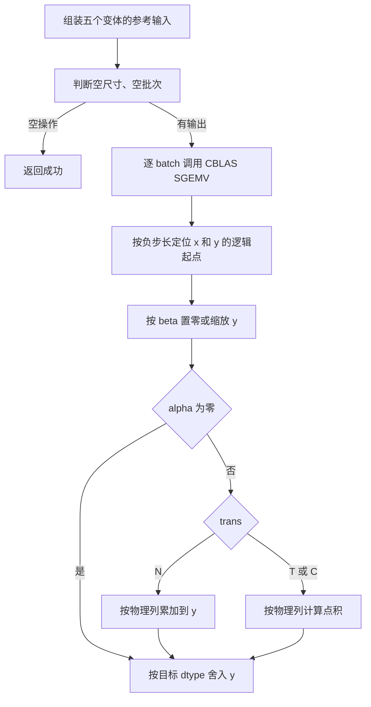
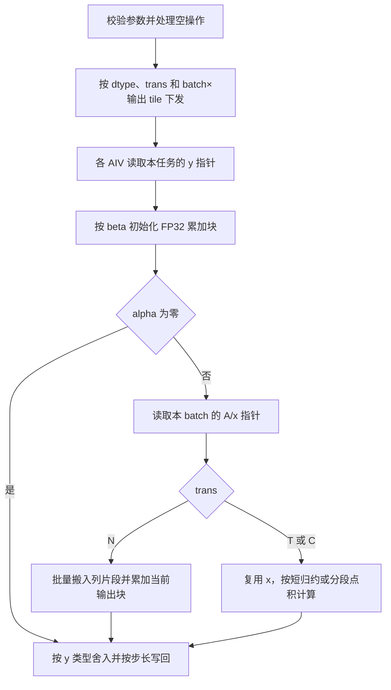
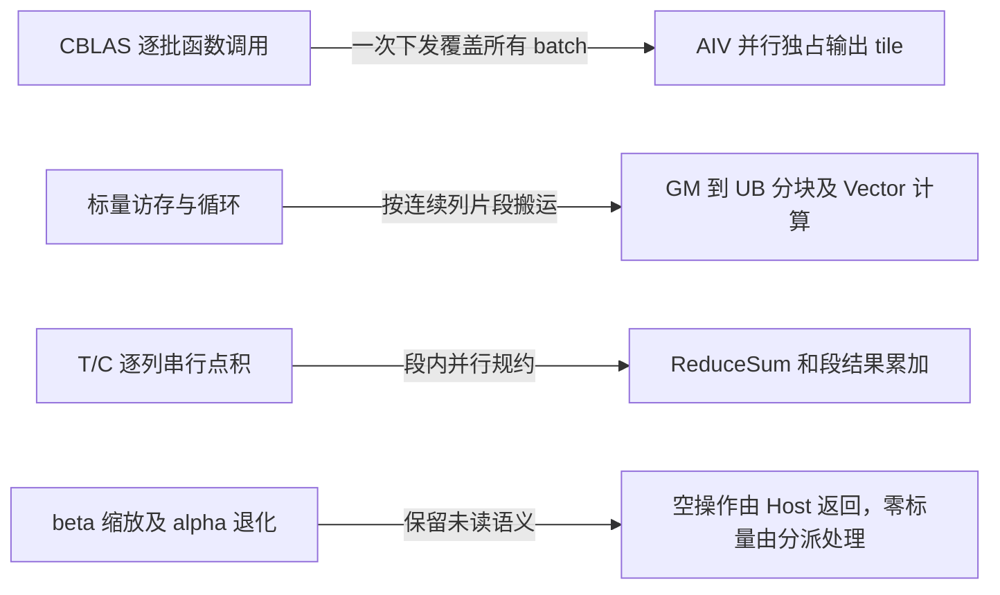

# aclblasSgemvBatched 类算子设计文档

| 项目 | 内容 |
| --- | --- |
| 任务 | 11 月社区任务 · GEMV Batched 五个实数接口（A2/A3） |
| 工程 | `cann/ops-blas`，实现位于 `blas/gemv_batched/arch22/`，测试位于 `test/gemv_batched/arch22/` |
| 硬件 | Atlas A2/A3（dav-2201），性能验收设备为 Atlas 800T A2（910B3） |
| 软件 | 任务书指定 CANN 9.1.0 |
| 标杆 | cuBLAS 对应接口的 A100 kernel 时间，Netlib CBLAS `sgemv` 逐批精度参考 |

## 一、需求背景

### 1.1 需求来源

在 Atlas A2/A3 上实现句柄式实数批量矩阵向量乘法，覆盖 S、HSH、HSS、TST、TSS 五个变体，接口参数顺序与对应 cuBLAS 接口一致。复用 `include/cann_ops_blas.h` 中的公开声明。工程采用 Ascend C 内核直调，调用者通过 `aclblasSetStream` 绑定 stream。

### 1.2 标杆与参考实现

任务的 BLAS 入口通过 handle 直接下发内核，TBE 实现、TBE 原型和算子信息库不参与该调用链。任务书指定以下参考：

| 用途 | 参考 |
| --- | --- |
| 公开接口与现有行为 | [ops-blas 公共头](https://gitcode.com/cann/ops-blas/blob/master/include/cann_ops_blas.h) |
| 同族 Ascend C 参考 | [arch35 Host](https://gitcode.com/cann/ops-blas/blob/master/blas/gemv_batched/arch35/gemv_batched_host.cpp)、[arch35 Kernel](https://gitcode.com/cann/ops-blas/blob/master/blas/gemv_batched/arch35/gemv_batched_kernel.cpp) |
| 精度标杆与访存语义 | [Netlib sgemv.f](https://www.netlib.org/blas/sgemv.f) 和 [ops-blas CBLAS golden](https://gitcode.com/cann/ops-blas/blob/master/test/gemv_batched/gemv_batched_golden.h) |
| 性能标杆 | [cuBLAS GEMV Batched](https://docs.nvidia.com/cuda/cublas/index.html) 和任务附件各变体的 `gpu_baseline.csv` |

精度参考按 batch 解释指针数组，将窄类型输入解释成 FP32 后调用 `cblas_sgemv`，并按输出类型进行舍入。Netlib 的 N 路径按矩阵列累加，T/C 路径逐列求点积。下图描述公开精度参考的语义与控制流。GPU 时间来自任务包中的 cuBLAS 实测，cuBLAS 内核实现细节未公开。

## 二、需求分析

### 2.1 数学定义和布局

对 `b = 0, ..., batchCount-1` 执行 `y[b] = alpha · op(A[b]) · x[b] + beta · y[b]`。所有数据缓冲彼此独立寻址。`A[b](r,c)` 的元素偏移是 `c*lda+r`，矩阵物理布局恒为列主序 `lda × n`，`lda >= max(1,m)`。

| trans | op(A) | x 逻辑长度 | y 逻辑长度 |
| --- | --- | ---: | ---: |
| N | A | n | m |
| T、C | A 的转置 | m | n |

长度 `L` 的向量对负步长从 `(1-L)*inc` 开始，其余从 0 开始。位置 `j` 的物理下标为 `start+j*inc`。

### 2.2 接口和精度类型

所有接口共用参数顺序 `handle, trans, m, n, alpha, Aarray, lda, xarray, incx, beta, yarray, incy, batchCount`。三个数组都位于 Device 且各含 `batchCount` 个地址，`alpha` 与 `beta` 是 Host FP32 指针。`m`、`n`、`lda`、步长和 `batchCount` 均为 `int`。FP16/BF16 以 `uint16_t` 承载位模式。

| 接口 | A、x | y | 乘加和标量类型 |
| --- | --- | --- | --- |
| `aclblasSgemvBatched` | FP32 | FP32 | FP32 |
| `aclblasHSHgemvBatched` | FP16 | FP16 | FP32 |
| `aclblasHSSgemvBatched` | FP16 | FP32 | FP32 |
| `aclblasTSTgemvBatched` | BF16 | BF16 | FP32 |
| `aclblasTSSgemvBatched` | BF16 | FP32 | FP32 |

### 2.3 参数约束和异常行为

- 按 handle、trans、m/n、lda、incx/incy、batchCount、alpha/beta、Device 指针数组的顺序处理校验。空 handle 返回 `ACLBLAS_STATUS_HANDLE_IS_NULLPTR`，非法 trans 返回 `ACLBLAS_STATUS_INVALID_ENUM`，其他非法值返回 `ACLBLAS_STATUS_INVALID_VALUE`。
- `m`、`n`、`batchCount` 允许零，结构参数校验通过即可快速返回，Device 指针数组可为空且无需 kernel。非空操作要求三个数组参数均有效。步长允许负数，0 和任务包负向用例覆盖的 `INT_MIN` 返回非法参数。
- 沿用仓内可寻址跨度保护。A 的最大访问范围是 `(n-1)*lda+m` 个元素，向量跨度是 `1+(L-1)*abs(inc)`，总输出元素数是 `batchCount*L_y`，各项按 `INT32_MAX` 限制。
- y 原地更新。调用方保证每批 y 与本批的 A/x 以及其他批次的 y 无重叠。Host 只校验指针数组自身。接口支持批次离散存储与矩阵列填充。实数 C 与 T 等价。广播、复数和跨批共享输出区域超出范围。
- 当 `alpha=0` 时只处理 y，当 `beta=0` 时直接以零初始化累加值。`alpha=0,beta=1` 时 Host 可直接返回。调用者在读取 Device 结果前同步 stream。

## 三、详细设计

### 3.1 Host 分派和分核

五个入口转发给同一模板，校验通过后使用 `GetAivCoreCount()` 获取可用 AIV 核数。使用 `trans=0` 表示 N，`trans=1` 表示 T/C。dtype 标识保持仓内编号 `0=HSH,1=S,2=HSS,3=TST,4=TSS`。维度、步长、标量和任务数随 `GemvBatchedTilingData` 按值下发，handle 的 stream 保持调用时异步执行顺序。

令 `Y` 为逻辑输出长度，N 路径取输出 tile 长度 `U=128`，T/C 路径取 `U=16`，`tiles=ceil(Y/U)`，`tasks=batchCount*tiles`，`blocks=min(AIV,tasks)`。核 `b` 依次处理任务号 `b,b+blocks,...`。任务 `q` 对应 batch `q/tiles` 与输出区间 `[(q%tiles)*U,min((q%tiles+1)*U,Y))`。不同任务输出逻辑区间不重叠，步长地址映射为一一映射，核间无归约和同步。该方案使单批且输出较长时也能使用多核。

### 3.2 数据分块与 UB

N 路径每块输出最多 128 个元素，T/C 路径每块输出最多 16 个元素。归约轴每段最多 2048 个元素。N 路径按列主序批量搬入矩阵的连续行片段，每列按 32 字节对齐后，UB 中最多容纳 `floor(2048 / paddedRows)` 列。T/C 的短归约也采用按列批量搬运。使用 `DataCopyPad` 处理尾部和非对齐字节数。单位步长走连续地址。非单位输入步长先检查跨步窗口是否在 4096 元素内，窗口可容纳时搬入后提取有效位置，较大窗口按元素搬运。非单位输出步长按逻辑位置写回。

缓冲按最宽的 FP32 类型计。A 原始块、A FP32 块、x 原始块、x FP32 块、y 原始块、累加块和规约临时块各为 `2048 × 4 B`，另有规约缓冲 `512 B`、指针缓冲 `512 B` 和标量缓冲 `256 B`。基础缓冲合计 `58,624 B`。当任一步长不为 1，跨步缓冲增加 `4096 × 4 B`，合计 `75,008 B`，少于 A2/A3 的单核 UB 容量。该阶段使用单缓冲，无额外全局工作区。

### 3.3 Kernel 数据流

N 路径将 x 的一个分段与若干 A 列片段搬入 UB。对齐的 2 次幂列组用 `Brcb` 广播 x、逐元素乘法和树形加法归约。其他列组逐列做 `Axpy`。T/C 路径按列计算点积，x 可放入一个 UB 缓冲时在当前输出 tile 内复用。短归约批量调用 `WholeReduceSum`，较长归约按段调用 `ReduceSum` 后合并。短归约出现非有限中间值时，FP32 和 BF16 路径重算按 2 的幂缩放的点积，以便处理有限输入产生的中间溢出。大幅值 alpha 的路径保存 FP32 点积的乘积和加法残差，输出前将两部分与 alpha、beta 合并。窄输出用 `Cast(..., CAST_RINT, ...)` 写回。设备指针的读取依赖 MTE2 到 Scalar 的核内事件，向量输入与输出用核内事件协调搬入和搬出。每个任务独立完成原地写入。

### 3.4 与参考流程的差异

小形状主要受启动和同步耗时影响。大形状需要关注矩阵读带宽、输出 tile 内的列数以及跨步写回开销。N 路径的各输出 tile 独立读取 x，T/C 路径在当前输出 tile 内复用放得下的 x。性能比较使用同一任务用例和同一计时口径。

## 四、特性交叉分析

| 交叉维度 | 验证点 |
| --- | --- |
| 五种 dtype × N/T/C | 相同的物理 lda，正确的 x/y 长度和输出类型 |
| 维数 × batch | 0/1/尾块/4095/4096，空、单批和多批，覆盖输出 16、128 与归约 64、2048 的路径边界 |
| lda × 步长 | 紧凑和列填充，正负单位和跨步，非法 lda、零步长及 INT_MIN |
| 标量 × y 更新 | 0、±1、±1e4 和随机值，beta=0 时旧 y 为 NaN，alpha=0 时 x 为 NaN |
| 数值 × 类型 | 均匀和正态数据，FP16/BF16 收窄，Inf/NaN 的传播和未读路径 |
| 架构 × 执行 | A2 与 A3 共用 dav-2201 源码，按 SoC 编译并在 handle stream 同步结果 |

## 五、可维可测分析

### 5.1 精度与性能标准

精度按所有 batch 的逻辑 y 元素比较。满足 `abs(actual-golden) <= atol+rtol*abs(golden)` 的比例至少为 0.99，并检查最大绝对误差上限。特殊值按同类非有限值匹配。任务书允许 CBLAS FP32 参考或 FP64 累加参考，使用的口径随报告注明。

| 输出 dtype | rtol 与 atol | 最大绝对误差规格 |
| --- | --- | --- |
| FP32 | 2^-13 | `max(0.01, 32 ULP)` |
| FP16 | 2^-10 | `max(0.1, 32 ULP)` |
| BF16 | 2^-7 | `max(0.1, 32 ULP)` |

每变体 1000 条精度用例和 200 条性能用例。正式性能在 910B3 使用 `msprof op`，排除 5 次预热后统计连续 10 次成功的 kernel Task Duration 算术平均。单条平均耗时须满足 `NPU_us/1000 <= 1.25*gpu_ms`，匹配键包括 dtype、trans、m、n、lda、incx、incy、batchCount、alpha、beta。GTest `aclrtEvent` 使用同样的 5+10 采样，打印 `[PERF] case=... avg_us=...` 供端到端交叉验证。正式结果以实测报告为准。

### 5.2 构建与兼容性

使用 `bash build.sh --ops=sgemv_batched --soc=ascend910b3` 编译，A3 选择相应 `ascend910_93` SoC。实现复用五个公开签名和共同类型，变体输出格式为 ND，A/x/y 保持各自物理布局。当前验收目标使用 CANN 9.1.0。已在共享 910B3 的 CANN 9.0.0 环境验证算子和 GTest 可构建，9.1.0 的精度与性能数据需按任务标准另行确认。

精度阈值与用例合同见[开源精度标准](https://gitcode.com/cann/opbase/blob/28a1ce52ae856353589841226a0002af73314a6b/docs/zh/ops_precision_standard/mixed_tolerance_standard.md)。文档结构遵循[社区任务模板](https://gitcode.com/cann/cann-ops-competitions/blob/master/04_tasks/01_community-task-2026/resources/design_template.md)。
