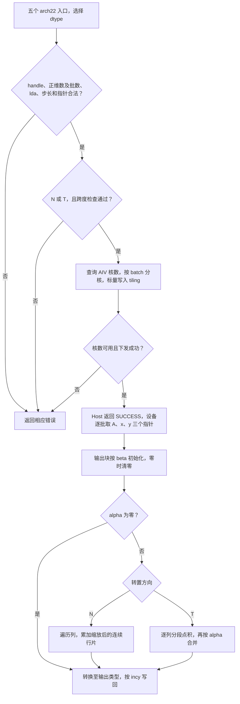
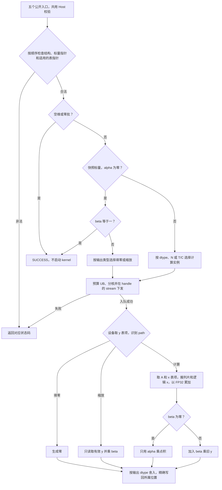

# 一、需求背景

## 1.1 需求来源

社区任务书 `aclblasSgemvBatched_AtlasA2_A3_task_doc.md`（2026-11-24 布局修订）要求通过 ops-blas 在一个 stream 上下发一批实数矩阵向量乘。五个入口分别对齐 cuBLAS 的 S、HSH、HSS、TST、TSS 变体。调用方按指针表组织不同地址的向量和矩阵，共用尺寸、转置、步长及两个标量，一次调用原地更新一批 y。交付范围包含五种精度路径及其各自的正确性和性能验收。[cuBLAS 13.5 批量 GEMV](https://docs.nvidia.com/cuda/cublas/index.html#cublas-t-gemvbatched)

## 1.2 背景介绍

### 1.2.1 gemvBatched 算子实现优化

任务书成文时记载 arch22 仅有复数实现。本文以 cann/ops-blas 上游提交 `60d9d0b153e22a154b8de9b7d89f21c5443c5f98` 为工程基线。该版本已包含五个实数入口、arch22 kernel 和通用 GTest。工作落点是修正现有校验、补齐退化路径、改进小 batch 的并行度，并接入五套验收数据。算子经 handle 直调 kernel，模板所列 TBE 源码、op-info 信息库和 ACLNN 两段接口在这条调用链中不适用。

| 在固定提交中的位置 | 本设计使用的依据 |
| --- | --- |
| [include/cann_ops_blas.h](https://gitcode.com/cann/ops-blas/blob/60d9d0b153e22a154b8de9b7d89f21c5443c5f98/include/cann_ops_blas.h)、[include/cann_ops_blas_common.h](https://gitcode.com/cann/ops-blas/blob/60d9d0b153e22a154b8de9b7d89f21c5443c5f98/include/cann_ops_blas_common.h) | 五个公开声明、枚举与状态码 |
| [blas/gemv_batched/arch22/gemv_batched_host.cpp](https://gitcode.com/cann/ops-blas/blob/60d9d0b153e22a154b8de9b7d89f21c5443c5f98/blas/gemv_batched/arch22/gemv_batched_host.cpp)、[gemv_batched_tiling_data.h](https://gitcode.com/cann/ops-blas/blob/60d9d0b153e22a154b8de9b7d89f21c5443c5f98/blas/gemv_batched/arch22/gemv_batched_tiling_data.h) | 校验、dtype 编号、按 batch 分核、按值传入的 tiling |
| [blas/gemv_batched/arch22/gemv_batched_kernel.cpp](https://gitcode.com/cann/ops-blas/blob/60d9d0b153e22a154b8de9b7d89f21c5443c5f98/blas/gemv_batched/arch22/gemv_batched_kernel.cpp)、[gemv_batched_kernel.h](https://gitcode.com/cann/ops-blas/blob/60d9d0b153e22a154b8de9b7d89f21c5443c5f98/blas/gemv_batched/arch22/gemv_batched_kernel.h) | AIV 读取设备指针、转换、归约与写回，launch 包装 |
| [blas/gemv_batched/arch35/gemv_batched_host.cpp](https://gitcode.com/cann/ops-blas/blob/60d9d0b153e22a154b8de9b7d89f21c5443c5f98/blas/gemv_batched/arch35/gemv_batched_host.cpp)、[blas/gemv_batched/README.md](https://gitcode.com/cann/ops-blas/blob/60d9d0b153e22a154b8de9b7d89f21c5443c5f98/blas/gemv_batched/README.md) | 跨架构同名入口与产品说明。arch35 的 N 路径规划为 SIMT，转置路径按 UB 分块，arch22 采用本平台 AIV 方案 |

### 1.2.2 gemvBatched 算子现状分析

功能标杆是对应的 cuBLAS 公开接口。CPU 数学参照是逐 batch 的 Netlib SGEMV。下述实现描述及第一张流程图对应可审阅的固定提交 arch22；cuBLAS 内核调度没有公开源码可供逐行对照。[Netlib sgemv.f](https://www.netlib.org/blas/sgemv.f)

#### 1.2.2.1 标杆算子支持的数据类型和数据格式

| ops-blas 接口 | cuBLAS 接口 | A、x | 乘积和累加 | y 读写 | alpha、beta |
| --- | --- | --- | --- | --- | --- |
| aclblasSgemvBatched | cublasSgemvBatched | FP32 | FP32 | FP32 | FP32 |
| aclblasHSHgemvBatched | cublasHSHgemvBatched | FP16 | FP32 | FP16 | FP32 |
| aclblasHSSgemvBatched | cublasHSSgemvBatched | FP16 | FP32 | FP32 | FP32 |
| aclblasTSTgemvBatched | cublasTSTgemvBatched | BF16 | FP32 | BF16 | FP32 |
| aclblasTSSgemvBatched | cublasTSSgemvBatched | BF16 | FP32 | FP32 | FP32 |

三个长度均为 `batchCount` 的 Device 指针表分别指向 ND 布局的 A、x、y。每个 A 逻辑尺寸为 `m × n`，物理列跨度为 `lda` 个输入元素，存储形状恒为 `lda × n`。表中每个成员可分别分配。任务的两个标量是全批共享的有限 Host float；cuBLAS 还支持 Device 标量。公开 C 类型 `uint16_t` 只承载 16 位浮点位模式，具体解释由入口决定。

#### 1.2.2.2 标杆算子实现描述

对每个批号 b，计算 `y_b ← alpha · op(A_b) · x_b + beta · y_b`。Netlib 先校验枚举、尺寸、lda 和步长，遇空维或恒等操作提前返回。其余情况从 BLAS 首元素计算负步长起点，按 beta 缩放或清零 y，然后 N 路径遍历列并累加各行，T/C 路径对每个列向量做点积。

固定提交的 `ValidateGemvBatchedParams` 先查 handle，再查尺寸、lda、步长和 batch、空指针，随后只接受 N/T，最后校验 A/x/y 跨度和总输出数的 32 位上界。零维和零批在此处即返回非法值。Host 查询 AIV 核数，拷贝 Host 标量进 tiling，给每核分配一段 batch，在 `handle->stream` 上 launch。每核的 `ProcessTyped` 逐批取三张表的成员，按转置计算向量起点。N 以行块为输出，用 `alpha*x[j]` 缩放 A 的连续列片累加；T 按列用 `Mul/ReduceSum` 算分段点积再乘 alpha。两路先调用 `InitYAcc`，beta=0 用零初始化，alpha=0 跳过 A/x 数据计算，但仍会取 A/x 表项。现有非单位步长读取按窗口或单元素收集，写回仅覆盖目标位置。现有 launch 包装返回线程级 ACL 下发错误。

#### 1.2.2.3 标杆算子实现流程图



# 二、需求分析

## 2.1 外部组件依赖

运行与编译基于 CANN 9.1.0、Ascend C、AscendCL 及对应设备驱动。自测在 ops-blas test 框架（任务书称 ATK）内用 C++ GTest 装配数据。精度参考依赖 Netlib BLAS 3.10.0 的 CBLAS；性能正式采集用 `msprof op`，A100 上的对应 cuBLAS 调用提供 GPU kernel 基线。GPU 库及 CPU golden 均为测试依赖。

## 2.2 内部适配模块

Host 复用句柄绑定的 stream 和 `GetAivCoreCount()`。拟在 1.2.1 的 arch22 实数 host、kernel 和私有 tiling 中实现第 3 章方案；产品说明同步明确 C、空尺寸、标量位置及校验顺序。已有测试按源码名读 `gemv_batched_test.csv`，`GemvBatchedParam` 默认 dtype 为 S，并读取 `a/x/y`、`alpha_fill/beta_fill`。附件按目录区分变体，使用 `aarray_fill/xarray_fill/yarray_fill` 及标量文本 `null`。拟在装配层显式映射这些字段，区分空表和空成员，给同名 case 带上变体标识。负向用例也须调用本变体入口。[handle 实现](https://gitcode.com/cann/ops-blas/blob/60d9d0b153e22a154b8de9b7d89f21c5443c5f98/blas/common/helper/aclblas_handle_internal.h)、[平台辅助函数](https://gitcode.com/cann/ops-blas/blob/60d9d0b153e22a154b8de9b7d89f21c5443c5f98/blas/common/helper/host_utils.h)、[测试参数解析](https://gitcode.com/cann/ops-blas/blob/60d9d0b153e22a154b8de9b7d89f21c5443c5f98/test/gemv_batched/gemv_batched_param.h)

拟复用 `test/gemv_batched/arch22/gemv_batched_test.cpp` 和 `gemv_batched_npu_wrapper.h`，在构建选择和测试注册处将附件中的五个 `--ops` 名称接入家族目标，每次明确选中一个变体和一份 CSV。任务书构建示例为 `bash build.sh --ops=sgemv_batched --soc=ascend910b3`，A3 选对应的 `ascend910_93` 型号。固定提交在家族 CMake 注册 `gemv_batched_test`，脚本还会递归寻找家族二进制，后续需以实际构建目标、GTest 枚举清单、CSV 哈希及数据类型确认接入正确。[测试注册](https://gitcode.com/cann/ops-blas/blob/60d9d0b153e22a154b8de9b7d89f21c5443c5f98/test/gemv_batched/CMakeLists.txt)、[arch22 测试包装](https://gitcode.com/cann/ops-blas/blob/60d9d0b153e22a154b8de9b7d89f21c5443c5f98/test/gemv_batched/arch22/gemv_batched_npu_wrapper.h)

## 2.3 需求模块设计

现有 wrapper 将 C 当成非法转置，在该分支临时用 Host 局部指针的地址占位。适配后 C 与 T 同走真实设备上传路径，所有可能下发 kernel 的正例都传 Device 表。负维数、零步长、空指针和预期错误先构造最小参数，避免测试夹具在调用实际 API 前就因分配或取绝对值失败。原 wrapper 包含拷贝和设备级同步，正式与辅助性能采集均直接复用已就绪的 Device 缓冲。

### 2.3.1 Ascend C 算子原型

下列公开签名取自固定提交的 `include/cann_ops_blas.h`。五个入口共用参数顺序、返回类型和状态语义。形状和步长使用 `int`，表项为只读指针，只有 y 指向的元素可写。

```cpp
aclblasStatus_t aclblasSgemvBatched(
    aclblasHandle_t handle, aclblasOperation_t trans, int m, int n,
    const float* alpha, const float* const Aarray[], int lda,
    const float* const xarray[], int incx, const float* beta,
    float* const yarray[], int incy, int batchCount);

aclblasStatus_t aclblasHSHgemvBatched(
    aclblasHandle_t handle, aclblasOperation_t trans, int m, int n,
    const float* alpha, const uint16_t* const Aarray[], int lda,
    const uint16_t* const xarray[], int incx, const float* beta,
    uint16_t* const yarray[], int incy, int batchCount);

aclblasStatus_t aclblasHSSgemvBatched(
    aclblasHandle_t handle, aclblasOperation_t trans, int m, int n,
    const float* alpha, const uint16_t* const Aarray[], int lda,
    const uint16_t* const xarray[], int incx, const float* beta,
    float* const yarray[], int incy, int batchCount);

aclblasStatus_t aclblasTSTgemvBatched(
    aclblasHandle_t handle, aclblasOperation_t trans, int m, int n,
    const float* alpha, const uint16_t* const Aarray[], int lda,
    const uint16_t* const xarray[], int incx, const float* beta,
    uint16_t* const yarray[], int incy, int batchCount);

aclblasStatus_t aclblasTSSgemvBatched(
    aclblasHandle_t handle, aclblasOperation_t trans, int m, int n,
    const float* alpha, const uint16_t* const Aarray[], int lda,
    const uint16_t* const xarray[], int incx, const float* beta,
    float* const yarray[], int incy, int batchCount);
```

### 2.3.2 Ascend C 算子相关约束

| trans | 输出长度 O | 点积长度 K | 输出 t、第 k 项所用 A 的元素偏移 |
| --- | --- | --- | --- |
| ACLBLAS_OP_N | m | n | `t + k*lda` |
| ACLBLAS_OP_T、ACLBLAS_OP_C | n | m | `k + t*lda` |

`0 ≤ t < O`、`0 ≤ k < K`。三种 trans 均要求 `lda ≥ max(1,m)`，C 在实数域等价于 T。对长度 L>0、元素步长 s 的向量，成员指针指向分配区低地址，`start(L,s) = (1-L)*s`（s<0），否则为 0；逻辑元素 i 的偏移为 `start+i*s`，所需跨度为 `1+(L-1)*abs(s)`。例如 m=2、n=3、lda=4、T、incx=-2、incy=-3 时，第 3 个输出读 A[8]、A[9]，分别乘 x[2]、x[0]，结果写 y[0]，前两个输出写 y[6]、y[3]。每一批都从自己的三个表项重新起算，无批间 stride 参数。

y 的逻辑元素就地更新。调用方保证各批的写集合两两不交，并与本次调用可能读取的 A/x 数据和指针表分离；只读数据可共用同一存储，仍须逐批提供表项。矩阵列间填充、向量空洞和表本身不写。接口不创建视图、不广播，不接受额外 dtype 或 0 维 tensor。形状在每次调用时给出，支持运行时分块，无需图模式动态 shape。

# 三、需求详细设计

## 3.1 调用方式

调用方先创建 handle，用 `aclblasSetStream` 绑定当前设备的 stream，准备每批 A/x/y 和含设备地址的三张 Device 表。若先在 Host 拼表，其 H2D 上传须早于同 stream 的算子调用；跨 stream 准备的数据用事件建立依赖。Host 仅检查表地址是否为空，不在 CPU 上下标访问 Device 表。两个 FP32 标量按值快照进入 launch 参数，调用返回后调用方可复用 Host 标量。表及被引用的设备分配须保持有效，直至该 stream 完成读写；复用 y、改表、回读结果或释放内存前遵守同一依赖。多 stream 并发各用已绑定的 handle，避免并发改绑同一 handle。

拟按下表从上到下处理。结构错误优先于任何 quick return；数值路径的分派发生在全部适用的指针检查之后。

| 顺序 | 检查或动作 | 结果 |
| --- | --- | --- |
| 1 | handle 为空 | `ACLBLAS_STATUS_HANDLE_IS_NULLPTR` |
| 2 | trans 不在 N、T、C | `ACLBLAS_STATUS_INVALID_ENUM`，即便同时有非法维数也优先报枚举错误 |
| 3 | m 或 n 小于 0，随后查 `lda < max(1,m)` | `ACLBLAS_STATUS_INVALID_VALUE` |
| 4 | 先查 incx、incy 为 0，再查 batchCount 小于 0 | `ACLBLAS_STATUS_INVALID_VALUE`；极端步长的附件分歧见 3.4 |
| 5 | alpha、beta 的 Host 指针须非空，包括空规模调用 | 空指针返回 `ACLBLAS_STATUS_INVALID_VALUE`；空规模无需解引用标量值 |
| 6 | 非空规模按 Aarray、xarray、yarray 顺序检查表地址，包含 alpha=0 或 beta=0 的调用 | 任一表地址为空返回 `ACLBLAS_STATUS_INVALID_VALUE`；空规模允许三表为空 |
| 7 | batchCount=0 或 m=0 或 n=0 | `ACLBLAS_STATUS_SUCCESS`，不访表、不缩放 y、不查核数、不启动 kernel |
| 8 | 读取两个有限标量；alpha=0 且 beta=1 时原值保留，alpha=beta=0 时填零，其余 alpha=0 时仅缩放 y | 恒等路径直接返回成功；填零和缩放仅需设备 y 表。正负零均进入相应零分支 |
| 9 | 常规路径，含 beta=0 | beta=0 跳过读取旧 y。平台或 tiling 信息不可用时返回 `ACLBLAS_STATUS_INTERNAL_ERROR`，launch 失败返回 `ACLBLAS_STATUS_EXECUTION_FAILED`，成功入队返回 `ACLBLAS_STATUS_SUCCESS` |

非空成员的可访问地址、容量、对齐到元素边界及写区不重叠由调用方保证。接口不扫描 Device 表来判断成员是否为空或是否相交。Host 可报告同步可知的错误，执行期错误通过调用方的 stream 同步反映。

## 3.2 需求总体设计

### 3.2.1 Host 侧设计

Host 将 C 归一为 T，推导 O、K、输入及输出元素字节数、正反向首偏移和每个对象的物理跨度。所有偏移先扩展再乘加，取步长绝对值前先转为 `int64_t`；元素跨度转字节数、地址区间长度及 tiling 各项加乘均检查可表示性。批表按 `b*sizeof(device_pointer)` 寻址，只校验独立成员所需的跨度，不因多个独立分配的跨度之和较大而截断单个成员。局部 DMA 的长度、块数等窄字段在切小 tile 后再转换。

#### 3.2.1.1 分核策略

设 B=batchCount、单核每个输出块最多负责 U 个输出，`H=ceil(O/U)`、`W=B*H`。空规模已返回。普通分工取 `P=min(W,可用 AIV 核数)`，任务号 w 对应 `b=w/H`（整除）、`t0=(w%H)*U`。令 `q=W/P`（整除）、`r=W%P`，核 c 从 `c*q+min(c,r)` 起处理 `q+(c<r)` 个连续任务；最后一块只处理 `min(U,O-t0)` 个值。每个输出的完整 K 都归一个所有者，跨 K 块只在核内合并。B 大时同一核可连续消费同批表项，B 小且 O 大时可拆同一批的输出；O=B=1 时使用一核。分块单位与核数由实机资源和形状决定。

上述分工具有逻辑输出独占性。物理写回须同时满足目标指令的并发写粒度约束。若平台对共享写粒度内的精确短写未证实安全，采用保守分工：各核从设备表得到 y 基址，按物理写粒度 G 将目标元素分组，固定 `floor(y字节地址/G) mod P` 为所属核，仅为本核的元素计算、写回；小规模可取 P=1。此分工跨批使用同一映射，能处理两个不重叠的短向量共享一个写入单元。常规分工的启用条件是平台已验证支持所用并发精确写，或能证明每个物理写入单元只有一个所有者。两种分工均不要求调用方额外填充 y。

#### 3.2.1.2 数据分块和内存优化策略

取 U 个输出、D 个点积元素为一 tile。N 在 D 个物理列上各搬 U 个相邻行，T/C 在 U 个物理列上各搬 D 个相邻行。x 的 D 个元素在该输出块内复用。设 `a=sizeof(A元素)`、`y=sizeof(y元素)`，`p(z)=ceil(z/32)*32` 为本方案 UB 槽的字节对齐。令 `M(s)=D*p(U*s)`（N）或 `U*p(D*s)`（T/C），其中 s 为槽的元素字节数。按列片分别计对齐，不能把不相邻列误当一块连续 GM。末块使用实际有效行数、列数和步长。

| 单核常规路径的预算项 | 字节上界及用途 |
| --- | --- |
| 原类型输入槽 | `h*(M(a)+p(D*a))`，h=1 为单缓冲、h=2 为搬入双缓冲 |
| FP32 展开与乘积 | `M(4)+p(4*D)`，已转换的 A 槽可原地保存乘积，x32 在整块内复用 |
| 累加、分段和及 y | `2*p(4*U)+2*p(U*y)`，分别容纳跨段和、本段和、旧 y 和输出。若启用补偿，再计 `p(4*U)` |
| 辅助空间 | `p(R)+p(V)+p(S)`。R 包含所选 ReduceSum 实例临时空间与结果槽，V 为可选的跨步窗口字节数，S 为指针表项、单元素搬运、其他暂存的逐槽对齐字节和 |

以上合计加平台和库保留空间不得超过每核可用 UB，已在查询值中扣除的保留量不重复扣。Host 按选定指令的约束和 R 的实际需求选 U、D、h，先尝试双缓冲，不合算时改为单缓冲或缩小 U/D。若窗口过宽，V 降为单元素暂存，采用精确步长搬运；最小 tile 仍不满足预算时禁止下发。填零仅需输出槽和寻址暂存，缩放路径另需输入 y 槽和 FP32 转换槽。全部路径使用 AIV，算法分配的 L1、L0A、L0B、L0C 均为 0 B。通过平台管理器查询当前设备的 AIV 数和 `GetCoreMemSize(UB,...)`，各平台独立选块，预算用字节计算。[CANN 9.1 GetCoreNumAiv](https://www.hiascend.com/document/detail/en/CANNCommunityEdition/910/API/ascendcopapi/docs/en/api/Utils-API/platform_info/PlatformAscendC/GetCoreNumAiv.md)、[GetCoreMemSize](https://www.hiascend.com/document/detail/en/CANNCommunityEdition/910/API/ascendcopapi/docs/en/api/Utils-API/platform_info/PlatformAscendC/GetCoreMemSize.md)

本方案每次调用的额外 Device GM workspace 需求及上限均为 **0 B**。跨段部分和保存在 UB，tiling 按值传入，表由调用方持有；不申请、扩展或覆盖 handle 的公共 workspace。UB 槽属于当前核的一次 launch，在相应流水消费完成后复用。该预算也适用于绑定用户 workspace 的 handle；设备数据缓冲和测试工程的 Host 副本另计。

#### 3.2.1.3 tilingKey 规划策略

沿用已有 dtype 编号 HSH=0、S=1、HSS=2、TST=3、TSS=4。拟用私有 `key=dtype+8*path` 表示形状无关的静态实例。path=0 为 N，1 为 T/C，2 为仅缩放 y，3 为仅填零。常规实例按五组输入/输出类型和两个方向编译；缩放、填零可将相同输出 dtype 的 key 映射到同一实例。空规模和恒等路径没有 key。Host 仅从已知入口生成 key，通过封闭分派表启动对应特化，未知组合按内部错误处理。

tiling 附带 m、n、lda、incx、incy、B、O、K、U、D、P、缓冲深度、分工模式和两个 FP32 标量。宽偏移保留 64 位。beta=0、连续/跨步搬运及实际尾长作为运行时标志，无需按尺寸或标量数值生成二进制。分派由直调包装负责，无需 GE 的模板注册。

### 3.2.2 Kernel 侧设计

#### 3.2.2.1 Kernel 侧实现描述

1. 核按 tiling 认领工作。先解析 y 表项。填零直接生成目标类型的零，缩放只取逻辑 y 并在 FP32 中乘 beta。常规路径再从 Aarray[b]、xarray[b] 读取设备指针，每一项搬运完成后才作为 GM 基址使用。缓存只在本次 launch 和当前批次有效。
2. CopyIn 根据 2.3.2 的偏移读取列片和 x，连续片采用支持真实字节长度的搬运。反向连续片可按低地址搬入后在 UB 内反序。其他步长可按索引逐元素收集；仅在整段可安全读取且不触碰并发写区时才采用有界读窗口。列尾、表尾及最后一段均不向 GM 外取整；对齐补零限于 UB，乘积、归约和写回按有效计数或掩码执行。
3. 两种 16 位输入都按真实浮点格式精确扩展到 FP32。N 以 U 行为并行输出，广播当前 x[k]，按列形成向量乘积并累加；T/C 从每列连续段读取，乘同一 x 段，每列分别做平衡归约。各 D 段在同核以固定次序合并，保持 FP32 到 K 结束，最后计算 `alpha*dot` 和 `beta*y_old`。这样不会在多个 tile 之间反复收窄，也避免在大 alpha 情形过早放大每一项。对 S、HSS、TSS 的长 K 抵消样例比较分段求和与有限值补偿累加的收益；若使用补偿，对非有限数使用普通 FP32 特殊值规则。具体分段、FMA 和补偿的取舍以高精度 golden 和耗时实测为准。
4. beta 为零的常规路径不载入旧 y；beta 非零才按有符号 incy 载入并在 FP32 合并。HSH/TST 仅在最终写回按 round-to-nearest-even 舍入到 FP16/BF16，允许溢出到同号 Inf，保留 NaN 类别。S/HSS/TSS 写 FP32。连续输出精确写有效字节，非单位 incy 只散写目标元素，不对包括空洞的整个窗口做读改写。
5. 每个输入槽在 MTE2 完成后才交给 V，读取 UB 指针/索引的标量路径等待 MTE2→S；S/V 间传递尺度或归约值按生产者、消费者成对同步。V 或 S 产生的输出等写入就绪后交 MTE3。输入槽覆盖前等待上一轮 V/S 消费，输出槽复用前等待 MTE3 完成。双缓冲只重叠不同槽的搬运与计算，末块也要排空写流水。各核没有跨核部分和、原子加或跨核屏障。

#### 3.2.2.2 Ascend C 实现流程图



#### 3.2.2.3 Ascend C 实现流程图与标杆算子流程图的差异点和原因

第一张图中的 arch22 入口会在计算前拒绝 C、零维及零批，新图先完成合法性检查，再对空规模直接成功返回，并将实数 C 复用 T。恒等、填零和仅缩放从通用核中分离，使失效操作数的表项也无需读取。原实现按 batch 分核且 N 路径提前乘 alpha；设计将可用并行度扩展到输出轴、让 FP32 点积跨完整 K 完成后再缩放。两图的异步边界相同，Host 返回成功只表示已入队；CPU Netlib 参考逐批同步完成。分核、缓冲深度与算术顺序的变更均须在 A2/A3 上验证。

## 3.3 支持硬件

| 产品 | 目标及验证角色 |
| --- | --- |
| Atlas A2 训练/推理系列（arch22） | 支持五个实数入口；任务指定 Atlas 800T A2（910B3）作正式性能设备 |
| Atlas A3 训练/推理系列（arch22） | 同一 ABI 和语义，按实际型号查询资源、选择编译目标；可作精度自验设备 |

任务书允许用其中一种款型自验证，精度建议 910B3 或 A3。记录实测 SoC、CANN 9.1.0、驱动、编译选项和时钟条件；架构目录相同不能代替另一款型的实测结果。[ops-blas 构建脚本](https://gitcode.com/cann/ops-blas/blob/60d9d0b153e22a154b8de9b7d89f21c5443c5f98/build.sh)

## 3.4 算子约束限制

- **极端步长存在验收分歧。** 任务书 §2.4 指定任意非零 int，包含 `INT_MIN`；五份 README 显式排除它，各 CSV 的 `TC_L6_021/022` 在长度 16、incx 或 incy 为 −2147483648 时期望 `INVALID_VALUE`。该向量跨度为 32,212,254,721 个元素，旧实现的 32 位跨度卫语句也能拒绝这两例，但无法证明步长本身非法。拟按任务书用 64 位寻址，把能由平台安全寻址的非零步长纳入目标，长度 1 时偏移恒为零。保留原负例及期望值，单列用例与接口文字的冲突，待验收方统一是否把 `INT_MIN` 列为步长校验特例。裁决前这十条不作通过结论，避免测试装配先在 int 中取绝对值或按负例申请巨额缓冲。
- **已发布实现的跨度限制。** 固定提交拒绝 `(n-1)*lda+m`、x/y 元素跨度或 `B*O` 大于 INT32_MAX。拟对窄指令保留局部分块约束，主寻址链路使用 64 位。超过原实现上限的支持须通过目标 SDK 的宽偏移、可寻址容量及边界测试，不能把原限制隐含在 int 乘法或截断中。[跨度检查源码](https://gitcode.com/cann/ops-blas/blob/60d9d0b153e22a154b8de9b7d89f21c5443c5f98/blas/common/helper/gemv_batched_span_check.h)
- **访问与别名。** 非空规模要求三个外层表地址有效，即便 alpha=0。此时只允许内核跳过 A/x 数据及表项。beta=0 仍要求有可写的 y 目标。跨批写冲突、输出与读取区重叠或 Device 表含无效的在用地址属调用方违约，接口不承诺在 Host 返回可预测的重叠错误。零批、零维仅免除三张设备表的要求，结构和标量指针仍须合法。
- **数值范围。** alpha/beta 的输入域为有限 FP32，矩阵和向量可含 Inf/NaN；随机分布用于造数。浮点归约无需逐位确定，跨路径、跨设备的舍入差异按输出类型和 5.1 的联合门槛评估。

# 四、特性交叉分析

| 交叉场景 | 可观察的约束与验证方法 |
| --- | --- |
| 旧调用方、复数及 arch35 共仓 | 调整 arch22 实数私有分派。按产品构建检查五个导出符号、既有 N/T 调用、原位 y 及公开头文件的 ABI；复数 C 分支具有不同的共轭语义 |
| 非连续、负步长与批间并行 | 用分散分配、重排的表项、多个只读项共享、相邻独立 y 子区间和负步长组合验证。为 A 填充、y 空洞和各分配前后留哨兵，逐字节检查写保护 |
| 同 stream 队列与多 stream | 同一 stream 上先更新设备表/输入再调用，回读前同步；不同 stream 用独立 handle 和事件串接同一 y 的读写。连续调用前后改变 Host 标量，检验每次快照与表项生命周期 |
| 退化与特殊值 | 以非 NaN 目标验证 alpha=0 且 x 为 NaN、beta=0 且旧 y 为 NaN；恒等路径逐位保留 y（含带符号零和 NaN），空规模检查无 launch、无写入。对有效读入的 NaN/Inf 验证传播、符号和低精度舍入边界 |
| 负例与空输入 | 在装配层为每个真实入口构造空 handle、多个错误同时出现及空规模带非法结构/标量的例子。重叠 y 负例在测试装配层验证重叠集合并记录调用方违约，禁止将未定义的计算结果当 golden，或声称 Host 会扫描表项 |

# 五、可维可测分析

## 5.1 精度标准/性能标准

**验收清单。** 每个变体有一份 `<变体目录名>_test.csv` 和一份 `gpu_baseline.csv`。下表是逐文件解析的实际数据行数（不含表头）。精度为非 `TC_PF_` 行，含负例；PF 为独立的性能子集。基线栏的分母是 PF 完整参数键的数目，分子是唯一匹配且 `gpu_ms` 为正数的行数。

| 变体目录 | 测试行 | 精度 | PF | PF 的 N/T/C | 基线有值/键数 | 非默认标量 PF | CSV 的 MERE/MARE |
| --- | ---: | ---: | ---: | --- | ---: | ---: | --- |
| sgemv_batched | 1200 | 1000 | 200 | 74/67/59 | 200/200 | 25 | 0.00012207031 / 10 |
| hsh_gemv_batched | 1200 | 1000 | 200 | 75/65/60 | 200/200 | 25 | 0.0009765625 / 32 |
| hss_gemv_batched | 1200 | 1000 | 200 | 75/65/60 | 200/200 | 25 | 0.00012207031 / 10 |
| tst_gemv_batched | 1200 | 1000 | 200 | 75/65/60 | 200/200 | 25 | 0.0078125 / 32 |
| tss_gemv_batched | 1200 | 1000 | 200 | 75/65/60 | 200/200 | 25 | 0.00012207031 / 10 |
| 合计 | 6000 | 5000 | 1000 | 374/327/299 | 1000/1000 | 125 | 按变体分别判定 |

五份测试表的实际字段相同，基线只有一个时间字段，其他列用于匹配。用例名在各变体内唯一，在五个目录间重复，记录和聚合均带变体名。

```text
case_name,description,trans,m,n,alpha,aarray_fill,lda,xarray_fill,incx,beta,yarray_fill,incy,batchCount,expect_result,mere_threshold,mare_multiplier,random_seed
id,trans,m,n,alpha,beta,lda,incx,incy,batchCount,gpu_ms
```

- 每变体精度按 L0/L1/L2/L3/L4/L5/L6/EX 实数为 6/39/21/8/14/28/28/856，README 中 L2=10、EX=867 已与数据不同。状态期望为 984 条 SUCCESS（其中 6 条空规模）、15 条 INVALID_VALUE、1 条 INVALID_ENUM；trans 为 N/T/C/999 各 348/330/321/1。空 handle 单独由装配层构造。
- 每套精度在 m、n 的并集中含任务书从 0 至 4096 的指定边界，覆盖方形、长宽不等及 4095/4096；batch 含 0、1、2、3、4、8、16、64、256 及负例 −1。成功行覆盖紧凑布局及 +1/+8/+64 的 lda。incx、incy 均覆盖 ±1/±2/±3，合并还有 7、8、16、31、64、127、−127。两步长各有零值和 INT_MIN 负例。标量包含 0、±1、±1e4 和种子采样值；CSV 的 beta 没有 −1，拟额外用 beta=−1 检查原地更新，不替换原行。
- 任务书的均匀/正态各 50% 是随机输入的目标。每套精度的三个填充列按字段计，均匀 `RANDOM_NORM_5_5`（[-5,5]）1491 次，正态 `GAUSS_NORM_0_1`（均值 0、标准差 1）1490 次，其余 19 个 token 覆盖空指针、零、交替、极值、Inf/NaN；PF 两种各 300 次。任务书用 `RANDOM_GAUSS_0_1` 描述分布，装配器须识别 CSV 中的实际 token。
- 每套 PF 的 batch 为 1、2、3、4、8、16、64、256，全部使用紧凑 lda，含 4095/4096，181 条至少一维为奇数。两步长均为 +1 只有 42/200 条；即使按绝对值均为 1 计也只有 80/200。任务书要求单位步长为主，实物中大步长较多。正式记录全部 200 条，并列明此覆盖差异。默认标量为 (1,0)，非默认 25 条（12.5%，alpha 均非零）。
- 任务书 §4 另列 `cases.json`、`perf/`、冻结的 `inputs/`、`golden/` 与 `facts.json`。本附件提供的是五套 CSV、README 与生成/校验脚本。实现自验时须记录输入 bit pattern、种子、参考版本及结果哈希以便复现，列明实际补齐的交付物。

**数值参考与正式精度。** 每批从独立物理缓冲取输入。先按入口 dtype 生成或量化 A/x/旧 y，再将实际编码解码给 CPU 和设备；标量先取调用时 FP32 值。依据任务书 §3.2，以 float64 累加和标量运算产生高精度参考，最后按 y dtype 收窄、落盘。另按 Netlib BLAS 3.10.0 `cblas_sgemv(CblasColMajor,...)` 对每批执行 FP32 参考并收窄，使用原始低地址基址及有符号步长，避免两次反移。CBLAS 的 S 接口在 FP32 域计算；自测报告注明正式选用的 golden、两种精度域在长归约/大标量用例的差值，避免将二者混为同一计算或按结果择优选 golden。[固定提交的 CPU 参照](https://gitcode.com/cann/ops-blas/blob/60d9d0b153e22a154b8de9b7d89f21c5443c5f98/test/gemv_batched/gemv_batched_golden.h)

| API | 输出 | atol | rtol | 最小 matched_ratio | 最大绝对误差上限 |
| --- | --- | --- | --- | ---: | --- |
| aclblasSgemvBatched | FP32 | 2^-13 | 2^-13 | 0.99 | max(0.01, 32 × ULP) |
| aclblasHSHgemvBatched | FP16 | 2^-10 | 2^-10 | 0.99 | max(0.1, 32 × ULP) |
| aclblasHSSgemvBatched | FP32 | 2^-13 | 2^-13 | 0.99 | max(0.01, 32 × ULP) |
| aclblasTSTgemvBatched | BF16 | 2^-7 | 2^-7 | 0.99 | max(0.1, 32 × ULP) |
| aclblasTSSgemvBatched | FP32 | 2^-13 | 2^-13 | 0.99 | max(0.01, 32 × ULP) |

逐批、逐逻辑 y 元素统计，有限值满足 `abs(actual-golden) ≤ atol + rtol*abs(golden)` 计为匹配。对整个用例合并计数，匹配率和表中最大绝对误差条件须同时成立。按任务书指定的固定精度标准，ULP 取**最大有限绝对误差位置**的 golden 收窄至输出 dtype 后所在值域的间距，`or` 表示取兜底值和 32 ULP 的较大者。报告保留最大误差、所在批号/逻辑下标、golden 和实际阈值。正确成对 NaN 或同号 Inf 单独比对；检查收窄溢出，单侧 NaN、错误符号或意外非有限值报错。全为正确匹配的特殊值时单列结果，不对 NaN 做差；零输出、空维 quick return 和非法入参按状态及写保护验收。[固定 opbase 混合容差标准](https://gitcode.com/cann/opbase/blob/28a1ce52ae856353589841226a0002af73314a6b/docs/zh/ops_precision_standard/mixed_tolerance_standard.md)

附件 README 精度表简写为固定上限，部分 README 又称 HSS/TSS 按输入半精度放宽。五套 CSV 的 MERE/MARE 配置可保留作诊断，正式门槛具体取上表。固定提交的 `VerifyGemvBatchedOutput` 将 HSS/TSS 的比较 dtype 选成低精度，旧测试还有 FP16/BF16 截断或非有限数编码差异，公共比较器按各点分别检查 32 ULP。验收适配须按五种真实输出 dtype、正确收窄和固定标准重新评估。附件 `verify_accuracy.py` 仅读 GTest 状态并对照非 PF 名单检查缺失，不能从脚本退出码推断数值判据正确；对每个变体验证所跑的二进制、输入表和 1000 个 case ID，负向用例按任务接口状态而非 CPU 参照的错误枚举判定。[arch22 测试实现](https://gitcode.com/cann/ops-blas/blob/60d9d0b153e22a154b8de9b7d89f21c5443c5f98/test/gemv_batched/arch22/gemv_batched_test.cpp)、[公共比较器](https://gitcode.com/cann/ops-blas/blob/60d9d0b153e22a154b8de9b7d89f21c5443c5f98/test/frame/verify.h)

**正式性能。** 在 Atlas 800T A2（910B3）预置所有数据和 Device 指针表，固定变体、trans、m、n、alpha、beta、lda、incx、incy 和 B。在同一 stream 上 warmup 5 次不计，再连续下发 10 次有效调用。以 `msprof op` 的 `OpBasicInfo.csv` 中对应的 `Task Duration(us)` 求算术平均，按调用、kernel 名和序号剔除预热；若一次调用涉及多任务，计入该调用全部必要任务耗时。只计入返回 SUCCESS 且同步完成的有效样本，异常单列原因并补足 10 次，不能挑选较快样本。NPU 平均值除以 1000 转成 ms，每个 PF 用例须满足 `NPU_kernel_ms ≤ 1.25*gpu_ms`，等价于 `gpu_ms/NPU_kernel_ms ≥ 0.8`；总体平均不能掩盖单例失败。

基线与 PF 按变体及九个参数（含 alpha、beta 和 lda）逐一匹配。README 同时出现“留空占位”和“默认标量已回填、非默认待复测”；实表所有 1000 个 `gpu_ms` 均有正值。任务书修订记录指出 T/C 旧 lda 键失效。应核对 A100 同名 cuBLAS API、真实参数、Host pointer mode、计时工具及对应采样原始记录；对沿用旧布局的 T/C 和无实测凭据的非默认标量按新参数复测，GPU 同样预热 5 次、至少 10 次有效 kernel 取算术均值。T/C 和非默认两组的并集分别为 S 的 133 行、其余每种 134 行，填值本身不能证明已完成复测。缺基线或来源未核实的 case 留在报告中标待核实，不能用于宣布整套达标。

**辅助计时。** GTest 在预置缓冲上用同 stream 的 `aclrtEvent` 夹住连续 10 次 API 调用（此前 warmup 5 次），同步结束事件并打印 `[PERF] case=<case_name> ... avg_us=<数值>`。该窗口含下发影响，不含 H2D/D2H、分配、造数、golden 与比较。非零 beta 的重复执行会改变旧 y，可预置独立 y 副本，或在两端明确采用相同递推输入；复位操作排在计时窗外，精度另用原始 y 验证。附件 `verify_performance.py` 用 avg_us/1000 对照 `gpu_ms`，检查逐例与可比项平均倍率均 ≥0.8；缺 case、缺有效计时或缺基线须报告，`--allow-noref` 仅供开发采集，GTest 整例毫秒及事件均不代替 kernel 正式判据。

定位未达标用例时按 N/T、正反步长、B 和 O 分组。常规路径每调用约有 `2*B*m*n` 次浮点运算；每批各数据只取一次时，有效数据量为 `m*n*a+K*a+(1+Iβ)*O*y` 字节，另加三个指针表项，其中 beta 非零时 Iβ=1。对照搬运计数识别 x 重读、跨步窗口读放大及短写开销，结合活跃核数判断小 B 拆输出、双缓冲或归约候选是否值得保留。

**内存。** 任务书 §3.4 未设独立内存门槛。README 的单用例 Host 512 MB 是造数预算，生成器常量为 512 MiB。按各成员物理跨度，一份非空输入输出数据实际字节数为 `B*(lda*n*a+spanX*a+spanY*y)`；设备另有三张合计 `3*B*sizeof(device_pointer)` 的表，另计对齐与分配器开销。Host 收窄前副本、双精度参考和验证缓冲会增加驻留峰值，按批生成、比较并释放临时副本控制峰值；显存、Host 峰值和算子额外 workspace 分栏记录，不由输入尺寸估算直接推断内存验收通过。

## 5.2 兼容性分析

公开 API、参数顺序、`uint16_t` 承载方式及 handle/stream 调用习惯与固定提交一致。新增 C 路径和合法空规模会改变旧 arch22 对这些输入的返回值，多处参数同时非法时以 3.1 的错误优先级为准。需要回归既有正步长与反向步长、独立/共享只读分配、HSS/TSS 的 FP32 输出，以及 A2/A3 间对 FP16/BF16 特殊值和尾部写入的行为。跨提交的测试记录应绑定 ops-blas 提交、任务包版本、SoC、工具链、输入/基线哈希和计时口径。本文记录设计与静态附件核对，设备正确性、构建兼容性和性能达标情况留待实现自验。
