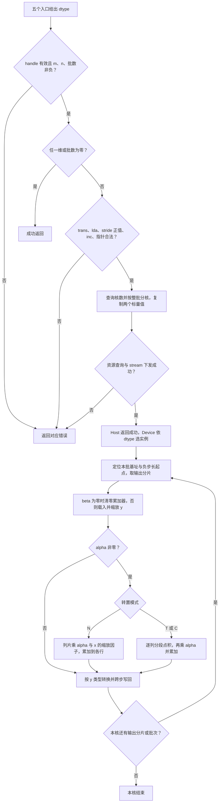
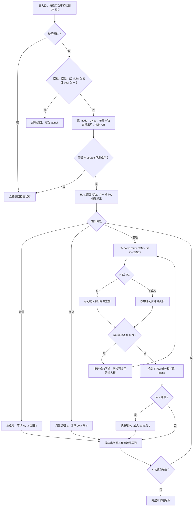

# 一、需求背景

## 1.1 需求来源

社区任务《aclblasSgemvStridedBatched 类算子开发任务书》（Atlas A2/A3，2026-11-24 布局修订）要求在 ops-blas 上交付五个实数 GEMV 接口。同一次调用在同一条 stream 上处理 `batchCount` 个同形状、等跨距的矩阵与向量，各批次独立地原地更新 y。目标是对齐 cuBLAS 对应五个 StridedBatched 接口的数学结果，并达到任务书规定的逐例精度与 kernel 性能。

## 1.2 背景介绍

GEMV 每读入一个矩阵元素约做一次乘加。N 模式沿列读 A、同时更新多个输出行；T/C 模式沿一列读 A、规约成一个输出。跨步批处理可以复用同一份形状与调度参数，一次下发多个 GEMV；当批次少、矩阵大时，仅按批分核会限制并行度。

### 1.2.1 gemvStridedBatched 算子实现优化

任务书按“已有 arch35、待建 arch22”描述立项时的工程。本文核对的官方 ops-blas 提交 `60d9d0b153e22a154b8de9b7d89f21c5443c5f98` 已含两套实现、arch22 测试及 A2/A3 产品说明。后续工作在这些文件上补齐参数契约、输出分块与验收适配。模板中的 TBE 源文件、op-info 库和 ACLNN 入口不适用于此调用链。公开 ABI、支持类型和 launch 分别以以下源码为据。

| 固定版本文件 | 本任务使用的事实 |
| --- | --- |
| [include/cann_ops_blas.h][abi]、[include/cann_ops_blas_common.h][status] | 五个函数声明、枚举及返回类型 |
| [arch22/gemv_strided_batched_host.cpp][host]、[arch22/gemv_strided_batched_kernel.cpp][kernel] | Host 校验、按批分核、AIV 指令路径与 launch 状态 |
| [arch22/gemv_strided_batched_tiling_data.h][td]、[arch22/gemv_strided_batched_kernel.h][launch] | 直调内部 ABI、原分块参数与 launch 签名 |
| [arch35/gemv_strided_batched_host.cpp][arch35]、[blas/gemv_strided_batched/README.md][readme] | 跨产品公共参数及产品清单。arch35 的 SIMT 线程配置只用于理解其实现 |

### 1.2.2 gemvStridedBatched 算子现状分析

cuBLAS 的五个同后缀函数是 GPU 性能标杆。CPU 数学参照为 Netlib BLAS 3.10.0 的 SGEMV。下述源码流程图对应可审计的 ops-blas arch22 基线；cuBLAS 对外公开接口及存储约定，其内部调度不作为设计依据。[cuBLAS gemvStridedBatched][cublas]、[Netlib 3.10.0 的 sgemv.f][netlib]

#### 1.2.2.1 标杆算子支持的数据类型和数据格式

| ops-blas 公开入口 | A、x 的元素 | y 读写元素 | 乘加、累加 | alpha、beta |
| --- | --- | --- | --- | --- |
| `aclblasSgemvStridedBatched` | FP32 | FP32 | FP32 | Host FP32 |
| `aclblasHSHgemvStridedBatched` | FP16 | FP16 | FP32 | Host FP32 |
| `aclblasHSSgemvStridedBatched` | FP16 | FP32 | FP32 | Host FP32 |
| `aclblasTSTgemvStridedBatched` | BF16 | BF16 | FP32 | Host FP32 |
| `aclblasTSSgemvStridedBatched` | BF16 | FP32 | FP32 | Host FP32 |

三个 Device 操作数均为普通线性存储（ND）。每个 A 的逻辑矩阵为 m 行 n 列，在物理 `lda × n` 区域中按列存放。所有变体、所有转置均满足 `lda ≥ max(1,m)`。HSH/HSS 与 TST/TSS 的 16 位公开载体均为 `uint16_t`，按入口解释浮点位模式，不做无符号整数运算。

#### 1.2.2.2 标杆算子实现描述

Netlib 的 `sgemv.f` 先检验形状与步长，空维或 `alpha=0, beta=1` 返回。非空时设定 x/y 的正向或反向起点，先按 beta 保留、清零或缩放 y，再在 alpha 非零时做乘加。N 逐列将 `alpha*x[j]` 乘入 A 的第 j 列，T/C 则逐列计算点积并加回 y。CPU 测试按三个 element stride 定位批次，各批调用一次 `cblas_sgemv(CblasColMajor, ...)`。[固定版本 CPU golden][golden]

现有 arch22 的 `GemvStridedBatchedImpl` 先判空 handle，再查 m/n/batchCount 是否为负；三者有零便返回成功。非空时才校验 trans、lda、stride 正值、inc 和空指针，查询 AIV 核数，将 Host 标量值、dtype 和分批参数传至 stream。其 stride 检查尚未比较最小间距。Device 按 dtype 调用 `ProcessTyped`，每个核处理一段完整批次；负 inc 在每批基址上一次性修正起点。N 按输出行分片、逐列缩放累加；T/C 对每列分段 `Mul/ReduceSum`。两路都在 `InitYAcc` 处理 beta，alpha 为零时跳过 A/x 乘加，最后转成 y 类型并按 incy 写回。非空标量恒等情形基线仍会下发。[Host 源码][host]、[Kernel 源码][kernel]

#### 1.2.2.3 标杆算子实现流程图



# 二、需求分析

## 2.1 外部组件依赖

生产端依赖 CANN 9.1.0、AscendCL 的 device/context/stream 及 Ascend C arch22 编译和向量算子接口。验收端使用 ops-blas 的 ATK/GTest、Netlib BLAS 3.10.0 CBLAS、`msprof op`；GPU 标杆为 NVIDIA A100 上相应 cuBLAS API 的 kernel-only 采样。造数、golden 与 GPU 对照均位于测试端。

## 2.2 内部适配模块

Host 复用 handle 的 stream、`GetAivCoreCount()` 及五入口共用的模板函数；扩展 arch22 的 tiling 结构和 kernel 分派。测试保留家族目标 `gemv_strided_batched_test`。固定提交从源文件同名 CSV 载入 `dtype/A/x/y`，缺省 dtype 为 S，负向分支调用 S 包装器。附件则分五个目录，每份表没有 dtype，填充列是 `aarray_fill/xarray_fill/yarray_fill`。测试适配层需按目录确定入口，映射填充、枚举、状态、标量 `null` 和基址 `NULLPTR`，以“变体 + case_name”保持用例唯一；负向用例直达对应公开 API，避免包装器提前判错掩盖入口行为。[测试注册][cmake]、[参数解析][param]、[arch22 GTest][test]、[NPU 包装器][wrapper]

## 2.3 需求模块设计

### 2.3.1 Ascend C 算子原型

沿用以下 16 参声明。A/x 只读，y 原地读写；运行时整数宽度和每个指针的 const 限定属于公开 ABI。[公开头文件][abi]

```cpp
aclblasStatus_t aclblasSgemvStridedBatched(
    aclblasHandle_t handle, aclblasOperation_t trans, int m, int n,
    const float* alpha, const float* A, int lda, int64_t strideA,
    const float* x, int incx, int64_t stridex, const float* beta,
    float* y, int incy, int64_t stridey, int batchCount);

aclblasStatus_t aclblasHSHgemvStridedBatched(
    aclblasHandle_t handle, aclblasOperation_t trans, int m, int n,
    const float* alpha, const uint16_t* A, int lda, int64_t strideA,
    const uint16_t* x, int incx, int64_t stridex, const float* beta,
    uint16_t* y, int incy, int64_t stridey, int batchCount);

aclblasStatus_t aclblasHSSgemvStridedBatched(
    aclblasHandle_t handle, aclblasOperation_t trans, int m, int n,
    const float* alpha, const uint16_t* A, int lda, int64_t strideA,
    const uint16_t* x, int incx, int64_t stridex, const float* beta,
    float* y, int incy, int64_t stridey, int batchCount);

aclblasStatus_t aclblasTSTgemvStridedBatched(
    aclblasHandle_t handle, aclblasOperation_t trans, int m, int n,
    const float* alpha, const uint16_t* A, int lda, int64_t strideA,
    const uint16_t* x, int incx, int64_t stridex, const float* beta,
    uint16_t* y, int incy, int64_t stridey, int batchCount);

aclblasStatus_t aclblasTSSgemvStridedBatched(
    aclblasHandle_t handle, aclblasOperation_t trans, int m, int n,
    const float* alpha, const uint16_t* A, int lda, int64_t strideA,
    const uint16_t* x, int incx, int64_t stridex, const float* beta,
    float* y, int incy, int64_t stridey, int batchCount);
```

### 2.3.2 Ascend C 算子相关约束

设 `B=batchCount`，下标从零开始。批 b 的三个基址分别是 `A+b*strideA`、`x+b*stridex`、`y+b*stridey`。三种 stride 均为各自 dtype 的**元素数**；例如 TSS 的 `stridex=16` 对应 32 字节，`stridey=16` 对应 64 字节。API 直接收三个 Device 基址，没有 Host 或 Device 指针表。附件列名中的 `array` 表示填充项。

| trans | 输入长度 K | 输出长度 O | 输出 q 的第 k 个乘积，省略批基址 |
| --- | ---: | ---: | --- |
| `ACLBLAS_OP_N` | n | m | `A[q+k*lda] * x[startX+k*incx]` |
| `ACLBLAS_OP_T`、`ACLBLAS_OP_C` | m | n | `A[k+q*lda] * x[startX+k*incx]` |

对长度 L、步长 d，非空向量跨度 `S(L,d)=1+(L-1)*abs(int64(d))`；空向量跨度为 0。正步长的起点偏移为 0，负步长为 `(L-1)*(-int64(d))`。据此得到 startX 和 startY。第 b 批输出 q 的物理偏移为 `b*stridey+startY+q*incy`。例如 `m=2,n=3,trans=T,lda=4,incx=-2,incy=-3,stridey=9`，一批 A 占 12 个元素，x 依次取偏移 2、0；第 1 批 y 依次写偏移 15、12、9。调用方传入各数组的低地址端，只在批内反向一次。

任务书限定各批独立，均不广播；A 占用包含列尾 padding，向量跨度包含孔洞，最小间距见 3.1。调用方保证 A/x 在消费期间只读，各批的区域不重叠，所有可写 y 与所有批的 A/x 可读区分离。Host 对由跨度或相同读写基址等可证明的冲突返回 `ACLBLAS_STATUS_INVALID_VALUE`；裸指针未携带分配边界，不能由地址包围盒相交就认定跨对象有效元素重叠。跨 stream 的生产、消费或复用由调用方用事件排序。矩阵填充、向量孔洞、批间空隙以及缓冲区两端的保护值均不属于写集。

# 三、需求详细设计

## 3.1 调用方式

调用方初始化 ACL 设备与上下文，以 `aclblasCreate` 建立 handle，`aclblasSetStream` 绑定 stream，按所选变体准备 A/x/y 的 Device 缓冲和两个可读的有限 Host float。入口按以下优先级返回首个错误。普通数据指针仅校验地址与尺寸，不从 Host 扫描 Device 元素。

| 顺序 | 拟实现的 Host 行为 | 失败或成功条件 |
| --- | --- | --- |
| 1 | 检查 handle，再检查 trans | 空句柄返回 `ACLBLAS_STATUS_HANDLE_IS_NULLPTR`；非 N/T/C 返回 `ACLBLAS_STATUS_INVALID_ENUM` |
| 2 | 依次检查 m/n、lda、incx/incy | 维度为负，`lda < max(1,m)`，步长为零或附件所列 `INT_MIN`，返回 `ACLBLAS_STATUS_INVALID_VALUE` |
| 3 | 检查 strideA、stridex、stridey，再检查 B | 三者须为正，且至少分别覆盖非空矩阵的 `lda*n`、`S(K,incx)`、`S(O,incy)`。m 或 n 为零时 A 无元素，只要求其 stride 为正。B 为负、跨批间距不足或地址运算溢出返回 `ACLBLAS_STATUS_INVALID_VALUE` |
| 4 | 依次检查 alpha/beta、A/x/y | 两个标量指针均须非空，即使为空操作。`B>0 && m>0 && n>0` 时三个基址均须非空，包括 `alpha=0` 或 `beta=0`；违反返回 `ACLBLAS_STATUS_INVALID_VALUE` |
| 5 | 合法空操作后才进入工作路径 | B、m、n 任一为零时，允许 A/x/y 为空，返回 `ACLBLAS_STATUS_SUCCESS`，不接触张量、不启动 kernel；尤其 n=0 时也不缩放 y |

间距按描述符下界校验，单批也须给出合法 stride。空维仍检查枚举、lda、inc、正 stride 及标量指针。例如附件 `TC_ED_191` 的 `m=0,n=16,lda=1,strideA=1` 明确期望成功。任务书的“任意非零 int”与五份 README、`TC_ED_212/213` 的 `INT_MIN` 期望相冲突，固定提交 Host 也显式拒绝此值。本设计保留这两条负例，拟把有效域明确为“非零、非 `INT_MIN`”，该例外需在接口验收时确认。其他负 inc 在提升至 64 位后计算，禁止以 32 位 `abs` 或取负推导地址。

乘法、加法逐项检查，包括 `lda*n`、跨度、非空时最后一批的 `(B-1)*stride+span-1`、转字节以及基址加末元素字节范围。先算可表示范围再构造地址，分块乘积与循环索引亦使用足宽类型。超范围返回 `ACLBLAS_STATUS_INVALID_VALUE`，避免有符号回绕后再比较；空工作不形成 `B-1` 地址。

在非空路径，Host 读取标量值并作为 launch 参数按值传递，接口结束后可复用 Host 标量存储。`alpha=0,beta=1` 直接返回成功；`alpha=0,beta=0` 仅写逻辑 y 为零；`alpha=0` 且其他 beta 仅缩放 y。一般路径 `beta=0` 跳过旧 y 的载入。查询资源失败沿用 `ACLBLAS_STATUS_INTERNAL_ERROR`，下发失败返回 `ACLBLAS_STATUS_EXECUTION_FAILED`。下发成功立即返回，异步执行错误需在同步 stream 时检查。在该 stream 完成前保持 Device 缓冲有效；读回结果后按调用关系释放缓冲、handle 与 stream。[状态定义][status]、[现有 launch 错误处理][kernel]

## 3.2 需求总体设计

采用 AIV 向量路径，以“一个输出由一个核完成全部 K 项规约”为原则。普通计算、仅缩放、清零均只下发一次 kernel；Host 可判定的恒等与空操作不下发。初版不跨核拆 K，不构造整个转置矩阵或稠密批次副本。

### 3.2.1 Host 侧设计

#### 3.2.1.1 分核策略

设 R 为每片输出数，`P=ceil(O/R)`，`T=B*P`。逻辑任务 t 映射到 `b=t/P`（整除）和 `q0=(t%P)*R`，只写 `[q0,min(q0+R,O))`。N 按行片分，T/C 按列片分；每片读同批 x、完成整个规约。小 O、大 B 时取 `R=O`，避免每批重复装载 x；大 O、小 B 时减小 R 以启动更多核。候选 R 与 K 片长须满足 3.2.1.2 的预算。

对可以独立写回的 T 个任务，以 `C=min(T,GetAivCoreCount())` 为 blockDim。第 c 核取 `[floor(c*T/C),floor((c+1)*T/C))`；乘除采用无溢出的商余分配。最后一个短片以实际输出数写回。检查相邻片和相邻批的物理 y 写区，按实际基址、步长和搬运写粒度判定。例如连续 y 以 32 字节边界切开内部任务；负步长先映射为物理低/高地址。若两个任务共享一个需要保护的写块，合并到同一核后按合并任务数重算分核；必要时用一核逐片精确写回。该保护也适用于长度很短且批间未对齐的 y。分配可按规则边界计算，保守回退无需建立与 B 成比例的任务表。

#### 3.2.1.2 数据分块和内存优化策略

Host 从当前设备的 `PlatformAscendCManager` 取得可用 AIV 数和 `GetCoreMemSize(UB, ...)` 的每核预算 U，扣除运行时保留区。R 沿输出，Kc 沿规约。N 的 A 片由 Kc 段连续的 R 行组成；T/C 的 A 片由 R 段连续的 Kc 行组成。因此不用在 GM 物化转置。x 的 Kc 个元素在同一输出片内复用。首先尝试单缓冲，UB 足够时双缓冲预取 A/x；片长受 DMA 描述符字段、向量指令计数和真实尾长的共同约束。[核数查询实现][cores]、[arch22 的 UB 查询与预算示例][ub]、[本家族搬运与归约实例][kernel]

下式给出每核同时存活的 UB 字节上界。设 `a=sizeof(A元素)`、`yB=sizeof(y元素)`，`p(z)=32*ceil(z/32)`。独立 DMA 段分别对齐；D 取 1 或 2 表示输入缓冲深度。设 `mat(s)=Kc*p(R*s)`（N）或 `R*p(Kc*s)`（T/C）。凡候选 API 具有更高对齐约束，逐项按其实际要求上调。

| 片内对象 | 预算（字节） |
| --- | --- |
| A、x 的原类型输入队列 | `D*(mat(a)+p(Kc*a))` |
| 已提升的 A 与 x，逐元素乘积缓冲 | `2*mat(4)+p(4*Kc)`；允许无别名冲突时原地复用，本上界分别计数 |
| FP32 点积、片间部分和、beta 项 | `(3+ceil(log2(ceil(K/Kc)+1)))*p(4*R)`，覆盖按层合并的规约向量 |
| y 的输入、输出暂存 | `2*p(R*yB)`；按路径可省略未读项 |
| 其余暂存 | `W+H`；W 为有上限的 gather 窗口或单元素搬运槽（按最大元素宽度对齐），H 计入所选 Reduce 的临时区、局部索引和流水管理预留 |

各项之和须不超过 U 的可用部分。归约工作区按目标 API 和有效片长求出，不能设为零后让内核隐式超配。若超限，先降 D、缩小 R/Kc，再使用单列/单行的最小向量片；必要资源查询失败或最小配置无法容纳时返回内部错误。缩放/清零的上界只保留 y 暂存、至多两个 `p(4*R)` 向量、W 和管理预留。全流程为 AIV-only，用户分配的 L1、L0A、L0B、L0C 各为 0 B。性能调优先看小批并行度、x 重读及非单位步长带宽，最佳片长与双缓冲收益留待分形状测量。

GM workspace 需求与上限均为 **0 B/调用**。部分和及转换只在本核 UB 中存活，tiling 是按值传递的定长结构。核结束即回收局部缓冲，多 stream 调用间不共享可变暂存。数据本体的可寻址范围见 3.1，验收端 Host 造数开销另计。

#### 3.2.1.3 tilingKey 规划策略

沿用源代码型别编号 `d={HSH:0,S:1,HSS:2,TST:3,TSS:4}`，以内部 key 选择静态实例。拟编码 `key=d+8*mode+32*layout`。mode 为 0（N）、1（T/C）、2（仅缩放）、3（清零）；layout 为 0（本路径用到的向量均正单位步长）或 1（其余）。缩放/清零只根据 incy 分类。Host 先处理空操作和恒等，再从五个 ABI 入口、标量值及 inc 生成 key。普通模式的 beta 为零由 tiling 的 `readOldY` 标志控制。Device 按 key 选择编译期输入/输出类型及访问路径，归并实数 T/C 实例，共至多 40 个有效组合；可合并相同输出类型的缩放/清零代码。

key 随内部 tiling 按值下发，并非图引擎或 TBE 注册键。tiling 同时携带 B、m、n、lda、三个 stride、两个 inc、标量值、R、Kc、D、任务边界策略及有效核数。枚举域与资源上界在 launch 前校验，避免未知 key 落入默认 FP32 实例。尾长从原始维度计算，不为不同 m/n 创建新的二进制。

### 3.2.2 Kernel 侧设计

#### 3.2.2.1 Kernel 侧实现描述

1. **定位与搬入。** 按块号领取输出片，计算本批 A/x/y 偏移；清零、仅缩放直接跳至写回逻辑。普通路径搬入一片 x 与若干物理列的 A。单位步长按有效字节搬运；负单位步长可按物理连续区升序搬入再在 UB 反向。大步长按已验证跨度取有限窗口并抽取，超出窗口时分段或用单元素精确搬运。所有 DMA 均限制在本操作数分配区，A 每列只取有效行。非对齐尾片用 arch22 可用的 `DataCopyPad` 与有效长度，UB 填充不得参与规约。
2. **点积。** FP16 与 BF16 均先按各自格式提升到 FP32。N 沿列把 `x[k]` 与 R 行的 A 相乘，按 K 分组累加对应行；T/C 让 R 个输出共享 x 片，分别对各列沿连续 K 段做 FP32 乘积与规约。块内采用成对或分组求和，块间按固定层次合并，避免长链每项舍入。保留完整 FP32 输入和部分和，禁止用 TF32、FP16 或 BF16 截断 FP32 乘数。最终才做 `alpha*dot` 并加独立的 FP32 `beta*y_old`。这使 N 模式避免先将 alpha 乘进每个 x 而重复引入缩放误差。强抵消、大 K、`±1e4` 标量与不同归约顺序是精度验证重点。
3. **写回。** `readOldY=false` 时直接用零加项；`alpha=0,beta=0` 生成正零，避免计算 `0*NaN`。需要旧 y 时先用其真实 dtype 取值并提升到 FP32。HSH/TST 最终仅做一次 round-to-nearest-even（RNE）转换，HSS/TSS/S 直接写 FP32。有限溢出按输出格式产生同号 Inf，保留应传播的 NaN、Inf，不钳位为最大有限值。向量的间隙不做整窗覆盖，稀疏写回仅写有效元素；负 incy 映射回反向地址。对 `incy=-1` 可先在 UB 反序，再按有效区连续写。
4. **流水与同步。** 每个输入槽的搬入（MTE2）完成后，用 TQue 交接或对应事件唤醒向量计算；向量消费结束后才能重填该槽。输出槽在 V→MTE3 就绪后写 GM，MTE3 完成后才复用；局部标量 gather/scatter 单独配对 MTE2→S、S→V 或 S→MTE3 等事件。双缓冲仅重叠相互独立的相邻片；结束前排空在途写。每个有效输出只归属一个核，不依赖原子加、跨核规约或 Host 同步。

#### 3.2.2.2 Ascend C 实现流程图



#### 3.2.2.3 Ascend C 与标杆流程的差异及原因

| 差异 | 设计依据与代价 |
| --- | --- |
| 参数优先级前移，加入跨度与溢出检查 | 修复基线对空形状提前成功和对正 stride 重叠放行。仅检查参数及可推导地址，不往返 Device |
| 整批分核扩展为批次与输出片分核 | 使 `B=1` 的大矩阵也能使用多个核；可能增加 x 重读。R 越小，需权衡复用、核占用和写块独占 |
| 两种乘加路径共用最终缩放，一次收窄 | 与参考浮点求和顺序可有舍入差异，保留 FP32 规约、限制树深，用 5.1 的逐例指标判断 |
| 显式空操作、清零、缩放 | 减少无需的 launch 和读流量，避免未读 NaN 污染结果 |
| 依据 A2/A3 实际 U、核数选片 | 替代固定版本的 `GEMV_SB_ARCH22_TILE`、`GEMV_SB_ARCH22_WIN_MAX` 常量选择；独立核完成规约，避免跨核临时空间 |

## 3.3 支持硬件

| 目标 | 验证角色 |
| --- | --- |
| Atlas A2 系列，arch22（DAV_2201） | 精度可选；正式性能设备为 Atlas 800T A2（910B3），SoC 取 `ascend910b3` |
| Atlas A3 系列，arch22（DAV_2201） | 精度可选；按实际款型选 A3 对应 SoC，固定版本构建将 `ascend910_93*` 映射至 arch22 |

任务书允许自验证覆盖一种款型。记录实际设备、资源查询值、CANN 9.1.0、编译参数与源码提交，按同一份契约维护两个目标。[构建中的架构选择][build]

## 3.4 算子约束限制

每次调用只有一组 trans、形状、lda、inc、三个 stride 和一对 Host FP32 标量。仅支持表 1.2.2.1 的五种实数类型组合；无复数共轭、行主序标志、广播、逐批尺寸/标量、负 batch stride 或指针数组模式。参数在调用时确定，不要求图模式动态 shape、返回视图或逐位确定性。输出可与自身旧值原地复用，其他写冲突超出接口契约。cuBLAS 的 Device scalar pointer mode 不在此 ABI 范围，非法转置按 ops-blas 返回 `INVALID_ENUM`。

# 四、特性交叉分析

| 交叉场景 | 需要验证的行为 |
| --- | --- |
| 负 inc、长方形 T/C、带 padding 与 batch gap | 用同一物理 A 对照 T/C，按 BLAS 低址传入 x/y；检查末批、反向首尾元素、跨步孔洞及所有哨兵。CPU 调用直接传批低址，避免对负 inc 二次修正 |
| 空维、非法结构与指针 | 组合空批与非法枚举、零维与零 inc、空标量与空张量，验证首错状态；合法空维不下发且整块 y 原样保留。除恒等分支外，补测 `alpha=0,beta=2` 且 A/x 含 NaN 的仅缩放路径 |
| 半精度、混合输出与特殊值 | A/x 先按真实 dtype 量化，旧 y 按独立输出 dtype 生成；覆盖量化边界、抵消、Inf、NaN、次正规数、同号/异号 Inf。检查 HSS/TSS 的 FP32 结果未被中途收窄 |
| 原地输出与并行 | 在片尾、批界正好落入同一搬运块时使用独占写策略；对越界写、孔洞写和错误 batch 基址分别设哨兵。两个独立 stream 使用不同标量/缓冲，完成事件前禁止复用依赖数据 |
| 返回状态与下发 | 验证空 handle、重叠 stride、非法枚举和不可表示的末批偏移；负例检查 y 全缓冲无变化。成功路径分别记录 Host 返回码与同步结果，使下发失败可与异步失败区分 |

# 五、可维可测分析

## 5.1 精度标准/性能标准

**附件清单。** 以下按原始 CSV 读取数据行，不含表头。每个目录有 `README.md`、`<目录名>_test.csv`、`gpu_baseline.csv`、`verify_accuracy.py` 和 `verify_performance.py`。用例表共 21 列，包含 case_name、description、trans、m/n、alpha/beta、三类 fill、lda、两个 inc、三个 stride、batchCount、expect_result、mere_threshold、mare_multiplier、random_seed。基线表 14 列，含 id、12 个参数键和唯一计时列 gpu_ms。

| 变体与附件目录 | 用例行数 | 精度（成功/非法值/非法枚举） | 性能（N/T/C） | baseline 行数 / 正 gpu_ms | 非默认标量 PF |
| --- | ---: | --- | --- | ---: | ---: |
| S · `sgemv_strided_batched` | 1200 | 1000（975/24/1） | 200（76/66/58） | 200 / 200 | 25 |
| HSH · `hsh_gemv_strided_batched` | 1200 | 1000（975/24/1） | 200（76/66/58） | 200 / 200 | 25 |
| HSS · `hss_gemv_strided_batched` | 1200 | 1000（975/24/1） | 200（76/66/58） | 200 / 200 | 25 |
| TST · `tst_gemv_strided_batched` | 1200 | 1000（975/24/1） | 200（76/66/58） | 200 / 200 | 25 |
| TSS · `tss_gemv_strided_batched` | 1200 | 1000（975/24/1） | 200（76/66/58） | 200 / 200 | 25 |

- **精度覆盖。** 合计 5000 条。每变体 L0/L1/L2/L3/L4/L5/ED/EX 实为 6/62/69/28/14/10/39/772；README 的 L2=36、EX=805 与实表不同。每变体 N/T/C/非法枚举为 375/341/283/1。覆盖 0、1、非方、奇数、对齐前后、4095/4096，B 含 0/1/2/3/8/16/64/256；lda 额外填充 0/1/8/64，精度正例的间隙有 0/7/64/1024，步长绝对值覆盖 1/2/3/7/8/16/31/64/127。保留零、`±1`、`±1e4` 与随机标量，另以独立 API 负例覆盖空 handle（CSV 无 handle 列）。
- **填充与分布。** 每变体精度表的三个 fill 列合计 3000 项，其中 `RANDOM_NORM_5_5` 有 1485 项，`GAUSS_NORM_0_1` 有 1487 项，对应任务书约各半的均匀 [−5,5] 和正态 N(0,1)。附件对后者使用 `GAUSS` token。其余是零、交替、极值、Inf、NaN 或空指针；保留混合填充，固定种子按行读取。`TC_ED_197–199` 分别覆盖 beta 为零且 y 为 NaN、alpha 为零且 A 或 x 为 NaN；另补实际读取 NaN 的传播对照。
- **性能覆盖。** 合计 1000 条 `TC_PF`，在附件中与精度行分开列出。各变体 167/200 的 m 或 n 为奇数（83.5%），批数覆盖 1/2/3/8/16/64/256；两个 inc 同为 +1 的仅 42 条，按实际覆盖保留其余负步长/大步长组合。非默认标量 25/200（12.5%），均有非零 alpha。任务书所列 1/8/64 是应覆盖批数，不能据此缩减附件。
- **构建与脚本接线。** 任务书示例 `--ops=sgemv_strided_batched`，脚本各用自己的变体名。固定提交按家族目录识别构建名，对应 `bash build.sh --soc=ascend910b3 --ops=gemv_strided_batched`，从该目标接入五份 CSV。脚本实际复制/查找的是变体名 CSV，而现有 GTest 读取 `gemv_strided_batched_test.csv`。应在测试层显式传入变体清单与 CSV 路径，保持原始文件、case_name、参数和预期值可追溯。固定提交测试中 FP16 转换截断尾数并将小指数清零，BF16 转换直接取高 16 位；适配时以真实位模式和 RNE 对照覆盖 NaN、次正规数、溢出和舍入中点。[构建入口][build]、[测试源][test]
- **结果归属。** `verify_accuracy.py` 按本变体排除 PF，以 GTest 日志中的 OK/FAILED 和应执行名集判定缺测，脚本本身不生成 golden，也不核算混合容差。验收日志须能关联实际执行的变体、二进制/架构、原行、基址空值和状态，不能因五份 CSV 的同名 case 互相顶替。任务书列出的 `cases.json`、`inputs/`、`golden/`、`facts.json` 等冻结交付物不在本次解压包中；后续自验需归档对应记录及生成版本，原附件行数与正式判据保留。

**精度判定。** 每批依相同 lda、inc 和 stride 取实际存储的元素和两个 FP32 标量。任务书 §3.2 同时给出 CPU 逐批 `cblas_sgemv` 和 FP64 累加落盘两种口径。拟用相同已量化输入、标量及初始 y，在 FP64 中按 GEMV 公式累加后按 y 类型 RNE 落盘，作为冻结比对；另行逐批调用 Netlib 3.10.0 的单精度 `cblas_sgemv`，记录两套参考的差异、精度域与最大差异位置。README 中“`cblas_sgemv`（FP64 累加）”不能作为其内部保证。对于未读分支，两种参考均显式遵循空操作、beta 清零和 alpha 跳过语义；每种用例固定 golden 选择，不按结果切换。[单精度 golden 实现][golden]、[Netlib 源码][netlib]

| 变体 | 输出 y | rtol = atol | matched_ratio 下限 | 最大绝对误差上限 | CSV 辅助 MERE / MARE multiplier |
| --- | --- | --- | ---: | --- | --- |
| S | FP32 | 2⁻¹³ | 0.99 | max(1e-2, 32 ULP) | 0.00012207031 / 10 |
| HSH | FP16 | 2⁻¹⁰ | 0.99 | max(1e-1, 32 ULP) | 0.0009765625 / 32 |
| HSS | FP32 | 2⁻¹³ | 0.99 | max(1e-2, 32 ULP) | 0.00012207031 / 10 |
| TST | BF16 | 2⁻⁷ | 0.99 | max(1e-1, 32 ULP) | 0.0078125 / 32 |
| TSS | FP32 | 2⁻¹³ | 0.99 | max(1e-2, 32 ULP) | 0.00012207031 / 10 |

逐批遍历逻辑 y（共 `B*O` 点），在每个有限值点检验 `abs(actual-golden) ≤ atol + rtol*abs(golden)`。每个用例**同时**满足匹配比例和最大误差上限才通过。ULP 取最大有限绝对误差点的 golden 按输出 dtype 收窄后的局部间距；保留最差批次、下标与两个数值。Inf 在收窄后按符号匹配，两侧 NaN 按传播位置匹配，不比较 payload。非有限错配单独报错，非有限点不进入有限最大误差，全特殊值用例逐点验类别/符号。空操作和负例分别验返回码、零下发及缓冲保护。MERE/MARE 只作附加诊断。[任务书指定的 opbase 混合容差标准][precision]

**正式性能。** 在 Atlas 800T A2（910B3）、CANN 9.1.0 上，对每个变体的每个 PF case 单独映射到该次 API 调用及对应 kernel。预置 Device 数据，warmup 5 次，随后连续取得 10 个成功且执行完成的有效样本，以 `msprof op` 的 `Task Duration(us)` 取算术平均。除以 1000 得到 NPU 毫秒。A100 对应 cuBLAS 接口在相同输入精度、参数和 Host 标量模式下以 nsys/profiling 取 GPU kernel-only 的 `gpu_ms`。**逐例均须 `NPU_mean_ms ≤ 1.25*gpu_ms`（等价倍率 ≥ 0.8）**。异常样本记录状态和原因，补足 10 个有效样本；日志中单列 warmup、正式样本及单位，整组平均不能掩盖失败用例。

每变体 `gpu_baseline.csv` 的 12 列完整参数键为 `trans,m,n,alpha,beta,lda,incx,incy,strideA,stridex,stridey,batchCount`；带上变体后连接 PF，200 个键在两张表中逐一对应。虽然各有 200 个正 `gpu_ms`，README 称非默认标量待复测，任务书修订记录又要求 T/C 按新的 `lda×n` 物理布局重测。每变体的 124 条 T/C 与 25 条非默认标量有 16 条交集，共 133 条需复核采集来源并按修订条件重测；其余 67 条默认标量 N 行亦须有同条件采集依据。保留原值、键及测量记录，新增复测记录注明环境、日期与参数。不能用非空数字、变体间借值或另一个转置键替代可追溯的正式基线。

**辅助计时。** GTest 在同一已绑定 stream 预热 5 次，再用两个 `aclrtEvent` 包住连续 10 次下发，同步结束事件后除以 10，打印 `[PERF] case=<case_name> ... avg_us=<数值>`。区间含下发影响，排除分配、H2D/D2H、造数和 golden 比对。对于 beta 非零的原地更新，在计时前准备相同初值的独立 y 槽，逐次使用，防止重复迭代改变输入；GPU 对照采用相同策略。脚本把 `avg_us` 换算到毫秒，可比单例和平均倍率均按 0.8 检查，核对 GTest 退出码，缺执行、缺计时或 `NO_REF` 分项记录。README 的 profiler 说明另将 golden 列入 GTest 总开销；整场 GTest 墙钟时间与这里的事件区间须分别记录。`--allow-noref` 仅供开发采集。任务书要求单独留存事件与 profiler 两套日志，正式结论取 kernel-to-kernel。

**内存口径。** 任务书 §3.4 无独立内存验收指标。附件称单用例 Host 预算 512 MB，生成器的 `fit_batch` 以 `512*1024²` 字节分别约束 A、x、y 的批量估算，并不约束三者合计及所有副本。对非空单次调用，输入输出本体最小字节数为 `a*((B-1)*strideA+lda*n)`、`a*((B-1)*stridex+S(K,incx))`、`yB*((B-1)*stridey+S(O,incy))`。自测记录含 gap 的分配量，再分别记 Host 原始/量化/参考副本与 Device 计时用 y 槽峰值。算子自身 GM workspace 为 0 B，UB 按每核预算记录；测试数据预算不作为硬件或接口上限。

## 5.2 兼容性分析

五个公开符号、参数顺序与 16 位位模式承载方式沿用 ops-blas；新分派与 tiling 字段由 arch22 Host/Device 同版本编译，只影响内部直调。固定提交已有的 arch35 不参与这次分块选择。收紧 stride 重叠和空操作前校验会使原来误获成功的非法调用返回错误，回归需保留合法空批/空维及负 inc 的调用行为。评审后以五入口全量状态、精度、哨兵结果和 910B3 性能数据验证兼容性；本文仅给出静态设计与附件核对结果。

[abi]: https://gitcode.com/cann/ops-blas/blob/60d9d0b153e22a154b8de9b7d89f21c5443c5f98/include/cann_ops_blas.h
[status]: https://gitcode.com/cann/ops-blas/blob/60d9d0b153e22a154b8de9b7d89f21c5443c5f98/include/cann_ops_blas_common.h
[host]: https://gitcode.com/cann/ops-blas/blob/60d9d0b153e22a154b8de9b7d89f21c5443c5f98/blas/gemv_strided_batched/arch22/gemv_strided_batched_host.cpp
[kernel]: https://gitcode.com/cann/ops-blas/blob/60d9d0b153e22a154b8de9b7d89f21c5443c5f98/blas/gemv_strided_batched/arch22/gemv_strided_batched_kernel.cpp
[td]: https://gitcode.com/cann/ops-blas/blob/60d9d0b153e22a154b8de9b7d89f21c5443c5f98/blas/gemv_strided_batched/arch22/gemv_strided_batched_tiling_data.h
[launch]: https://gitcode.com/cann/ops-blas/blob/60d9d0b153e22a154b8de9b7d89f21c5443c5f98/blas/gemv_strided_batched/arch22/gemv_strided_batched_kernel.h
[arch35]: https://gitcode.com/cann/ops-blas/blob/60d9d0b153e22a154b8de9b7d89f21c5443c5f98/blas/gemv_strided_batched/arch35/gemv_strided_batched_host.cpp
[readme]: https://gitcode.com/cann/ops-blas/blob/60d9d0b153e22a154b8de9b7d89f21c5443c5f98/blas/gemv_strided_batched/README.md
[golden]: https://gitcode.com/cann/ops-blas/blob/60d9d0b153e22a154b8de9b7d89f21c5443c5f98/test/gemv_strided_batched/gemv_strided_batched_golden.h
[cmake]: https://gitcode.com/cann/ops-blas/blob/60d9d0b153e22a154b8de9b7d89f21c5443c5f98/test/gemv_strided_batched/CMakeLists.txt
[param]: https://gitcode.com/cann/ops-blas/blob/60d9d0b153e22a154b8de9b7d89f21c5443c5f98/test/gemv_strided_batched/gemv_strided_batched_param.h
[test]: https://gitcode.com/cann/ops-blas/blob/60d9d0b153e22a154b8de9b7d89f21c5443c5f98/test/gemv_strided_batched/arch22/gemv_strided_batched_test.cpp
[wrapper]: https://gitcode.com/cann/ops-blas/blob/60d9d0b153e22a154b8de9b7d89f21c5443c5f98/test/gemv_strided_batched/arch22/gemv_strided_batched_npu_wrapper.h
[cores]: https://gitcode.com/cann/ops-blas/blob/60d9d0b153e22a154b8de9b7d89f21c5443c5f98/blas/common/helper/host_utils.h
[ub]: https://gitcode.com/cann/ops-blas/blob/60d9d0b153e22a154b8de9b7d89f21c5443c5f98/blas/iamin/arch22/icamin_host.cpp
[build]: https://gitcode.com/cann/ops-blas/blob/60d9d0b153e22a154b8de9b7d89f21c5443c5f98/build.sh
[cublas]: https://docs.nvidia.com/cuda/cublas/index.html#cublas-t-gemvstridedbatched
[netlib]: https://github.com/Reference-LAPACK/lapack/blob/aa631b4b4bd13f6ae2dbab9ae9da209e1e05b0fc/BLAS/SRC/sgemv.f
[precision]: https://gitcode.com/cann/opbase/blob/28a1ce52ae856353589841226a0002af73314a6b/docs/zh/ops_precision_standard/mixed_tolerance_standard.md
