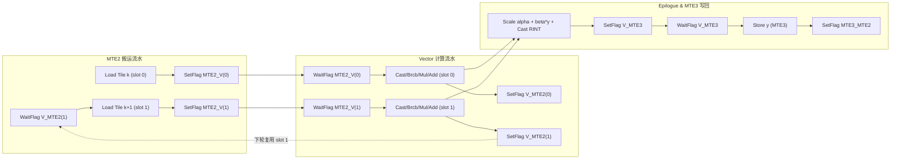

# 需求背景（required）

## 需求来源

基于昇腾社区算子开源任务需求，在昇腾 Atlas A2（910B3，`DAV_2201` / `arch22`）与 Atlas A3（910_93，`DAV_2201`）硬件平台上，使用 Ascend C 编程语言开发跨步批量矩阵-向量乘算子族 `aclblasSgemvStridedBatched`（含 `S` / `HSH` / `HSS` / `TST` / `TSS` 全部 5 个公开接口），对标 GPU BLAS 跨步批量 GEMV 能力，完成设计、开发、测试全流程工作，验收通过后合入昇腾算子开源仓 `cann/ops-blas`。

- **任务名称**：`11-aclblasSgemvStridedBatched-A2A3`（社区任务 2026 算子开发）
- **目标代码仓**：https://gitcode.com/cann/ops-blas
- **实现代码目标路径**：`blas/gemv_strided_batched/arch22/`
- **测试代码目标路径**：`test/gemv_strided_batched/arch22/`
- **公共头文件声明**：`include/cann_ops_blas.h`（已存在全部 5 个公开接口声明，无需修改）
- **算子文档说明**：`blas/gemv_strided_batched/README.md`

## 背景介绍

### aclblasSgemvStridedBatched 算子实现优化

跨步批量矩阵-向量乘（Strided Batched GEMV）是 BLAS Level 2 的重要批量扩展算子，广泛用于大语言模型增量解码（Decode 阶段单 token 批量注意力/投影）、科学计算与信号处理等高频访存密集型场景。其对每个独立 batch $i \in [0, \text{batchCount} - 1]$ 执行：

$$y + i \cdot \text{stridey} = \alpha \cdot \mathrm{op}(A + i \cdot \text{strideA}) \cdot (x + i \cdot \text{stridex}) + \beta \cdot (y + i \cdot \text{stridey})$$

在 Atlas A2 / A3（`DAV_2201` / `arch22`，单核 UB = 192 KB = 196,608 B，SIMD-Membase 架构）平台上，GEMV 属于典型的 **Memory-Bound（访存带宽受限）** 算子。本方案面向 **$\ge 0.8\times$ NVIDIA A100** 的性能目标，通过二维扁平化持久核调度、`x/y` 步长访存与 `A` 2D 连续突发 DMA 解耦、单 `TBuf` 统一 UB 内存池与 Ping-Pong 双缓冲流水，充分榨干硬件 HBM2e 有效带宽并压低极小尺寸启动延迟。

### aclblasSgemvStridedBatched 算子 ops-blas 现有实现现状分析

对 `cann/ops-blas` 仓内现状与任务书契约交叉审计结果如下：
1. **现有 `arch22` 实现局限**：仓内已有功能保底版 `arch22` 实现，但存在明显性能与契约短板——仅按 `batchCount` 单维分核（`batchCount = 1` 时仅激活 1 个 AIV 核，算力与带宽浪费 $> 97\%$）、矩阵 $A$ 采用逐列串行小包搬运、缺少相邻 batch 区域重叠检测及严格结构校验顺序、且存在 `S` 变体无效 `Muls(1.0F)` 拷贝。
2. **工作负载关键特征**：对 5 份 `gpu_baseline.csv`（共 1,000 条 PF 用例）分析发现：
   - `batchCount ∈ {1, 2, 3}` 占 47%（94/200），`batchCount ∈ {64, 256}` 占 25%（50/200），batch 极度两极分化；
   - `incx != 1` 占 67.5%（135/200），`incy != 1` 占 66.5%（133/200），绝不能因非单位步长导致主计算体回退标量逐元素读 `A`；
   - 头部大带宽用例（如 `sgemv-base-159` `T, 1024×511, bc=256`）0.8× A100 要求有效带宽 $\ge 1321\text{ GB/s}$，尾部极小用例（如 `base-011` `1×1, bc=1`）要求耗时 $\le 10.4\ \mu\text{s}$。
3. **本方案核心重构方向**：在 `blas/gemv_strided_batched/arch22/` 统一重构为 5 路径自适应高性能架构，补齐 11 步严格参数校验状态机，并采用 `test/gemm_ex/` 的多目标 CMake 范式兼容全套 6 个 `--ops=` 构建入口。

### aclblasSgemvStridedBatched 算子功能分析

`aclblasSgemvStridedBatched` 算子族包含 5 个公开接口，覆盖 FP32、FP16、BF16 及其混合精度组合：

| 接口名 | A dtype | x dtype | y dtype | alpha / beta dtype | 计算精度域 |
| :--- | :--- | :--- | :--- | :--- | :--- |
| `aclblasSgemvStridedBatched` | FP32 (`float`) | FP32 (`float`) | FP32 (`float`) | FP32 Host 标量 | FP32 |
| `aclblasHSHgemvStridedBatched` | FP16 (`uint16_t`) | FP16 (`uint16_t`) | FP16 (`uint16_t`) | FP32 Host 标量 | FP32 累加 $\to$ FP16 RNE 收窄 |
| `aclblasHSSgemvStridedBatched` | FP16 (`uint16_t`) | FP16 (`uint16_t`) | FP32 (`float`) | FP32 Host 标量 | FP32 |
| `aclblasTSTgemvStridedBatched` | BF16 (`uint16_t`) | BF16 (`uint16_t`) | BF16 (`uint16_t`) | FP32 Host 标量 | FP32 累加 $\to$ BF16 RNE 收窄 |
| `aclblasTSSgemvStridedBatched` | BF16 (`uint16_t`) | BF16 (`uint16_t`) | FP32 (`float`) | FP32 Host 标量 | FP32 |

参数清单与约束规范如下：

| 参数 | 参数含义 | 数据类型 | 支持数据类型 | 约束条件 | 形状 (Shape) |
| :--- | :--- | :--- | :--- | :--- | :--- |
| `handle` | 算子上下文句柄 | `aclblasHandle_t` | 指针 | 非空，携带合法 stream | - |
| `trans` | 矩阵转置操作 | `aclblasOperation_t` | 枚举 | `ACLBLAS_OP_N` / `ACLBLAS_OP_T` / `ACLBLAS_OP_C`（实数下 `OP_C ≡ OP_T`） | - |
| `m` | 矩阵 $A$ 的物理行数 | `int` | 整型 | $m \ge 0$；$m=0$ 为合法 quick return | - |
| `n` | 矩阵 $A$ 的物理列数 | `int` | 整型 | $n \ge 0$；$n=0$ 为合法 quick return | - |
| `alpha` | 标量乘数 $\alpha$ | `const float*` | Host 指针 | 非空；$\alpha = 0$ 时不读取 $A$ 与 $x$ | - |
| `A` | 批量输入矩阵 $A$ | `const T*` | Device 指针 | 列主序，物理维度恒为 $lda \times n$ | `[batchCount, lda, n]` |
| `lda` | $A$ 的前导维度 | `int` | 整型 | $lda \ge \max(1, m)$（与 `trans` 无关） | - |
| `strideA` | 相邻 batch $A$ 跨步（元素） | `int64_t` | 整型 | $> 0$ 且 $\ge \text{minStrideA}$（无重叠） | - |
| `x` | 批量输入向量 $x$ | `const T*` | Device 指针 | `OP_N` 长 $n$，`OP_T/C` 长 $m$ | `[batchCount, lenx]` |
| `incx` | $x$ 的元素步长 | `int` | 整型 | 非 0 且 $\ne \text{INT32\_MIN}$（支持负步长） | - |
| `stridex` | 相邻 batch $x$ 跨步（元素） | `int64_t` | 整型 | $> 0$ 且 $\ge \text{minStridex}$（无重叠） | - |
| `beta` | 标量乘数 $\beta$ | `const float*` | Host 指针 | 非空；$\beta = 0$ 时不读取 $y$ 旧值 | - |
| `y` | 批量输入/输出向量 $y$ | `TOut*` | Device 指针 | 原地覆写；`OP_N` 长 $m$，`OP_T/C` 长 $n$ | `[batchCount, leny]` |
| `incy` | $y$ 的元素步长 | `int` | 整型 | 非 0 且 $\ne \text{INT32\_MIN}$（支持负步长） | - |
| `stridey` | 相邻 batch $y$ 跨步（元素） | `int64_t` | 整型 | $> 0$ 且 $\ge \text{minStridey}$（无重叠） | - |
| `batchCount` | 批次数 | `int` | 整型 | $\ge 0$；$0$ 为合法 quick return | - |

---

# 需求分析（required）

## 需求描述

使用 Ascend C 编程语言在 Atlas A2（910B3）/ Atlas A3（910_93）平台上重构并实现 `aclblasSgemvStridedBatched` 算子族全部 5 个公开接口（`S` / `HSH` / `HSS` / `TST` / `TSS`），严格对齐任务书参数校验契约、列主序与负步长语义、FP32 累加与 RNE 收窄精度要求，以及 $\ge 0.8\times$ A100 的性能验收目标。

## 需求拆解

1. **5 变体统一实现**：在 `blas/gemv_strided_batched/arch22/` 下以统一模板架构实现 `S / HSH / HSS / TST / TSS` 5 个接口，避免代码重复；
2. **严格参数校验状态机**：按任务书 §2.5 顺序实现 11 步校验（含 `incx/incy == INT32_MIN` 与 `int64_t` 域相邻 batch 重叠检测），结构校验全部通过后再执行 quick return；
3. **5 路径自适应路由与满带宽优化**：针对 `alpha == 0`、极小尺寸、小 $m$ 大 $n$、`OP_N` 主力、`OP_T/C` 主力设计 5 条执行路径，通过二维扁平化分核 `(batchIdx, outTileIdx)`、2D `DataCopyPad` + Ping-Pong 双缓冲与步长访存解耦，同时满足高带宽与极低延迟要求；
4. **单 `TBuf` 池化防重叠**：遵循 `DAV_2201` 硬件约束，使用单一整段 `TBuf` 静态 256B 对齐划分所有子缓冲，规避 `TBuf.Get()` 地址重叠陷阱；
5. **多目标测试与双百验收**：采用 `test/gemm_ex/` 多目标 CMake 范式，支持全部 6 个 `--ops=` 构建入口，完成 5 × 1,000 = 5,000 条精度用例（100% PASS）与 5 × 200 = 1,000 条性能用例（`msprof op` 统一 18-Launch 协议，达标且预留 5% 安全余量）及显存 0 泄漏验证。

---

# 详细设计（required）

## 算子分析

### 数学公式

对每个独立 batch $i \in [0, \text{batchCount} - 1]$：

$$y_i = \alpha \cdot \mathrm{op}(A_i) \cdot x_i + \beta \cdot y_i$$

其中：
- $A_i = A + i \cdot \text{strideA}$，物理存储按列主序恒为 $lda \times n$（元素 $A_i(r, c)$ 位于偏移 $r + c \cdot lda$）；
- $x_i = x + i \cdot \text{stridex}$，$y_i = y + i \cdot \text{stridey}$；
- 当 `trans = ACLBLAS_OP_N` 时，$\mathrm{op}(A_i) = A_i \in \mathbb{R}^{m \times n}$，$x_i$ 逻辑长 $n$，$y_i$ 逻辑长 $m$：
  $$y_i[r] = \alpha \sum_{c=0}^{n-1} A_i(r, c) \cdot x_i[c] + \beta \cdot y_i[r], \quad r \in [0, m-1]$$
- 当 `trans = ACLBLAS_OP_T` 或 `ACLBLAS_OP_C` 时（实数域 `OP_C ≡ OP_T`），$\mathrm{op}(A_i) = A_i^T \in \mathbb{R}^{n \times m}$，$x_i$ 逻辑长 $m$，$y_i$ 逻辑长 $n$：
  $$y_i[c] = \alpha \sum_{r=0}^{m-1} A_i(r, c) \cdot x_i[r] + \beta \cdot y_i[c], \quad c \in [0, n-1]$$
- **负步长索引约定**：对于逻辑长度为 $L$、步长为 `inc` 的向量，逻辑第 $k \in [0, L-1]$ 个元素的物理索引为：
  $$\text{idx}(k) = \begin{cases} k \cdot \text{inc}, & \text{inc} > 0 \\ (k - L + 1) \cdot \text{inc}, & \text{inc} < 0 \end{cases}$$

### 支持数据类型

- **输入/输出组合**：`(FP32, FP32, FP32)`、`(FP16, FP16, FP16)`、`(FP16, FP16, FP32)`、`(BF16, BF16, BF16)`、`(BF16, BF16, FP32)`；
- **标量**：`alpha`、`beta` 均为 Host 侧 `const float*`（FP32）；
- **累加与收窄**：所有 5 个变体内部统一在 FP32 域累加，FP16/BF16 输出在 Epilogue 阶段通过 `Cast(..., RoundMode::CAST_RINT)`（IEEE RNE）收窄并严格保留 NaN/Inf。

### 支持形状

- 任意合法非负整数 $m \ge 0, n \ge 0, \text{batchCount} \ge 0$；
- 物理前导维 $lda \ge \max(1, m)$；
- 非零步长 `incx`, `incy`（支持负步长，拒绝 `0` 与 `INT32_MIN`）；
- 跨步 `strideA`, `stridex`, `stridey` 严格 $> 0$ 且满足相邻 batch 不重叠约束；
- 不支持广播或非跨步任意视图。

---

## 算子实现

### 实现方案

#### 3.2.1 host侧设计：

##### tiling策略：
Host 侧通过 `GetAivCoreCount()` 动态获取当前设备（Atlas A2 / A3）物理 AIV 核心数（若返回 0 则报 `ACLBLAS_STATUS_INTERNAL_ERROR`），严禁硬编码核数。主 AIV 架构 **Workspace 需求为 `0 B`**。

`GemvStridedBatchedTilingData` 结构体字段规划如下：
- `dtype`（0=HSH, 1=S, 2=HSS, 3=TST, 4=TSS）、`trans`（0=N, 1=T/C）、`pathId`（`GemvSbPath` 0~4）；
- `m`、`n`、`outTile`（输出维切分步长：`NORMAL` 为 $m$ 方向，`TRANS` 为 $n$ 方向）、`kTile`（规约维切分步长）；
- `tilesPerBatch = CeilDiv(outDim, outTile)`、`batchCount`、`totalTasks = batchCount * tilesPerBatch`、`usedCoreNum = min(coreNum, totalTasks)`；
- `alpha`、`beta`、`lda`、`incx`、`incy`、`strideA`、`stridex`、`stridey`。

##### 任务均分：
采用**二维扁平化持久核调度 `(batchIdx, outTileIdx)`**，将 `totalTasks = batchCount * tilesPerBatch` 均匀摊平到全部可用 AIV 核：
- 每个核按 `taskId = blockIdx; taskId < totalTasks; taskId += usedCoreNum` 步进领取任务；
- 由 `b = taskId / tilesPerBatch` 与 `outTileIdx = taskId % tilesPerBatch` 解码目标 batch 与输出分块；
- 彻底解决 `batchCount = 1` 时的单核瓶颈与 `batchCount = 256` 时的尾核负载不均问题。

##### 批量搬运：
- **矩阵 $A$ 的 2D 连续突发 DMA**：当 `srcGap = (lda - mCnt) * sizeof(T)` 处于 `DataCopyExtParams` 的合法范围且 `nCnt <= 4095` 时，使用单次 2D `DataCopyPad` 一次搬入整个 `mCnt × nCnt` 矩形块（`mCnt % 8 == 0 && lda % 8 == 0` 且满足 32B 单位上限时优先使用硬件原生 `DataCopy`），彻底消除逐列小包 DMA；大 `lda` 越界时自动回退按列循环 `DataCopyPad`。
- **向量 $x / y$ 步长访存解耦**：
  - 读 $x$：`incx == 1` 连续 `DataCopyPad`；`incx == -1` 连续搬入窗口后在 UB 内反转；`|incx| > 1` 且跨度 $\le 4096$ 时一次性突发搬入 `bufWin` 再 UB 内标量抽取；超大跨度回退单元素 `DataCopyPad`；
  - 写 $y$（哨兵安全）：`incy == 1` 单次精确字节 `DataCopyPad` 写回；`incy != 1` 严格按物理地址逐点写回，绝不改写跨步间隙字节。

##### 1. 分核策略：
- **极小路径（`TINY_FAST`）**：当 `batchCount * m * n <= 4096` 时，仅启动极少核心（单核或按 `batchCount`），跳过复杂调度以压低内核启动开销（目标 $\le 10.4\ \mu\text{s}$）；
- **主力路径（`NORMAL_2D` / `TRANS_2D` / `NORMAL_SMALLM` / `ALPHA_ZERO`）**：优先满核原则，`usedCoreNum = min(aivCoreNum, totalTasks)`，通过二维扁平化网格保证小 batch 也能激活全片 AIV 核心。

##### 2. 数据分块和内存优化策略：
针对 `DAV_2201` 单核 UB = 192 KB（196,608 B），并在 `Init()` 阶段**仅向 `TPipe` 申请一块统一的整段 UB 内存池**（`TBuf<TPosition::VECCALC> ubPool_`），所有子缓冲区按 **`256 B` 对齐** 静态划分字节偏移并通过 `static_assert` 校验总字节数 $\le 196,608\text{ B}$，彻底规避 `DAV_2201` 多 `TBuf.Get()` 地址重叠陷阱。

- **Path 3 (`NORMAL_2D`, `M_TILE=128`, `N_TILE=64`, `WIN_MAX=4096`) UB 预算**：
  - `bufAIn[0..1]`（Ping-Pong 双缓冲）：FP32 占 65,536 B / 16-bit 占 32,768 B；
  - `bufA32`（16-bit 转 FP32）：FP32 占 0 B / 16-bit 占 32,768 B；
  - `bufWork`（`Brcb` 广播 $x$ 至 `[128×64]`）：32,768 B；
  - `bufXIn` / `bufX32` / `bufAcc` / `bufY` / `bufWin` (16,384 B) / `bufScalar`：合计 **116,480 B（59.2%）**（FP32） / **116,736 B（59.4%）**（16-bit）。
- **Path 4 (`TRANS_2D`, `M_TILE=1024`, `N_TILE=16`, `X_RES_MAX=4096`, `WIN_MAX=4096`) UB 预算**：
  - `bufAIn[0..1]`（Ping-Pong 双缓冲）：FP32 占 131,072 B / 16-bit 占 65,536 B；
  - `bufA32`（16-bit 转 FP32）：FP32 占 0 B / 16-bit 占 65,536 B；
  - `bufXIn` + `bufX32`（$m \le 4096$ 时整条 $x$ 常驻 UB 跨 `colTile` 零重复读取）：16,384 B / 24,576 B；
  - `bufWin` (16,384 B) + `bufSums` (1,024 B) + `bufOutput` + `bufAcc` + `bufY` + `bufScalar`：合计 **166,144 B（84.5%）**（FP32） / **174,336 B（88.7%）**（16-bit）。
- **Path 1 (`TINY_FAST`) UB 预算**：仅使用 **24 KB**（单缓冲），最大化减少 `TPipe` 初始化开销。

##### 3. tilingkey规划策略：

通过 `GemvSbPath`（`pathId` 0~4）与 `dtype` 组合分派 5 条自适应执行路径：

| `pathId` | 路径名称 | 触发条件（Host 侧静态判定） | 核心调度与计算机制 |
| :--- | :--- | :--- | :--- |
| **0** | `ALPHA_ZERO` | `alpha == 0.0f`（且未命中 `beta == 1` shortcut） | 不读 `A` 与 `x`；`beta == 0` 直接写 0，否则仅读 `y` 做 `Muls(beta)` 写回 |
| **1** | `TINY_FAST` | `batchCount * m * n <= 4096` | 极小 UB（24 KB）、单缓冲、单核/少核极简直通，压低启动延迟 |
| **2** | `NORMAL_SMALLM` | `trans == N && m <= 16 && n >= 256` | 沿 $n$ 维切块；`m == 1` 单行大向量 `Mul + WholeReduceSum`；`2 <= m <= 16` 2D 批量加载后按行规约 |
| **3** | `NORMAL_2D` | `trans == N` 其余全部规模（主力） | `M_TILE=128, N_TILE=64`；2D DMA + Ping-Pong + `Brcb` + `Mul` + 6 轮二叉树 `Add` 归约 |
| **4** | `TRANS_2D` | `trans == T / C` 其余全部规模（主力） | `M_TILE=1024, N_TILE=16`；$x$ 驻留 UB + 2D DMA + Ping-Pong + 16 列连续 `Mul` + 两级 `WholeReduceSum` |

##### 数据检测：
严格按任务书 §2.5 规定的 11 步顺序执行校验，确保非法参数不被 quick return 掩盖：
1. `handle == nullptr` $\to$ `ACLBLAS_STATUS_HANDLE_IS_NULLPTR`；
2. `trans` 不在 `{OP_N, OP_T, OP_C}` $\to$ `ACLBLAS_STATUS_INVALID_ENUM`；
3. `m < 0 || n < 0` $\to$ `ACLBLAS_STATUS_INVALID_VALUE`；
4. `lda < max(1, m)` $\to$ `ACLBLAS_STATUS_INVALID_VALUE`；
5. `incx == 0 || incx == INT32_MIN || incy == 0 || incy == INT32_MIN` $\to$ `ACLBLAS_STATUS_INVALID_VALUE`；
6. `batchCount < 0` $\to$ `ACLBLAS_STATUS_INVALID_VALUE`；
7. `strideA <= 0 || stridex <= 0 || stridey <= 0` $\to$ `ACLBLAS_STATUS_INVALID_VALUE`；
8. 相邻 batch 重叠检测（在 `int64_t` 域计算 `minStrideA` / `minStridex` / `minStridey`，任一小于下界即拦截）$\to$ `ACLBLAS_STATUS_INVALID_VALUE`；
9. `alpha == nullptr || beta == nullptr` $\to$ `ACLBLAS_STATUS_INVALID_VALUE`；
10. 合法 Quick Return：`batchCount == 0 || m == 0 || n == 0` $\to$ `ACLBLAS_STATUS_SUCCESS`（不引用 `A/x/y`，不启动 kernel）；
11. 数据指针非空校验：`A == nullptr || x == nullptr || y == nullptr` $\to$ `ACLBLAS_STATUS_INVALID_VALUE`；
12. 无操作 Shortcut（仅在步骤 11 之后）：`*alpha == 0.0f && *beta == 1.0f` $\to$ `ACLBLAS_STATUS_SUCCESS`。

#### 3.2.2 kernel侧设计：

Kernel 分为 `Init()` 与 `Process()` 两阶段。硬件事件 ID（`EVENT_ID0`、`EVENT_ID1`）在 `Init()` 阶段一次性 `FetchEventID()` 预取，严禁在循环内重复申请。

- **CopyIn**：通过 Ping-Pong 双缓冲 `bufAIn[0..1]` 与 2D `DataCopy` / `DataCopyPad` 异步预取矩阵块；向量 $x$ 按步长策略搬入并在 `TRANS_2D`（$m \le 4096$）中常驻 UB 复用；
- **Compute**：
  - `S` 变体直接对 UB 中 FP32 原位计算，消除无效 `Muls(1.0F)` 拷贝；16-bit 输入通过 `Cast` 提升至 FP32 计算；
  - `NORMAL_2D`：`Brcb` 广播 $x[64]$ 至 `[128×64]`，向量 `Mul` 后执行 6 轮二叉树 `Add` 归约（`64 -> 32 -> 16 -> 8 -> 4 -> 2 -> 1`）累加至 `acc[128]`，零标量点积循环；
  - `TRANS_2D`：16 列连续 `Mul`（无中间依赖、零 `PIPE_BARRIER`）+ 批量两级 `WholeReduceSum` 累加至 `acc[16]`；
- **Epilogue & CopyOut**：
  - 统一融合 `acc = alpha * acc + beta * y_old`（`beta == 0.0f` 时不读取 `y_old` 免疫 `NaN`）；
  - `HSH` / `TST` 变体使用 `Cast(..., RoundMode::CAST_RINT)` 按 IEEE RNE 收窄并保留 NaN/Inf；
  - 按 `incy == 1`（连续 `DataCopyPad`）或 `incy != 1`（逐点哨兵安全写回）输出至 GM。

---

## 支持硬件

| 支持的芯片版本 | 涉及勾选 | 说明 |
| :--- | :--- | :--- |
| **Atlas A2 训练/推理系列（910B3，`DAV_2201` / `arch22`）** | **√** | 本任务目标硬件，单核 UB = 192 KB，AIV 核数运行时动态查询 |
| **Atlas A3 训练/推理系列（910_93，`DAV_2201` / `arch22`）** | **√** | 同架构兼容，AIV 核数运行时动态查询 |

---

## 算子约束限制

1. **存储与布局**：矩阵 $A$ 按列主序存储，物理维度恒为 $lda \times n$（$lda \ge \max(1, m)$）；不支持广播或任意非跨步视图；
2. **步长与重叠约束**：`incx`、`incy` 不可为 `0` 或 `INT32_MIN`；`strideA`、`stridex`、`stridey` 必须 $> 0$ 且相邻 batch 内存区域不可重叠；
3. **标量位置**：`alpha`、`beta` 为 Host 侧 FP32 标量指针，不可为空；
4. **原地覆写与安全**：向量 $y$ 原地覆写，非单位步长时严格不改写跨步间隙字节；主 AIV 路径 Workspace 为 `0 B`（若启用可选 Cube Split-K 储备路径，严格受 `ACLBLAS_MAX_WORKSPACE_SIZE = 2 GiB` 硬上限管控）。

---

# 可维可测分析

## 精度标准/性能标准

| 验收标准 | 描述 (不涉及说明原因) | 标准来源 |
| :--- | :--- | :--- |
| **精度标准** | 1. 5 个变体（`S / HSH / HSS / TST / TSS`）共计 **5 × 1,000 = 5,000 条**精度用例，采用 FP64 累加计算参考值并按输出 dtype（FP16/BF16 IEEE RNE，严格保留 NaN/Inf）收窄 golden； 2. 满足生态算子开源精度标准 Mixed Tolerance（`matched_ratio >= 0.99` 且 `max_abs_error <= max(fixed, 32 * ULP)`），覆盖 `TC_L2` 溢出收窄、`TC_L5` NaN/Inf 组合及 25 条 `TC_ED` 负向用例； 3. 全量达成 **100% PASS（0 FAIL / 0 SKIP）**。 | 任务书 §3.2 及生态算子开源精度标准 |
| **性能标准** | 1. 5 个变体共计 **5 × 200 = 1,000 条** PF 性能用例，严格采用 `msprof op` 真实硬件采集（统一 `1 precheck + 5 warmup + 12 samples = 18 Launches`，去 2 尖刺留 10 稳态样本均值）； 2. 对标 `gpu_baseline.csv`（A100 实测基线）：全量用例达成 **$\ge 0.8\times$ A100**，内部调优预留 $\ge 5\%$ 安全余量（$\ge 0.84\times$ A100）； 3. 同步执行 `npu-smi` 3 阶段显存采样审计，确保显存 **0 泄漏（Leak = 0 MB）**。 | 任务书 §3.3 性能判据及验收规范 |

## 兼容性分析

1. **接口兼容性**：`include/cann_ops_blas.h` 中已存在 5 个公开接口声明，本实现完全遵循既有函数签名与 ABI，不修改公共头文件；
2. **构建与测试兼容**：沿用 `ops-blas` 仓内 `test/gemm_ex/` 的多目标 CMake 范式，仅增量注册 4 处 CMake（`test/gemv_strided_batched/CMakeLists.txt`、`test/CMakeLists.txt`、`blas/CMakeLists.txt`、`cmake/test.cmake`），不修改 `build.sh`，使 `--ops=gemv_strided_batched` 及 5 个变体构建入口全部开箱即用；
3. **跨架构隔离**：所有代码改动严格限定在 `arch22` 目录下，不影响 `arch35` 及其他算子的编译与运行。
