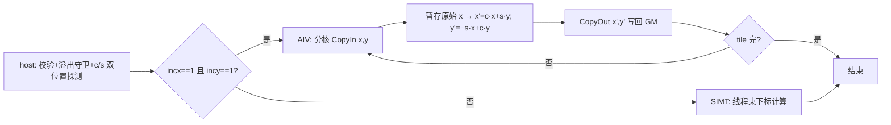

# aclblasSrot 算子设计文档

# 需求背景（required）

## 需求来源
- 任务名称/批次：2026 年 11 月社区任务 — aclblasSrot 算子开发（A2A3）。
- 合入目标仓：https://gitcode.com/cann/ops-blas ，算子代码 `blas/rot/arch22/`，测试代码 `test/rot/srot/arch22/`。
- 验收流程：cann-competitions 社区任务流程（任务书 §4 交付件 / §5 PR 申请合入）。

## 背景介绍
### 算子功能定位
- aclblasSrot 将 Givens 平面旋转 G = [[c, s], [−s, c]] 逐元素作用于单精度实数向量 x、y：`x' = c·x + s·y`，`y' = −s·x + c·y`（第二等式右端 x 取更新前值，实现须先暂存原始 x），x/y 原地更新，c/s 为 float 标量指针。
- n=0 时 x/y 不修改（no-op 快速返回）。

### 业界对标
- 对标 cuBLAS `cublasSrot`（cuBLAS 官方文档 §2.5.8）：参数语义、返回码、快速返回口径以该文档为唯一依据；golden 参考语义见 Netlib `srot.f`。
- 行为对齐仓内 950PR 既有实现 `blas/rot/arch35/srot_host.cpp`（aclblasSrot 入口 L242-251、strided 溢出守卫 L116-129），A2/A3 口径对齐 `blas/rot/README.md` per-arch 差异表。
- 与同族复数 `aclblasCrot`（blas/rot/arch35 已合入）、实数 `aclblasCsrot`（blas/rot/arch22 已合入）同族同工程模式。

### 工程形态
- 工程模式：Ascend C kernel 直调（host 入口 + 校验 + tiling + device kernel，handle 绑定 stream）。
- 代码落位：`blas/rot/arch22/`（srot_host.cpp / srot_kernel.cpp / srot_kernel.h / srot_tiling_data.h，与同目录 csrot 分层一致）；测试落位 `test/rot/srot/arch22/`，并在 `test/rot/srot/CMakeLists.txt` arch22 分支补 `ops_blas_add_gtest_tests(${OPS_BLAS} srot_test)`（当前仅 arch35 注册，随本任务补齐）。
- 仓内近亲：`blas/rot/arch35/srot_*`（950PR 实数旋转已合入：连续 AIV 路径 + SIMT 跨步路径 + 溢出守卫，整体移植）；`blas/rot/arch22/csrot_*`（arch22 工程骨架与 CMake 接入样例）。
- 现场核验：`include/cann_ops_blas.h` **L459 已有 `aclblasSrot` 声明**（任务书 §2.3 写 L448-449，行号小幅漂移），签名与 §2.3 逐参一致，本任务无需改公共头。

### 接口规格
- 接口声明（与 include/cann_ops_blas.h L459 既有声明逐参一致）：

```cpp
aclblasStatus_t aclblasSrot(aclblasHandle_t handle, int n, float* x, int incx, float* y, int incy, const float* c, const float* s);
```

- 参数规格表（官方栏目）：

| 参数 | 参数含义 | 数据类型 | 支持数据类型 | 约束 | 形状 |
| --- | --- | --- | --- | --- | --- |
| handle | 库上下文句柄（携带 stream），Host 内存 | scalar | - | nullptr 返回 ACLBLAS_STATUS_HANDLE_IS_NULLPTR | - |
| n | 向量元素个数，Host 内存 | scalar | int32 | n=0 合法 no-op 快速返回；n<0 返回 INVALID_VALUE | - |
| x | 输入/输出向量（原地更新 x'=c·x+s·y），Device | tensor | FLOAT32 | 全值域（Inf/NaN 按 IEEE 自然传播）；n>0 时 nullptr 返回 INVALID_VALUE | 1+(n−1)×\|incx\| |
| incx | x 步长，Host 内存 | scalar | int32 | ≠0 且非 INT32_MIN；(n−1)×\|incx\| 超 int32 返回 INVALID_VALUE（host int64） | - |
| y | 输入/输出向量（原地更新 y'=−s·x+c·y，x 取更新前值），Device | tensor | FLOAT32 | 同 x | 1+(n−1)×\|incy\| |
| incy | y 步长，Host 内存 | scalar | int32 | 同 incx | - |
| c | 旋转余弦元素指针，Host 或 Device 内存（aclrtPointerGetAttributes 运行时判定） | scalar | FLOAT32 | n>0 时 nullptr 返回 INVALID_VALUE；值不校验 | [1] |
| s | 旋转正弦元素指针，Host 或 Device 内存（同 c） | scalar | FLOAT32 | n>0 时 nullptr 返回 INVALID_VALUE；值不校验 | [1] |

### 数学公式
- `x'[i] = c·x[i] + s·y[i]`，`y'[i] = −s·x[i] + c·y[i]`（0 基，x[i] 为更新前值）；旋转矩阵 G=[[c,s],[−s,c]]；与 §3.2 golden（cblas_srot，srot.f 语义）同一计算形态。

# 需求分析（required）

## 需求描述
- 使用 Ascend C 在 Atlas A2/A3（arch22）上以 kernel 直调实现 aclblasSrot：FLOAT32 dtype、正负步长、n=0 快速返回、c/s 双内存位置探测、跨度溢出守卫，精度按 mixed_tolerance FLOAT32 对齐 cblas_srot golden，性能达到 cublasSrot（910B3 实测）平均单次耗时的 0.8 倍以上。

## 需求拆解

| # | 必须回答 | 本算子结论 |
| --- | --- | --- |
| 1 | 数学定义与可复用的代数量 | 逐元素 2×2 旋转，无依赖链可按核并行；arch35 srot 已合入实现（含连续/跨步双路径与溢出守卫）整体移植，arch22 csrot 提供工程骨架 |
| 2 | 接口原型 | include/cann_ops_blas.h L459 声明已存在（现场核验），无需新增；参数序列与 cublasSrot 逐位一致 |
| 3 | 参数规格 | 见接口规格表；异常码：HANDLE_IS_NULLPTR / INVALID_VALUE；n=0 快速返回 SUCCESS |
| 4 | 支持数据类型 | x/y：FLOAT32；c/s：FLOAT32 标量（Host/Device 双位置） |
| 5 | 目标芯片与 arch 映射 | Atlas A2/A3（arch22）；自验覆盖 910B3（性能设备 Atlas 800I A2 910B3）；标杆 cublasSrot |
| 6 | 精度要求 | y 逐元素 FLOAT32：rtol/atol=2^-13，ratio 0.99，max_abs 1e-2 or 32×ULP（mixed_tolerance）；golden=cblas_srot（srot.f 语义）；Inf/NaN 等效规则 |
| 7 | 性能预期 | msprof op（warmup 5 + 采样 ≥10 取平均）≤ GPU 标杆 1.25 倍；标杆 gpu_baseline.csv |
| 8 | 代码架构选型 + 可行性 | 双 kernel 变体（连续 AIV/UB DataCopy 流水 + 跨步 SIMT 直接下标计算），arch35 srot 终态设计直接移植。已排除死路：x/y 就地顺序更新不做原始 x 暂存（y 更新会读到已改写的 x，违反先读后写语义）；GM 中转暂存（UB/寄存器暂存即可） |
| 9 | 评测来源 | golden：cblas_srot（仓内 test/rot/srot/srot_golden.h 同口径）；性能标杆：cublasSrot（gpu_baseline.csv）；用例：test_cases CSV + GTest |

# 详细设计（required）

## 算子分析
### 数学公式
- 逐元素：`x'[i] = c·x[i] + s·y[i]`；`y'[i] = −s·x[i] + c·y[i]`，i=0..n−1；第二式使用更新前 x[i]（先暂存）。

### 支持数据类型
- x/y：FLOAT32；c/s：FLOAT32 标量（Host/Device 双位置，运行时探测）。

### 支持形状
- 一维向量，物理长度 1+(n−1)×|incx| / 1+(n−1)×|incy|。
- 退化：n=0 → 快速返回 SUCCESS（x/y 不修改）；n<0 → INVALID_VALUE。

## 算子实现
### 实现方案
#### 总体架构与数据流
- 双 kernel 变体（继承 arch35 srot 设计），由 host 侧按 (incx==1 && incy==1) 分派：

| 变体 | 触发条件 | 职责 |
| --- | --- | --- |
| AIV/UB 流水 kernel | incx==1 && incy==1 | 连续访问：多核均分 n，每核 CopyIn(x,y) → 暂存原始 x → 旋转计算 → CopyOut(x',y')，double buffer 分 tile |
| SIMT kernel | incx≠1 或 incy≠1 | 跨步访问：asc_vf_call 线程束按下标公式直接读写 GM，负步长自尾端反向 |

#### host 侧设计
- **分核策略**：连续路径 `numBlocks = min(coreNum, n)`，每核均分 + 余块归末核；跨步路径 `useCoreNum = min(aivCoreNum, n)`，均分逻辑下标，满核原则。
- **数据分块和内存优化策略**：连续路径 x/y 段分 tile 载入 UB（double buffer），原始 x 在寄存器/UB 暂存，一次遍历产出两个输出（每元素 2R+2W，无冗余访存）；跨步路径无 UB 中转。
- **tilingkey 规划策略**：不引入 tiling key——连续/跨步在 host 侧选 kernel 入口，步长符号 kernel 内按下标公式处理；c/s 值随 tiling 下发。
- **数据检测（校验顺序，对齐 arch35 srot_host.cpp L242-251 与溢出守卫 L116-129）**：
  1. handle==nullptr → ACLBLAS_STATUS_HANDLE_IS_NULLPTR；
  2. n<0 → INVALID_VALUE；n==0 → 快速返回 SUCCESS（x/y 不修改）；
  3. incx==0 / incy==0 / INT32_MIN → INVALID_VALUE；
  4. (n−1)×|incx|、(n−1)×|incy| 超 int32 表示范围（host 侧 int64 计算，strided 溢出守卫）→ INVALID_VALUE；
  5. n>0 时 x/y/c/s 任一 nullptr → INVALID_VALUE。
- **c/s 处理（双内存位置）**：运行时 aclrtPointerGetAttributes 判定 Host/Device；Host 指针同步解引用、Device 指针经 stream 读取，统一转为值随 tiling 下发；标量值不校验。

#### kernel 侧设计
- Init：解析 tiling（n/incx/incy/各核起止/c/s 值），SetGlobalBuffer，InitBuffer。
- Process（连续）：CopyIn x/y 段 → 暂存原始 x → `x' = c·x + s·y`、`y' = −s·x + c·y`（向量指令）→ CopyOut；末尾余块走对齐块 + DataCopyPad。Process（跨步）：每核取自身分片，线程束 grid-stride 按下标公式计算（负步长自尾端反向）。
- 流程图：



- workspace 布局：无额外 workspace（原始 x 暂存在 UB/寄存器，x/y 原地覆写）。

#### 性能优化要点（终态）
- 优化项：连续路径 UB double buffer + 向量指令批量旋转计算；原始 x 暂存免二次访存；跨步路径 SIMT 直接计算避免 pad/对齐开销。目标 ≤1.25× cublasSrot 标杆，实测数据回填自测报告。
- 未采用路线：跨步路径 UB+DataCopy 间接寻址（pad 语义复杂，劣于 SIMT）；GM 中转暂存 x；两输出分两个 kernel。

## 支持硬件

| 支持的芯片版本 | 涉及 |
| --- | --- |
| Atlas A2/A3 训练系列（910B，arch22） | ✅（本任务目标，自验覆盖 910B3） |
| Atlas 950PR（arch35） | ❌（arch35 已有 srot 实现，本任务不改） |

## 算子约束限制
- 非连续 tensor：以 BLAS 步长语义支持（正负步长均生效，负步长自尾端起算）；incx/incy 为 0 或 INT32_MIN 非法。
- 不涉及 broadcast / dynamic shape / 0 维 tensor；x/y 原地更新不返回视图（先读后写，y 用更新前 x）。
- 确定性：逐元素运算单次执行内确定，同输入同步长跨次执行 bit 级一致。
- 异步执行：经 handle 绑定 stream 异步下发，读输出前须同步 stream；c/s 标量在提交前消解，Device 标量经 stream 读取。

# 可维可测分析（required）

## 精度标准/性能标准

| 验收标准 | 描述 | 标准来源 |
| --- | --- | --- |
| 精度标准 | y 逐元素 FLOAT32：rtol=atol=2^-13(1.2e-4)，ratio 0.99，max_abs 1e-2 or 32×ULP；golden=cblas_srot（srot.f 语义）；Inf/NaN 按等效规则单独判定（非有限值不计入统计） | mixed_tolerance_standard，任务书 §3.2 |
| 性能标准 | FLOAT32 平均单次耗时 ≤ GPU 标杆（cublasSrot 同规模同 dtype 同步长）×1.25；msprof op 采集，warmup 5 + 有效采样 ≥10 取平均，仅 SUCCESS 计入 | 任务书 §3.3 + test_cases/gpu_baseline.csv |

## 测试概览
- 测试工程：`test/rot/srot/arch22/` 新建（CSV + C++ GTest，参照仓内 test/rot/srot arch35 工程模式与 srot_param.h/srot_golden.h 范式），补 `test/rot/srot/CMakeLists.txt` arch22 注册。
- 用例口径：精度全量 1000 条、性能子集 200 条（单 dtype 100% 分摊）；覆盖尺寸扫描（0/1/2/3/1024/16384/262144/1048576）、步长 {1,2,7,-1,-3} 与溢出组合（n=3 且 incx=INT_MAX、n=2^30 且步长 8）、标量特殊值（c/s ∈ {0.0,1.0,2.5,-1.5,0.1,10.0}）、边界域（n=0/n=1/全零向量/单位旋转 c=1,s=0）、负向域（handle nullptr、n>0 时 x/y/c/s nullptr、inc==0/INT32_MIN、跨度溢出——期望对应错误码）、Inf/NaN 用例、性能用例。
- 输入生成：均匀 [-5,5] 50% + 正态 GAUSS_NORM_5_2 50%；负向用例不按 (n−1)×|inc| 预分配缓冲（dummy/NULLPTR 占位）；n=0 或 incx≤0/incy≤0 的快返用例无需按步长分配；任务自带 gen_csv.py 仅均匀分布，正态用例本任务补齐并在自测报告说明。
- 性能口径：msprof op，warmup 5 + 有效采样 ≥10 取平均；复现入口 test_cases/README.md。

## 兼容性分析
- 公共头零改动：`aclblasSrot` 声明已存在于 include/cann_ops_blas.h L459（现场核验，任务书行号 L448-449 有小幅漂移），本任务不新增不修改任何声明。
- `blas/rot/arch22/` 新增 srot 文件（与既有 csrot 并列）、`test/rot/srot/arch22/` 新建测试工程与 arch22 CMake 注册，均不影响同目录 csrot 与 arch35 既有行为。
