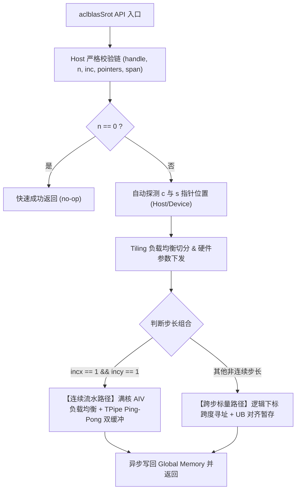

# aclblasSrot 算子设计文档

# 需求背景（required）

## 需求来源

- **任务名称**：2026 年 11 月社区任务「aclblasSrot 算子开发（Atlas A2/A3）」
- **任务编号/ID**：`a42dd9c650154f4f9acdfb3d2bea468b`
- **团队及提交账号**：`qingkouwei`
- **提交路径**：`04_tasks/01_community-task-2026/tasklist/11-aclblasSrot-A2A3/qingkouwei/docs/design.md`
- **目标代码仓**：`https://gitcode.com/cann/ops-blas`（开发分支 master）
- **代码合入路径**：实现代码合入 `blas/rot/arch22/`，测试代码合入 `test/rot/srot/arch22/`
- **目标硬件与 CANN 版本**：Atlas A2/A3（arch22，自验覆盖 Atlas 800T A2 910B3），CANN 9.1.0 及以上

## 背景介绍

### 算子功能定位

`aclblasSrot` 是标准 BLAS Level-1 例程之一，用于对两个等长单精度实数（FLOAT32）向量 $x$ 与 $y$ 施加 Givens 平面旋转变换（旋转矩阵 $G = \begin{bmatrix} c & s \\ -s & c \end{bmatrix}$），计算结果原地更新（in-place）写入 $x$ 与 $y$ 向量。

数学公式：
$$
x_k = c \cdot x_k + s \cdot y_j
$$
$$
y_j = -s \cdot x_k + c \cdot y_j \quad (\text{等式右端的 } x_k \text{ 为更新前原始旧值})
$$
其中：
$$
k = 1 + (i-1) \times incx, \quad j = 1 + (i-1) \times incy, \quad i = 1 \dots n
$$
当 $n = 0$ 时，向量 $x, y$ 不修改，直接快速返回（no-op）。

### 业界对标与依据

| 对标对象 | 语义与设计依据 | 差异与对齐要点 |
| :--- | :--- | :--- |
| **cuBLAS `cublasSrot`**（cuBLAS API §2.5.8） | 参数命名、校验逻辑与返回码口径的业界标准依据（唯一依据） | 返回码严格对齐：$n < 0$、步长为 $0$ 或 $\text{INT32\_MIN}$ 返回 `ACLBLAS_STATUS_INVALID_VALUE`；$n = 0$ 快速成功返回。 |
| **Netlib BLAS `srot.f`** | 数学真值（Golden Reference）标准 | 严格以未旋转的原始旧值参与两式计算；逐元素独立舍入。 |
| **仓内现有实现** | `blas/rot/arch35/`（950PR）与 `blas/rot/arch22/` 兄弟算子 | 采用相同的工程模式与文件结构，头文件零改动，规范公共接口组织。 |

### 工程形态

- **工程模式**：Kernel 直调模式（Host 入口参数校验 + Tiling 下发 + Device Kernel 向量化执行）。
- **文件布局**：
  ```text
  blas/rot/arch22/
  ├── srot_host.cpp        # Host 入口、参数校验链与 Tiling 下发
  ├── srot_kernel.cpp      # Device 端 Ascend C 向量化计算 Kernel
  ├── srot_kernel.h        # Kernel 内部函数与数据结构声明
  └── srot_tiling_data.h   # Host 与 Device 交互的 Tiling 参数结构体
  ```
- **测试工程布局**：
  ```text
  test/rot/srot/arch22/
  ├── srot_test.cpp        # C++ GTest 测试代码
  ├── srot_test.csv        # 测试用例配置文件
  └── CMakeLists.txt       # 调用 ops_blas_add_gtest_tests 注册 arch22 GTest
  ```

### 接口规格

本任务严格遵循 `include/cann_ops_blas.h`（L448-449）中已声明的官方公开接口原型，**保持头文件零修改，禁止另立私有平行接口**：

```cpp
aclblasStatus_t aclblasSrot(
    aclblasHandle_t handle,
    int n,
    float* x,
    int incx,
    float* y,
    int incy,
    const float* c,
    const float* s);
```

#### 参数规格明细表（1:1 严格对齐任务书 §2.4）

| 参数名 | 输入/输出/属性 | 描述 | 数据类型 | dtype | 数据格式 | 维度(shape) | 值域范围 | 异常行为与返回码 |
| :--- | :--- | :--- | :--- | :--- | :--- | :--- | :--- | :--- |
| **handle** | 输入 | 库上下文句柄（携带 stream），Host 内存 | attr | - | - | - | aclblasCreate 返回的非空句柄 | 为 `nullptr` 时返回 `ACLBLAS_STATUS_HANDLE_IS_NULLPTR` |
| **n** | 输入 | 向量元素个数，Host 内存 | attr | int | - | - | 任意 int32 整数（$n=0$ 走 no-op 快速成功返回） | $n < 0$ 时返回 `ACLBLAS_STATUS_INVALID_VALUE`；$n = 0$ 时不修改 $x,y$ 直接返回成功 |
| **x** | 输出(原地更新) | 输入兼输出向量，Device 内存 | tensor | FLOAT32 | ND | 一维向量，物理跨度 $1+(n-1) \times \|incx\|$ | 全值域（含 Inf/NaN，按 IEEE 规则自然传播） | $n > 0$ 时为 `nullptr` 返回 `ACLBLAS_STATUS_INVALID_VALUE`；元素值不校验 |
| **incx** | 输入 | $x$ 中相邻元素存储步长，Host 内存 | attr | int | - | - | 非零且不为 `INT32_MIN`（支持正负步长，负步长自尾端起算） | 为 $0$ 或 `INT32_MIN` 返回 `ACLBLAS_STATUS_INVALID_VALUE`；$(n-1) \times \|incx\|$ 超出 int32 范围返回 `ACLBLAS_STATUS_INVALID_VALUE` |
| **y** | 输出(原地更新) | 输入兼输出向量，Device 内存 | tensor | FLOAT32 | ND | 一维向量，物理跨度 $1+(n-1) \times \|incy\|$ | 全值域（含 Inf/NaN，按 IEEE 规则自然传播） | $n > 0$ 时为 `nullptr` 返回 `ACLBLAS_STATUS_INVALID_VALUE`；元素值不校验 |
| **incy** | 输入 | $y$ 中相邻元素存储步长，Host 内存 | attr | int | - | - | 非零且不为 `INT32_MIN`（支持正负步长，负步长自尾端起算） | 为 $0$ 或 `INT32_MIN` 返回 `ACLBLAS_STATUS_INVALID_VALUE`；$(n-1) \times \|incy\|$ 超出 int32 范围返回 `ACLBLAS_STATUS_INVALID_VALUE` |
| **c** | 输入 | 旋转余弦标量指针，Host 或 Device 内存 | scalar | FLOAT32 | - | - | 任意 FLOAT32 值（值不校验） | $n > 0$ 时为 `nullptr` 返回 `ACLBLAS_STATUS_INVALID_VALUE`；运行时自动判定内存位置 |
| **s** | 输入 | 旋转正弦标量指针，Host 或 Device 内存 | scalar | FLOAT32 | - | - | 任意 FLOAT32 值（值不校验） | $n > 0$ 时为 `nullptr` 返回 `ACLBLAS_STATUS_INVALID_VALUE`；运行时自动判定内存位置 |

---

# 需求分析（required）

## 需求描述

在 Atlas A2/A3（arch22）平台使用 Ascend C 编程语言实现高效稳定的 `aclblasSrot` 算子：
1. **完整性与规范性**：严格对标 cuBLAS 与 Netlib BLAS 语义，支持连续步长（$incx = incy = 1$）与任意非连续步长（正跨步、负跨步）。
2. **指针自适应**：$c$ 与 $s$ 标量指针支持 Host 内存与 Device 内存的自动探测与读取，避免非必要的跨设备数据搬移与隐式流同步。
3. **精度与稳定性**：严格满足单精度浮点 Mixed Tolerance 精度标准，正确处理极端浮点值（NaN、Inf）。
4. **性能极致优化**：连续数据场景达到 A100 标杆的 80% 以上，充分发挥 AIV 多核算力与高速带宽。

## 任务书 §2.5 算子实现约束逐项核对结论

| 约束项 | 任务书核心要求 | 本设计方案实现结论 |
| :--- | :--- | :--- |
| **参数合法性与校验层级** | 严格的 5 级校验链：handle 为空返回 `HANDLE_IS_NULLPTR`；$n<0$、空指针、$0/\text{INT32\_MIN}$ 步长、跨度超 int32 返回 `INVALID_VALUE`；$n=0$ 快速返回成功。 | **完全对齐**。按标准顺序校验，与仓内 `arch35/srot_host.cpp`（L242-251 与 L116-129）及 cuBLAS 口径严格一致。 |
| **非连续 Tensor 支持** | 支持 BLAS 步长访问；正负步长均生效（负步长从尾端起算）；步长为 0 或 INT32_MIN 报错拦截。 | **完全支持**。在通用跨步路径中实现逻辑索引到物理地址的准确映射。 |
| **Broadcast 规则** | 不涉及广播：BLAS-1 向量算子无操作数广播。 | **不涉及**。无需引入广播算子节点。 |
| **Dynamic Shape 要求** | 不要求（静态 shape 即可满足）：$n, incx, incy$ 均为运行时属性参数，Host Tiling 按实际 $n$ 分块即可。 | **完全满足**。一次编译，适配任意规模。 |
| **原地与视图语义** | 原地更新（in-place），先读后写，右端第二式使用更新前的原始旧值 $x$。 | **原生满足**。数据由 GM 异步读入 UB 备份后再计算，避免原地脏读。 |
| **确定性计算要求** | 逐元素运算输出确定，同输入跨次执行 bit 级一致。 | **完全保证**。无多核竞争写问题。 |
| **空 Tensor 与 0 维处理** | 等价于 $n = 0$，快速返回成功，不下发 Kernel；不涉及 0 维 Tensor。 | **完全支持**。 |
| **异步执行语义** | 经 handle stream 异步下发，Host 不做同步阻塞；$c, s$ 内存位置由 `aclrtPointerGetAttributes` 自动探测。 | **严格保证**。Host 绝不调用 `aclrtSynchronizeStream`，杜绝破坏异步流水。 |

---

# 详细设计（required）

## 算子分析

### 数学计算逻辑

旋转方程：
$$
x_{\text{new}}[k] = c \cdot x_{\text{old}}[k] + s \cdot y_{\text{old}}[j]
$$
$$
y_{\text{new}}[j] = c \cdot y_{\text{old}}[j] - s \cdot x_{\text{old}}[k]
$$

在 Ascend C Kernel 中：
先将输入数据分块从 Global Memory 异步搬入 UB（Unified Buffer），天然保留了 $x_{\text{old}}$ 与 $y_{\text{old}}$ 的旧值，计算完成后再统一写回 Global Memory，杜绝由于原地更新造成的数据污染。

### 支持数据类型与形状

- **数据类型**：仅支持单精度浮点型 `FLOAT32`。
- **数据规模**：支持任意合法规模的 $n$（从小规模到数千万元素）。
- **核数适配**：自动获取当前芯片 BlockDim（AIV 核心数），实现核间均匀划分。

## 算子实现

### 总体设计架构



### Host 侧实现设计

1. **指针属性动态检测（避免同步与 D2H 拷贝）**：
   通过昇腾运行时 API `aclrtPointerGetAttributes` 判定 $c$ 与 $s$ 的内存属性：
   - 若位于 Host 内存：Host 侧直接读取标量浮点值，存入 `tilingData` 下发给 Device；
   - 若位于 Device 内存：将标量 Device GM 地址写入 `tilingData`，Kernel 内直接读取，**绝不在 Host 端调用流同步进行 Device-to-Host 拷贝**，保证算子异步高性能。
2. **多核负载均衡切分（Tiling 算法）**：
   - 设总元素量为 $n$，系统 AIV 核心数记为 $C$（如 910B3 常见配置 40 核）：
   - 基础每核处理量：$\text{blockLen} = \lfloor n / C \rfloor$；
   - 尾部余数：$\text{tail} = n \pmod C$；
   - 前 $\text{tail}$ 个核分担 $\text{blockLen} + 1$ 个元素，其余核心分担 $\text{blockLen}$ 个元素，避免尾核负载倾斜；
   - 单核内部以 `TILE_SIZE`（按 256/512 元素对齐，符合 32B 硬件对齐要求）为单元切分迭代。

### Kernel 侧实现设计（Ascend C 矢量流水线）

#### 1. 连续路径（$incx = 1 \ \&\&\ incy = 1$）

主性能路径采用满核 AIV 展开并发，利用 Ascend C 的 `TPipe` 双缓冲（Ping-Pong Buffer）实现访存与计算的全面遮蔽：

- **UB 资源分配与 Double Buffer**：
  - `inQueueX`（2 块）：暂存输入向量 $x$ Tile；
  - `inQueueY`（2 块）：暂存输入向量 $y$ Tile；
  - `outQueueX`（2 块）：暂存计算结果 $x'$ Tile；
  - `outQueueY`（2 块）：暂存计算结果 $y'$ Tile。
- **三级流水线执行时序（MTE2 $\rightarrow$ Vector $\rightarrow$ MTE3）**：
  - **Stage 1 (CopyIn)**：DMA 控制器异步将 $x$ 和 $y$ 块从 Global Memory 搬入 UB（MTE2 指令）；
  - **Stage 2 (Compute)**：
    - 调用 `Muls` 计算临时项：$T_1 = c \cdot x$
    - 调用 `Axpy` 或 `Mul`+`Add` 计算新 $x$：$x' = T_1 + s \cdot y$
    - 调用 `Muls` 计算临时项：$T_2 = c \cdot y$
    - 调用 `Axpy` 或 `Mul`+`Sub` 计算新 $y$：$y' = T_2 - s \cdot x$
  - **Stage 3 (CopyOut)**：DMA 控制器异步将 $x'$ 与 $y'$ 写回 Global Memory（MTE3 指令）。
  - 双缓冲机制确保在计算 Tile $k$ 的同时，MTE2 正在异步加载 Tile $k+1$ 的输入，全流程隐蔽搬运延迟。

#### 2. 跨步路径（$incx \ne 1$ 或 $incy \ne 1$）

对于任意步长组合（含负步长），逻辑索引到物理内存的映射为：
- 当 $incx > 0$ 时，首地址物理偏移为 $0$，第 $i$ 个逻辑元素偏移为 $i \cdot incx$；
- 当 $incx < 0$ 时，首地址物理偏移为 $(n-1) \cdot |incx|$，第 $i$ 个逻辑元素偏移为 $(n - 1 - i) \cdot |incx|$。
各核负责连续的逻辑下标切片，按标量读取旧值至 UB 32B 对齐槽位，完成乘加旋转后再安全写回对应物理内存。

---

# 性能与精度设计

## 精度设计

1. **对齐真值**：严格对标 Netlib BLAS `srot.f`（Netlib BLAS 3.10.0）CPU 单精度实现生成的 golden 真值。
2. **生态开源 mixed_tolerance 精度判定阈值（FLOAT32）**：
   - 相对误差阈值 $rtol = 2^{-13} \approx 1.22 \times 10^{-4}$；
   - 绝对误差阈值 $atol = 2^{-13} \approx 1.22 \times 10^{-4}$；
   - 逐元素判定条件：$|actual - golden| \le atol + rtol \times |golden|$；
   - 达标率要求：$\text{matched\_ratio} \ge 99\%$；
   - 最大绝对误差限制：$\text{max\_abs\_error} \le 10^{-2}$ 或 $\le 32 \times \text{ULP}$；
   - $x$ 与 $y$ 原地更新后的两个向量分别独立判定。
3. **Inf/NaN 特殊值判定规则**：
   - 依据任务书 §3.2 规定，当出现 Inf/NaN 时不计入一般数值统计，单独记录非有限值；
   - golden 与 actual 同为 NaN、同号 Inf，或一方为 NaN 另一方为 $\pm\text{Inf}$ 均判定等效通过；
   - 严格保证无无穷循环、无 Core Dump。

## 性能设计

1. **理论性能分析**：Srot 是纯带宽密集型（Memory-Bound）算子。每个元素需读入 2 个 float 并写回 2 个 float，单元素有效访存量为 16 字节，有效算力消耗为 6 次浮点操作（FLOPs）。
2. **标杆比对要求**：
   - 测试硬件：Atlas 800T A2 (910B3)；
   - 采集口径：`msprof op` 模式（自带 5 次预热 warmup，连续有效采样 $\ge 10$ 次算术平均）；
   - **判据**：平均单次耗时 $\le 1.25 \times \text{GPU 标杆耗时}$（即达到 GPU 标杆的 0.8 倍以上性能）；
   - 典型规模阈值（根据 `gpu_baseline.csv`）：
     - $n = 1\text{M} \ (1048576)$：耗时 $\le 20.71 \ \mu\text{s}$；
     - $n = 2\text{M} \ (2097152)$：耗时 $\le 31.34 \ \mu\text{s}$；
     - $n = 4\text{M} \ (4194304)$：耗时 $\le 61.03 \ \mu\text{s}$。
3. **架构优化手段**：
   - 满核心 AIV 负载均衡切分，打满片上 HBM 带宽；
   - TPipe 双缓冲重叠 MTE2、Vector 与 MTE3，消除核内气泡；
   - 向量块 256/512 元素大颗粒度突发连续传输。

---

# 测试与验证

## 测试方案规划

1. **自验工程搭建**：
   在 `test/rot/srot/arch22/` 新建测试工程，并在 `test/rot/srot/CMakeLists.txt` 的 arch22 分支中显式调用 `ops_blas_add_gtest_tests(${OPS_BLAS} srot_test)` 补齐 GTest 注册。
2. **测试用例覆盖矩阵（1:1 覆盖任务书 §3.5）**：
   - **全量精度用例（1000 条）**：
     - 数据分布：均匀分布 $[-5, 5]$ 占 50%，正态分布（$\mu \in [-5,5], \sigma \in [0.1,2]$）占 50%；
     - 规模分布：覆盖 $n \in \{0, 1, 2, 3, 1024, 16384, 262144, 1048576\}$；
     - 步长分布：覆盖 $incx, incy \in \{1, 2, 7, -1, -3\}$ 及正负跨距组合；
     - 标量组合：覆盖 $c, s \in \{0.6, 1.0, 0.0, -0.5\}$ 及 Host/Device 内存组合。
   - **全量性能用例（200 条）**：
     - 包含不同大规模连续场景，使用 `msprof op` 严格进行 5 次预热与 $\ge 10$ 次采样。
   - **负向与边界用例**：
     - $handle = \text{nullptr}$；
     - $n < 0$ 或 $n > 0$ 时 $x/y/c/s$ 为空；
     - $incx = 0$、$incy = 0$ 或 $inc = \text{INT32\_MIN}$；
     - 跨度溢出负向：如 $n=1048577, incx=4096$，跨度超出 `int32` 范围校验错误码；
     - 负向测试工程采用单元素 dummy 缓冲区占位，防止大步长内存预分配溢出。
3. **验收交付物清单**：
   个人仓按任务书 §4 模板规范建立 `task_submission` 交付目录：
   - `1 自验证步骤说明.md`
   - `2.1 精度自验证报告.xlsx` & `2.2 精度自验证日志.log`
   - `3.1 性能自验证报告.xlsx` & `3.2 性能自验证日志.log`
   - 邀请账号 `Ascend-CANN` 作为私仓开发者。
