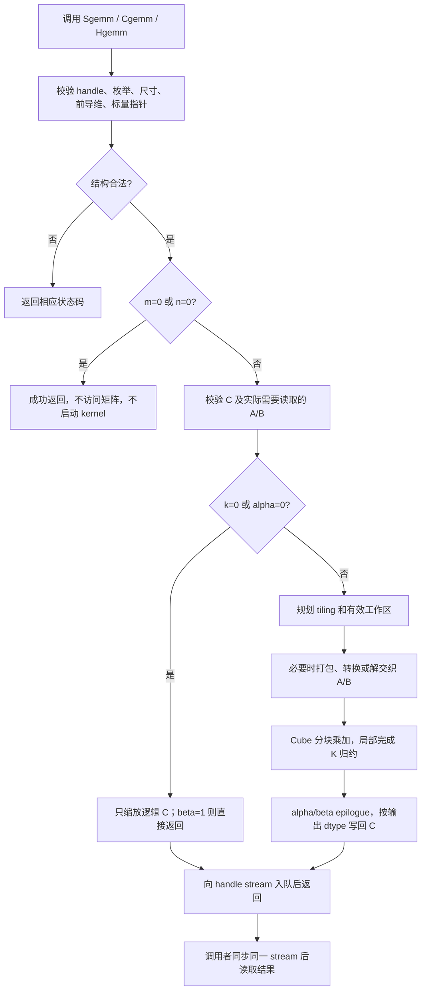

# aclblasSgemm / aclblasCgemm / aclblasHgemm 算子设计文档（Atlas A2/A3）

| 项目 | 内容 |
| --- | --- |
| 任务名称 | 11月社区任务-gemm类3个算子开发（A2A3） |
| 提交者 | linjuan6 |
| 设计版本 | v1.0，2026-11-25 |
| 目标仓库 | [cann/ops-blas](https://gitcode.com/cann/ops-blas) |
| 目标架构 | arch22，Atlas A2/A3 |
| 开发环境要求 | CANN 9.1.0、Ascend C、ACL runtime |
| 文档性质 | 设计评审稿，不代表编译、精度、性能或社区验收已通过 |

本文依据任务包中的 `aclblasSgemm_Cgemm_Hgemm_AtlasA2_A3_task_doc.md` 编写，章节覆盖仓内设计模板的需求背景、需求分析、详细设计和可维可测分析。任务包未给出正式任务编号，当前上游任务列表也未收录该组合任务，因此目录暂以月份和任务名称标识；正式编号发布后按社区要求调整。

## 1 需求背景（required）

### 1.1 需求来源

在 Atlas A2/A3 上基于 ops-blas 句柄式 BLAS 接口工程，使用 Ascend C 完成 `aclblasSgemm`、`aclblasCgemm`、`aclblasHgemm` 的开发、测试及文档交付。数学和参数语义分别对齐 cuBLAS `cublasSgemm`、`cublasCgemm`、`cublasHgemm`，实现代码放在 `blas/gemm/arch22/`，测试扩展现有 `test/gemm/arch22/`。

本任务不是 ACLNN/TBE 算子的迁移，不新增 ACLNN 两段式 API、算子信息库或图引擎注册项。TBE 源码路径和 ACLNN 算子信息库路径不适用，公开入口以 `include/cann_ops_blas.h` 为准。

### 1.2 背景介绍与现状分析

以 ops-blas 上游提交 `55ef791b77f3677b45da3468b0a8b17941424f84` 为源码核查基线。任务书描述的是较早快照，实施时需保留已合入的同族实现，不能重复定义公共符号。

| 模块 | 当前源码情况 | 本任务处理 |
| --- | --- | --- |
| `include/cann_ops_blas.h` | 已声明 Sgemm、Cgemm；缺少非 batch Hgemm | 保留 S/C 签名，按同族风格新增 Hgemm |
| `blas/gemm/arch22/gemm_host.cpp`、`gemm_kernel.cpp/.h` | 已有 Sgemm 校验、打包、Cube 计算及 epilogue | 复用并核对空矩阵、前导维、长 K 和缩放语义 |
| `blas/gemm/arch22/cgemm_host.cpp`、`cgemm_kernel.cpp/.h` | 已有解交织、四个实数乘积、复数组装路径 | 复用四乘法实现，补齐本任务要求的退化指针语义和测试 |
| `blas/gemm/arch22/` | 尚无非 batch Hgemm | 补齐 FP16 公共入口、计算及写回路径 |
| `blas/gemm/arch35/` | 有 S/C GEMM 和 FP16 strided-batched 实现 | 参考 dtype、缩放、舍入设计，不直接复制 arch35 专用 SDK API |
| `test/gemm/arch22/` | 已有共享 `gemm_test.cpp`、CSV | 扩展统一测试入口，不新建 `test/gemm/sgemm/arch22/` |

### 1.3 算子功能分析

三个接口均计算单矩阵乘加：

```text
C = alpha * op(A) * op(B) + beta * C
op(A): m x k, op(B): k x n, C: m x n
```

| 接口 | A/B/C 与 alpha/beta | 计算与输出要求 |
| --- | --- | --- |
| Sgemm | FLOAT32，`float` | FP32 乘加，不以低精度截断替代 FP32 语义 |
| Cgemm | COMPLEX64，`aclblasComplex` | 实部/虚部各 FP32，普通复数四乘法 |
| Hgemm | FLOAT16，`aclblasHalf` | FP16 存储、FP32 累加、最终 RNE 收窄到 FP16 |

输入为 handle、操作枚举、尺寸、Host 标量指针和 Device 矩阵指针；输出原地写回 C。三者均不支持广播、任意非连续视图或 batch。`N` 表示不转置，`T` 表示普通转置，Cgemm 的 `C` 表示共轭转置；S/H 的 `C` 与 `T` 等价。

## 2 需求分析（required）

### 2.1 需求描述与拆解

1. 沿用公共 S/C 签名，新增参数序列与 cuBLAS 一致的 Hgemm，禁止定义私有平行 API。
2. 支持三种 dtype、九种转置组合、列主序紧凑及带 padding 的前导维布局。
3. 对齐结构参数校验顺序、返回码、quick return 和不读取无效操作数的语义。
4. 基于 handle 绑定的 stream 下发 Ascend C kernel，保持异步执行与 C 原地输出。
5. 完成 1000 条精度、200 条性能用例及冻结数据交付，区分 kernel 正式性能与事件辅助性能。
6. 保留 arch35、batch、GemmEx、Cgemm3m 等非本任务接口的行为和构建选择。

### 2.2 依赖与工程边界

| 依赖 | 用途与边界 |
| --- | --- |
| CANN 9.1.0 / Ascend C Matmul API | kernel 编译、分块矩阵计算、流水同步和数据搬运 |
| ACL runtime / ops-blas handle | stream、Device 内存、有效工作区、异步错误检查 |
| 仓内 GTest / ATK 测试框架 | CSV 加载、接口调用、精度检查和结果留档 |
| Netlib BLAS 3.10.0 / CPU golden | S/C 参考计算；不是 Device 生产依赖 |
| cuBLAS / GPU profiling | 语义参考及任务给定的 GPU kernel 基线；NPU 算子不依赖 CUDA |

不为本任务额外引入 PyTorch、TBE、ACLNN 或新的生产第三方库。沿用已有构建依赖，但不因此将其他算子实现纳入新增接口范围。

### 2.3 公共接口设计

```cpp
aclblasStatus_t aclblasSgemm(
    aclblasHandle_t handle, aclblasOperation_t transa, aclblasOperation_t transb,
    int m, int n, int k, const float* alpha, const float* A, int lda,
    const float* B, int ldb, const float* beta, float* C, int ldc);

aclblasStatus_t aclblasCgemm(
    aclblasHandle_t handle, aclblasOperation_t transa, aclblasOperation_t transb,
    int m, int n, int k, const aclblasComplex* alpha, const aclblasComplex* A, int lda,
    const aclblasComplex* B, int ldb, const aclblasComplex* beta, aclblasComplex* C, int ldc);

aclblasStatus_t aclblasHgemm(
    aclblasHandle_t handle, aclblasOperation_t transa, aclblasOperation_t transb,
    int m, int n, int k, const aclblasHalf* alpha, const aclblasHalf* A, int lda,
    const aclblasHalf* B, int ldb, const aclblasHalf* beta, aclblasHalf* C, int ldc);
```

alpha/beta 为 Host 指针，不引入 Device pointer mode。`aclblasHalf` 按 IEEE binary16 位模式解释，例如 `0x3c00` 表示 1.0，不能将整数 1 当作 FP16 的 1.0。

## 3 详细设计（required）

### 3.1 数学与布局模型

列主序物理地址统一为 `row + column * ld`。寻址乘法前提升至 64 位，工作区字节数使用带溢出检查的无符号宽整数。

| 操作数 | N 时物理形状 | T/C 时物理形状 | 前导维下界 |
| --- | --- | --- | --- |
| A | `lda x k` | `lda x m` | N：`max(1,m)`；T/C：`max(1,k)` |
| B | `ldb x n` | `ldb x k` | N：`max(1,k)`；T/C：`max(1,n)` |
| C | `ldc x n` | 不转置输出 | `max(1,m)` |

逻辑读取公式为：

```text
a(i,p) = A[i + p*lda]                 if transa=N
         A[p + i*lda]                 if transa=T
         conj(A[p + i*lda])           if transa=C and dtype=COMPLEX64

b(p,j) = B[p + j*ldb]                 if transb=N
         B[j + p*ldb]                 if transb=T
         conj(B[j + p*ldb])           if transb=C and dtype=COMPLEX64

C[i + j*ldc] = alpha * sum_p(a(i,p)*b(p,j)) + beta*C[i + j*ldc]
```

S/H 的共轭为恒等操作。只写 `0 <= i < m, 0 <= j < n`，禁止扩大写回范围覆盖 `ldc-m` 个 padding 元素。调用方保证 C 的读写范围与 A/B 的读取范围不重叠，Host 不扫描 Device 元素或推断任意别名关系。

### 3.2 整体执行流程



### 3.3 Host 侧设计

#### 3.3.1 参数校验与 quick return

| 顺序 | 检查或条件 | 处理 |
| --- | --- | --- |
| 1 | handle 为空 | `ACLBLAS_STATUS_HANDLE_IS_NULLPTR` |
| 2 | transa/transb 不在 N/T/C 中 | `ACLBLAS_STATUS_INVALID_ENUM` |
| 3 | m/n/k 为负 | `ACLBLAS_STATUS_INVALID_VALUE` |
| 4 | lda/ldb/ldc 小于相应下界 | `ACLBLAS_STATUS_INVALID_VALUE`，即使 m/n 为零也校验 |
| 5 | alpha/beta 为空 | `ACLBLAS_STATUS_INVALID_VALUE`，空输出也不豁免 |
| 6 | m=0 或 n=0 | 成功返回，允许 A/B/C 为空，不读取矩阵、不启动 kernel |
| 7 | 非空输出的 C 为空 | `ACLBLAS_STATUS_INVALID_VALUE` |
| 8 | k>0 且 alpha 非零时 A/B 为空 | `ACLBLAS_STATUS_INVALID_VALUE` |
| 9 | k=0 或 alpha=0 | 不读取 A/B，仅执行 C 的缩放 |
| 10 | 其余合法输入 | dtype/布局分派、工作区规划、kernel launch |

复数零同时要求实部和虚部等于零。退化分支中 `beta=1` 不启动 kernel；`beta=0` 直接生成零，不能以 `0*C` 代替，以免传播旧 C 中的 NaN。正常乘法分支同样仅在 beta 非零时读取旧 C。

非法枚举返回 `INVALID_ENUM` 是 ops-blas 与 cuBLAS 的有意差异。分配失败、硬件资源查询失败及可检测的下发失败按仓内状态码返回；后续异步错误由调用方同步检查。

#### 3.3.2 分核与 tiling 策略

输出按二维 M/N tile 划分，每个 tile 只由一个计算任务写入。网格为 `ceil(m/tileM) * ceil(n/tileN)`，按实际 AIC 核数调度，任务较多时按轮次遍历；AIV 打包和 epilogue 按不重叠的列段分配。

优先让同一输出 tile 的整个 K 归约在片上完成，减少临时矩阵读写和多次下发；若 Matmul 单次形状或片上容量不足，则按 K panel 顺序累加到独立 FP32 临时输出，最后只做一次 alpha/beta epilogue。不得每个 K panel 都重复应用 beta，也不得把未初始化的累加缓冲作为首项。

候选 tile 从仓内已用的 64/128/256 输出块及适配 dtype 的 K 对齐开始，依据 CANN 9.1 编译资源和 A2/A3 实测选择。tile、core 数和路径只由实际尺寸、布局、dtype、缩放属性和资源决定，不使用 case 名、编号或随机种子分派。

本工程不使用 ACLNN `tilingKey`，分派通过 Host 条件、模板实例和共享 tiling 结构表达。结构携带逻辑 m/n/k、物理 lda/ldb/ldc、转置/共轭、对齐尺寸、tile 基址、标量及工作区偏移，不将“对齐后尺寸”误作真实访问边界。

#### 3.3.3 工作区和异步生命周期

复用 handle 有效工作区，所有 launch 使用 handle 已绑定的 stream。用户工作区不被替换，容量不足返回 `ACLBLAS_STATUS_ALLOC_FAILED`；库工作区沿用仓内容量上限和分配管理。不引入每次调用后的强制同步，但已有工作区扩容可能通过仓内 helper 同步旧任务后更换存储，性能测试前需预热以完成分配。

工作区按 packed A、packed B、乘积/累加平面和下级 scratch 规划，每段地址按搬运/API 需求对齐，先做乘加溢出检查再分配。以对齐后的 M/N/K 为基准：

| 路径 | 工作区构成 |
| --- | --- |
| Sgemm 通用路径 | 对齐 FP32 A/B 面板、FP32 乘积/累加平面；直读直写路径可省略无用段 |
| Cgemm | FP32 Ar/Ai/Br/Bi、实/虚输出平面及复用实数后端所需 scratch |
| Hgemm 正确性基线 | FP16 转 FP32 的 A/B 打包矩阵和 FP32 乘积，约 `4*(M*K+K*N+M*N)` 字节 |
| Hgemm 性能候选 | FP16 原生输入打包和 FP32 输出，约 `2*(M*K+K*N)+4*M*N` 字节，具体依分块复用 |

上述是设计容量模型，不是已测峰值。需要时以面板复用减小峰值；下级 GEMM 若使用工作区切片，应以用户工作区模式约束该切片，防止其扩容覆盖上层仍在使用的输入平面。所有临时数据在 stream 消费完成前保持有效。

### 3.4 Kernel 侧设计

#### 3.4.1 统一列主序适配与数据流水

利用 `C^T = op(B)^T * op(A)^T`，把列主序公开接口映射到内部 row-major Matmul。支持直读的紧凑布局走对应转置特化；其他布局通过打包去掉 ld 间隙，并在内部对齐坐标填零，不读取逻辑矩阵之外的输入。

通用流水为 CopyIn、Compute、CopyOut，使用仓内 TPipe/TQue 和明确的流水事件保护 GM/UB、Vector/Cube 依赖。适合连续段的路径采用双缓冲和块搬运；非对齐尾块使用有界搬运或安全尾处理。GM 标量逐元素读取仅作为正确性回退，不能视为大矩阵性能达标方案。

#### 3.4.2 Sgemm 路径

复用 arch22 FP32 Matmul、必要的打包及缩放写回。显式禁止 HF32 截断影响 FP32 语义，验证跨 K panel 的输入基址、累加偏移和首块初始化。alpha/beta 在 FP32 中计算；beta 为零时 epilogue 不建立旧 C 读取依赖。

大幅度标量放大和长 K 可能放大中间舍入误差，需用对应正式 golden 检查；若需要更稳定累加或补偿，按实际数值误差和运行属性实现通用路径，不放宽阈值或按测试数据定制结果。

#### 3.4.3 Cgemm 路径

将 A/B 解交织为 FP32 实/虚平面，沿用四个实数 GEMM 后组合。设 `sa=-1` 当 transa=C，否则为 1；`sb` 同理，实数后端处理对应 N/T 布局：

```text
Pr = opT(Ar)*opT(Br) - sa*sb*opT(Ai)*opT(Bi)
Pi = sb*opT(Ar)*opT(Bi) + sa*opT(Ai)*opT(Br)
Y.real = alpha.real*Pr - alpha.imag*Pi
Y.imag = alpha.real*Pi + alpha.imag*Pr
```

`opT` 只表示 N 或普通 T，共轭符号由 sa/sb 承载。再按普通复数乘法加入 `beta*C_old`，只写逻辑复数元素。beta 为复数零时不读取 C。该方案不是三乘法，不修改 `cgemm3m` 文件或入口。

#### 3.4.4 Hgemm 路径

先以 FP16 读取、FP32 打包和 FP32 Cube 累加建立正确性基线，在 FP32 epilogue 内应用转换后的 FP16 alpha/beta，最终一次 RNE 写回 FP16。公开存储和标量始终是 `aclblasHalf`，不是把 `uint16_t` 数值直接转换成 float。

性能优化优先评估 arch22 原生 FP16 Cube 输入和 FP32 累加，降低打包流量并提高矩阵计算吞吐。该候选必须在 CANN 9.1 实机编译后验证 N/T/C、长 K、尾块、次正规数和 Inf/NaN 行为，不能直接采用 arch35 的 SIMT/tensor API。只有精度和性能均满足后才替换通用路径；初版 FP32 打包路径尚无性能达标证据。

Hgemm 的溢出和舍入以最终 FP16 输出判定。输入含次正规数时需要检查 Cube/Cast 的实际处理，不预先宣称硬件保留全部次正规行为；若与任务 golden 不一致，应实现兼容计算路径并验证，不静默裁剪输入。

#### 3.4.5 片上资源预算

所有 buffer 分别预算，不以全局矩阵大小申请 UB/L1。以深度 2 的 1024 元素 epilogue 为例，FP32 product 队列 8192 字节、FP16 old-C 队列 4096 字节、FP16 output 队列 4096 字节，两个 FP32 计算 buffer 共 8192 字节，显式 UB 约 24576 字节；Matmul 的 L1/L0 buffer 单独由 API tiling 核算。

这是候选预算，真实资源以编译结果和平台可用容量为准。缩减 tile 或缓冲深度时保留正确的事件同步；禁止为了满核而让每核申请超出容量的片上 buffer。

### 3.5 工程接入与兼容性

| 位置 | 修改范围 |
| --- | --- |
| `include/cann_ops_blas.h` | 只新增非 batch Hgemm 声明 |
| `blas/gemm/arch22/` | 复用/修正 S/C，按仓内规范新增 Hgemm host、kernel 和共享描述 |
| `test/gemm/arch22/` | 统一 S/C/H CSV 适配、补充 GTest、精度及事件计时 |
| 构建源文件/测试选择 | 支持 `--ops=sgemm,cgemm,hgemm`；共享目标只注册一次 |
| `blas/gemm/README.md` | 三接口 A2/A3 支持范围、参数、约束及复现入口 |

构建别名限定到本任务 arch22，不能把 arch35 原有 Cgemm 测试错误映射到 arch22 测试或漏掉下级后端依赖。既有 S/C 的二进制签名不变；Hgemm 是加法式新增。Sgemm 空矩阵调用仍需合法 ld、Cgemm 的 alpha=0 允许空 A/B 是按任务契约的边界修正，需增加回归用例。

### 3.6 支持硬件与约束

| 项目 | 设计范围 |
| --- | --- |
| Atlas A2 / Atlas A3 | 目标适配，arch22；自验证至少一种款型 |
| 正式性能设备 | Atlas 800T A2，910B3 |
| CANN | 9.1.0 |
| Ascend 950 / arch35 | 不属于本任务新增实现，保留原有行为 |
| 布局 | 仅列主序和 ld padding，无广播或任意视图支持 |
| C 输出 | 原地覆写，逻辑 m*n 外不改写，不支持与 A/B 重叠 |
| 确定性 | 不保证跨执行逐位一致，按任务精度阈值验收 |

## 4 可维可测分析

### 4.1 精度标准与 golden

S/C 以 Netlib `cblas_sgemm` / `cblas_cgemm` 为参考；任务也允许输入及标量先转 float64、float64 累加后收窄到 float32/complex64 的冻结 golden。采用哪一种必须记入 facts 和报告，并说明其与直接 cblas FP32 累加的差异。H 不调用不存在的 `cblas_hgemm`，按 float64 累加、先收窄 FP32 再 RNE 收窄 FP16 生成参考输出。

| 项目 | Sgemm / Cgemm 分量 | Hgemm |
| --- | --- | --- |
| atol / rtol | `2^-13` | `2^-10` |
| required_matched_ratio | 0.99 | 0.99 |
| 最大绝对误差界 | `1e-2` 或任务标准的 32 ULP | `1e-1` 或任务标准的 32 ULP |

逐元素以 `abs(actual-golden) <= atol + rtol*abs(golden)` 计 matched，且用例需同时满足匹配率和最大误差要求。Cgemm 实部、虚部分别统计，不以复数模长替代分量阈值。ULP 判定按引用标准实现并保留使用的版本；不能用一个全局最大 ULP 放宽其他元素。NaN 仅同为 NaN 匹配，Inf 要求同号；数值比较不能掩盖 padding 位模式变化。

### 4.2 用例与冻结数据规划

原始压缩包 CSV 的实数 schema 使用 `alpha/beta`，复数 schema 使用 `func/alpha_real/alpha_imag/...`；不能直接覆盖现有 `gemm_test.csv` 并假设加载器已兼容。统一适配时保留全部参数、随机 seed、填充类型、空指针标志和期望状态码，增加 dtype 标识；合并后三算子的原始重名 case 必须加算子前缀，并保留可追溯映射。

| 算子 | 精度条数 | 性能条数 |
| --- | --- | --- |
| Sgemm | 334 | 67 |
| Cgemm | 333 | 67 |
| Hgemm | 333 | 66 |
| 总计 | 1000 | 200 |

这与所供 CSV 的实际条数一致，任务书建议分摊不是强制的 333/333/334。性能另外覆盖非默认标量；scale-only 用例属于精度/边界集合，不混入正常 GEMM 性能子集。

| 场景 | 重点检查 |
| --- | --- |
| 九种转置组合 | Cgemm 用非对称复数区分 T/C，S/H 验证 T=C |
| 尺寸与对齐 | 0/1、小质数、2 的幂及相邻值，4095/4096 单维和立方，跨 K panel |
| ld 与尾部 | 下界、+1/+8/+64、非法下界，独立 padding 哨兵 |
| 标量和退化 | alpha=0、k=0、beta=0/1/其他值，A/B 为空或 NaN，旧 C 为 NaN |
| 随机分布 | 一般输入约 50% 均匀 [-5,5]、50% 正态 N(0,1)，复数分量独立采样 |
| FP16 特殊值 | 65504 附近、最小次正规数、溢出、Inf/NaN 和负零 |
| 非法参数 | 空 handle、非法枚举、负尺寸、空标量和必需矩阵指针 |
| 异步及工作区 | 非默认 stream、连续调用、用户工作区容量不足、扩容后地址有效性 |

通过 repo-task-case-gen 交付 `cases.json`、`perf/`、`inputs/`、`golden/`、`facts.json`，记录 seed、生成器版本、任务包哈希、golden 算法和文件校验和。原包只有 CSV、脚本和图片，不能把它直接称为已生成冻结输入/golden 的验收包。额外回归测试与正式 1000/200 条分开统计；超时、未执行和缺失结果不能算通过。

### 4.3 性能标准与采样

正式逐 case 判据为 `NPU_kernel_avg_us <= 1000 * gpu_ms * 1.25`，等价于 `GPU/NPU >= 0.8`。不能以全体平均速度比覆盖单条失败。

| 指标 | 采集与统计 | 用途 |
| --- | --- | --- |
| kernel duration | 910B3 上 `msprof op` 的 kernel task duration，预热 5 次后 10 次有效调用取算术平均 | 正式判据 |
| `avg_us` | 预置 Device 缓冲，用同一 stream 的 ACL event 夹住连续 10 次调用，总时间除 10 | 辅助交叉验证 |

事件计时前完成 H2D、初始化、工作区分配与 5 次预热，不在计时区间造数、计算 golden 或读回。打印 `[PERF] case=<case_name> ... avg_us=<value>`，解析不到该字段判采集失败，不回退到 GTest 整数毫秒。beta 非零时连续调用会递推修改 C，需记录此条件并检查结果是否仍有效；精度计算使用独立的初始 C，不从递推状态生成 golden。

多 kernel 实现必须把一次 BLAS 调用的打包、矩阵计算和 epilogue 对应 Task Duration 全部列出，并按调用归组汇总，不能只挑 Cube 内核与 GPU 对比。正式统计对多阶段调用的归组规则需在验收前与评审方确认，保留每任务原始记录与端到端事件数据。预热、精度调用和复制任务应可辨识，无法准确分组时不能宣称性能通过。

2026-11-25 核查所供三份 `gpu_baseline.csv` 共 200 条，`gpu_ms` 均非空；原包 README 存在“待回填”等历史描述，以实际 CSV 为准。沿用这些提供的基线但不声称自行复测过 GPU；关联键包括 dtype、transa/transb、m/n/k、lda/ldb/ldc、alpha/beta，参数不一致或缺失匹配的 case 标记为不可比较，不填造数据。

### 4.4 验证步骤与交付计划

1. 在 CANN 9.1.0 的 A2/A3 环境记录 NPU 型号、SoC、编译器和代码 SHA，完成原生编译与小矩阵边界测试。
2. 优先对小、中、大及转置/padding 的代表性能用例做 profiling，确认打包、launch、计算成本，迭代候选路径。
3. 接通统一 CSV 适配后冻结输入与 golden，在同一最终 SHA 上跑完整 1000 条精度；Cgemm 输出两分量结果，报告 padding 和异常返回码。
4. 在 910B3 上采集全部 200 条的 `msprof op` 和 ACL event 结果，逐条关联提供的 GPU 基线。
5. 整理设计文档、README、自测报告、原始日志、截图和 `task_submission`；内存项按任务书“不涉及”填写说明，不伪造内存指标。
6. 提交代码 PR 和设计评审，保留最终 commit 链接；重新提交或 rebase 后重新验证相关最终代码，不用旧 SHA 结果替代。

构建入口目标如下，必须在真实工具链中验证源文件及测试目标选择，不以命令存在代替构建通过：

```bash
source /usr/local/Ascend/ascend-toolkit/set_env.sh
bash build.sh --ops=sgemm,cgemm,hgemm --soc=ascend910b3
# Atlas A3 使用对应实际 SoC 的 --soc，例如 ascend910_93。
```

### 4.5 风险与验证边界

| 风险 | 处理与验收条件 |
| --- | --- |
| 初版 Hgemm 打包流量大、FP32 计算吞吐不足 | 作为正确性基线；验证原生 FP16 Cube 与打包融合，不宣称已达到 0.8 倍基线 |
| CANN/SoC 的 Matmul 模板和尾块差异 | 使用 CANN 9.1 实编译，分开验证 A2/A3；不复制 arch35 专有接口 |
| 长 K、标量放大、次正规数造成误差 | 使用冻结 golden 和严格阈值定位，必要时加入通用稳定计算回退 |
| 工作区切片被下级扩容替换或复用过早 | 显式容量契约、检查偏移溢出、同 stream 生命周期和失败路径回归 |
| 构建别名干扰其他架构测试 | arch22 限定、单 API 与组合构建检查，保留既有 arch35 选择逻辑 |
| 测试脚本格式或统计不一致 | schema 显式转换、1000/200 条映射核对、缺失 case 失败、两种性能口径独立归档 |

当前仅有本地代码初版，尚未在目标 CANN/NPU 环境完成编译、完整精度和正式性能验证；本设计提交不包含这些通过结论。优化 tile、FP16 Cube 路径及多 kernel profiling 统计在实机验证后更新，所有结果以最终代码和原始日志为依据。

## 5 参考资料

1. 用户提供任务包中的 `aclblasSgemm_Cgemm_Hgemm_AtlasA2_A3_task_doc.md` 及 `test_cases/{sgemm,cgemm,hgemm}/`。
2. [社区任务目录与提交规范](https://gitcode.com/cann/cann-ops-competitions/blob/master/04_tasks/01_community-task-2026/README.md)。
3. [社区任务设计模板](https://gitcode.com/cann/cann-ops-competitions/blob/master/04_tasks/01_community-task-2026/resources/design_template.md)。
4. [ops-blas 核查基线](https://gitcode.com/cann/ops-blas/tree/55ef791b77f3677b45da3468b0a8b17941424f84)。
5. [cuBLAS 文档](https://docs.nvidia.com/cuda/cublas/index.html)。
6. [Netlib sgemm](https://www.netlib.org/blas/sgemm.f)、[Netlib cgemm](https://www.netlib.org/blas/cgemm.f)。
7. [生态算子混合容差精度标准](https://gitcode.com/cann/opbase/blob/28a1ce52ae856353589841226a0002af73314a6b/docs/zh/ops_precision_standard/mixed_tolerance_standard.md)。

## 6 修订记录

| 日期 | 版本 | 内容 | 作者 |
| --- | --- | --- | --- |
| 2026-11-25 | v1.0 | 三接口 arch22 设计、校验与数值语义、分核/工作区方案及验证交付计划 | linjuan6 |
