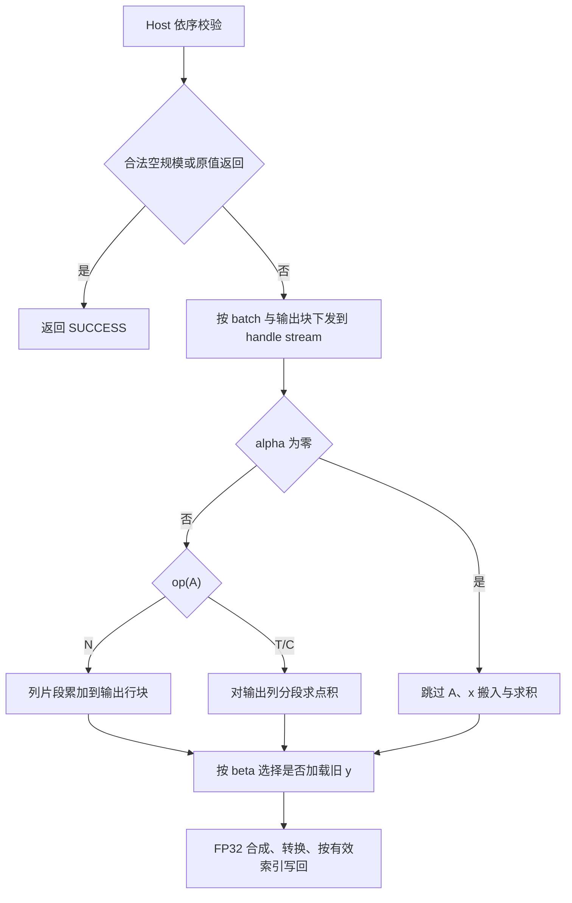

# 需求背景（required）

## 需求来源

《aclblasSgemvBatched 类算子开发任务书》（2026-11-24 修订）要求在 Atlas A2/A3 上交付 5 个实数批量 GEMV 接口。算子实现和测试进入 [cann/ops-blas](https://atomgit.com/cann/ops-blas)。矩阵物理布局与前导维契约采用修订版，数学语义参考 [Netlib SGEMV](https://www.netlib.org/blas/sgemv.f)。[官方任务页](https://www.hiascend.com/activities/task-center/details/d82eff6522c34a1a89710f93bb8926b7)

## 背景介绍

### gemvBatched 算子功能

一次调用提交多组独立的实数矩阵与向量乘加。调用方给出 Device 上的三组指针数组，每个 batch 可位于独立分配的内存。Handle 提供运行 stream，输出原地覆盖各 batch 的 y。

### 上游实现现状

在 [ops-blas arch22 参考提交](https://atomgit.com/cann/ops-blas/commit/feb4f9c4c737ee5987781d4fb560872ad4dd9e09) 中，五个接口已在 `include/cann_ops_blas.h` 声明。arch35 提供同名变体，可参考类型分派；arch22 的 `gemv_batched_host.cpp` 已有五个入口和直调封装，`gemv_batched_kernel.cpp` 已有按 batch 分派的 AIV 实现，N 走列向量累加，T 走列点积，支持向量步长及输出转换。

该基线的 Host 校验会拒绝 C 和零规模；按 batch 分核时，batch 少而输出长的场景可用并行度受 batch 数限制。此次设计在现有公共接口和工程结构上补齐任务语义，通过输出分块提高 AIV 利用率，并复用 `test/gemv_batched/` 下的参考计算和 GTest 接入方式。

# 需求分析（required）

## 需求描述

在 CANN 9.1.0 上，以 Ascend C 实现 `aclblasSgemvBatched`、`aclblasHSHgemvBatched`、`aclblasHSSgemvBatched`、`aclblasTSTgemvBatched` 和 `aclblasTSSgemvBatched` 的 Atlas A2/A3 路径。保留公共 ABI、句柄语义及异步直调方式，参数顺序采用现有头文件。

## 需求拆解

| 类别 | 必须满足的行为 | 验证方法 |
| --- | --- | --- |
| 功能 | 支持 N/T/C，实数 C 与 T 等价。A 按列主序存储，支持 lda 填充、正负非零向量步长和独立 batch 指针 | 对五种类型运行矩形矩阵、填充 lda、负步长以及彼此独立分配的 batch |
| 参数 | 校验顺序遵循任务书。合法零规模返回成功，数组可为空。非法入参返回既有状态码 | 各错误类别、复合非法入参、零规模空数组与空标量回归 |
| 读写 | alpha 为零时跳过 A/x 数据访问。beta 为零时跳过 y 旧值读取。只写 y 的逻辑元素 | alpha 为零且 x 含 NaN，beta 为零且 y 含 NaN，正负步长间隙以哨兵检查 |
| 精度 | FP32 乘加和累加，按输出类型收窄，执行任务书的混合容差联合判定 | 对照逐 batch golden 和冻结的精度用例，并验证 Inf/NaN |
| 性能 | Atlas 800T A2（910B3）上 `msprof op` 采集的 kernel 均值不超过同参数 GPU kernel 耗时的 1.25 倍 | 五变体各 200 条性能用例，正式口径与端到端辅助口径分别保存 |

# 详细设计（required）

## 算子分析

### 数学公式

每个 batch 独立计算 $y_b \leftarrow \alpha\,\mathrm{op}(A_b)x_b + \beta\,y_b$。记输出元素数为 $D$、归约长度为 $K$。N 路径取 $(D,K)=(m,n)$，输出元素 $j$ 的第 $k$ 项访问 `A_b[k*lda+j]`；T/C 路径取 $(D,K)=(n,m)$，对应 `A_b[j*lda+k]`。两条路径都访问同一个列主序物理矩阵。

### 支持数据类型

| 变体 | A 与 x | 输入及输出 y | alpha、beta | 累加 |
| --- | --- | --- | --- | --- |
| S | FP32 | FP32 | FP32 Host 标量 | FP32 |
| HSH | FP16 | FP16 | FP32 Host 标量 | FP32 |
| HSS | FP16 | FP32 | FP32 Host 标量 | FP32 |
| TST | BF16 | BF16 | FP32 Host 标量 | FP32 |
| TSS | BF16 | FP32 | FP32 Host 标量 | FP32 |

公共接口中的 `uint16_t` 传递 FP16/BF16 位模式，由变体决定解释方式。非 FP32 输入在乘加前转为 FP32。HSH/TST 在标量合成后按输出类型一次收窄，HSS/TSS 保留 FP32 结果。标量零分支先择路，避免将本应忽略的 NaN 或 Inf 引入计算。

### 支持形状

| 参数 | 约束或解释 |
| --- | --- |
| `m, n, lda` | 非负的 m、n 描述 A 的有效行列。A 的存储形状为 `lda × n`，所有 trans 统一要求 `lda >= max(1,m)`，矩阵列间填充不参与计算。 |
| `batchCount` | 非负。Aarray、xarray、yarray 是 Device 指针数组，元素数为 batchCount。非空任务时三组数组的地址均须有效。 |
| `incx, incy` | 按有符号元素步长访问。逻辑长度为 L 时，正步长的起始偏移为 0，负步长为 `(1-L)*inc`，第 i 个元素的偏移为 `start+i*inc`。跨度为 `1+(L-1)*abs(inc)`。零步长非法。 |
| `alpha, beta` | 有限 FP32 Host 标量，指针须有效。alpha 为零仅做 y 缩放，beta 为零从零构造输出。 |

## 算子实现

### 实现方案

#### 1. Host 与算子接入

保留 `include/cann_ops_blas.h` 中的签名，五个入口共用校验和 Tiling，通过类型标记选择设备计算实例。校验顺序为 handle → trans → m/n → lda → incx/incy → batchCount → alpha/beta → 适用的数组地址校验 → quick return。handle 为空返回 `ACLBLAS_STATUS_HANDLE_IS_NULLPTR`，trans 非法返回 `ACLBLAS_STATUS_INVALID_ENUM`，其余非法参数返回 `ACLBLAS_STATUS_INVALID_VALUE`。

零 batch 或零维走 quick return，跳过数组非空校验，标量地址和前置结构参数仍须合法。非空调用在参数检查后，alpha=0、beta=1 可原样返回。非空的缩放路径只在设备读取 y 指针，alpha 为非零时才读取 A/x 指针。若 beta=0，缩放路径直接写零。Host 不读取 Device 数组成员。

先以 64 位计算矩阵实际最大访问范围 `(n-1)*lda+m`、向量跨度及总 Tile 数，再检查字节偏移和表示范围。kernel 的局部有效块长可以维持较窄类型，GM 地址计算使用 64 位。通过 handle 的 stream launch 并传回发射错误，调用方在读取结果前同步该 stream。实现、测试和使用说明分别在 `blas/gemv_batched/arch22/`、`test/gemv_batched/arch22/` 和 `blas/gemv_batched/README.md` 内维护。

#### 2. 分核与片上内存

将任务拆成 `(batch, 输出 tile)`，每个任务独占一段 y 的逻辑索引并完成该段的全部 K 维计算。设输出块宽度为 `B`，则单 batch 块数 `T=ceil(D/B)`，任务总数 `U=batchCount*T`，启动核数 `P=min(U, 实际可用 AIV 核数)`。核 p 处理编号 `p, p+P, … < U`，用除法和取模得到 batch 与块号。batch 小时可沿输出维度并行；同一 y 元素由一个核完整写回，无跨核原子归约。

初始块参数为 N 路径输出 64 行、K 分块 32 列，T/C 路径输出 16 列、K 分块 512 行。每次按剩余逻辑长度截取有效范围。这些值是供 CANN 9.1.0 上板核对的起点，分派条件来自尺寸、布局、数据类型和资源预算，与用例名称无关。

以单缓冲规划容量。设实际输出 tile 长度上限 B、归约片长 L，输入与输出元素字节数分别为 `s_in`、`s_out`。按 32 字节对齐各块预算，最多同时保留原始 A 面板 `B*L*s_in`、FP32 面板 `4*B*L`、两份 x 片段 `L*s_in + 4*L`、输出累加与暂存 `4*B + B*s_out`，另计归约 scratch、指针和非连续搬运暂存。归约可逐列消费并复用工作区，避免再保留一个等大的乘积面板。实际预算以目标配置的 UB 容量、归约接口所需空间和实分配结果核对。较大面板从 L 或 B 收缩，紧凑路径可按可用空间选择更大的片长。基础方案的核间 Workspace 为 0。

#### 3. Kernel 数据流与边界

| 路径 | 搬入与计算 | 写回 |
| --- | --- | --- |
| N | 每次搬运列内连续的行片段，按 lda 找到下一列。将一个 x 片段与对应面板逐列乘加，在 FP32 UB 累加中保留当前输出行块的部分和。 | 完整 K 后乘 alpha，按 beta 是否为零决定是否加载并合入旧 y，最后转换并写回有效行。 |
| T/C | 逐 K 片搬入连续的 A 列段。同一批输出列可复用已搬入的 x 片段。对每列做 FP32 乘积和分段归约，在核内合并 K 片的部分和。 | 完整 K 后执行共同的 alpha/beta 合成，最后转换并写回有效列。 |
| 缩放 | 只计算 y 的原地缩放。beta=0 直接构造有效长度的零向量。 | 只写 y 的逻辑位置，保留跨步空隙。 |

单位步长用连续搬运。反向连续和其他有符号步长根据其实际索引在片内归整，跨度超过片上缓冲时分窗或逐元素搬运。跨步 y 只写逻辑地址。末块仅沿有效长度读写，向量对齐填充留在 UB 内。流水按搬入完成 → Vector 消费 → 搬出完成的依赖同步，复用缓冲前等对应阶段消费结束。

## 支持硬件

Atlas A2/A3，采用 `arch22`（DAV_2201）的 AIV 路径，CANN 9.1.0。正式性能在 Atlas 800T A2（910B3）验证。其他机型的结果按实际机型记录。

## 算子约束限制

不提供跨 batch 广播或重叠输出。调用方负责保证各 batch 的 y 可写区域互不重叠，且不与本 batch 的 A/x 可读区域重叠。正负步长的底层存储须覆盖完整跨度。Host 仅做参数和可表示范围校验。测试附件将 `INT_MIN` 作为非法步长，任务书参数表写非零 int，两者边界需确认；自验分别记录书面约定和负向用例结果。实数 C 只转置，复数接口仍走现有实现。

# 可维可测分析

## 精度标准/性能标准

精度按照任务书 §3.2，使用以 Netlib `cblas_sgemv` 为定义的逐 batch golden，按变体收窄到 y 的存储类型后逐元素比较。留存实际 golden 的累加精度，区分附件 FP64 累加与 Netlib FP32 对照。有限值满足 `|actual − golden| <= atol + rtol*|golden|` 计为匹配，用例同时满足匹配率至少 0.99 和最大绝对误差限制。Inf/NaN、非法参数、合法空规模分别单列结果。

| 输出类型 | atol | rtol | 最大绝对误差限制（按任务书） |
| --- | ---: | ---: | --- |
| FP16 | 2⁻¹⁰ | 2⁻¹⁰ | 0.1 或 32 ULP |
| BF16 | 2⁻⁷ | 2⁻⁷ | 0.1 或 32 ULP |
| FP32 | 2⁻¹³ | 2⁻¹³ | 0.01 或 32 ULP |

五变体各执行 1000 条精度用例、200 条性能用例。补充覆盖矩形转置且 `lda=m<n`、末块、负步长、非默认标量、跨步哨兵、空规模不发射，以及 batch 少但输出长的场景。附件中的 MERE/MARE 字段及脚本结果原样记录，任务书的联合判定单独计算。

正式性能以 `msprof op` 计得的 kernel Task Duration（µs）为依据。每例预热 5 次，再执行 10 次，取成功样本算术平均。样本有失败时记录原因，并补齐有效样本后判定。按变体、trans、m/n、lda、incx/incy、batchCount、alpha/beta 匹配同参数的 cuBLAS kernel 标杆，将 `gpu_ms` 乘 1000 换为 µs。正式阈值为 `NPU_avg_us <= 1.25 * GPU_kernel_us`。附件旧 T/C 数值按任务书修订需重测，非默认标量也须确认标杆来源和参数。记录缺失、失败和不可比数据。GTest 的 `aclrtEvent` 端到端 `avg_us` 仅用于交叉检查。

性能优先检查低 batch 核利用率、转置路径复用 x 的收益，以及跨步窗口复制和写回成本。用不同 D/K、步长和 batch 的代表组比较候选块参数，再进行全量回归。任务书无独立内存验收指标，仍验证片上预算、越界行为和跨步写入完整性。

## 兼容性分析

保留现有公共 API、句柄绑定、参数序列和导出方式。Atlas A2/A3 通过架构构建选择 arch22 实现，现有 arch35 与复数分支保持原有入口。新增覆盖集中在 arch22 的参数契约、计算分派与测试。
