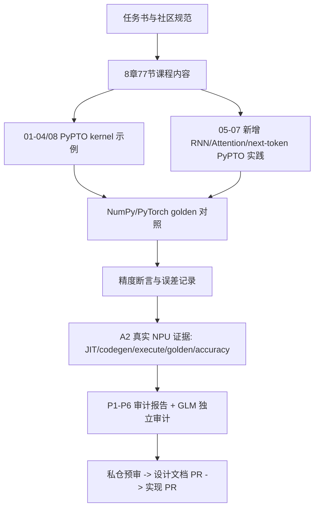

# 面向零基础学习者的 PyPTO 算子开发课程设计（PyPTO-Zero2Hero）

## 需求背景（required）

### 需求来源
本设计对应 CANN 社区任务《开发一套面向 0 基础人群的 PyPTO 算子开发课程》（任务目录 `11-开发一套面向0基础人群的PyPTO算子开发课程`）。任务书原件保存于项目 `docs/开发一套面向0基础人群的PyPTO算子开发课程.md`（2026-11-10，SHA256 `159c24bf16896a86f8025810bf859eee932df9003c03726bcfda6d5606d0b419`）。

课程定位为面向零基础开发者的 PyPTO 入门课程：学习者只需具备基础 Python，不预先要求线性代数、微积分、机器学习或 CANN 经验。课程需覆盖从数学基础到 Transformer/大模型的知识点，并使学习者能够使用 PyPTO 编写、运行、验证算子。

### 背景介绍
PyPTO 是算子编程框架，算子开发是 AI 基础设施。任务书要求“学习过程中的算子均有 PyPTO 实现”，但既有社区 PyPTO 教程（如 `tutorials/pypto_development`）聚焦 PyPTO 本身且使用 CANN 9.0.0；本课程补充“零基础 → AI 全链路 → PyPTO 算子实践”的长路径，使用 CANN 9.1.0 / PyPTO 0.2.1。两者范围与深度不同，是否并存由维护者确认（方案 Issue #1042 Q9）。

### 现状分析
课程已按 8 章 77 个 Notebook 完整交付，配套 241 个答案文件、76 张 SVG 配图、8 个章节 README 与公共引导模块；P1–P5 完成（`P5_PASS`），P6 完成整改与上游迁移预演（`P6_UPSTREAM_PREP_FINAL_READY`）。当前设计文档 PR 是社区流程要求的设计评审节点，不代表验收完成。

### 依据与边界
- 任务书 §1–§4：内容、格式、实操与交付件要求；§5：向 `cann-learning-hub/contrib/tutorials` 提 PR；§7：提交前自验证。
- 社区规范：`docs/course_submission_criteria.md`（目录、README、Checklist、CANNLab 硬性要求）、`CONTRIBUTING.md`（Issue/RFC、CLA、许可证）、`docs/CANNLab_course_development_guide.md`（环境创建与 PR 流程）。
- 候选交付目录：`contrib/tutorials/pypto_zero2hero/`；**最终目录名待维护者确认**（Issue #1042 Q8）。
- 预审版本按社区规范单独准备，不在公开 PR 中披露。

## 需求分析（required）

### 需求描述
建设一套可独立运行、知识点完整、练习可验证、算子以 PyPTO 实现且具备真实 NPU 证据的零基础课程，并满足社区教程上库规范。

### 需求拆解与设计响应

| 来源 | 约束 | 设计响应 |
| --- | --- | --- |
| 任务书 §1、§3.2、§4.1 | 至少 5 章，每章平均 ≥5 节，覆盖数学/线性 NN/CNN/RNN/注意力/大模型 | 8 章 77 节，逐章覆盖；每章首节概述、末节实践 |
| 任务书 §2.1、§3.3 | 零基础、基础 Python 即可；术语首次出现须解释 | 从问题和小数据出发，概念先行、图辅助、逐项覆盖表 |
| 任务书 §1、§2.4、§3.4 | 算子均用 PyPTO 实现，代码可运行、无需手动切目录 | 01–08 章嵌入 PyPTO kernel；05–07 补齐 RNN/Attention/next-token；公共引导自定位路径 |
| 任务书 §3.4③、§4.2 | 每节练习 + 答案，正文与实践解耦 | 每节第 10 节练习、第 11 节答案；答案独立目录 241 文件 |
| 任务书 §3.1、§3.4② | 至少一个 CANNLab 环境开箱即用、无报错 | 候选模板/内核列为待确认；验证清单已备，当前 BLOCKED_EXTERNAL_ENVIRONMENT |
| 课程标准 §3.1–3.5 | 课程 README 五要素、answer/images/src、HTML `<table>`、输出清空 | README 重写；60 处 HTML 表格；0 个 code cell 有输出 |
| 课程标准 §4 | 算子课程需在 cann-learning-hub notebook 可运行 | 待维护者配置在线体验链接（Issue #1042 Q13） |
| 任务书 §7 | 提交前自验证 | P1–P6 报告、GLM 独立审计、83 tests、77/77 静态、42/42 覆盖 |

### 可检验学习目标

| 层次 | 章节 | 学完可完成 | 考核依据 |
| --- | --- | --- | --- |
| 基础 | 01–02 | 配置 Notebook，解释 Tensor/Shape/dtype/点积/矩阵乘/梯度/概率 | 概念题、形状推演、PyPTO 数值例子 |
| 应用 | 03–05 | 实现线性/MLP/CNN/RNN 前向并做 golden 对照；判断过拟合与数值问题 | 编程题、误差断言、损失曲线、门控与边界用例 |
| 综合 | 06–08 | 解释 Transformer/LLM，验证注意力与输出头算子，完成端到端算子交付 | 因果性检查、真实 NPU 证据、交付报告 |

## 详细设计（required）

### 3.1 总体架构



课程包自包含：`course/` 为课程根，含 `common/`、8 个章节目录、根 README；每章含 Notebook、`answer/`、`images/`、`src/`。Notebook 首个 code cell 嵌入公共引导：向上探测 `docs/course_manifest.json` 定位项目根，找不到时使用 `tempfile` 工作目录，因此脱离原项目也可运行（隔离目录 7/7 Notebook 实测通过）。

### 3.2 课程大纲（8 章 / 77 节）

**01 Python、AI 与 PyPTO 入门（7 节）**：01.01 章节概述；01.02 Python 开发环境与 Notebook 工作流；01.03 人工智能、机器学习与算子；01.04 PyPTO 编程模型；01.05 第一个 PyPTO 算子；01.06 算子验证；01.07 章节实践。

**02 数学基础：线性代数、微积分与概率（7 节）**：02.01 章节概述；02.02 标量、向量、矩阵与张量；02.03 张量基本运算与降维；02.04 点积与矩阵乘法；02.05 导数、偏导数、梯度与链式法则；02.06 概率、期望、方差与交叉熵；02.07 章节实践（数学工具箱，含三道编程题）。

**03 线性神经网络与多层感知机（9 节）**：03.01 章节概述；03.02 线性回归；03.03 训练循环；03.04 多层感知机；03.05 前向传播与反向传播；03.06 激活函数；03.07 欠拟合、过拟合与超参数；03.08 数值稳定性、初始化与正则化；03.09 章节实践。

**04 卷积神经网络（11 节）**：04.01 章节概述；04.02 图像数据 Shape 与全连接网络局限；04.03 卷积直觉；04.04 填充、步幅与输出尺寸；04.05 多通道卷积与 1×1 卷积；04.06 池化与 Flatten；04.07 CNN 完整前向与损失；04.08 参数量、计算量与感受野；04.09 经典 CNN（AlexNet/VGG/ResNet/DenseNet）；04.10 PyPTO 卷积算子与验证状态；04.11 章节实践。

**05 循环神经网络与序列模型（11 节）**：05.01 章节概述；05.02 序列数据与文本预处理；05.03 语言模型与困惑度；05.04 RNN 原理与前向传播（含 PyPTO RNN Cell）；05.05 BPTT、梯度消失与爆炸；05.06 梯度裁剪与 RNN 训练；05.07 GRU；05.08 LSTM；05.09 深度与双向 RNN；05.10 编码器—解码器与 Seq2Seq；05.11 章节实践。

**06 注意力机制与 Transformer（13 节）**：06.01 章节概述；06.02 为什么需要注意力；06.03 Q/K/V 与相似度打分；06.04 缩放点积注意力（含 PyPTO 融合 Attention）；06.05 掩码机制；06.06 自注意力与交叉注意力；06.07 多头注意力；06.08 位置编码；06.09 FFN、残差与 LayerNorm；06.10 Transformer Encoder；06.11 Transformer Decoder 与 Encoder-Decoder；06.12 Decoder-only 与 KV Cache；06.13 章节实践。

**07 大语言模型基础（12 节）**：07.01 章节概述；07.02 Tokenizer 与 BPE；07.03 Next Token Prediction（含 PyPTO softmax 输出头）；07.04 Decoder-only 架构；07.05 小型 GPT 前向与生成；07.06 预训练数据与训练目标；07.07 困惑度与 Scaling Law；07.08 微调与 Instruction Tuning；07.09 LoRA 与 QLoRA；07.10 生成策略；07.11 量化、KV Cache 与推理性能；07.12 章节实践。

**08 综合项目与 PyPTO 算子实战（7 节）**：08.01 章节概述；08.02 从数学公式到 PyPTO Kernel；08.03 Attention 子算子；08.04 算子优化与性能；08.05 综合开发任务；08.06 融合算子与 FlashAttention 教学；08.07 章节实践（端到端交付）。

### 3.3 Notebook 与工程组织

```text
contrib/tutorials/pypto_zero2hero/
├── README.md                       # 简介/人群/硬件/在线环境表/章节目录
├── common/                         # 公共引导模板 + CANNLab 验证清单
├── 01_python_ai_pypto/ … 08_capstone/
│   ├── 0n.0m_*.ipynb               # 章节概述/教程/实践
│   ├── README.md                   # 小节链接
│   ├── answer/                     # 241 个答案文件
│   ├── images/                     # 76 张 SVG（文本格式）
│   └── src/                        # 05–07 章 PyPTO kernel 源码
```

- 相对路径：图片、答案、`src/` 均以章节相对路径引用；模拟迁移后 0 失效链接。
- 输出清理：所有 code cell 的 `outputs` 与 `execution_count` 为空（77/77）。
- 表格风格：60 处 `<table style="text-align:left;">`，符合课程标准 §3.4①。
- 环境说明：README 明确区分“GitCode A2 Notebook 已验证”与“CANNLab 未验证（候选模板 `cann_9.1.0_py3.11-A2-arm` / 内核 `cann_py311`，待确认）”。

### 3.4 PyPTO 计算设计

**编程模型**：host 侧准备输入/输出 Tensor，带类型注解的 `pypto.frontend.jit` 描述设备计算，结果通过 `out[:] = ...` 写回；同步后 D2H 读取。PyTorch/NumPy 仅作数据生成与独立 golden，不冒充 PyPTO 实现。

**API 与版本**（PyPTO 0.2.1 / CANN 9.1.0 实测白名单）：`pypto.frontend.jit`、`pypto.Tensor`、`pypto.DT_FP32`、`set_cube_tile_shapes`、`set_vec_tile_shapes`、`matmul`（显式 out_dtype）、`add`、`mul`、`tanh`、`sigmoid`、`softmax`、`amax`。

**核心 kernel**：

| 章节 | kernel | 计算 | Shape/dtype | 验证 |
| --- | --- | --- | --- | --- |
| 05.04 | rnn_cell | `tanh(x@wx + h@wh + b)` | 16×16 FP32 | 四段 PASS，max_abs 1.49e-7 |
| 06.04 | full_attention_composed | `softmax(QKᵀ·0.25)@V` | 16×16 FP32 | 四段 PASS，max_abs 2.38e-7 |
| 07.03 | next_token_softmax | `softmax(h@Wy)` | 16×16 FP32 | 四段 PASS，max_abs 1.12e-8 |
| P5 证据 | gru_cell / lstm_h / lstm_c | 门控与状态更新 | 16×16 FP32 | 5/5 PASS，≤1.8e-7 |
| P5 证据 | attention 子算子 6 个 | QKᵀ/scale/mask/softmax/AV/融合 | 16×16 FP32 | 6/6 PASS，≤1.9e-6 |

Cube tile 16 对齐；容差 1e-3（next-token 1e-4），实测误差低于容差 1–3 个数量级。JIT、AICore codegen、NPU execute、CPU golden、精度分别记录，不以 SIM PASS 冒充 NPU PASS。

**已知限制（不降低标准）**：`pypto.sum` FP16、`pypto.where` BF16 在 0.2.1 返回 dtype 不支持（保留原始错误）；`pypto.conv` 的 `paddings` 需 `SymbolicScalar`，04.10 标记 BLOCKED；LSTM 多输出写回语义问题在 P5 中拆分为 `lstm_h`/`lstm_c` 两个单输出 kernel 解决。

### 3.5 验证与证据设计

- 静态：77/77 Notebook 通过 validator（0 error / 0 warning）；42/42 课程覆盖。
- 答案：80 个 `answer_*.py` 中 73 个可安全运行脚本在隔离目录实跑 PASS，7 个需 PyPTO/CANN/NPU 标 `NEEDS_ENVIRONMENT`（不伪造 PASS）。
- 隔离：429 文件 / 1,670,841 字节复制到 `/tmp` 模拟目录，逐文件 SHA256 0 不一致；0 大小写冲突、0 符号链接、0 断链。
- 真机：A2 910B4 / HDK 25.5.1 / CANN 9.1.0 / PyPTO 0.2.1；Attention 6/6、序列 5/5、课堂 kernel 3/3 四段 PASS。
- 独立审计：GLM P5 Round4、P6 Remediation、P6 Upstream Prep Final 均为 0 CRITICAL / 0 HIGH。

## 可维可测分析

### 验收矩阵

| 任务书条款 | 验证项 | 结果 | 状态 |
| --- | --- | --- | --- |
| §3.2、§4.1 | 8 章 77 Notebook，知识点覆盖 | 77/77、42/42 | 通过 |
| §1、§3.4③ | 练习与答案 | 241 答案，题号一致 | 通过 |
| §3.3、§3.4 | 内容准确、链接有效、无敏感信息 | 外链 200、敏感扫描 0 | 通过 |
| §3.1、§3.4② | CANNLab 开箱即用 | 未验证 | BLOCKED_EXTERNAL_ENVIRONMENT |
| §5 | 上游 PR | 未创建 | 待维护者确认与授权 |

### 测试用例规划

| 类别 | 用例 | 判据 |
| --- | --- | --- |
| 结构 | 77 Notebook、每章 README、answer/images/src | validator 0 error |
| 答案 | 73 个安全脚本隔离实跑 | 全部 rc=0；断言通过 |
| 精度 | RNN/GRU/LSTM/next-token/Attention | 四段 PASS、mismatch=0 |
| 可移植 | 429 文件模拟迁移 | SHA256 全一致、0 外部运行时依赖 |
| 环境 | A2 vs CANNLab | A2 证据不等于 CANNLab PASS |

### 兼容性分析
课程仅新增独立目录，不修改上游其他教程；目录名与 PyPTO 既有教程定位差异待维护者裁决。代码使用 PyPTO 0.2.1 已验证 API，不依赖系统级升级；CANNLab 预置版本与模板待确认。

### 风险与降级预案

| 风险 | 影响 | 预案 |
| --- | --- | --- |
| CANNLab 模板/内核未确认 | 不满足任务书 §3.1 硬性项 | 先完成设计评审；收到确认后在 PR 分支按 `CANNLAB_VERIFICATION.md` 验证并更新 README |
| LICENSE / CLA / RFC 未完成 | 影响社区准入 | 由用户与维护者确认后办理；本 PR 不擅自选择许可证 |
| 目标目录名未确认 | 需调整路径 | 按 Issue #1042 Q8 答复调整 |
| A2 与 CANNLab 环境差异 | 验收口径争议 | 如实区分，A2 仅作技术正确性证据 |

## 附录：交付状态

- 方案讨论 Issue：https://gitcode.com/cann/cann-learning-hub/issues/1042 （open）。
- 本 PR 仅提交本设计文档 1 个文件；实现 PR 尚未创建；CANNLab 与许可证事项未完成。
